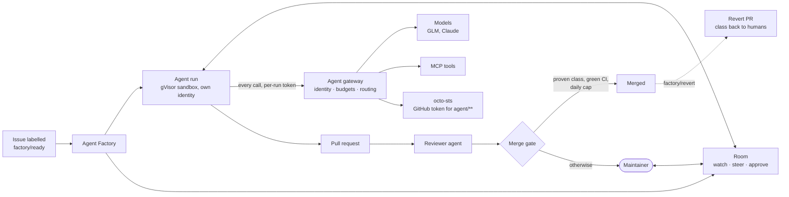

# ai-native-ref

**The Agent Factory, a governed agent platform, and open-weights model serving, on your own Kubernetes cluster,
deployed with GitOps.**

Label a GitHub issue and agents take it from there. An implementer works it in a sandbox under its
own identity and budget, a reviewer checks the result, and a pull request comes out. You follow
every step live, steer it, or stop it. Low-risk changes merge themselves; everything else waits for a
human. Beside the agents, the cluster can serve open-weights models on its own GPUs behind an
OpenAI-compatible endpoint, for your editor or chat client.

This repository is the deployable platform (Flux manifests, policies, alerts, dashboards), its
documentation and its runbooks. Documentation: **[airef.ogenki.io](https://airef.ogenki.io/)**.

## Why it exists

Getting a coding agent to write code is the easy part now. The hard part is **letting agents run
unattended on real repositories**: without leaking credentials or data, without runaway spend,
without a human reading every line, and with a way back when one gets it wrong.

Hosted agents solve this inside a vendor's cloud: the agent loop, the model calls and your code go
there. Self-hosted options are either licensed products, or general agent runtimes that know nothing
about pull requests, reviews or merges. **ai-native-ref is an open reference for the missing piece:
the Agent Factory, an agent platform you run yourself, whose every control is declared in Git and enforced outside the
agent.**

It is built to be read as much as run. Each design choice has an architecture decision record, each
feature a runbook with its live proof, and the [status page](https://airef.ogenki.io/docs/platform/ai-platform/status/)
says what works today, what does not yet, and what it costs.

## What you gain

| Benefit | How |
|---|---|
| **Your data stays where you decide** | Public work runs on open-weights models (Z.ai GLM); internal work on Claude through a key only the gateway holds. Nothing reaches a model except through the gateway, and an internal run has no network egress at all |
| **Spend you can cap, not just watch** | Each run is capped in dollars, cache reads priced at their own rate; the gateway refuses calls over a run's, the fleet's or a provider's budget with a `429`. Most tasks finish in 10–40 steps for under $0.20 |
| **Safety that does not depend on the agent** | The agent is never trusted. One gVisor sandbox per run, default-deny network policy, no long-lived credential, a GitHub token valid only for its own `agent/**` branch, rulesets on branches and tags, and a kill switch |
| **Autonomy you earn, one class at a time** | Only a change class proven by a live drill may merge without a human, today Markdown link fixes, at most once a day. A revert, asked with one label, sends the class back to human review |
| **A human in the loop when you want one** | Rooms: a shared live log of each task where people watch, post, steer the running agent and approve its actions, from a browser, a terminal or their own coding agent. A run waiting on a person gives up its pod and resumes with the same workspace and conversation |
| **Everything visible** | Per-run traces, step logs, token and cost metrics, alerts on budget overruns and refusals, and Grafana dashboards for one run or the whole fleet |
| **Reproducible and auditable** | Every manifest in Git, every release a cosign-signed OCI artifact pinned by digest, every claim on the status page linked to its evidence |

## Design principles

- **Controls live outside the sandbox.** Network policy, identity, token scope, budgets and the merge
  gate do not ask the agent to behave.
- **Measure in dollars, judge on outcomes.** Budgets are in USD, and a change to the factory is
  judged by acceptance rate and cost per accepted pull request.
- **Autonomy is earned with evidence.** A feature is "landed" only after a live proof; a change class
  merges alone only after a drill, and keeps a revert breaker.
- **GitOps all the way.** Flux applies a signed artifact; the cluster runs exactly what the Git
  history says.
- **Say what does not work.** Failures are recorded beside successes, on the same pages.

## What you get

| Part | What it does |
|---|---|
| **Agent Factory** | A labelled issue becomes a task. Agents in roles (implementer, reviewer, tester, triager) work it on one `agent/**` branch and open a pull request. The factory narrates each step on the issue, meters every run, and serves several repositories, each fenced to one factory. The Agent Factory is a bundle of open-source tools (Maku, agentgateway, OpenHands, gVisor, octo-sts, RunLore, Kueue and others); [Maku](https://github.com/Smana/maku) is one of them: the controller, rooms, harness and bridge, the Slack app and the `maku` CLI |
| **Sandboxed runtime** | One gVisor pod per run, with a default-deny network policy, egress only to the hosts its profile allows, and a short-lived GitHub token scoped to its own branch |
| **Rooms** | The append-only log of each task: watch, post, steer, approve, with approval deadlines and suspend while a person decides |
| **Agent gateway** | Every model and tool call of a run goes through [agentgateway](https://agentgateway.dev): it checks the run's identity, enforces token budgets per run, fleet and provider, and routes to the model its tier names |
| **Merge gate** | A policy bot and a merger App: a change class merges alone only with green CI, the head pinned to the commit it decided on, a daily cap, and a revert breaker |
| **Model serving** (off by default) | [vLLM](https://github.com/vllm-project/vllm) on L4 GPUs behind Envoy AI Gateway, one Crossplane claim per model, for OpenCode, Continue and OpenWebUI |
| **Observability** | Traces, step logs, token and cost metrics, budget alerts, and fleet and per-run dashboards |

## One task, end to end



## What has been measured

| Result | Detail |
|---|---|
| Routine tasks are cheap | Most runs take 10–40 steps and cost under $0.20; about 95% of their input is read from the prompt cache |
| Vague tasks are the expensive ones | An open "find out why" task spent its whole $2.55 budget on 319 search steps and pushed nothing: a bounded task is the cheapest optimisation |
| On hard issues, the model is the limit | On 15 harder issues, Claude Code on Claude got 13 pull requests accepted; on GLM-5.3, our factory and Claude Code alike got none. The harness was not the bottleneck |
| Unattended merge works, and so does its rollback | A link-fix pull request merged with no human at the head the gate decided; a revert by label demoted the class back to review |
| Budgets refuse for real | A run over its budget gets `429 agent_budget_exhausted`, and the refusal alert fires within two minutes |

Sources and the full record: [status](https://airef.ogenki.io/docs/platform/ai-platform/status/),
[routing and cost](https://airef.ogenki.io/docs/platform/ai-platform/routing/),
[harness tuning](https://airef.ogenki.io/docs/platform/ai-platform/agents/tune/harness/).

## Status and roadmap

**v3 is built**: Maku v0.32.3 (CRD group `maku.ogenki.io`), with the harness and bridge on v0.32.3
through crossplane-configuration v0.9.31. The v3.0.0 release is still a draft. v3 aims at more accepted pull requests per dollar by shaping the task, not
by changing the model. A scoper bounds each issue or asks its author; a test-first tester writes the
contract; the implementer runs the repository's checks in the sandbox and asks a read-only search
tool; a completion judge reads the result against its checks; a splitter proposes parts for a task
too big for one pull request. Work arrives from a label, Slack, your coding agent (Claude Code,
OpenCode) or RunLore, whose alerts come back as verified fixes.

All of it was proven live on `gcp-0` from 2026-10-27 to 2026-10-29, with capability profiles and
Kimi K3.1 Pro for public work; Mistral works through the gateway but is not recommended as an
implementer. `gcp-0` was torn down on 2026-10-29. The factory runs on `aws-0` since 2026-10-30, where
the human path was proven live: a maintainer's approval of the current head is the merge, a
regression pauses a class and three clean merges lift it, and `dead-links` was drilled once (merged,
then reverted by the merger itself with no human). Auto-merge is live for Markdown link fixes only;
`dead-links` and `deps-patch` run in shadow, `deps-minor` in observe. Every line, with its evidence and runbook:
[status page](https://airef.ogenki.io/docs/platform/ai-platform/status/#roadmap).

We are **on the road to a dark factory**, one proven lane at a time: today a human writes the issue
and approves, the approval being the merge, for most work, and one class ships with no human at all. What that means and
where we stand: [status and roadmap](https://airef.ogenki.io/docs/platform/ai-platform/status/#dark-factory).

## How it compares

| | Hosted coding agents | Licensed self-hosted | Agent runtimes on Kubernetes | **ai-native-ref** |
|---|---|---|---|---|
| Agent loop and model calls in your cluster | No: the vendor's cloud | Yes | Yes | **Yes** |
| Open source | No | No | Yes | **Yes** |
| Knows issues, reviews and merges | Yes | Yes | No | **Yes** |
| Spend caps | Per session or per day | Varies | No | **In USD per run, task and fleet, at a gateway you host** |
| Short-lived identity per run | Varies | Varies | Varies | **Yes** |
| Auto-merge by risk class, with a revert breaker | No | No | No | **Yes** |
| Declared in Git, signed releases | No | No | Partly | **Yes** |

Examples of each family, and the evidence behind this table, are in the
[v3 roadmap design](docs/superpowers/specs/2026-10-19-v3-roadmap-design.md#what-the-field-says-research-2026-10-19).

## What it runs on

The platform does not build its own cluster. It runs on a **host**: a Kubernetes cluster that
already provides Flux, Cilium, Gateway API, OpenBao, External Secrets, cert-manager, Crossplane,
an identity provider and the Victoria observability stack. The host and this repository agree on
a written [host contract](HOST-CONTRACT.md): what the host provides, and what this repository
guarantees back.

The reference host is [cloud-native-ref](https://github.com/Smana/cloud-native-ref), a GitOps
platform on GKE and EKS. The controllers, the room broker and the agent harness are built in
[Maku](https://github.com/Smana/maku), the software the Agent Factory runs on; this repository deploys their released
images. Installing on any Kubernetes cluster without that host is on the roadmap, after v3.

## Repository layout

| Directory | Holds |
|---|---|
| `clusters/<cluster>-{ai-gateway,llm-platform,agent-platform}/` | The children of each of the host's three opt-in umbrellas |
| `infrastructure/`, `security/`, `tooling/`, `observability/`, `apps/` | What those children apply |
| `flux/sources/` | The AI-owned Flux sources, applied by the `ai-sources` child |
| `website/` | The docs site, [airef.ogenki.io](https://airef.ogenki.io/), and the AI ADRs (the next is 0060) |
| `scripts/ops/`, `scripts/docs/` | Factory ops: `task agent:run`, `task agentgateway:live-check`, `task factory:walkthrough`, the identity probe, the cohort sheet |
| `docs/` | Runbooks, specs and plans, and the drawio sources of the diagrams |

## Turning it on in a cluster

Each `v*` tag is a cosign-signed OCI artifact, `ghcr.io/smana/ai-native-ref:<tag>`. The host defines
`OCIRepository/ai-native-ref` in `flux-system`, pinned by digest and suspended by default, and the
children read it (`sourceRef: {kind: OCIRepository, name: ai-native-ref}`). Opting in on a cluster:

```bash
flux resume source oci ai-native-ref
flux resume kustomization ai-gateway
flux resume kustomization llm-platform
flux resume kustomization agent-platform
```

Verifying a release:

```bash
cosign verify ghcr.io/smana/ai-native-ref:<tag> \
  --certificate-identity-regexp '^https://github\.com/Smana/ai-native-ref/\.github/workflows/release\.yaml@refs/tags/v.*$' \
  --certificate-oidc-issuer https://token.actions.githubusercontent.com
```

## Validating a change

```bash
task check   # builds the host profile, then runs the host's gates on it
```

CI renders this tree inside cloud-native-ref at the commit in `HOST_REF`, so a change here is judged
by the same gates the host applies to its own tree.

## Support this work

One person maintains this repository and pays for the AWS, GCP and model-API time its live sessions
need; [sponsoring it](https://github.com/sponsors/Smana) helps cover that.

## License

[Apache-2.0](LICENSE).
