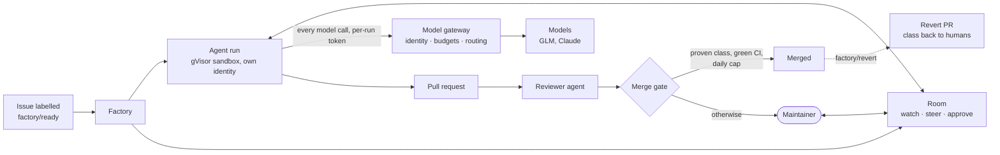

# ai-native-ref

This repository deploys a self-hosted coding-agent platform ([Maku](https://github.com/Smana/maku))
and optional open-weights model serving onto a Kubernetes cluster managed with GitOps, on top of the
[Cloud Native Reference](https://github.com/Smana/cloud-native-ref) host contract. It ships the Flux
manifests, admission and network policies, merge-gate resources, alerts, dashboards, runbooks and
documentation ([airef.ogenki.io](https://airef.ogenki.io/)).

## What you get

| Capability | How | What it replaces |
|---|---|---|
| **Governed tasks and pull requests** | Label an issue, mention Slack or hand off from your coding agent; roles implement and review on an `agent/**` branch | Agent runtimes that know nothing about issues, reviews or merges |
| **Controls outside the sandbox** | One gVisor pod per run, default-deny network policy, egress proxy, short-lived per-run GitHub tokens, branch rulesets and a kill switch | Hosted coding agents in a vendor cloud, or prompts that ask an agent to behave |
| **Model gateway and USD budgets** | Every call goes through [agentgateway](https://agentgateway.dev) with per-run identity, routing by data class, and dollar caps per run, task and fleet | Unmetered API keys inside agent pods or session-only vendor limits |
| **Attended rooms** | Shared append-only log per task where you watch live, steer the running agent and approve actions before their deadline | Opaque background jobs with no live steering or audit trail |
| **Earned auto-merge** | A `MergePolicy` bound `live` merges unattended under daily caps and a revert breaker; every other pull request merges on your approval | Manual merge of routine fixes, or unguarded auto-merge without rollback |
| **Self-hosted model serving** | Opt-in [vLLM](https://github.com/vllm-project/vllm) on GPUs behind Envoy AI Gateway, declared as one claim per model for editors and chat | Vendor-only model endpoints for internal or latency-sensitive workloads |
| **GitOps and observability** | Signed OCI releases applied by Flux, plus per-run traces, step logs, token and dollar metrics, alerts and Grafana dashboards | Hand-configured agents with no reproducible state or per-run cost trail |

Measured run costs, cache read shares and acceptance figures live in the
[cost snapshot](docs/superpowers/specs/2026-10-18-cost-snapshot.md).

## One task, end to end



## Try it

- [Maku quickstart](https://github.com/Smana/maku/blob/main/docs/quickstart.md) — run the loop on your laptop from a labelled issue to a pull request in about 15 minutes.
- [Get started](https://airef.ogenki.io/docs/get-started/) — see how the platform fits onto a Kubernetes host.
- [User guide](https://airef.ogenki.io/docs/use/guide/) — file tasks, follow rooms, steer runs and merge pull requests.

## Status

What is available, experimental or planned, the pinned Maku release, and which cluster is active live on the
[status page](https://airef.ogenki.io/docs/status/).

## Repository layout

| Directory | Holds |
|---|---|
| `clusters/<cluster>-{ai-gateway,llm-platform,agent-platform}/` | Children of each of the host's three opt-in Flux umbrellas |
| `infrastructure/`, `security/`, `tooling/`, `observability/`, `apps/` | Manifests, policies, factory resources, alerts and dashboards those children apply |
| `flux/sources/` | AI-owned Flux sources applied by the `ai-sources` child |
| `website/` | Documentation site ([airef.ogenki.io](https://airef.ogenki.io/)) and architecture decision records |
| `scripts/` | CI gates and operator helpers (`task agent:run`, `task factory:walkthrough`) |
| `docs/` | Runbooks, design specs, plans and architecture diagram sources |

## Turning it on in a cluster

A host built from [cloud-native-ref](https://github.com/Smana/cloud-native-ref) pulls each signed release as `OCIRepository/ai-native-ref`; the [host contract reference](https://airef.ogenki.io/docs/reference/host-contract/) documents the contract and the commands that resume the umbrellas.

## Validating a change

```bash
task check   # builds the host profile, then runs the host's gates on it
```

CI renders this tree inside cloud-native-ref at the commit in `HOST_REF`, so every change passes the
host's own manifest, schema, policy and documentation gates.

## Support this work

One person maintains this repository and pays for the cloud and model-API time its live sessions
use; [sponsoring it](https://github.com/sponsors/Smana) helps cover that.

## License

[Apache-2.0](LICENSE).
