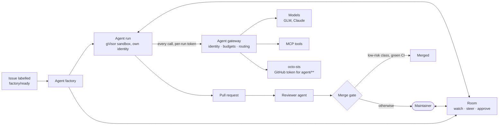

# ai-native-ref

**Coding agents and open-weights models on your own Kubernetes cluster, deployed with GitOps.**

Label a GitHub issue and an agent picks it up: it works in a sandbox under its own identity and
budget, opens a pull request, and a second agent reviews it. You follow it live, steer it, or stop
it. Beside the agents, the cluster can serve open-weights models on its own GPUs behind an
OpenAI-compatible endpoint, for your editor or chat client.

This repository is the deployable platform (Flux manifests, policies, dashboards), its
documentation and its runbooks. Documentation: **[airef.ogenki.io](https://airef.ogenki.io/)**.

## What you get

| Part | What it does for you |
|---|---|
| **Agent factory** | A labelled issue becomes a task. Agents in roles (implementer, then reviewer) work it on an `agent/**` branch and open a pull request. The factory narrates each step on the issue, meters every run and has a kill switch |
| **Sandboxed runtime** | One gVisor pod per run, with a default-deny network policy, no long-lived credential and a short-lived GitHub token scoped to its own branch |
| **Rooms** | A shared, append-only log of each task. Humans watch it live, post into it, steer the running agent and approve its actions, from a browser, a terminal or their own coding agent |
| **Agent gateway** | Every model and tool call of a run goes through [agentgateway](https://agentgateway.dev): it checks the run's identity, meters its tokens against budgets and routes to the model its tier names (GLM, Claude) |
| **Merge gate** | Only low-risk change classes, with green CI, may merge themselves. Everything else waits for a human |
| **Model serving** (off by default) | [vLLM](https://github.com/vllm-project/vllm) on L4 GPUs behind Envoy AI Gateway, one Crossplane claim per model, for OpenCode, Continue and OpenWebUI |
| **Observability** | Per-run traces, step logs, token and cost metrics, and Grafana dashboards for one run or the whole fleet |

## One task, end to end



The agent itself is never trusted. Every control sits outside its sandbox: network policy, per-run
identity, scoped short-lived tokens, branch and tag rulesets, token budgets and the merge gate.

## Status

v1 shipped on 2026-10-08 as a pilot: one public repository, and a human merges every pull request.
v2, now in progress, adds live auto-merge of low-risk changes, a second repository, enforced spend
caps, and suspend/resume for runs waiting on a human. What is proven live, and on which cluster, is
on one page: [Status and roadmap](https://airef.ogenki.io/docs/platform/ai-platform/status/).

## What it runs on

The platform does not build its own cluster. It runs on a **host**: a Kubernetes cluster that
already provides Flux, Cilium, Gateway API, OpenBao, External Secrets, cert-manager, Crossplane,
an identity provider and the Victoria observability stack. The host and this repository agree on
a written [host contract](HOST-CONTRACT.md): what the host provides, and what this repository
guarantees back.

The reference host is [cloud-native-ref](https://github.com/Smana/cloud-native-ref), a GitOps
platform on GKE and EKS. The controllers, the room broker and the agent harness are built in
[agent-platform](https://github.com/Smana/agent-platform); this repository deploys their released
images.

## Repository layout

| Directory | Holds |
|---|---|
| `clusters/<cluster>-{ai-gateway,llm-platform,agent-platform}/` | The children of each of the host's three opt-in umbrellas |
| `infrastructure/`, `security/`, `tooling/`, `observability/`, `apps/` | What those children apply |
| `flux/sources/` | The AI-owned Flux sources, applied by the `ai-sources` child |
| `website/` | The docs site, [airef.ogenki.io](https://airef.ogenki.io/), and the AI ADRs (the next is 0059) |
| `scripts/ops/`, `scripts/docs/` | Agent-factory ops: `task agent:run`, `task agentgateway:live-check`, `task factory:walkthrough`, the identity probe, the cohort sheet |
| `docs/` | Runbooks, specs and plans, and the drawio sources of the diagrams |

## Turning it on in a cluster

Each `v*` tag is a cosign-signed OCI artifact, `ghcr.io/smana/ai-native-ref:<tag>`. The host defines
`OCIRepository/ai-native-ref` in `flux-system`, pinned by digest and suspended by default, and the
children read it (`sourceRef: {kind: OCIRepository, name: ai-native-ref}`). Opting in on a cluster:

```bash
flux resume source oci ai-native-ref
flux resume kustomization ai-gateway
flux resume kustomization llm-platform
flux resume kustomization agent-platform
```

Verifying a release:

```bash
cosign verify ghcr.io/smana/ai-native-ref:<tag> \
  --certificate-identity-regexp '^https://github\.com/Smana/ai-native-ref/\.github/workflows/release\.yaml@refs/tags/v.*$' \
  --certificate-oidc-issuer https://token.actions.githubusercontent.com
```

## Validating a change

```bash
task check   # builds the host profile, then runs the host's gates on it
```

CI renders this tree inside cloud-native-ref at the commit in `HOST_REF`, so a change here is judged
by the same gates the host applies to its own tree.

## License

[Apache-2.0](LICENSE).
