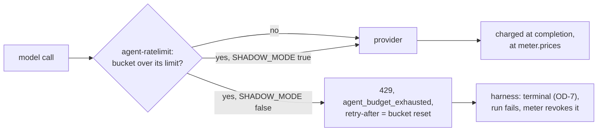

# 04 — Gateway, secrets and budgets

Two independent gateways are in scope here. **Part A (SP1)** proves that no provider key ever lands
in namespace `agents`, and that the `agents-secrets` OpenBao role reads the `agents` mount and
nothing else — plus the `internal`-listener half of SC-17 (an `internal` run has no route to Z.ai
at all), and that the agents' budgets B1–B2 count on agentgateway's own rate-limit server.
**Part D** turns those budgets from counting to refusing, behind one flag, refusing since 2026-10-18.
**Part B (SP4 PR 1)** proves the human/system Gateway's frontier route answers real chat
requests, its token usage is counted (in shadow mode, nothing is rejected on the real route), and a
route-level rate-limit policy actually fires a 429 when its bucket is exhausted — the mechanism
SP4's real budgets (still shadow-only) will use once enforcement ships. **Part E** covers the
cache-read share alerts and the offline proofs behind them. **Part F** is the live check of the
factory's daily caps in dollars, on the first day they run. See [README.md](README.md)
for prerequisites; run [00](README.md#runbook-00-one-time-cluster-setup) first.

## Prerequisites

- Runbook 00 done.
- **Owner action 2**: the agents' dedicated Z.ai key written to `agents/zai` — without it, Part A's
  `ExternalSecret` stays un-synced (harmless for this runbook's assertions, which are about denial and
  scope, but note it in the results table if it's missing).
- Part B needs the promptfoo API key from the `ai-gateway-promptfoo-key` Password generator (Step
  B.1). gcp-0 generates its gateway client keys in-cluster, so no AWS credentials are needed.

## Part A — `agents-secrets` scope (SC-10) and the internal listener (SC-17, listener half)

### Step 1 — confirm the store synced

```bash
flux get kustomizations -n flux-system | grep -E '^(agent-secrets|agent-router)[[:space:]]'
kubectl get secretstore -n agent-system agents-secrets -o jsonpath='{.status.conditions[0].status}{"\n"}'
kubectl get externalsecret -n agent-system agents-zai-api-key -o jsonpath='{.status.conditions[0].reason}{"\n"}'
```

> Corrected 2026-09-27: `flux get kustomization` only reads the first positional name; list-then-grep.

Expected: both `Ready=True`; `True`; `SecretSynced` (needs owner action 2).

### Step 2 — the gateway-name label exists (both data-plane CNPs depend on it)

The risk checked here: each CNP selects its proxy pods by a label the gateway controller sets, not
one this repo controls: `gateway.networking.k8s.io/gateway-name` for agentgateway
(`agent-router-data-plane` in `infrastructure/base/agent-gateway/network-policy.yaml`), Envoy
Gateway's `owning-gateway-name` for `ai-gateway`.

```bash
kubectl get pods -n agent-gateway -l gateway.networking.k8s.io/gateway-name=agent-router -o name
kubectl get pods -n envoy-gateway-system -l gateway.envoyproxy.io/owning-gateway-name=ai-gateway -o name
```

Expected: two `agent-router` pods (`replicas: 2` in `infrastructure/base/agent-gateway/parameters.yaml`)
and one `ai-gateway` pod. If either is empty, **stop** — the data-plane CNP for that Gateway selects
no proxy pod, Cilium then allows everything on the unselected side, and every 401/403 check in this
session is meaningless until it's fixed.

### Step 3 — SC-10: no key in `agents`, and the store's reach

> Note: the OpenBao capability probe (`bao write auth/jwt/$CLOUD-0/login ...`) mints a live OpenBao
> token via a `bao write` call. This session's rules forbid any write to OpenBao, so this half of
> the step is not run here — the owner must run it (see the Results table).

```bash
kubectl get secrets -n agents -o name | grep -vx secret/room-broker-ca | wc -l
kubectl apply --dry-run=server -f - <<'YAML'
apiVersion: external-secrets.io/v1
kind: ExternalSecret
metadata: {name: sc10, namespace: agents}
spec:
  secretStoreRef: {kind: ClusterSecretStore, name: openbao-platform}
  target: {name: sc10}
  data: [{secretKey: k, remoteRef: {key: llm/zai, property: api_key}}]
YAML
export VAULT_ADDR=https://bao.priv.$CLOUD.ogenki.io:8200 VAULT_CACERT=opentofu/$CLOUD/openbao/management/.tls/ca.pem
JWT=$(kubectl create token agents-secrets -n agent-system --audience openbao --duration 10m)
T=$(bao write -field=token auth/jwt/$CLOUD-0/login role=agents-secrets jwt="$JWT")
bao token capabilities "$T" agents/data/zai
bao token capabilities "$T" platform/data/agents/zai
bao token capabilities "$T" platform/data/llm/zai
bao token capabilities "$T" apps/data/anything
bao token revoke "$T"
```

Expected: `0` secrets in `agents` besides `room-broker-ca`; the `ExternalSecret` denied by
`agents-no-secret-import` (`namespace agents holds no secret: External Secrets objects are refused,
but for the room-broker-ca certificate`); `read`, `deny`, `deny`, `deny`.

**What this proves:** SC-10 — namespace `agents` holds no Secret but the room broker's CA
certificate (the one ExternalSecret the policy admits by name), cannot import another, and the
namespaced `agents-secrets` OpenBao role is scoped to exactly `agents/*` (never the old
`platform/agents/*` path, never `platform/llm/*`, never any other mount).

### Step 4 — SC-17, listener half: `internal` cannot reach Z.ai

```bash
kubectl apply -f "$AI_NATIVE_REF_DIR"/scripts/ops/k8s/agent-probe.yaml
kubectl wait -n agents sandbox/agent-probe --for=condition=Ready --timeout=10m
# The token substitution ($(cat ...)) runs INSIDE the pod's shell, so it never
# appears in this host's process list or shell history.
kubectl exec -n agents agent-probe -c probe -- sh -c "curl -s -o /dev/null -w 'internal chat %{http_code}\n' -H \"Authorization: Bearer \$(cat /var/run/secrets/probe/internal/token)\" -H 'content-type: application/json' -d '{\"model\":\"agent-default\",\"messages\":[{\"role\":\"user\",\"content\":\"hi\"}]}' http://agent-router.agent-gateway.svc.cluster.local:8081/v1/chat/completions"
curl -sS --cacert opentofu/$CLOUD/openbao/management/.tls/ca.pem https://vl.priv.$CLOUD.ogenki.io/select/logsql/query --data-urlencode \
  'query=kubernetes.pod_namespace:"agent-gateway" AND kubernetes.pod_labels.gateway.networking.k8s.io/gateway-name:"agent-router" _time:15m | unpack_json | log.x_ar_agent:"system:serviceaccount:agents:agent-probe" AND log.http.path:~"chat/completions" | stats by (log.http.status, log.route) count() hits'
```

Expected: `internal chat 404` — the Z.ai route (`agentgateway-models` in
`infrastructure/base/agent-gateway/llm.yaml`) attaches to the `public` listener only; `internal` is served by the direct Anthropic API (key in OpenBao,
gateway-injected; ADR-0054) once the agentgateway migration's phase I lands, with Bedrock/Vertex
optional per cloud. The internal route does not exist on this cluster yet. In
VictoriaLogs, a `404` row with an empty `log.route` and no row naming `agentgateway-models` (verify on
next run: the empty-route form is not yet recorded on agentgateway).

**What this proves:** SC-17 (listener half) — an `internal`-class run has no path to Z.ai whatsoever,
structurally (the route doesn't exist on that listener), not just by audience mismatch.

### Step 5 — the agents' budgets B1–B2 count on their own server

Agent budgets are not on `ai-gateway`'s rate limit (Part B): agentgateway's `token-budgets` policy
sends them to its own `agent-ratelimit` (`infrastructure/base/agent-gateway/ratelimit.yaml`), backed
by the Valkey `KVStore` `xplane-agent-ratelimit` (`kvstore.yaml`).

```bash
kubectl get kvstore -n agent-gateway xplane-agent-ratelimit
kubectl get pods -n agent-gateway -l app.kubernetes.io/name=agent-ratelimit
kubectl get deploy -n agent-gateway agent-ratelimit -o jsonpath='{.spec.template.spec.containers[0].env[?(@.name=="SHADOW_MODE")].value}{"\n"}'
kubectl get --raw "/api/v1/namespaces/observability/services/vmsingle-victoria-metrics-k8s-stack:8428/proxy/api/v1/query?query=sum%20by%20(key1)%20(ratelimit_service_rate_limit_total_hits%7Bnamespace%3D%22agent-gateway%22%7D)" | jq -c '.data.result[] | [.metric.key1, .value[1]]'
```

Expected: `READY True`; `Running 1/1`; `true` (the flag, [Part D](#part-d--enforcing-the-agents-budgets));
a `total_hits` series for `agent` (B1, per run) and `fleet_agents` (B2) once a run has made model
calls. While the flag is `true` nothing answers `429`. `AgentRateLimitDown` fires if the pod is gone;
the router then fails open (`failureMode: FailOpen` in `policy-budgets.yaml`).

**What this proves:** B1–B2 are metered per verified `sub` and fleet-wide, apart from the human
budgets B3–B5.

### Cleanup

```bash
kubectl delete -f "$AI_NATIVE_REF_DIR"/scripts/ops/k8s/agent-probe.yaml
```

## Part B — SP4 frontier route and budgets (200, then 429)

### Step 1 — get the promptfoo API key

```bash
LLM_API_KEY=$(kubectl get secret -n envoy-ai-gateway-system ai-gateway-api-keys -o jsonpath='{.data.promptfoo}' | base64 -d)
```

The Secret holds the keys `openwebui` and `promptfoo`. On gcp-0 the value comes from the
`ai-gateway-promptfoo-key` Password generator (`CreatedOnce`). Never echo `$LLM_API_KEY`.

An agent session's permission classifier may refuse this command (credential materialization). Steps
3–6 then need the owner's session; Step 2 does not need the key.

### Step 2 — check the budget policy and the rate-limit store are live

```bash
kubectl get kvstore -n envoy-gateway-system xplane-ai-gateway-ratelimit
kubectl get pods -n envoy-gateway-system -l app.kubernetes.io/name=envoy-ratelimit
kubectl get btp -n envoy-ai-gateway-system ai-gateway-token-budgets \
  -o jsonpath='{range .status.ancestors[*].conditions[*]}{.type}={.status} {.reason}{"\n"}{end}'
```

Expected: `READY True`; `Running 1/1`; `Accepted=True` (never `Conflicted` or `Invalid`).

### Step 3 — call the frontier route

```bash
curl -sS --cacert opentofu/$CLOUD/openbao/management/.tls/ca.pem https://llm.priv.$CLOUD.ogenki.io/v1/chat/completions -H "Authorization: Bearer $LLM_API_KEY" \
  -H "Content-Type: application/json" -H "x-ai-gateway-client-id: forged" \
  -d '{"model":"tier-frontier","messages":[{"role":"user","content":"Reply with the word ok"}]}' | jq '.model, .usage'
```

Expected: `"glm-5.3"` and a non-zero `usage` block — proves the `tier-frontier` route resolves to
Z.ai's GLM-5.3 (`modelNameOverride` in `infrastructure/base/llm-gateway/aigatewayroute.yaml`) through
the `/api/paas/v4` prefix, and that a client-supplied `x-ai-gateway-client-id`
is discarded (the real one comes from `apiKeyAuth`, stripped and re-set the same way `agent-router`
handles `x-ar-agent`).

### Step 4 — confirm token usage is attributed to the real client (via the API-server proxy, never a direct VM URL)

```bash
kubectl get --raw "/api/v1/namespaces/observability/services/vmsingle-victoria-metrics-k8s-stack:8428/proxy/api/v1/query?query=sum%20by%20(ar_client)%20(gen_ai_client_token_usage_sum%7Bgen_ai_original_model%3D%22tier-frontier%22%7D)" | jq .
```

Expected: a `promptfoo` series with a non-zero value, and **no** `forged` series.

**What this proves:** the SP4 frontier route works end to end and its usage counter attributes to the
verified client identity, not a client-forged header.

### Step 5 — tokens are charged, in shadow

```bash
kubectl -n envoy-gateway-system port-forward deploy/envoy-ratelimit 19001 &
sleep 2
curl -s localhost:19001/metrics | grep -E 'total_hits|shadow_mode' | head
kill %1
```

Expected: counters above 0 after Step 3. Record the exact metric names seen — the shadow-week
analysis before SP4 PR 7 (budget enforcement) reads them.

### Step 6 — marker probe: prove 429 actually fires

A temporary, route-level `BackendTrafficPolicy` overrides the Gateway-level one (still shadow mode)
on a header only this probe sends. Nothing else on the Gateway changes.

```bash
kubectl apply -f - <<'EOF'
apiVersion: gateway.envoyproxy.io/v1alpha1
kind: BackendTrafficPolicy
metadata:
  name: zz-budget-marker-probe
  namespace: llm-gateway
spec:
  targetRefs:
    - group: gateway.networking.k8s.io
      kind: HTTPRoute
      name: llm-gateway
  rateLimit:
    global:
      rules:
        - clientSelectors:
            - headers:
                - name: x-budget-probe
                  type: Exact
                  value: marker
          limit: {requests: 1, unit: Hour}
          cost:
            request: {from: Number, number: 0}
            response: {from: Metadata, metadata: {namespace: io.envoy.ai_gateway, key: llm_total_token}}
          shared: true
EOF
sleep 60   # Envoy needs about a minute to program the policy; earlier calls see no rate limit at all
for i in 1 2 3; do curl -sS --cacert opentofu/$CLOUD/openbao/management/.tls/ca.pem -o /dev/null -D - https://llm.priv.$CLOUD.ogenki.io/v1/chat/completions \
  -H "Authorization: Bearer $LLM_API_KEY" -H "Content-Type: application/json" -H "x-budget-probe: marker" \
  -d '{"model":"tier-frontier","messages":[{"role":"user","content":"ok"}]}' | grep -iE '^HTTP|x-ratelimit-(remaining|reset)'; done
kubectl delete btp -n llm-gateway zz-budget-marker-probe
```

Expected: `200`, `200`, then `429 Too Many Requests` with `x-ratelimit-remaining: 0`. The cost is
charged from the *response*, so the call that spends the budget still succeeds and the next one is
refused. Send three calls, not two. There is no `x-envoy-ratelimited` header: detect a budget cut-off
by status 429 (and `x-ratelimit-reset`), which is what the harness's 429 handling (`agent_run.py`)
does.

The bucket is keyed on the rule, not on the header value. A re-run within the hour inherits the spent
bucket and gives `429` from the first call: change the rule (for example its `limit`) for a fresh one.

**What this proves:** SP4's token-cost rate-limiting mechanism actually enforces (200 then 429) when
a rule is not in shadow mode — the three real rules in
`infrastructure/base/llm-gateway/btp-token-budgets.yaml` stay in shadow deliberately (ADR-0050); this
probe is the only way to see enforcement fire before SP4 PR 7 (budget enforcement) turns it on.

### Cleanup

```bash
unset LLM_API_KEY
kubectl delete btp -n llm-gateway zz-budget-marker-probe --ignore-not-found
```

## Part C — per-person caps, the shadow week

`budgets.perPerson.enabled: true` with `enforcePrincipal: false` charges every run to its person
(`github:<login>`) and to the fleet, and refuses nothing: a run past a day is admitted and counted
as `agent_factory_run_revocations_total{reason="budget-principal-shadow", principal}`
([Maku: per-person caps](https://github.com/Smana/maku/blob/main/docs/factory.md#per-person-caps)).
`AgentPersonCapShadowRefusal` (info) fires on each one. Turning on `enforcePrincipal` refuses on
the person's day **and** on the fleet's, so both count. Since Maku v0.16.0 (#168), pinned here at v0.17.1, the days are in
USD (`budgets.humanDailyUSD`, $8.50 a person), so the week's record starts again, in dollars.

### Step 1 — attribution is on

```bash
kubectl get --raw "/api/v1/namespaces/observability/services/vmsingle-victoria-metrics-k8s-stack:8428/proxy/api/v1/query?query=agent_factory_budget_spent_usd%7Bprincipal%3D~%22github%3A.%2B%22%7D" | jq -c '.data.result[] | [.metric.principal, .value[1]]'
```

Expected, once a labelled task has run: a `github:<login>` row, that person's spend today in USD.
None means no run was charged to a person, and an empty Step 2 proves nothing.

### Step 2 — after 7 days

```bash
kubectl get --raw "/api/v1/namespaces/observability/services/vmsingle-victoria-metrics-k8s-stack:8428/proxy/api/v1/query?query=sum%20by%20(principal)%20(increase(agent_factory_run_revocations_total%7Breason%3D%22budget-principal-shadow%22%7D%5B7d%5D))" | jq -c '.data.result[] | [.metric.principal, .value[1]]'
```

The query, decoded: `sum by (principal) (increase(agent_factory_run_revocations_total{reason="budget-principal-shadow"}[7d]))`.

| Exit criterion (D8) | Then |
|---|---|
| 7 days since the release went live, Step 1 shows a person, and every Step 2 row is a run that *should* have been refused | Set `enforcePrincipal: true` |
| A row is a false refusal: the wrong person charged, or a day filled by reservations the meter later released | Fix in Maku; the week restarts |
| Rows are correct but frequent for one person | Raise `perPerson.dailyUSD` (default `humanDailyUSD`) before enforcing; the week restarts |

## Part D — enforcing the agents' budgets

The gateway's budgets are a backstop under the factory's own caps: they hold if the factory
misbehaves, and they never refuse a call the factory would admit. One flag turns them from
counting to refusing: `SHADOW_MODE` on the `agent-ratelimit` Deployment
(`infrastructure/base/agent-gateway/ratelimit.yaml`). It is `"false"` in the source since
2026-10-18 ([#65](https://github.com/Smana/ai-native-ref/pull/65)), so a rebuild refuses too. No
descriptor sets its own `shadow_mode` (gate AG8), so the flip is one line.

| Bucket | Key | Limit per day (reference tokens, $1.70/M) | The factory's cap it sits above |
|---|---|---|---|
| B1 | `agent`, the verified `sub`: one run | 5M ($8.50) | the dearest tier's run cap: `frontier` `runUSD` $6.80 (4M) and `runTokens` 4M |
| B2 | `fleet_agents` | 41M ($69.70) | `budgets.factoryDailyUSD` $42.50 (25M) plus `caps.concurrentRuns` 4 runs at 4M |
| B6 | `provider_anthropic`, the `internal` listener | 10M ($17) | none: a provider cap the factory does not know |

Each call is charged at completion at the run meter's own price (`meter.prices`, the same table and
formula), so a cache read costs its cache rate. Gate AG8 regenerates the policy's cost expression
from `meter.prices` and checks B1 and B2 against the factory's values: a price or a cap that moves
alone fails `task check`. A model without a price row is charged its raw tokens, as in the meter.



The call that crosses a limit completes; the next one is refused. The refusal is a `429` with
`x-ratelimit-limit`, `x-ratelimit-reset`, `retry-after` and a body the harness logs:

```json
{"error":{"type":"rate_limit_error","code":"agent_budget_exhausted","message":"agent-router refused this call: a gateway token budget is spent (limit 5000000, resets in 12877 s). Not retryable."}}
```

The limit names the bucket (the table above, or 40,000,000 for the per-replica local limit, which
always refuses and uses the same body). A provider's own `429` keeps its body and logs
`reason: Upstream`, never `RateLimit`.

| Signal | Mode | Meaning |
|---|---|---|
| `agent_router:budget_shadow_overrun_tokens:increase10m{key1}` → `AgentBudgetShadowOverrun` (info) | shadow | reference tokens admitted over a bucket's limit |
| `agent_router:budget_refused_tokens:increase10m{key1}` → `AgentBudgetRefused` (warning) | enforcing | reference tokens over a budget while `global_shadow_mode` stands still: that bucket's next calls get `429`. Read from the ratelimit service, since agentgateway records no series for a ratelimit `429` ([#81](https://github.com/Smana/ai-native-ref/issues/81)) |

### Step 1 — read the mode

```bash
kubectl get deploy -n agent-gateway agent-ratelimit -o jsonpath='{.spec.template.spec.containers[0].env[?(@.name=="SHADOW_MODE")].value}{"\n"}'
```

Expected: `false`, since 2026-10-18.

### Step 2 — the shadow record

```bash
kubectl get --raw "/api/v1/namespaces/observability/services/vmsingle-victoria-metrics-k8s-stack:8428/proxy/api/v1/query?query=sum%20by%20(key1)%20(increase(ratelimit_service_rate_limit_over_limit%7Bnamespace%3D%22agent-gateway%22%7D%5B7d%5D))" | jq -c '.data.result[] | [.metric.key1, .value[1]]'
```

Decoded: `sum by (key1) (increase(ratelimit_service_rate_limit_over_limit{namespace="agent-gateway"}[7d]))`.
Each row is a bucket that went over. For an `agent` row, find the run on the agent-gateway dashboard
and compare its cost with its tier's `runUSD`.

| Exit criterion | Then |
|---|---|
| A week of real runs, and no row is a run under its factory caps | Flip (Step 3) |
| A row is a run under its caps | A false refusal: fix the price or the limit; AG8 should have caught it, so add the case to its test |
| No run reached the gateway in the week | The record proves nothing; wait |

### Step 3 — flip the flag (owner)

In ai-native-ref, `infrastructure/base/agent-gateway/ratelimit.yaml`: `SHADOW_MODE` `"true"` →
`"false"`. Release, then bump the pin in cloud-native-ref. The Deployment rolls; its one replica
restarts and the router fails open for those seconds. Roll back with the same line.

### Step 4 — prove a refusal live

With the flag `false`, give the probe a 1-token bucket of its own, call twice, put the config back.
A descriptor with a `value` wins over the key-only one for that `sub`.

```bash
flux suspend kustomization agent-gateway -n flux-system
kubectl get cm -n agent-gateway agent-ratelimit-config -o jsonpath='{.data.config\.yaml}' > /tmp/rl.yaml
{ cat /tmp/rl.yaml; printf '  - key: agent\n    value: system:serviceaccount:agents:agent-probe\n    rate_limit: {unit: hour, requests_per_unit: 1}\n'; } \
  | kubectl create cm -n agent-gateway agent-ratelimit-config --from-file=config.yaml=/dev/stdin --dry-run=client -o yaml | kubectl apply -f -
sleep 90   # the kubelet syncs the ConfigMap, then the server reloads it
kubectl apply -f "$AI_NATIVE_REF_DIR"/scripts/ops/k8s/agent-probe.yaml
kubectl wait -n agents sandbox/agent-probe --for=condition=Ready --timeout=10m
for i in 1 2; do kubectl exec -n agents agent-probe -c probe -- sh -c "curl -s -o /dev/stderr -w '%{http_code}\n' -H \"Authorization: Bearer \$(cat /var/run/secrets/probe/public/token)\" -H 'content-type: application/json' -d '{\"model\":\"agent-default\",\"messages\":[{\"role\":\"user\",\"content\":\"ok\"}]}' http://agent-router.agent-gateway.svc.cluster.local:8080/v1/chat/completions"; done
flux resume kustomization agent-gateway -n flux-system   # restores the ConfigMap
kubectl delete -f "$AI_NATIVE_REF_DIR"/scripts/ops/k8s/agent-probe.yaml
```

Expected: `200`, then `429` with the `agent_budget_exhausted` body, `limit 1`. Within 2 minutes
the meter's throttle query (plan F.4) returns the probe's `x_ar_agent`, and `AgentBudgetRefused`
fires for `key1="agent_system_serviceaccount_agents_agent-probe"`. With the flag `true` the second call is a
`200` and `ratelimit_service_global_shadow_mode` rises instead.

**What this proves:** the flag refuses a call over budget with a reason the harness logs, and
only that `sub`'s bucket is touched.

## Part E — the cache-read share

Internal runs read about 85% of their input from Anthropic's prompt cache; a step that reads
nothing costs 20× a cached token per token, and an uncached run about 4× a cached one. The marker that makes it work crosses two repositories: the
harness rewrites the SDK's `cache_control` as `prompt_cache_breakpoint`, and agentgateway converts it
back on the way to Anthropic ([cache design](../../superpowers/specs/2026-10-21-prompt-cache-design.md)).

| Alert | Means | Do |
|---|---|---|
| `AgentCacheReadZero` (critical) | An internal run read nothing after 100k input tokens | Read the run's log for `prompt cache NOT applied`. None: the gateway stopped converting the marker, or the harness or SDK stopped sending it. If `test-agent-gateway-cache-wire` passes on the deployed digest, the gateway converts: look at the last harness pin change. A run whose steps are all more than 5 minutes apart also reads nothing (the cache lives 5 minutes). Stop a long run: `kubectl annotate agentrun -n agents <name> agents.ogenki.io/revoked=budget-run` |
| `AgentCacheReadShareLow` | Under 60% over 15 minutes, with 200k input in the window | One window after a condensation or a resume is expected. If it stays low, read the run's MCP tool lists: a federated target that fails is dropped from the list and re-added, and each change rewrites the cache |
| `AgentCacheMarkerMissing` | The harness could not patch the SDK | Roll the harness pin back; the patch in Maku's `sitecustomize.py` needs the SDK's new method |
| `AgentMeterInputExcludesCache` | The meter read a model's `input` below its cache tokens: a gateway or the provider stopped counting cache tokens inside `input`. The meter prices such a run right; the run's *Cost (USD)* panel and `AnthropicFleetNearCap` under-count it, down to a negative figure, and the cache-read share can read above 100% | Run `test-agent-gateway-cache-wire` against the deployed agentgateway digest: a failure on the streamed reply is the gateway. If it passes, read one reply's `usage` from the provider of the model the alert names. Until it is fixed, read money from `agent_factory_run_cost_usd` |

Offline, `task check` proves both sides: `test-agent-cache-alerts` evaluates the two metric alerts on
synthetic series, and `test-agent-gateway-cache-wire` runs the pinned agentgateway against a fake
Anthropic upstream and fails if the marker or the token series change, on a plain or a streamed
reply.
`test-agent-cost-rules` fires `AgentMeterInputExcludesCache` on the counter's first increment.

Live, at the next platform session: the share panel on the agent-gateway dashboard reads above 60%
for internal runs and neither alert fires. The drill (a run that sends no marker, through an
`agents.ogenki.io/cache-drill` annotation) waits for the loop-policy composition release.

## Part F — daily caps in dollars, the switch day

From Maku v0.16.0 (#168), pinned here at v0.17.1, the factory's daily caps count dollars at `meter.prices`
([truthful costs](../../superpowers/specs/2026-10-22-truthful-costs-design.md), TC5 to TC9). One
ConfigMap per UTC day, `agent-factory-ledger-usd-<YYYYMMDD>`, holds `spent` (principal → micro-USD),
`reserved.<runId>` (`maxMicroUSD`) and `settled.<runId>` (the micro-USD charged to that run that
day). The first day starts at $0: nothing is carried over from the token ledger. Offline, `task
check` holds the values, gates AG8 and AG10 and the alert (`test-agent-factory-budget-alerts`).
These steps are the live half, for the first platform session on the release. Not run yet.

### Step 1 — the factory reads the USD keys

```bash
kubectl logs -n agent-system -l app.kubernetes.io/name=agent-factory --prefix --tail=-1 | grep 'config key ignored'
```

Expected: nothing. A line names a token key the values still set, which AG8 should have failed.

### Step 2 — the day's ledger is in micro-USD and adds up

After at least one task run has ended today:

```bash
day=$(date -u +%Y%m%d)
kubectl get cm -n agent-system "agent-factory-ledger-usd-$day" -o json | jq '.data
  | {spent: (.spent | fromjson),
     settled: ([to_entries[] | select(.key | startswith("settled.")) | .value | tonumber] | add),
     reserved: [to_entries[] | select(.key | startswith("reserved.")) | .value | fromjson]}'
```

Expected: `spent` maps `system:factory`, and each `github:<login>` charged, to an integer; every
`reserved` entry carries `maxMicroUSD`. With only factory task runs that day, `spent["system:factory"]`
equals `settled`, the sum over the runs.

### Step 3 — a failover neither loses nor re-charges a run

While a task's run is running, delete the meter's leader:

```bash
holder=$(kubectl get lease -n agent-system agent-factory.agents.ogenki.io -o jsonpath='{.spec.holderIdentity}')
kubectl delete pod -n agent-system "${holder%%_*}"
```

When the run has ended, on the same UTC day:

```bash
task=<the task's name>; day=$(date -u +%Y%m%d)
kubectl get task -n agent-system "$task" -o json | jq -c '.status.runs[] | [.id, .costMicroUSD]'
kubectl get cm -n agent-system "agent-factory-ledger-usd-$day" -o json \
  | jq -c '.data | to_entries[] | select(.key | startswith("settled.")) | [.key, .value]'
```

Expected: the run's `settled.<id>` equals its `costMicroUSD`.

### Step 4 — the cap holds a task in dollars, and its alert fires

With no run in flight (an enforced day revokes a running run past it) and at least one run settled
today (the alert needs a spend above 80% of the drill's cap), lower the fleet's day to $0.01 and
enforce it, in place, as Part D Step 4 edits its ConfigMap:

```bash
flux suspend kustomization agent-factory -n flux-system
kubectl get cm -n agent-system agent-factory-helm-values -o jsonpath='{.data.values\.yaml}' > /tmp/values.yaml
sed -i 's/factoryDailyUSD: 42.50/factoryDailyUSD: 0.01/; s/enforcePrincipal: false/enforcePrincipal: true/' /tmp/values.yaml
kubectl patch cm -n agent-system agent-factory-helm-values --type merge \
  -p "$(jq -n --rawfile v /tmp/values.yaml '{data: {"values.yaml": $v}}')"
```

helm-controller upgrades the release on the change (the ConfigMap's watch label). Then label one
small issue `factory/ready`, and read:

```bash
kubectl get task -n agent-system -o custom-columns=NAME:.metadata.name,PHASE:.status.phase,REASON:.status.reason
kubectl get --raw "/api/v1/namespaces/observability/services/vmsingle-victoria-metrics-k8s-stack:8428/proxy/api/v1/query?query=agent_factory_budget_spent_usd%7Bprincipal%3D%22system%3Afactory%22%7D" | jq -c '.data.result[] | [.metric.pod, .value[1]]'
```

Expected: the new task is `Queued` with reason `waiting_daily_budget`; `AgentFactoryDailyBudgetHigh`
fires for `principal="system:factory"` within 6 minutes; the leader's
`agent_factory_budget_spent_usd{principal="system:factory"}` is Step 2's `spent["system:factory"]`
÷ 1e6. `enforcePrincipal: true` is part of the drill: while it is `false` the fleet's day is shadow
too, and the task would run and count `budget-principal-shadow`. Put the values back:

```bash
flux resume kustomization agent-factory -n flux-system   # restores the ConfigMap; the release upgrades again
```

## Part G — the cost cross-check

Two independent readings of a run's cost: the factory's ledger (`agent_factory_run_settled_usd{run}`,
the sum of the run's `settled` entries, kept 1 h after the run) and agentgateway's own counter
(`agentgateway_gen_ai_client_cost_usd_total`, priced from the `agent-model-catalog` overlay that
`gen-prices.py` renders from `meter.prices`). Design:
[cost cross-check](../../superpowers/specs/2026-10-27-cost-crosscheck-design.md). A disagreement warns
and nothing more: neither side is presumed right. The *Cost: ledger vs gateway* panel on the agent-run
dashboard and *Spend per UTC day: ledger vs gateway* on the factory dashboard show the two sides; the day
is also `scripts/ops/cost-crosscheck.py --day YYYYMMDD` (exit 1 outside the tolerance).

| Alert | Means | Do |
|---|---|---|
| `AgentCostCrossCheckMismatch` (warning) | A run whose gateway cost stopped moving 10 min ago differs from its ledger total by more than max(1 %, 0.01 USD), or the gateway priced spend the ledger never saw | Read the run's two figures, then the suspects below, in order |
| `AgentGatewayCostUnpriced` (warning) | A catalog lookup answered other than `Exact`: the call adds nothing to the gateway counter | `Missing` or `Unpriced`: the model has no row (or a zero rate) in `meter.prices`; add it, then `scripts/ci/gen-prices.py --write`. `NoCatalog`: `agent-model-catalog` is not mounted (`AgentgatewayParameters.spec.modelCatalog`) |

Which side is high decides the first suspect:

| Suspect | Reads as | Check |
|---|---|---|
| [maku#166](https://github.com/Smana/maku/issues/166), a double charge: a settle write answered 504 that commits later | Ledger above gateway by one tick's spend. Fixed in Maku v0.25.0; any recurrence is a new bug | The run's `settled.<id>` against `status.usage.costMicroUSD` on the task (Part F, step 3) |
| [maku#167](https://github.com/Smana/maku/issues/167), a lifted run's late spend lost across a failover | Ledger below gateway, by the run's last reading; only on a run first seen already ended, after a leader change | `kubectl get lease -n agent-system agent-factory.agents.ogenki.io`: did the holder change near the run's end? |
| A price row, in the table or the overlay | Both sides consistently off by the same ratio on one model | `scripts/ci/gen-prices.py` (exit 1 on drift); the catalog the proxy mounted against `meter.prices`; the run's *Cost by model* panel |
| An unpriced lookup | Ledger above gateway, with `AgentGatewayCostUnpriced` firing | Above |
| A run through Envoy | Left out of the alert by design (XC7); counted in the factory dashboard's *Runs outside the cross-check* | The router the run's gateway series belong to |
| Scrape loss | Gateway below ledger, a gap in `agentgateway_gen_ai_client_cost_usd_total` for the run's proxy pod | `up{namespace="agent-gateway"}` over the run's window; a proxy pod that died takes its last scrape with it |

The access log's `cost` attribute traces one request: `kubectl logs -n agent-gateway -l gateway.networking.k8s.io/gateway-name=agent-router | grep <run id>`.

Offline, `test-agent-cost-crosscheck-alerts` evaluates the rule and both alerts on synthetic series: an
agreeing run, 1.5 % off, a 0.005 USD gap on a 0.20 USD run, a run still spending, an Envoy run, gateway
cost with no ledger series, and a `Missing` lookup.

Live, at the next platform session: the drill. Double `output` for Opus in `agent-model-catalog`, in
place, under a suspended Kustomization (Part F's method); the next Opus run fires
`AgentCostCrossCheckMismatch` within 30 min; put the row back.

## A provider answers and the gateway returns 502

The run's model call fails with a 502 whose body says `invalid type: sequence, expected a string`.
Agentgateway parses a Chat Completions message's `content` as a string. Mistral, asked to reason (`reasoning_effort` other than `none`), returns `content` as a list of chunks. The transformation in `infrastructure/base/agent-gateway/mistral.yaml` sets `reasoning_effort` to `"none"`; Kimi is unaffected, its reasoning arrives in a separate `reasoning_content` string. The gateway's access log for the run shows the 502 on `/v1/chat/completions`.

## Results

> Every round below predates phase H (#2429): the agent rows ran on Envoy's agent-router in
> `envoy-gateway-system` and use its log fields. Part A Step 5 has no recorded round yet.

### D.4 enforcing — gcp-0, 2026-10-18

ai-native-ref `v0.1.19`, `SHADOW_MODE: "false"` (#65). The refusal holds; its alert does not fire
([#81](https://github.com/Smana/ai-native-ref/issues/81)).

| Step | Expected | Observed | Pass/Fail |
|---|---|---|---|
| D.1 — the mode | `false` | `false` | PASS |
| D.4 — a refusal | `200`, then `429` `agent_budget_exhausted`, `limit 1` | 18:24Z: `200` (`x-ratelimit-remaining: 1`), then `429` (`x-ratelimit-remaining: 0`, `retry-after: 2145`): "a gateway token budget is spent (limit 1, resets in 2145 s). Not retryable." The Kustomization resume put the ConfigMap back | PASS |
| D.4 — the alert | `AgentBudgetRefused` fires for the probe | Silent: `agentgateway_requests_total` has no `reason="RateLimit"` or `429` series, so `agent_router:budget_refusals:increase10m` reads nothing; the ratelimit service's `over_limit` series for the probe is new, with one sample | FAIL ([#81](https://github.com/Smana/ai-native-ref/issues/81)); the rule now reads the ratelimit service: replayed on this run's data, it reads 918 for the probe at 18:26Z and 18:30Z |
| D.4 — the alert, re-run on `v2.0.1` (#84) | `AgentBudgetRefused` fires for the probe | 20:03:51Z: `200`, then `429`. `AgentBudgetRefused` **firing** at 20:05:00Z for `key1="agent_system_serviceaccount_agents_agent-probe"` (514 reference tokens), active in Alertmanager to `slack-monitoring` | PASS |

### D.4 alert re-run — gcp-0, 2026-10-18

The shadow variant of Step 4 again, after the alert fix (#52, pinned in cloud-native-ref since
ai-native-ref v0.1.14). The ratelimit pod had run since 2026-10-17 19:23Z, so the probe's series
already existed at 61: this proves the alert on a live series. The new-series case rests on #52's
`promtool` test and its replay on the 10-17 data.

| Step | Expected | Observed | Pass/Fail |
|---|---|---|---|
| D.1 — the mode | `true` | `true` | PASS |
| D.4, shadow variant | `200`, `200`; the shadow counters rise | `200` (`x-ratelimit-remaining: 1`), then `200` (`x-ratelimit-remaining: 0`), 08:38Z. `over_limit{key1="agent_system_serviceaccount_agents_agent-probe"}` 61 → 1,693, `global_shadow_mode` 3 → 6, no 429. The Kustomization resume put the ConfigMap back (no probe descriptor) | PASS |
| D.4, the alert | `AgentBudgetShadowOverrun` fires | `agent_router:budget_shadow_overrun_tokens:increase10m` = 1,632 (exactly 1,693 − 61); `ALERTS{alertname="AgentBudgetShadowOverrun", key1="…agent-probe"}` `firing` at 08:42Z, within 4 minutes | PASS |

### Parts C and D — gcp-0, 2026-10-17 (compressed same-day test)

Each shadow week ran as a deliberate same-day test, by the owner's choice, because a week-long
platform costs too much. The record covers six real `solo` tasks (19:56–21:35 UTC, one person,
Maku v0.15.2). That is enough to show that nothing is wrongly refused. It is too short
to show how often a real week would cross a limit, so the D8 exit criterion ("7 days") is **not**
met: this round only shows the mechanism works.

| Step | Expected | Observed | Pass/Fail |
|---|---|---|---|
| C.1 — attribution | a `github:<login>` row | `agent_factory_budget_remaining_tokens{principal="github:smana"}` 4,047,669 of 5,000,000. The 952,331 spent is exactly the six tasks' meter totals (92,486–192,697 each); `system:factory` shows the same spend | PASS |
| C.2 — shadow refusals on real runs | rows only for runs that should be refused | No `agent_factory_run_revocations_total` series at all; `AgentPersonCapShadowRefusal` healthy, inactive | PASS (zero) |
| D.1 — the mode | `true` | `true` | PASS |
| D.2 — shadow record on real runs | no row for a run under its caps | `ratelimit_service_rate_limit_over_limit` had no real-run series: `agent` and `fleet_agents` only `within_limit` (189,248 and 189,310 reference tokens at 21:34); no `RateLimit` 429 | PASS (zero) |
| D.4, shadow variant | `200`, `200`; the shadow counters rise | A 1-token-per-hour bucket for `system:serviceaccount:agents:agent-probe`: `200` (`x-ratelimit-remaining: 1`), then `200` (`x-ratelimit-remaining: 0`). `over_limit{key1="agent_system_serviceaccount_agents_agent-probe"}` 61, `global_shadow_mode` 3, no 429. The Kustomization resume put the ConfigMap back (no probe descriptor) | PASS |
| D.4, the alert | `AgentBudgetShadowOverrun` fires | **Did not fire**: `agent_router:budget_shadow_overrun_tokens:increase10m` read `0` while `over_limit` held 61 | FAIL |

**Finding: the shadow alert misses an overrun on a new series.** `over_limit` and
`global_shadow_mode` are statsd counters, created at their first increment. A series therefore starts
at the call's whole overshoot, 61 here, and `increase()` counts nothing for a series that has no
earlier sample. So the first overrun of each bucket after a ratelimit pod starts is never alerted,
and neither is this runbook's probe. Every rollout and rebuild resets this. Comparing against
`offset 10m`, with the series' absence read as 0, returned `61` on the same data, as did MetricsQL's
`increase_pure()`. `promtool` cannot parse `increase_pure()`, so the rule should use the offset form.

**Sizing `perPerson.dailyTokens`:** today's metered usage was 0.95M tokens for six trivial docs
tasks, about 160k each. That is the floor a maintainer reaches by labelling small issues. A day of
real `pair` tasks runs at about 667k each (runbook 11's aws-0 round). Recommended: **keep 5,000,000**
(the `humanDaily` default). That is 5.3 × today and about seven real `pair` tasks, and it sits
under the fleet's 25M, so one person cannot spend the factory's day.

### Part D offline — agentgateway v1.6.0, 2026-10-16

Not a cluster: agentgateway v1.6.0 (the pinned digest), envoyproxy/ratelimit at
`ratelimit.yaml`'s digest and Valkey in containers, against a fake OpenAI upstream. The
configuration was rendered from this repository's `ratelimit.yaml`, `policy-budgets.yaml`,
`policies-identity.yaml` (public listener) and `llm.yaml` (`zai` aliases). Run A sent eight calls of
4M input tokens, 3.8M of them cache reads, and 50k output tokens: $1.488 at glm-5.3, or 875,294
reference tokens.

| Check | Observed | Pass/Fail |
|---|---|---|
| The charge is the meter's price | Valkey `agent-router_agent_<run A>` rose by 875,294 per call; `requests_per_unit` 5,000,000 | PASS |
| (a) shadow: over budget, admitted and counted | Calls 7 and 8 over B1: `200`; `over_limit{key1="agent"}` 2,002,352, `global_shadow_mode` 5 | PASS |
| (b) enforcing: refused | Calls 7 and 8: `429`, `retry-after`, the `agent_budget_exhausted` body; `agentgateway_requests_total{status="429",reason="RateLimit"}` | PASS |
| (c) another run within budget | Run B `200` beside run A's refusals | PASS |
| Step 4's probe descriptor | Run C with its own 1-token bucket: `200`, then `429`, `limit 1` | PASS |
| A provider's 429 | Body untouched, `reason="Upstream"` | PASS |
| A stream is not buffered | Four SSE events one second apart, as the upstream sent them; charged at its price | PASS |

### Round 7 — gcp-0, 2026-09-30 (`integration/agent-factory` @ `a2c645ba`)

| Step | Expected | Observed | Pass/Fail |
|---|---|---|---|
| A.1 — secrets synced | `Ready=True` ×2, `SecretSynced` | `agent-secrets` and `agent-router` `Ready=True`; SecretStore `agents-secrets` `True`; `agents-zai-api-key` `SecretSynced` | PASS | <!-- pragma: allowlist secret -->
| A.2 — gateway label | 1 pod each | `agent-router`: 2 pods (2 replicas); `ai-gateway`: 1 pod | PASS |
| A.3 — SC-10, cluster half | `0`; ExternalSecret denied | `0` secrets in `agents`. The server-side dry run of `sc10` was refused by `agents-no-secret-import`: `namespace agents holds no secret: External Secrets objects are refused (SP1 S9)` | PASS |
| A.3 — SC-10, OpenBao half | `read,deny,deny,deny` | Needs `bao write auth/jwt/gcp-0/login …`, which mints a token. This session holds no OpenBao token | [OWNER] |
| A.4 — SC-17 listener half | `404`; no `zai` on 8081 | `internal chat 404`; VictoriaLogs: 2 hits on port 8081 in 15 min, both with a null `upstream_cluster` | PASS |
| B.1 — promptfoo key | key fetched, never echoed | Length 48, never printed. The Secret's key is `promptfoo`, not `promptfoo_apikey` as this runbook says (`ai-gateway-api-keys` holds `openwebui,promptfoo`) | PASS |
| B.2 — budget/ratelimit live | `READY True`; `Running 1/1`; `Accepted=True` | KVStore `xplane-ai-gateway-ratelimit` `SYNCED=True READY=True`; `envoy-ratelimit-69b6cdc49f-6ph5c` `1/1 Running`; BTP `Accepted=True Accepted` | PASS |
| B.3 — frontier call | the frontier model, non-zero usage | `"glm-5.3"` (the route now serves GLM-5.3, not 5.2); `{"prompt_tokens":17,"completion_tokens":94,"total_tokens":111}` | PASS |
| B.4 — VM attribution | `promptfoo` series, no `forged` | `ar_client=promptfoo` = `3073`; no `forged` series | PASS |
| B.5 — shadow counters | Non-zero `total_hits` | `ratelimit_service_rate_limit_total_hits` = `739` on `ai-gateway-token-budgets` rule 1 and rule 2; `311` on the marker probe | PASS |
| B.6 — marker probe | `200`, `200`, then `429` | First attempt, 20 s after the apply: `200`, `200` (no rate-limit headers: the policy was not programmed yet), then `200` with `x-ratelimit-remaining: 1`. Second attempt, 60 s after the re-apply: `429 Too Many Requests` ×3, `x-ratelimit-remaining: 0`, `x-ratelimit-reset: 772`. The bucket is keyed on the rule, not on the header value, so it carried over. No `x-envoy-ratelimited` header. Wait about 60 s after the apply | PASS |

### Earlier rounds — aws-0

| Step | Expected | Observed | Pass/Fail |
|---|---|---|---|
| A.1 — secrets synced | `Ready=True` ×2, `SecretSynced` | `agent-secrets`/`agent-router` both `SUSPENDED=False READY=True`; SecretStore condition `True`; ExternalSecret `agents-zai-api-key` reason `SecretSynced` | PASS | <!-- pragma: allowlist secret -->
| A.2 — gateway label | 1 pod each | `ai-gateway`: 1 pod; `agent-router`: 2 pods (2 replicas, both selected) | PASS |
| A.3 — SC-10 | `0`; ExternalSecret denied; `read,deny,deny` | `0` secrets in `agents`; ExternalSecret denied by `agents-no-secret-import`; capabilities-self of an `agents-secrets` login: `platform/data/agents/zai` read, `platform/data/llm/zai` deny, `apps/data/anything` deny; token revoked (owner's session, `scratchpad/owner/rb04-openbao-scope.sh`) | PASS |
| A.4 — SC-17 listener half | `404`; no `zai` on 8081 | `internal chat 404`; VictoriaLogs: 3 hits on port 8081 in 15m, all with a null `upstream_cluster` (no route matched, so certainly no `zai`) | PASS |
| B.1 — get promptfoo key | key fetched, never echoed | Fetched in the owner's session (length 51), never printed | PASS |
| B.2 — budget/ratelimit live | `READY True`; `Running 1/1`; `Accepted=True` | `xplane-ai-gateway-ratelimit` KVStore `SYNCED=True READY=True`; `envoy-ratelimit-7797cc6985-zqrhj` `1/1 Running`; BTP ancestor `Accepted=True` | PASS |
| B.3 — frontier call | `"glm-5.2"`, non-zero usage | `"glm-5.2"`; `{"prompt_tokens":17,"completion_tokens":93,"total_tokens":110}` | PASS |
| B.4 — VM attribution | `promptfoo` series, no `forged` | `ar_client=promptfoo`, `gen_ai_original_model=tier-frontier`; no `forged` series (needs one scrape interval, ~60 s) | PASS |
| B.5 — shadow counters | Non-zero `total_hits` | `ratelimit_service_rate_limit_total_hits` = 110 on rule 1 and rule 2 (exactly the call's total tokens) | PASS |
| B.6 — marker probe | `200`, `200`, then `429` | `200` (`x-ratelimit-remaining: 1`), `200`, `429 Too Many Requests` (`x-ratelimit-remaining: 0`, `x-ratelimit-reset`); no `x-envoy-ratelimited` header | PASS |
