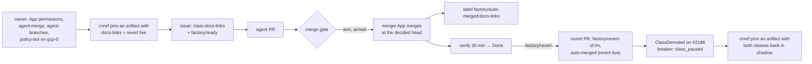

# 12 — Live auto-merge drill (`docs-links`, gcp-0)

Drills the first unattended merge to `main` and its revert, gate evidence G2 and G3 of the
[live auto-merge design](../../superpowers/specs/2026-10-16-v2-live-auto-merge-design.md) (D4).
The factory merges to `main` without a human for the drill's duration: **run it only on the
owner's go.** The drill runs on the factory that `Smana/cloud-native-ref`'s
`.github/agent-factory.yaml` names (the ownership fence): `gcp-0` today, the only live cluster.
Every other factory renders the same values and never acts on the repository. See
[README.md](README.md) for `CLOUD`.

## Owner's GitHub prerequisites

Nothing below reaches the cluster. All three must hold before gcp-0 pins an artifact carrying
ai-native-ref [#21](https://github.com/Smana/ai-native-ref/pull/21) (the drill config, merged on
`main` since 2026-10-18 and in no release yet).

- [ ] **The merger App `ogenki-agent-merger` holds `issues: write` and `actions: write`, accepted on
  the installation.** `issues` writes the ledger labels (GitHub labels PRs through the issues API);
  `actions` re-runs a cancelled check (`checkReruns: 1`). Settings → Developer settings → GitHub
  Apps → `ogenki-agent-merger` → Permissions → Issues and Actions: Read and write; then accept the
  change on the installation page. Proof: the [mint test](#the-mint-test) returns `201`.
- [ ] **The `agent-merge` ruleset exists on `Smana/cloud-native-ref`**, covering `refs/heads/main`,
  `refs/heads/revert-*` and `refs/heads/revert-*/**`, with the merger App on its bypass list. From a
  cloud-native-ref checkout (the App ID is on github.com/settings/apps/ogenki-agent-merger; a private
  App's `/apps/<slug>` 404s):

  ```bash
  MERGER_APP_ID=<merger App ID> task ops:github:agent-merge-ruleset -- Smana/cloud-native-ref
  gh api repos/Smana/cloud-native-ref/rulesets --jq '.[] | select(.name == "agent-merge") | .id'
  ```

- [ ] **The live `agent-branches` ruleset (24063626) no longer covers `main`.** This is the blocker:
  it excludes only `refs/heads/agent/**`, and its bypass list (human roles, Renovate) omits the
  merger App, so every live merge and revert is refused. After `agent-merge` exists (the script
  refuses before):

  ```bash
  task ops:github:agent-branch-ruleset -- Smana/cloud-native-ref
  gh api repos/Smana/cloud-native-ref/rulesets/24063626 --jq .conditions.ref_name.exclude
  ```

  Expected: `refs/heads/agent/**`, `refs/heads/main`, `refs/heads/revert-*`, `refs/heads/revert-*/**`.

Observed on 2026-10-18: all three hold (the merger's installation reads `issues: write` and
`actions: write`; `agent-merge` 25335777 covers `main` and `revert-*` with the merger App 5187454 on
its bypass list; `agent-branches` 24063626 excludes `main` and `revert-*`).

## The merge gate runs on gcp-0

The gate's row 3 needs a `policy-bot: main` status posted by `merge.policyBotLogin`
(`ogenki-merge-gate[bot]`). Without it every decision is `human` / `policy_absent` and the drill
never arms: what gcp-0 decided until [#58](https://github.com/Smana/ai-native-ref/pull/58) put
policy-bot there (it ran on aws-0 only).

- [ ] **policy-bot runs on gcp-0 and posts on cloud-native-ref's PRs.** Its OpenBao side is
  cloud-native-ref [#2504](https://github.com/Smana/cloud-native-ref/pull/2504) (the `merge-gate`
  mount, policy and `jwt/gcp-0` role, the `policy-bot` listener), its secret is the five keys at
  `merge-gate/policy-bot`, and the `ogenki-merge-gate` App's webhook is
  `https://policy-bot.gcp.cloud.ogenki.io/api/github/hook` with Pull request, Pull request review,
  Issue comment, Status, Check run and Workflow run subscribed. Proof:

  ```bash
  kubectl rollout status deploy -n merge-gate policy-bot --timeout=1m
  sha=$(gh pr list -R Smana/cloud-native-ref --state open --limit 1 --json headRefOid -q '.[0].headRefOid')
  gh api "repos/Smana/cloud-native-ref/commits/$sha/statuses" \
    --jq '[.[] | select(.context == "policy-bot: main")][0] | {state, by: .creator.login}'
  ```

  Expected: the rollout completes, and `by` is `ogenki-merge-gate[bot]` (push to the PR, or
  redeliver its last webhook, if no status is there yet).



## Know before the go

- **The drill pauses `docs-links` afterwards.** With `breaker: {window: 10, maxReverts: 1}`, the
  drill's revert holds the class at `class_paused`, in shadow too (gate row 9 precedes row 11), until
  10 newer `docs-links` merges by maintainers push it out of the window. No `would-arm` comment, and so
  no tally progress for G4, until then. After a rebuild only labelled merges count, so the pause lasts
  until 10 merges made after the rebuild.
- **Live means `{live: true}`.** `{}` is "neither": a label only, the gate hands off `class_mismatch`.
- **Both classes go live in one commit** (D5): a live class with a shadow `revert` would wait for a
  human to merge its own revert.
- **A missing App grant stops every merger call.** Once a class is live, the factory asks the
  merger's tokens for `issues: write` and `actions: write`. GitHub refuses the whole mint if the
  installation lacks one, so the shadow calls stop too, not only the labels.

## Prerequisites

From a cloud-native-ref checkout, `kubectl` on the factory's cluster
(`gke_ogenki-435905_europe-west4-a_gcp-0` for gcp-0; `kubectl config current-context` shows it).

| # | Check | How |
|---|---|---|
| P1 | The factory runs agent-platform `v0.14.0` or later | cloud-native-ref pins ai-native-ref `v0.1.5` or later, and the pod runs that tag: `kubectl get deploy -n agent-system agent-factory -o jsonpath='{.spec.template.spec.containers[0].image}{"\n"}'` → `ghcr.io/smana/agent-factory:v0.15.3@sha256:98e5…` at pin `v0.1.17` |
| P2 | The owner's GitHub prerequisites hold | The three boxes above ticked, and the mint test below returns `201` |
| P2b | The merge gate runs on gcp-0 | [The box above](#the-merge-gate-runs-on-gcp-0) ticked: `policy-bot: main` from `ogenki-merge-gate[bot]` on a cloud-native-ref PR |
| P3 | The factory is idle on `Smana/cloud-native-ref` | `kubectl get tasks -n agent-system` shows no task outside a final phase (`Done`, `Rejected`, `NoOp`, `Reverted`, `Closed`, `Stopped`) |
| P4 | `main` is green | `gh run list -R Smana/cloud-native-ref --branch main --limit 3` |
| P5 | No auto-merge today | `gh pr list -R Smana/cloud-native-ref --state merged --label 'factory/auto-merged:docs-links'` is empty (the drill's cap is 1 a day, labelled merges count) |

### The mint test

It asks for exactly the merger's live scope. Nothing reaches a process's argv, and the token is
revoked at once:

```bash
d=$(mktemp -d); trap 'rm -rf "$d"' EXIT; umask 077
kubectl get secret -n agent-system agent-factory-merger -o jsonpath='{.data.private_key}' | base64 -d >"$d/key.pem"
id=$(kubectl get secret -n agent-system agent-factory-merger -o jsonpath='{.data.app_id}' | base64 -d)
b64() { openssl base64 -A | tr '+/' '-_' | tr -d '='; }
now=$(date +%s)
h=$(printf '{"alg":"RS256","typ":"JWT"}' | b64)
p=$(printf '{"iat":%d,"exp":%d,"iss":"%s"}' $((now-60)) $((now+540)) "$id" | b64)
s=$(printf '%s.%s' "$h" "$p" | openssl dgst -sha256 -sign "$d/key.pem" -binary | b64)
printf 'Authorization: Bearer %s.%s.%s\n' "$h" "$p" "$s" >"$d/jwt"
inst=$(curl -s -H @"$d/jwt" https://api.github.com/repos/Smana/cloud-native-ref/installation | jq -r .id)
curl -s -o "$d/tok.json" -w '%{http_code}\n' -X POST -H @"$d/jwt" \
  "https://api.github.com/app/installations/$inst/access_tokens" \
  -d '{"repositories":["cloud-native-ref"],"permissions":{"checks":"read","statuses":"read","contents":"write","pull_requests":"write","metadata":"read","actions":"write","issues":"write"}}'
printf 'Authorization: Bearer %s\n' "$(jq -r .token "$d/tok.json")" >"$d/tok"
curl -s -o /dev/null -w 'revoked %{http_code}\n' -X DELETE -H @"$d/tok" https://api.github.com/installation/token
```

Expected: `201`, then `revoked 204`. A `422` names the missing permission: fix the first box above before going on.

## Steps

Set once:

```bash
CLOUD=gcp    # the cloud of the factory the fence names
CA=opentofu/$CLOUD/openbao/management/.tls/ca.pem
VL=https://vl.priv.$CLOUD.ogenki.io
vm() { kubectl get --raw "/api/v1/namespaces/observability/services/vmsingle-victoria-metrics-k8s-stack:8428/proxy/api/v1/query?query=$(jq -rn --arg q "$1" '$q|@uri')" | jq -c '.data.result[] | [.metric, .value[1]]'; }
vm 'sum by (class, verdict, reason) (agent_factory_merge_decisions_total{class=~"docs-links|revert"})'   # the baseline
```

### Step 1 — switch the classes live

1. Pick a signed artifact that carries [#21](https://github.com/Smana/ai-native-ref/pull/21)
   (`docs-links` and `revert` `{live: true}`, `autoMergesPerDay: 1`, merged as `00661de`): a release
   `v0.1.N` tagged on `00661de` or a later `main` commit (`release.yaml`), or, while no release is cut, a PR
   pre-release built on such a `main` (`ci.yaml@refs/pull/<N>/merge`, which the OCIRepository's
   cosign `subject` accepts).
2. In cloud-native-ref, set `flux/sources/ocirepo-ai-native-ref.yaml` to that tag and its digest
   (`crane digest ghcr.io/smana/ai-native-ref:<tag>`), and merge it.
3. Watch it land:

```bash
flux reconcile source oci ai-native-ref -n flux-system
kubectl get cm -n agent-system agent-factory-helm-values -o jsonpath='{.data.values\.yaml}' | grep -E 'factory:|docs-links:|revert:|autoMergesPerDay'
kubectl rollout status deploy -n agent-system agent-factory --timeout=5m
```

Expected: `factory: gcp-0` (the name the fence holds), `docs-links: {live: true}`,
`revert: {live: true}`, `autoMergesPerDay: 1`; the rollout completes (a strictly parsed bad config
fails it, and the old pods keep serving).

### Step 2 — open the `docs-links` issue

```bash
gh issue create -R Smana/cloud-native-ref --label class:docs-links \
  --title "docs: fix broken external links (live auto-merge drill)" \
  --body "Find broken external link targets in Markdown links ([text](url) or [ref]: url) under docs/ and website/content/, outside docs/superpowers/, docs/specs/ and website/content/docs/decisions/. Leave URLs in code blocks and plain text alone. Fix those with an obvious replacement, changing fewer than 21 lines in total and adding or deleting no file. If none is broken, change nothing and open no pull request."
gh issue edit <issue> -R Smana/cloud-native-ref --add-label factory/ready
```

This is the `link-rot` schedule's text, narrowed to Markdown link targets: the class's rule R52
(`LinksOnly`) counts only those, so a fix to a URL in a code block or in prose is refused
`class_mismatch` (2026-10-18, attempt 1). If the task ends `NoOp` (nothing broken), file a second
issue naming one external link target you have seen fail, with its replacement. A maintainer adds `factory/ready`
after `class:docs-links`: the class is read at triage.

```bash
TASK=$(kubectl get task -n agent-system --sort-by=.metadata.creationTimestamp -o jsonpath='{.items[-1:].metadata.name}'); echo "$TASK"
kubectl get task -n agent-system "$TASK" -o jsonpath='{.spec.predictedClass} {.status.phase} {.status.reason}{"\n"}'
```

Expected: `docs-links`, then `Implementing` → `AwaitingCI`.

### Step 3 — watch the gate decide

```bash
kubectl get task -n agent-system "$TASK" -w -o jsonpath='{.status.phase} {.status.reason}{"\n"}'
```

Expected: `AwaitingCI` (waits while checks run) → `AutoMerging` → `Verifying`. Any other ending (a
`human` verdict with `class_mismatch`, `head_unreported`, `policy_*`, `verdict_stale`) is a
finding: record the reason and stop at Step 6. A hand-off of a finished run is final: the run
cannot hand off again, so a maintainer merges or closes the PR.

### Step 4 — verify the merge and its head pin (G2)

```bash
PR=$(kubectl get task -n agent-system "$TASK" -o jsonpath='{.status.pullRequest.number}')
kubectl get task -n agent-system "$TASK" -o jsonpath='{.status.pullRequest}' | jq '{headSHA, mergeCommitSHA, mergedBy, autoMerged, armedAt, mergedAt}'
gh pr view "$PR" -R Smana/cloud-native-ref --json headRefOid,mergedBy,mergeCommit,labels \
  -q '{head: .headRefOid, by: .mergedBy.login, merge: .mergeCommit.oid, labels: [.labels[].name]}'
gh api "repos/Smana/cloud-native-ref/commits/$(gh pr view "$PR" -R Smana/cloud-native-ref --json headRefOid -q .headRefOid)" -q .commit.message | grep '^Agent-Run:'
```

Expected:

- `mergedBy` is `ogenki-agent-merger[bot]` (`app/ogenki-agent-merger` in `gh`), `autoMerged: true`;
- the PR's `headRefOid` equals the task's `headSHA`: the head the run reported is the head merged
  (`expectedHeadOid`);
- the head carries an `Agent-Run:` trailer;
- labels include `factory/auto-merged:docs-links` (written after the merge, retried each pass: allow a minute).

After `merge.verifyFor` (30 min) with `main` green, the task ends `Done` / `merged_verified`.

### Step 5 — revert it and see the breaker count it (G3)

Within `merge.revertWindow` (168 h), from `Verifying` or `Done`:

```bash
gh api -X POST "repos/Smana/cloud-native-ref/issues/$PR/labels" -f 'labels[]=factory/revert'   # gh pr edit fails silently here (Projects classic)
kubectl get task -n agent-system "$TASK" -w -o jsonpath='{.status.phase} {.status.reason} {.status.pullRequest.revertNumber}{"\n"}'
```

Expected: `Reverted` / `revert_requested` within a poll (60 s), with a `revertNumber`. Then:

```bash
RV=$(kubectl get task -n agent-system "$TASK" -o jsonpath='{.status.pullRequest.revertNumber}')
gh pr view "$RV" -R Smana/cloud-native-ref --json author,title,body,labels,autoMergeRequest,state,mergedBy \
  -q '{author: .author.login, title, body, labels: [.labels[].name], auto: (.autoMergeRequest != null), state, by: .mergedBy.login}'
gh issue view 2188 -R Smana/cloud-native-ref --json comments -q '.comments[-1].body'
```

Expected:

- the revert PR is authored by the merger App, titled `Revert "…"`, its body `Reverts #<PR> (agent factory task …)`;
- it carries `factory/revert-of:#<PR>`, and native auto-merge is on (the `revert` class is live);
- it ends `MERGED` by the merger once its required checks are green (and `policy-bot: main`, where
  the `agent-merge-gate` ruleset requires it). Before agent-platform `v0.15.6` it stays `BLOCKED`
  ([finding 5](#findings)): merge it by hand;
- the control issue #2188's newest comment: "an auto-merge of `docs-links` was reverted … goes to human review".

The breaker now holds 1 revert in 1 merge. Its proof is the next `docs-links` decision, which must be
`human` / `class_paused`. If another `docs-links` PR reaches the gate during the window, read it there.
Otherwise the [G1 check](#g1-optional-the-breaker-survives-a-restart) below shows it.

### Step 6 — switch back to shadow

Revert #21's merge commit (`00661de`) in ai-native-ref (back to `{shadow: true}` for both classes
and `autoMergesPerDay: 10`), and pin an artifact carrying the revert, as in Step 1. Then:

```bash
kubectl get cm -n agent-system agent-factory-helm-values -o jsonpath='{.data.values\.yaml}' | grep -E 'docs-links:|revert:|autoMergesPerDay'
```

Expected: `{shadow: true}` twice, `autoMergesPerDay: 10`. The drill is over when this holds.

### G1 (optional): the breaker survives a restart

Owner call: deleting Tasks drops their history from `kubectl` (the PRs and comments stay).

```bash
kubectl delete task -n agent-system "$TASK"
kubectl rollout restart deploy -n agent-system agent-factory && kubectl rollout status deploy -n agent-system agent-factory
```

Then put one `docs-links` issue through the factory. Expected: the merge ledger is read from GitHub
(log below) and the PR's gate decision is `human` / `class_paused`.

## Evidence to record

```bash
# The gate's decisions over the drill (the counter appears at the first decision after the rollout)
vm 'sum by (class, verdict, reason) (increase(agent_factory_merge_decisions_total{class=~"docs-links|revert"}[6h]))'
vm 'sum by (class, outcome) (increase(agent_factory_pr_outcomes_total{class="docs-links"}[6h]))'

# The factory's own account: ledger read, label writes, the task's hand-offs
curl -sS --cacert $CA $VL/select/logsql/query --data-urlencode \
  "query=_time:6h kubernetes.pod_namespace:\"agent-system\" AND kubernetes.pod_labels.app.kubernetes.io/name:\"agent-factory\" AND (\"merge ledger\" OR \"$TASK\") | fields _time, _msg | sort by (_time)"

# GitHub's record: what the breaker and the daily cap read after a rebuild
gh pr list -R Smana/cloud-native-ref --state all --label 'factory/auto-merged:docs-links' --json number,mergedBy,mergedAt
gh pr list -R Smana/cloud-native-ref --state all --label "factory/revert-of:#$PR" --json number,state,author
```

Expected: `verdict="arm", reason="armed"` once for `docs-links`; no `label the merge ledger` error;
`merge ledger read from GitHub` at each factory start; one labelled merge, one revert-of PR; `agent_factory_pr_outcomes_total` counts `auto_merged` then `reverted`.

## Abort and roll back

| When | Do | Effect |
|---|---|---|
| Before the merge | `factory/stop` on the task's issue or PR | The task ends `Stopped`; nothing merges |
| Anything looks wrong, any time | `factory/stop` on the control issue #2188 | The kill switch: every task stops, intake pauses. `factory/revert` is still honoured, but a task already `Stopped` cannot be reverted by the factory |
| After the merge | `factory/revert` on the PR (Step 5) | The merger's revert PR. If it stalls, `merge.verifyFor` later its auto-merge is turned off: merge or close it by hand |
| The merge is wrong and the factory is stopped | Revert it yourself (GitHub's **Revert** button) and merge that PR | The breaker cannot see it until you add `factory/revert-of:#<PR>` to it |
| End the live window at once | Revert the cloud-native-ref pin bump (back to the previous artifact, already verified) | Both classes back in shadow within one Flux reconcile. Back to `v0.1.16`, policy-bot leaves gcp-0 too (it predates #58): cloud-native-ref's gate falls back to `policy_absent`, and ai-native-ref's PRs wait on `policy-bot: main` until a later pin restores it |

## Results

### 2026-10-18 (afternoon), gcp-0: G2 and G3

ai-native-ref `v0.1.19`, agent-factory `v0.15.5` (agent-platform #154 and #157), both classes
`{live: true}`, `autoMergesPerDay: 1`. G2 passes unattended. G3 passes on every check except the
revert's own merge, which waits on agent-platform [#158](https://github.com/Smana/agent-platform/pull/158)
([finding 5](#findings)). Step 6 is not run: the owner keeps both classes live at one merge a day,
and #66 is closed.

| Step | Expected | Observed | Pass/Fail |
|---|---|---|---|
| 2 | task `docs-links`, PR opened | Issue cloud-native-ref#2519 (15:07Z) → task `ey5miixe`, run `2ka3pegs` → PR #2520 (15:13Z), +4/−4, Markdown link targets only | Pass |
| 3 | `AutoMerging` → `Verifying` | CI green, `policy-bot: main` `success`, decision `arm` | Pass |
| 4 (G2) | merged by the merger at the task's `headSHA`, `Agent-Run` trailer, `factory/auto-merged:docs-links` | Merged 15:20:09Z by `ogenki-agent-merger` at `91c8f0d1…`, the task's `headSHA`; merge commit `4be79ae7` carries `Agent-Run: 2ka3pegs`; label written. The task ended `Done` / `merged_verified` | Pass |
| 5 (G3) | revert PR by the merger, `factory/revert-of:#<PR>`, merged; `ClassDemoted` on #2188 | `factory/revert` on #2520 → `Reverted` / `revert_requested`; #2521 (15:51Z) authored by the merger, `Revert "…"`, `Reverts #2520`, `factory/revert-of:#2520`, auto-merge armed; every required check and `policy-bot: main` green, yet `BLOCKED`. Disarmed at `verifyFor` (16:22Z, `revert-end-stalled`), merged by the owner 18:04Z. #2188 reports the demotion. `agent_factory_pr_outcomes_total{class="docs-links", outcome="reverted"}` 1 | Pass, except the unattended merge |
| 6 | both classes `{shadow: true}`, cap 10 | Not run: the owner keeps them live, cap 1 | Skipped |
| G1 | after the restart, `class_paused` | Not run | Not run |

The breaker now holds 1 revert in 1 merge: the next `docs-links` decision must be `human` /
`class_paused`.

### 2026-10-18 (morning), gcp-0

ai-native-ref `v0.1.17`, agent-factory `v0.15.3`, `docs-links` and `revert` `{live: true}`,
`autoMergesPerDay: 1`. Two attempts, no unattended merge: the gate refused both, correctly by its
rules, so G2 and G3 remain unproven.

| Step | Expected | Observed | Pass/Fail |
|---|---|---|---|
| P1–P5 | `v0.14.0`+; GitHub boxes ticked, mint `201`; policy-bot posts on gcp-0; idle; `main` green; no auto-merge today | `v0.15.3`; boxes ticked; `policy-bot: main` from `ogenki-merge-gate[bot]` on cloud-native-ref #2508 and #2510 and ai-native-ref #64 (P2b) | Pass |
| 1 | both classes `{live: true}`, cap 1, rollout complete | `v0.1.17` pinned, both classes live, cap 1 | Pass |
| 2 | task `docs-links`, PR opened | Attempt 1: issue cloud-native-ref#2507 (the `link-rot` text) → task `wxzxxnwg` → PR #2508. Attempt 2: #2509 (the second issue) → task `vgvmy5bf` → PR #2510 | Pass |
| 3 | `AutoMerging` → `Verifying` | #2508: CI green, policy-bot `success`, then `AwaitingHuman` / `class_mismatch` ([finding 1](#findings)). #2510: CI green, policy-bot `success`, then `AwaitingHuman` / `head_unreported` ([finding 2](#findings)); the owner merged #2510 by hand (11:20:29Z) | Fail |
| 4 | merged by the merger at the task's `headSHA`, `Agent-Run` trailer, `factory/auto-merged:docs-links` | Not reached; the daily cap was not consumed | Not run (G2) |
| 5 | revert PR by the merger, `factory/revert-of:#<PR>`, auto-merged; `ClassDemoted` on #2188 | Not reached | Not run (G3) |
| 6 | both classes `{shadow: true}`, cap 10 | Pending: ai-native-ref [#66](https://github.com/Smana/ai-native-ref/pull/66) (draft) reverts #21, the owner's call | Pending |
| G1 | after the restart, `class_paused` | Not run (needs a revert) | Not run |

The link scan behind attempt 2: 91 external Markdown link targets in scope, one 404
(`website/content/docs/platform/networking/gateway-api.md`, line 151: the HTTPRoute API reference,
now `/reference/api-types/httproute/`, 200).

### Findings

1. **R52 counts Markdown link targets only.** #2508 changed one line (+1/-1): a RunLore
   `runbook_url` inside a YAML code block in
   `website/content/docs/platform/observability/dashboards-and-alerts.md` (old URL 404, new 200).
   `LinksOnly` accepts only `[x](url)` and `[ref]: url` targets, so the gate handed it off
   `class_mismatch`. A correct refusal; the issue text in Step 2 now says link targets only.
2. **R02 compares the full head SHA, and the handoff carried a short one.** The implementer's
   `room_handoff` reported `c3119614`; the gate compares it with the PR's 40-character head exactly,
   and the tool schema allowed `^[0-9a-f]{7,40}$`. The finished run could not hand off again, so the
   hold was final. Fixed in agent-platform
   [#154](https://github.com/Smana/agent-platform/pull/154) (`room_handoff` and `room_verdict`
   require the full 40-hex SHA), released in `v0.15.4`.
3. **R52 read the base at `main`'s tip, not the merge base.** When #2508 merged during the drill, a
   later PR's diff was read against a base that already held #2508's change, so `LinksOnly` saw lines
   the PR never touched. Fixed in agent-platform [#157](https://github.com/Smana/agent-platform/pull/157):
   `Files` reads the base at the merge-base commit. Released in `v0.15.5`.
4. **R52's code-fence scan never left a fence.** `fencesOf` kept its in-fence state after a closing
   fence, so every link below a code block read as code. Fixed in the same #157.
5. **Native auto-merge never fires on a revert.** `agent-merge` restricts updates to `main` to its
   bypass actors, so GitHub reads every PR as `BLOCKED` and native auto-merge waits forever. The
   forward merge is unaffected: the merger merges at the decided head through its bypass. Fixed in
   agent-platform [#158](https://github.com/Smana/agent-platform/pull/158): the revert watch merges a
   green revert the same way, and native auto-merge stays armed as the fallback for a factory that is
   down. Proven offline (`TestAGreenRevertIsMergedAtItsHead`); live at the next revert.

### What remains

The breaker's live proof (the next `docs-links` decision reads `class_paused`) and #158's unattended
revert merge. Both come with the next `docs-links` PR and the next revert, which the weekly `link-rot`
schedule (Mondays 06:00 UTC) produces unattended.

### Template

| Step | Expected | Observed | Pass/Fail |
|---|---|---|---|
| P1–P5 | `v0.14.0`+; GitHub boxes ticked, mint `201`; policy-bot posts on gcp-0; idle; `main` green; no auto-merge today | | |
| 1 | both classes `{live: true}`, cap 1, rollout complete | | |
| 2 | task `docs-links`, PR opened | | |
| 3 | `AutoMerging` → `Verifying` | | |
| 4 | merged by the merger at the task's `headSHA`, `Agent-Run` trailer, `factory/auto-merged:docs-links` | | |
| 5 | revert PR by the merger, `factory/revert-of:#<PR>`, auto-merged; `ClassDemoted` on #2188 | | |
| 6 | both classes `{shadow: true}`, cap 10 | | |
| G1 | after the restart, `class_paused` | | |
