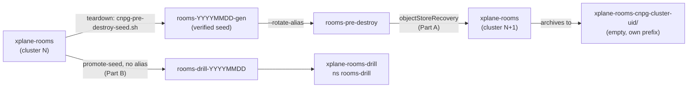

# 13 — Rooms database: restore on rebuild, and a scratch restore

Proves that the room log, the factory's audit trail, survives a cluster rebuild and can be restored
on demand, and records its RPO and RTO (issue #27, rooms design §4 recovery objectives). See
[README.md](README.md) for `CLOUD`.



| Part | When | Proves |
|---|---|---|
| A | Around a teardown and the rebuild after it | The wired path: the rebuilt `xplane-rooms` holds the torn-down cluster's rooms, events, grants and roles |
| B | Any time on a live cluster, no teardown | A restore into a scratch namespace from a fresh seed, with RPO and RTO measured |

## Prerequisites

- `kubectl` on the cluster, `aws` or `gcloud` read access to the CNPG bucket, a cloud-native-ref checkout.
- For Part A, ai-native-ref's claim restores from `rooms-pre-destroy` on this cloud:
  `infrastructure/base/room-broker/sqlinstance.yaml`. aws-0 does; gcp-0 starts fresh until it is opted
  in ([Step A0](#step-a0--gcp-0-opt-in)): not yet, so the next gcp-0 bootstrap starts with no rooms.

```bash
case $CLOUD in
  aws) BUCKET=eu-west-3-ogenki-cnpg-backups ;;
  gcp) BUCKET=$(gcloud config get-value project)-ogenki-cnpg-backups ;;
esac
rooms_psql() {  # $1: namespace, $2: CNPG cluster name; reads stdin
  kubectl exec -i -n "$1" "$(kubectl get pod -n "$1" -l cnpg.io/cluster="$2",cnpg.io/instanceRole=primary -o name)" \
    -c postgres -- psql -d rooms -tA -v ON_ERROR_STOP=1
}
```

The fingerprint, the same query for every capture. One line per room (its event sequence,
hashed), then the grants and the `rooms_*` roles:

```bash
cat > /tmp/rooms-fingerprint.sql <<'SQL'
SELECT r.room_id, r.last_seq, r.sealed, count(e.seq), coalesce(max(e.seq), 0),
       md5(coalesce(string_agg(e.seq || ':' || e.id || ':' || e.type || ':' || e.origin_client || ':' || e.origin_seq, ',' ORDER BY e.seq), ''))
  FROM rooms r LEFT JOIN events e USING (room_id) GROUP BY r.room_id ORDER BY r.room_id;
SELECT 'grant', grantee, table_name, string_agg(privilege_type, ',' ORDER BY privilege_type)
  FROM information_schema.role_table_grants WHERE table_schema = 'public' AND grantee LIKE 'rooms_%'
  GROUP BY grantee, table_name ORDER BY grantee, table_name;
SELECT 'role', rolname, rolsuper, rolcanlogin FROM pg_roles WHERE rolname LIKE 'rooms_%' ORDER BY rolname;
SQL
```

## Part A — restore on rebuild

### Step A0 — gcp-0 opt-in

gcp-0's overlay removes `objectStoreRecovery`, because an empty recovery prefix fails the bootstrap
instead of starting fresh. Opt in only once the GCS bucket holds a restorable alias, written by a
gcp-0 teardown (A1–A2):

```bash
gcloud storage ls gs://$BUCKET/ | grep rooms-pre-destroy/
./scripts/ops/k8s/cnpg-promote-seed.sh --cloud gcp --bucket $BUCKET --verify-seed rooms-pre-destroy
```

Both pass, then in ai-native-ref's `infrastructure/gcp-0/room-broker/kustomization.yaml`, replace the
`remove` with:

```yaml
      - op: replace
        path: /spec/objectStoreRecovery/bucketName
        value: ${project_id}-ogenki-cnpg-backups
```

Release, bump the host's pin, then rebuild and run A3–A4. Merged before the alias exists, the
rebuild's `xplane-rooms` never becomes Ready.

### Step A1 — before the teardown: capture

On the cluster about to be destroyed, just before its teardown (`terramate script run destroy`, GKE or EKS only, or the full `--reverse destroy`):

```bash
rooms_psql agent-system xplane-rooms-cnpg-cluster < /tmp/rooms-fingerprint.sql > /tmp/rooms-before.txt
echo "SELECT now(), max(ts), count(*) FROM events;" | rooms_psql agent-system xplane-rooms-cnpg-cluster
wc -l /tmp/rooms-before.txt
```

Expected: one line per room, then the `grant` and `role` lines. Note the captured `max(ts)`, the
newest event at capture: the RPO is measured against it. Keep `/tmp/rooms-before.txt` off the cluster: it is the comparison baseline.

### Step A2 — the teardown seeds the alias

The destroy lane runs `scripts/ops/k8s/cnpg-pre-destroy-seed.sh`, which discovers `xplane-rooms`
from its `backup` block. In the teardown log:

```text
Set spec.objectStoreRecovery.path to: rooms-pre-destroy
```

Expected: that line for `xplane-rooms`, and no `[warn] seed for xplane-rooms failed`. A warning
means the alias still holds the previous seed: Part A then measures that seed's RPO, not zero.
Verify the alias read-only before the rebuild:

```bash
./scripts/ops/k8s/cnpg-promote-seed.sh --cloud $CLOUD --bucket $BUCKET --verify-seed rooms-pre-destroy
```

Expected: exit 0; the newest base backup has `status=DONE` and both its `begin_wal` and `end_wal` are present.

### Step A3 — after the rebuild: the bootstrap restored

```bash
kubectl get cluster -n agent-system xplane-rooms-cnpg-cluster \
  -o jsonpath='{.spec.bootstrap}{"\n"}{.spec.plugins[0].parameters.serverName}{"\n"}'
kubectl get cluster -n agent-system xplane-rooms-cnpg-cluster -o json \
  | jq -r '.metadata.creationTimestamp, (.status.conditions[] | select(.type=="Ready") | "\(.status) \(.lastTransitionTime)")'
```

Expected: `{"recovery":{"source":"rooms-pre-destroy"}}`; a serverName
`xplane-rooms-cnpg-cluster-<uid8>` that differs from the torn-down one (an empty archive prefix of
its own); `True` and a timestamp. **RTO (database)** = Ready − creation. Then the broker:

```bash
kubectl get deploy -n agent-system room-broker -o jsonpath='{.status.readyReplicas}{"\n"}'
```

Expected: ≥ 1, and the `rooms_*` role logins work, which CNPG resets to this generation's
generated passwords (managed roles).

### Step A4 — compare

```bash
rooms_psql agent-system xplane-rooms-cnpg-cluster < /tmp/rooms-fingerprint.sql > /tmp/rooms-after.txt
diff /tmp/rooms-before.txt /tmp/rooms-after.txt && echo IDENTICAL
echo "SELECT max(ts), count(*) FROM events;" | rooms_psql agent-system xplane-rooms-cnpg-cluster
```

Expected: `IDENTICAL`. A room written between A1 and the seed shows as an added line or a higher
`last_seq` for that room: acceptable (it postdates the baseline); a missing room, a lower `last_seq`, a
changed hash at an equal `last_seq`, or a `grant`/`role` difference is a FAIL. **RPO** =
max(0, A1's captured `max(ts)` − the restored `max(ts)`): the span of events written before the
capture that the restore lost. 0 means nothing captured was lost.

## Part B — scratch restore on a live cluster

Leaves `xplane-rooms` untouched. **Writes to the bucket** (a dated seed) and creates a namespace:
run on the owner's go, and finish Step B4 before any teardown — a claim left behind has `backup`
and would be seeded as `rooms-drill-pre-destroy`.

### Step B1 — capture and seed

```bash
SEED=rooms-drill-$(date +%Y%m%d%H%M)
rooms_psql agent-system xplane-rooms-cnpg-cluster < /tmp/rooms-fingerprint.sql > /tmp/rooms-before.txt
echo "SELECT now(), max(ts), count(*) FROM events;" | rooms_psql agent-system xplane-rooms-cnpg-cluster   # T0 and the captured max(ts)
./scripts/ops/k8s/cnpg-promote-seed.sh --cloud $CLOUD --bucket $BUCKET \
  --cluster xplane-rooms --namespace agent-system --seed $SEED --apply
```

Expected: `Set spec.objectStoreRecovery.path to: $SEED` and exit 0 (the script verifies the seed).
The seed is named `rooms-drill-*`, never `xplane-*`, so the gcp bucket's lifecycle rule cannot expire it.

### Step B2 — restore into `rooms-drill`

The claim keeps `xplane-rooms`'s databases and roles but has no `atlasSchema` (the schema comes from
the seed). It keeps a `backup` block only because the bucket identity is composed from it; its
schedule is yearly and it archives into its own `xplane-rooms-drill-cnpg-cluster-<uid8>/` prefix.

```bash
COMPOSITION=xsqlinstances.cloud.ogenki.io; [ $CLOUD = gcp ] && COMPOSITION=xsqlinstances-gcp.cloud.ogenki.io
kubectl create namespace rooms-drill
date -u +%FT%TZ   # T1, the restore start
kubectl apply -f - <<EOF
apiVersion: cloud.ogenki.io/v1alpha1
kind: SQLInstance
metadata: {name: xplane-rooms-drill, namespace: rooms-drill}
spec:
  instances: 1
  size: small
  storageSize: 20Gi
  postgresVersion: "18"
  credentials: {source: generated}
  databases: [{name: rooms, owner: rooms_owner}]
  roles:
    - {name: rooms_owner, comment: drill, superuser: false}
    - {name: rooms_broker, comment: drill, superuser: false}
    - {name: rooms_retention, comment: drill, superuser: false}
  objectStoreRecovery: {bucketName: $BUCKET, path: $SEED}
  backup: {schedule: "0 0 3 1 1 *", bucketName: $BUCKET}
  crossplane: {compositionRef: {name: $COMPOSITION}}
EOF
kubectl wait -n rooms-drill cluster/xplane-rooms-drill-cnpg-cluster --for=condition=Ready --timeout=30m
date -u +%FT%TZ   # T2, ready
```

Expected: `condition met`. **RTO** = T2 − T1. If it stalls, read the recovery Job's log
(`kubectl logs -n rooms-drill -l cnpg.io/jobRole=full-recovery`): `403` or `AccessDenied` is the bucket
identity, `expected empty archive` would mean the drill claim reused a prefix (it should not: uid-keyed).

### Step B3 — compare

```bash
rooms_psql rooms-drill xplane-rooms-drill-cnpg-cluster < /tmp/rooms-fingerprint.sql > /tmp/rooms-drill.txt
diff /tmp/rooms-before.txt /tmp/rooms-drill.txt && echo IDENTICAL
echo "SELECT max(ts) FROM events;" | rooms_psql rooms-drill xplane-rooms-drill-cnpg-cluster
```

Expected and FAIL criteria as Step A4. **RPO** = max(0, B1's captured `max(ts)` − the restored
`max(ts)`).

### Step B4 — clean up

```bash
kubectl delete sqlinstance -n rooms-drill xplane-rooms-drill --wait
kubectl delete namespace rooms-drill
```

The `rooms-drill-*` seed and the drill's `xplane-rooms-drill-cnpg-cluster-*` prefix stay in the bucket:
delete the seed with the cloud CLI once the result is recorded; the gcp lifecycle rule expires the
`xplane-*` prefix after 30 days.

## Pass criteria

| # | Criterion | Part |
|---|---|---|
| 1 | The rebuilt cluster's bootstrap is `recovery` from `rooms-pre-destroy`, and it archives to a new uid-keyed prefix | A3 |
| 2 | Every baseline room is present with the same `last_seq` and event hash; grants and roles are identical | A4, B3 |
| 3 | The broker is ready on the restored database | A3 |
| 4 | RPO (max(0, captured `max(ts)` − restored `max(ts)`)) and RTO are recorded below for each part and cloud | A3–A4, B2–B3 |

## Results

| Date | Cloud | Part | Rooms / events | RPO | RTO (db) | Result |
|---|---|---|---|---|---|---|
| — | gcp | A | | | | not run yet |
| — | aws | A | | | | not run yet |
| — | — | B | | | | not run yet |
Related runbooks: 04-gateway-secrets-budgets.md, 11-v1-validation.md, README.md.
