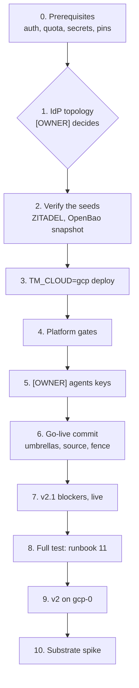

# 14 — The gcp-0 session: a full test, then v2 and v2.1 on GCP

This is an ordered checklist for bringing `gcp-0` up **alone** and running the agent factory on it. aws-0 is torn down.
Owner steps are marked **[OWNER]**. Everything else can be done by an agent holding the
kubeconfig.

Each step points to the runbook that holds its detail. Results go in that runbook's table, and the
cluster-level evidence goes in a `results-gcp-0-<date>.md`, as in
[the 2026-09-30 round](results-gcp-0-2026-09-30.md).



## 0. Before the session

| # | Check | How |
|---|---|---|
| 0.1 | **[OWNER]** Interactive Google auth for both the CLI and ADC. A reauth can expire ADC mid-run with `invalid_rapt`, which needs this step again | `gcloud auth login`, then `gcloud auth application-default login`, then `gcloud auth application-default set-quota-project ogenki-435905` |
| 0.2 | **[OWNER]** The CPU quota fits the platform (sizing below) | `gcloud compute project-info describe --project ogenki-435905 --flatten=quotas --filter='quotas.metric=CPUS_ALL_REGIONS' --format='value(quotas.limit,quotas.usage)'` and `gcloud compute regions describe europe-west4 --project ogenki-435905 --flatten=quotas --filter='quotas.metric:(CPUS N2_CPUS)' --format='table(quotas.metric,quotas.limit,quotas.usage)'` |
| 0.3 | **[OWNER]** Shell inputs | `export TF_VAR_tailscale_api_key=…`, plus AWS credentials for `opentofu/shared/*` (state, Route53 federation) |
| 0.4 | The Secret Manager entries the deploy reads exist (names only, never values) | `gcloud secrets list --project ogenki-435905 --format='value(name)'` includes `tailscale-k8s-operator-oauth`, `openbao-priv-gcp-{root-token,recovery-keys,ca-chain,intermediate-ca}`, `zitadel-envvars`, `zitadel-google-idp`, `zitadel-github-idp`, `github-gha-runner-scale-set-default`, `platform-llm-api-keys` |
| 0.5 | cloud-native-ref pins the releases under test, and the pin carries the gcp-0 fixes. These fixes are the factory's IdP egress, the warm headroom and the RunLore intake. An ai-native-ref release after v0.1.8 carries them | `flux/sources/ocirepo-ai-native-ref.yaml` tag; agent-platform v0.15.2; crossplane-configuration v0.9.15 |
| 0.6 | Optional, decided now: serve the Substrate spike's APIs | `TF_VAR_enable_pod_certificate_apis=true` on step 3. It is safe to turn on later, but turning it off later replaces the cluster. It needs a control plane on 1.35 or later: `gcloud container get-server-config --zone europe-west4-a --format='yaml(channels)'` |

### CPU sizing

| Capacity | vCPU |
|---|---|
| `static` pool, `e2-standard-4` ×2 (max 3) | 8 (12) |
| `agents-gvisor`, `e2-standard-8` ×0–2, spot. The warm headroom keeps one up while the platform is live | 8 (16) |
| NAP ComputeClasses (`general-purpose` e2/n2, `io` n2) | whatever the cluster ceiling leaves |
| Cluster ceiling, all node pools (`autoscaling_max_cpu_cores`) | **48** |
| OpenBao `e2-small` ×1 and the Tailscale router `e2-micro` ×1, outside GKE | ≤ 4 |
| Surge during a node upgrade (one extra `e2-standard-4`) | 4 |
| **Peak** | **≈ 56** |

The project's `CPUS_ALL_REGIONS` stood at 32 on 2026-09-30, with 26 in use. At that level an
`e2-standard-8` cannot start (finding F3), and NAP falls back to an `e2-standard-4` gVisor node,
which cannot hold a `large` run.

**[OWNER] Quota request** (Console → IAM & Admin → Quotas, or the command below):

```bash
gcloud beta quotas preferences create --project=ogenki-435905 \
  --service=compute.googleapis.com --quota-id=CPUS-ALL-REGIONS-per-project \
  --preferred-value=64 --preference-id=cpus-all-regions-64 \
  --justification="GKE reference platform: 48 vCPU autoscaling ceiling + OpenBao + upgrade surge"
```

Also check regional `N2_CPUS` in europe-west4. The `io` class provisions `n2-standard-4`/`-8`, so
it needs at least 16. Regional `CPUS` was 200 and is not a constraint.

## 1. [OWNER] The identity-provider topology

On `main`, ZITADEL is hosted by AWS. The relevant settings are `primary_cloud = "aws"` in `opentofu/config.tm.hcl`, aws-0's
`security/zitadel.yaml` with `suspend: false`, and gcp-0's with `suspend: true`. gcp-0 alone would point every login
at the dead `auth.cloud.ogenki.io`. The OIDC-client registration only warns and exits 0, so the
deploy reports success while SSO is dead. **Decide one option before step 3:**

| Option | What it costs | |
|---|---|---|
| A. GCP primary, restoring gcp-0's own seed `zitadel-20260828` | One host commit (below). The masterkey `zitadel-envvars` is already in GCP. The seed predates the rooms clients, and the deploy's `zitadel-oidc-clients.sh sync` creates them | **Recommended** |
| B. GCP primary, restoring AWS's `zitadel-pre-destroy` seed | Rsync the seed to GCS, copy the AWS masterkey, the PAT and eight client secrets, then mirror them into OpenBao. The migration guide misses the masterkey, `openbao-oidc` and `agents-rooms-proxy` | Highest fidelity, highest risk |
| C. GCP primary, a fresh directory | As A, and also drop `objectStoreRecovery`. Human users and IdP links are lost, so the first login and the admin grant are redone | Fallback if A's seed fails 2.1 |
| Keep AWS primary | gcp-0 cannot stand alone | No |

The commit for A, in cloud-native-ref:

| File | Change |
|---|---|
| `opentofu/config.tm.hcl` | `primary_cloud = "gcp"` |
| `clusters/gcp-0/security/zitadel.yaml` | `suspend: false` |
| `clusters/aws-0/security/zitadel.yaml` | `suspend: true`. `validate-idp-topology.sh` fails a non-primary cluster that hosts |
| `opentofu/gcp/gke/configure/variables.tfvars`, `opentofu/gcp/workforce-identity/variables.tfvars` | `zitadel_project_id = "388252679236747629"`, the GCP directory's project, which the seed keeps. Both files must agree |

Gate: `./scripts/ci/validate-idp-topology.sh` prints `gcp hosts`. Rebuilding aws-0 later means
migrating back, because `aws/eks/configure` hosts unconditionally.

## 2. Verify the seeds (read-only)

| # | Check | How |
|---|---|---|
| 2.1 | The ZITADEL seed for the option chosen is restorable | `./scripts/ops/k8s/cnpg-promote-seed.sh --cloud gcp --bucket ogenki-435905-ogenki-cnpg-backups --verify-seed zitadel-20260828` |
| 2.2 | Which OpenBao snapshot the rehydrate will pick | `gcloud storage ls gs://ogenki-435905-ogenki-openbao-snapshot/`. The daily S3→GCS mirror probably makes aws-0's pre-destroy `*-awskms.snap` the newest object, and a gcpckms node then stops on `SEAL MISMATCH`. In that case run step 3 with `OPENBAO_SNAPSHOT_SKIP_FOREIGN_SEAL=true`, or name the object with `OPENBAO_SNAPSHOT_KEY=<ts>-gcpckms.snap` |
| 2.3 | The rooms DB | gcp-0 starts it fresh unless opted in: [runbook 13, Step A0](13-rooms-restore.md#step-a0--gcp-0-opt-in). No gcp-0 teardown has written `rooms-pre-destroy` yet, so this rebuild starts empty. Run [Part B](13-rooms-restore.md#part-b--scratch-restore-on-a-live-cluster) later in the session for the RPO and RTO |

## 3. [OWNER] Deploy

```bash
cd opentofu && git pull                   # deploys apply the checkout's disk, not main
TM_CLOUD=gcp terramate script run deploy  # + OPENBAO_SNAPSHOT_SKIP_FOREIGN_SEAL=true per 2.2
                                          # + TF_VAR_enable_pod_certificate_apis=true per 0.6
```

Afterwards, check the clouds rather than the log. Look first at `kubectl get certificate -n security`. Let's Encrypt allows
five certificates per identifier set per week, and a 429 there shows up as "ZITADEL not ready".

## 4. Platform gates

Re-run the platform gates and the gVisor smoke probe of the
[2026-09-30 round](results-gcp-0-2026-09-30.md): break-glass login, mounts, ExternalSecrets,
ZITADEL fresh, public DNS, CNPG archiving. **Step 9 (a scheduled snapshot) is the live re-run that
F1's fix still owes.**

## 5. [OWNER] The agents keys, once per GCP lineage

If the restored gcpckms snapshot predates these keys, they are missing. Write each one that
`bao kv list -mount=agents` lacks, using the [owner actions](README.md#owner-actions-in-order)
(2, 2b, 4, 4b, 4c, 4d):

```bash
bao kv put -mount=agents zai api_key=-
bao kv put -mount=agents anthropic api_key=-
bao kv put -mount=agents github-app app_id=<id> private_key=@<pem>
bao kv put -mount=agents factory-app app_id=<id> private_key=@<pem>
bao kv put -mount=agents merger-app app_id=<id> private_key=@<pem>
# runlore-intake + platform/runlore/factory-intake: README action 4d
```

Without `merger-app` or `runlore-intake` the factory pod never starts.

## 6. [OWNER] Go-live commit

aws-0 went live with a commit, not with `flux resume`. The parent Kustomization re-applies
`suspend: true` at its next reconcile, so a resume does not stick. Make one cloud-native-ref commit:

| File | Change |
|---|---|
| `clusters/gcp-0/flux/flux-sources.yaml` | The `OCIRepository/ai-native-ref` un-suspend patch, as in aws-0's |
| `clusters/gcp-0/ai-gateway.yaml`, `clusters/gcp-0/agent-platform.yaml` | `suspend: false`. `llm-platform` stays suspended |
| `.github/agent-factory.yaml` | `factory: gcp-0`. Only one factory may own the repository. The auto-merge drill (runbook 12) is written for aws-0 |

Gate: `flux get kustomizations -A | grep -v True` lists nothing but `llm-platform`.

## 7. The v2.1 blockers, live

| # | Blocker | What proves it closed |
|---|---|---|
| 7.1 | The factory reaches the identity provider over GKE's network. Its CNP's IdP rule is replaced by a portless `toEntities: [all]`, as the broker's and rooms-proxy's already are | Use a factory pod on a node that does **not** run ZITADEL; a co-located pod succeeds under any policy. `kubectl logs -n agent-system deploy/agent-factory` shows the human JWKS loaded. A `roomctl` call to the run-request API (`:8082`) is accepted. `RoomsJWKSStale` stays silent |
| 7.2 | The CPU quota allows its nodes | `agents-gvisor` scales 0→1 for the headroom, then to 2 for a `large` run. There is no `FailedScaleUp … GCE quota exceeded`, and no `nap-e2-standard-4` gVisor fallback |

## 8. The full test: runbook 11 on gcp-0

Run [runbook 11](11-v1-validation.md) end to end, with `CLOUD=gcp`. Step 7, one task end to end on release pins, is the
first gcp-0 run of the release-pinned factory. Runbook 01's GKE notes from the 2026-09-30
round still apply: `sandbox.gke.io/runtime`, no `agents-nodepool`.

## 9. v2 on gcp-0

| Feature | Live check |
|---|---|
| Warm sandboxes | `kubectl get pods -n agent-system -l app.kubernetes.io/name=agents-headroom -o wide` runs on an `agents-gvisor` node. Then the start-time runs still owed ([design results](../../superpowers/specs/2026-10-16-v2-warm-sandboxes-design.md#results)), the one forcing a preemption, and the day of idle cost on GKE prices |
| Per-person caps, shadow | [Runbook 04 Part C](04-gateway-secrets-budgets.md#part-c--per-person-caps-the-shadow-week): start the shadow week on gcp-0 |
| Gateway budgets, shadow + alerts | [Runbook 04 Part D](04-gateway-secrets-budgets.md#part-d--enforcing-the-agents-budgets): `AgentBudgetShadowOverrun` is evaluated, and the ratelimit server runs `SHADOW_MODE` |
| The internal tier on Claude | One `--class internal` run is answered through agentgateway's Anthropic backend, which proves `agents/anthropic` |
| The reviewer | A `pair` run's reviewer uses the implementer's model |
| Rooms | Follow, steer and approve one run in its room (runbook 11 steps 3–5) |
| Suspend | Off on both clouds by design. It is turned on in a later step |

## 10. The Substrate spike

The spike runs for two days against agent-sandbox ([alternatives](../../../website/content/docs/platform/ai-platform/agents/alternatives.md#agent-substrate)).
It needs step 0.6. Gate: `kubectl api-resources --api-group=certificates.k8s.io` lists
`podcertificaterequests` and `clustertrustbundles`. If it does not, check whether GKE also leaves a
feature gate off for the beta.

## Only a live run proves

- the cross-node JWKS fetch (7.1)
- the quota once it is raised (7.2)
- the ZITADEL seed's restore
- the rehydrate's snapshot choice
- the scheduled OpenBao snapshot (F1)
- the headroom pod being scheduled and preempted by GKE's autoscaler, whose PriorityClass cutoff is -10
- the beta APIs (10)

Every render check behind this runbook ran offline, and none of it has run on a live GKE cluster.
