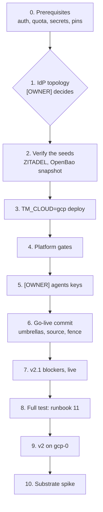

# 14 — The gcp-0 session: a full test, then v2 and v2.1 on GCP

This is an ordered checklist for bringing `gcp-0` up **alone** and running the Agent Factory on it. aws-0 is torn down.
Owner steps are marked **[OWNER]**. Everything else can be done by an agent holding the
kubeconfig.

Each step points to the runbook that holds its detail. Results go in that runbook's table, and the
cluster-level evidence goes in a `results-gcp-0-<date>.md`, as in
[the 2026-09-30 round](results-gcp-0-2026-09-30.md).

**Historical.** gcp-0 was torn down on 2026-10-29, and the factory has run on aws-0 since 2026-10-30 (Maku v0.32.3, [results](results-aws-0-2026-10-30.md)). The checklist stays for a gcp-0 rebuild, which is fresh, on a Maku release at least v0.32.0 (CRD group
`maku.ogenki.io`): no cluster may still run v0.30.x Rooms, or Flux prunes `rooms.agents.ogenki.io` and
every Room under it. Steps 1 and 6 are already on cloud-native-ref's `main`; check they still are.



## 0. Before the session

| # | Check | How |
|---|---|---|
| 0.1 | **[OWNER]** Interactive Google auth for both the CLI and ADC. A reauth can expire ADC mid-run with `invalid_rapt`, which needs this step again | `gcloud auth login`, then `gcloud auth application-default login`, then `gcloud auth application-default set-quota-project ogenki-435905` |
| 0.2 | **[OWNER]** The CPU quota fits the platform (sizing below) | `gcloud compute project-info describe --project ogenki-435905 --flatten=quotas --filter='quotas.metric=CPUS_ALL_REGIONS' --format='value(quotas.limit,quotas.usage)'` and `gcloud compute regions describe europe-west4 --project ogenki-435905 --flatten=quotas --filter='quotas.metric:(CPUS N2_CPUS E2_CPUS)' --format='table(quotas.metric,quotas.limit,quotas.usage)'` |
| 0.3 | **[OWNER]** Shell inputs | `export TF_VAR_tailscale_api_key=…`, plus AWS credentials for `opentofu/shared/*` (state, Route53 federation) |
| 0.4 | The Secret Manager entries the deploy reads exist (names only, never values) | `gcloud secrets list --project ogenki-435905 --format='value(name)'`. Required: `tailscale-k8s-operator-oauth`, `openbao-priv-gcp-{root-token,recovery-keys,ca-chain,intermediate-ca}`, `zitadel-envvars`, `zitadel-google-idp`. Required for the agent platform: `zitadel-github-idp`. Without it the deploy skips the GitHub link IdP and so never writes `room-broker-zitadel-reader`, the broker's link reader. Optional: `github-gha-runner-scale-set-default` (GHA runners only) |
| 0.5 | cloud-native-ref pins the releases under test | `flux/sources/ocirepo-ai-native-ref.yaml`: an ai-native-ref release on Maku v0.32.0; crossplane-configuration v0.9.29 (cloud-native-ref #2676) |
| 0.6 | Optional, decided now: serve the Substrate spike's APIs | `TF_VAR_enable_pod_certificate_apis=true` on step 3. It is safe to turn on later, but turning it off later replaces the cluster. It needs a control plane on 1.35 or later: `gcloud container get-server-config --zone europe-west4-a --format='yaml(channels)'` |

### CPU sizing

Every fixed machine is E2. Regional `E2_CPUS` reads usage 0 while E2 runs: E2 counts against `CPUS` and `CPUS_ALL_REGIONS` only, so `CPUS_ALL_REGIONS` is the one to watch.

| E2 capacity in europe-west4 | vCPU |
|---|---|
| `static` pool, `e2-standard-4` ×2 (max 3) | 8 (12) |
| `agents-gvisor`, `e2-standard-8` ×0–2, spot. The warm headroom, when on, keeps one up while the platform is live | 8 (16) |
| OpenBao `e2-small` ×1 and the Tailscale router `e2-micro` ×1, outside GKE | 4 |
| **Static total, both gVisor nodes up** | **≈ 28** |
| NAP ComputeClasses (`general-purpose` e2/n2, `io` n2) and the upgrade surge (one `e2-standard-4`) | on top, up to the 48 cluster ceiling (`autoscaling_max_cpu_cores`) |

| Quota, measured 2026-10-17 | Limit | Verdict |
|---|---|---|
| europe-west4 `E2_CPUS` | **24** (increase to 48 requested) | Not binding: it reads usage **0** with 30 E2 vCPUs running, and a second `e2-standard-8` starts |
| `CPUS_ALL_REGIONS` | 48 | **The binding one.** 30 used with one gVisor node; a second adds 8. It fits the static 28; only the cluster ceiling plus surge (≈ 56) exceeds it |
| europe-west4 `N2_CPUS` | 200 | Fits: the `io` class needs at least 16 |
| europe-west4 `CPUS` | 200 | Not a constraint |

Short of quota, the `e2-standard-8` cannot start (finding F3 of 2026-09-30) and NAP falls back to a
`nap-e2-standard-4` gVisor node, which cannot hold a `large` run.

## 1. [OWNER] The identity-provider topology

**Option A is on `main`** (`primary_cloud = "gcp"`, 2026-10-17). A session starts from step 2 unless it
changes the topology. With AWS primary, gcp-0 alone points every login at the dead
`auth.cloud.ogenki.io`, and the OIDC-client registration only warns and exits 0: the deploy reports
success while SSO is dead. The options:

| Option | What it costs | |
|---|---|---|
| A. GCP primary, restoring gcp-0's own seed `zitadel-20260828` | One host commit (below). The masterkey `zitadel-envvars` is already in GCP. The seed predates the rooms clients, and the deploy's `zitadel-oidc-clients.sh sync` creates them | **Chosen** |
| B. GCP primary, restoring AWS's `zitadel-pre-destroy` seed | Rsync the seed to GCS, copy the AWS masterkey, the PAT and eight client secrets, then mirror them into OpenBao. The migration guide misses the masterkey, `openbao-oidc` and `agents-rooms-proxy` | Highest fidelity, highest risk |
| C. GCP primary, a fresh directory | As A, and also drop `objectStoreRecovery`. Human users and IdP links are lost, so the first login and the admin grant are redone | Fallback if A's seed fails 2.1 |
| Keep AWS primary | gcp-0 cannot stand alone | No |

The 2026-09-30 round's directory is not an option: its masterkey lived only in-cluster, so its
archive cannot be decrypted.

The commit for A, in cloud-native-ref:

| File | Change |
|---|---|
| `opentofu/config.tm.hcl` | `primary_cloud = "gcp"` |
| `clusters/gcp-0/security/zitadel.yaml` | `suspend: false` |
| `clusters/aws-0/security/zitadel.yaml` | `suspend: true`. `validate-idp-topology.sh` fails a non-primary cluster that hosts |
| `opentofu/gcp/gke/configure/variables.tfvars`, `opentofu/gcp/workforce-identity/variables.tfvars` | `zitadel_project_id = "388252679236747629"`, the GCP directory's project, which the seed keeps. Both files must agree |

Gate: `./scripts/ci/validate-idp-topology.sh` prints `gcp hosts`. Rebuilding aws-0 later means
migrating back, because `aws/eks/configure` hosts unconditionally.

## 2. Verify the seeds (read-only)

| # | Check | How |
|---|---|---|
| 2.1 | The ZITADEL seed for the option chosen is restorable | `./scripts/ops/k8s/cnpg-promote-seed.sh --cloud gcp --bucket ogenki-435905-ogenki-cnpg-backups --verify-seed zitadel-20260828` |
| 2.2 | The OpenBao snapshot the rehydrate restores | `gcloud storage ls gs://ogenki-435905-ogenki-openbao-snapshot/`. The S3→GCS mirror's `*-awskms.snap` objects are refused by a gcpckms node with `SEAL MISMATCH`: name the newest `*-gcpckms.snap` in step 3 with `OPENBAO_SNAPSHOT_KEY`. Agents keys written after that snapshot are missing (step 5) |
| 2.3 | The rooms DB | gcp-0 starts it fresh unless opted in: [runbook 13, Step A0](13-rooms-restore.md#step-a0--gcp-0-opt-in), once a gcp-0 teardown has written `rooms-pre-destroy`. Run [Part B](13-rooms-restore.md#part-b--scratch-restore-on-a-live-cluster) later in the session for the RPO and RTO |

## 3. [OWNER] Deploy

```bash
cd opentofu && git pull   # deploys apply the checkout's disk, not main
TM_CLOUD=gcp OPENBAO_SNAPSHOT_KEY=<newest *-gcpckms.snap> \
  terramate script run deploy             # per 2.2; + TF_VAR_enable_pod_certificate_apis=true per 0.6
```

Run it from a shell whose `KUBECONFIG` names gcp-0 or nothing. Pointed at another cluster,
`helm-release-present.sh` answers "absent" and the deploy re-installs flux-operator, which fails
with `cannot re-use a name`.

**[OWNER] The admin PAT.** A ZITADEL restored from a seed has no admin PAT, so the OIDC-client sync
cannot authenticate. Mint one in the ZITADEL console for the IAM admin, store it as Secret
`security/iam-admin-pat`, and re-run the deploy: it persists the PAT to Secret Manager
`zitadel-iam-admin-pat`.

Afterwards, check the clouds rather than the log. Look first at `kubectl get certificate -n security`. Let's Encrypt allows
five certificates per identifier set per week, and a 429 there shows up as "ZITADEL not ready".

## 4. Platform gates

```bash
scripts/ops/k8s/gcp-0-platform-gates.sh <kube-context>   # read-only; exit 1 on any FAIL
```

[`gcp-0-platform-gates.sh`](../../../scripts/ops/k8s/gcp-0-platform-gates.sh) prints one PASS or FAIL per check:

| Area | It checks |
|---|---|
| Flux | Every unsuspended Kustomization and HelmRelease is Ready; the suspended ones are listed |
| Certificates | `security` (ZITADEL) and `infrastructure` (the Gateways) are Ready, with no Let's Encrypt 429 event and no errored Order |
| External Secrets | Every ClusterSecretStore and ExternalSecret is Ready |
| CNPG | Every Cluster is Ready and archiving; ZITADEL's restored `zitadel-20260828` (`--zitadel-seed none` expects option C's initdb) |
| ZITADEL | `identity_provider_url` is the cluster's own `https://auth.<domain>`, a replica is ready, discovery answers 200 with that issuer |
| OpenBao | `bao status` over the tailnet: initialized, `sealed=false`, no 20 s hang; the snapshot CronJob's last success |
| Nodes | Nodes by pool, all Ready, `static` at 2 |

Still by hand, from the [2026-09-30 round](results-gcp-0-2026-09-30.md): break-glass login, mounts,
public DNS and the gVisor smoke probe. **Step 9 (a scheduled snapshot) is the live re-run that F1's
fix still owes.**

## 5. [OWNER] The agents keys, once per GCP lineage

The snapshot (2.2) predates the keys written since, so expect gaps. Write each one that
`bao kv list -mount=agents` lacks, using the [owner actions](README.md#owner-actions-in-order)
(2, 2b, 2c, 4, 4b, 4c):

```bash
bao kv put -mount=agents zai api_key=-
bao kv put -mount=agents anthropic api_key=-
# Feature 15, public data only: the Kimi Code subscription key (api.kimi.ai/coding/v1, flat rate)
# and Mistral's (billing must be active first: pay-as-you-go, $20 cap). Selectable, never a default.
bao kv put -mount=agents moonshot api_key=-
bao kv put -mount=agents mistral api_key=-
bao kv put -mount=agents github-app app_id=<id> private_key=@<pem>
bao kv put -mount=agents factory-app app_id=<id> private_key=@<pem>
bao kv put -mount=agents merger-app app_id=<id> private_key=@<pem>
# factory-slack-app: one JSON document on stdin, runbook 22 §2
# runlore-intake + platform/runlore/factory-intake: retired by feature 14's PR 7 (README action 4d)
# Feature 14 (runbook 20): one webhook key, two mounts: the broker reads agents/, RunLore platform/.
KEY=$(openssl rand -base64 48 | tr -d '\n')
bao kv put -mount=agents runlore-webhook signing-key="$KEY"
bao kv put -mount=platform runlore/factory-webhook signing-key="$KEY"
unset KEY
# runlore-factory-principal and agents-runlore-principal: zitadel-oidc-clients.sh sync --apply (host)
```

Without `merger-app` the factory pod never starts.

`agents/factory-slack-app` is written by the owner from the Slack App's console (the bot token, the
signing secret and the bot's `U…` user id) and read by the ExternalSecret `factory-slack-app`. It is
optional until the App is switched on ([runbook 18](18-factory-interfaces.md)).

### Feature 15 providers, a smoke through the gateway

Once the two keys are seeded, with a public run's token (the identity proxy's `x-ar-model` pin is
what routes; a class names these aliases with `loops.<class>.models`, switched on for a live session only):

```bash
# GW = the public listener's address inside the cluster; TOKEN = a public role's run token
for A in kimi-frontier mistral-standard mistral-light; do
  curl -sS "$GW/v1/chat/completions" -H "authorization: Bearer $TOKEN" -H "x-ar-model: $A" \
    -H 'content-type: application/json' \
    -d '{"model":"agent-default","max_tokens":2048,"messages":[{"role":"user","content":"say ok"}]}' \
    | jq '{model, usage}'
done
```

Pass: each answers 200 with a `usage.prompt_tokens_details.cached_tokens` on the second identical call.
Kimi needs a generous `max_tokens`: its `reasoning_content` spends it before `content`. The same call on
an internal token answers 403, and Hubble shows no flow to `api.kimi.ai` or `api.mistral.ai` from a run pod.
Kimi is a flat-rate plan (tokens metered, nominal price, owner-accepted risk: plan terms aim at coding
tools, rate limits are personal) and processed in China, so public data only. Mistral is EU, public
only until the owner approves internal. Mistral works through the gateway but is not recommended as an
implementer: a run spent its budget on a 5-line pull request.

## 6. [OWNER] Go-live commit

**On `main` since 2026-10-17**; check it was not reverted. Going live takes a commit, not `flux resume`: the parent Kustomization
re-applies `suspend: true` at its next reconcile, so a resume does not stick. The cloud-native-ref
commit:

| File | Change |
|---|---|
| `clusters/gcp-0/flux/flux-sources.yaml` | The `OCIRepository/ai-native-ref` un-suspend patch, as in aws-0's |
| `clusters/gcp-0/ai-gateway.yaml`, `clusters/gcp-0/agent-platform.yaml` | `suspend: false`. `llm-platform` stays suspended |
| `.github/agent-factory.yaml` | `factory: gcp-0`. Only one factory may own the repository, so the auto-merge drill (runbook 12) runs on gcp-0 |

Gate: `flux get kustomizations -A | grep -v True` lists nothing but `llm-platform`.

## 7. The v2.1 blockers, live

```bash
scripts/ops/k8s/gcp-0-v21-checks.sh <kube-context>                   # after go-live: the headroom node, if on
scripts/ops/k8s/gcp-0-v21-checks.sh <kube-context> --gvisor-nodes 2  # during a large run
```

[`gcp-0-v21-checks.sh`](../../../scripts/ops/k8s/gcp-0-v21-checks.sh) is read-only. On a factory
pod co-located with ZITADEL it fails and prints the cordon commands, which it never runs.

On GKE the API server reaches pods through konnectivity-agent, so an ingress rule
`fromEntities: [kube-apiserver]` never matches there. A CNP that relies on it alone refuses the API
server's calls to pods (admission webhooks, the services proxy) on gcp-0 only. The fix is a sibling
rule from the `kube-system` konnectivity-agent pods on the same ports, inert on EKS;
[`test-cnp-konnectivity-sibling.py`](../../../scripts/ci/tests/test-cnp-konnectivity-sibling.py)
fails a CNP that lacks it.

| # | Blocker | What proves it closed | Scripted |
|---|---|---|---|
| 7.1 | The factory reaches the identity provider over GKE's network. Its CNP's IdP rule is a portless `toEntities: [all]`, as the broker's and rooms-proxy's are | The factory pod runs on a node with no ZITADEL pod; a co-located pod succeeds under any policy. Its log has `agent-factory starting`: the human verifier is eager, so that line follows the JWKS fetch, and a failed fetch exits with `initial JWKS fetch`. The live CNP carries the portless rule. The broker's `maku_rooms_authn_jwks_last_refresh_timestamp_seconds` for the IdP is under 6 h old, and neither `RoomAuthnJWKSStale` nor `RoomAuthnHumanIssuerNeverFetched` fires | Yes |
| | | A `maku` call to the run-request API (`:8082`) is accepted | No: the owner's human token |
| 7.2 | The E2 quota allows its nodes (sizing above). The factory sizes every run `small`, so a forced headroom preemption (a 5.6-vCPU stand-in for a `large` run) brings the second node | `agents-gvisor` holds the headroom pod at 1 node, then 2 for a `large` run. There is no `FailedScaleUp` or quota event, and no gVisor node outside `agents-gvisor` (the `nap-e2-standard-4` fallback). Events live about 1 h: run it right after the scale-up | Yes |

## 8. The full test: runbook 11 on gcp-0

Run [runbook 11](11-v1-validation.md) end to end, with `CLOUD=gcp`: its private hosts are then
`*.priv.gcp.ogenki.io` and its IdP `auth.gcp.cloud.ogenki.io`. Step 7 is one task end to end on release pins. Runbook 01's GKE notes apply:
`sandbox.gke.io/runtime`, no `agents-nodepool`.

## 9. v2 on gcp-0

| Feature | Live check |
|---|---|
| Warm sandboxes | Headroom off by default ([runbook 01](01-runtime-sandbox.md#headroom-off-by-default-on-for-production)). When on, `kubectl get pods -n agent-system -l app.kubernetes.io/name=agents-headroom -o wide` runs on an `agents-gvisor` node. Then the start-time runs still owed ([design results](../../superpowers/specs/2026-10-16-v2-warm-sandboxes-design.md#results)), the one forcing a preemption, and the day of idle cost on GKE prices |
| Per-person caps, shadow | [Runbook 04 Part C](04-gateway-secrets-budgets.md#part-c--per-person-caps-the-shadow-week): start the shadow week on gcp-0 |
| Gateway budgets, shadow + alerts | [Runbook 04 Part D](04-gateway-secrets-budgets.md#part-d--enforcing-the-agents-budgets): `AgentBudgetShadowOverrun` is evaluated, and the ratelimit server runs `SHADOW_MODE` |
| The internal tier on Claude | One `--class internal` run is answered through agentgateway's Anthropic backend, which proves `agents/anthropic` |
| The reviewer | A `pair` run's reviewer uses the implementer's model |
| Rooms | Follow, steer and approve one run in its room (runbook 11 steps 3–5) |
| Suspend | On on gcp-0 (`tooling/gcp-0/agent-factory/helm-values-suspend.yaml`, `infrastructure/gcp-0/room-broker/config.yaml`): [runbook 01 Step 8](01-runtime-sandbox.md#step-8--suspend-and-resume-a-waiting-run-gcp-0) |

## 10. The Substrate spike

The spike runs for two days against agent-sandbox ([alternatives](../../../website/content/docs/platform/ai-platform/agents/alternatives.md#agent-substrate)).
It needs step 0.6. Gate: `kubectl api-resources --api-group=certificates.k8s.io` lists
`podcertificaterequests` and `clustertrustbundles`. If it does not, check whether GKE also leaves a
feature gate off for the beta.

## Only a live run proves

- the cross-node JWKS fetch (7.1)
- the quota once it is raised (7.2)
- the scheduled OpenBao snapshot (F1)
- the headroom pod being scheduled and preempted by GKE's autoscaler, whose PriorityClass cutoff is -10
- the beta APIs (10)

The seed's restore and the rehydrate's snapshot choice are proven live (steps 1–3); the items
above only by render checks.
