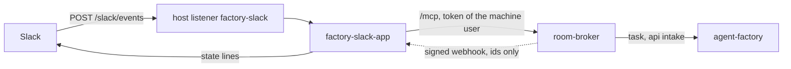

# 18 — Factory interfaces: the switch-on

Switches on the factory's second interface set on gcp-0: a sponsored principal (a ZITADEL machine user
that files tasks through intake `api`), the broker's signed webhooks, and the Slack App
(`factory-slack-app`). Design: [factory interfaces](../../superpowers/specs/2026-10-21-factory-interfaces-design.md).
Everything ships off (D4): no cluster lists the App, no config declares a principal or a subscriber, and
`tooling/base/agent-factory/slack-app/` and `tooling/gcp-0/agent-factory/slack-app/` are applied by nothing.
A session declares the switches in gcp-0's own copies and removes them after. See [README.md](README.md)
for `CLOUD`.



## 1. Prerequisites

- [ ] **[OWNER]** agent-platform v0.20.0 or later pinned (`flux/sources/ocirepo-agent-factory.yaml`).
- [ ] The host sync has run, and `agents/factory-slack-principal` is present in OpenBao
  (`bao kv get -mount=agents factory-slack-principal`: client id, secret, project id). gcp-0's deploy
  already runs the sync, so this is usually "check the key". To re-run it, use the line the host's deploy
  prints (`opentofu/gcp/gke/init/workflows.tm.hcl`), from the host checkout. Every flag is needed:
  without the OpenBao ones the ExternalSecrets stay on the previous directory's clients.

  ```bash
  IDP_URL=https://auth.<public_domain> PRIVATE_DOMAIN=<private_domain> \
    scripts/provision/zitadel-oidc-clients.sh sync --cluster gcp-0 --cloud gcp --project <project_id> \
    --workforce-pool <pool> --openbao-url https://bao.<private_domain>:8200 \
    --openbao-root-token-secret openbao-priv-gcp-root-token \
    --openbao-ca-file opentofu/gcp/gke/configure/.tls/ca.pem --mirror-openbao --apply
  ```

- [ ] **[OWNER]** The Slack App is created from the manifest of agent-platform's `docs/slack.md`, **without**
  `event_subscriptions.request_url` (the listener does not exist yet and Slack verifies the URL when
  it is saved; check 4 of section 5 sets it), and installed in the workspace.
- [ ] **[OWNER]** Noted: the team id (`T…`), the served channel ids (`C…`), the owner's Slack user id
  (`U…`) and the bot's `U…` user id (the App's page, "App Home", or `auth.test` with the bot token
  returns `user_id`).
- [ ] **[OWNER]** The Slack keys are in the store ([runbook 14](14-gcp-0-session.md#5-owner-the-agents-keys-once-per-gcp-lineage)):
  `bao kv put -mount=agents factory-slack-app bot-token=- signing-secret=- bot-user-id=<U…>`.

## 2. The token: go or no-go for everything below

Before any declaration is merged, prove that ZITADEL's token for the machine user carries what the broker
and the factory identify it by (R2). It needs only the sync and OpenBao.

```bash
curl -s -d grant_type=client_credentials \
  -d scope='openid urn:zitadel:iam:org:project:id:<project>:aud' \
  -u <id>:<secret> https://auth.<domain>/oauth/v2/token
```

Decode the access token: it must carry `client_id` equal to the stored client id and an `aud` holding
the project id. **If `client_id` is missing, stop here**: nothing is declared yet, and R2's fallback
(`userIDFile`, matched on `sub`) is a one-task change in agent-platform. Then, from the tailnet:

```bash
curl -s -o /dev/null -w '%{http_code}' -H "Authorization: Bearer <token>" https://rooms.<domain>/mcp
```

It answers `403`: no project role, so no `groups` for oauth2-proxy's `allowed-group` (L9, O-E).

Three ZITADEL checks belong here:

| Check | Expected |
|---|---|
| The same call with a wrong client secret | The error is `invalid_client` |
| The machine user's client id against its user name | Note whether they are equal (the host script's convergence assumes it) |
| A `scope=openid` grant, without the project audience | Note whether it returns 200 with no project role |

## 3. The host listener: a cloud-native-ref PR

The public listener is not merged: a merged listener orders a Let's Encrypt certificate (DNS-01,
Route53) on any running host, so it lands in the session (ruling L3'). Add this block to
`infrastructure/gcp-0/gapi-public/platform-public-gateway.yaml` after `policy-bot` (and to
`infrastructure/aws-0/gapi/platform-public-gateway.yaml` only if aws-0 ever runs the App), extend the
inventory comment at the top, and add "a `factory-slack` listener for `agent-system`" to H4 in the host
design §2. Merge it in the session.

```yaml
    # The agent factory's Slack App (factory interfaces F9): Slack posts its Events API callbacks
    # here, and the App verifies each against its signing secret (±5 min) before reading it. Routes
    # from agent-system only; its HTTPRoute matches POST /slack/events and nothing else.
    - name: factory-slack
      hostname: "factory-slack.${public_domain_name}"
      port: 443
      protocol: HTTPS
      allowedRoutes:
        namespaces:
          from: Selector
          selector:
            matchExpressions:
              - key: kubernetes.io/metadata.name
                operator: In
                values:
                  - agent-system
      tls:
        mode: Terminate
        certificateRefs:
          - name: factory-slack-public-tls
```

## 4. The ai-native-ref switch-on PR

One PR, in the session. `HOST_REF` moves to the host PR's merge, and `HOST-CONTRACT.md` goes to
version 4 (H4 gains the listener). Then:

| Where | Change |
|---|---|
| gcp-0's broker config copy, `infrastructure/gcp-0/room-broker/config.yaml` | `human.mcp.enabled: true`. It is required by `human.mcp.sponsored`, and it also opens human `/mcp` on the tailnet (L10). Then `human.mcp.sponsored: [{name: slack-app, clientIDFile: /etc/room-broker/sponsored/slack-app-client-id}]`, and the `webhooks` entry of the commented example in `infrastructure/base/room-broker/config.yaml` (full `room.*` event names, `secretFile`) |
| `scripts/ci/tests/test-room-broker-suspend.py` | Widen the parity: gcp-0's copy may differ from base in `suspend`, `webhooks` and `human.mcp` alone |
| The factory's gcp-0 values | A new ConfigMap, `tooling/gcp-0/agent-factory/helm-values-sponsored.yaml`, appended to the HelmRelease's `valuesFrom` as `helm-values-suspend.yaml` is (Helm deep-merges, so `config.api.sponsored` lands); the off-test's glob then needs that file exempted. It holds `projectIDFile: /etc/agent-factory-sponsored/project-id` and `api.sponsored` with the owner as `sponsor`, the owner's Slack id linked (`onBehalfOf.slack: {"T…/U…": <login>}`), `dailyUSD: 5`, `maxCostUSD: 2`. It needs `meter.prices`. The commented example is in `tooling/base/agent-factory/helm-values-configmap.yaml`. The factory mounts `/etc/agent-factory-sponsored/` with the keys `<name>-client-id` and `project-id`; the broker mounts its own at `/etc/room-broker/sponsored` |
| The App's config | A `configMapGenerator` with `behavior: replace` in `tooling/gcp-0/agent-factory/slack-app/`. It replaces the whole `config.yaml`, so the gcp-0 file is a full copy of base's with `teamID` and `channels` filled (each channel's `maxCostUSD` at most the principal's `maxCostUSD: 2`, for example `0.5`). The App refuses to start until both are filled. `brokerURL` stays `http://room-broker.agent-system.svc.cluster.local:8080`, with no path: the App appends `/mcp` |
| The webhook egress | `python3 -I scripts/ci/gen-webhook-egress.py --write .` writes `infrastructure/gcp-0/room-broker/network-policy-webhooks-patch.yaml`; list it under the gcp-0 overlay's `patches` |
| `clusters/gcp-0-agent-platform/tooling-factory-slack-app.yaml` | A Flux Kustomization, listed by that cluster's `kustomization.yaml` (block below) |
| `scripts/ci/tests/test-factory-interfaces-off.py` | Drop clause 1 for gcp-0, and clause 2 for gcp-0's copies |

```yaml
apiVersion: kustomize.toolkit.fluxcd.io/v1
kind: Kustomization
metadata:
  name: tooling-factory-slack-app
  namespace: flux-system
spec:
  prune: true
  interval: 5m0s
  retryInterval: 30s
  timeout: 5m0s
  path: ./tooling/gcp-0/agent-factory/slack-app
  sourceRef:
    kind: OCIRepository
    name: ai-native-ref
  postBuild:
    substituteFrom:
      - kind: ConfigMap
        name: gke-gcp-0-vars
  # The host's H2 Kustomizations only (AGENTS.md), plus its siblings: its ExternalSecrets read the
  # agents store, it calls the broker and the factory.
  dependsOn:
    - name: agent-secrets
    - name: room-broker
    - name: agent-factory
  healthChecks:
    - apiVersion: apps/v1
      kind: Deployment
      name: factory-slack-app
      namespace: agent-system
```

The webhook key is generated in the cluster by the External Secrets `Password` generator
(`room-broker-webhook-slack-app`): one Secret that both pods mount, regenerated with the cluster. Nothing
is written to OpenBao for it. Rotating it is a manual edit of that Secret (two base64 lines during the
overlap); the broker and the App re-read the key at use, so nothing restarts.

`task check` green, merge.

## 5. Checks

| # | Do | Expected reading |
|---|---|---|
| 1 | `for d in room-broker agent-factory factory-slack-app; do kubectl -n agent-system rollout status deploy/$d; done` | All three roll out |
| 2 | Read the factory's `/metrics` | `agent_factory_principal_sponsor_info` reads 1 |
| 3 | `kubectl -n agent-system get httproute` | The App's route attaches; external-dns publishes `factory-slack.<domain>` |
| 4 | Set the Slack App's request URL (event subscriptions) to `https://factory-slack.<domain>/slack/events` | Slack's request-URL challenge passes |

## 6. Live proofs

Run them in this order, after the checks. Each is the live half of an offline proof (the token is section 2).

### 6.1 Live proof 3: the api intake

Call the broker's `/mcp` with the token of section 2, from a pod in `agent-system`. Do not give that pod
the App's labels: it would join the App's Service endpoints and receive Slack events and webhooks while it
lives. Use other labels with a dedicated CiliumNetworkPolicy admitting it to the broker, or
`kubectl -n agent-system port-forward deploy/room-broker 8080:8080` and call `localhost:8080/mcp`:

| Call | Expected |
|---|---|
| `run_create` without `max_cost` | Refused; nothing is filed or created |
| `run_create` with `max_cost: 0.5` on a small `docs` issue text | A Task with `source.kind: api` appears, naming the principal and the sponsor; its room lists `system:slack-app` as a member |
| The run's spend | Charged to `system:slack-app` in the day ledger; the task ends `Escalated budget-task` or `Done` at or under $0.50 (`status.usage.costMicroUSD`) |

### 6.2 Live proof 2: webhooks

Replay a captured delivery at the App's `:8081` with an old timestamp, a flipped signature byte and an
edited `webhook-id`: each answers `401`. Add a cluster subscriber to the broker's config without
regenerating the egress: the gate fails in CI.

### 6.3 Live proof 5: Slack

In a served channel, post `@factory` with a draft.

| Do | Expected |
|---|---|
| A check mark from a second, unlinked Slack user | `Not filed: not_linked` |
| A check mark from the owner | The issue is filed (factory-authored, no label, the footer naming the sponsor); a Task with `source.kind: api` names the App and the owner; the thread receives `Triaged`, `A run started`, `Pull request #… opened` and `Ended` |
| The run asks an approval | The thread shows the room link; the approval is given on the room page |
| `conversations.replies(ts=<reply>, limit=1)` | Returns the reply, not the parent |
| A bot message | Carries `user=<bot U-id>` |
| The manifest's bot scopes | Suffice (`metadata.message:read` is not needed) |

### 6.4 Live proof 4: the api path

A draft carrying a zero-width character and an instruction-shaped line arrives stripped, fenced as
untrusted, and the run treats it as data.

### 6.5 Read the series

`agent_factory_max_cost_usd_total`, `agent_factory_api_intake_total`, `rooms_webhook_deliveries_total`,
`factory_slack_requests_total`; the `agent-identity` dashboard's Sponsored row shows the principal.

## 7. A changed bot user id

`kubectl -n agent-system rollout restart deploy/factory-slack-app`: the bot user id is the one file the
App reads only at start.

## 8. Off again

1. Revert the declarations in the ai-native-ref switch-on PR: the broker's `human.mcp` and `webhooks`, the
   factory's values file, the App's config, the Kustomization, the egress patch and the parity widening.
   **Keep** `HOST_REF` and HOST-CONTRACT v4: the listener stays in the host (it serves 404s), and
   removing it is a host PR. Regenerate the egress (`gen-webhook-egress.py --write .`), restore the two
   off-test clauses and merge.
2. Clear the Slack App's request URL, or disable its event subscriptions, or Slack keeps retrying into 404s.
3. Confirm the factory's intake is off (a port-forward is not subject to the CNP):

   ```bash
   kubectl -n agent-system port-forward deploy/agent-factory 8082:8082 &
   curl -s -o /dev/null -w '%{http_code}\n' -X POST localhost:8082/v1/tasks   # 404
   ```

4. Confirm the emitter is idle: `rooms_webhook_deliveries_total` stops moving and there is no
   `rooms_webhook_disabled` series (the broker's `/metrics`, or the metrics store).
