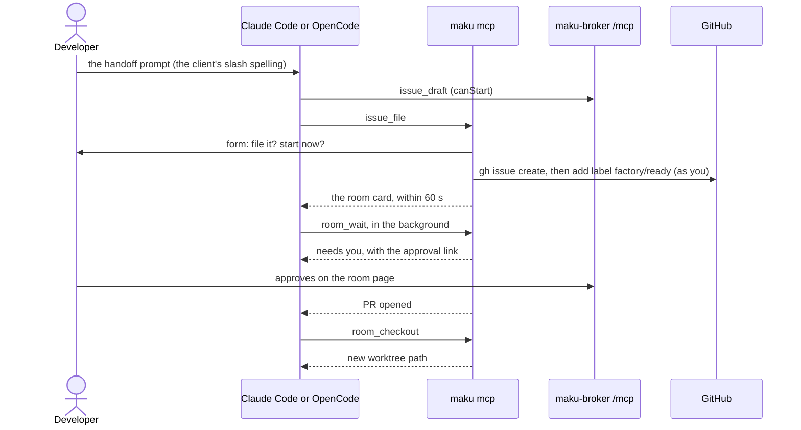

# 19 — The factory from your coding agent: the live proofs

Proves feature 13 on gcp-0, in Claude Code and in OpenCode: a developer hands a side task to the
factory from the session, follows it to an approval, and brings the branch back. Design:
[the factory from your coding agent](../../superpowers/specs/2026-10-25-factory-from-your-agent-design.md)
(its Gate lists the five proofs below). Everything ships off (D4): `human.mcp.sessionStart` is empty
in every committed config, so no repository offers the start. A session lists one repository in
gcp-0's own copy for these proofs and empties it after. See [README.md](README.md) for `CLOUD`.

## 1. Prerequisites

- [ ] **[OWNER]** Maku v0.23.1 or later pinned (`flux/sources/ocirepo-agent-factory.yaml`), and
  `human.mcp.enabled` on in base and gcp-0 (done by the pin PR).
- [ ] `maku` v0.23.1 or later, configured and logged in (`maku doctor`: `dns`, `tls`, `login`, `github` ok).
- [ ] Claude Code and OpenCode installed, each able to run a background subagent.
- [ ] The cloud-native-ref pull request that removes the drifted v0.11.0 `factory-handoff` skill copy
  (design PR 7, plan Task 8) is merged. Until it is, the doctor's `skill` check FAILs in every
  cloud-native-ref checkout (section 2, step 2).
- [ ] A test repository the factory serves, where the developer can write, and a small `docs` issue to
  file for proof 1.
- [ ] gcp-0 is up and the factory's intake is on (see [runbook 14](14-gcp-0-session.md)).

## 2. The switch-on and the setup

### 2.1 The switch-on, in the session's PR

| Where | Change |
|---|---|
| gcp-0's broker config copy, `infrastructure/gcp-0/room-broker/config.yaml` | `human.mcp.sessionStart: [<owner>/<repo>]` (one entry, `owner/name`). `sessionStart` needs `human.mcp.enabled` and `human.access` |
| `scripts/ci/tests/test-room-broker-suspend.py` | Widen the parity: gcp-0's copy may differ from base in `suspend` and `human.mcp.sessionStart` |
| `scripts/ci/tests/test-factory-interfaces-off.py` | Its `sessionStart` check skips gcp-0's copy |

### 2.2 Setup

| # | Do | Expected |
|---|---|---|
| 1 | `maku setup claude`, then `maku setup opencode` | Each prints the MCP registration (the client's own `mcp add`, or the snippet to paste) and the skill directory it wrote |
| 2 | `maku doctor` | Every check `ok`, `skill` included |
| 3 | `opencode`'s config after setup | The server sits under `mcp.servers.factory`, the shape `opencode mcp add` writes, and opencode lists it as connected. **Record the opencode version.** A docs-shaped `mcp.factory` that opencode ignores is a FAIL for `setup`'s snippet |
| 4 | In each client, list the MCP tools and prompts | `rooms_list`, `room_summary`, `room_changes`, `room_wait`, `room_checkout`, `issue_draft`, `issue_file`; prompts `handoff`, `status`, `inbox`. **Record the slash spelling** each client shows (`/factory:handoff` in OpenCode, `/mcp__factory__handoff` in Claude Code) |

## 3. Live proofs

Run each in Claude Code, then in OpenCode. Mark PASS or FAIL per client; a FAIL names what was seen.

| # | Do | Expected | Claude Code | OpenCode |
|---|---|---|---|---|
| 1a | `/factory:handoff` (OpenCode) or `/mcp__factory__handoff` (Claude Code), with the small `docs` issue | The agent drafts one issue; a form shows it with "start the factory now" defaulting to no | | |
| 1b | Answer file + start | The issue is filed and labelled `factory/ready`; GitHub's timeline shows the developer, not a bot, as the labeller; the room card appears within 60 s | | |
| 1c | In a second session, the model is asked to start the work without the form | No tool argument starts it: the form is the only path | | |
| 2a | "wait for it" (a background `room_wait`) | It returns when the run asks an approval, with the card and the approval link; the main session stayed usable meanwhile | | |
| 2b | In a client with URL forms | The URL form opens the room page at the approval, and only for a URL on the rooms host that came from the broker | | |
| 2c | Decide the approval on the room page, then "wait for it" again | The next wait returns on the pull request. Approvals stayed on the room page: no tool in the session approved | | |
| 3a | `/factory:status` | The card shows the runs line and the spend in dollars, with states in words | | |
| 3b | Force a resume (queue a note with `maku post <room> --queue`, or stop and restart the run), then ask for `room_changes` | The milestones appear; turns and tool calls are collapsed; a second call shows only what is new | | |
| 3c | **L8.** The same card from `rooms_list` and `room_summary` | The client displays the Markdown `content` text, not the JSON `structuredContent`. If a client shows the JSON instead, record which and FAIL: the view is hidden | | |
| 4a | `room_checkout` for the room | A new worktree appears beside the repository at the checked commit; the current checkout and its branch are untouched; a second call returns the same path | | |
| 4b | Plant `.opencode/plugins/<file>` in the room's branch (a test branch the factory pushed, or a fork of it), then `room_checkout` | The form lists the file and defaults to no; answering no creates nothing | | |
| 5 | Queue a hostile note (`maku post <room> --queue` with a link, a heading, a table row, an ANSI escape and a bidi character in the text), then show the card in both clients | Each appears as a quoted code span: no link, heading or table from the note, no escape in the terminal | | |

### 3.1 Checks collected during the build

| # | Do | Expected | Claude Code | OpenCode |
|---|---|---|---|---|
| a | Sign in with a deliberately wrong client id or a revoked token (`maku login`, then a tool call) | **Record ZITADEL's exact `invalid_client` wording** and what `maku doctor` and the tools return; the fix named must be one that works | | |
| b | Have a reviewer on a test PR delete their GitHub account (or use a known ghost user), then look at the card | **Record the login GitHub's GraphQL returns** for the deleted reviewer (a ghost, or null). The card must not crash or show an empty name | | |

## 4. Claude Code without forms

If Claude Code declares no form mode at `initialize`, proofs 1 and 4 run the no-forms path there and
the result says so:

| Proof | The no-forms path | Expected |
|---|---|---|
| 1 | `issue_file` refuses and tells the agent to show the draft; the developer files it with `gh`, and labels it | Nothing starts without the developer; the card then appears as in 1b |
| 4 | `room_checkout` for a branch with a flagged file | It refuses and names the file; a clean branch still checks out |

Record "no forms" in the user guide's portability table, in the Forms cell.

## 5. Off again

1. Empty `human.mcp.sessionStart` in gcp-0's broker config copy, and revert the parity widening and the
   off-test skip. `test-factory-interfaces-off.py` passes on `main`. **Keep** `human.mcp.enabled`
   (on since v0.23.1).
2. Remove the planted `.opencode/plugins/` test branch and the checked-out worktrees
   (`git worktree remove <path>`).
3. In the user guide's portability table (`website/content/docs/platform/ai-platform/agents/user-guide.md`),
   the Claude Code and OpenCode Status cells become `proven, <date>`, and fix any cell a proof
   contradicted. In the design's Status line, replace "live proofs wait" with the session's date.
4. File the three recorded wordings (opencode's shape, ZITADEL's `invalid_client`, the deleted
   reviewer's login) where the next reader finds them.
