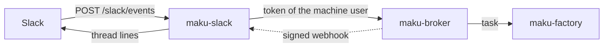

# 22 — Slack: configure

The one-time set-up of the factory's Slack App, in order, with a check after each step. It is the
short path for an operator. [Runbook 18](18-factory-interfaces.md) is the switch-on of the whole
second interface set (host listener, broker webhooks, the PR that turns it on); this page is what
you do around it with Slack. Users read the
[user guide](../../../website/content/docs/use/guide/_index.md)
instead. The App's own reference (config keys, flows, state) is Maku's `docs/slack.md`.



| Piece | Where it is declared |
|---|---|
| The App, its token and signing secret | Slack console, then OpenBao `agents/factory-slack-app` (step 2) |
| The App's identity to the factory | ZITADEL machine user, OpenBao `agents/factory-slack-principal` (step 3) |
| Team, channels, repositories per channel | `tooling/gcp-0/agent-factory/slack-app/config.yaml` (step 5) |
| Who may file, and the repositories the App may file in | `tooling/gcp-0/agent-factory/helm-values-sponsored.yaml` (step 5, 6) |
| Which repositories get state lines back | `infrastructure/gcp-0/room-broker/config.yaml`, `webhooks` (step 5) |

Set the shell once. The OpenBao root token comes from Secret Manager; it is never printed.

```bash
export VAULT_ADDR=https://bao.<private_domain>:8200
export VAULT_CACERT=opentofu/gcp/openbao/management/.tls/ca.pem   # from the cloud-native-ref checkout
export VAULT_TOKEN=$(gcloud secrets versions access latest --secret openbao-priv-gcp-root-token \
  --project <project_id> | jq -r .token)
```

Check: `bao status` shows `Sealed false`.

## 1. [OWNER] Create the Slack App

1. Open the manifest in Maku's [`docs/slack.md`](https://github.com/Smana/maku/blob/main/docs/slack.md#manifest).
   Take it as is, but **remove `request_url`** for now: Slack checks the URL on save and the listener
   does not answer yet (step 4 sets it).
2. api.slack.com/apps, **Create New App**, **From a manifest**, pick the workspace, paste the JSON.
3. **Install to Workspace**, then allow.
4. In Slack, open the served channel and run `/invite @factory` (private channels too).

What the manifest gives you, for reference:

| | Value |
|---|---|
| Bot events | `app_mention`, `reaction_added`, `message.channels`, `message.groups` |
| Bot scopes | `app_mentions:read`, `chat:write`, `reactions:read`, `channels:history`, `groups:history` |
| Not enabled | slash commands, socket mode |

The App serves interactivity on the **same** Request URL as its events,
`https://factory-slack.<public_domain>/slack/events` (step 4): the buttons of an approval card arrive
there. A manifest carried from before that change needs the console step in section 4 — and a
reinstall if Slack asks for one.

An App made from an older manifest lacks `message.channels` and `message.groups`: add them under
**Event Subscriptions**, then reinstall. Without them, replies that edit a draft are never seen.

Collect four ids and two secrets:

| What | Where | Looks like |
|---|---|---|
| Team id | Slack web URL `app.slack.com/client/T…/C…`, or the workspace's **About** | `T07J97G2K2P` |
| Channel id | The channel's name, **View channel details**, bottom of **About** (or the web URL) | `C0CC4M8SNVD` |
| Bot user id | **App Home**, or `auth.test` with the bot token (`user_id`) | `U0…` |
| A user's id | Their profile, **More**, **Copy member ID** | `U07JY4EQNDN` |
| Bot token | **OAuth & Permissions**, **Bot User OAuth Token** | `xoxb-…` |
| Signing secret | **Basic Information**, **App Credentials** | 32 hex characters |

Check: the bot appears in the channel's member list, and its App Home shows the bot user.

## 2. [OWNER] Store the keys in OpenBao

`bao kv put` reads one JSON document from stdin with `-`. Type each secret at a hidden prompt, and
let `printf` (a shell builtin, so nothing shows in `ps`) hand it over:

```bash
read -rsp 'bot token: ' TOK; echo
read -rsp 'signing secret: ' SIG; echo
read -rp  'bot user id (U…): ' BOT
printf '{"bot-token":"%s","signing-secret":"%s","bot-user-id":"%s"}' "$TOK" "$SIG" "$BOT" \
  | bao kv put -mount=agents factory-slack-app -
unset TOK SIG BOT
```

Check, without printing a value: `bao kv get -mount=agents -format=json factory-slack-app | jq '.data.data | keys'`
returns `["bot-token","bot-user-id","signing-secret"]`.

A changed bot user id needs `kubectl -n agent-system rollout restart deploy/factory-slack-app`: it
is the one value the App reads only at start.

## 3. The machine user the App acts as

The App calls the broker with the token of a ZITADEL machine user. The host's sync creates it
(`factory-slack-app`) and writes `agents/factory-slack-principal` (client id, secret, project id).
gcp-0's deploy usually ran it already. Check first:

```bash
bao kv get -mount=agents -format=json factory-slack-principal | jq '.data.data | keys'
# ["client-id","client-secret","project-id"]
```

If the key is missing, run the sync from the cloud-native-ref checkout. **Every flag is needed**; a
partial line fails with `--cluster is required` or an `IDP_URL` error:

```bash
IDP_URL=https://auth.<public_domain> PRIVATE_DOMAIN=<private_domain> \
  scripts/provision/zitadel-oidc-clients.sh sync --cluster gcp-0 --cloud gcp --project <project_id> \
  --workforce-pool <pool> --owners scripts/provision/zitadel-owners.yaml \
  --openbao-url https://bao.<private_domain>:8200 \
  --openbao-root-token-secret openbao-priv-gcp-root-token \
  --openbao-ca-file opentofu/gcp/gke/configure/.tls/ca.pem --mirror-openbao --apply
```

Check: the `bao kv get` above lists the three keys. Then
`kubectl -n agent-system get externalsecret` shows the Slack App's and the factory's as `SecretSynced`.

## 4. The Request URL

Needs the App running ([runbook 18](18-factory-interfaces.md), sections 3 to 5, merged). Probe the
route unsigned first:

```bash
curl -s -o /dev/null -w '%{http_code}\n' -X POST https://factory-slack.<public_domain>/slack/events
```

Check: `401`. That is correct: the App refuses what is not signed. A `404` means the host listener or
the HTTPRoute is missing (`kubectl -n agent-system get httproute`); a timeout means DNS or the
certificate is not ready.

Then, in the Slack console, **Event Subscriptions**, turn it on and set the **Request URL** to
`https://factory-slack.<public_domain>/slack/events`.

Check: Slack shows **Verified**. Save, and reinstall if Slack asks.

Then the card buttons. **Interactivity & Shortcuts**, turn **Interactivity** on and set its
**Request URL** to the same `https://factory-slack.<public_domain>/slack/events`, then **Save**.

Check: Slack accepts it. The App verifies signatures there already, so the URL verification Slack
runs on save is the events one that passed above.

## 5. Declare the channel, in git

One PR on ai-native-ref. A channel's repositories are listed in **three** places, and all three must
agree. A channel that lists a repository the other two do not is the usual failure: the draft works,
then a check mark on a draft whose repository the channel does not list is ignored without a word, the factory refuses a repository it does not list (`repository_not_allowed`), or the thread never hears about the run.

| # | File | Key | What it governs |
|---|---|---|---|
| 1 | `tooling/gcp-0/agent-factory/slack-app/config.yaml` | `channels.<C…>.repositories` | The repositories a mention may name there |
| 2 | `tooling/gcp-0/agent-factory/helm-values-sponsored.yaml` | `api.sponsored[slack-app].repositories` | The repositories the factory lets the App file in |
| 3 | `infrastructure/gcp-0/room-broker/config.yaml` | `webhooks[slack-app].repositories` | The repositories whose room events reach the App |
| 4 | `infrastructure/gcp-0/room-broker/config.yaml` | `human.slackDecide` | The route a card's buttons call, and the principal they act as |

Row 4 is not a repository list: it is what turns the App's buttons into decisions (the two switches,
below).

```yaml
# 1. slack-app/config.yaml — a channel that draws approvals as cards
teamID: T07J97G2K2P
channels:
  C0CC4M8SNVD: {repositories: [Smana/cloud-native-ref, Smana/ai-native-ref], maxCostUSD: 0.5, approvals: true}
# 2. helm-values-sponsored.yaml, under api.sponsored (name: slack-app)
repositories: [Smana/cloud-native-ref, Smana/ai-native-ref]
# 3. room-broker/config.yaml — the decide route, and the close event. The events list changed, so the
# subscriber's generation is bumped and the broker restarted: webhooks apply at restart only.
human:
  slackDecide: {principal: slack-app, teamID: T07J97G2K2P}
webhooks:
  - name: slack-app
    generation: 2
    events: [room.task_triaged, room.run_started, room.waiting_for_human, room.pr_opened,
             room.verdict_posted, room.merged, room.reverted, room.budget_reached, room.ended,
             room.approval_closed]
    repositories: [Smana/cloud-native-ref, Smana/ai-native-ref]
```

- The two switches fail differently. The broker's `human.slackDecide` is the authority: a card whose
  broker has no `slackDecide` answers `unavailable` when pressed. The channel's
  `approvals: true` is who gets the affordance. Turning the channel's off is the fast rollback.
- `human.slackDecide` needs `human.access`, and its `principal` names one of `human.mcp.sponsored`.
- The `webhooks` entry changes here, so its `generation` is bumped — the entry carries none today,
  and an absent generation reads as 1, so the first explicit value is `2`. A `webhooks` change is
  read at startup: a `configMapGenerator` roll alone is not guaranteed to be the read that counts,
  and a subscriber the emitter disabled stays disabled until the bump. Restart the broker by hand.
- `maxCostUSD` per channel is the cap each filed task gets (at least 0.01, at most the principal's
  `maxCostUSD: 2`).
- A channel with **one** repository lets users leave it out of their mention. With several, a mention
  without one is refused with a `Try:` line.
- The App refuses to start with an empty `teamID` or no channel.
- Adding a repository to #1 and #2 is not enough: also add it to #3, or state lines never arrive.

Merge, then check: `kubectl -n agent-system rollout status deploy/factory-slack-app deploy/room-broker deploy/agent-factory`
all succeed, and `kubectl -n agent-system logs deploy/factory-slack-app | head` shows no config error.

```bash
kubectl -n agent-system rollout restart deploy/room-broker
kubectl -n agent-system rollout status deploy/factory-slack-app deploy/room-broker
```

Check: both rollouts complete, and `kubectl -n agent-system logs deploy/room-broker | head` shows it
read its config with the new subscriber list.

## 6. Who may file

A Slack user may file only when the factory knows whose GitHub account they are, in one of two ways.

**Self-serve link** (Maku v0.29.9; gcp-0 has it on). It needs both sides: the broker's
`human.slackLink: {principal: slack-app, teamID: <T…>, repository: <owner/name>}` in
`infrastructure/<cloud>/room-broker/config.yaml` (it needs `human.access`), and `slackLinks: true` under the
principal's `onBehalfOf` in `helm-values-sponsored.yaml`. The user mentions `@factory link`, opens the
ephemeral one-time URL (10 minutes), signs in and presses **Link**; `@factory unlink` removes it. The link
names the ZITADEL account, and the factory reads its **current** GitHub login at each use. The release's
`slack_links` migration arrives with the `atlasSchema.ref` pin. `users:read` in the Slack App is optional
(without it the page shows the user's id only).

**Git** (always wins over a link), in `helm-values-sponsored.yaml`:

```yaml
onBehalfOf:
  slack: {"T07J97G2K2P/U07JY4EQNDN": Smana, "T07J97G2K2P/U0ANOTHER": other-login}
  slackLinks: true
```

Key: `<team id>/<Slack member id>`. Value: the GitHub login. Either way the login must be in the factory's
`maintainers` list (`tooling/base/agent-factory/helm-values-configmap.yaml`), or the refusal is
`not_a_maintainer`. A Slack user with neither gets `Not filed: not_linked`. A git entry goes in the same kind
of PR as step 5 (the factory rolls on a change).

Check: a second user mentions `@factory link`, confirms the page, and their check mark files (step 7); before
that, their check mark answers `not_linked`; after `@factory unlink`, `not_linked` again.

## 7. Verify end to end

In the served channel, with a linked maintainer:

| Do | Expected |
|---|---|
| Post `@factory <owner/repo> docs: fix a typo in the readme` | A draft in the thread within seconds: an intro line, `What is wrong`, `What it should be`, `Acceptance check`, a hint to reply or react |
| Reply in the thread `Title: docs: fix a typo in the README` | A second, newer draft |
| Add the reaction white check mark to the **latest** draft (hover, **Add reaction**) | `Filed #N for @you; the factory starts it. Room: <link>`; the issue exists on GitHub, authored by the factory, its footer naming the sponsor |
| Wait | `Triaged. Room: …`, `A run started.`, `Pull request #… opened.`, then `Ended, state: …` |
| Same reaction from an unlisted user, in a new thread | `Not filed: not_linked` |

A channel with `approvals: true` whose broker declares `human.slackDecide` draws a `forge.push`
approval as a card with two buttons. The eight proofs below close that half; the evidence each leaves
— log lines, metric series, room events — is the design's
[live proofs](../../superpowers/specs/2026-11-05-v3x-slack-push-approval-design.md#live-proofs) table.

| Do | Expected |
|---|---|
| Press **Approve** twice quickly, then replay the same interaction (re-POST the signed body) | One decision, one answer to the clicker; the second press reads `already_decided`; the card is inert once |
| Let a card's deadline pass in a room whose sweep interval is longer than your wait, then press **Approve** after it | `approval_expired` both times, no decision, the row `expired` |
| Press from a Slack user with no link, then a linked user who is not an approver, then a linked approver whose GitHub login cannot write the repository | `not_linked`, `not_permitted`, `repository_permission`; no decision |
| A person who prompted the run presses **Approve**; a second approver presses afterwards | `four_eyes`, then decided; the room log names only the second human |
| Tamper the signed body (change the branch), POST it unsigned, then post a card of another room's approval into this channel | `ignored`, `401`, `binding_mismatch`; no event in either room |
| Provoke a `forge.pr` or a `shell.high` approval in the same thread | A text line with the room link and **no** button; the `forge.push` card beside it keeps its buttons |
| Approve on the card in the same second the room page answers, twice over (the page wins once, the card once) | Exactly one decision each time; the loser reads `already_decided` or `superseded`; the card goes inert |
| Take the App's `chat:write` away (or stub Slack's 5xx), then decide a card | The decision lands, the failed card update is logged and counted, and the stale card answers `already_decided` |

If a step does not answer, find where it stopped:

| Symptom | Look at |
|---|---|
| No reaction to the mention at all | `kubectl -n agent-system logs deploy/factory-slack-app`; `factory_slack_requests_total{outcome="bad_signature"}` (wrong signing secret), `ignored` (wrong team, unserved channel); the bot is invited |
| Draft posted, check mark does nothing | The check mark is not on the latest draft, or the Slack user is not linked (step 6) |
| Filed, but no state lines | The repository is missing from the broker's `webhooks` (step 5, #3), or the subscriber is disabled: bump `generation`, restart the broker (Maku `docs/slack.md`, State) |
| `Not filed: repository_not_allowed` | The repository is missing from #2 |
| `Not decided: only this room's approvers decide here` (`result=not_permitted`) | The clicker is neither the room's owner nor one of its approvers (the CR's `spec.members[].approver`). A ZITADEL admin outside the CR cannot decide from Slack (D15); they decide on the room page |
| `Not decided: your GitHub account cannot write to this room's repository` (`result=repository_permission`) | The linked GitHub login has read only on that repository |
| `Not decided: you prompted this run` (`result=four_eyes`) | The clicker prompted the run, so another approver decides it |
| `Not decided: the factory could not be reached just now` (`result=unavailable`) | The broker's `human.slackDecide` is off, or the store, the room or the log could not be read. Check `human.slackDecide` first, then the broker's logs |

The series: `factory_slack_requests_total{route,outcome}`, `maku_factory_api_intake_total`,
`maku_rooms_webhook_deliveries_total`. Turning it off again is [runbook 18, section 8](18-factory-interfaces.md#8-off-again).
