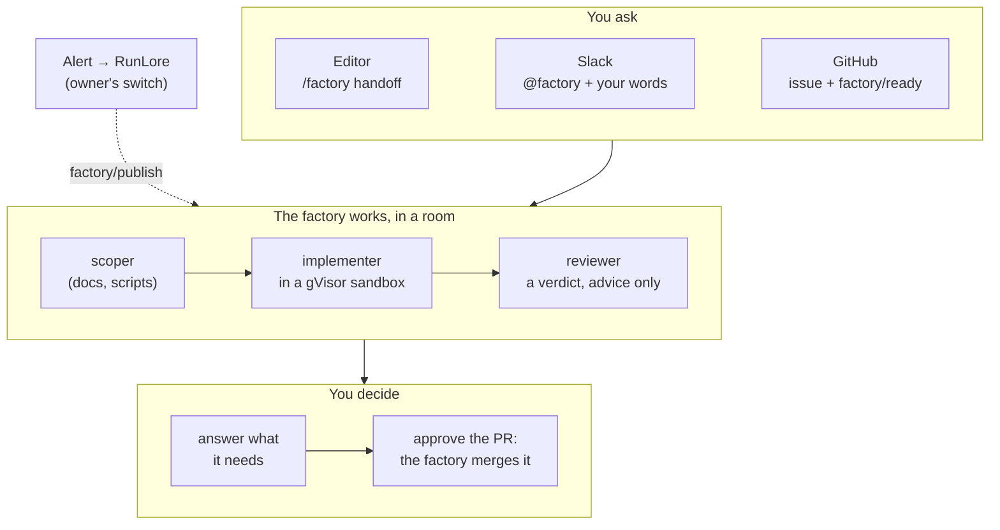

# 23 — Showcase: the Agent Factory for developers

A presenter's script for showing developers, live on **aws-0**, what the Agent Factory does for them:
hand work over from the editor or from Slack, follow it, answer what it needs, and approve its pull
request to merge it. It runs in 30 or 60 minutes, plus seeds an hour before. This page holds the script:
what to type and what to point at. The explanations are in the
[user guide](../../../website/content/docs/use/guide/_index.md). Link the audience there; do not read it
to them.

| | |
|---|---|
| Cluster | aws-0 (`factory: aws-0` in both repositories' `.github/agent-factory.yaml`) |
| Versions | Maku v0.40.0 for the factory, the broker and the Slack App, as the host pins it |
| Repositories | `Smana/cloud-native-ref` for the editor, the tester and the split. `Smana/ai-native-ref` for Slack and the planner |
| Who | A presenter, and a maintainer (`maintainers: [Smana]`) who confirms, labels and approves |
| Cost of a 60-minute run | About $15 expected, $45 at every cap. Each live scenario runs twice, seed and live ([cost](#cost)) |
| Shared state it changes | Two optional switch PRs on aws-0's config; real issues, PRs and merges on two public repositories; posts in the served Slack channel |

Name the open-source part behind each capability:

| Part | What it does in the demo |
|---|---|
| Maku | `maku-factory` (intake, triage, runs, narration, the gate), `maku-broker` (rooms, approvals, the MCP server), `maku-slack`, the `maku` CLI |
| OpenHands, gVisor, Kueue | The agent loop, the sandbox it runs in, the queue that admits it |
| agentgateway | Every model and tool call: checked against the role's profile, metered, budgeted |
| octo-sts | Each run's short-lived GitHub token, one repository |
| RunLore | Investigates alerts and hands the fix to the factory |
| policy-bot, Kyverno, ZITADEL, Grafana | The merge gate, the one way to create a run, sign-in, the dashboards |

## What not to promise {#do-not-promise}

| Do not promise | What is true |
|---|---|
| Auto-merge beyond link fixes | Only cloud-native-ref's `docs-links` and `revert` merge with no person. Everything else comes to a maintainer, whose approval is the merge |
| Approving or steering from Slack or the coding agent | Steering is the room page's alone. Slack decides one `forge.push` card, and only if a run asks; no MCP tool approves, steers, stops or labels |
| The planner on any repository | It plans for `Smana/ai-native-ref` and `Smana/runlore-kb` only, and only the `docs-links` class. A Slack plan needs a linked user |
| The Settings pages | Built in Maku v0.40.0 (policy editor, promotion, evidence, approval memory) but off on aws-0: `/settings` answers `404` |
| A change across two repositories | Plan mode only: `coordination_plan` composes and hashes a plan and files nothing |
| Mistral as an implementer | Not recommended ([providers](../../../website/content/docs/how-it-works/providers.md)) |
| The scoper on every task | Only on the `docs` and `scripts` classes |

## Prep {#prep}

### The day before

| # | Do | Expected |
|---|---|---|
| 1 | `kubectl -n agent-system get deploy -o custom-columns='NAME:.metadata.name,IMAGE:.spec.template.spec.containers[*].image' \| grep maku-` | The factory, the broker and the Slack App on `…:v0.40.0@sha256:…` |
| 2 | `kubectl -n agent-system get tasks` | Fewer than 3 tasks active and fewer than 5 `AwaitingHuman` (`caps.activeTasks`, `caps.awaitingHumanWIP`). Close or finish the others, or the demo's tasks wait |
| 3 | Presenter's laptop: tailnet up, the platform CA trusted, `maku login`, `maku setup claude` (or `opencode`), `maku doctor` | Every line `ok`. In the client, `/factory` lists `handoff`, `status`, `resume`, `inbox` |
| 4 | In Slack's served channel, `@factory link`, open the DM's link, press **Link** | The presenter's Slack user files as their GitHub login ([guide, ch. 3](../../../website/content/docs/use/guide/your-first-task.md#paths)) |
| 5 | Read [session switches](#switches) and agree each with the owner | A PR merged, or "not needed today" |
| 6 | Pre-open the browser tabs ([the set](#set)) once, so Grafana caches its panels | |
| 7 | Rehearse scenario 1 end to end off camera | The real timings. Note them over the agenda's |

### Session switches {#switches}

A **session switch** is a setting the owner turns on for a live session and off in its last commit
([runbooks README](README.md#state)). Each one is a PR to shared aws-0 config, merged by the owner.

| Switch | Value for the demo | Off again | Needed by |
|---|---|---|---|
| Start from the form | `human.mcp.sessionStart: [Smana/cloud-native-ref]` in `infrastructure/aws-0/room-broker/config.yaml`. **On today** (since #244): check before you change anything | `sessionStart: []` | Scenario 1: "start the factory now" in the form. Without it, file, then label |
| The tester on `scripts` | cloud-native-ref's `classes.scripts: {checks: true, testFirst: true}` in `tooling/base/agent-factory/helm-values-configmap.yaml` ([runbook 21 §0](21-test-first-tester.md#0-preconditions)) | `{checks: false, testFirst: false}` | Scenario 1's tester variant only |
| RunLore | [Runbook 25 §1](25-runlore-kb-phase-1.md#1-switch-on-in-this-order): a PR here, a release, and a host PR | [§7](25-runlore-kb-phase-1.md#7-switch-off-in-this-order-the-reverse) | Scenario 8 live. Not recommended for a showcase: a verdict needs about 2 h 15 after the merge |

Already on, nothing to switch: the scoper on `docs` and `scripts`, the completion judge on both, the
splitter on `scripts`, Slack proposals, the planner, coordination plan mode, approve-to-merge on all three
repositories, and the Kimi reviewer on `docs-links`.

After Flux reconciles a switch: `kubectl -n agent-system logs deploy/agent-factory | grep -c 'config warning'` → `0`.

### Seeds, an hour before {#seeds}

A run takes 10 to 20 minutes to reach a pull request. For each live scenario, start one copy an hour
before, so a finished room, PR and card are ready while the live copy runs.

Keep each seed's text on the presenter's machine (`~/.cache/v3/drills/`), never in a repository the agents
read: an agent that finds the script answers the script, not the issue. Reword a seed before it runs again.

| Scenario | Seed | Repository, how it starts |
|---|---|---|
| 1 | One defect with an observable acceptance check, the shape of cnref #2759 | cloud-native-ref, `/factory handoff` |
| 1, tester | A small host script change a suite under `scripts/ci/tests/` can pin (drill T1's shape) | cloud-native-ref, `class:scripts` then `factory/ready` |
| 2 | One broken relative link in a runbook, typed live | ai-native-ref, Slack |
| 3 | A docs issue with no acceptance check | ai-native-ref, `class:docs` then `factory/ready` |
| 4 | A hard issue of three separable parts, the shape of cnref #2672 | cloud-native-ref, `class:scripts` then `factory/ready` |

### The set {#set}

Hide notifications and other tabs, and never run `maku token` on screen. Tabs, in order:

1. `https://rooms.priv.aws.ogenki.io/`, the room list, filter **needs me**
2. The seed issues and PRs on GitHub
3. `https://grafana.priv.aws.ogenki.io/d/agents-overview`
4. `https://grafana.priv.aws.ogenki.io/d/agent-identity`
5. Slack, the served channel
6. A terminal in a fresh cloud-native-ref worktree on `main`, with Claude Code or OpenCode

## Agendas {#agendas}

Start each live copy first, show its seed while it runs, then come back to the live copy.

| Time | 30 minutes | 60 minutes |
|---|---|---|
| 0:00 | The diagram, what not to promise (3 min) | The diagram, what not to promise (4 min) |
| | [1](#s1), from your editor (10 min) | [1](#s1), from your editor (10 min) |
| | [2](#s2), from Slack (8 min) | [2](#s2), from Slack (8 min) |
| | [6](#s6), approve to merge, on scenario 1's PR or its seed (5 min) | [3](#s3), the factory asks back (5 min) |
| | Questions (4 min) | [4](#s4), too big for one PR (6 min) |
| | | [5](#s5), watch and steer (6 min) |
| | | [6](#s6), approve to merge (5 min) |
| | | [7](#s7), across two repositories (4 min) |
| | | [8](#s8), from an alert to a verified fix, a finished one (4 min) |
| | | [9](#s9), guardrails and cost (4 min) |
| | | Questions (4 min) |

For an audience that writes vague tickets, swap [3](#s3) into the 30-minute slot in place of 6.

## Scenario 1 — From your editor {#s1}

**Takeaway:** one line in your coding agent files the chore; the factory does it in a sandbox and checks
it; you approve. Guide: [ch. 3, coding agent](../../../website/content/docs/use/guide/your-first-task.md#paths),
[ch. 8](../../../website/content/docs/use/guide/terminal-and-coding-agent.md).

| # | Do | Point at |
|---|---|---|
| 1 | `/factory handoff <the defect, with an Acceptance: line>` | Your agent calls `intake_plan`. On cloud-native-ref it answers `repository_not_allowed` (the planner's list), so the agent writes the issue in three sections and has `issue_draft` check it |
| 2 | The form: **file** yes, **start** yes | The issue is filed and labelled `factory/ready` with your own `gh`, as you. The agent cannot answer the form |
| 3 | "wait for it", then ask an unrelated question | `room_wait` runs in a background task; the session stays usable |
| 4 | Open the seed's room from the room list | Status line, facts, **NEXT**, **NOW**, the run rail: implementer, then reviewer |
| 5 | `/factory status #<seed issue>` | The same card in the terminal: runs, spend against the cap, PR, verdict |
| 6 | "check it out", on the seed | `room_checkout`: a new worktree beside the repository; your checkout untouched |
| 7 | Hand the seed's PR to [scenario 6](#s6) | |

**Variant, the tester** (switch on): file the seed with **start** no, then
`gh issue edit <n> -R Smana/cloud-native-ref --add-label class:scripts` and then `--add-label factory/ready`.
The class must come first, or the task is class `review`, with no scoper and no tester. Point at:
the scoper's bounded task, the tester's `contract_ready` note and its "contract of N tests" comment, the
**Test contract 🧪** check on the PR, and the judge.

**Example:** cnref #2759 → PR #2760: the implementer took about 9 minutes, the reviewer 2, $0.16 in all.

## Scenario 2 — From Slack {#s2}

**Takeaway:** say it in your own words; read the proposal; a maintainer confirms; the thread answers
how it is going. Guide: [ch. 3, Slack](../../../website/content/docs/use/guide/your-first-task.md#paths),
[Slack reference](../../../website/content/docs/use/slack.md).

| # | Do | Point at |
|---|---|---|
| 1 | `@factory docs/runbooks/agent-factory/<page> links to <x>, which does not exist. It should link to <y>.` | One proposal message within seconds: repository with its evidence, the issue as it will be filed, roles `scoper, implementer, reviewer`, ceiling $2.00 (`class:docs-links.taskUSD`) |
| 2 | Reply in the thread: `the acceptance check should also say no other page links to the old name` | The same message updates; changed sections read `‹changed›` |
| 3 | The maintainer presses **Confirm** | `Filed #N for @you, sponsored by GitHub @<login>; the factory starts it.` and the room link |
| 4 | In the seed's thread, reply `status`, then `needs me`, then `stop` | Answers read from the room. `stop` only says where the label goes: nothing in a thread steers or stops |
| 5 | On the seed's PR, point at the reviewer | Its verdict comes from Kimi K3.1 Pro, another model family (the `docs-links` reviewer) |

The task is charged to the `slack-app` principal: $5 a day, so at most two Slack tasks at full ceiling.

## Scenario 3 — The factory asks back {#s3}

**Takeaway:** the scoper asks one precise question instead of guessing. Guide:
[ch. 6](../../../website/content/docs/use/guide/when-the-factory-needs-you.md#scoper-question).

| # | Do | Point at |
|---|---|---|
| 1 | The seed, labelled `class:docs` then `factory/ready` | A triager run, no implementer |
| 2 | The scoper's comment | One question and the assumption it would make; the label `factory/needs-author`; the room's **Needs you** card links to the issue |
| 3 | Reply in a comment | Nothing happens: the factory reads the issue, never its comments |
| 4 | Edit the body to add the acceptance check, remove `factory/ready` and put it back | A new task scopes `ready`; an implementer starts |
| 5 | Or, as a maintainer, `/factory retry` | The implementer starts on the stated assumption |

## Scenario 4 — Too big for one PR {#s4}

**Takeaway:** the factory proposes a split with a merge order; nothing splits until a maintainer accepts.
Guide: [ch. 6](../../../website/content/docs/use/guide/when-the-factory-needs-you.md#split).

| # | Do | Point at |
|---|---|---|
| 1 | The seed, `class:scripts` then `factory/ready` | A triager run |
| 2 | The seed's proposal | Two to four parts, the why, the merge order; `factory/split-proposed`; no part exists yet |
| 3 | `/factory split`, as a maintainer | Part 1 opens as `Part 1 of N of #<parent>`, labelled `factory/child-of:#<parent>`. The room's rail shows one chip per part |
| 4 | Alternatives | `/factory retry` runs it as one task; `factory/stop` on the parent stops every part |

**Example:** cnref #2672: three parts proposed in 8 minutes, script, then dashboard, then docs, because the
docs page names the others' paths.

## Scenario 5 — Watch and steer {#s5}

**Takeaway:** the room is the whole transcript; you queue a note from anywhere, but steer only in the
browser. Guide: [ch. 5](../../../website/content/docs/use/guide/following-and-steering.md).

| # | Do | Point at |
|---|---|---|
| 1 | The room list, **needs me** | The rooms waiting for you first; the tab title counts them |
| 2 | A live room, top to bottom | The header's four clusters (run, cost, links, who), **NEXT** and **NOW**, a need card ending in its action, **Merge policy**, the run rail, **Raw events** |
| 3 | `maku post <room> --queue "<a hint>"` | Under **Queued for the next run**, labelled machine-sent |
| 4 | **Driver** → **take**, with a reason; **Steer** in the composer; then **give** it back | Read at the run's next step. While you hold the token, the task shows a hold |
| 5 | **fork here** on a message | A room of your own from that point, on your budget |
| 6 | `maku needs`, then `/factory inbox` | The same list, in the same order, as the room page's **Needs you** |

An approval card shows only if a run asks for one: there is no way to make one on demand.

## Scenario 6 — Approve to merge {#s6}

**Takeaway:** your approval of the commit you read is the merge; no agent merges its own work. Guide:
[ch. 7](../../../website/content/docs/use/guide/merging.md).

| # | Do | Point at |
|---|---|---|
| 1 | The issue's hand-off comment | `waits for a maintainer's review` and the one action: approve |
| 2 | The room's **Merge policy** fold | The class, its mode (`live`, `shadow`, `unarmed`) and what merging takes. On ai-native-ref, `docs-links` is shadow: when it would have merged, the gate reads `shadow_would_arm` and hands the PR to you |
| 3 | Wait until no run is in progress, then approve on GitHub, or `gh api repos/<owner>/<repo>/pulls/<n>/reviews -f commit_id=<sha> -f event=APPROVE` | The merger merges that commit within a minute; the issue reads `is done` with the tokens used |
| 4 | Tell, do not trigger | An approval of an older commit reads `approval_stale`; a head no run reported, `head_unreported`; a person's commit on the branch, `human_commit_in_pr`, which only an admin merges |

**Request changes** instead makes a better story when the diff is wrong: the next run revises the same
branch with your review as its brief.

## Scenario 7 — Across two repositories, plan mode {#s7}

**Takeaway:** one change across two repositories becomes a plan you can read: one child per repository,
a dependency, an integration check. Nothing is filed. Guide:
[ch. 9](../../../website/content/docs/use/guide/multi-repository.md).

| # | Do | Point at |
|---|---|---|
| 1 | In your coding agent: `Plan a coordination: <a change in Smana/ai-native-ref and Smana/runlore-kb>. Primary repository: Smana/ai-native-ref.` | `coordination_plan` answers a plan and its hash: the children, each one's acceptance check, the dependency |
| 2 | Say what is not there | No issue, task, run or label. Executing a plan is not built |

## Scenario 8 — From an alert to a verified fix {#s8}

**Takeaway:** an alert becomes an investigation; a maintainer publishes it and that starts the fix; after
the merge, a verdict says whether the alert is gone. Guide:
[RunLore](../../../website/content/docs/how-it-works/runlore.md).

Show a finished incident, not a live one: a verdict comes about 2 h 15 after the merge.

| # | Show | Point at |
|---|---|---|
| 1 | The stub issue `RunLore: <alert> on <namespace>/<name>`, labelled `factory/proposed` | An `investigate` task, internal data, read-only: no public work started |
| 2 | The maintainer's `factory/publish` | The fix issue is filed and its task started with the inferred class, `alert-rules` (`publishStarts`) |
| 3 | The fix PR, merged by a maintainer | RunLore's `Soaking for … before checking` |
| 4 | `kubectl -n agent-system get task <fix> -o jsonpath='{.status.monitor}'` | `resolved`; a fix that does not hold reads `persisting` and labels the PR `factory/monitor:regression` |

**Example:** cnref #2654 seeded an alert on a misspelled Deployment; RunLore's stub #2657, published as
#2658, fixed by PR #2659, then `resolved`.

## Scenario 9 — Guardrails and cost {#s9}

**Takeaway:** limits are enforced outside the agent, and every dollar is charged to someone.

| Show | Point at |
|---|---|
| The factory's started comment | `Budget: 1.5 M tokens, 45 minutes (tier standard)` and how to stop |
| The room's cost fact, or `/factory status` | `$0.16 of $5.10 (3 %)`: spent against the task's cap |
| [Providers](../../../website/content/docs/how-it-works/providers.md) | Public work on GLM, internal on Claude; Kimi and Mistral public data only |
| Grafana `agent-identity` | Spend per identity against its day. It never ranks people |
| [Gate reasons](../../../website/content/docs/reference/gate-reasons.md) | Why a PR comes to a person |
| [The four rules](../../../website/content/docs/use/guide/meet-the-factory.md#never) | No merge without approval, no CI or gate paths, no long-lived secret, no open internet |

Tell, do not trigger: past 20 tasks a day, `POST /v1/tasks` answers `429 daily_task_cap`; a gateway call over
a run's, the fleet's or Anthropic's budget answers `429 agent_budget_exhausted`
([runbook 04, Part D](04-gateway-secrets-budgets.md#part-d--enforcing-the-agents-budgets)). The fleet's day
and each person's are counted, never refused (`enforcePrincipal: false`).

## Cost {#cost}

Caps are aws-0's (`tiers`, `caps`, `budgets` in `tooling/base/agent-factory/helm-values-configmap.yaml`).

| Scenario | Expected, one copy | Cap |
|---|---|---|
| 1 | $0.20 to $1 | $5.10 (`standard` task) |
| 1, tester | $2 to $4 | $5.10 |
| 2 | under $1 | $2.00 ceiling; `slack-app` $5 a day |
| 3 | a scoper run, then as 1 | $5.10 |
| 4 | $4 to $8 | `familyUSD` $20.40 |
| 5, 6, 9 | nothing new | — |
| 7 | one planner call | 50 plans a day per person |
| 8, live | RunLore's investigations, then as 1 | `runlore` $10 a day, $2 a task |

The day: `factoryDailyUSD` $42.50, at most 20 tasks and 3 active at once. A 60-minute session with seeds
files about eight tasks.

## When it goes wrong live {#fallbacks}

| Symptom | Do |
|---|---|
| `/factory handoff` stops at `repository_not_allowed` | Say "draft it with `issue_draft` instead"; or file the shown draft with `gh` and label it |
| The form never appears, or `not_logged_in` | `maku doctor`, then `maku login`. Worst case, file with `gh` and label on GitHub |
| The form offers no "start" | `canStartWhy` says why: the [session switch](#switches) is off. Label `factory/ready` on GitHub |
| Slack answers `Not proposed: …` | The mention named a repository the planner does not serve: name `Smana/ai-native-ref` |
| Slack answers `Not filed: … not linked` | `@factory link`, then press **Confirm** again |
| `planner_timeout` | Ask again with fewer words; the planner has 20 s |
| No room card after 60 s | Is `factory/ready` on, applied by a maintainer? `kubectl -n agent-system get tasks`: `waiting_active_tasks` or `waiting_review_wip` means the caps (prep step 2) |
| The scoper asks a question you did not plan | Keep it: it is [scenario 3](#s3) |
| A run ends `Disrupted` (spot reclaim) | Keep it: the factory resumes it on its own (`resuming automatically (1/2)`) |
| `approval_stale` after you approved | A run pushed after your approval: read the new head, approve again |
| The live copy is slow | Switch to its seed; come back at the end |

## Reset {#reset}

After each rehearsal, and after the session:

1. Every seed or live issue left open: `factory/stop` on it, then close it and its PR.
   `kubectl -n agent-system get tasks` shows none outside `Done`, `Rejected`, `NoOp`, `Reverted`, `Closed`,
   `Stopped`.
2. Delete the `agent/<task>` branches of unmerged PRs; `git worktree remove <path>` for each `room_checkout`.
3. Slack: `@factory unlink` for a guest who linked only for the demo.
4. The owner turns every switch the session turned on off again ([switches](#switches)), and checks Flux
   reconciled.
5. Anything the audience saw that contradicts a doc: fix the doc.
