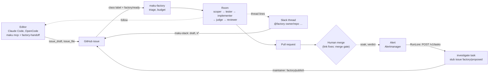

# 23 — Showcase: the Agent Factory for developers

A presenter's runbook for showing developers, live on `gcp-0`, what the Agent Factory does for them.
Each scenario is a chore a developer recognises from their own week. A developer who watches should
leave knowing how to hand work over from their editor and from Slack, what happens to it, and what
they still decide.

The **Agent Factory** is a bundle of open-source tools. Name the one behind each capability:

| Component | What it does in the demo |
|---|---|
| Maku | `maku-factory` (intake, triage, the team of runs, narration on the issue), `maku-broker` (rooms, approvals, the developer's MCP server), `maku-bridge` (streams a run into its room), `maku-slack`, the `maku` CLI and the `factory-handoff` skill |
| OpenHands | The agent loop inside each run (the harness) |
| gVisor | The sandbox each run executes in |
| agentgateway | Every model and tool call: checked against the role's profile, metered, budgeted |
| octo-sts | The run's short-lived GitHub token, one repository, one role |
| Kueue | Admits each sandbox |
| RunLore | Investigates alerts and hands the fix to the factory, agent to agent |
| policy-bot, Kyverno, ZITADEL, VictoriaMetrics, Grafana | The merge gate, the one way to create a run, sign-in, metrics and dashboards |

Every command, label and output below comes from runbooks [17](17-splitter.md) to [22](22-slack.md),
[12](12-live-auto-merge-drill.md), [14](14-gcp-0-session.md), the
[runbooks README](README.md) and the site's [user guide](../../../website/content/docs/platform/ai-platform/agents/user-guide.md). Durations and costs are the documented ones.

## What not to promise

| Do not promise | Why |
|---|---|
| Mistral as an implementer | Its one live run spent its whole budget (4.8M tokens) on a 5-line docs change (ANR #225 → PR #226). Not recommended yet |
| Auto-merge beyond link fixes | `docs-links` and its `revert` are the one live class. `dead-links` and `deps-patch` run in shadow and arm nothing |
| Approving or steering from Slack or MCP | Approvals and steering stay on the room page. Nothing written in a Slack thread reaches the run; no MCP tool approves, steers or labels |
| A reviewer on another model by default | The reviewer runs on the other tier's caps but the implementer's GLM model (ADR-0058). Another model (Kimi) only with the `docs` row's `models` session switch |
| The scoper on every task | Only on a task whose class row has `scope: scoper` (`docs`, `scripts`). A Slack-filed issue has no class label, so its task is class `review`: implementer and reviewer, no scoper |
| Typing ✅ as a message | Not filed yet: react with `white_check_mark` on the latest draft |

## Prep checklist

### The day before

- [ ] **[OWNER]** gcp-0 is up and the platform gates pass:
  `scripts/ops/k8s/gcp-0-platform-gates.sh <kube-context>` (exit 0; [runbook 14 §4](14-gcp-0-session.md#4-platform-gates)).
- [ ] Maku v0.30.3 runs: `kubectl -n agent-system get deploy agent-factory -o jsonpath='{..image}'`
  shows `ghcr.io/smana/maku-factory:v0.30.3@sha256:…`.
- [ ] The presenter's laptop: tailnet up, the platform CA trusted, `maku` v0.30.0 or later,
  `maku setup claude` (and `maku setup opencode`), then `maku doctor` all `ok`. In the client, the tools
  `rooms_list`, `room_summary`, `room_changes`, `room_wait`, `room_checkout`, `issue_draft`,
  `issue_file` and the prompts `handoff`, `status`, `inbox` are listed.
- [ ] The presenter's Slack user is linked (`@factory link`, [runbook 22 §6](22-slack.md#6-who-may-file)),
  and the served channel lists both repositories ([runbook 22 §5](22-slack.md#5-declare-the-channel-in-git)).
- [ ] Who may approve and merge: the factory's `maintainers` list (`[Smana]` today). Merging an agent PR
  on cloud-native-ref needs admin: the factory's own comment says to tick "bypass rules" on the PR page,
  or `gh pr merge <pr> --squash --admin --repo Smana/cloud-native-ref`. Room approvals need
  `agents-admin` or the room's approver standing. Audience members need `agents-member` to watch a
  room.
- [ ] The day's headroom: at most 20 tasks a day and 3 at once (`caps`), `factoryDailyUSD: 42.50`.
  The 60-minute agenda, seeds and live copies together, files about ten tasks.

### Session switches

The owner turns these on in one session commit and off in the session's last one. Each is a
**session switch** ([status page](../../../website/content/docs/platform/ai-platform/status.md#roadmap)): off outside a live session.

| Switch | On, for the demo | Off again | Needed by |
|---|---|---|---|
| The tester on `scripts` | cloud-native-ref's `repositories[].classes.scripts: {checks: true, testFirst: true}` in `tooling/base/agent-factory/helm-values-configmap.yaml` ([runbook 21 §0](21-test-first-tester.md#0-preconditions)) | Back to `{checks: false, testFirst: false}`, as [#199](https://github.com/Smana/ai-native-ref/pull/199) did | Scenario 1 |
| A reviewer on Kimi for `docs` | The `docs` loops row gains `models: {reviewer: {frontier: kimi-frontier}}`; the row is read whole, so keep its other keys. Leave the Mistral implementer out | Remove `models`, as [#218](https://github.com/Smana/ai-native-ref/pull/218) did | Scenarios 2, 7 (optional) |
| Session start (optional) | `human.mcp.sessionStart: [Smana/ai-native-ref]` in `infrastructure/gcp-0/room-broker/config.yaml` ([runbook 19](19-factory-from-your-agent.md)) | Back to `[]`, as [#230](https://github.com/Smana/ai-native-ref/pull/230) did | Scenario 1, to show the form's "start the factory now" |
| RunLore | A cloud-native-ref PR that undoes [cnref#2643](https://github.com/Smana/cloud-native-ref/pull/2643): `./runlore` in `observability/gcp-0/kustomization.yaml` and Alertmanager's `runlore` route | Merge the equivalent of cnref#2643 again | Scenario 6 |

Already on, nothing to switch: the scoper on `docs` and `scripts`, the splitter on `scripts`, the
judge and search on `docs`, sandbox checks on `docs`, and Slack.

Check after Flux reconciles: `kubectl -n agent-system logs deploy/agent-factory | grep -c 'config warning'` → `0`.

### Seeds, prepared in advance

Warm sandboxes are off on this platform, so a run starts in 1.5 to 3.5 minutes. For each scenario,
run one copy **an hour before**, so a finished room, PR and card are ready to show while the live copy
runs. Keep every seed's text on the presenter's machine (`~/.cache/v3/drills/`), **never in a
repository the agents read**: on 2026-10-27 the agents recognised a drill from the README and answered
the drill rather than the issue. Reword a drill before it runs again.

| Scenario | Seed | Repository, labels |
|---|---|---|
| 1 | One small, testable change to a host script under `scripts/` that a suite under `scripts/ci/tests/` can pin (drill T1's shape) | cloud-native-ref, `class:scripts` |
| 2 | A one-line docs gap, typed live in Slack | ai-native-ref |
| 3 | A docs issue with no acceptance check (drill B's shape) | ai-native-ref, `class:docs` |
| 4 | A hard issue of three separable parts (drill S1's shape; the real one is cnref #2672) | cloud-native-ref, `class:scripts` |
| 6 | An alerting rule whose selector names a misspelled Deployment, merged to the host by PR (the real one is cnref #2654) | cloud-native-ref |

## Agendas

| 30 minutes | 60 minutes |
|---|---|
| 3 min: the diagram above, the bundle table | 5 min: the diagram, the bundle table, what not to promise |
| 12 min: scenario 1, from your editor | 12 min: scenario 1, from your editor |
| 8 min: scenario 2, from Slack | 8 min: scenario 2, from Slack |
| 5 min: scenario 7, guardrails and cost | 5 min: scenario 3, the factory asks back |
| 2 min: questions | 7 min: scenario 4, too big for one PR |
| | 7 min: scenario 5, watch and steer |
| | 8 min: scenario 6, from an alert to a verified fix |
| | 5 min: scenario 7, guardrails and cost |
| | 3 min: questions |

Swap scenario 3 into the 30-minute slot for an audience that writes vague tickets.

## Scenario 1 — From your editor: hand off a side chore

**For** a developer mid-session who spots a chore (a small ops script and its test) they do not want to
babysit. **Takeaway:** one prompt files it; the factory scopes it, writes the test first, builds it in a
sandbox and checks it; you merge.

**Components:** `maku mcp` and the `factory-handoff` skill (Maku), `maku-factory`, OpenHands in gVisor,
agentgateway, octo-sts.

**Switches:** the tester on `scripts` (owner); session start, optional (owner). Session start can list
`Smana/ai-native-ref` only for the demo, and the tester runs on cloud-native-ref only, so on cloud-native-ref the form files the issue and the
developer starts it with `gh`.

| # | Do | Point at |
|---|---|---|
| 1 | In Claude Code, `/mcp__factory__handoff <the chore>` (in OpenCode, `/factory:handoff`), or say "hand this to the factory" for the `factory-handoff` skill | The agent drafts one issue (`issue_draft`); a form shows it, with "start the factory now" defaulting to no |
| 2 | Answer the form: file it | Filed `#N`. On cloud-native-ref the start is not offered (`canStartWhy` says why) |
| 3 | `gh issue edit <N> -R Smana/cloud-native-ref --add-label class:scripts`, then `gh issue edit <N> -R Smana/cloud-native-ref --add-label factory/ready` | The class label first: without it the class is `review`, which has no scoper and no tester. The labels are yours: the agent never applies one |
| 4 | Say "wait for it" and keep working in the main session | `room_wait` runs in a background subagent; the session stays usable |
| 5 | `/mcp__factory__status` | The room card: state in words, run, spend in dollars, PR, the agents' notes in code spans |
| 6 | Open the room link | **Scoper** (a triager run): the bounded task and its acceptance checks. **Tester**: `Harness (tester): contract_ready: scripts/ci/tests/test-….sh`, and the issue comment "The tester wrote a contract of N tests". **Implementer**: the repository's checks run in the sandbox before the push. **Reviewer**: the other tier, a verdict posted on the PR, advice only |
| 7 | On the PR: `gh pr checks <pr> -R Smana/cloud-native-ref` | "Test contract 🧪": each tester id fails at base plus tests and passes at the head. The implementer cannot change the contract (`contract_modified`) |
| 8 | When `room_wait` returns on the PR, say "check it out" | `room_checkout` returns a new worktree beside the repository; the current checkout and its branch are untouched |
| 9 | Review, approve, merge as a maintainer | The factory comments that it waits for a maintainer, then how the task ended and the tokens used |

**Real example:** cnref #2666, 2026-10-29: the scoper bounded it, the tester wrote a contract of three
tests, the implementer opened PR #2670. The completion judge is not on `scripts`: show it in scenario 2's
room, on `docs`.

**Duration and cost:** a tester task is about $2 to $4 expected, $5.10 at the `standard` task cap
([README, layer 6](README.md#layer-6-the-test-first-tester-proven-2026-10-29)). The room card appears
within 60 s of the start ([runbook 19](19-factory-from-your-agent.md#3-live-proofs)).

**Reset:** close the issue and PR if not merged, delete `agent/<task>`,
`git worktree remove <path>` for the checkout.

## Scenario 2 — From Slack: a chore from a thread

**For** a developer who sees a gap in a conversation and wants it fixed without leaving Slack.
**Takeaway:** a mention drafts the issue, a reply edits it, a maintainer's ✅ files it, the thread
follows the work.

**Components:** `maku-slack`, `maku-broker`'s signed webhooks, `maku-factory`.

**Switches:** none: Slack is live.

| # | Do | Point at |
|---|---|---|
| 0 | Once per person: `@factory link`, open the one-time link (10 minutes), sign in, press **Link** | The App answers only you. Before it, a ✅ answers `Not filed: not_linked` |
| 1 | `@factory Smana/ai-native-ref docs: <title>` with optional lines `Should:` and `Acceptance:` | A draft in the thread within seconds: `What is wrong`, `What it should be`, `Acceptance check` |
| 2 | Reply in the thread: `Title: docs: <better title>` | A second, newer draft |
| 3 | A maintainer reacts `white_check_mark` on the **latest** draft | `Filed #N for @you; the factory starts it. Room: <link>`. The issue is authored by the factory App, its footer names the sponsor |
| 4 | Wait | `Triaged.`, `A run started.`, `Pull request #… opened.`, then `Ended, state: …` |
| 5 | Show a refusal: a ✅ on an older draft | `This draft was replaced by a newer one: react on the latest draft.` |

The issue is filed with no label, so the task is class `review`: an implementer and a reviewer, no
scoper. Its budget is the channel's `maxCostUSD` (0.5) and it is charged to the `slack-app`
principal ($5 a day). To show the scoper and the completion judge, open the room of a `docs` task filed
with `class:docs` (scenario 3's, or ANR #217's).

**Real example:** ANR #180, 2026-10-28: filed from Slack, PR #181, merged by a maintainer.

**Reset:** close the issue; `@factory unlink` for a guest who linked only for the demo.

## Scenario 3 — The factory asks back

**For** anyone who has picked up a ticket with no definition of done. **Takeaway:** the scoper asks
one precise question instead of guessing; an edit to the issue unblocks it.

**Components:** the scoper (a triager run in `maku-factory`'s team).

**Switches:** none (`docs` has `scope: scoper`).

| # | Do | Point at |
|---|---|---|
| 1 | File the seed on ai-native-ref; as a maintainer, `class:docs`, then `factory/ready` | A triager run, no implementer |
| 2 | Wait for the scoper | One comment: the question and the assumption it would make; the label `factory/needs-author`; `kubectl -n agent-system get task <t> -o yaml` shows `Escalated`, reason `needs_author` |
| 3 | Reply under the question in a comment | Nothing: comments are never read as an answer |
| 4 | Edit the issue body to add the acceptance check, then re-apply `factory/ready` | A new task scopes `ready`; the first is superseded; an implementer starts |
| 5 | Alternative: `/factory retry` as a maintainer | The implementer starts on the stated assumption (`status.scope` `assumed`) |

Left alone, the task stops after 7 days.

**Reset:** close the issue and any PR.

## Scenario 4 — Too big for one PR

**For** a lead who knows a big ticket becomes a big, unreviewable PR. **Takeaway:** the factory proposes
a split with a merge order; nothing splits until a maintainer accepts; parts land one at a time.

**Components:** the scoper's split (`maku-factory`), GitHub sub-issues.

**Switches:** none (`scripts` has `split`, `anyTier: true`).

| # | Do | Point at |
|---|---|---|
| 1 | File the seed on cloud-native-ref; `class:scripts`, then `factory/ready` | A triager run |
| 2 | Wait for the proposal (the pre-run copy if it is not there yet) | One comment with two to four parts, the why and the merge order; the label `factory/split-proposed`; no part exists yet |
| 3 | A maintainer comments `/factory split` | The approver pays for every part. Part 1 opens as a sub-issue `Part 1 of N of #<parent>`, labelled `factory/child-of:#<parent>` and with the class label |
| 4 | Merge part 1's PR (after the demo if needed) | Part 2 opens; the parent closes on the last merge |
| 5 | Alternatives | `/factory retry` runs the whole issue as one task; `factory/stop` on the parent stops every part |

**Real example:** cnref #2672, 2026-10-29: a split into 3 parts proposed in 8 minutes, with a merge order
(script, then dashboard, then docs, because the docs page names the others' paths).

**Cost:** a family is capped at `familyUSD` $20.40; expect about $4 to $8 (a scoper run, then up to four
parts at about $1 to $2) ([README, layer 5](README.md#layer-5-the-splitter)).

**Reset:** `factory/stop` on the parent if parts are left, close the parts and the parent.

## Scenario 5 — Watch and steer

**For** a developer who wants to see what an agent does, and step in. **Takeaway:** the room is the whole
transcript; you queue a note, steer, fork or approve there, and only there.

**Components:** `maku-broker` and its web view, `maku-bridge`, the `maku` CLI, ZITADEL sign-in.

**Switches:** none. Use the live room of scenario 1 or 3.

| # | Do | Point at |
|---|---|---|
| 1 | Open `https://rooms.priv.gcp.ogenki.io`, filter **needs me** | The room list: rooms that need you first. The "Needs you" column counts approvals you could decide and PRs waiting for your merge |
| 2 | Open a room | Status strip (phase, run, budget bar, PR, verdict), **Needs you**, controls, progress notes (the agents' claims, labelled), the folded event stream |
| 3 | In a terminal, `maku watch <room>` | The last 50 events, then live |
| 4 | `maku post <room> --queue "<a hint>"` | Queued for the next run's brief. `maku` never steers or approves |
| 5 | On the room page, take the driver token (with a reason), then **steer** in the composer | Injected at the run's next step. Steering is the driver's alone, and web only |
| 6 | **fork here** on a message | A new room from that prefix, on your token and budget; its PR carries `Forked-from: <branch>@<sha>` |
| 7 | An approval, if the run asks one | A card under **Needs you**, with its deadline; `…/r/<room>#<approvalId>` scrolls to it. First valid decision wins; an expired one answers `approval_expired` |
| 8 | The room page's **Dashboards** chip | Grafana `agent-room` and the run's `agent-run` page: tokens, cost, latency, trace |

There is no documented way to make a run ask for an approval on demand: show one only if it arises,
or a past room that holds one.

**Reset:** close the fork's room if a run started there.

## Scenario 6 — From an alert to a verified fix

**For** an on-call developer. **Takeaway:** an alert becomes an investigation, a proposal a maintainer
publishes, a fix PR a human merges, and a verdict after the merge that the alert is gone.

**Components:** RunLore, `maku-factory`'s `investigate` template (the triager on Claude, internal,
read-only), the broker's signed webhooks, the task's monitor.

**Switches:** RunLore on (owner, see the prep). The seed's alert must be firing before the demo starts:
the time RunLore takes to file is not documented.

| # | Do | Point at |
|---|---|---|
| 1 | The seeded rule fires | RunLore calls `POST /v1/tasks` as `system:runlore`: an `investigate` task, `internal`. A stub issue `RunLore: <alert> on <namespace>/<name>` labelled `factory/proposed`, with the proposal |
| 2 | Read the proposal, then a maintainer labels the stub `factory/publish` | The factory files the fix issue, unlabelled, with the footer `Published by @<you> from agent factory task <t>` |
| 3 | Label the fix issue `class:alert-rules`, then `factory/ready` | An implementer and a reviewer; a PR. No public work started before the human's label |
| 4 | A maintainer merges the PR | RunLore posts "Soaking for 30m" |
| 5 | After the soak | `kubectl -n agent-system get task <fix> -o jsonpath='{.status.monitor}'` shows `resolved` |

**Real example:** 2026-10-29. cnref #2654 seeded an `AppWizardUnavailable` rule selecting
`deployment="app-wizzard"`, which fired permanently. RunLore's stub #2657, published as #2658, fixed by
PR #2659 (opened 06:33, merged 06:47 UTC), then `resolved`.

A fix that does not hold reads `persisting`: the PR is labelled `factory/monitor:regression`, a
follow-up stub opens, and the class pauses ([runbook 20, live 5](20-runlore-agent-to-agent.md#5-live-5-a-fix-that-does-not-hold)).

**Reset:** delete the seeded rule by a host PR; the owner merges RunLore's switch-off.

## Scenario 7 — Guardrails and cost

**For** the developer who asks "what stops it?" and the lead who asks "what does it cost?".
**Takeaway:** limits are enforced outside the agent, and every dollar is charged to someone.

**Components:** agentgateway, the capability profiles, `maku-factory`'s meter and caps, Kyverno,
Grafana's `agent-identity` dashboard.

| Show | How | Point at |
|---|---|---|
| Public and internal data | The [providers page](../../../website/content/docs/platform/ai-platform/agents/providers.md) | Public work on GLM (Z.ai), internal on Claude. Kimi (processed in China) and Mistral (EU) are public data only, held three times: the gateway's `public` listener, the public profiles, the factory |
| A provider alias refused on an internal run | Operator only, [runbook 14 §5](14-gcp-0-session.md#feature-15-providers-a-smoke-through-the-gateway)'s `curl` with `x-ar-model: kimi-frontier` on an internal run's token | `403`. The factory also refuses such a run at admission |
| A reviewer on another model | With the Kimi switch on, a `docs` task's room | Its reviewer on `k3.1-pro`: on 2026-10-29 it cost $0.089596 by the ledger against $0.0895964 by the gateway, 82% of input read from cache (ANR #217) |
| Spend per identity | Grafana, dashboard `agent-identity` (*Spend per identity*), one principal | Today against the principal's and the fleet's daily caps, tokens with the cache-read share, cost per accepted PR, refusals. It never ranks people |
| Run, task and day caps | The started comment on any issue | Budget and deadline per tier (`light` 20 min, `standard` 45 min, `frontier` 90 min); the task cap is twice the run budget; the run meter revokes a run at its cap |
| The daily task cap | Do not trigger; show the doc | Past 20 tasks a day, `POST /v1/tasks` answers `429 daily_task_cap`, and a labelled issue is refused with a comment |
| Gateway budgets | Do not trigger; show [runbook 04, Part D](04-gateway-secrets-budgets.md#part-d--enforcing-the-agents-budgets) | A call over a run, fleet or Anthropic budget gets `429 agent_budget_exhausted`; the harness never retries a 429 |
| What it never does | The [user guide](../../../website/content/docs/platform/ai-platform/agents/user-guide.md#what-the-factory-never-does) | Merge anything but a `docs-links` change or its revert; touch a gate path; take a principal from a request body; start public work from an internal finding |

Optional, link fixes merging on their own: show past ones rather than a live drill, which pauses the
class afterwards ([runbook 12](12-live-auto-merge-drill.md#know-before-the-go)):
`gh pr list -R Smana/cloud-native-ref --state merged --label 'factory/auto-merged:docs-links'`.

## After the session

1. The owner turns every session switch off (the table above) and checks Flux reconciled.
2. `kubectl -n agent-system get tasks` shows no task outside a final phase (`Done`, `Rejected`, `NoOp`,
   `Reverted`, `Closed`, `Stopped`); `factory/stop` any that is not.
3. Close the seed issues and their PRs, delete their `agent/*` branches, remove local worktrees.
4. Note anything the audience saw that contradicts a doc, and fix the doc.
