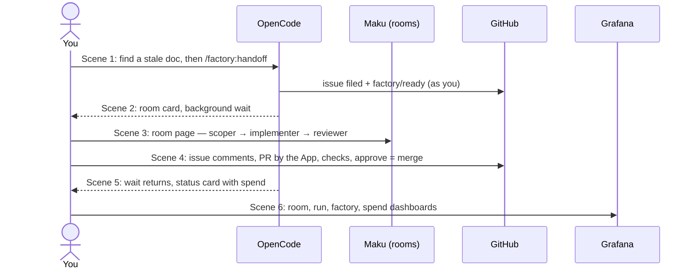

# 24 — Screencast: a side task, handed off from the terminal

The script for recording a 7–9 min screencast of the Agent Factory on aws-0: OpenCode, the room page
(Maku), GitHub and the Grafana dashboards, one real `docs` task end to end. It proves nothing new: it
shows what [runbook 19](19-factory-from-your-agent.md) proved, plus the human path's approve-to-merge
([runbook 12](12-live-auto-merge-drill.md)). The client-side commands are the
[user guide](../../../website/content/docs/use/guide/terminal-and-coding-agent.md#hand-off-from-your-coding-agent)'s.

The story in one sentence: **I'm working in OpenCode, I spot a small defect that isn't my current
job, I hand it to the Agent Factory without leaving the terminal, and 40 minutes later a reviewed,
checked PR is waiting for one click from me. Every step is visible, bounded and paid for.**

| | |
|---|---|
| Final cut | 7–9 min |
| Wall clock | ~60–75 min (the factory takes ~5 min to a PR, then the reviewer, CI and the gate), recorded in 6 segments, the waits cut |
| Cluster | **aws-0**. `.github/agent-factory.yaml` says `factory: aws-0`, so only aws-0 takes the issue |
| Repo | `Smana/cloud-native-ref`, class **`docs`** (scoper, implementer, reviewer, judge, search all on) |
| Climax | The **approval is the merge** (`approveToMerge: true`): you approve, the factory merges, not you. Approve the commit you read (maku [#301](https://github.com/Smana/maku/pull/301): `gh api …/reviews -f commit_id=<sha> -f event=APPROVE`) |



---

## The prompts

**Prompt 1 — discovery (Scene 1).** Natural, shows OpenCode is your normal tool, and gives the
factory a *real* defect. Rehearse it the day before so you know what it finds.

```text
Read website/content/docs/<section you pick>/ and compare it with the code it describes.
List anything stale (a renamed command, a wrong path, a dead reference). Don't fix anything.
```

**Prompt 2 — the handoff (Scene 1, the line the video is about).**

```text
/factory:handoff In Smana/cloud-native-ref, <file>: <one-line defect, e.g. "the setup step still
names `roomctl`, renamed to `maku` in v0.30.0">.
Acceptance: <one observable check, e.g. "no `roomctl` left in that page; the doc build passes">.
```

Why this shape:

- **One defect per issue** — the skill refuses to bundle, and a small diff reads well on camera.
- **An `Acceptance:` line** — the scoper reads it, so it won't stop to ask you a question
  (`factory/needs-author` would stall the video), and the judge checks against it.
- **`docs` class** — the richest pipeline on screen: scoper → implementer (with search) → reviewer →
  judge, and the docs link check on the PR.

Fallback if Prompt 1 finds nothing usable: pick a defect yourself the day before and go straight to
Prompt 2.

---

## T-1 day: preparation

| # | Do | Expected |
|---|---|---|
| 1 | aws-0 up, factory intake on, fence on aws-0 (cnref PR #2682 merged) | `kubectl -n agent-system get deploy` all ready; the Agents overview dashboard is green |
| 2 | `maku login`, then `maku doctor` | every check `ok` (`dns`, `tls`, `login`, `github`, `skill`). Today the `factory` MCP server says `not_logged_in`: this fixes it |
| 3 | `maku setup opencode` (idempotent) | `factory` under `mcp.servers` in opencode's config; in OpenCode the tools `rooms_list` … `issue_file` and the prompts `/factory:handoff`, `/factory:status`, `/factory:inbox` are listed |
| 4 | **Choose the start path** (below) | |
| 5 | **Full dry run** with a throwaway defect, off camera: Prompt 1, Prompt 2, through to the approval | Note the real timings per scene; close that PR unmerged, or let it merge if it's genuine |
| 6 | Pre-open the Grafana dashboards once (caches the panels), set time range "Last 3 hours" | |

**Start path — pick one:**

| Path | What | On camera |
|---|---|---|
| **A. Start from the session** (recommended) | Session switch: `human.mcp.sessionStart: [Smana/cloud-native-ref]` in aws-0's broker copy, `infrastructure/aws-0/room-broker/config.yaml` ([#244](https://github.com/Smana/ai-native-ref/pull/244)). Merge it on the eve of the session, revert it after | The form offers **"start the factory now"** → yes. Zero GitHub clicks to start |
| B. No switch | Nothing to change | The form files the issue only; you cut to GitHub and apply **`factory/ready`** yourself. Honest, one extra shot |

---

## T-30 min: the set

- **Screen**: 1920×1080, browser zoom 125 %, terminal font ≥ 16 pt, a light-on-dark theme for both.
- **Hide**: notifications, bookmarks bar, other tabs, tokens in the terminal (`maku token` never on screen).
- **Browser tabs, in order** (tailnet up):
  1. `https://rooms.priv.aws.ogenki.io/` — room list (Maku)
  2. `https://github.com/Smana/cloud-native-ref/issues?q=label%3Afactory%2Fready`
  3. `https://grafana.priv.aws.ogenki.io/d/agents-overview`
  4. `https://grafana.priv.aws.ogenki.io/d/agent-room`
  5. `https://grafana.priv.aws.ogenki.io/d/agent-run`
  6. `https://grafana.priv.aws.ogenki.io/d/agent-factory`
  7. `https://grafana.priv.aws.ogenki.io/d/agent-identity`
- **Terminal**: one OpenCode session in a fresh `cloud-native-ref` worktree on `main`, plus a
  scratch shell for `maku` (not shown unless needed).
- Recorder: OBS, one scene per window, or a single full-screen capture; record each segment as its
  own file (`01-…mp4` … `06-…mp4`).

---

## The scenes

Each scene: **Do** (keys), **Say** (voice-over, optional), **Show** (what must be in frame),
**Cut** (where to stop the recording).

### Scene 0 — cold open (15 s)

- **Do**: Tab 3, Agents overview.
- **Say**: "This is an agent factory running on Kubernetes. Let me show you what using it feels like."
- **Show**: Factory up, room broker up, kill switch off.
- **Cut**.

### Scene 1 — the handoff, in OpenCode (90 s on screen)

1. **Do**: Prompt 1. Let it answer (speed it up ×4 in edit).
   **Say**: "I'm reviewing docs, I find something stale — not my job right now."
2. **Do**: Prompt 2.
   **Show**: the agent calls `issue_draft`, then the **form**: title, body with *Acceptance*, repo.
   **Say**: "My agent drafts the issue. Only I can answer this form — the agent can't start the
   factory on its own."
3. **Do**: answer *file it* = yes, *start the factory now* = yes (path A).
   **Show**: `Filed #N for @Smana; the factory starts it. Room: …` and, within 60 s, the **room card**.
4. **Do**: type `wait for it`.
   **Show**: a background subagent starts `room_wait`; the prompt is free again.
   **Say**: "It follows the room in the background. I keep working."
5. **Do**: type one unrelated question to prove the session is usable (e.g. "what does
   `task check` run?").
- **Cut** once that answer lands. Note the room id and issue number.

### Scene 2 — Maku, the room (90 s on screen; record ~5 and ~12 min after the label)

1. **Do**: Tab 1, the room list → your room's status line → open it.
   **Say**: "Every task gets a room: one append-only log of what every agent did."
2. **Show**, top to bottom (the page's own order):
   - **Status**: phase, run and role, **budget** (tier standard: 1.5 M tokens, 45 min), PR.
   - **Needs you** — only if an approval appears; if it does, decide it here on camera
     ("approvals live on the room page, never in my terminal").
   - **What you can do now**: queue a note, stop.
   - **Progress notes**: the agents' claims, *labelled as claims*.
   - **Raw event stream**, unfold a tool call or two.
3. **Do** (optional, 10 s): queue a note — `keep the wording short` — to show steering for the next run.
4. Record a second pass ~12 min in, when the run chain shows **scoper → implementer → reviewer**.
- **Cut**.

### Scene 3 — GitHub, what actually happened (2 min on screen; record once the gate waits on you)

Record when the issue reads "*waits for a maintainer's review*" (dry run tells you when).

1. **Issue #N**:
   - Author **and** the `factory/ready` labeller: **you**, not a bot (the timeline shows it).
   - The factory's "started" comment: run id, branch `agent/<task>`, **Budget**, **Watch** link,
     **Stop** (`factory/stop`).
   - One line per run after it.
   - **Say**: "The factory talks on the issue. Budget, a watch link, and how to stop it — every time."
2. **PR**:
   - Author `app/ogenki-agents` (the GitHub App; tokens via octo-sts, per run, short-lived).
   - **Files changed**: the small diff.
   - **Commits**: the `Agent-Run: <id>` trailer — every commit traces back to a run.
   - The **reviewer** run's verdict.
   - **Checks**: the docs link check, security scan, and the **merge gate** (policy-bot) waiting on
     a maintainer.
   - The hand-off comment naming the one action left: approve.
3. **Do**: *Review changes → Approve*.
   **Say**: "My approval is the merge. I don't press merge — the factory does, as a human merge."
   Approve the head you reviewed, after the task's runs have ended and a minute has passed:
   the approval binds to that commit ([maku#301](https://github.com/Smana/maku/pull/301)), and one
   given earlier, or on a head pushed after the runs, is not counted (`approval_stale`,
   `human_commit_in_pr`). From the web UI, or pinned to the commit:
   `gh api repos/<owner>/<repo>/pulls/<n>/reviews -f commit_id=<sha> -f event=APPROVE`.
4. **Do**: refresh until merged (cut the wait).
   **Show**: merged by the factory, the issue closed with "Tokens used: … k".
- **Cut**.

> If the diff is wrong, that's a better video: *Request changes*, and show the next implementer run
> start on the same branch with your review in its brief (issue comment "*is revising after
> @Smana's review*").

### Scene 4 — back in OpenCode (45 s on screen)

1. **Show**: the background `room_wait` has returned (PR opened / ended).
2. **Do**: `/factory:status`.
   **Show**: the card — runs chain with time and **$ per run**, spend vs budget, PR, state `done`.
   **Say**: "Same card as the room, in my terminal. This change cost N cents."
3. **Do** (optional): `check it out` → `room_checkout` returns a new worktree path; your checkout
   untouched.
- **Cut**.

### Scene 5 — the dashboards (2 min on screen)

Set each to the task's window. In order, one claim each:

| Tab | Dashboard | Point at | Say |
|---|---|---|---|
| 4 | **Agent room** (`var-room=<room>`) | Runs of this room, Spend, Time waiting for a human | "Where the time went: the agents were fast, the wait was me." |
| 5 | **Agent run** (`var-run=<implementer run>`) | Tokens vs budget, Cost (USD), Models, Duration | "Every run is metered at the gateway against a hard budget." |
| 6 | **Agent factory** | Time to PR p50, PR outcomes by class, **Human interventions (how dark is it?)**, Kill switch | "How autonomous is it, really? This panel says it." |
| 7 | **Spend per identity** (`var-principal=Smana`) | Today against its day, Cost per accepted PR | "And it's charged to me, the person who asked." |

- **Cut**.

### Scene 6 — close (10 s)

- Back to Agents overview, or the merged PR. **Say**: "One sentence in my terminal, one click on
  GitHub. Everything in between was agents, in a sandbox, on a budget, in the open."

---

## Fallbacks during recording

| Symptom | Do |
|---|---|
| The form never appears | OpenCode didn't declare forms or `maku` lost login: `maku doctor`; worst case path B (file from the shown draft with `gh`, label on GitHub) |
| No room card after 60 s | Check the fence (`factory: aws-0`) and the label on the issue; `maku rooms --mine` |
| Scoper posts a question (`factory/needs-author`) | Edit the issue body to answer, re-apply `factory/ready` — or keep it as a scene: "it asked before writing code" |
| A run ends `Disrupted` (spot reclaim) | Keep it: the factory resumes it itself (`resuming automatically (1/2)`) — great B-roll |
| The run drifts or stalls | `factory/stop` label on the issue; re-record with the dry-run defect |
| Grafana panels empty | Widen the time range; run/room vars populate a few minutes after the run |

## After recording

1. Path A: revert the session switch (empty `sessionStart` or delete aws-0's copy); `task check` green.
2. `git worktree remove <path>` for any `room_checkout` worktree.
3. Blur in edit: anything showing a token, an internal IP, or an email.
4. Edit notes: speed ×4 on model output, hard-cut every wait, overlay a small clock
   ("+5 min", "+38 min") so the viewer feels the elapsed time without watching it.
