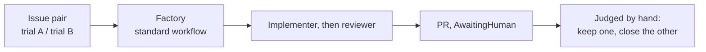

# Harness paired trial, round 1 — OpenCode vs OpenHands on gcp-0 — 2026-11-26

Round 1 of a paired trial: the same small task given twice to the factory, once per harness, on
Maku v0.54.5 with the `standard` workflow and the same model tier (`glm-5.3`). Three pairs finished;
a fourth is queued. Data read from the Task and AgentRun objects and the room logs on 2026-11-26.

> **Round 1 measures OpenCode with a handicap.** The `maku-opencode` image of v0.54.5 shipped
> without `bash` and without the GNU userland. The repository's `agent-checks` needs `bash`, so
> every OpenCode run first had to diagnose the sandbox and work around it. The image is fixed in
> Maku #736, released in v0.54.7. Read the OpenCode numbers below as an upper bound on its cost and
> a lower bound on its quality; [round 2](#round-2-opencode-on-v0547-pending) re-runs it on v0.54.7.

## Purpose

The [OpenCode harness design](../../superpowers/specs/2026-11-15-opencode-harness-design.md) adopts
OpenCode only if it holds the merge rate and improves cost or time against OpenHands. Its 50/50
cohort trial needs 30 ended tasks per arm. This paired trial is a faster, smaller read: identical
tasks, judged by hand on the quality of the pull request as well as its cost.

## Method

Each task was filed twice with identical bodies and acceptance criteria. The `[trial A]` issue
carried the label `harness:opencode`, the `[trial B]` issue `harness:openhands`. Every task is a
small script fix with an exact acceptance list, including "only these two files change".

Each pull request was judged on:

1. Does it meet the acceptance list exactly?
2. Do the new checks test the change, or only that the code runs?
3. Scope: any file or behaviour beyond the task?
4. Is the description useful to a developer reviewing it?
5. Did the harness run the tests itself (room log)?

Then the better pull request of each pair was kept and the other closed with "trial duplicate:
kept #N, see the trial results". Quality decides; cost breaks a tie. Nothing was merged.

Time is reported two ways. **Active** runs from the first run's start to the hand-off to a human
(`pullRequest.handedOffAt`). **Wall** runs from the Task's creation and adds the wait for a free run
slot, which depends on the factory's load, not on the harness.

## Results per pair

| Task | OpenCode (`[trial A]`) | OpenHands (`[trial B]`) | Kept |
|---|---|---|---|
| t3 kb-measures: reject bad dates and an empty window | #557: $1.195, 3.65M tokens, 39 min active (58 wall); stepped up after `budget-run` | #543: $0.156, 421k tokens, 17 min active (18 wall) | #557 |
| t4 factory-journey: fractional seconds, no `tokens` key | #551: $0.398, 1.16M tokens, 19 min active (19 wall) | #542: $0.149, 366k tokens, 17 min active (18 wall) | #542 |
| t6 check-reader-first: `--format github` | #559: $1.124, 3.32M tokens, 25 min active (68 wall); stepped up after `budget-run` | #554: $0.235, 664k tokens, 17 min active (25 wall) | #554 |
| t5 cost-crosscheck: `--json` | #544, task `33eqjewz`: queued | #545, task `anviim7b`: queued | — |

t5 waited in `Queued` with the reason `waiting_review_wip`: the six pull requests above filled the
review queue (`awaitingHumanWIP: 5`). Closing the three duplicates frees it.

All six pull requests changed only the two allowed files, passed CI (`validate`, `lint`,
`prerelease`), and got an `approve` from the reviewer agent. The merge gate then handed each to a
human (`no_policy_matched`): no merge class covers `scripts/`.

### t3 — kept #557 (OpenCode)

The two code changes are the same: an argparse `type=` that round-trips the date, and
`ap.error("--until must be after --since")`. Both add the four usage-error checks the acceptance
asks for, asserting exit 2, the message, and no `Traceback`.

- #557 adds a fifth check that a valid call still prints its table, the only one of the pair that
  touches "a valid call prints exactly what it prints today". Its description is accurate and names
  the one suite that failed in the sandbox, with the cause.
- #543's description claims the round-trip catches dates "Python would silently roll over (e.g.
  `2026-02-31` → March 3rd)". `strptime` raises on that date; it does not roll over. The round-trip
  catches `2026-11-1`, which #557 says correctly.

Kept on quality, at 7.7 times the cost.

### t4 — kept #542 (OpenHands)

Both meet the acceptance and add the two required checks.

- #542 parses with a full-match regex and keeps the microseconds, so a malformed timestamp still
  fails loudly. Its test prints `PASS` once, after every check. It also rewrites the fixture's
  `comments` for the fractional case, which the task did not need. Its description has no
  provenance footer (`Agent-Room`, `Agent-Run`); the factory linked the pull request regardless.
- #551 strips the fraction with `re.sub` before the old `strptime`: simpler, equally correct for
  the acceptance. Its test keeps the old `PASS` line *before* the new checks, so a failure prints
  `PASS` then `FAIL` (the exit code is still 1).

Equal on the acceptance; kept #542 for the stricter parse and the clean test output, at 0.37 times
the cost.

### t6 — kept #554 (OpenHands)

Both add `--format {text,github}` with argparse, a `report()` helper and a docstring.

- #554 tests every rule as an annotation, the clean tree, `--format text`, `README.md`, both
  argument orders, and an invalid format (exit 2).
- #559 tests the acceptance's exact line-3 case and adds a no-arguments equivalence check against
  the real repository. Its docstring keeps the old "Exit 1: each finding is printed as file:line"
  next to the new text, and the `run()` docstring describes an argument list it does not take.

Kept #554: broader checks, cleaner docstring, 0.21 times the cost.

## Totals

| Measure | OpenCode | OpenHands |
|---|---|---|
| Pull requests opened and approved by the reviewer | 3 of 3 | 3 of 3 |
| Kept after judging | 1 | 2 |
| Implementer runs out of budget (`budget-run`) | 2 of 3 | 0 of 3 |
| Cost, total / per success | $2.717 / $0.906 | $0.540 / $0.180 |
| Tokens, total | 8.12M | 1.45M |
| Active time, median (range) | 25 min (19–39) | 17 min (17–17) |
| Wall time, median (range) | 58 min (19–68) | 18 min (18–25) |

OpenCode cost 5.0 times as much per success and used 5.6 times the tokens. Both used `glm-5.3`; the
two OpenCode step-up runs also called `glm-5.3-flash`.

## Failure modes

### OpenCode (on the handicapped image)

- **No `bash`.** `agent-checks` failed with `FileNotFoundError: 'bash'`. The implementer spent
  about ten tool calls finding out why, then downloaded a static `bash` 5.2 binary from
  `robxu9/bash-static` on GitHub and pointed `python3` at the sandbox's venv for PyYAML. The
  sandbox's egress allowed that download; a run fetching an unpinned binary from the internet is
  worth a look on its own.
- **Budget spent on the workaround.** In t3 and t6 the first implementer run hit `budget-run` on
  `standard`. The factory stepped the task up to `careful`, and the second run finished. t4 was
  simple enough to fit.
- **Chasing an unrelated failure.** In t3 the first run spent its last minutes on
  `test-room-broker-webhook-egress`, which fails in the sandbox because it runs `python3 -I` without
  a system PyYAML. The harness recorded "5 pass, 1 fail" for the head.
- **Waiting on CI.** In t3 the second run polled the pull request's CI for 12 minutes (07:56 to
  08:08) before handing off, adding wall time and tokens for nothing the reviewer needed.
- **Unreadable check result.** In t6 the harness logged "checks on c3202ada skipped: unreadable
  result".
- **Reviewer without checks.** The t4 reviewer could not run `agent-checks` either; it ran the
  suite directly and said so in its verdict, the only verdict of the six with any text.

### OpenHands

- No run out of budget, and the harness logged "6 pass" on each head.
- **Description accuracy.** #543 states a false fact about `strptime`.
- **Provenance.** #542's description has no `Agent-*` footer.
- **Reviewer text.** All three reviewer verdicts are empty: an `approve` with nothing for the human
  who reviews next.

## Finding: `harness-trial-report.py` reads fields real Tasks do not have

`scripts/ops/harness-trial-report.py`, the tool for the 50/50 trial's frozen gate, counts none of
these tasks. Run on a snapshot of all 33 ai-native-ref Tasks on gcp-0 it reports 0 ended tasks per
arm and excludes 26 as `not_ended`, including the six that are `Done` with outcome `accepted`.

| The script reads | Real Tasks (Maku v0.54.5) carry |
|---|---|
| `status.costMicroUSD` | `status.usage.costMicroUSD` |
| `status.tokens` as a map (`input`, `output`, `cacheRead`, `cacheWrite`) | `status.usage.tokens`, one integer |
| `status.finishedAt` or `completedAt` | `status.endedAt` |
| outcome `merged`, phase in a list without `done` | phase `Done`, outcome `accepted` or `merged_human` |
| the arm from `profile.cohort` only | `profile.harness` too: task `3qtjvnuh` is cohort `treatment` on harness `openhands` |

The script's own tests (`scripts/ci/tests/test-harness-trial-report.py`) build Tasks with the
invented fields, so they pass and prove nothing about real data. Fix the reader against a real Task
before the 50/50 trial produces a verdict.

## Round 2: OpenCode on v0.54.7 (pending)

Re-run the same OpenCode tasks on Maku v0.54.7, whose image carries `bash` and the GNU userland.
Compare against the OpenHands numbers above, which stand. Record here: budget-run count, cost per
success, tokens, active time, and whether the implementer ran `agent-checks` without a workaround.
