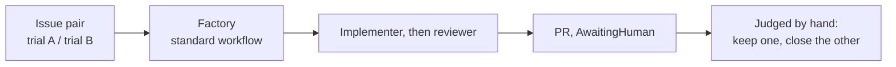

# Harness paired trial, rounds 1 and 2 — OpenCode vs OpenHands on gcp-0 — 2026-11-26

A paired trial: the same small task given twice to the factory, once per harness, with the
`standard` workflow and the same model tier (`glm-5.3`). Round 1 ran on Maku v0.54.5,
[round 2](#round-2-opencode-on-v0547) on v0.54.7. Data read from the Task and AgentRun objects, the
room logs and the pull requests on 2026-11-26. The [recommendation](#recommendation-not-yet-with-conditions)
is at the end.

> **Round 1 measures OpenCode with a handicap.** The `maku-opencode` image of v0.54.5 shipped
> without `bash` and without the GNU userland. The repository's `agent-checks` needs `bash`, so
> every OpenCode run first had to diagnose the sandbox and work around it. The image is fixed in
> Maku #736, released in v0.54.7. Read the OpenCode numbers below as an upper bound on its cost and
> a lower bound on its quality; [round 2](#round-2-opencode-on-v0547) re-runs it on v0.54.7.

## Purpose

The [OpenCode harness design](../../superpowers/specs/2026-11-15-opencode-harness-design.md) adopts
OpenCode only if it holds the merge rate and improves cost or time against OpenHands. Its 50/50
cohort trial needs 30 ended tasks per arm. This paired trial is a faster, smaller read: identical
tasks, judged by hand on the quality of the pull request as well as its cost.

## Method

Each task was filed twice with identical bodies and acceptance criteria. The `[trial A]` issue
carried the label `harness:opencode`, the `[trial B]` issue `harness:openhands`. Every task is a
small script fix with an exact acceptance list, including "only these two files change".

Each pull request was judged on:

1. Does it meet the acceptance list exactly?
2. Do the new checks test the change, or only that the code runs?
3. Scope: any file or behaviour beyond the task?
4. Is the description useful to a developer reviewing it?
5. Did the harness run the tests itself (room log)?

Then the better pull request of each pair was kept and the other closed with "trial duplicate:
kept #N, see the trial results". Quality decides; cost breaks a tie. Nothing was merged.

Time is reported two ways. **Active** runs from the first run's start to the hand-off to a human
(`pullRequest.handedOffAt`). **Wall** runs from the Task's creation and adds the wait for a free run
slot, which depends on the factory's load, not on the harness.

## Results per pair

| Task | OpenCode (`[trial A]`) | OpenHands (`[trial B]`) | Kept |
|---|---|---|---|
| t3 kb-measures: reject bad dates and an empty window | #557: $1.195, 3.65M tokens, 39 min active (58 wall); stepped up after `budget-run` | #543: $0.156, 421k tokens, 17 min active (18 wall) | #557 |
| t4 factory-journey: fractional seconds, no `tokens` key | #551: $0.398, 1.16M tokens, 19 min active (19 wall) | #542: $0.149, 366k tokens, 17 min active (18 wall) | #542 |
| t6 check-reader-first: `--format github` | #559: $1.124, 3.32M tokens, 25 min active (68 wall); stepped up after `budget-run` | #554: $0.235, 664k tokens, 17 min active (25 wall) | #554 |
| t5 cost-crosscheck: `--json` | #565, task `33eqjewz` | #564, task `anviim7b` | [see below](#t5-the-last-pair-on-v0545) |

t5 waited in `Queued` with the reason `waiting_review_wip`: the six pull requests above filled the
review queue (`awaitingHumanWIP: 5`). Closing the three duplicates frees it.

All six pull requests changed only the two allowed files, passed CI (`validate`, `lint`,
`prerelease`), and got an `approve` from the reviewer agent. The merge gate then handed each to a
human (`no_policy_matched`): no merge class covers `scripts/`.

### t3 — kept #557 (OpenCode)

The two code changes are the same: an argparse `type=` that round-trips the date, and
`ap.error("--until must be after --since")`. Both add the four usage-error checks the acceptance
asks for, asserting exit 2, the message, and no `Traceback`.

- #557 adds a fifth check that a valid call still prints its table, the only one of the pair that
  touches "a valid call prints exactly what it prints today". Its description is accurate and names
  the one suite that failed in the sandbox, with the cause.
- #543's description claims the round-trip catches dates "Python would silently roll over (e.g.
  `2026-02-31` → March 3rd)". `strptime` raises on that date; it does not roll over. The round-trip
  catches `2026-11-1`, which #557 says correctly.

Kept on quality, at 7.7 times the cost.

### t4 — kept #542 (OpenHands)

Both meet the acceptance and add the two required checks.

- #542 parses with a full-match regex and keeps the microseconds, so a malformed timestamp still
  fails loudly. Its test prints `PASS` once, after every check. It also rewrites the fixture's
  `comments` for the fractional case, which the task did not need. Its description has no
  provenance footer (`Agent-Room`, `Agent-Run`); the factory linked the pull request regardless.
- #551 strips the fraction with `re.sub` before the old `strptime`: simpler, equally correct for
  the acceptance. Its test keeps the old `PASS` line *before* the new checks, so a failure prints
  `PASS` then `FAIL` (the exit code is still 1).

Equal on the acceptance; kept #542 for the stricter parse and the clean test output, at 0.37 times
the cost.

### t6 — kept #554 (OpenHands)

Both add `--format {text,github}` with argparse, a `report()` helper and a docstring.

- #554 tests every rule as an annotation, the clean tree, `--format text`, `README.md`, both
  argument orders, and an invalid format (exit 2).
- #559 tests the acceptance's exact line-3 case and adds a no-arguments equivalence check against
  the real repository. Its docstring keeps the old "Exit 1: each finding is printed as file:line"
  next to the new text, and the `run()` docstring describes an argument list it does not take.

Kept #554: broader checks, cleaner docstring, 0.21 times the cost.

## Totals

| Measure | OpenCode | OpenHands |
|---|---|---|
| Pull requests opened and approved by the reviewer | 3 of 3 | 3 of 3 |
| Kept after judging | 1 | 2 |
| Implementer runs out of budget (`budget-run`) | 2 of 3 | 0 of 3 |
| Cost, total / per success | $2.717 / $0.906 | $0.540 / $0.180 |
| Tokens, total | 8.12M | 1.45M |
| Active time, median (range) | 25 min (19–39) | 17 min (17–17) |
| Wall time, median (range) | 58 min (19–68) | 18 min (18–25) |

OpenCode cost 5.0 times as much per success and used 5.6 times the tokens. Both used `glm-5.3`; the
two OpenCode step-up runs also called `glm-5.3-flash`.

## Failure modes

### OpenCode (on the handicapped image)

- **No `bash`.** `agent-checks` failed with `FileNotFoundError: 'bash'`. The implementer spent
  about ten tool calls finding out why, then downloaded a static `bash` 5.2 binary from
  `robxu9/bash-static` on GitHub and pointed `python3` at the sandbox's venv for PyYAML. The
  sandbox's egress allowed that download; a run fetching an unpinned binary from the internet is
  worth a look on its own.
- **Budget spent on the workaround.** In t3 and t6 the first implementer run hit `budget-run` on
  `standard`. The factory stepped the task up to `careful`, and the second run finished. t4 was
  simple enough to fit.
- **Chasing an unrelated failure.** In t3 the first run spent its last minutes on
  `test-room-broker-webhook-egress`, which fails in the sandbox because it runs `python3 -I` without
  a system PyYAML. The harness recorded "5 pass, 1 fail" for the head.
- **Waiting on CI.** In t3 the second run polled the pull request's CI for 12 minutes (07:56 to
  08:08) before handing off, adding wall time and tokens for nothing the reviewer needed.
- **Unreadable check result.** In t6 the harness logged "checks on c3202ada skipped: unreadable
  result".
- **Reviewer without checks.** The t4 reviewer could not run `agent-checks` either; it ran the
  suite directly and said so in its verdict, the only verdict of the six with any text.

### OpenHands

- No run out of budget, and the harness logged "6 pass" on each head.
- **Description accuracy.** #543 states a false fact about `strptime`.
- **Provenance.** #542's description has no `Agent-*` footer.
- **Reviewer text.** All three reviewer verdicts are empty: an `approve` with nothing for the human
  who reviews next.

## Finding: `harness-trial-report.py` reads fields real Tasks do not have

`scripts/ops/harness-trial-report.py`, the tool for the 50/50 trial's frozen gate, counts none of
these tasks. Run on a snapshot of all 33 ai-native-ref Tasks on gcp-0 it reports 0 ended tasks per
arm and excludes 26 as `not_ended`, including the six that are `Done` with outcome `accepted`.

| The script reads | Real Tasks (Maku v0.54.5) carry |
|---|---|
| `status.costMicroUSD` | `status.usage.costMicroUSD` |
| `status.tokens` as a map (`input`, `output`, `cacheRead`, `cacheWrite`) | `status.usage.tokens`, one integer |
| `status.finishedAt` or `completedAt` | `status.endedAt` |
| outcome `merged`, phase in a list without `done` | phase `Done`, outcome `accepted` or `merged_human` |
| the arm from `profile.cohort` only | `profile.harness` too: task `3qtjvnuh` is cohort `treatment` on harness `openhands` |

The script's own tests (`scripts/ci/tests/test-harness-trial-report.py`) build Tasks with the
invented fields, so they pass and prove nothing about real data. Fix the reader against a real Task
before the 50/50 trial produces a verdict.

## Round 2: OpenCode on v0.54.7

Round 2 gives both harnesses four new pairs on a fixed image: Maku v0.54.7 and later, whose
`maku-opencode` image carries `bash` and the GNU userland. t1, t2 and the OpenHands t8 run report
`factoryVersion: v0.54.7` in every run's provenance; t7 and the OpenCode t8 run report v0.54.8,
which ships the same images. The t5 pair, queued during round 1, ran later on v0.54.5 and is
recorded [on its own](#t5-the-last-pair-on-v0545).

### Results per pair

| Task | OpenCode (`[trial A]`) | OpenHands (`[trial B]`) | Kept |
|---|---|---|---|
| t1 harness-trial-report: ended and merged from the real Task status | #579, task `3fwok2p2`: $0.196, 454k tokens, 18 min active (29 wall) | #580, task `davmfk3s`: $0.132, 315k tokens, 13 min active (23 wall) | #579 |
| t2 harness-trial-report: cost and tokens from `status.usage` | #578, task `q6isxrf5`: $0.278, 742k tokens, 14 min active (15 wall) | #577, task `yyzhww52`: $0.308, 871k tokens, 30 min active (30 wall) | #578 |
| t7 cohort-results: extract `arm_summary()` and `ARMS` | #595, task `h4w45inn`: $0.196, 480k tokens, 15 min active (19 wall) | #597, task `acui76um`: $0.185, 447k tokens, 16 min active (21 wall) | #595 |
| t8 cheat-sheet: the harness label and the rescue comment | #596, task `2b374w2q`: $0.260, 688k tokens, 15 min active (19 wall) | #581, task `vpunyqq2`: $0.090, 247k tokens, 17 min active (32 wall) | #596 |

All eight pull requests changed only the allowed files and passed CI (`validate`, `lint`,
`prerelease`). The reviewer agent approved each. The merge gate handed the six script changes to a
human (`no_policy_matched`); for the two t8 pages the `docs` policy, in shadow, would have merged
them (`shadow_would_arm`). The t1 and t2 costs each include one reviewer run that the factory
discarded; see [Reviewer verdicts](#reviewer-verdicts). Without it, #579 cost $0.156 and #577
$0.263.

#### t1 — kept #579 (OpenCode)

The code changes are the same: `endedAt` joins the end-time fields, `done`, `noop` and `stopped`
join the ended phases, and `accepted`, `merged_human` and the reason `merged` count as merged. Both
add the four checks the acceptance lists, and every existing check is unchanged.

- #579 builds its fixture the way a real Task looks: no `startedAt`, no legacy cost or token
  fields. Its 30-minute check therefore exercises the fallback to `metadata.creationTimestamp`.
- #580's fixture sets `startedAt` to the creation time and carries `costMicroUSD` and a `tokens`
  map, so the start fallback is never exercised and the "real" Task is not a real shape.

Kept #579 for the test that checks what the acceptance describes, at 1.48 times the cost.

#### t2 — kept #578 (OpenCode)

Both add the `status.usage.costMicroUSD` fallback with today's fields first, a per-arm token total,
and the `Total tokens` row after `Cache-write tokens`.

- #578 keeps the total in its own `total_tokens` key. When VictoriaMetrics token readings replace
  the per-key counts, it takes their `total` or re-sums the keys, so the row matches the rows above
  it. Its report check asserts the thousands separator (`540,000`).
- #577 adds a fifth `total` key inside the four-key `tokens` map, which changes the map's shape for
  any reader of the summary. VictoriaMetrics readings replace the four keys but leave `total` from
  the Task, so the total can disagree with the rows above it. Its report check does not test the
  separator.

Kept #578, at 0.90 times the cost.

#### t1 and t2 together

Both tasks change the same two files, and a conflict was expected for whichever merged second. It
does not happen: the hunks do not overlap. `git merge-tree` of #578 and #579 is clean, and
`test-harness-trial-report.py` passes on the merged tree. The `main` ruleset does not require an
up-to-date branch, so neither pull request needs a rebase.

#### t7 — kept #595 (OpenCode)

The two refactors are line for line the same: `ARMS = "ABC"`, an `arm_summary(rows)` holding the
old loop body, and `main()` returning 0. Both show `cmp` reporting identical output before and after.

- #595's new check builds two rows, one accepted and one rejected, so `accepted == 1` tells a
  counted verdict from an ignored one. It compares the output on the real 45-row cohort CSV in
  `docs/superpowers/specs/`, and gives `arm_summary()` a docstring.
- #597's check calls `arm_summary(rows[:2])` on two fixture rows that are both unaccepted, so
  `accepted == 0` would also pass if the function counted nothing. Its comparison runs on a
  seven-row synthetic CSV.

Kept #595 for the sharper check, at 1.06 times the cost.

#### t8 — kept #596 (OpenCode)

Both add the two rows in the right places, in the table's style, and change nothing else. The
`/factory retry harness=openhands` rows are identical.

- #596's `harness:<name>` row says "a maintainer picks", as the task asks: only a maintainer's
  label selects a harness. Its description notes that the page's existing `harness:opencode` row
  stays as it is.
- #581's row drops "a maintainer", so a reader cannot tell who may set the label.

Kept #596 for that fact, at 2.9 times the cost. For two table rows, OpenCode used 688k tokens to
OpenHands' 247k: the widest cost gap of round 2.

### Totals (t1, t2, t7, t8)

| Measure | OpenCode | OpenHands |
|---|---|---|
| Pull requests opened and approved by the reviewer | 4 of 4 | 4 of 4 |
| Kept after judging | 4 | 0 |
| Implementer runs out of budget (`budget-run`) | 0 of 4 | 0 of 4 |
| Cost, total / per success | $0.930 / $0.233 | $0.715 / $0.179 |
| Tokens, total | 2.36M | 1.88M |
| Active time, median (range) | 15 min (14–18) | 16.5 min (13–30) |
| Wall time, median (range) | 19 min (15–29) | 26.5 min (21–32) |

### Against round 1

| OpenCode ÷ OpenHands | Round 1 (v0.54.5) | Round 2 (fixed image) |
|---|---|---|
| Cost per success | 5.0× | 1.30× |
| Tokens | 5.6× | 1.26× |
| Implementer runs out of budget | 2 of 3 against 0 of 3 | 0 of 4 against 0 of 4 |
| Pull requests kept | 1 of 3 | 4 of 4 |
| Active time, median | 25 min against 17 | 15 min against 16.5 |

The image fix closes most of the gap. On the fixed image OpenCode costs 30 % more per success,
against five times as much before, and no run ran out of budget. All four kept pull requests are
OpenCode's, each on a concrete difference, though t7's was narrow. Most of the remaining cost gap
is t8; on t1, t2 and t7 together OpenCode cost $0.670 against $0.625 (1.07×).

No OpenCode implementer worked around the sandbox. Three of the four OpenCode heads logged "6 pass"
from the harness; for #579 the agent noted "agent-checks all pass" and the harness recorded no
result. All four OpenHands heads logged "6 pass".

### t5: the last pair on v0.54.5

Both t5 runs started at 08:45 UTC, before the upgrade: every run of the pair reports
`factoryVersion: v0.54.5`. It completes round 1 and is kept out of the round-2 totals.

| Task | OpenCode (`[trial A]`) | OpenHands (`[trial B]`) | Kept |
|---|---|---|---|
| t5 cost-crosscheck: `--json` | #565, task `33eqjewz`: $1.672, 5.03M tokens, 41 min active (121 wall); stepped up after `budget-run` | #564, task `anviim7b`: $0.513, 1.30M tokens, 19 min active (99 wall) | #565 |

The OpenCode run repeated round 1's failure modes. The first implementer made 64 tool calls and no
model turn on the missing `bash` before it ran out of budget. The second fetched the static `bash`
from GitHub again, then waited nine minutes for CI's `prerelease`. Its harness logged "checks on
254950091051 skipped: unreadable result". The OpenHands head logged "6 pass".

Both pull requests meet the acceptance, and both check that the exit code is the same with and
without `--json`.

- #565 adds a module-level `usd()` helper and a `render_json()` beside `render()`, and leaves every
  existing check untouched. It asserts the table output byte for byte, and that the docstring's
  usage line mentions `[--json]`.
- #564 has more checks (empty day, a bad `--day` with `--json`), but it changes the existing
  `main_with()` helper and its three call sites, which the acceptance keeps untouched. Its
  `collect()` keeps an unused `ok` from `compare()` and re-derives it in a new `verdict()`.

Kept #565 on the acceptance and the smaller change, at 3.3 times the cost. With t5, round 1 reads:
OpenCode $4.389 for 4 successes ($1.097 each), 3 of 4 out of budget; OpenHands $1.053 ($0.263
each), 0 of 4.

### Reviewer verdicts

**Empty verdicts.** In round 1, 5 of the 6 reviewer approvals had no text. In round 2 all 13
reviewer verdict comments, on t1, t2, t5, t7 and t8 and across both harnesses, are empty: a heading
"Agent review: approved" over an empty code block. That makes 18 of 19 over the trial. The next
human reviewer learns nothing from the agent review except that it approved.

**Invented commit hashes.** Three of the 13 verdicts name a commit that shares the head's first 12
hex digits but not the rest. For #579, `6b47574ccb0d22306548…` against the head
`6b47574ccb0d880e0a41…`. The factory recorded those runs as verdict `none` (stage effect
`approve_overruled`) and started another reviewer run: one extra on #579 (OpenCode, $0.040) and on
#577 (OpenHands, $0.045). The reviewer seems to extend the 12-digit short hash it was given into a
full one by guessing; the factory's check caught it each time.

## Recommendation: not yet, with conditions

Do not make OpenCode the default yet. Keep OpenHands as the factory default, and keep OpenCode
selectable per issue with `harness:opencode`. The paired trial removes the case against OpenCode,
but it does not make the case for it that the design's
[strict decision rule](../../superpowers/specs/2026-11-15-opencode-harness-design.md#93-strict-decision-rule)
asks for.

| Rule (design §9.3) | Round 2 reading | Holds? |
|---|---|---|
| Zero critical security, audit or recovery regressions | None on the fixed image; on v0.54.5 OpenCode downloaded and ran an unpinned binary | Not yet: egress still allows it |
| Merge rate no more than 5 points lower | All 8 pull requests met their acceptance and passed CI; judged, OpenCode's were kept 4 of 4 | Yes, on a small sample |
| Cost per merged PR no more than 10 % higher | 1.30× (1.07× without t8) | No |
| A material win: ≥ 15 % lower cost or median duration | Active time 9 % lower; wall time 28 % lower, which depends on the factory's load | Not shown |

Four pairs of small, well-specified tasks on one model (`glm-5.3`) cannot settle a rule written for
30 ended tasks per arm. They show that the round-1 gap was the image, and that OpenCode now writes
pull requests at least as good as OpenHands', for somewhat more tokens.

What must hold before a cutover PR sets `defaults.harness: opencode`:

1. **The image contract stays enforced.** Maku #736 gave both runner images one userland contract
   (`bash`, the GNU tools) that each image's test stage runs. Every Maku release the factory pins
   must keep it; the v0.54.5 failure mode returns the day it slips.
2. **Run egress is tightened.** The round-1 runs fetched a static `bash` from GitHub release assets
   and ran it, through the always-on `github` egress profile. Maku #742 (spec, open) moves the
   release-asset hosts out of that profile. It must be built and deployed first: a default harness
   that reaches for tools when it lacks them must not be able to fetch them.
3. **The 50/50 live comparison reaches its gate.** Design §9.2: 30 ended tasks per arm, read with
   `scripts/ops/harness-trial-report.py` now that #578 and #579 make it read real Tasks. Include
   larger tasks and documentation tasks: t8 shows OpenCode spending most on the smallest change.
4. **The provider smoke tests pass.** Design §9.2 asks for one live OpenCode task each on
   GLM/Z.ai, Anthropic, Kimi and Mistral; this trial used GLM only.
5. **The rescue path is proven once.** `/factory retry harness=openhands` on an escalated OpenCode
   task, end to end, since it is the rollback for every task during the 30-day soak (design §9.4).

One finding does not gate the harness choice but needs a fix on its own: the reviewer agent's
verdicts are empty, and it invents full commit hashes, on both harnesses.
