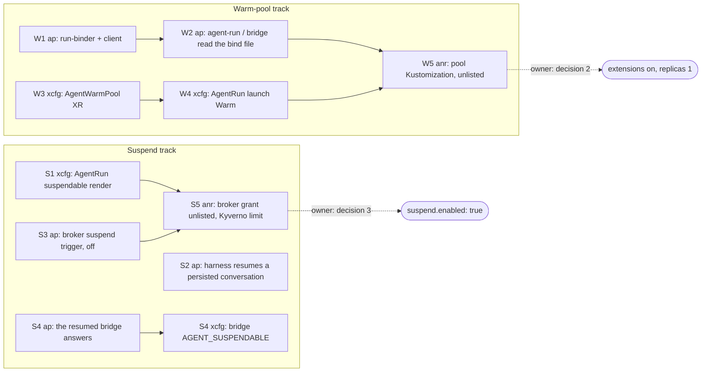

# v2 warm and suspended sandboxes — Implementation Plan

> **For agentic workers:** REQUIRED SUB-SKILL: Use superpowers:subagent-driven-development (recommended) or superpowers:executing-plans to implement this plan task-by-task. Steps use checkbox (`- [ ]`) syntax for tracking.

**Goal:** Build the design's steps 3 (suspend) and 4 (warm pool) as small PRs, each behind a flag
that defaults off, so a rebuild changes nothing until the owner turns a flag on.

**Architecture:** Suspend and the warm pool are two tracks across three repositories.
crossplane-configuration renders them, agent-platform drives them, and ai-native-ref ships the
inert manifests. Each PR merges on its own. A PR that later PRs depend on ships first, and every
PR is inert until an explicit flag flips.

**Tech Stack:** KCL on function-kcl v0.12.2 (Crossplane), Go 1.27 (agent-platform), Python 3 (the
harness's `agent_run.py`), agent-sandbox v1.0.6 (`agents.x-k8s.io/v1beta1`,
`extensions.agents.x-k8s.io/v1beta1`), Cilium CNPs, Flux.

**Spec:** [`docs/superpowers/specs/2026-10-16-v2-warm-sandboxes-design.md`](../specs/2026-10-16-v2-warm-sandboxes-design.md)

## Global Constraints

- Every behaviour change is off by default. The flags:
  - AgentRun `spec.suspendable`: absent means today's run.
  - AgentRun `spec.launch`: absent or `Cold` means a Sandbox.
  - The factory's `sandbox.suspend.enabled: false` (and, for the warm track, `sandbox.launch: cold`).
  - The room-broker's `suspend.enabled: false`, and its grant's Flux Kustomization
    `room-broker-suspend` unlisted.
  - `AgentWarmPool.spec.replicas: 0`.
  - The warm-pool Flux Kustomization stays out of every cluster's `kustomization.yaml`.
- `controller.extensions` stays `false` until the owner's warm-pool go (design decision 2).
  Turning it on is the owner's PR, not this plan's.
- agent-sandbox pin: v1.0.6, controller image and chart tag in lockstep. Every API shape below was
  read from the v1.0.6 tag, not from memory.
- Names: `xplane-run-<id>` (`^xplane-run-[a-z2-7]{8}$`) for a run, `xplane-*` for every
  Crossplane-managed object. Namespaces: runs in `agents`, the controller and factory in
  `agent-system`.
- Constitution: default-deny CNP on every pod, requests and limits, both probes, a restricted
  security context, least-privilege RBAC, no credentials in any file.
- Commits: conventional, English, no trailers. A PR is opened with `--body-file`, CI is polled to
  green, and nobody merges their own PR.
- Evidence per repository:
  - crossplane-configuration: `task check` (render `N/N match`).
  - agent-platform: `task check`, plus the `harness-test` CI job for the harness.
  - ai-native-ref: `task check`.

## Decisions made for this plan

The design's open points that are not the owner's, decided on its recommended side.

| # | Decision | Why | Rejected |
|---|---|---|---|
| P1 | **Suspend track first, then the warm pool.** Same order as the design's steps 3 and 4 | Suspend needs no new authority. Most of it can be proven offline. The warm pool waits on decision 2 (the binder), the riskier owner call | Warm pool first: its first useful PR is the binder, which only a live cluster can prove |
| P2 | Suspend is requested through the AgentRun annotation `agents.ogenki.io/operating-mode` (`Suspended` or `Running`). The composition reads it only when `spec.suspendable` is true | The factory may only patch annotations (the `validatingpolicies.yaml` patch limit and `runs.Annotate`). `spec.suspendable` is immutable and set at create, so no later actor can make a run suspendable | A spec field: the patch limit refuses it from the factory |
| P3 | The deadline a resumed pod gets comes from the annotation `agents.ogenki.io/remaining-seconds`. The composition caps it at `maxMinutes × 60` and ignores anything under 60 | KCL has no clock, and the factory does. The cap means a factory bug can at most repeat the run's own budget per resume, never exceed it | Wall clock (design D6). Computing it in KCL from timestamps: no `now()` in a deterministic render |
| P4 | **Phase `Suspended` latches until the resumed pod is Ready.** The F12 pod-lost gate is dropped while the run is suspending and re-added at the resumed pod's binding | Upstream drops `PodScheduled` with the pod (`sandbox_controller.go:470-488`), so the gate's "already scheduled" memory must restart. While a run waits for a node, `previous == Running` would read as lost | Phase `Running` during the resume: an Unschedulable pod would be read `PodLost` |
| P5 | **No broker change for the room lease.** Design §6's "`suspended` lease" row is dropped | The lease is keyed on the run id (`store/bridges.go:30-55`). A run that is not terminal is `live` (`bridgeapi/server.go:298-302`), so a Suspended run keeps its room, and its resumed bridge re-takes the lease as the same holder | A new lease state: adds a migration for a guarantee that already holds |
| P6 | **Nothing but the room-bridge continues a resumed run**, by answering the pending confirmation from the room's decision. agent-run reattaches the conversation and sends it nothing | The 1.49.6 SDK breaks the design's "agent re-issues the call": a new user message *rejects* a call awaiting confirmation (`local_conversation.py:2292-2306`), which then closes the approval as superseded (`store/approvals.go` `answeredSQL`), and a bare `/run` *executes* it as an implicit confirmation. The SIGTERM path's `/interrupt` falls back to `pause()` when nothing runs (`local_conversation.py:2736-2768`), and appends no `tool_result`, so the approval stays pending through the suspend | A "resumed" message from agent-run, or a `/run`: each bypasses the human |
| P7 | The run PVC names no StorageClass: it gets the cluster's default, the host's `storage_class` (HOST-CONTRACT H3). On aws-0 that is gp3, encrypted, `WaitForFirstConsumer`, `Delete` (cloud-native-ref `opentofu/aws/eks/configure/kubernetes.tf`) | The host already provides persistent volumes. The App and SQLInstance compositions omit the class the same way | A new `agent-workspace` class from ai-native-ref: a second class per cloud for the same disks |
| P8 | A suspendable pod's harness gets `AGENT_SUSPENDABLE=true`. agent-run then keeps its `OH_SECRET_KEY` in `/workspace/.oh-key` (0600) and resumes the persisted conversation | agent-server 1.49.6 stores conversations in `workspace/conversations/<uuid.hex>` relative to cwd `/` (`config.py:253`). A `POST /api/conversations` with an existing id reattaches the stored one (`conversation_service.py:1483-1560`) | A Secret per run: a credential the platform would have to create and garbage-collect |
| P9 | `SandboxTemplate.spec.networkPolicyManagement: Unmanaged`, and both injection policies `Disallowed` | v1.0.6's default `Managed` creates a NetworkPolicy that blocks cluster DNS and allows all public egress (`sandboxtemplate_controller.go:192-256`), beside our CNPs. `Disallowed` makes a claim carrying `env` or volumes fail loudly instead of starting cold | `Managed`: a second, wider policy source |
| P10 | The pool's pod label `agents.ogenki.io/pool: <size>` selects the pool CNP. `agent-sandbox-config` (namespace `agent-system`, key `allowed-label-domains`) gets `agents.ogenki.io` | Only allow-listed label domains propagate from a claim (`sandboxclaim_controller.go:1618-1665`). The controller runs in `agent-system` (`values.namespace.name`) | `agents.x-k8s.io/warm-pool-sandbox`: removed at adoption, so it cannot be the pool's identity |
| P11 | A warm run's deadline: the factory writes the CREATE-only annotation `agents.ogenki.io/deadline` (RFC 3339), and the composition copies it into `SandboxClaim.spec.lifecycle.shutdownTime` with `shutdownPolicy: Delete` | The template cannot carry `activeDeadlineSeconds`: a pod that sat warm for an hour would die on claim. The claim has no relative deadline | `activeDeadlineSeconds` in the template |

## The PRs



| PR | Repo | What | Flag | Offline evidence | Live acceptance rows (design §9) |
|---|---|---|---|---|---|
| **S1** | crossplane-configuration | `spec.suspendable`, phase `Suspended`, the two annotations, a `workspace` PVC | `spec.suspendable` absent | KCL tests, golden `agentrun-suspendable`, `task check`; kind: Running → Suspended → Running on the pinned controller keeps the PVC | S2–S4 |
| **S2** | agent-platform | agent-run keeps a per-run key and resumes a persisted conversation | `AGENT_SUSPENDABLE` unset | Unit tests in `test_agent_run.py` (`harness-test`) | S1 (spike W-2 under gVisor) |
| **S3** | agent-platform | **The room-broker's** trigger (owner decision 2026-10-16): broker config `suspend.{enabled,after}`, the Room reconciler suspends and resumes through three annotations; `Suspended` is live. The factory writes `spec.suspendable` on a run in an attended room | broker `suspend.enabled: false`, factory `sandbox.suspend.enabled: false` | Go unit tests, `task check` | S2 |
| **S4** | agent-platform, crossplane-configuration | The resumed bridge answers the reloaded confirmation from the decision, under `AGENT_SUSPENDABLE`, which the composition now gives the bridge too | `AGENT_SUSPENDABLE` unset | Store test (testcontainers), bridge unit tests; KCL test and golden | S3, S4 |
| **S5** | ai-native-ref | The broker's `patch` on `agentruns` in a Flux Kustomization no cluster lists; a Kyverno limit on the broker's AgentRun updates, always on | unlisted | `task check` + a test asserting the grant stays unlisted and the config off; kind: the limit against the broker's patches | — |
| **W1** | agent-platform | `run-binder` service and `run-binder-client` sidecar (design §4–§5) | not deployed | Go unit tests over fake TokenReview / TokenRequest / claim reads | W2, W3 |
| **W2** | agent-platform | agent-run and room-bridge read `/run/agent/bind/run.json` when present | file absent | Unit tests | W3 |
| **W3** | crossplane-configuration | `AgentWarmPool` XR: SandboxTemplate, SandboxWarmPool, SA `agent-warm`, pool CNP | `replicas: 0` | KCL tests, golden, `task check`; kind: no NetworkPolicy created, label propagation, `env` claim refused | W2 |
| **W4** | crossplane-configuration | AgentRun `spec.launch: Warm` renders a SandboxClaim; the pod read and the `Usage` key on `status.sandbox.name` | `launch` absent | KCL tests, golden `agentrun-warm`, `task check` | W3, W4 |
| **W5** | ai-native-ref | `agent-sandbox-config`, Crossplane RBAC for the extension kinds, binder Deployment/RBAC/VAP/CNP, `AgentWarmPool` claim at 0, in a Flux Kustomization no cluster lists | unlisted | `task check` | W2–W5 |

The host pin (cloud-native-ref `configuration-packages.yaml` and the App Wizard tag) and the
agent-platform image pins in ai-native-ref move with each release, as today.

---

### Task S1: AgentRun renders a suspendable run (crossplane-configuration)

**Files:**
- Modify: `apis/agentrun/definition.yaml`: `spec.suspendable`, its presence pin, phase
  `Suspended`.
- Modify: `apis/agentrun/kcl/main.k`: the suspend inputs, `_phaseOf`, the gate, the Sandbox's
  `operatingMode`, VCT, volumes and env.
- Test: `apis/agentrun/kcl/main_test.k`.
- Create: `examples/agentrun-suspendable.yaml` and `tests/golden/agentrun-suspendable.yaml`.
- Regenerate: `apis/agentrun/composition.yaml` (`task generate`).

**Interfaces:**
- Produces, for S3:
  - Annotation `agents.ogenki.io/operating-mode`, values `Suspended` or `Running`, honoured
    only when `spec.suspendable: true`.
  - Annotation `agents.ogenki.io/remaining-seconds`, an integer string of 1–6 digits, used only
    if ≥ 60 and capped at `maxMinutes × 60`.
  - `status.phase: Suspended`, which is not terminal.
- Produces, for S2: harness env `AGENT_SUSPENDABLE=true`, and `/workspace` on the PVC
  `workspace-xplane-run-<id>`.

Phase rules, in order; the first match wins:

| Inputs | Phase |
|---|---|
| previous terminal | previous |
| revoked | BudgetExhausted / Revoked |
| harness exit 0, or Finished/PodSucceeded | Succeeded |
| (suspend asked, **or** the Sandbox last applied Suspended and not yet `Suspended=True`) and previous ∈ {Running, Suspended} | **Suspended** |
| disrupted / Finished PodFailed / lost | Failed |
| Ready, or previous Running | Running |
| previous Suspended (resuming) | **Suspended** |
| otherwise | Pending |

The second row of the suspend rule is the hold. A decision that arrives while the old pod still
drains must not render `Running`: the controller would keep the terminating pod, and its PodFailed
would end the run.

- [ ] **Step 1: Write the failing KCL tests** in `main_test.k`, using the file's `_run`/`_xr` helpers:
  - `test_suspendable_absent_renders_today` — no `volumeClaimTemplates`, `workspace` is an
    emptyDir, no `AGENT_SUSPENDABLE`, and the annotation `operating-mode: Suspended` is ignored.
  - `test_suspendable_workspace_is_a_pvc` — a VCT `workspace` with no class (the cluster
    default) and the size's scratch, no `workspace` emptyDir, `AGENT_SUSPENDABLE=true`.
  - `test_suspend_asked_while_running` — previous Running plus the annotation gives phase
    `Suspended`, `operatingMode: Suspended`, no pod-lost gate, the SA kept, no finished-phase
    annotation.
  - `test_suspend_ignored_before_running` — previous Pending plus the annotation gives Pending
    and Running mode.
  - `test_suspending_pod_failure_is_not_a_failure` — previous Suspended, Finished PodFailed
    gives `Suspended`.
  - `test_suspend_holds_until_the_pod_is_gone` — previous Suspended, annotation `Running`, the
    Sandbox last applied `Suspended` without `Suspended=True`, gives mode Suspended.
  - `test_resume_after_pod_gone` — the same with `Suspended=True` gives mode Running, phase
    Suspended, no gate.
  - `test_resume_gates_once_scheduled` — previous Suspended, mode Running, PodScheduled True
    gives the gate.
  - `test_resumed_ready_is_running` — previous Suspended, Ready True gives Running.
  - `test_resumed_replacement_is_lost` — previous Suspended, gated Sandbox, PodScheduled False
    gives Failed/PodLost.
  - `test_remaining_seconds_sets_deadline_and_ttl` — `"900"` gives activeDeadlineSeconds 900
    and token TTL 900.
  - `test_remaining_seconds_is_capped` — `"999999"` with maxMinutes 30 gives 1800, and `"30"`
    is ignored.
  - `test_revoke_wins_over_suspend` — the revoked annotation plus Suspended gives Revoked.
- [ ] **Step 2:** `kcl test . -Y settings-example.yaml` in `apis/agentrun/kcl`. Expect the new
  tests to FAIL.
- [ ] **Step 3: Implement** in `main.k`:
  - Move `_ann` above `_tokenTTL`.
  - Add `_suspendable`, `_mode`, `_runSeconds`.
  - Give `_phaseOf` a `suspend: bool` and a `hold: bool` argument (the rule table above).
  - Add `_parked = _phase == "Suspended" and (_suspendAsked or _hold)`.
  - `operatingMode = "Suspended" if _suspended or _parked else "Running"`.
  - The gate: `if not _parked and (...)`.
  - `_sandboxReady` counts `Suspended`.
  - Make VCT, volumes and env conditional on `_suspendable`, without mutating a dict.
- [ ] **Step 4:** XRD:
  - Add `suspendable: {type: boolean}` and a rule in the shape of `roomRef`'s:
    `has(self.suspendable) == has(oldSelf.suspendable) && (!has(self.suspendable) || self.suspendable == oldSelf.suspendable)`.
  - Add `Suspended` to the `status.phase` enum.
  - Add `Suspended` to `reason`'s description.
- [ ] **Step 5:** Add `examples/agentrun-suspendable.yaml` (agentrun-basic plus
  `suspendable: true` and `roomRef`), render it into its golden, then `task generate`.
- [ ] **Step 6:** `task check`. Expect exit 0 and the render to print `N/N match`.
- [ ] **Step 7: Kind proof**, one node, deleted afterwards.
  - Set-up: the pinned v1.0.6 chart, `controller.extensions=false`. Apply the golden Sandbox with
    runtimeClass `gvisor` mapped to handler `runc`, busybox images, and kind's default class.
  - Patch `operatingMode` Running → Suspended → Running.
  - Expected:
    - the pod is gone while Suspended;
    - `PodScheduled` is removed while Suspended;
    - the PVC is `Bound` throughout;
    - a file written before the suspend is read back after the resume.
- [ ] **Step 8:** Commit `feat(agentrun): render a suspendable run behind spec.suspendable`.

### Task S2: agent-run resumes a persisted conversation (agent-platform)

**Files:**
- Modify: `images/agent-harness/agent_run.py` (`server_env`, `main`, new `suspendable`,
  `run_key`, `persisted`).
- Test: `images/agent-harness/tests/test_agent_run.py`.

**Interfaces:**
- Consumes: S1's `AGENT_SUSPENDABLE=true` and `CONVERSATION_ID` (the XR uid).
- Produces, for S4: a resumed conversation is reattached under the same id and sent nothing (P6).
  It still waits on its call's confirmation, which the bridge answers.

- [ ] **Step 1: Failing tests**:
  - `ServerEnvTest.test_suspendable_key_is_kept_in_the_workspace`: the first call creates the
    file 0600, and the second call returns the same key.
  - `test_unsuspendable_key_stays_per_pod`: today's behaviour.
  - `PersistedTest.test_found_by_uuid_hex`: `<dir>/<uuid.hex>/base_state.json` exists → True.
  - `test_not_suspendable_is_never_resumed`.
  - `test_malformed_conversation_id_is_not_resumed`.
  - `MainResumeTest.test_a_resumed_run_skips_the_clone_and_sends_nothing_but_the_start`: `clone`
    is not called, and the only agent-server call is `POST /api/conversations`.
  - `MainResumeTest.test_a_first_start_clones`.
- [ ] **Step 2:** run them in the harness test image: `task harness:test`, or
  `docker build --target test images/agent-harness` under
  `systemd-run --user --scope -p MemoryMax=6G`. Expect FAIL.
- [ ] **Step 3: Implement:**

```python
KEY_FILE = "/workspace/.oh-key"
CONVERSATIONS_DIR = "/workspace/conversations"


def suspendable(env: dict) -> bool:
    return env.get("AGENT_SUSPENDABLE") == "true"


def run_key(path: str = KEY_FILE) -> str:
    """A suspendable run's OH_SECRET_KEY, made once and kept on its PVC: agent-server redacts the
    stored secrets it cannot decrypt, so a resumed pod needs the key the first one used."""
    try:
        with open(path) as f:
            return f.read().strip()
    except FileNotFoundError:
        key = secrets.token_urlsafe(32)
        fd = os.open(path, os.O_WRONLY | os.O_CREAT | os.O_EXCL, 0o600)
        with os.fdopen(fd, "w") as f:
            f.write(key)
        return key


def persisted(env: dict, root: str = CONVERSATIONS_DIR) -> bool:
    """True when this run's conversation is on disk: agent-server keeps it under uuid.hex."""
    if not suspendable(env):
        return False
    try:
        cid = uuid.UUID(env.get("CONVERSATION_ID", ""))
    except ValueError:
        return False
    return os.path.isfile(os.path.join(root, cid.hex, "base_state.json"))
```

In `server_env`, `out.setdefault("OH_SECRET_KEY", run_key() if suspendable(env) else
secrets.token_urlsafe(32))`. In `main`:
- `resumed = persisted(env) or clone(env)`. Then POST the same request: agent-server reattaches a
  stored conversation. Nothing else is sent (P6).
- Otherwise, today's path.
- [ ] **Step 4:** the tests PASS, and the whole suite passes.
- [ ] **Step 5:** Commit `feat(harness): resume a suspendable run's persisted conversation`.

### Task S3: the room-broker's suspend trigger, off by default (agent-platform)

**Owner decision, 2026-10-16:** the trigger lives in the room-broker, not the factory. Humans
drive attended rooms through `roomctl`, and the factory only creates unattended rooms
(`internal/factory/rooms/rooms.go:41`). The factory's part is to mark the run at create:
`spec.suspendable` is immutable, and only the factory creates runs (C3).

**Files:**
- `internal/config/config.go`: `suspend: {enabled: false, after: 5m}`, `after` within [1m, 25m],
  under the 30 min attended TTL.
- `internal/runwatch/run.go`: `Run` reads `spec.suspendable`, the three annotations and the
  claim's `resourceVersion`. `Suspended` is not terminal, and a test pins it.
- `internal/suspend/`: the pure `Decide(after, run, waiting, idleSince, now)` and the
  `Suspender`, which merge-patches the claim under its `resourceVersion`.
- `internal/factory/config`, `internal/factory/runs`, `internal/factory/api`: with
  `sandbox.suspend.enabled`, a `POST /v1/runs` into an attended room writes
  `spec.suspendable: true`. Otherwise the claim carries no such field.
- `internal/roomctrl/reconciler.go`: each 15 s resync of a room that is not closed hands the
  trigger the room, its log's `lastEventAt` and its runs. A conflict requeues after 1 s.

| Rule | Why |
|---|---|
| Attended rooms (the default profile), `spec.suspendable: true`, a live run | Nobody is expected in an unattended room |
| Suspend: phase `Running`, an approval of the run pending, the room's log idle for `after` | A room with activity has its human present |
| Resume: `operating-mode: Suspended` and none of the run's approvals pending | Decided, expired and superseded all close it |
| `remaining-seconds` is written at suspend: the current pod's budget less its running time since `status.startedAt` or `resumed-at`, floor 60 | agent-sandbox v1.0.6 syncs only template metadata to a live pod, and `Suspended` deletes it (`sandbox_controller.go:1328-1356`) |
| A third annotation, `agents.ogenki.io/resumed-at`, written at resume; the composition ignores it | The trigger keeps no state: a broker restart loses nothing |

Authority (S5): `patch` on `agentruns` in `agents`, fenced by a Kyverno policy to these three
annotations, with valid values, on a suspendable run. It mints nothing, so design D3's
objection does not apply.

### Task S4: the resumed bridge answers the pending confirmation (agent-platform)

**Files:** `internal/bridge/confirm.go`, `internal/bridge/resume_test.go`,
`internal/app/bridge.go`, plus `internal/store/approvals_test.go` (testcontainers) as a
regression guard; and the composition's bridge env (crossplane-configuration).

- Under `AGENT_SUSPENDABLE=true` (now on the bridge as well as the harness), a `paused` status
  found at the bridge's **first** status is the previous pod's. Its pending step is answered
  like a waiting one: the approval is re-asked by event id, and the broker returns the stored one.
  The room's decision is applied: accept runs the call, while a decline or an expiry rejects it
  and `/run` lets the model read why. With nothing pending, one `/run` continues the run. A
  pause after any other status stays a human's interrupt.
- Still pending: no write at all. Never a message, never a bare `/run` (P6).
- Store guard: the SIGTERM path's interrupt and pause events leave the approval `pending`.

Spike W-2 confirms live that the reloaded state is paused or `waiting_for_confirmation` with
the action still pending.

### Task S5: inert manifests for suspend (ai-native-ref)

**Files:**
- Create: `infrastructure/base/room-broker/suspend/`, Role and RoleBinding `room-broker-suspend`
  (`patch` on `agentruns` in `agents`, for SA `agent-system/room-broker`).
- Create: `clusters/{aws-0,gcp-0}-agent-platform/infrastructure-room-broker-suspend.yaml`, a
  Flux Kustomization that **neither** cluster's `kustomization.yaml` lists.
- Modify: `security/base/agent-policies/validatingpolicies.yaml`, adding
  `agentrun-broker-patch-limit`. It is always on and matches only the broker: no change to spec,
  labels or finalizers, only the three annotations change, with valid values, and only on a
  suspendable run. The factory's list is unchanged: the factory writes none of them.
- Test: `scripts/ci/tests/test-room-broker-suspend.py`.
- The broker config's `suspend` key lands only with a broker image that reads it, because the
  decode is strict.

### Task W1: run-binder (agent-platform)

**Files:**
- Create: `cmd/run-binder/main.go` (thin) and `internal/binder/`. The service:
  - `GET /v1/binding`;
  - TokenReview of the pool token, audience `run-binder`;
  - the pod's `agents.ogenki.io/run-id` label;
  - a check that the run's SandboxClaim `status.sandbox.name` is the pod's Sandbox;
  - a uid-once record on the AgentRun annotation `agents.ogenki.io/bound-pod` (resourceVersion
    CAS);
  - three TokenRequests for `xplane-run-<id>` at today's audiences, TTL to the deadline.
- Create: `internal/binder/client/`, the sidecar. It polls every 1 s and writes the tokens into
  the proxy and bridge volumes and the run files into the harness volume, 0400.
- Metrics: `agent_binder_binds_total{result}` (bound, refused_unclaimed, refused_second_pod,
  denied).
- Tests: table-driven over fake reviewer, token and claim clients:
  - unclaimed → 404 `refused_unclaimed`;
  - a second uid → 409 `refused_second_pod`;
  - an audience or name outside the families → never requested;
  - a TTL above 7200 → clamped;
  - a token for a pod in another namespace → 403 `denied`.
- `task check`. Not deployed by this PR; its image ships with the next release.

### Task W2: agent-run and room-bridge read the bind file (agent-platform)

- `agent_run.py`, `internal/app/bridge.go`: when `/run/agent/bind/run.json` exists, it supplies
  RUN_ID, ROLE, REPOSITORY, BASE_REF, BRANCH, MODEL, DATA_CLASS, CONVERSATION_ID, TRACEPARENT,
  ROOM_ID and BROKER_URL; env stays the fallback.
- agent-run waits for the bridge's `/healthz` to report the room held in place of `room-gate`.
- Its first clone retries 3 × 2 s to absorb the CNP identity update.
- Tests: file present wins, absent falls back to env, malformed fails closed (exit 1, no clone).

### Task W3: the AgentWarmPool XR (crossplane-configuration)

**Files:** `apis/agentwarmpool/{definition.yaml,composition.yaml,kcl/}`,
`examples/agentwarmpool-small.yaml`, `tests/golden/agentwarmpool-small.yaml`.

- XRD `agentwarmpools.cloud.ogenki.io`, namespaced in `agents`. Spec fields:
  - `size` (small|medium|large, immutable);
  - `replicas` (0–3, default 0).
- Renders:
  - `SandboxTemplate xplane-pool-<size>`:
    - `networkPolicyManagement: Unmanaged`;
    - `envVarsInjectionPolicy` and `volumeClaimTemplatesPolicy` both `Disallowed`;
    - pod label `agents.ogenki.io/pool: <size>`;
    - the run pod minus design §3's "No" rows, plus the `run-binder-client` native sidecar before
      identity-proxy;
    - no `activeDeadlineSeconds`.
  - `SandboxWarmPool xplane-pool-<size>`, with `replicas` and `sandboxTemplateRef`.
  - ServiceAccount `xplane-agent-warm-<size>`, automount off.
  - The pool CNP: DNS for the binder's name, and egress to the binder only.
- The run pod's shared parts (images, security contexts, probes, sizes) come from the same values
  as `apis/agentrun/kcl/main.k`. A test in both modules asserts the digests match, so the harness
  digest stays single-sourced in review.
- Tests:
  - the template carries no ServiceAccount token volume;
  - no `run-id` label;
  - `Unmanaged`;
  - both policies `Disallowed`;
  - `replicas` defaults to 0.
- Kind proof, extensions on, in the local cluster only:
  - no NetworkPolicy is created;
  - a claim with `additionalPodMetadata.labels: {agents.ogenki.io/run-id: x}` is adopted warm
    (`agents.x-k8s.io/launch-type=warm`), and the label reaches the pod;
  - a claim with `env` is refused.

### Task W4: AgentRun `spec.launch: Warm` (crossplane-configuration)

- XRD: `launch: {enum: [Cold, Warm]}`, optional and immutable; `Warm` excludes `suspendable`
  (CEL).
- `main.k`: for `Warm`, render a `SandboxClaim` instead of the Sandbox:
  - `warmPoolRef: xplane-pool-<size>`;
  - `additionalPodMetadata.labels` = run-id, role and task;
  - `lifecycle: {shutdownTime: <annotation deadline>, shutdownPolicy: Delete}`;
  - **no `env`, no `volumeClaimTemplates`**.

  The pod requirement and the `Usage` key on `SandboxClaim.status.sandbox.name`. Phase reads the
  claim's conditions. A missing or malformed deadline renders no claim, and the reason is
  `NoDeadline`.
- Tests:
  - Cold is unchanged (every existing golden is byte-identical);
  - Warm carries no env or VCT;
  - the Usage follows `status.sandbox.name`.

### Task W5: inert warm-pool manifests (ai-native-ref)

- `infrastructure/base/agent-warm-pool/`:
  - `agent-sandbox-config` (`allowed-label-domains: agents.ogenki.io`);
  - a ClusterRole aggregated to Crossplane for sandboxclaims, sandboxtemplates and
    sandboxwarmpools;
  - the binder's Deployment, SA, RBAC (`serviceaccounts/token` create in `agents`, tokenreviews
    create, agentruns get/patch, sandboxclaims get);
  - the binder's `ValidatingAdmissionPolicy`: names `^xplane-run-[a-z2-7]{8}$`, audiences in the
    three families, `expirationSeconds` ≤ 7200;
  - the binder's default-deny CNP;
  - the `AgentWarmPool` claim `small` at `replicas: 0`.
- A Flux Kustomization `clusters/aws-0-agent-platform/infrastructure-agent-warm-pool.yaml`,
  **not** listed in `kustomization.yaml`, the headroom pattern.
- Tests: the Kustomization is unlisted on both clouds; `replicas: 0`; the VAP's three expressions.

## What turns things on (the owner's, not this plan's)

| Switch | Owner decision | PR |
|---|---|---|
| Broker `suspend.enabled: true` and `room-broker-suspend` listed, attended rooms in use | Decision 3 | ai-native-ref |
| `controller.extensions: true`, warm-pool Kustomization listed, `replicas: 1`, `sandbox.launch: warm` | Decision 2, and decision 1's targets | ai-native-ref |
| Live proofs W1–W5, S1–S4 | Decision 4 | runbook 01 |

## Owner questions (answered 2026-10-16)

1. **Who drives attended rooms?** Humans, through `roomctl`. The suspend trigger is the
   room-broker's (S3 above).
2. **Build the binder (W1) now?** No. It waits for the owner to accept its token-minting
   authority. The W track is not built.

## Self-review against the design

| Design | Plan |
|---|---|
| §3 template rows (images, volumes, SA, tokens, labels, env, task, deadline, room-gate, F12) | W3 (template), W1 (tokens, bind uid), W2 (env, room-gate), W4 (labels, deadline), P11 |
| §4 claim without env or VCT, allow-list, binder sidecar, CNP keyed on run-id, pod read by claim name | W4, P10, W1, W3, W4 |
| §5 security rows | W1 (one uid, audience), W5 (VAP, binder CNP), W3 (pool CNP, gVisor in the template) |
| §6 state table | S1 (PVC), S2 (key, conversation), P5 (lease: no change), S4 (in-flight call), S3 (deadline) |
| §7 flags | Global Constraints; S3, S5 (the trigger moved to the broker: `suspend.enabled` is the broker's) |
| §8 observability | Not in this plan. The run dashboard's "start" and "pool" rows land with W5, once there are samples |
| §9 acceptance | The right-hand column of the PR table |
| Status gate "extensions controller enabled" | The owner's switch, above |
