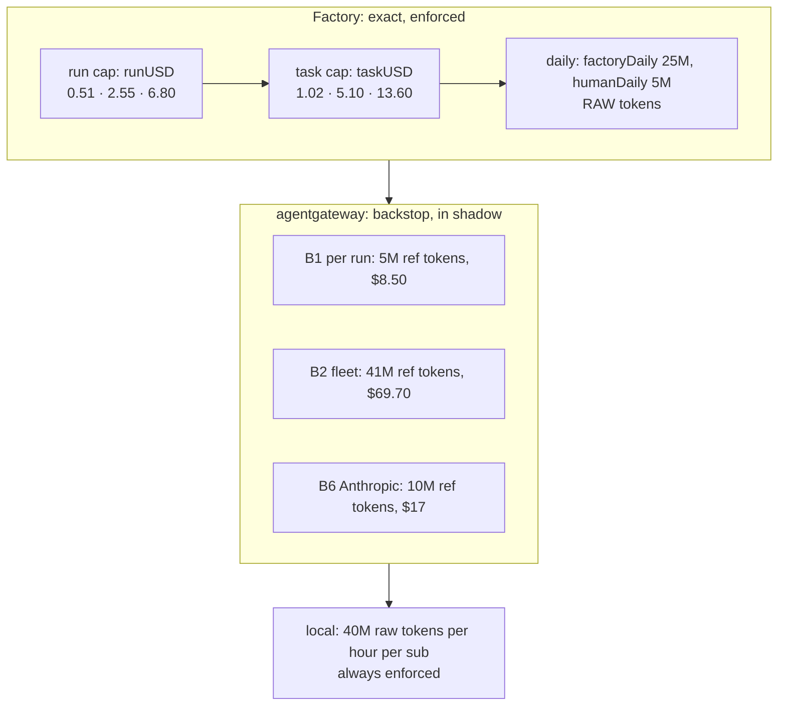
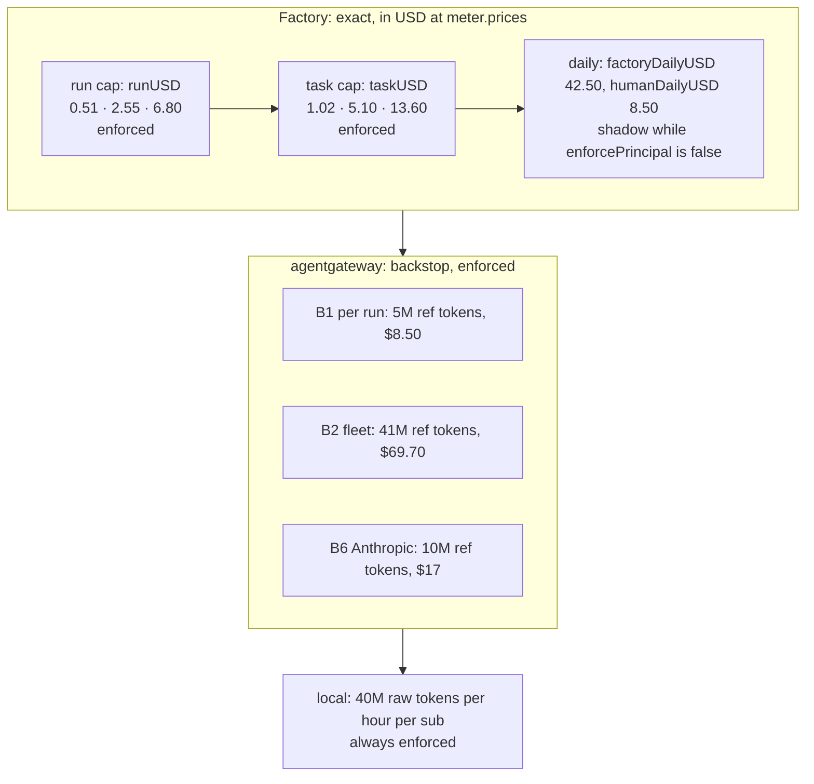

# Truthful costs, PR 3: adopt daily caps in dollars — Implementation Plan

> **For agentic workers:** REQUIRED SUB-SKILL: Use superpowers:subagent-driven-development (recommended) or superpowers:executing-plans to implement this plan task-by-task. Steps use checkbox (`- [ ]`) syntax for tracking.

**Goal:** Pin agent-platform `v0.16.0`, the release whose daily caps count dollars, and move this
deployment onto it. The factory config takes the USD days, every `meter.prices` row says where and
when it was read, gate AG8 sizes B2's floor from `factoryDailyUSD` and refuses the token keys, the
factory's alert and dashboard read the USD gauges, and the docs stop saying tokens or shadow where
both are wrong.

**Architecture:** Six tasks. Each commit leaves `task check` green, and the pull request is
squash-merged.

- **Task 1** reads the release and changes nothing. It checks that the release exists and is signed,
  reads its three digests, and finds what it changes beside #155 (the spec's open item). If the
  release is missing, the plan stops here.
- **Task 2** moves every agent-platform pin to `v0.16.0`, and moves the values to the release's keys
  in the same commit. v0.15.6's strict decoder refuses `factoryDailyUSD`; v0.16.0 ignores the token
  keys, with only a log line (both measured). The pins suite proves the pins. A one-off parse of the
  rendered values under v0.16.0's `config.Parse` proves the values (offline proof 12).
- **Task 3** changes the gate, test first (offline proof 11). AG8 takes B2's floor from
  `factoryDailyUSD`, requires that day, and refuses a token key. AG10 requires `source` and
  `checkedAt` on every row.
- **Task 4** moves the factory's alert, a ledger name in another alert, and the dashboard panel to
  the USD gauges. A new promtool suite and a check in `test-agent-observability` hold them (offline
  proof 13).
- **Task 5** corrects the docs: `routing.md`'s budget layers, runbook 04 (whose new Part F is the
  switch day's live checklist), the harness reference, the status page, three comments, and the
  spec.
- **Task 6** verifies, pushes and opens the pull request.

**Tech Stack:** Python 3 with PyYAML (the gate and the suites), promtool 3.15.0, Bash suites run by
`scripts/ci/run-tests.sh` inside `.composite/`, Helm 4 and Go 1.27 for the one-off parse, `oras`,
`cosign` and `gh` to read the release, Flux 2.

**Spec:** [the truthful costs design](../specs/2026-10-22-truthful-costs-design.md). It covers TC1
(rows gain `source` and `checkedAt` in PR 3), TC5, TC8 and TC9, the PR 3 row of "Pull requests, in
order", the PR 3 rows of the readers table, offline proofs 11–13, live proofs 3–5, and "Open item
for the release step". The names PR 3 consumes come from agent-platform PR 2's plan
(`docs/superpowers/plans/2026-10-22-daily-caps-usd-plan.md` on agent-platform's
`feat/daily-caps-usd`, rulings R1–R17):

- the config keys `budgets.factoryDailyUSD`, `budgets.humanDailyUSD` and
  `budgets.perPerson.dailyUSD`;
- the gauges `agent_factory_budget_{cap,remaining,spent}_usd{principal}`;
- the ledger `agent-factory-ledger-usd-<YYYYMMDD>`;
- the warning `config key ignored: the daily budgets are in USD`;
- `Price.source` (https with a host, no userinfo) and `Price.checkedAt` (`YYYY-MM-DD`);
- the release `v0.16.0`.

**Out of PR 3:**

- PR 1 (`feat/truthful-costs-rule`): the generated charge rule, `AnthropicFleetNearCap`, the
  `agent-run` Cost panel, `AgentMeterInputExcludesCache`, and `routing.md`'s "What a call costs".
- PR 2 (agent-platform) and PR 4 (merged as #98).
- Enforcing per-person caps: TC9 keeps `enforcePrincipal: false`.
- The raw-token alerts, and the sizes of B1, B2 and B6.
- The agent-gateway dashboard's two "(shadow)" panels (R12).
- The live proofs. Task 5 writes them into runbook 04 Part F, and the first platform session on the
  release runs them.

### This plan's rulings

| # | Ruling | Why |
|---|---|---|
| R1 | **The pin is the whole release.** These move to `v0.16.0`: the factory's chart and image by digest, the room-broker's image (its App and the retention CronJob), its `crd-rooms.yaml` asset, and `atlasSchema.ref` | Every agent-platform pin has moved them together (#82). `crd-rooms.yaml` says "Refresh with every AP pin". `app.yaml` moves the broker image with the CronJob's image, the CRD and the schema ref. No release tested a factory on v0.16.0 beside a broker on v0.15.6 |
| R2 | **The pin and the USD keys land in one commit** (Task 2) | Measured: v0.15.6's decoder refuses the new values (`unknown field "factoryDailyUSD"`). v0.16.0 accepts today's values but ignores both days (`Ignored`) and runs on its defaults, with only a log line to say so |
| R3 | **A row's provenance.** `source` is the page named in the comment above `prices:`: Z.ai's `https://docs.z.ai/guides/overview/pricing` or Anthropic's `https://platform.claude.com/docs/en/about-claude/pricing`. `checkedAt` is `"2026-10-16"`, the day the rows were read | The comment records both. A later date would claim a check nobody made, and the next human check moves the date. The comment stays as PR 4 left it |
| R4 | **A row's layout.** The prices go on the row's first line. `source` and `checkedAt` go on a second line of the same flow mapping, with `checkedAt` quoted | No line passes 120 columns, and a price change stays a one-line diff. Quoted, `checkedAt` is a string to every reader. PyYAML reads an unquoted one as a date, which AG10 then refuses. Helm quotes it again when it renders the config (measured) |
| R5 | **AG8 requires a positive `budgets.factoryDailyUSD`** | The release defaults an absent day to $42.50, which the gate cannot see, so the floor would be computed from 0. The gate already follows this rule elsewhere: an absent field fails rather than being assumed |
| R6 | **The token-key check names all three keys**, `factoryDaily`, `humanDaily` and `perPerson.dailyTokens`, each with its USD replacement, once per cluster | The spec says "a token key fails AG8", and the release accepts three. The check runs at the top of `check_budgets`, not once per rate-limit policy, so it reports once, even where no global limit exists |
| R7 | **AG10 requires `source` and `checkedAt` on every row**, pinned or not, in the release's format: `https` with a host and no userinfo, and a real `YYYY-MM-DD` date | Nothing else keeps TC1's "every row" true. Without the gate, a malformed value fails the factory's rollout (the strict `Parse`), not `task check`. PR 4's issue shows each row's `source` |
| R8 | **The alert gets a new promtool suite**, `test-agent-factory-budget-alerts` | PR 3 depends only on PR 2 (the spec's PR table), so PR 1's `test-agent-cost-rules` may not exist yet. The suite follows #95's `test-agent-cache-alerts` |
| R9 | **The alert uses the spec's expression**, and keeps `for: 5m` and `severity: warning`. The summary says USD. The description says nothing is refused while `enforcePrincipal` is `false` | The expression is the spec's readers table. The old description implied that runs are refused |
| R10 | **The dashboard check.** `test-agent-observability` holds the budget panel's exact expression, and fails any file in `observability/base/agent-platform` that names an `agent_factory_budget_*_tokens` gauge | A removed gauge reads nothing and fails nothing: neither `validate-vmrules` nor Grafana notices it |
| R11 | **`routing.md`: the budget layers wherever the page states them.** This is the `#budget-layers` section, the state table's B1/B2/B6 row, two Tuning rows, two Measuring rows, and the Known gaps row "Daily budgets in raw tokens", which is deleted. Nothing in "What a call costs" (lines 240–332) changes: that section is PR 1's | Each of those rows calls a layer tokens or shadow, or names a removed gauge. The section also said the fleet's day makes tasks wait. With `enforcePrincipal: false` the fleet's day is shadow too: agent-platform's `reconciler.go` (lines 801–821) passes that flag to `Reserve` |
| R12 | **Two more comments say B1–B2 are in shadow** (`infrastructure/base/agent-gateway/kustomization.yaml` and `policy-budgets.yaml`'s header). They are corrected. The agent-gateway dashboard's two "(shadow)" panels are not | The comments state the fact the spec corrects. Panel 10 reads the shadow counter, so making it show refusals would change what it measures. That is a later change, with its own proof |
| R13 | **Runbook 04 changes in four places:** Part C's query and key, Part D's B2 row, Part D's two statements that the flag is `"true"`, and a new Part F, the switch day's live checklist (live proofs 3–5). The Results tables keep what was recorded | The cache plan put its live half in runbook 04 the same way (Part E). A result is a record, not an instruction |
| R14 | **Live proof 5 sets `enforcePrincipal: true` for the drill**, with no run in flight. It edits the values in place, under a suspended Kustomization | While `enforcePrincipal` is `false`, `Reserve` reports the fleet's day as over and still admits the task (`budget-principal-shadow`). The spec's "wait `waiting_daily_budget`" needs enforcement. Enforced, the meter revokes running runs past their day, so none may be in flight. A commit would need a release and a host pin bump to apply it, and two more to revert it. Part D Step 4 drills the same way |
| R15 | **Offline proof 12's parse is a one-off step** (Task 2), not a suite | It needs Go and agent-platform's source at the tag, and no suite has either. The spec left this choice open |
| R16 | **The release is read before anything changes** (Task 1). The plan stops if the release is missing or unsigned, or if it needs a values key or an object this deployment lacks | This is the spec's "Open item for the release step". Measured at PR 2's head `113fbb6`: the chart's templates are still those of 0.15.6 |

**Measured 2026-10-22.** Tasks 2–5 were prototyped in this worktree on `origin/main` (`bece5b2`),
then reverted. The prototype kept the v0.15.6 pins, since v0.16.0 is not cut yet. The code below is
the prototype's.

- **`task check`:** `26 passed, 2 skipped, 0 failed`. Both skips are Docker suites. It printed
  `assert-agent-gateway: 14 checks, 0 violations (clusters: aws-0, gcp-0)` and
  `103 PromQL expression(s) in 18 group(s) parse`. Links, doc paths and sources passed, `exit=0`.
  The baseline before #98 (`8345d4a`) was `24 passed, 2 skipped`. #98 adds `test-check-price-drift`,
  and this plan adds one suite. `pre-commit` passed every hook on the 14 changed files.
- **AG8 and AG10:**
  - With the new tests on today's gate, `test-assert-agent-gateway` printed 118 `ok` and 20
    failures. Among them: `the fleet floor … got (4000000, 16000000)`, and each provenance case
    `got []`.
  - With the gate changed, it printed `all passed` (138 checks).
  - With the gate changed and the old fixture, the compliant bundle failed on
    `needs a positive budgets.factoryDailyUSD`, on `sets budgets.factoryDaily, a day in tokens`, and
    on `needs source` and `needs checkedAt` for each row.
- **promtool:** the new suite failed on today's alert (`time: 16m … got:[]`) and passed on the USD
  one. Three mutants each failed it: `>= 0.8` at `9m`, `> 0.9` at `16m`, and `for: 1m` at `14m`.
- **Observability:** today's tree gave three errors (the panel, plus the two files naming `_tokens`
  gauges). With the change, the suite printed `PASS`.
- **The values parse:**
  - The values were rendered with gcp-0-shaped substitutions, then through `helm template` of the
    chart at PR 2's branch head `113fbb6`, where PR 2's Tasks 1–3 have landed (config and ledger).
  - `config.Parse` at that head accepted them: `factoryDailyUSD=42.5 humanDailyUSD=8.5
    perPerson.dailyUSD=8.5 enforcePrincipal=false`, and 6 rows, each with `source` and `checkedAt`.
  - Today's values under the same `Parse` returned
    `ignored keys: [{Key:budgets.factoryDaily …} {Key:budgets.humanDaily …}]`.
  - The new values under agent-platform `main`'s `Parse` (before #155) returned
    `config: json: unknown field "factoryDailyUSD"`.
  - Helm rendered `checkedAt: "2026-10-16"`, quoted.
- **The chart:** at `113fbb6`, its templates are byte-identical to the published 0.15.6 chart's. Only
  `Chart.yaml` metadata and `README.md` differ.
- **Release reads, tried on v0.15.6:**
  - `oras resolve` returned exactly the three pinned digests: the chart, the factory image and the
    room-broker image.
  - `cosign verify` passed on the 0.15.6 chart, with the OCIRepository's issuer and identity.
  - The vendored `crd-rooms.yaml` is its 3-line header plus the v0.15.6 release asset, byte for
    byte.
  - `ghcr.io/smana/agent-factory:v0.16.0` and the GitHub release `v0.16.0` do not exist yet.

## Global Constraints

- **Branch:** `feat/truthful-costs-adopt`, which carries this plan, in its own worktree. In a new
  worktree, run `mise trust mise.toml` once. Rebase onto a freshly fetched `origin/main` before every
  push.
- **`$SCRATCH`** is a scratch directory outside the repository. It holds two helpers:
  - `check.sh <worktree>` runs `task check` with a `python3` that has PyYAML ahead of mise's. It
    logs to `$SCRATCH/check-<worktree directory name>.log` and ends the log with `exit=N`.
  - `run-suite.sh <command…>` runs one command with that `python3`.
  The `python3` on `PATH` lacks PyYAML, so every Python and suite command below goes through one of
  the two helpers. Task 1 adds `$SCRATCH/v0.16.0.env` and a clone, `$SCRATCH/agent-platform`.
- **`task check` is the evidence** (AGENTS.md). Never claim done without its log.
- **Suites that import the host's modules run inside the composite.** `test-assert-agent-gateway`
  imports `yamlcompat`. `test-agent-factory-pins` reads the host's `.github/renovate.json`. Both run
  only after `bash $SCRATCH/run-suite.sh ./scripts/ci/host-profile.sh`, as
  `.composite/scripts/ci/tests/…`. `host-profile.sh` copies the working tree as it is on disk.
- **Run `export PYTHONDONTWRITEBYTECODE=1`** in the shell first. `git add` named paths only, never
  `-A`.
- **The suite contract:** line 1 is the shebang and line 2 is `# requires: <tools>`. Exit 77 is a
  SKIP. Suites read the real tree and never the network. `run-tests.sh` runs them inside
  `.composite/` and finds them with `git ls-files`, so a new suite counts only once it is committed.
- **Host scripts are never vendored.** The gate and the suites are this repository's own.
- **No new workload.** Images and values move, and no object is added, so the platform
  constitution's workload rules gain nothing new to apply to.
- **The pins' form** follows v0.15.6's, with the digests from `$SCRATCH/v0.16.0.env`:
  - the chart: `tag: "0.16.0"  # agent-platform v0.16.0` and `digest: sha256:<64 hex>`;
  - the factory image: `tag: "v0.16.0@sha256:<64 hex>"`;
  - the room-broker image, in two places: `v0.16.0@sha256:<64 hex>`;
  - the schema: `ref: v0.16.0`.
  If PR 2 is released under another tag, use that tag everywhere and name it in the pull request.
- **PR 1 overlap.** PR 1 changes four places this plan also edits:
  - `routing.md`: it rewrites "What a call costs" and deletes the Known gaps row "Two price tables
    disagree";
  - `vmrule-agent-factory.yaml`: it appends `AgentMeterInputExcludesCache` after
    `AgentModelUnpriced`;
  - runbook 04: it edits Part E's table and its offline paragraph;
  - the spec: it appends a "Ruled in PR 1" list.

  PR 3 touches none of those lines. If PR 1 merges first, the rebase can conflict in two adjacent
  places. In the Known gaps table, PR 3 deletes the row just above PR 1's: keep both deletions. At
  the spec's end, both PRs append a "Ruled in" list: keep both, PR 1's first.
- **Commits** are conventional, in English, with **no trailers**.
- **Verbatim from the spec:**
  - TC5: "`budgets.factoryDailyUSD: 42.50`, `budgets.humanDailyUSD: 8.50`,
    `budgets.perPerson.dailyUSD` (default `humanDailyUSD`) … The token keys are accepted for one
    release, ignored with a warning, then removed. AG8's fleet floor reads `factoryDailyUSD`; B2 stays
    $69.70". The config table puts `budgets.perPerson.dailyUSD` at "omitted".
  - TC8: "`agent_factory_budget_cap_usd{principal}`, `agent_factory_budget_remaining_usd{principal}`,
    and a new `agent_factory_budget_spent_usd{principal}`, today's spend unclamped. The `_tokens`
    gauges are removed. `AgentFactoryDailyBudgetHigh` and the dashboard's budget panel move to them".
  - TC9: "`enforcePrincipal` stays `false`".
  - Readers, PR 3: `AgentFactoryDailyBudgetHigh` becomes
    "`agent_factory_budget_spent_usd / agent_factory_budget_cap_usd > 0.8`". The `agent-factory`
    dashboard's budget panel becomes "`remaining_usd / cap_usd`". `AgentPersonCapShadowRefusal`'s
    description "names the USD ledger".
  - Offline proof 11: "AG8: the fleet floor from `factoryDailyUSD` is B2's 41M; a raised
    `factoryDailyUSD` without B2 fails; a token key fails. AG10 passes with `source` and `checkedAt` on
    every row."
  - Offline proof 12: "The pins suite passes on the release's digests, and the values parse under the
    release's `config.Parse`."
  - Offline proof 13: "promtool: `AgentFactoryDailyBudgetHigh` fires at 80% of the USD cap."

## File structure

| File | Change | Task |
|---|---|---|
| `flux/sources/ocirepo-agent-factory.yaml` | The chart's tag and digest | 2 |
| `tooling/base/agent-factory/helm-values-configmap.yaml` | The image pin; `budgets` in USD; `source` and `checkedAt` on each row | 2 |
| `infrastructure/base/room-broker/{app,retention-cronjob,sqlinstance,crd-rooms}.yaml` | The broker image (twice), the schema ref, the CRD asset | 2 |
| `scripts/ci/flux-schema/assert-agent-gateway.py` | AG8: the floor, the day, the token keys. AG10: provenance | 3 |
| `scripts/ci/tests/flux-schema/test-assert-agent-gateway.py` | The fixture in USD; 20 new checks | 3 |
| `scripts/ci/tests/test-agent-factory-budget-alerts.sh` | Create: promtool on the USD alert | 4 |
| `observability/base/agent-platform/vmrule-agent-factory.yaml` | `AgentFactoryDailyBudgetHigh`; `AgentPersonCapShadowRefusal`'s ledger name | 4 |
| `observability/base/agent-platform/grafana-dashboard-agent-factory.yaml` | The budget panel | 4 |
| `scripts/ci/tests/test-agent-observability.py` | `check_factory_budget` | 4 |
| `website/content/docs/platform/ai-platform/routing.md` | The budget layers (R11) | 5 |
| `docs/runbooks/agent-factory/04-gateway-secrets-budgets.md` | Parts C and D; new Part F | 5 |
| `website/content/docs/platform/ai-platform/agents/harness-reference.md` | The `budgets.*` row | 5 |
| `website/content/docs/platform/ai-platform/status.md` | The per-person caps row | 5 |
| `infrastructure/base/agent-gateway/{ratelimit,kustomization,policy-budgets}.yaml` | Comments only | 5 |
| `docs/superpowers/specs/2026-10-22-truthful-costs-design.md` | Live proof 5; "Ruled in PR 3" | 5 |

---

### Task 1: The release, read

**Files:** none in the repository. Writes `$SCRATCH/v0.16.0.env`, `$SCRATCH/crd-rooms-v0.16.0/` and
a clone at `$SCRATCH/agent-platform`.

**Interfaces:**
- Produces: `$SCRATCH/v0.16.0.env`, which defines `CHART_DIGEST`, `FACTORY_DIGEST` and
  `BROKER_DIGEST`, each `sha256:<64 hex>`. It also produces
  `$SCRATCH/crd-rooms-v0.16.0/crd-rooms.yaml` and `$SCRATCH/agent-platform` with its tags. Task 2
  reads all three.

- [ ] **Step 1: The release exists**

```bash
gh release view v0.16.0 --repo Smana/agent-platform --json tagName,isDraft,isPrerelease,publishedAt
```

Expected: `"isDraft":false,"isPrerelease":false`, `"tagName":"v0.16.0"`. If the output is `release
not found`, a draft or a prerelease, **stop here and report**: PR 3 depends on PR 2 being released
(the spec's PR table). On 2026-10-22 the output was `release not found`.

- [ ] **Step 2: Read the three digests**

```bash
CHART_DIGEST=$(oras resolve ghcr.io/smana/charts/agent-factory:0.16.0)
FACTORY_DIGEST=$(oras resolve ghcr.io/smana/agent-factory:v0.16.0)
BROKER_DIGEST=$(oras resolve ghcr.io/smana/room-broker:v0.16.0)
printf 'CHART_DIGEST=%s\nFACTORY_DIGEST=%s\nBROKER_DIGEST=%s\n' \
  "$CHART_DIGEST" "$FACTORY_DIGEST" "$BROKER_DIGEST" | tee "$SCRATCH/v0.16.0.env"
helm show chart oci://ghcr.io/smana/charts/agent-factory --version 0.16.0 | grep appVersion
```

Expected: three `sha256:` lines of 64 hex digits each, then `appVersion: v0.16.0`. The pins suite
expects that appVersion. On a `not found`, stop. On 0.15.6 the same commands return today's pinned
digests.

- [ ] **Step 3: The chart is signed by the release workflow**

Flux verifies the chart the same way (`flux/sources/ocirepo-agent-factory.yaml`), so an unsigned
chart would never deploy:

```bash
source "$SCRATCH/v0.16.0.env"
cosign verify "ghcr.io/smana/charts/agent-factory@$CHART_DIGEST" \
  --certificate-oidc-issuer https://token.actions.githubusercontent.com \
  --certificate-identity-regexp '^https://github\.com/Smana/agent-platform/\.github/workflows/release\.yaml@refs/tags/v.*$' \
  > /dev/null; echo "exit=$?"
```

Expected: `Verification for ghcr.io/smana/charts/agent-factory@sha256:… --`, then `exit=0`. On a
failure, stop.

- [ ] **Step 4: What the release changes beside #155**

```bash
git clone --quiet --filter=blob:none https://github.com/Smana/agent-platform "$SCRATCH/agent-platform"
git -C "$SCRATCH/agent-platform" diff --stat v0.15.6 v0.16.0 -- \
  charts/agent-factory internal/factory/config internal/config internal/store/migrations
gh release download v0.16.0 --repo Smana/agent-platform --pattern crd-rooms.yaml --dir "$SCRATCH/crd-rooms-v0.16.0"
diff <(tail -n +4 infrastructure/base/room-broker/crd-rooms.yaml) "$SCRATCH/crd-rooms-v0.16.0/crd-rooms.yaml"
```

Read each path against this table:

| Path | Expected | If it differs |
|---|---|---|
| `charts/agent-factory/templates/`, `charts/agent-factory/values.yaml` | Unchanged. At PR 2's head `113fbb6` only `README.md` and `Chart.yaml` metadata differ | **Stop and report.** A new value, object or RBAC rule is a decision beyond this plan |
| `internal/factory/config` | The USD days, `Ignored`, `Price.Source` and `Price.CheckedAt`, and #160's optional `runs:` block, which defaults to today's kind | **Stop and report** on a new required key |
| `internal/config` (the broker's) | Unchanged, or optional keys only | **Stop and report** on a new required key |
| `internal/store/migrations` | Any change. `atlasSchema.ref` moves with the broker image (R1), so the schema and the binary still match | Name the new migration files in the pull request |
| `crd-rooms.yaml` | Any change | Task 2 vendors it. Put the diff's summary in the pull request |

`crd-agentruns.yaml` (#160) is a release asset this deployment does not vendor: it runs no
run-controller, and the factory's `runs:` block defaults to today's kind. If #165 (install anywhere)
is in the release, read its chart diff the same way.

Nothing is committed in this task.

---

### Task 2: Pin v0.16.0 and move the values to its keys, in one commit

**Files:**
- Modify: `flux/sources/ocirepo-agent-factory.yaml:13-14`
- Modify: `tooling/base/agent-factory/helm-values-configmap.yaml:17-19` (the image), `:175-182`
  (`budgets`), `:205-210` (the `prices` rows)
- Modify: `infrastructure/base/room-broker/app.yaml:13-15`, `retention-cronjob.yaml:35`,
  `sqlinstance.yaml:36`, `crd-rooms.yaml` (whole file)
- Test: `scripts/ci/tests/test-agent-factory-pins.py` (unchanged), plus a one-off parse in `$SCRATCH`

**Interfaces:**
- Consumes: Task 1's `$SCRATCH/v0.16.0.env`, `$SCRATCH/crd-rooms-v0.16.0/crd-rooms.yaml` and
  `$SCRATCH/agent-platform`.
- Produces: the values that Tasks 3–5 rely on.
  - `config.budgets` holds `factoryDailyUSD: 42.50` and `humanDailyUSD: 8.50`, and no token key.
  - `perPerson` stays `{enabled: true}`.
  - Every `config.meter.prices.<model>` row has `source` (an https URL) and `checkedAt`
    (`"2026-10-16"`).

- [ ] **Step 1: Move the chart pin alone, and watch the pins suite fail**

```bash
export PYTHONDONTWRITEBYTECODE=1
source "$SCRATCH/v0.16.0.env"
```

In `flux/sources/ocirepo-agent-factory.yaml`, replace:

```yaml
    tag: "0.15.6"  # agent-platform v0.15.6
    digest: sha256:2a766b4f9c2abc7d9a4b68423cff6ab4f7bae4b4f85d812455b6fccc33ead137
```

with the following, `<CHART_DIGEST>` being the value from the env file:

```yaml
    tag: "0.16.0"  # agent-platform v0.16.0
    digest: <CHART_DIGEST>
```

```bash
bash $SCRATCH/run-suite.sh ./scripts/ci/host-profile.sh
bash $SCRATCH/run-suite.sh python3 .composite/scripts/ci/tests/test-agent-factory-pins.py; echo "exit=$?"
```

Expected: `FAIL: image 'v0.15.6' is not chart '0.16.0''s appVersion 'v0.16.0': bump both`, then
`==> agent-factory pins: chart 0.16.0, image v0.15.6, 1 problem(s)` and `exit=1`.

- [ ] **Step 2: The factory image**

In `tooling/base/agent-factory/helm-values-configmap.yaml`, replace:

```yaml
      # agent-platform v0.15.6, the chart's appVersion.
      # renovate: datasource=docker depName=ghcr.io/smana/agent-factory
      tag: "v0.15.6@sha256:e571b0cc7d227bc0278f1892da169d38eb5e130626a825677ca529b14e521c9b"
```

with:

```yaml
      # agent-platform v0.16.0, the chart's appVersion.
      # renovate: datasource=docker depName=ghcr.io/smana/agent-factory
      tag: "v0.16.0@<FACTORY_DIGEST>"
```

```bash
bash $SCRATCH/run-suite.sh ./scripts/ci/host-profile.sh
bash $SCRATCH/run-suite.sh python3 .composite/scripts/ci/tests/test-agent-factory-pins.py; echo "exit=$?"
```

Expected: `==> agent-factory pins: chart 0.16.0, image v0.16.0, 0 problem(s)`, `exit=0`.

- [ ] **Step 3: The room-broker's pins (R1)**

In `infrastructure/base/room-broker/app.yaml`, replace:

```yaml
    # agent-platform v0.15.6, by digest. Move it with the retention CronJob's,
    # crd-rooms.yaml and atlasSchema.ref together.
    tag: "v0.15.6@sha256:09ca8d78f74deaa186d50de1e21a2daa277afb01123c0cc19530df16502cf5d1"
```

with:

```yaml
    # agent-platform v0.16.0, by digest. Move it with the retention CronJob's,
    # crd-rooms.yaml and atlasSchema.ref together.
    tag: "v0.16.0@<BROKER_DIGEST>"
```

In `infrastructure/base/room-broker/retention-cronjob.yaml`, replace:

```yaml
              image: ghcr.io/smana/room-broker:v0.15.6@sha256:09ca8d78f74deaa186d50de1e21a2daa277afb01123c0cc19530df16502cf5d1
```

with:

```yaml
              image: ghcr.io/smana/room-broker:v0.16.0@<BROKER_DIGEST>
```

In `infrastructure/base/room-broker/sqlinstance.yaml`, replace `    ref: v0.15.6` with
`    ref: v0.16.0`. Then vendor the CRD asset under its header:

```bash
{ printf '%s\n' \
  '# Vendored from Smana/agent-platform (ruling P16): the release asset since the merge wave.' \
  '# Source: the crd-rooms.yaml asset of agent-platform v0.16.0, the room-broker pin.' \
  '# Refresh with every AP pin: gh release download <tag> --repo Smana/agent-platform --pattern crd-rooms.yaml'
  cat "$SCRATCH/crd-rooms-v0.16.0/crd-rooms.yaml"; } > infrastructure/base/room-broker/crd-rooms.yaml
git grep -n -E 'v?0\.15\.6' -- flux infrastructure tooling
```

Expected: the grep prints nothing.

- [ ] **Step 4: Two throwaway helpers for offline proof 12 (R15)**

They live in `$SCRATCH` and are never committed. `$SCRATCH/render-values.py` substitutes the values
as Flux's postBuild does, then renders them through the chart, as helm-controller does:

```python
"""Flux's postBuild substitution on the factory's values, as gcp-0 sets it, then `helm template`.

Usage: python3 render-values.py <values ConfigMap> <chart dir> <out config.yaml>
Writes the chart's rendered config.yaml (the file the factory parses) to <out>.
"""
import subprocess
import sys
import tempfile

import yaml

cm_path, chart, out = sys.argv[1:4]
SUBST = {"${cluster_name}": "gcp-0", "${private_domain_name}": "priv.example.test",
         "${identity_provider_url}": "https://auth.example.test"}
values = yaml.safe_load(open(cm_path))["data"]["values.yaml"]
for k, v in SUBST.items():
    values = values.replace(k, v)
assert "${" not in values, "an unsubstituted variable is left"
with tempfile.NamedTemporaryFile("w", suffix=".yaml") as f:
    f.write(values)
    f.flush()
    rendered = subprocess.run(["helm", "template", "agent-factory", chart, "-f", f.name,
                               "--show-only", "templates/configmap.yaml"],
                              check=True, capture_output=True, text=True).stdout
open(out, "w").write(yaml.safe_load(rendered)["data"]["config.yaml"])
```

`$SCRATCH/agent-platform/internal/factory/config/zz_deployment_values_test.go`, inside the clone,
checked out at the tag:

```go
// SPDX-License-Identifier: Apache-2.0

package config

import (
	"os"
	"testing"
)

// A throwaway check for ai-native-ref's truthful costs PR 3 (offline proof 12): the deployment's
// rendered config parses under this release's Parse, every token day gone, every row provenanced.
func TestTheDeploymentValuesParse(t *testing.T) {
	path := os.Getenv("DEPLOYMENT_CONFIG")
	if path == "" {
		t.Skip("DEPLOYMENT_CONFIG unset")
	}
	cfg, err := Load(path)
	if err != nil {
		t.Fatal(err)
	}
	if len(cfg.Ignored) != 0 {
		t.Fatalf("ignored keys: %+v", cfg.Ignored)
	}
	b := cfg.Budgets
	t.Logf("factoryDailyUSD=%v humanDailyUSD=%v perPerson.dailyUSD=%v enforcePrincipal=%v",
		b.FactoryDailyUSD, b.HumanDailyUSD, b.PerPerson.DailyUSD, b.EnforcePrincipal)
	if b.FactoryDailyUSD != 42.50 || b.HumanDailyUSD != 8.50 || b.PerPerson.DailyUSD != 8.50 || b.EnforcePrincipal {
		t.Fatalf("budgets: %+v", b)
	}
	for model, p := range cfg.Meter.Prices {
		if p.Source == "" || p.CheckedAt == "" {
			t.Fatalf("meter.prices.%s: source %q checkedAt %q", model, p.Source, p.CheckedAt)
		}
	}
	t.Logf("%d price rows, each with source and checkedAt", len(cfg.Meter.Prices))
}
```

```bash
git -C "$SCRATCH/agent-platform" checkout --quiet v0.16.0
helm pull oci://ghcr.io/smana/charts/agent-factory --version 0.16.0 --untar --untardir "$SCRATCH/chart-0.16.0"
```

Expected: `helm pull` prints `Digest: <CHART_DIGEST>`, the digest Step 1 pinned. If they differ,
stop: the tag was re-pushed.

- [ ] **Step 5: Today's values under v0.16.0, and watch the parse fail**

```bash
bash $SCRATCH/run-suite.sh python3 "$SCRATCH/render-values.py" \
  tooling/base/agent-factory/helm-values-configmap.yaml "$SCRATCH/chart-0.16.0/agent-factory" "$SCRATCH/config.yaml"
DEPLOYMENT_CONFIG="$SCRATCH/config.yaml" go -C "$SCRATCH/agent-platform" test ./internal/factory/config/ \
  -run TestTheDeploymentValuesParse -v -count=1
```

Expected: `ignored keys: [{Key:budgets.factoryDaily Use:budgets.factoryDailyUSD} {Key:budgets.humanDaily Use:budgets.humanDailyUSD}]`,
then `FAIL`. The release would run today's values on its defaults, and only a log line would say
so.

- [ ] **Step 6: The days in USD, and the rows' provenance**

In `tooling/base/agent-factory/helm-values-configmap.yaml`, replace:

```yaml
        # Still shadow (owner, 2026-10-18): daily budgets count cache reads as full tokens, so 5M
        # ends a maintainer's day at ~$2 of real spend. Enforce once they count priced units
        # (agent-platform#155).
        enforcePrincipal: false
        factoryDaily: 25000000
        humanDaily: 5000000
        # Per-person caps in shadow (D8): counted as budget-principal-shadow{principal}, never refused.
        perPerson: {enabled: true}
```

with:

```yaml
        # Still shadow, the fleet's day and each person's alike (truthful costs TC9): the days count
        # dollars since agent-platform v0.16.0 (#155), and enforcing waits on their shadow record.
        enforcePrincipal: false
        # The days in USD (TC5): the old 25M and 5M at the reference $1.70 per M, now counted at
        # meter.prices, cache reads at their own rate. AG8 holds B2 at or above factoryDailyUSD
        # plus caps.concurrentRuns frontier runs, and fails a token key (factoryDaily, humanDaily,
        # perPerson.dailyTokens): v0.16.0 ignores one, the next release refuses it.
        factoryDailyUSD: 42.50
        humanDailyUSD: 8.50
        # Per-person caps in shadow (D8): counted as budget-principal-shadow{principal}, never refused.
        # Each person's day is humanDailyUSD: perPerson.dailyUSD is unset.
        perPerson: {enabled: true}
```

and replace the six rows:

```yaml
          glm-5.3: {input: 1.40, cacheRead: 0.26, output: 4.40}
          glm-5.3-flashx: {input: 0.37, cacheRead: 0.075, output: 1.25}
          glm-5.3-flash: {input: 0.15, cacheRead: 0.03, output: 0.50}
          claude-opus-5-5: {input: 4.00, cacheRead: 0.20, cacheWrite: 5.00, output: 20.00}
          claude-sonnet-5-5: {input: 2.00, cacheRead: 0.10, cacheWrite: 2.50, output: 10.00}
          claude-haiku-5-5: {input: 0.50, cacheRead: 0.05, cacheWrite: 0.625, output: 2.50}
```

with (R3, R4):

```yaml
          glm-5.3: {input: 1.40, cacheRead: 0.26, output: 4.40,
            source: "https://docs.z.ai/guides/overview/pricing", checkedAt: "2026-10-16"}
          glm-5.3-flashx: {input: 0.37, cacheRead: 0.075, output: 1.25,
            source: "https://docs.z.ai/guides/overview/pricing", checkedAt: "2026-10-16"}
          glm-5.3-flash: {input: 0.15, cacheRead: 0.03, output: 0.50,
            source: "https://docs.z.ai/guides/overview/pricing", checkedAt: "2026-10-16"}
          claude-opus-5-5: {input: 4.00, cacheRead: 0.20, cacheWrite: 5.00, output: 20.00,
            source: "https://platform.claude.com/docs/en/about-claude/pricing", checkedAt: "2026-10-16"}
          claude-sonnet-5-5: {input: 2.00, cacheRead: 0.10, cacheWrite: 2.50, output: 10.00,
            source: "https://platform.claude.com/docs/en/about-claude/pricing", checkedAt: "2026-10-16"}
          claude-haiku-5-5: {input: 0.50, cacheRead: 0.05, cacheWrite: 0.625, output: 2.50,
            source: "https://platform.claude.com/docs/en/about-claude/pricing", checkedAt: "2026-10-16"}
```

The comment above `prices:` stays as it is: it already names both pages and the date.

- [ ] **Step 7: Parse again, and run the suites that read the values**

```bash
bash $SCRATCH/run-suite.sh python3 "$SCRATCH/render-values.py" \
  tooling/base/agent-factory/helm-values-configmap.yaml "$SCRATCH/chart-0.16.0/agent-factory" "$SCRATCH/config.yaml"
grep -m1 -A3 'glm-5.3:' "$SCRATCH/config.yaml"
DEPLOYMENT_CONFIG="$SCRATCH/config.yaml" go -C "$SCRATCH/agent-platform" test ./internal/factory/config/ \
  -run TestTheDeploymentValuesParse -v -count=1
bash $SCRATCH/run-suite.sh ./scripts/ci/host-profile.sh
for t in test-agent-factory-pins.py test-check-price-drift.py flux-schema/test-assert-agent-gateway.py; do
  bash $SCRATCH/run-suite.sh python3 ".composite/scripts/ci/tests/$t" > /dev/null; echo "$t exit=$?"; done
```

Expected:
- The rendered row carries `checkedAt: "2026-10-16"`, quoted.
- The test logs `factoryDailyUSD=42.5 humanDailyUSD=8.5 perPerson.dailyUSD=8.5 enforcePrincipal=false`
  and `6 price rows, each with source and checkedAt`, then `PASS`.
- All three suites print `exit=0`. `test-check-price-drift` loads the real table, `source`
  included. Today's gate still reads `factoryDaily`, and treats it as 0 when absent, so its
  fixture-based tests are unchanged until Task 3.

- [ ] **Step 8: Commit**

```bash
git add flux/sources/ocirepo-agent-factory.yaml tooling/base/agent-factory/helm-values-configmap.yaml \
  infrastructure/base/room-broker/app.yaml infrastructure/base/room-broker/retention-cronjob.yaml \
  infrastructure/base/room-broker/sqlinstance.yaml infrastructure/base/room-broker/crd-rooms.yaml
git commit -m "feat(agent-platform): pin v0.16.0, its daily caps in dollars and dated price rows"
```

---

### Task 3: Gate AG8 on the USD day, and AG10 on every row's provenance

**Files:**
- Modify: `scripts/ci/flux-schema/assert-agent-gateway.py`: the AG8 docstring (lines 41–43), the AG10
  docstring (line 60), the imports (86–90), the constants after `PRICE_FIELDS` (153),
  `factory_floors` (538–543), the head of `check_budgets` (568–570), and the end of
  `check_meter_prices` (805–807)
- Test: `scripts/ci/tests/flux-schema/test-assert-agent-gateway.py`: the imports (9–15), `PRICES`
  (30–33), the fixture's `budgets` (181), line 368, lines 560–561, and a block after line 591

**Interfaces:**
- Consumes: Task 2's values shape. The gate reads `config.budgets.factoryDailyUSD` and each
  `config.meter.prices.<model>.{source, checkedAt}`.
- Produces:
  - `factory_floors(cfg) -> (run, fleet)`, in reference tokens, with `fleet` from `factoryDailyUSD`;
  - `positive(v) -> bool`;
  - `daily_cap_problems(cfg) -> list[str]`;
  - `valid_day(day) -> bool`;
  - the constants `TOKEN_DAYS` and `CHECKED_AT`.

  The messages begin `AG8: agent-system/agent-factory-helm-values needs a positive
  budgets.factoryDailyUSD`, `AG8: … sets budgets.<key>, a day in tokens`,
  `AG10: meter.prices.<model> needs source` and `AG10: meter.prices.<model> needs checkedAt`.

- [ ] **Step 1: Write the failing tests**

In `scripts/ci/tests/flux-schema/test-assert-agent-gateway.py`, add `import datetime` after
`import copy`. Replace:

```python
PRICES = {"glm-5.3": {"input": 1.40, "cacheRead": 0.26, "output": 4.40},
          "glm-5.3-flash": {"input": 0.15, "cacheRead": 0.03, "output": 0.50},
          "claude-opus-5-5": {"input": 4, "cacheRead": 0.20, "cacheWrite": 5, "output": 20},
          "claude-haiku-5-5": {"input": 0.50, "cacheRead": 0.05, "cacheWrite": 0.625, "output": 2.50}}
```

with:

```python
ZAI_PAGE = {"source": "https://docs.z.ai/guides/overview/pricing", "checkedAt": "2026-10-16"}
CLAUDE_PAGE = {"source": "https://platform.claude.com/docs/en/about-claude/pricing", "checkedAt": "2026-10-16"}
PRICES = {"glm-5.3": {"input": 1.40, "cacheRead": 0.26, "output": 4.40, **ZAI_PAGE},
          "glm-5.3-flash": {"input": 0.15, "cacheRead": 0.03, "output": 0.50, **ZAI_PAGE},
          "claude-opus-5-5": {"input": 4, "cacheRead": 0.20, "cacheWrite": 5, "output": 20, **CLAUDE_PAGE},
          "claude-haiku-5-5": {"input": 0.50, "cacheRead": 0.05, "cacheWrite": 0.625, "output": 2.50, **CLAUDE_PAGE}}
```

Replace `"budgets": {"factoryDaily": 25000000}, "caps": {"concurrentRuns": 4}}})}},` with
`"budgets": {"factoryDailyUSD": 42.50}, "caps": {"concurrentRuns": 4}}})}},`, and
`expect("B2 below factoryDaily plus the in-flight runs fails",` with
`expect("B2 below factoryDailyUSD plus the in-flight runs fails",`. Then replace:

```python
expect("a raised factoryDaily without B2 fails",
       edit_config(lambda c: c["budgets"].update({"factoryDaily": 26000000})), "AG8", "fleet")
```

with:

```python
fixture = yaml.safe_load(find(compliant(), "ConfigMap", gate.FACTORY_VALUES)["data"]["values.yaml"])["config"]
check("the fleet floor from factoryDailyUSD $42.50 is B2's 41M: 25M plus 4 frontier runs at 4M",
      gate.factory_floors(fixture) == (4000000, 41000000), f"got {gate.factory_floors(fixture)}")
expect("a raised factoryDailyUSD without B2 fails ($1.70 more is 1M more)",
       edit_config(lambda c: c["budgets"].update({"factoryDailyUSD": 44.20})), "AG8", "fleet")
expect("no factoryDailyUSD fails: the release's default is not in the values",
       edit_config(lambda c: c["budgets"].pop("factoryDailyUSD")), "AG8", "budgets.factoryDailyUSD")
expect("a zero factoryDailyUSD fails", edit_config(lambda c: c["budgets"].update({"factoryDailyUSD": 0})),
       "AG8", "budgets.factoryDailyUSD")
expect("factoryDaily in tokens fails, naming its USD key",
       edit_config(lambda c: c["budgets"].update({"factoryDaily": 25000000})), "AG8", "Use budgets.factoryDailyUSD")
expect("humanDaily in tokens fails, naming its USD key",
       edit_config(lambda c: c["budgets"].update({"humanDaily": 5000000})), "AG8", "Use budgets.humanDailyUSD")
expect("perPerson.dailyTokens fails, naming its USD key",
       edit_config(lambda c: c["budgets"].update({"perPerson": {"enabled": True, "dailyTokens": 5000000}})),
       "AG8", "Use budgets.perPerson.dailyUSD")
got = copy.deepcopy(compliant())
edit_config(lambda c: c["budgets"].update({"humanDailyUSD": 8.50, "perPerson": {"enabled": True, "dailyUSD": 4.25}}))(got)
check("the USD person keys pass", gate.run(got) == [], f"got {gate.run(got)}")
```

Then, after:

```python
expect("no factory values beside the backends fails",
       lambda o: o.remove(find(o, "ConfigMap", gate.FACTORY_VALUES)), "AG10", gate.FACTORY_VALUES)
```

insert:

```python
print("AG10 every row says where and when it was read (truthful costs TC1)")
for name, value in (("an http source", "http://docs.z.ai/guides/overview/pricing"),
                    ("a source without a host", "https:///pricing"),
                    ("a source with credentials", "https://u:p@docs.z.ai/guides/overview/pricing"),
                    ("a source that is not a URL", "docs.z.ai pricing")):
    expect(f"{name} fails", edit_meter(lambda m, v=value: m["prices"]["glm-5.3"].update({"source": v})),
           "AG10", "meter.prices.glm-5.3 needs source")
for name, value in (("no such month", "2026-13-01"), ("another layout", "16/10/2026"),
                    ("no dashes", "20261016"), ("a timestamp", "2026-10-16T00:00:00Z"),
                    ("an unquoted date, which YAML reads as a date", datetime.date(2026, 10, 16))):
    expect(f"checkedAt as {name} fails", edit_meter(lambda m, v=value: m["prices"]["glm-5.3"].update({"checkedAt": v})),
           "AG10", "meter.prices.glm-5.3 needs checkedAt")
expect("a row without source fails", edit_meter(lambda m: m["prices"]["claude-opus-5-5"].pop("source")),
       "AG10", "claude-opus-5-5 needs source")
expect("a row without checkedAt fails", edit_meter(lambda m: m["prices"]["claude-opus-5-5"].pop("checkedAt")),
       "AG10", "claude-opus-5-5 needs checkedAt")
expect("a row no backend pins needs them too: every row",
       edit_meter(lambda m: m["prices"].update({"glm-5.3-flashx": {"input": 0.37, "cacheRead": 0.075, "output": 1.25}})),
       "AG10", "glm-5.3-flashx needs source")
```

- [ ] **Step 2: Run them and watch them fail**

```bash
bash $SCRATCH/run-suite.sh ./scripts/ci/host-profile.sh
bash $SCRATCH/run-suite.sh python3 .composite/scripts/ci/tests/flux-schema/test-assert-agent-gateway.py \
  | grep -E '^  FAIL|failure'; echo "exit=${PIPESTATUS[0]}"
```

Expected: 20 `FAIL` lines, among them
`the fleet floor from factoryDailyUSD $42.50 is B2's 41M … got (4000000, 16000000)` and
`B2 below factoryDailyUSD plus the in-flight runs fails -- got []`. Every new AG8 and AG10 case ends
`got []`, except the last: its `got` lists only the AG8 cost mismatch the new row causes. Then
`20 failure(s)` and `exit=1`.

- [ ] **Step 3: Write the gate**

In `scripts/ci/flux-schema/assert-agent-gateway.py`, replace the docstring lines:

```
       runTokens), the fleet bucket at least budgets.factoryDaily plus
       caps.concurrentRuns runs at that cap: the gateway never refuses before
       the factory would. A local limit on the real router, which refuses in either mode, allows
```

with:

```
       runTokens), the fleet bucket at least budgets.factoryDailyUSD in
       reference tokens plus caps.concurrentRuns runs at that cap: the gateway
       never refuses before the factory would. The day must be set, and a day
       in tokens (factoryDaily, humanDaily, perPerson.dailyTokens) fails: the
       release ignores it (truthful costs TC5). A local limit on the real
       router, which refuses in either mode, allows
```

and `       but its runs would escape the USD caps.` with:

```
       but its runs would escape the USD caps. Every row names its source,
       the https:// page it was read from, and checkedAt, the YYYY-MM-DD day
       (truthful costs TC1).
```

Add `import datetime` before `import json`, and `import urllib.parse` after `import sys`. After
`PRICE_FIELDS = ("input", "cacheRead", "output")`, add:

```python
# Truthful costs TC5: the daily caps are in USD since agent-platform v0.16.0, which ignores these
# token keys with a warning; its next release refuses them. Each names the key that replaced it.
TOKEN_DAYS = {("budgets", "factoryDaily"): "budgets.factoryDailyUSD",
              ("budgets", "humanDaily"): "budgets.humanDailyUSD",
              ("budgets", "perPerson", "dailyTokens"): "budgets.perPerson.dailyUSD"}
# TC1: where and when a price row was read, as v0.16.0's config.Parse accepts them.
CHECKED_AT = re.compile(r"^\d{4}-\d{2}-\d{2}$")
```

In `factory_floors`, replace:

```python
    fleet = (cfg.get("budgets") or {}).get("factoryDaily", 0) + (cfg.get("caps") or {}).get("concurrentRuns", 0) * run
    return run, fleet
```

with:

```python
    day = (cfg.get("budgets") or {}).get("factoryDailyUSD")
    day = round(day * 1e6 / REF_USD_PER_M) if positive(day) else 0
    fleet = day + (cfg.get("caps") or {}).get("concurrentRuns", 0) * run
    return run, fleet


def positive(v):
    return isinstance(v, (int, float)) and not isinstance(v, bool) and v > 0


def daily_cap_problems(cfg):
    """The fleet's day B2 is sized from, and the token-day keys the release no longer reads (TC5)."""
    where = f"{FACTORY_NS}/{FACTORY_VALUES}"
    out = []
    if not positive((cfg.get("budgets") or {}).get("factoryDailyUSD")):
        out.append(f"AG8: {where} needs a positive budgets.factoryDailyUSD: B2's floor is the fleet's day "
                   "plus the runs in flight, and the release's default is invisible here")
    for path, use in TOKEN_DAYS.items():
        node = cfg
        for key in path[:-1]:
            node = node.get(key) if isinstance(node, dict) else None
        if isinstance(node, dict) and path[-1] in node:
            out.append(f"AG8: {where} sets {'.'.join(path)}, a day in tokens: agent-platform v0.16.0 ignores it "
                       f"and its next release refuses it. Use {use}")
    return out
```

In `check_budgets`, replace:

```python
def check_budgets(objs):
    out = []
    configs = ratelimit_configs(objs)
```

with:

```python
def check_budgets(objs):
    out = []
    if (factory := factory_values(objs)) is not None:
        out += daily_cap_problems(factory)
    configs = ratelimit_configs(objs)
```

At the end of `check_meter_prices`, replace:

```python
            if isinstance(v, bool) or not isinstance(v, (int, float)) or v <= 0:
                out.append(f"AG10: meter.prices.{model} ({ref(b)}) needs a positive {f}")
    return out
```

with:

```python
            if isinstance(v, bool) or not isinstance(v, (int, float)) or v <= 0:
                out.append(f"AG10: meter.prices.{model} ({ref(b)}) needs a positive {f}")
    for model, row in sorted(prices.items()):
        if not isinstance(row, dict):
            continue
        src = urllib.parse.urlsplit(row["source"]) if isinstance(row.get("source"), str) else None
        if src is None or src.scheme != "https" or not src.hostname or src.username is not None:
            out.append(f"AG10: meter.prices.{model} needs source, the https:// page its prices were read from")
        day = row.get("checkedAt")
        if not (isinstance(day, str) and CHECKED_AT.match(day) and valid_day(day)):
            out.append(f"AG10: meter.prices.{model} needs checkedAt, the day they were read, "
                       "as a quoted YYYY-MM-DD")
    return out


def valid_day(day):
    try:
        datetime.date.fromisoformat(day)
    except ValueError:
        return False
    return True
```

`CHECKED_AT` comes before `fromisoformat` because Python 3.11's `fromisoformat` also accepts
`20261016`, which Go's `time.DateOnly` refuses.

- [ ] **Step 4: Run them and watch them pass**

```bash
bash $SCRATCH/run-suite.sh ./scripts/ci/host-profile.sh
bash $SCRATCH/run-suite.sh python3 .composite/scripts/ci/tests/flux-schema/test-assert-agent-gateway.py | tail -1
```

Expected: `all passed` (138 checks).

- [ ] **Step 5: The gate on the real bundle**

```bash
bash $SCRATCH/check.sh "$PWD"
grep -E 'assert-agent-gateway:|passed,|exit=' "$SCRATCH/check-$(basename "$PWD").log"
```

Expected: `assert-agent-gateway: 14 checks, 0 violations (clusters: aws-0, gcp-0)`, `0 failed`,
`exit=0`. Task 2's values give a floor of 25M + 16M = 41M, which is B2, and every row has its
provenance.

- [ ] **Step 6: Commit**

```bash
git add scripts/ci/flux-schema/assert-agent-gateway.py scripts/ci/tests/flux-schema/test-assert-agent-gateway.py
git commit -m "feat(agent-gateway): AG8 sizes B2 from the day in dollars and refuses token days, AG10 dates every price"
```

---

### Task 4: The factory's alert and dashboard on the USD gauges

**Files:**
- Create: `scripts/ci/tests/test-agent-factory-budget-alerts.sh`
- Modify: `observability/base/agent-platform/vmrule-agent-factory.yaml:33-40`
  (`AgentFactoryDailyBudgetHigh`) and `:52` (`AgentPersonCapShadowRefusal`'s description)
- Modify: `observability/base/agent-platform/grafana-dashboard-agent-factory.yaml:40`
- Modify: `scripts/ci/tests/test-agent-observability.py`: a new check before `CHECKS` (line 441)

**Interfaces:**
- Consumes: the release's gauges `agent_factory_budget_cap_usd{principal}`,
  `agent_factory_budget_remaining_usd{principal}` and `agent_factory_budget_spent_usd{principal}`.
  The meter's leader sets them, and they read 0 for yesterday's principals from a day's first tick.
- Produces:
  - `AgentFactoryDailyBudgetHigh{principal, severity="warning"}` on the USD gauges;
  - the panel "Budget left today", with the expression
    `agent_factory_budget_remaining_usd / agent_factory_budget_cap_usd`.

  Task 5's docs name both.

- [ ] **Step 1: Write the promtool suite**

`scripts/ci/tests/test-agent-factory-budget-alerts.sh`, made executable with `chmod +x`:

```bash
#!/usr/bin/env bash
# requires: promtool python3
#
# The factory's daily budget alert (truthful costs TC8), evaluated by promtool on synthetic series
# shaped as the factory's scrape leaves them: agent_factory_budget_{cap,spent}_usd{principal},
# set by the meter's leader (agent-platform v0.16.0). AgentFactoryDailyBudgetHigh fires past 80% of
# a principal's USD cap, not at it; a day overrun past its cap still fires, since spent is
# unclamped; it resolves when the meter records the principal at 0 on the day's first tick.
# Annotations are stripped from the copy promtool reads: it compares them exactly, and
# test-agent-alert-annotations owns them.
set -uo pipefail
ROOT="$(cd "$(dirname "${BASH_SOURCE[0]}")/../../.." && pwd)"
python3 -c 'import yaml' 2>/dev/null || { echo "SKIP: pyyaml not installed"; exit 77; }
tmp="$(mktemp -d)"
trap 'rm -rf "$tmp"' EXIT

ROOT="$ROOT" OUT="$tmp/rules.yaml" python3 - <<'PY' || exit 1
import os
import sys
import yaml

path = os.path.join(os.environ["ROOT"], "observability/base/agent-platform/vmrule-agent-factory.yaml")
rules = [r for d in yaml.safe_load_all(open(path)) if d and d.get("kind") == "VMRule"
         for g in d["spec"]["groups"] if g["name"] == "agent-factory"
         for r in g["rules"] if r.get("alert") == "AgentFactoryDailyBudgetHigh"]
if len(rules) != 1:
    sys.exit(f"{path}: expected one alert AgentFactoryDailyBudgetHigh in group agent-factory, found {len(rules)}")
rules[0].pop("annotations", None)
yaml.safe_dump({"groups": [{"name": "agent-factory", "rules": rules}]}, open(os.environ["OUT"], "w"), sort_keys=False)
PY

C='agent_factory_budget_cap_usd{namespace="agent-system", pod="agent-factory-0", principal="'
P='agent_factory_budget_spent_usd{namespace="agent-system", pod="agent-factory-0", principal="'
cat > "$tmp/tests.yaml" <<EOF
rule_files: [rules.yaml]
evaluation_interval: 30s
tests:
  # The fleet's day, \$42.50: \$34.00 is exactly 80% and stays silent, \$34.01 fires after 5 minutes.
  # A person past their \$8.50 (unclamped, 110%) fires. The meter's day-start 0 resolves both.
  - interval: 30s
    input_series:
      - {series: '${C}system:factory"}', values: '42.5x60'}
      - {series: '${P}system:factory"}', values: '34x20 34.01x30 0x10'}
      - {series: '${C}github:alice"}', values: '8.5x60'}
      - {series: '${P}github:alice"}', values: '2x20 9.35x30 0x10'}
      - {series: '${C}github:bob"}', values: '8.5x60'}
      - {series: '${P}github:bob"}', values: '6.8x60'}
    alert_rule_test:
      - {eval_time: 9m, alertname: AgentFactoryDailyBudgetHigh, exp_alerts: []}
      - {eval_time: 14m, alertname: AgentFactoryDailyBudgetHigh, exp_alerts: []}
      - eval_time: 16m
        alertname: AgentFactoryDailyBudgetHigh
        exp_alerts:
          - exp_labels: {severity: warning, namespace: agent-system, pod: agent-factory-0, principal: "system:factory"}
          - exp_labels: {severity: warning, namespace: agent-system, pod: agent-factory-0, principal: "github:alice"}
      - {eval_time: 26m, alertname: AgentFactoryDailyBudgetHigh, exp_alerts: []}
EOF

cd "$tmp" && promtool test rules tests.yaml
```

- [ ] **Step 2: Run it and watch it fail**

```bash
bash $SCRATCH/run-suite.sh bash scripts/ci/tests/test-agent-factory-budget-alerts.sh; echo "exit=$?"
```

Expected: `FAILED:`, `alertname: AgentFactoryDailyBudgetHigh, time: 16m,` with both principals
under `exp:` and `got:[]`, then `exit=1`. Today's expression reads the `_tokens` gauges, and the
release no longer exports them.

- [ ] **Step 3: Write the dashboard check, and watch it fail**

In `scripts/ci/tests/test-agent-observability.py`, replace:

```python
CHECKS = [check_collector, check_reference_grant, check_ksm, check_run_dashboard, check_run_trace_link, check_fleet_dashboard, check_fleet_tier,
          check_task_runs, check_factory_resumes, check_agent_gateway, check_agentgateway_dashboards]
```

with:

```python
def check_factory_budget():
    panel = titled(dashboard(f"{DASHBOARDS}/grafana-dashboard-agent-factory.yaml", "agent-factory")).get("Budget left today", {})
    exprs = [t.get("expr", "") for t in panel.get("targets", [])]
    check(exprs == ["agent_factory_budget_remaining_usd / agent_factory_budget_cap_usd"],
          f"the factory page's budget panel reads the day in USD (truthful costs TC8), got {exprs}")
    # agent-platform v0.16.0 removed the token gauges: a reader left on them reads nothing, silently.
    for path in sorted((ROOT / PLATFORM).glob("*.yaml")):
        check(not re.search(r"agent_factory_budget_\w+_tokens", path.read_text()),
              f"{path.relative_to(ROOT)} reads a removed agent_factory_budget_*_tokens gauge")


CHECKS = [check_collector, check_reference_grant, check_ksm, check_run_dashboard, check_run_trace_link, check_fleet_dashboard, check_fleet_tier,
          check_task_runs, check_factory_resumes, check_factory_budget, check_agent_gateway, check_agentgateway_dashboards]
```

```bash
bash $SCRATCH/run-suite.sh ./scripts/ci/host-profile.sh
bash $SCRATCH/run-suite.sh python3 .composite/scripts/ci/tests/test-agent-observability.py; echo "exit=$?"
```

Expected, then `exit=1`:

```
the factory page's budget panel reads the day in USD (truthful costs TC8), got ['agent_factory_budget_remaining_tokens / agent_factory_budget_cap_tokens']
observability/base/agent-platform/grafana-dashboard-agent-factory.yaml reads a removed agent_factory_budget_*_tokens gauge
observability/base/agent-platform/vmrule-agent-factory.yaml reads a removed agent_factory_budget_*_tokens gauge
```

- [ ] **Step 4: The alert, the ledger name, the panel**

In `observability/base/agent-platform/vmrule-agent-factory.yaml`, replace:

```yaml
        - alert: AgentFactoryDailyBudgetHigh
          expr: (1 - agent_factory_budget_remaining_tokens / agent_factory_budget_cap_tokens) > 0.8
          for: 5m
          labels:
            severity: warning
          annotations:
            summary: "{{ $labels.principal }} has spent more than 80 % of today's agent tokens"
            description: "Past the cap, runs are refused (429) or revoked with budget-principal once enforcement is on. Resets at 00:00 UTC."
```

with:

```yaml
        - alert: AgentFactoryDailyBudgetHigh
          # Truthful costs TC8: the day in USD (agent-platform v0.16.0). spent is unclamped, so a day
          # past its cap keeps firing; the meter records yesterday's principals at 0 on a day's first tick.
          expr: agent_factory_budget_spent_usd / agent_factory_budget_cap_usd > 0.8
          for: 5m
          labels:
            severity: warning
          annotations:
            summary: "{{ $labels.principal }} has spent more than 80 % of today's budget in USD"
            description: "Past the cap, runs are refused (429) or revoked with budget-principal once budgets.enforcePrincipal is on; until then nothing is refused and AgentPersonCapShadowRefusal fires instead. The caps are budgets.factoryDailyUSD and humanDailyUSD. Resets at 00:00 UTC."
```

In the same file, in `AgentPersonCapShadowRefusal`'s description, replace
`Read the day's ledger: kubectl get cm -n agent-system agent-factory-ledger-<YYYYMMDD> -o yaml"` with
`Read the day's ledger, in micro-USD: kubectl get cm -n agent-system agent-factory-ledger-usd-<YYYYMMDD> -o yaml"`.

In `observability/base/agent-platform/grafana-dashboard-agent-factory.yaml`, replace
`"expr": "agent_factory_budget_remaining_tokens / agent_factory_budget_cap_tokens"` with
`"expr": "agent_factory_budget_remaining_usd / agent_factory_budget_cap_usd"`. The panel's title and
`percentunit` stay: a share of a day reads the same in any unit.

- [ ] **Step 5: Run the three suites**

```bash
bash $SCRATCH/run-suite.sh bash scripts/ci/tests/test-agent-factory-budget-alerts.sh; echo "exit=$?"
bash $SCRATCH/run-suite.sh ./scripts/ci/host-profile.sh
bash $SCRATCH/run-suite.sh python3 .composite/scripts/ci/tests/test-agent-observability.py; echo "exit=$?"
bash $SCRATCH/run-suite.sh bash scripts/ci/tests/test-agent-alert-annotations.sh; echo "exit=$?"
```

Expected: `SUCCESS` and `exit=0`; `PASS` and `exit=0`; `PASS` and `exit=0`.

- [ ] **Step 6: Prove the boundary bites**

```bash
cp observability/base/agent-platform/vmrule-agent-factory.yaml "$SCRATCH/vmrule-agent-factory.keep"
sed -i 's|agent_factory_budget_cap_usd > 0.8|agent_factory_budget_cap_usd >= 0.8|' \
  observability/base/agent-platform/vmrule-agent-factory.yaml
bash $SCRATCH/run-suite.sh bash scripts/ci/tests/test-agent-factory-budget-alerts.sh 2>&1 | grep -m1 'time:'
cp "$SCRATCH/vmrule-agent-factory.keep" observability/base/agent-platform/vmrule-agent-factory.yaml
git diff --stat observability/base/agent-platform/vmrule-agent-factory.yaml
```

Expected: `alertname: AgentFactoryDailyBudgetHigh, time: 9m,`, because `github:bob`'s exactly-80% day
would fire. After the copy back, the diff stat shows only Step 4's change.

- [ ] **Step 7: Commit**

```bash
git add scripts/ci/tests/test-agent-factory-budget-alerts.sh scripts/ci/tests/test-agent-observability.py \
  observability/base/agent-platform/vmrule-agent-factory.yaml observability/base/agent-platform/grafana-dashboard-agent-factory.yaml
git commit -m "feat(observability): the factory's daily budget alert and panel read dollars"
```

---

### Task 5: The docs: budget layers, runbook 04, the reference, the status page, the spec

**Files:**
- Modify: `website/content/docs/platform/ai-platform/routing.md`: line 38, lines 336–366, 444–445,
  500–501 and 521 (R11)
- Modify: `docs/runbooks/agent-factory/04-gateway-secrets-budgets.md`: lines 7, 11–12, 268–277, 291,
  298–299, 304 and 343, and a new Part F before `## Results` (line 414) (R13)
- Modify: `website/content/docs/platform/ai-platform/agents/harness-reference.md:96`
- Modify: `website/content/docs/platform/ai-platform/status.md:79`
- Modify: `infrastructure/base/agent-gateway/ratelimit.yaml:8-10`, `kustomization.yaml:8`,
  `policy-budgets.yaml:1-2` (comments only, R12)
- Modify: `docs/superpowers/specs/2026-10-22-truthful-costs-design.md`: live proof 5, and the end of
  "Left to the builder"

**Interfaces:**
- Consumes: the names from Tasks 2–4: the keys, the gauges, the ledger, the alert and the suite.

- [ ] **Step 1: `routing.md`, the budget layers section**

Replace the block from ```` ```mermaid ```` under `### Budgets: five layers, one exact {#budget-layers}`
through the closing `` before `## Efficiency {#efficiency}`:

````markdown


| Layer | Unit | Enforced | Note |
|---|---|---|---|
| `runUSD`, `taskUSD` | USD, cache-aware | **yes** | The cap that decides a run's fate |
| `factoryDaily`, `humanDaily` | **raw tokens**: a cache read counts as a full token | the fleet's day: tasks wait `waiting_daily_budget`. Per person: shadow | See the warning below |
| B1, B2, B6 | reference tokens: USD ÷ $1.70 per million | shadow (`SHADOW_MODE: "true"`, `infrastructure/base/agent-gateway/ratelimit.yaml`) | Sized above the factory's caps, so the gateway never refuses what the factory admits |
| local limit | raw tokens per hour, per replica | always | Above the largest admitted run: $6.80 of Opus cache reads is 34M tokens |


**The daily budgets run out long before the money does.** `factoryDaily` (25M) and `humanDaily`
(5M) still count raw tokens. On 2026-10-18 both read **0 remaining**
(`agent_factory_budget_remaining_tokens`), and `AgentFactoryDailyBudgetHigh` was firing, after about
$10 of real spend (29.1M raw tokens at a blended $0.357 per million). The raw-token alerts
`AgentRunTokenSpendHigh` (5M in 8 h) and `AgentFleetTokenSpendHigh` fire on cache-heavy runs well
inside their USD caps, as they did for `d3jacb5z` and `kk2egjta` that day. A USD (or
reference-token) daily budget is the open fix.

````

with:

````markdown


| Layer | Unit | Enforced | Note |
|---|---|---|---|
| `runUSD`, `taskUSD` | USD, cache-aware | **yes** | The cap that decides a run's fate |
| `factoryDailyUSD`, `humanDailyUSD` | USD, cache-aware: the same `meter.prices`, since agent-platform v0.16.0 | **shadow**, the fleet's day and each person's: with `enforcePrincipal: false` a run past its day is admitted and counted as `budget-principal-shadow` | `AgentFactoryDailyBudgetHigh` fires at 80%. The day's ledger is `agent-factory-ledger-usd-<YYYYMMDD>`, in micro-USD |
| B1, B2, B6 | reference tokens: USD ÷ $1.70 per million, at `meter.prices` | **yes**, since 2026-10-18 (`SHADOW_MODE: "false"`, `infrastructure/base/agent-gateway/ratelimit.yaml`): `429 agent_budget_exhausted` | Sized above the factory's caps, so the gateway never refuses what the factory admits. Gate AG8 holds B2 at or above `factoryDailyUSD` plus four frontier runs |
| local limit | raw tokens per hour, per replica | always | Above the largest admitted run: $6.80 of Opus cache reads is 34M tokens |


**The daily caps count dollars.** Until agent-platform v0.16.0 they counted raw tokens, a cache read
as a full token: on 2026-10-18 the fleet's 25M and a person's 5M both read 0 remaining after about
$10 of real spend. `factoryDailyUSD` ($42.50) and `humanDailyUSD` ($8.50) are the same days at the
reference $1.70 per million, now priced as the run caps are. They stay in shadow until a record in
dollars shows that enforcing would refuse only what it should. The raw-token alerts
`AgentRunTokenSpendHigh` (5M in 8 h) and `AgentFleetTokenSpendHigh` are unchanged: they still fire
on cache-heavy runs well inside their USD caps.

````

- [ ] **Step 2: `routing.md`, the rows elsewhere on the page (R11)**

In the state table, replace
`| Gateway budgets B1, B2, B6 | **Deployed, in shadow**: counted, never refused | [runbook 04, Part D]`
with
`| Gateway budgets B1, B2, B6 | **Deployed, enforced** since 2026-10-18: a call over its bucket is refused `429` | [runbook 04, Part D]`.
The rest of the row stays.

In Tuning, replace:

```markdown
| Daily budget not spent by cache reads | `budgets.factoryDaily`, `humanDaily` (raw tokens) | Raising them loosens the only daily stop until a USD daily cap exists | `agent_factory_budget_remaining_tokens` |
| Gateway budgets that refuse | `SHADOW_MODE: "false"` in `ratelimit.yaml` | 429 `agent_budget_exhausted`; wait for a longer shadow record (status) | `agent_router:budget_shadow_overrun_tokens:increase10m` |
```

with:

```markdown
| A longer or shorter day | `budgets.factoryDailyUSD`, `humanDailyUSD` | Above $42.50, `factoryDailyUSD` also needs B2 raised: AG8 fails otherwise. Both count in shadow until `enforcePrincipal` | `agent_factory_budget_spent_usd` against `agent_factory_budget_cap_usd` |
| Gateway budgets that only count | `SHADOW_MODE: "true"` in `ratelimit.yaml` | Nothing past a bucket is refused: the backstop under the factory's caps is gone | `agent_router:budget_shadow_overrun_tokens:increase10m` |
```

In Measuring, replace:

```markdown
| What enforcing B1–B2 would refuse | `agent_router:budget_shadow_overrun_tokens:increase10m` |
| Daily budget left | `agent_factory_budget_remaining_tokens / agent_factory_budget_cap_tokens` by `principal` |
```

with:

```markdown
| What B1, B2 and B6 refused | `agent_router:budget_refused_tokens:increase10m` by `key1` (`AgentBudgetRefused`) |
| Daily budget left, in USD | `agent_factory_budget_remaining_usd / agent_factory_budget_cap_usd` by `principal`; `agent_factory_budget_spent_usd` is today's spend, unclamped |
```

In Known gaps, delete the row
`| Daily budgets in raw tokens | The fleet's day runs out after about $10 at today's cache mix | A USD daily cap |`.

- [ ] **Step 3: Runbook 04, the intro and Parts C and D**

In `docs/runbooks/agent-factory/04-gateway-secrets-budgets.md`, make these replacements:

1. `**Part D** turns those budgets from counting to refusing, behind one flag that defaults to shadow.`
   becomes
   `**Part D** turns those budgets from counting to refusing, behind one flag, refusing since 2026-10-18.`
2. The lines

   ```markdown
   SP4's real budgets (still shadow-only) will use once enforcement ships. **Part E** covers the
   cache-read share alerts and the offline proofs behind them. See [README.md](README.md)
   ```

   become

   ```markdown
   SP4's real budgets (still shadow-only) will use once enforcement ships. **Part E** covers the
   cache-read share alerts and the offline proofs behind them. **Part F** is the live check of the
   factory's daily caps in dollars, on the first day they run. See [README.md](README.md)
   ```

3. In Part C, the lines from `the person's day **and** on the fleet's, so both count.` through
   `person, and an empty Step 2 proves nothing.` become:

   ````markdown
   the person's day **and** on the fleet's, so both count. Since agent-platform v0.16.0 the days are in
   USD (`budgets.humanDailyUSD`, $8.50 a person), so the week's record starts again, in dollars.

   ### Step 1 — attribution is on

   ```bash
   kubectl get --raw "/api/v1/namespaces/observability/services/vmsingle-victoria-metrics-k8s-stack:8428/proxy/api/v1/query?query=agent_factory_budget_spent_usd%7Bprincipal%3D~%22github%3A.%2B%22%7D" | jq -c '.data.result[] | [.metric.principal, .value[1]]'
   ```

   Expected, once a labelled task has run: a `github:<login>` row, that person's spend today in USD.
   None means no run was charged to a person, and an empty Step 2 proves nothing.
   ````

4. `Raise `perPerson.dailyTokens` (default `humanDaily`) before enforcing; the week restarts` becomes
   `Raise `perPerson.dailyUSD` (default `humanDailyUSD`) before enforcing; the week restarts`.
5. In Part D, the lines

   ```markdown
   (`infrastructure/base/agent-gateway/ratelimit.yaml`). It is `"true"` in the source, so a rebuild
   changes nothing. No descriptor sets its own `shadow_mode` (gate AG8), so the flip is one line.
   ```

   become

   ```markdown
   (`infrastructure/base/agent-gateway/ratelimit.yaml`). It is `"false"` in the source since
   2026-10-18 ([#65](https://github.com/Smana/ai-native-ref/pull/65)), so a rebuild refuses too. No
   descriptor sets its own `shadow_mode` (gate AG8), so the flip is one line.
   ```

6. In Part D's table, the cell
   `` `budgets.factoryDaily` 25M plus `caps.concurrentRuns` 4 runs at 4M `` becomes
   `` `budgets.factoryDailyUSD` $42.50 (25M) plus `caps.concurrentRuns` 4 runs at 4M ``.
7. In Part D Step 1, `Expected: `true` until the owner flips it.` becomes
   `Expected: `false`, since 2026-10-18.`

The Results tables below `## Results` keep what was recorded (R13).

- [ ] **Step 4: Runbook 04, Part F: the platform session's checklist (live proofs 3–5)**

Insert before `## Results`, after Part E's last paragraph:

````markdown
## Part F — daily caps in dollars, the switch day

From agent-platform v0.16.0 the factory's daily caps count dollars at `meter.prices`
([truthful costs](../../superpowers/specs/2026-10-22-truthful-costs-design.md), TC5 to TC9). One
ConfigMap per UTC day, `agent-factory-ledger-usd-<YYYYMMDD>`, holds `spent` (principal → micro-USD),
`reserved.<runId>` (`maxMicroUSD`) and `settled.<runId>` (the micro-USD charged to that run that
day). The first day starts at $0: nothing is carried over from the token ledger. Offline, `task
check` holds the values, gates AG8 and AG10 and the alert (`test-agent-factory-budget-alerts`).
These steps are the live half, for the first platform session on the release. Not run yet.

### Step 1 — the factory reads the USD keys

```bash
kubectl logs -n agent-system -l app.kubernetes.io/name=agent-factory --prefix --tail=-1 | grep 'config key ignored'
```

Expected: nothing. A line names a token key the values still set, which AG8 should have failed.

### Step 2 — the day's ledger is in micro-USD and adds up

After at least one task run has ended today:

```bash
day=$(date -u +%Y%m%d)
kubectl get cm -n agent-system "agent-factory-ledger-usd-$day" -o json | jq '.data
  | {spent: (.spent | fromjson),
     settled: ([to_entries[] | select(.key | startswith("settled.")) | .value | tonumber] | add),
     reserved: [to_entries[] | select(.key | startswith("reserved.")) | .value | fromjson]}'
```

Expected: `spent` maps `system:factory`, and each `github:<login>` charged, to an integer; every
`reserved` entry carries `maxMicroUSD`. With only factory task runs that day, `spent["system:factory"]`
equals `settled`, the sum over the runs.

### Step 3 — a failover neither loses nor re-charges a run

While a task's run is running, delete the meter's leader:

```bash
holder=$(kubectl get lease -n agent-system agent-factory.agents.ogenki.io -o jsonpath='{.spec.holderIdentity}')
kubectl delete pod -n agent-system "${holder%%_*}"
```

When the run has ended, on the same UTC day:

```bash
task=<the task's name>; day=$(date -u +%Y%m%d)
kubectl get task -n agent-system "$task" -o json | jq -c '.status.runs[] | [.id, .costMicroUSD]'
kubectl get cm -n agent-system "agent-factory-ledger-usd-$day" -o json \
  | jq -c '.data | to_entries[] | select(.key | startswith("settled.")) | [.key, .value]'
```

Expected: the run's `settled.<id>` equals its `costMicroUSD`.

### Step 4 — the cap holds a task in dollars, and its alert fires

With no run in flight (an enforced day revokes a running run past it) and at least one run settled
today (the alert needs a spend above 80% of the drill's cap), lower the fleet's day to $0.01 and
enforce it, in place, as Part D Step 4 edits its ConfigMap:

```bash
flux suspend kustomization agent-factory -n flux-system
kubectl get cm -n agent-system agent-factory-helm-values -o jsonpath='{.data.values\.yaml}' > /tmp/values.yaml
sed -i 's/factoryDailyUSD: 42.50/factoryDailyUSD: 0.01/; s/enforcePrincipal: false/enforcePrincipal: true/' /tmp/values.yaml
kubectl patch cm -n agent-system agent-factory-helm-values --type merge \
  -p "$(jq -n --rawfile v /tmp/values.yaml '{data: {"values.yaml": $v}}')"
```

helm-controller upgrades the release on the change (the ConfigMap's watch label). Then label one
small issue `factory/ready`, and read:

```bash
kubectl get task -n agent-system -o custom-columns=NAME:.metadata.name,PHASE:.status.phase,REASON:.status.reason
kubectl get --raw "/api/v1/namespaces/observability/services/vmsingle-victoria-metrics-k8s-stack:8428/proxy/api/v1/query?query=agent_factory_budget_spent_usd%7Bprincipal%3D%22system%3Afactory%22%7D" | jq -c '.data.result[] | [.metric.pod, .value[1]]'
```

Expected: the new task is `Queued` with reason `waiting_daily_budget`; `AgentFactoryDailyBudgetHigh`
fires for `principal="system:factory"` within 6 minutes; the leader's
`agent_factory_budget_spent_usd{principal="system:factory"}` is Step 2's `spent["system:factory"]`
÷ 1e6. `enforcePrincipal: true` is part of the drill: while it is `false` the fleet's day is shadow
too, and the task would run and count `budget-principal-shadow`. Put the values back:

```bash
flux resume kustomization agent-factory -n flux-system   # restores the ConfigMap; the release upgrades again
```
````

- [ ] **Step 5: The reference, the status page, the three comments**

In `website/content/docs/platform/ai-platform/agents/harness-reference.md`, replace:

```markdown
| `budgets.*` | `factoryDaily` 25 M, `humanDaily` 5 M | Daily caps; the per-person one counts in shadow |
```

with:

```markdown
| `budgets.*` | `factoryDailyUSD` $42.50, `humanDailyUSD` $8.50 | Daily caps in USD at `meter.prices` (agent-platform v0.16.0). The fleet's and each person's count in shadow while `enforcePrincipal` is `false` |
```

In `website/content/docs/platform/ai-platform/status.md`, in the "Per-person spend caps" row,
replace
`The recommended daily limit is the 5M-token default. Enforcing waits on daily caps that count dollars rather than raw tokens, and a longer record ([runbook 04]`
with
`The daily caps count dollars since agent-platform v0.16.0, cache reads at their own rate: a person's day is $8.50, the 5M-token default it replaces at the reference $1.70 per million. That is proven offline; the live proof and a longer record in dollars come before enforcing ([runbook 04]`.
The link stays.

In `infrastructure/base/agent-gateway/ratelimit.yaml`, replace:

```yaml
# $6.80, runTokens 4M); B2 41M for the fleet per day ($69.70) is
# budgets.factoryDaily plus caps.concurrentRuns runs at the frontier cap
# (25M + 4 x 4M). B6 is a provider cap the factory does not know.
```

with:

```yaml
# $6.80, runTokens 4M); B2 41M for the fleet per day ($69.70) is
# budgets.factoryDailyUSD ($42.50, 25M) plus caps.concurrentRuns runs at the
# frontier cap (25M + 4 x 4M). B6 is a provider cap the factory does not know.
```

In `infrastructure/base/agent-gateway/kustomization.yaml`, replace
`# Budgets B1-B2 count on its own rate-limit server and Valkey, in shadow.` with:

```yaml
# Budgets B1, B2 and B6 are charged on its own rate-limit server and Valkey, and refuse
# since 2026-10-18 (ratelimit.yaml's SHADOW_MODE "false").
```

In `infrastructure/base/agent-gateway/policy-budgets.yaml`, replace:

```yaml
# B1-B2 (ADR-0050's limits, ADR-0053's mechanism), counted on agent-ratelimit,
# in shadow until its SHADOW_MODE flag is flipped (ratelimit.yaml). Gateway-wide,
```

with:

```yaml
# B1, B2 and B6 (ADR-0050's limits, ADR-0053's mechanism), charged on agent-ratelimit,
# which refuses past a bucket while its SHADOW_MODE flag is "false" (ratelimit.yaml). Gateway-wide,
```

Only comments change in these three files: the cost string AG8 regenerates is untouched.

- [ ] **Step 6: The spec**

In `docs/superpowers/specs/2026-10-22-truthful-costs-design.md`, replace live proof 5:

```markdown
5. A drill commit lowering `factoryDailyUSD` to $0.01 makes the next task wait `waiting_daily_budget`
   and fires `AgentFactoryDailyBudgetHigh`; `agent_factory_budget_spent_usd{principal="system:factory"}`
   equals `spent` ÷ 1e6. The commit is reverted.
```

with:

```markdown
5. A drill lowering `factoryDailyUSD` to $0.01, with `enforcePrincipal: true` (ruled in PR 3, below),
   makes the next task wait `waiting_daily_budget` and fires `AgentFactoryDailyBudgetHigh`;
   `agent_factory_budget_spent_usd{principal="system:factory"}` equals `spent` ÷ 1e6. The values are
   put back.
```

Then append at the end of the file, after the "Ruled in PR 4" list:

```markdown

Ruled in PR 3 ([plan](../plans/2026-10-22-truthful-costs-adopt-plan.md#this-plans-rulings)):

- **The pin:** the whole release, as every agent-platform pin moves: the factory's chart and image,
  the room-broker's image, its `crd-rooms.yaml` asset and its schema ref. The values move to the
  USD keys in the same commit: v0.15.6's strict decoder refuses `factoryDailyUSD`.
- **The rows:** `source` is the provider's page the table's comment names, and `checkedAt` the day
  the row was read (2026-10-16), quoted, on a second line of the row's flow mapping.
- **The gates:** AG8 also fails values without a positive `factoryDailyUSD`. AG10 requires `source`
  and `checkedAt` on every row, in the release's format. Offline proof 12's parse is a one-off step
  of the plan, not a suite: it needs Go and the release's source.
- **The alert's suite:** `test-agent-factory-budget-alerts`, its own, so PR 3 does not wait on
  PR 1's `test-agent-cost-rules`.
- **Live proof 5:** the drill also sets `enforcePrincipal: true`. While it is `false` the fleet's
  day is shadow too, and the task would run. It edits the values in place under a suspended
  Kustomization ([runbook 04, Part F](../../runbooks/agent-factory/04-gateway-secrets-budgets.md#part-f--daily-caps-in-dollars-the-switch-day)),
  as Part D's refusal drill does, instead of a commit.
```

- [ ] **Step 7: Links, the site, doc paths**

```bash
bash $SCRATCH/run-suite.sh ./scripts/ci/validate-links.sh
(cd website && hugo --gc --minify > /dev/null) && echo "hugo exit=0"
bash $SCRATCH/run-suite.sh ./scripts/ci/verify-doc-paths.sh
```

Expected: `==> All relative Markdown links resolve (0 allowlisted).`, then `hugo exit=0`, then
`==> Every repository path named in the docs site exists.`

- [ ] **Step 8: Commit**

```bash
git add website/content/docs/platform/ai-platform/routing.md docs/runbooks/agent-factory/04-gateway-secrets-budgets.md \
  website/content/docs/platform/ai-platform/agents/harness-reference.md website/content/docs/platform/ai-platform/status.md \
  infrastructure/base/agent-gateway/ratelimit.yaml infrastructure/base/agent-gateway/kustomization.yaml \
  infrastructure/base/agent-gateway/policy-budgets.yaml docs/superpowers/specs/2026-10-22-truthful-costs-design.md
git commit -m "docs: the daily caps count dollars, and B1, B2 and B6 refuse"
```

---

### Task 6: Verify, push, open the pull request

- [ ] **Step 1: The whole check, the hooks, and what is left over**

```bash
bash $SCRATCH/check.sh "$PWD"
grep -E "assert-agent-gateway:|test-agent-factory-budget-alerts|test-agent-factory-pins|test-agent-observability|passed,|exit=" \
  "$SCRATCH/check-$(basename "$PWD").log"
pre-commit run --from-ref origin/main --to-ref HEAD
git grep -n -E 'agent_factory_budget_(remaining|cap)_tokens' -- ':!docs/superpowers'
git grep -n -E '^\s+(factoryDaily|humanDaily|dailyTokens):' -- tooling
```

Expected:
- `assert-agent-gateway: 14 checks, 0 violations (clusters: aws-0, gcp-0)`.
- `PASS` on `test-agent-factory-budget-alerts`, `test-agent-factory-pins` and
  `test-agent-observability`.
- `26 passed, 2 skipped, 0 failed`. The two skips are the Docker suites when no daemon runs. If
  suites have merged since, the counts are higher; what matters is `0 failed`.
- `exit=0`. Every pre-commit hook `Passed` or `Skipped`.
- The first grep prints one line: runbook 04's Results row C.1, a record from 2026-10-17. The second
  grep prints nothing.

- [ ] **Step 2: Rebase and push**

```bash
git fetch origin && git rebase origin/main
git push -u origin feat/truthful-costs-adopt
```

If PR 1 merged first, resolve the two adjacent conflicts as Global Constraints says. If the rebase
changed anything, run Step 1 again before pushing.

- [ ] **Step 3: Open the pull request**

Title: `feat(agent-platform): truthful costs PR 3, pin v0.16.0 and daily caps in dollars`.

The body is in English and covers:

- **The outcome:** the pin, the USD days, every row's provenance, AG8 and AG10, the alert and panel
  on the USD gauges, and the docs.
- **The release read** (Task 1): the three digests, the signature, and the chart and broker diffs.
  Name any new migration files, and summarise the `crd-rooms.yaml` diff.
- **The parse:** Task 2's two runs, today's values `ignored` and then the new ones `PASS`.
- **The rulings:** R1 to R16. Name R2 (one commit), R11 (where `routing.md` changes, and not its cost
  section) and R14 (live proof 5 enforces for the drill).
- **The `task check` summary.**
- **What waits for merge:** an ai-native-ref release, cloud-native-ref's pin of it, and then live
  proofs 3–5 at the first platform session on the release (runbook 04, Part F).

No attribution line.

### After merge (live proofs 3–5)

At the platform session, run runbook 04 Part F, Steps 1–4, and record a Results round under
`## Results` the way the earlier rounds are written. Live proofs 1, 2 and 6 belong to PRs 1 and 4.
