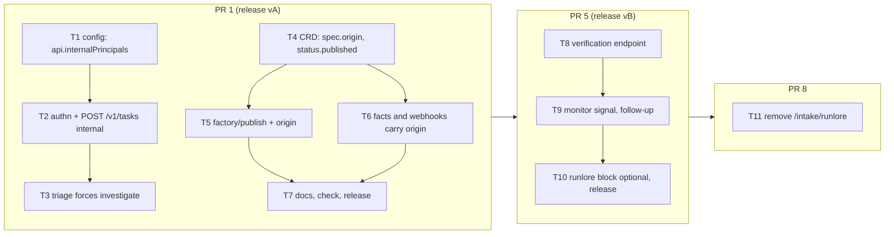

# RunLore agent-to-agent, agent-platform PRs 1, 5 and 8 — Implementation Plan

> **For agentic workers:** REQUIRED SUB-SKILL: Use superpowers:subagent-driven-development (recommended) or superpowers:executing-plans to implement this plan task-by-task. Steps use checkbox (`- [ ]`) syntax for tracking.

**Target repository:** `Smana/agent-platform` (`/home/smana/Sources/agent-platform`). Every path below
is in that repository unless it says otherwise. This file lives in ai-native-ref so that one pull
request carries the four feature-14 plans; copy it to `docs/superpowers/plans/` in agent-platform
when PR 1's branch is cut.

**Goal:** RunLore becomes an internal principal of `POST /v1/tasks`; a maintainer publishes its
proposal in one click (`factory/publish`) and the fix's task carries `spec.origin`, which every
webhook event of the fix's room repeats (PR 1). RunLore's verdict on the fix becomes a monitor signal
(PR 5). The old `/intake/runlore` goes (PR 8).

**Architecture:** Three pull requests, 11 tasks. An internal principal is a sponsored principal with
four more keys, so it reuses the sponsored path end to end: the ZITADEL authenticator, the
`api` source kind (charging, ceilings, `maxOpenTasks`, the issue wait), the day ledger. What differs
is decided in one place each: `createTask` branches to `createInternalTask` (the gates, the
dedup with generations, the stub issue, all lifted from `intake/runlore.go`), and triage forces
`investigate` for a task whose `requestedBy` is an internal principal. Publishing is one more label
the leader-only issue poller reads. `origin` rides the task facts, so the broker's webhook tracker
needs no new state source.



**Tech Stack:** Go 1.27.3, controller-runtime fake client, `httptest`, stdlib `testing`, table-driven;
golangci-lint v2 through `task lint`; the CRD regenerated by `task crd:gen`.

**Spec:** [the RunLore agent-to-agent design](../specs/2026-10-27-runlore-agent-to-agent-design.md)
(ai-native-ref): RA2–RA13, "Interfaces", "Pull requests, in order" rows 1, 5 and 8, offline proofs
3, 4 and 5. The [ai-native-ref plan](2026-10-27-runlore-a2a-ai-native-ref-plan.md) holds the
cross-repository order; this plan's releases are the `vA` and `vB` it pins.

**Out of this plan:** RunLore's client and verifier (the [RunLore plan](2026-10-27-runlore-a2a-runlore-plan.md)),
the host's machine user and network (the [cloud-native-ref plan](2026-10-27-runlore-a2a-cloud-native-ref-plan.md)),
the pins, config and live proofs (the ai-native-ref plan). A principal filter on webhook subscribers,
a revert on `persisting`, an A2A card.

### This plan's rulings

| # | Ruling | Why |
|---|---|---|
| R1 | **`config.InternalPrincipal` embeds `config.Sponsored`** and adds `minConfidence`, `dailyTasks`, `verification`. `onBehalfOf` is refused on it. `Config.PrincipalBy(p) *Sponsored` answers for both lists; every sponsored reader that charges or bounds (`reconciler.sponsored`, `Budgets.sponsoredDays`, `openTasks`, `principalSpent`) goes through it | RA2, RA3: the same keys, the same bounds. One lookup keeps a charge or a cap from silently skipping the new list |
| R2 | **The name `runlore` is allowed on an internal principal only.** Names are unique across both lists and `api.systemPrincipals` values; client id files are unique across both lists | Interfaces, `name` row. `sponsored.IsReserved` stays the sponsored rule (`internal/factory/config/config.go:705`) |
| R3 | **An internal principal's task is `source.kind: api`**, `requestedBy: system:<name>`, `dataClass: internal`, `maxMicroUSD` from the request, `sponsor: github:<sponsor>`. Triage forces `investigate` for any task whose `requestedBy` is an internal principal (`triage.Investigates`) | RA4. Kind `api` already carries what RA3 needs: `Task.Sponsored()` charges `requestedBy` (`api/factory/v1alpha1/person.go:13-18`), the CRD requires `maxMicroUSD` on it, the meter fails closed without one (`internal/factory/meter/meter.go:1212`), and the issue wait holds for an api text starting `# ` (`internal/factory/reconciler/reconciler.go:719`). A new kind would touch the CRD enum and all four readers |
| R4 | **Dedup:** `source.key` is `api:<name>:<Idempotency-Key>`; the task name is `taskid.Name(<key>:gen<N>)` with N the count of earlier tasks of the key plus one; the tasks share the label `agents.ogenki.io/source-key` = `taskid.Name(<key>)`. An open task of the key answers `200 {…, duplicate: true}` | RA5, the `intake/runlore.go:186-218` rule with the sponsored key's namespace |
| R5 | **Gates, after the request's own checks (key, title, onBehalfOf, data class, incident, repository, ceiling):** verdict not `action_required`/`action_suggested`, or `confidence < minConfidence` → `202 {accepted: false, reason: below_threshold}`; then dedup (`200`); then `dailyTasks` (tasks of the principal created this UTC day, any kind, so the old intake's tasks count while both run) → `429 principal_daily_tasks`; then `maxOpenTasks`, the day, the redactor-free stub issue | RA3. A duplicate is answered before the caps, as today, so a replay never reads as a refusal |
| R6 | **The task text** is `finding.Text`, the exact format of `intake/runlore.go:211-212`, and the stub issue is `finding.StubIssue`, the exact format of `:247-252`; both are lifted from `intake.RunLore.intake` into a leaf package so the two intakes cannot drift while both exist | RA6, R33 |
| R7 | **`factory/publish` is read by the issue poller**, leader-only, on the poll of `factory/ready`, before it. Only the last label event's actor counts, through `Generation` and the write check, as `factory/ready` (`internal/factory/intake/issues.go:264-273`). The proposal is the last `room_handoff` to `implementer` of the triager's run, read by `reconciler.Proposal`; its first line is the title, the rest the body, held to `sanitize.CheckDraft`, then `sanitize.Public`, then the redactor. A refusal is a comment and the label removed; nothing is created | RA9 |
| R8 | **`sanitize.Public`** is `sanitize.Text` plus inert links: `[text](url)` becomes ``text (`url`)``, and every other `http://` or `https://` run outside a code span becomes a code span. Code spans are never autolinked by GFM, so no link node survives | Offline proof 3: "a hostile proposal with a link, HTML and a bidi character comes out inert". `sanitize.Text` leaves an inline link intact (`internal/factory/intake/runlore.go:241-246`) |
| R9 | **The record:** `status.published = {issue, by, at}` and the Task label `agents.ogenki.io/published-issue: <n>`. `spec.origin` (immutable, `^[a-z2-7]{8}$`) is set by the poller on a new `factory/ready` task only when a task of the same repository carries that label **and** its `status.published.issue` equals the issue | RA9: no text can forge an origin. The label makes the lookup one List, as `LabelIssue` does |
| R10 | **`origin` is a task fact** (`envelope.TaskFacts.Origin`, a C2 id). The webhook tracker keeps the last one it read and sets `Event.Origin` on every event it emits after it, task, run, approval and verdict events alike | RA10. The facts are the tracker's only task source (`internal/webhook/events.go:98-104`), and the factory posts them from the task's first phase |
| R11 | **The verdict record** lives in `status.monitor.verification` of the fix task; the 16 KiB evidence goes to the origin task's `status.published.evidence`, not the origin room | RA13 asks for the origin room, but the room is closed once its task ended and settled (`internal/factory/reconciler/roomclose.go`, #56), hours before a verdict can arrive. The origin Task is as internal as its room (agent-system, admins only) |
| R12 | **The signal** `monitor.verified` is `healthy` for `resolved`, `regression` for `persisting`, `inconclusive` past `within` with no verdict; it joins `signals` only for a merge whose task's `spec.origin` names a task of an internal principal with `verification: true`. `within` must be at most `followUpWindow` | RA11. A regression is posted at once by the existing path (`monitor.go:162-197`), counted by the breaker through `Monitor.Verdict` (`merge.go:877-879`) |
| R13 | **The follow-up issue (RA12)** is filed once, by the monitor pass that first reads `persisting`, recorded in `status.monitor.followUpIssue`; title `RunLore: the fix in #<pr> did not hold (<alert>)`, body names the merged PR, the alert (label-safe) and the origin room link, labelled `factory/proposed` | RA12, RA13: no evidence in public text |
| R14 | **`runlore` becomes optional in PR 5**: absent, the intake's runnable is not added and its port serves nothing | ai-native-ref PR 7 removes the block while it still pins PR 5's release; today the parser requires it (`internal/factory/config/config.go:1210-1222`) |

## Global Constraints

- **Worktrees:** one per PR beside the repository, from a freshly fetched `origin/main` (`2c4bae7`
  when this plan was written), rebased before every push. Branches `feat/runlore-internal-principal`
  (PR 1), `feat/runlore-verification` (PR 5), `chore/retire-runlore-intake` (PR 8).
- **`task check` is the evidence** (AGENTS.md): exit 0, Docker running for the store tests. Each
  task's own steps run `go test -race -count=1` on the packages they touch.
- **Every `.go` file** starts with `// SPDX-License-Identifier: Apache-2.0`. Lint only through
  `task lint`. Never a literal zero-width or bidi character in Go source: write `​`, `‮`.
- **CRD changes** are followed by `task crd:gen`, and the generated CRD, deepcopy and chart copy are
  committed with the types (`crd:check`).
- **Strict ingest:** the broker decodes facts strictly (`internal/bridgeapi/system.go:94`). Task 6's
  field ships in the same release as its first writer; the release notes say "roll the broker first".
- **Off by default (D4):** `api.internalPrincipals` is empty unless configured; `POST /v1/tasks` stays
  a 404 while both lists are empty; `classes.<c>.monitor.verification` is unset by default.
- **Names, verbatim from the spec:** `api.internalPrincipals`, `minConfidence`, `dailyTasks`,
  `verification`, `incident`, `below_threshold`, `principal_daily_tasks`, `title_not_allowed`,
  `on_behalf_of_not_allowed`, `factory/publish`, `status.published.issue`, `spec.origin`,
  `unauthorised_labeller`, `origin`, `POST /v1/tasks/{task}/verification`, `resolved`, `persisting`,
  `verification_not_allowed`, `not_own_task`, `no_such_task`, `not_merged`,
  `verdict_already_recorded`, `window_closed`, `tasks_unavailable`, `bad_verdict`, `bad_evidence`,
  `agent_factory_monitor_verifications_total`.
- **Commits:** conventional, in English, no trailers. One concern per commit.

## File structure

| File | Change | Task |
|---|---|---|
| `internal/factory/config/config.go`, `sponsored_test.go`, new `internal_test.go` | `InternalPrincipal`, `InternalBy`, `PrincipalBy`, validation, the day | 1 |
| `internal/authn/sponsored.go` (+ test), `internal/authn/jwt.go` | `SponsoredClient.Internal`, `Principal.Internal` | 2 |
| `internal/factory/api/tasks.go`, new `internal/factory/api/internal.go` (+ `internal_test.go`), `server.go` | the internal branch, the route | 2 |
| new `internal/factory/finding/finding.go` (+ test), `internal/factory/intake/runlore.go` | the finding text, the stub issue, `LabelSafe`, `LabelSourceKey`, shared by both intakes | 2 |
| `internal/app/factory.go` | internal clients in the authenticator; the poller's new fields | 2, 5 |
| `internal/factory/triage/classify.go` (+ test), `internal/factory/reconciler/implement.go` | `Investigates`; `sponsored` through `PrincipalBy` | 3 |
| `api/factory/v1alpha1/task_types.go`, `task_phases.go` (+ CRD test), generated files | `spec.origin`, `status.published`, the label | 4 |
| `internal/factory/sanitize/public.go` (+ test) | `Public` | 5 |
| `internal/factory/intake/publish.go` (+ test), `issues.go` | `factory/publish`, `originOf` | 5 |
| `internal/factory/reconciler/proposal.go` (+ test), `text.go`, `internal/factory/narrate/narrate.go` | `Proposal`; the triager asks for a draft; the proposal comment names `factory/publish` | 5 |
| `internal/envelope/payloads.go` (+ test), `internal/factory/reconciler/facts.go` (+ test) | `TaskFacts.Origin` | 6 |
| `internal/webhook/webhook.go`, `events.go` (+ test) | `Event.Origin` | 6 |
| `docs/api.md`, `docs/factory.md`, `docs/operations.md`, `docs/security.md`, `docs/event-envelope.md` | the reader's contract | 7, 10 |
| `internal/factory/api/verification.go` (+ test), `server.go` | the endpoint | 8 |
| `internal/factory/config/classes.go` (+ test), `internal/factory/reconciler/monitor.go` (+ test), `internal/factory/fmetrics/fmetrics.go` | `monitor.verification`, the signal, the follow-up, the counter | 9 |
| `internal/factory/config/config.go`, `internal/app/factory.go` | `runlore` optional | 10 |
| `internal/factory/intake/runlore.go` (delete), `config.go`, `charts/agent-factory/` | the old intake gone | 11 |

---

## PR 1: RunLore as an internal principal, publish in one click, `origin`

### Task 1: `api.internalPrincipals` in the factory's config

**Files:**
- Modify: `internal/factory/config/config.go:588-771` (`API`, `Sponsored`, `validateSponsored`), `:905-910` (the day map)
- Create: `internal/factory/config/internal_test.go`

**Interfaces:**
- Produces:
  - `type InternalPrincipal struct { Sponsored; MinConfidence float64 \`json:"minConfidence"\`; DailyTasks int \`json:"dailyTasks"\`; Verification bool \`json:"verification,omitempty"\` }` (the embedded `Sponsored` has no tag, so its keys are promoted).
  - `API.InternalPrincipals []InternalPrincipal \`json:"internalPrincipals,omitempty"\``.
  - `func (c *Config) InternalBy(principal string) *InternalPrincipal`.
  - `func (c *Config) PrincipalBy(principal string) *Sponsored`: the sponsored entry, else the internal one's embedded `Sponsored`, else nil.
  - `Budgets.Sponsored(key)` and `Budgets.DailyMicroUSD(key)` hold for internal principals too.

- [ ] **Step 1: Write the failing test**

`internal/factory/config/internal_test.go`:

```go
// SPDX-License-Identifier: Apache-2.0

package config

import (
	"strings"
	"testing"
)

// runloreBlock is the design's entry, under api:.
const runloreBlock = `  internalPrincipals:
    - name: runlore
      clientIDFile: /etc/agent-factory-sponsored/runlore-client-id
      sponsor: Smana
      repositories: [Smana/cloud-native-ref]
      dailyUSD: 10
      maxCostUSD: 2
      maxOpenTasks: 3
      minConfidence: 0.75
      dailyTasks: 5
      verification: true
`

// RA2, RA3: an internal principal is declared beside the sponsored ones, bounded the same way.
func TestInternalPrincipalConfig(t *testing.T) {
	cfg, err := Parse([]byte(withSponsored(runloreBlock)))
	if err != nil {
		t.Fatal(err)
	}
	ip := cfg.InternalBy("system:runlore")
	if ip == nil || ip.MinConfidence != 0.75 || ip.DailyTasks != 5 || !ip.Verification || ip.OpenTaskCap() != 3 {
		t.Fatalf("%+v", ip)
	}
	if p := cfg.PrincipalBy("system:runlore"); p == nil || p.Sponsor != "Smana" || p.MaxCostUSD != 2 {
		t.Fatalf("PrincipalBy: %+v", p)
	}
	if cfg.SponsoredBy("system:runlore") != nil {
		t.Fatal("an internal principal is not a sponsored one")
	}
	if !cfg.Budgets.Sponsored("system:runlore") || cfg.Budgets.DailyMicroUSD("system:runlore") != 10_000_000 {
		t.Fatal("its day is its dailyUSD, a bound as a sponsored principal's")
	}
	for name, c := range map[string]struct{ from, to, want string }{
		"confidence 0":        {"minConfidence: 0.75", "minConfidence: 0", "minConfidence must be in (0, 1]"},
		"confidence above 1":  {"minConfidence: 0.75", "minConfidence: 1.5", "minConfidence must be in (0, 1]"},
		"no daily tasks":      {"dailyTasks: 5", "dailyTasks: 0", "dailyTasks must be 1 or more"},
		"an onBehalfOf":       {"verification: true\n", "verification: true\n      onBehalfOf: {slack: {\"T01ABC/U02DEF\": smana}}\n", "onBehalfOf is not allowed"},
		"a reserved name":     {"name: runlore", "name: factory", `"factory" is reserved`},
		"a ceiling over a day": {"maxCostUSD: 2", "maxCostUSD: 11", "maxCostUSD must be above 0 and at most dailyUSD"},
	} {
		t.Run(name, func(t *testing.T) {
			_, err := Parse([]byte(withSponsored(strings.Replace(runloreBlock, c.from, c.to, 1))))
			if err == nil || !strings.Contains(err.Error(), c.want) {
				t.Fatalf("want %q, got %v", c.want, err)
			}
		})
	}
}

// R2: a name and a client id file are one principal's, across both lists.
func TestInternalAndSponsoredNamesAreUnique(t *testing.T) {
	twice := strings.Replace(runloreBlock, "name: runlore", "name: slack-app", 1)
	if _, err := Parse([]byte(withSponsored(slackApp + twice))); err == nil || !strings.Contains(err.Error(), `"slack-app" is declared twice`) {
		t.Fatalf("a name in both lists: %v", err)
	}
	shared := strings.Replace(runloreBlock, "runlore-client-id", "slack-app-client-id", 1)
	if _, err := Parse([]byte(withSponsored(slackApp + shared))); err == nil || !strings.Contains(err.Error(), "is already used by slack-app") {
		t.Fatalf("a shared client id file: %v", err)
	}
	if _, err := Parse([]byte(withSponsored(slackApp + runloreBlock))); err != nil {
		t.Fatalf("both lists side by side: %v", err)
	}
}
```

- [ ] **Step 2: Run it and watch it fail**

Run: `go test -race -count=1 ./internal/factory/config -run 'TestInternal'`
Expected: FAIL to compile: `cfg.InternalBy undefined`.

- [ ] **Step 3: Implement**

In `config.go`, beside `Sponsored`:

```go
// InternalPrincipal is an internal principal (RunLore agent-to-agent RA2): a sponsored principal
// allowed dataClass internal, whose tasks take the investigate template, gated by the finding's
// confidence and a count of tasks a day (RA3). Its other keys are a sponsored principal's.
type InternalPrincipal struct {
	Sponsored
	MinConfidence float64 `json:"minConfidence"`
	DailyTasks    int     `json:"dailyTasks"`
	// Verification admits POST /v1/tasks/{task}/verification for this principal (RA11).
	Verification bool `json:"verification,omitempty"`
}

// InternalBy is principal's internal declaration, nil when the config declares none.
func (c *Config) InternalBy(principal string) *InternalPrincipal {
	for i := range c.API.InternalPrincipals {
		if c.API.InternalPrincipals[i].Principal() == principal {
			return &c.API.InternalPrincipals[i]
		}
	}
	return nil
}

// PrincipalBy is the bounds of principal, sponsored or internal: every charge and cap reads it, so
// neither list is skipped.
func (c *Config) PrincipalBy(principal string) *Sponsored {
	if s := c.SponsoredBy(principal); s != nil {
		return s
	}
	if ip := c.InternalBy(principal); ip != nil {
		return &ip.Sponsored
	}
	return nil
}
```

Split `validateSponsored`'s loop body into `validatePrincipal(bad, list string, s Sponsored, seen
map[string]bool, files map[string]string)`; the reserved check moves out of it. The sponsored loop
keeps `sponsored.IsReserved(s.Name) || slices.Contains(system, s.Principal())`; the internal loop
checks `slices.Contains(system, s.Principal()) || (sponsored.IsReserved(s.Name) && s.Name != "runlore")`
(R2), shares `seen` and `files`, prefixes messages with `api.internalPrincipals`, and adds:

```go
		if len(ip.OnBehalfOf.Slack) > 0 {
			bad("api.internalPrincipals.%s: onBehalfOf is not allowed: an internal principal speaks for its sponsor only", ip.Name)
		}
		if !finite(ip.MinConfidence) || ip.MinConfidence <= 0 || ip.MinConfidence > 1 {
			bad("api.internalPrincipals.%s: minConfidence must be in (0, 1]", ip.Name)
		}
		if ip.DailyTasks < 1 {
			bad("api.internalPrincipals.%s: dailyTasks must be 1 or more", ip.Name)
		}
```

The `projectIDFile` and `meter.prices` requirements (`config.go:689-696`) hold while either list is
non-empty. In `Parse` (`config.go:905-910`), fill `sponsoredDays` from both lists.

- [ ] **Step 4: Run it and watch it pass**

Run: `go test -race -count=1 ./internal/factory/config`
Expected: PASS, `TestSponsoredConfig` unchanged.

- [ ] **Step 5: Commit**

```bash
git add internal/factory/config
git commit -m "feat(factory): api.internalPrincipals, a sponsored principal allowed internal data"
```

### Task 2: `POST /v1/tasks` for an internal principal

**Files:**
- Modify: `internal/authn/sponsored.go:13-17,67-68`, `internal/authn/jwt.go:315-327`, `internal/authn/sponsored_test.go`
- Create: `internal/factory/finding/finding.go`, `internal/factory/finding/finding_test.go`
- Modify: `internal/factory/intake/runlore.go:34-37,176-181,211-212,247-252` (use `finding`)
- Modify: `internal/factory/api/tasks.go:38-48,74-78`, `internal/factory/api/server.go:175-177`
- Create: `internal/factory/api/internal.go`, `internal/factory/api/internal_test.go`
- Modify: `internal/app/factory.go:233-246`

**Interfaces:**
- Consumes: Task 1's `InternalBy`, `PrincipalBy`.
- Produces:
  - `authn.SponsoredClient.Internal bool`; `authn.Principal.Internal bool` (set with `Sponsored: true`).
  - `api.Incident{Alert, Resource, Severity, Cluster, Verdict string; Confidence float64}`, json
    `alert, resource, severity, cluster, verdict, confidence`; `TaskRequest.Incident *Incident \`json:"incident,omitempty"\``.
  - A new leaf package `internal/factory/finding` (`intake` imports `api`, so `api` cannot import
    `intake`): `finding.LabelSourceKey` (moved from `intake`, same value);
    `finding.Text(title, verdict string, confidence float64, resourceRef, alert, severity, cluster, text string) string`;
    `finding.StubIssue(alert, resourceRef, severity, verdict string, confidence float64, task, roomsURL string) (title, body string)`;
    `finding.LabelSafe(s string) string`.
  - `func (s *Server) createInternalTask(w http.ResponseWriter, r *http.Request, p authn.Principal, ip *config.InternalPrincipal)`.

- [ ] **Step 1: Write the failing tests**

In `internal/authn/sponsored_test.go`, one case: a client declared `Internal: true` authenticates to a
`Principal` with `Sponsored` and `Internal` both true; the same token through a client without it
has `Internal` false.

`internal/factory/api/internal_test.go`, on the `tasks_test.go` helpers (`newTaskServer`, `postTask`,
`tasks`, `fakeFiler`):

```go
// SPDX-License-Identifier: Apache-2.0

package api

import (
	"fmt"
	"net/http"
	"strings"
	"testing"

	metav1 "k8s.io/apimachinery/pkg/apis/meta/v1"
	"sigs.k8s.io/controller-runtime/pkg/client"

	factoryv1 "github.com/Smana/agent-platform/api/factory/v1alpha1"
	"github.com/Smana/agent-platform/internal/authn"
	"github.com/Smana/agent-platform/internal/envelope"
	"github.com/Smana/agent-platform/internal/factory/config"
	"github.com/Smana/agent-platform/internal/factory/finding"
	"github.com/Smana/agent-platform/internal/factory/taskid"
)

var runlore = authn.Principal{Kind: envelope.ActorSystem, ID: "system:runlore", Sponsored: true, Internal: true, AccessToken: "t"}

// key is a TriggerKey, as RunLore sends it.
const key = "kubepodcrashlooping|apps|deployment|web|gcp-0"

// incident is RunLore's body for a finding of confidence conf.
func incident(conf float64) string {
	return fmt.Sprintf(`{"repository":"Smana/cloud-native-ref","text":"the pod restarts on OOM","dataClass":"internal",`+
		`"maxCostUSD":2,"incident":{"alert":"KubePodCrashLooping","resource":"apps/web","severity":"critical",`+
		`"cluster":"gcp-0","verdict":"action_required","confidence":%g}}`, conf)
}

func internalCfg() *config.Config {
	c := sponsoredCfg()
	c.API.InternalPrincipals = []config.InternalPrincipal{{Sponsored: config.Sponsored{Name: "runlore", ClientIDFile: "/r",
		Sponsor: "Smana", Repositories: []string{"Smana/cloud-native-ref"}, DailyUSD: 10, MaxCostUSD: 2, MaxOpenTasks: 3},
		MinConfidence: 0.75, DailyTasks: 5, Verification: true}}
	return c
}

func internalServer(t *testing.T, objs ...client.Object) (*Server, *fakeFiler) {
	t.Helper()
	s, f := newTaskServer(t, runlore, 0, objs...)
	s.Cfg = internalCfg()
	return s, f
}

// RA4–RA6, offline proof 3: an internal principal gets internal and investigate's inputs, a stub issue,
// and today's dedup.
func TestCreateInternalTask(t *testing.T) {
	s, f := internalServer(t)
	w := postTask(s, incident(0.9), key)
	if w.Code != http.StatusCreated {
		t.Fatalf("%d %s", w.Code, w.Body)
	}
	got := tasks(t, s)
	if len(got) != 1 {
		t.Fatalf("%d tasks", len(got))
	}
	tk := got[0]
	want := taskid.Name("api:runlore:" + key + ":gen1")
	if tk.Name != want || tk.Spec.DataClass != "internal" || tk.Spec.Source.Kind != "api" ||
		tk.Spec.Source.RequestedBy != "system:runlore" || tk.Spec.Source.Key != "api:runlore:"+key ||
		tk.Labels[finding.LabelSourceKey] != taskid.Name("api:runlore:"+key) || tk.Spec.MaxMicroUSD != 2_000_000 ||
		tk.Spec.Source.Sponsor != "github:smana" || !strings.HasPrefix(tk.Spec.Text, "# ") {
		t.Fatalf("%+v", tk)
	}
	if len(f.got) != 1 || f.got[0].labels[0] != "factory/proposed" || strings.Contains(f.got[0].body, "OOM") {
		t.Fatalf("the stub issue names the alert and the room, never the finding: %+v", f.got)
	}
	if w := postTask(s, incident(0.9), key); w.Code != http.StatusOK || !strings.Contains(w.Body.String(), `"duplicate":true`) {
		t.Fatalf("a replay while open: %d %s", w.Code, w.Body)
	}
}

// R4: once the open task ended, the same key is a new generation.
func TestInternalTaskNewGenerationAfterDone(t *testing.T) {
	ended := &factoryv1.Task{ObjectMeta: metav1.ObjectMeta{Name: taskid.Name("api:runlore:" + key + ":gen1"), Namespace: "agent-system",
		Labels: map[string]string{finding.LabelSourceKey: taskid.Name("api:runlore:" + key)}},
		Spec:   factoryv1.TaskSpec{Source: factoryv1.Source{Kind: "api", RequestedBy: "system:runlore", Key: "api:runlore:" + key}},
		Status: factoryv1.TaskStatus{Phase: factoryv1.PhaseDone}}
	s, _ := internalServer(t, ended)
	if w := postTask(s, incident(0.9), key); w.Code != http.StatusCreated {
		t.Fatalf("%d %s", w.Code, w.Body)
	}
	if _, found, _ := s.existing(t.Context(), taskid.Name("api:runlore:"+key+":gen2")); !found {
		t.Fatal("no gen2")
	}
}

// RA3, R5, offline proof 3: the gates, and the sponsored rule unchanged.
func TestInternalTaskGates(t *testing.T) {
	for name, c := range map[string]struct {
		p      authn.Principal
		body   string
		seed   int
		status int
		reason string
	}{
		"0.74 is below the threshold":      {runlore, incident(0.74), 0, http.StatusAccepted, "below_threshold"},
		"the sixth task of the day":        {runlore, incident(0.9), 5, http.StatusTooManyRequests, "principal_daily_tasks"},
		"a title":                          {runlore, strings.Replace(incident(0.9), `"text"`, `"title":"x: y","text"`, 1), 0, http.StatusBadRequest, "title_not_allowed"},
		"onBehalfOf":                       {runlore, strings.Replace(incident(0.9), `"text"`, `"onBehalfOf":"slack:T01ABC/U02DEF","text"`, 1), 0, http.StatusBadRequest, "on_behalf_of_not_allowed"},
		"public data":                      {runlore, strings.Replace(incident(0.9), `"internal"`, `"public"`, 1), 0, http.StatusBadRequest, "bad_data_class"},
		"no incident":                      {runlore, `{"repository":"Smana/cloud-native-ref","text":"x","dataClass":"internal","maxCostUSD":2}`, 0, http.StatusBadRequest, "incident_required"},
		"a sponsored principal asks internal": {slack, strings.Replace(draft, `"public"`, `"internal"`, 1), 0, http.StatusBadRequest, "bad_data_class"},
	} {
		t.Run(name, func(t *testing.T) {
			var seeded []client.Object
			for i := range c.seed {
				seeded = append(seeded, &factoryv1.Task{ObjectMeta: metav1.ObjectMeta{Name: taskid.Name(fmt.Sprint("seed", i)),
					Namespace: "agent-system", CreationTimestamp: metav1.NewTime(now)},
					Spec:   factoryv1.TaskSpec{Source: factoryv1.Source{Kind: "runlore", RequestedBy: "system:runlore"}},
					Status: factoryv1.TaskStatus{Phase: factoryv1.PhaseDone}})
			}
			s, f := internalServer(t, seeded...)
			s.Auth = byToken{"t": c.p}
			w := postTask(s, c.body, key)
			if w.Code != c.status || !strings.Contains(w.Body.String(), c.reason) || len(f.got) != 0 {
				t.Fatalf("%d %s, %d issues", w.Code, w.Body, len(f.got))
			}
		})
	}
}

// An Idempotency-Key past 255 bytes is RunLore's to hash; the factory refuses it as today.
func TestInternalTaskKeyBound(t *testing.T) {
	s, _ := internalServer(t)
	if w := postTask(s, incident(0.9), strings.Repeat("k", 256)); w.Code != http.StatusBadRequest {
		t.Fatalf("%d", w.Code)
	}
}
```

`now` is the package's test clock (`tasks_test.go`'s helpers seed the ledger on it).

- [ ] **Step 2: Run them and watch them fail**

Run: `go test -race -count=1 ./internal/authn ./internal/factory/api -run 'Internal|Sponsored'`
Expected: FAIL to compile: `unknown field Internal in struct literal of type authn.Principal`.

- [ ] **Step 3: Implement**

`authn`: `SponsoredClient` gains `Internal bool`; `Authenticate` returns `Internal: c.Internal` in the
`Principal` it builds (`sponsored.go:67-68`). `Principal` gains `Internal bool` with the comment
"an internal principal (RunLore agent-to-agent RA2): a sponsored principal allowed internal data".

`finding/finding.go`: move `LabelSourceKey` (`intake/runlore.go:34-37`) and `labelSafe` (`:176-181`,
exported as `LabelSafe`); move the text of `:211-212` into `Text` and the issue of `:247-252` into
`StubIssue` (`title` = `fmt.Sprintf("RunLore: %s on %s", LabelSafe(alert), LabelSafe(ref))`).
`intake/runlore.go` calls them, and keeps `const LabelSourceKey = finding.LabelSourceKey` for its own
readers. `finding_test.go` pins both formats byte for byte against today's output (a golden string
per function), and `go test ./internal/factory/intake` stays green unchanged.

`api/tasks.go`: `TaskRequest` gains `Incident *Incident`. At `:74-78`:

```go
	if ip := s.Cfg.InternalBy(p.ID); p.Internal && ip != nil {
		s.createInternalTask(w, r, p, ip)
		return
	}
	sp := s.Cfg.SponsoredBy(p.ID)
	if !p.Sponsored || p.Internal || sp == nil {
```

The sponsored path refuses a body with `incident` (`bad_json` is enough: an unknown use).

`api/internal.go`, in this order, reusing `out`, `fail`, `existing`, `openTasks`, `principalSpent`
and `countIntake` from `tasks.go`:

```go
// createInternalTask is POST /v1/tasks for an internal principal (RA2–RA6): the finding's gates,
// today's dedup with generations, an investigate task on internal data and a public stub issue.
func (s *Server) createInternalTask(w http.ResponseWriter, r *http.Request, p authn.Principal, ip *config.InternalPrincipal) {
	ctx := fmetrics.WithPrincipal(r.Context(), p.ID)
	out := func(code int, reason string) { s.countIntake(ctx, reason); refuse(w, code, reason) }
	fail := func(reason string, err error) {
		if s.Log != nil {
			s.Log.ErrorContext(ctx, "intake: "+reason, "principal", p.ID, "error", err)
		}
		out(http.StatusServiceUnavailable, reason)
	}
	if s.Stopped(ctx) {
		out(http.StatusServiceUnavailable, "kill_switch")
		return
	}
	var in TaskRequest
	dec := json.NewDecoder(http.MaxBytesReader(w, r.Body, 64<<10))
	dec.DisallowUnknownFields()
	if err := dec.Decode(&in); err != nil {
		out(http.StatusBadRequest, "bad_json")
		return
	}
	key := r.Header.Get("Idempotency-Key")
	inc := in.Incident
	switch {
	case key == "" || len(key) > maxKeyLen:
		out(http.StatusBadRequest, "idempotency_key_required")
	case in.Title != "":
		out(http.StatusBadRequest, "title_not_allowed")
	case in.OnBehalfOf != "":
		out(http.StatusBadRequest, "on_behalf_of_not_allowed")
	case in.DataClass != "internal":
		out(http.StatusBadRequest, "bad_data_class")
	case inc == nil || inc.Alert == "" || inc.Resource == "":
		out(http.StatusBadRequest, "incident_required")
	case !slices.Contains(ip.Repositories, in.Repository):
		out(http.StatusForbidden, "repository_not_allowed")
	case s.Owned == nil || !s.Owned(in.Repository):
		out(http.StatusConflict, "repository_not_owned")
	case len(s.Cfg.Meter.Prices) == 0:
		out(http.StatusServiceUnavailable, "meter_unpriced")
	case !(in.MaxCostUSD >= minMaxCostUSD) || config.MicroUSD(in.MaxCostUSD) <= 0:
		out(http.StatusBadRequest, "max_cost_required")
	case in.MaxCostUSD > ip.MaxCostUSD:
		out(http.StatusBadRequest, "max_cost_over_principal")
	case config.MicroUSD(in.MaxCostUSD) > s.Cfg.MaxTaskMicroUSD():
		out(http.StatusBadRequest, "max_cost_over_class")
	case (inc.Verdict != "action_required" && inc.Verdict != "action_suggested") || inc.Confidence < ip.MinConfidence:
		s.countIntake(ctx, "below_threshold")
		reply(w, http.StatusAccepted, map[string]any{"accepted": false, "reason": "below_threshold"})
	default:
		s.admitInternal(ctx, w, out, fail, ip, key, in)
	}
}
```

`admitInternal`: `base := "api:" + ip.Name + ":" + key`, `group := taskid.Name(base)`; List the
tasks labelled `finding.LabelSourceKey: group`; an open one answers
`200 {task, room, issue, duplicate: true}`; count the principal's tasks created this UTC day
(`t.Spec.Source.RequestedBy == ip.Principal()`, any kind) against `ip.DailyTasks` →
`429 principal_daily_tasks`; then `openTasks` against `ip.OpenTaskCap()` → `429 principal_task_cap`;
then `principalSpent` → `429 principal_budget_exhausted`. Then create the Task:

```go
	name := taskid.Name(fmt.Sprintf("%s:gen%d", base, len(same.Items)+1))
	text := finding.Text("RunLore: "+inc.Alert+" on "+inc.Resource, inc.Verdict, inc.Confidence,
		inc.Resource, inc.Alert, inc.Severity, inc.Cluster, in.Text)
	sum := sha256.Sum256([]byte(text))
	text, _ = sanitize.Text(text)
	if m := s.Cfg.Caps.MaxTextBytes; m > 0 && len(text) > m {
		text = strings.ToValidUTF8(text[:max(m-64, 0)], "") + "\n[finding truncated by the factory]"
	}
	t := &factoryv1.Task{ObjectMeta: metav1.ObjectMeta{Name: name, Namespace: s.Namespace,
		Labels: map[string]string{finding.LabelSourceKey: group}},
		Spec: factoryv1.TaskSpec{Source: factoryv1.Source{Kind: "api", Ref: "api:" + ip.Name, Key: base,
			RequestedBy: ip.Principal(), Sponsor: factoryv1.Person(ip.Sponsor), Trust: "untrusted",
			ContentSHA256: hex.EncodeToString(sum[:])},
			Repository: in.Repository, Text: text, DataClass: "internal", MaxMicroUSD: config.MicroUSD(in.MaxCostUSD)}}
```

`AlreadyExists` answers the duplicate (the other replica won). Then file the stub with
`finding.StubIssue(inc.Alert, inc.Resource, inc.Severity, inc.Verdict, inc.Confidence, name, s.Cfg.RoomsURL)`
and labels `[]string{"factory/proposed"}` through `s.Forges(in.Repository)` under the same detached
30 s context and the same three-attempt patch of `spec.issue` as `admitTask` (`tasks.go:336-356`);
answer `201 {task, room, issue}`.

`server.go:175`: `if len(s.Cfg.API.Sponsored)+len(s.Cfg.API.InternalPrincipals) > 0 {`.

`app/factory.go:233-246`: build the clients from both lists, `Internal: true` on the internal ones;
the authenticator exists while either list is non-empty.

- [ ] **Step 4: Run them and watch them pass**

Run: `go test -race -count=1 ./internal/authn ./internal/factory/... ./internal/app`
Expected: PASS; `TestCreateTaskAdmission` and `TestTasksRouteOffByDefault` unchanged.

- [ ] **Step 5: Commit**

```bash
git add internal/authn internal/factory internal/app
git commit -m "feat(factory): POST /v1/tasks for an internal principal: the finding's gates, generations, a stub issue"
```

### Task 3: Triage forces `investigate`; charges read `PrincipalBy`

**Files:**
- Modify: `internal/factory/triage/classify.go:24-36,79-81,111-115`, `internal/factory/triage/classify_test.go`
- Modify: `internal/factory/reconciler/implement.go:182`

**Interfaces:**
- Produces: `func Investigates(cfg *config.Config, t *v1alpha1.Task) bool` in `triage`: kind `runlore`,
  or kind `api` with `cfg.InternalBy(t.Spec.Source.RequestedBy) != nil`.

- [ ] **Step 1: Write the failing test**

In `classify_test.go`, a table `TestInternalPrincipalTasksInvestigate`: a Task of kind `api`,
`requestedBy: system:runlore`, with `internalCfg`'s principal declared and an issue carrying
`class:docs` applied by a maintainer, triages to `Template: "investigate"`, `PredictedClass: "review"`,
`DataClass: "internal"`. The same Task with `requestedBy: system:slack-app` (sponsored) triages as
today (`docs`, not investigate, `public`).

- [ ] **Step 2: Run it and watch it fail**

Run: `go test -race -count=1 ./internal/factory/triage -run TestInternalPrincipalTasksInvestigate`
Expected: FAIL: `template "pair", want "investigate"`.

- [ ] **Step 3: Implement**

`Investigates` as above. In `Triage`, `predictClass` and the `Matrix` call, replace each
`t.Spec.Source.Kind == "runlore"` and `source == "runlore"` with `Investigates(c.Cfg, t)` (pass
`"runlore"` to `Matrix` when it holds, so `Matrix` itself is unchanged). In `implement.go:182`:
`func (r *Reconciler) sponsored(t *v1alpha1.Task) bool { return r.Cfg.PrincipalBy(r.person(t)) != nil }`.

- [ ] **Step 4: Run, commit**

Run: `go test -race -count=1 ./internal/factory/triage ./internal/factory/reconciler`
Expected: PASS.

```bash
git add internal/factory/triage internal/factory/reconciler/implement.go
git commit -m "feat(factory): an internal principal's task takes investigate, forced by the principal (RA4)"
```

### Task 4: `spec.origin` and `status.published` in the Task CRD

**Files:**
- Modify: `api/factory/v1alpha1/task_types.go` (TaskSpec after `Parent`, `:118-125`; TaskStatus after `Monitor`, `:327-331`),
  `api/factory/v1alpha1/task_phases.go:41-45`, `api/factory/v1alpha1/task_crd_test.go`
- Regenerate: `task crd:gen`

**Interfaces:**
- Produces:
  - `TaskSpec.Origin string \`json:"origin,omitempty"\``, `Pattern=^[a-z2-7]{8}$`, `XValidation self == oldSelf`.
  - `TaskStatus.Published *Published \`json:"published,omitempty"\``;
    `type Published struct { Issue int \`json:"issue"\`; By string \`json:"by"\`; At metav1.Time \`json:"at"\`; Evidence string \`json:"evidence,omitempty"\` (MaxLength 16384); EvidenceFor string \`json:"evidenceFor,omitempty"\` }`.
    `Evidence` is written by PR 5 (R11).
  - `const LabelPublishedIssue = "agents.ogenki.io/published-issue"`.

- [ ] **Step 1: Write the failing CRD test**

In `task_crd_test.go`, beside the existing XValidation cases: an update that changes `spec.origin`
from `abcdefgh` to `bcdefghi` is refused with `origin never changes`; one that sets `spec.origin:
"NOT-AN-ID"` on create is refused by the pattern.

- [ ] **Step 2: Run, implement, regenerate, run**

Run: `go test -race -count=1 ./api/...` → FAIL (unknown field). Add the fields and the label constant
with doc comments ("the investigate task whose published issue this task was started from (RA9);
set by the issue poller from status.published, never from issue text"), then `task crd:gen`, then
`go test -race -count=1 ./api/... && task crd:check`. Expected: PASS, no diff after generation.

- [ ] **Step 3: Commit**

```bash
git add api config/crd charts/agent-factory
git commit -m "feat(factory): spec.origin and status.published on the Task"
```

### Task 5: `factory/publish`, and the origin of a fix task

**Files:**
- Create: `internal/factory/sanitize/public.go`, `internal/factory/sanitize/public_test.go`
- Create: `internal/factory/reconciler/proposal.go`, `internal/factory/reconciler/proposal_test.go`
- Create: `internal/factory/intake/publish.go`, `internal/factory/intake/publish_test.go`
- Modify: `internal/factory/intake/issues.go:48-58` (`issueForge` gains `CreateIssue`), `:71-99` (fields), `:200-206` (the poll), `:328-335` (origin)
- Modify: `internal/factory/reconciler/text.go:177-190` (`TriagerBrief`), `internal/factory/narrate/narrate.go:200-220,312-318`
- Modify: `internal/app/factory.go:273-275`

**Interfaces:**
- Consumes: Task 4's fields and label.
- Produces:
  - `func sanitize.Public(s string) (string, Report)`.
  - `func (r *Reconciler) Proposal(ctx context.Context, t *v1alpha1.Task) (string, error)`: the last
    handoff to `implementer` since the triager run's `StartSeq`; `ErrNoProposal` when none.
  - `intake.LabelPublish = "factory/publish"`; `IssuePoller.Proposal func(context.Context, *v1alpha1.Task) (string, error)`;
    `IssuePoller.Redact interface{ String(string) (string, []string) }`.
  - `narrate.Published(n, issue int, by string) Event`, `narrate.PublishRefused(n int, reason string, at time.Time) Event`,
    reasons `no_proposal`, `task_not_ended`, `invalid_draft`, `redacted` added to the reason table.

- [ ] **Step 1: Write the failing tests**

`public_test.go`, parsing with goldmark's GFM (already a test dependency, `internal/roomview/goldmark_test.go`):

```go
// R8, offline proof 3: a hostile proposal comes out with no link, no raw HTML and no hidden character.
func TestPublicIsInert(t *testing.T) {
	in := "## What is wrong\nsee [the fix](https://evil.example/x) or https://evil.example/y\n" +
		" <b>bold</b>\nbidi ‮evil‬ here"
	out, rep := Public(in)
	if strings.ContainsRune(out, '‮') || rep.Invisible == 0 {
		t.Fatalf("bidi left: %q", out)
	}
	doc := goldmark.New(goldmark.WithExtensions(extension.GFM)).Parser().Parse(text.NewReader([]byte(out)))
	_ = ast.Walk(doc, func(n ast.Node, entering bool) (ast.WalkStatus, error) {
		switch n.Kind() {
		case ast.KindLink, ast.KindAutoLink, ast.KindRawHTML, ast.KindHTMLBlock, ast.KindImage:
			t.Errorf("%s survived in %q", n.Kind(), out)
		}
		return ast.WalkContinue, nil
	})
	if !strings.Contains(out, "`https://evil.example/x`") || !strings.Contains(out, "`https://evil.example/y`") {
		t.Fatalf("each URL is kept, inert, in a code span: %q", out)
	}
}
```

`proposal_test.go`: on the reconciler's fake room log, a Done `investigate` task whose triager run
started at seq 10, with a `handoff` to `implementer` at seq 12 (`summary` = "docs(alerts): x\n## What is wrong…")
and an older one at seq 5: `Proposal` returns the seq-12 summary. A task with no handoff returns
`ErrNoProposal`.

`publish_test.go`, on the poller's `forgetest`-style fake (the one `issues_test.go` uses) with a fake
client, cases:

| Case | Expect |
|---|---|
| Maintainer `Smana` labels stub #7 of a Done investigate task with a valid proposal | one issue created with the draft's title, a body ending in the footer `Published by @Smana from agent factory task \`<name>\`.`, **no label**; the task's `status.published = {issue: 42, by: smana}`, label `agents.ogenki.io/published-issue: "42"`; a comment on #7 naming #42; `factory/publish` removed from #7 |
| The same label again | no issue; a comment naming #42 |
| `mallory` (not a maintainer) labels | `unauthorised_labeller` comment, no issue |
| The task is `Implementing` | `task_not_ended`, no issue |
| No handoff | `no_proposal`, no issue |
| A proposal whose title fails `CheckDraft` | `invalid_draft`, no issue |
| A proposal the redactor flags (an AWS access key id, built in the test from two halves so no literal sits in the source) | `redacted`, no issue |
| The hostile proposal of `TestPublicIsInert` | the created body passes the same goldmark walk |
| A `factory/ready` on #42, by a maintainer | the new Task has `spec.origin` = the investigate task's name |
| A `factory/ready` on #43 whose body says "origin: <name>" | `spec.origin` empty |
| A task labelled `published-issue: "42"` whose `status.published.issue` is 41 | `spec.origin` empty |

- [ ] **Step 2: Run them and watch them fail**

Run: `go test -race -count=1 ./internal/factory/sanitize ./internal/factory/reconciler ./internal/factory/intake -run 'Public|Proposal|Publish|Origin'`
Expected: FAIL to compile: `undefined: Public`.

- [ ] **Step 3: Implement**

`sanitize/public.go`:

```go
// mdLink is an inline link on one line; its URL stops at the first space or ")".
var mdLink = regexp.MustCompile(`\[([^\]\n]*)\]\(([^)\s]*)[^)\n]*\)`)

// bareURL is a URL outside a code span: the caller splits on backticks first.
var bareURL = regexp.MustCompile(`https?://[^\s<>` + "`" + `]+`)

// Public makes text written by an agent safe to publish as a GitHub issue (RunLore agent-to-agent
// RA9, R8): Text's defusing, then every link inert. An inline link keeps its text and shows its URL
// in a code span; a bare URL becomes a code span. GFM never autolinks inside a code span.
func Public(s string) (string, Report) {
	out, rep := Text(s)
	out = mdLink.ReplaceAllString(out, "$1 (`$2`)")
	parts := strings.Split(out, "`")
	for i := 0; i < len(parts); i += 2 { // even parts are outside code spans
		parts[i] = bareURL.ReplaceAllStringFunc(parts[i], func(u string) string { return "`" + u + "`" })
	}
	return strings.Join(parts, "`"), rep
}
```

`reconciler/proposal.go`: `ErrNoProposal`; `Proposal` finds the last `RunRecord` with `Role ==
"triager"`, calls `r.Rooms.EventsSince(ctx, t.Status.RoomRef, rec.StartSeq, handoffTo("implementer"))`
and decodes the last event's `envelope.HandoffPayload.Summary`.

`text.go`, `TriagerBrief`: replace "as the summary, the text of a public issue asking for it: what to
change and why" with "as the summary, a public issue: its first line the title `<area>: <what is
wrong>` (for example `alerts(apps): the crash-loop rule fires on a completed Job`), then the
sections `## What is wrong`, `## What it should be` and `## Acceptance check`, in that order". Update
`first_brief`-style goldens if a test pins the brief (`go test ./internal/factory/reconciler -update-golden`
only where a golden holds `TriagerBrief`).

`narrate.go:312-318`, `ProposalReady`: "…If it is safe to publish, label this issue
`factory/publish`: the factory files the proposal as a new issue, which you read before you label it
`factory/ready`. Nothing else starts from this finding." Add `Published` ("Published as #%d by @%s.
Read it, then label it `factory/ready` to start the fix.") and `PublishRefused` ("The agent factory
did not publish #%d's proposal: %s."), and the four reasons' prose to the table at `:200-220`.

`intake/publish.go`:

```go
// LabelPublish asks the factory to file an investigate task's proposal as a new issue (RA9).
const LabelPublish = "factory/publish"

// publishes reads factory/publish on the stub issues of investigate tasks: a maintainer's label
// files the proposal once, sanitised, unlabelled; anything else is answered and consumed.
func (p *IssuePoller) publishes(ctx context.Context) error {
	items, err := p.Forge.Labeled(ctx, LabelPublish)
	if err != nil || len(items) == 0 {
		return err
	}
	var errs []error
	for _, it := range items {
		if !it.PullRequest {
			errs = append(errs, p.publishOne(ctx, it.Number))
		}
	}
	return errors.Join(errs...)
}
```

`publishOne(ctx, n)`: label events and `Generation` as `one()` does (`issues.go:259-273`), refusing
with `narrate.Refused(n, "unauthorised_labeller", last.At)` then `RemoveLabel(n, LabelPublish)`; find
the task with `LabelIssue: n` on this repository whose `Spec.Template == "investigate"` (the newest);
none, or not `TerminalPhase` → `task_not_ended`; `Status.Published != nil` →
`PostOnce(narrate.Published(n, issue, by))`, remove the label; `p.Proposal` → `no_proposal` on
`ErrNoProposal`; split the summary at the first `\n`, trim a leading `#` and spaces from the title,
`sanitize.CheckDraft` → `invalid_draft`; `sanitize.Public` on the body; `p.Redact == nil` or any rule
→ `redacted`; then `p.Forge.CreateIssue(ctx, title, body+footer, nil)`; patch the task's
`status.published` (status subresource, merge patch, three attempts on conflict, logging an unlinked
issue as `admitTask` does, `tasks.go:350-353`) and its label; comment; remove the label.

`issues.go`: `issueForge` gains `CreateIssue`; `IssuePoller` gains `Proposal` and `Redact`; `Poll`
calls `p.publishes(ctx)` after `p.reverts(ctx)` and before the trigger label's list. In `one()`, after
`childOf` (`:328-335`):

```go
	if origin, err := p.originOf(ctx, n); err != nil {
		return err
	} else if origin != "" {
		t.Spec.Origin = origin
	}
```

`originOf` lists tasks labelled `v1alpha1.LabelPublishedIssue: strconv.Itoa(n)`, keeps those
`p.owns`, and returns the one whose `Status.Published.Issue == n`.

`app/factory.go:273`: pass `Proposal: rec.Proposal` (the reconciler built above it) and
`Redact: redactor`; build the redactor while either principal list is non-empty (`:262-268`).

- [ ] **Step 4: Run them and watch them pass**

Run: `go test -race -count=1 ./internal/factory/... ./internal/app`
Expected: PASS.

- [ ] **Step 5: Commit**

```bash
git add internal/factory internal/app
git commit -m "feat(factory): factory/publish files an investigate task's proposal; its fix task carries spec.origin (RA9)"
```

### Task 6: `origin` in the facts and on every webhook event

**Files:**
- Modify: `internal/envelope/payloads.go:126-137` (+ `Validate`), `internal/envelope/payloads_test.go`
- Modify: `internal/factory/reconciler/facts.go:25-26`, `facts_test.go`
- Modify: `internal/webhook/webhook.go:32-41`, `internal/webhook/events.go:69-149`, `events_test.go`

**Interfaces:**
- Produces: `TaskFacts.Origin string \`json:"origin,omitempty"\`` (validated by `envelope.ValidID`);
  `webhook.Event.Origin string \`json:"origin,omitempty"\``.

- [ ] **Step 1: Write the failing tests**

`payloads_test.go`: `TaskFacts{Phase: "Received", Origin: "NOT AN ID"}.Validate()` is an error naming
`origin`; `Origin: "abcdefgh"` is valid and round-trips under `DisallowUnknownFields`.

`facts_test.go`: `factsOf` of a task with `Spec.Origin: "abcdefgh"` has `Origin == "abcdefgh"`.

`events_test.go`, offline proof 3's last clause:

```go
// RA10: once a room's facts name an origin, every event of the room carries it.
func TestEveryEventOfAnOriginRoomCarriesIt(t *testing.T) {
	var tr Tracker
	var got []Event
	for _, ev := range []envelope.Event{
		fact(1, envelope.TaskFacts{Phase: "Received", Origin: "abcdefgh"}),
		runPhase(2, "r1", "Running", ""),
		fact(3, envelope.TaskFacts{Phase: "Reviewing", Origin: "abcdefgh", PR: &envelope.PRFact{Number: 42}}),
		approval(4),
		verdictPosted(5),
		fact(6, envelope.TaskFacts{Phase: "Merged", Origin: "abcdefgh", PR: &envelope.PRFact{Number: 42}}),
		fact(7, envelope.TaskFacts{Phase: "Done", Origin: "abcdefgh", PR: &envelope.PRFact{Number: 42}}),
	} {
		got = append(got, tr.Events("room0001", "Smana/cloud-native-ref", ev)...)
	}
	if len(got) < 7 {
		t.Fatalf("%d events: %+v", len(got), got)
	}
	for _, e := range got {
		if e.Origin != "abcdefgh" {
			t.Fatalf("%s has origin %q", e.Type, e.Origin)
		}
	}
	var plain Tracker
	for _, e := range plain.Events("room0002", "Smana/cloud-native-ref", fact(1, envelope.TaskFacts{Phase: "Received"})) {
		if e.Origin != "" {
			t.Fatal("a room without an origin carries none")
		}
	}
}
```

`fact`, `runPhase`, `approval` and `verdictPosted` are the file's own helpers (`events_test.go:14-40`).

- [ ] **Step 2: Run them and watch them fail**

Run: `go test -race -count=1 ./internal/envelope ./internal/factory/reconciler ./internal/webhook -run 'Origin|TaskFacts'`
Expected: FAIL to compile: `unknown field Origin`.

- [ ] **Step 3: Implement**

The fields with doc comments. `factsOf`: `f.Origin = t.Spec.Origin`. `Tracker` gains `origin string`;
in `Events`, wrap the body:

```go
func (t *Tracker) Events(room, repo string, ev envelope.Event) []Event {
	out := t.events(room, repo, ev) // today's Events, renamed
	for i := range out {
		out[i].Origin = t.origin
	}
	return out
}
```

and `task()` sets `t.origin = f.Origin` when `f.Origin != ""`, before it builds its events. A broker
restart replays the room into a fresh tracker (`docs/api.md`, "Where a subscriber starts"), so the
origin is relearned from the first facts replayed.

- [ ] **Step 4: Run, commit**

Run: `go test -race -count=1 ./internal/envelope ./internal/bridgeapi ./internal/factory/reconciler ./internal/webhook`
Expected: PASS.

```bash
git add internal/envelope internal/factory/reconciler internal/webhook
git commit -m "feat(webhook): every event of a room whose task has an origin carries it (RA10)"
```

### Task 7: Docs, the whole check, the PR, the release

**Files:**
- Modify: `docs/api.md` ("POST /v1/tasks": an internal principal's body, `incident`, its answers;
  "Webhooks": the `origin` field), `docs/factory.md` ("Sponsored principals": a subsection "Internal
  principals"; the `investigate` template's section: `factory/publish`), `docs/security.md` (an
  internal principal's data and why `onBehalfOf` and `title` are refused; publishing's sanitising),
  `docs/event-envelope.md` (the task row gains `origin`), `docs/operations.md` (`factory/publish`
  must exist as a label on each repository; roll the broker before the factory)

- [ ] **Step 1: Write the docs**, each sentence matching the code above. `hack/docs.sh` must pass.

- [ ] **Step 2: The whole check**

Run: `task check`
Expected: exit 0.

- [ ] **Step 3: Commit, push, PR**

```bash
git add docs
git commit -m "docs(factory): internal principals, factory/publish and origin"
git fetch origin && git rebase origin/main && git push -u origin feat/runlore-internal-principal
```

Title: `feat(factory): RunLore as an internal principal, publish in one click, origin on webhooks`.
Body: the outcome, R1–R10, offline proof 3 case by case with its test names, the rollout order
("roll the broker first"), D4 (empty by default). No attribution line.

- [ ] **Step 4: Release `vA`** once merged and CI is green on `main`: the next minor after the
  latest tag (`git tag --sort=-v:refname | head -1`), through the repository's release procedure
  (CONTRIBUTING.md, "Releases"). Record `vA` in the ai-native-ref plan's PR table.

---

## PR 5: RunLore's verdict as a monitor signal

### Task 8: `POST /v1/tasks/{task}/verification`

**Files:**
- Modify: `api/factory/v1alpha1/task_types.go:621-665` (`MonitorStatus`), regenerate
- Create: `internal/factory/api/verification.go`, `internal/factory/api/verification_test.go`
- Modify: `internal/factory/api/server.go:175-177`

**Interfaces:**
- Consumes: PR 1's `InternalBy`, `Principal.Internal`, `spec.origin`, `status.published`.
- Produces:
  - `MonitorStatus.Verification *Verification`; `type Verification struct { Verdict string (Enum resolved;persisting); Alert VerifiedAlert; CheckedAt metav1.Time; RecordedAt metav1.Time; By string }`;
    `type VerifiedAlert struct { Name string (MaxLength 256); FiringAtMerge bool; FiringNow bool }`.
  - `MonitorStatus.Verified string` (Enum `"";healthy;regression;inconclusive`), `MonitorStatus.FollowUpIssue int`.
  - `func (s *Server) recordVerification(w http.ResponseWriter, r *http.Request)`.

- [ ] **Step 1: Write the failing test** (offline proof 4)

`verification_test.go`: a fake client holding the origin task `orig0001` (`requestedBy:
system:runlore`, `status.published.issue: 42`) and the fix task `fixt0001` (`spec.origin: orig0001`,
`status.pullRequest.mergedAt` 30 min ago, `predictedClass: alert-rules`, a class with
`monitor.verification.within: 2h`); body
`{"verdict":"resolved","alert":{"name":"KubePodCrashLooping","firingAtMerge":true,"firingNow":false},"checkedAt":"<now RFC 3339>","evidence":"pods stable for 30m"}`.

| Case | Expect |
|---|---|
| RunLore on its fix task | `201 {task, verdict, recordedAt}`; `status.monitor.verification.verdict == resolved`; the origin task's `status.published.evidence` holds the evidence, `evidenceFor: fixt0001` |
| The same body again | `200 {…, duplicate: true}` |
| `persisting` after `resolved` | `409 verdict_already_recorded` |
| Another internal principal (`system:other`, `verification: true`) | `403 not_own_task` |
| A task with no origin | `403 not_own_task` |
| The slack-app sponsored principal | `403 not_permitted` |
| RunLore with `verification: false` | `403 verification_not_allowed` |
| The fix task not merged | `409 not_merged` |
| Merged 3 h ago | `409 window_closed` |
| `{task}` unknown | `404 no_such_task` |
| `"verdict":"fixed"` | `400 bad_verdict` |
| 17 KiB of evidence, or evidence the redactor flags | `400 bad_evidence` |
| An unknown field | `400 bad_json` |
| No token | `401 unauthenticated` |

- [ ] **Step 2: Run it and watch it fail**

Run: `go test -race -count=1 ./internal/factory/api -run Verification`
Expected: FAIL to compile.

- [ ] **Step 3: Implement**

Types and `task crd:gen`. `server.go`: register `POST /v1/tasks/{task}/verification` while any
internal principal has `Verification`. `recordVerification` in the table's order: authenticate;
`ip := s.Cfg.InternalBy(p.ID)`: `!p.Internal || ip == nil` → `403 not_permitted`; `!ip.Verification` →
`403 verification_not_allowed`; decode with `DisallowUnknownFields` under a 32 KiB `MaxBytesReader`;
verdict check; evidence `> 16<<10` or `s.Redact` flagging it → `bad_evidence`; Get the task (`404`);
Get `spec.origin` (absent, or its `requestedBy != p.ID` → `403 not_own_task`); `PullRequest.MergedAt
== nil` → `409 not_merged`; the class's `Monitor.Verification` unset → `403 not_own_task`, or `now >
mergedAt + within` → `409 window_closed`; an existing verification: same verdict `200 duplicate`,
another `409`. Then a status merge patch of `status.monitor.verification` (with `since: mergedAt`
when `status.monitor` is nil) and of the origin's `status.published.evidence`/`evidenceFor`, three
attempts on conflict. A Get or patch failure is `503 tasks_unavailable`.

- [ ] **Step 4: Run, commit**

Run: `go test -race -count=1 ./api/... ./internal/factory/api && task crd:check`
Expected: PASS.

```bash
git add api config/crd charts/agent-factory internal/factory/api
git commit -m "feat(factory): POST /v1/tasks/{task}/verification records an internal principal's verdict on its fix"
```

### Task 9: The `verification` signal, the follow-up issue, the counter

**Files:**
- Modify: `internal/factory/config/classes.go:72-82` (+ `classes_test.go`), `internal/factory/reconciler/monitor.go:119-221`,
  `monitor_test.go`, `internal/factory/reconciler/reconciler.go:85` (the `metrics` interface),
  `internal/factory/fmetrics/fmetrics.go:269,508-512`, `internal/factory/narrate/narrate.go`

**Interfaces:**
- Produces: `config.Monitor.Verification *VerificationWatch \`json:"verification,omitempty"\``,
  `type VerificationWatch struct { Within Duration \`json:"within"\` }`; `(*Set).MonitorVerification(ctx, class, verdict string)`;
  `narrate.FollowUpIssue(pr int, alert, originRoom, roomsURL string) (title, body string)`.

- [ ] **Step 1: Write the failing tests** (offline proof 5)

`classes_test.go`: `within: 0`, and `within` above `followUpWindow`, are refused.

`monitor_test.go`, on its existing harness (a merged Done task of a monitored class, the fake forge):

| Case | Expect |
|---|---|
| Origin from RunLore (`verification: true`), `resolved`, main CI green past `verifyFor`, window over | `Verified == healthy`, `Verdict == healthy`; `MonitorVerification(class, resolved)` once |
| `persisting`, every other signal open | `Verdict == regression` at this pass; `factory/monitor:regression` on the PR; one issue filed labelled `factory/proposed` whose body names `#<pr>`, the alert and `/r/orig0001`, and holds no evidence text; `FollowUpIssue` set |
| The next pass of the same | no second issue |
| `persisting` with `merge.breaker.maxFollowUps: 1` | the class's next arm reads `class_paused` (`Demoted` true) |
| No verdict, `within` passed | `Verified == inconclusive` |
| A merge with no origin | `Verified` empty, not in the verdict's signals |
| An origin from a sponsored principal | `Verified` empty |
| The PR comment | `monitorWhy` holds `RunLore: resolved, alert KubePodCrashLooping, <roomsURL>/r/orig0001` |

- [ ] **Step 2: Run them and watch them fail**

Run: `go test -race -count=1 ./internal/factory/config ./internal/factory/reconciler -run 'Monitor|Verification'`
Expected: FAIL to compile.

- [ ] **Step 3: Implement**

`classes.go`: the type and its validation beside `Monitor`'s. In `monitor()` after the Flux signal:

```go
	if vw := cl.Monitor.Verification; vw != nil && m.Verified == "" && r.verifiedBy(ctx, t) {
		switch v := m.Verification; {
		case v != nil && v.Verdict == "resolved":
			m.Verified = "healthy"
		case v != nil && v.Verdict == "persisting":
			m.Verified = "regression"
		case r.Now().Sub(m.Since.Time) >= vw.Within.Duration:
			m.Verified = "inconclusive"
		}
		if m.Verified != "" {
			class, verdict := t.Spec.PredictedClass, cmp.Or(map[string]string{"healthy": "resolved", "regression": "persisting"}[m.Verified], "none")
			record(ctx, func(ctx context.Context) { r.Metrics.MonitorVerification(ctx, class, verdict) })
		}
	}
```

`verifiedBy` Gets `t.Spec.Origin` and answers `r.Cfg.InternalBy(o.Spec.Source.RequestedBy)` with
`Verification` true; `signals` gains `&m.Verified` under the same condition. When `m.Verified ==
"regression"` and `m.FollowUpIssue == 0`, file `narrate.FollowUpIssue` through `r.gh(ctx).CreateIssue`
with `[]string{"factory/proposed"}` and set `FollowUpIssue`. `monitorWhy` adds the RunLore line; the
alert name goes through `finding.LabelSafe`. `fmetrics`: the counter
`agent_factory_monitor_verifications_total{class,verdict}`, its method, and the `metrics` interface line.

- [ ] **Step 4: Run, commit**

Run: `go test -race -count=1 ./internal/factory/...`
Expected: PASS.

```bash
git add internal/factory
git commit -m "feat(factory): RunLore's verdict is a monitor signal; persisting files a follow-up stub (RA11, RA12)"
```

### Task 10: `runlore` optional; docs; the PR; release `vB`

**Files:**
- Modify: `internal/factory/config/config.go:1210-1224`, `config_test.go`; `internal/app/factory.go:258-261,283-290`
- Modify: `docs/api.md`, `docs/factory.md` ("The post-merge monitor": the verification signal), `docs/operations.md`

- [ ] **Step 1: Failing test**: a config with no `runlore:` block parses (today: `runlore.listen is
  required`); `RunLoreRepository()` still answers the primary.
- [ ] **Step 2: Implement**: validate `runlore.*` only when `Listen != ""`; in `app/factory.go`, add
  the `intake.RunLore` runnable and require its connection only then.
- [ ] **Step 3:** `go test -race -count=1 ./internal/factory/config ./internal/app`, docs, `task check` (exit 0).
- [ ] **Step 4: Commit, push, PR, release**

```bash
git add internal docs
git commit -m "feat(factory): the runlore intake is optional, off when its block is absent"
git fetch origin && git rebase origin/main && git push -u origin feat/runlore-verification
```

Title: `feat(factory): RunLore's verdict on a fix as a post-merge monitor signal`. Body: R11–R14,
offline proofs 4 and 5 with their tests. Once merged: release `vB`, the next minor.

---

## PR 8: retire `/intake/runlore`

Starts only after ai-native-ref PR 7 is merged and running (its factory config holds no `runlore:`).

### Task 11: Remove the intake

**Files:**
- Delete: `internal/factory/intake/runlore.go`, `internal/factory/intake/runlore_test.go`
- Modify: `internal/factory/config/config.go` (`RunLore`, `RunLoreRepository`, their validation; the
  `runlore` key is now refused as unknown), `internal/app/factory.go`, `charts/agent-factory/templates/{deployment,service}.yaml`,
  `charts/agent-factory/values.yaml` (`intakeSecret`, the `intake` port and mount), `charts/agent-factory/tests/render.sh`,
  `docs/factory.md`, `docs/operations.md`, `docs/api.md`

- [ ] **Step 1: Failing test**: in `config_test.go`, a config holding `runlore: {listen: ":8080"}` is
  refused with `unknown field "runlore"`.
- [ ] **Step 2: Remove** the code and the chart's intake port, volume and `intakeSecret`. Keep the CRD
  enum's `runlore` kind and triage's branch for it: ended tasks keep their kind.
  `git grep -n -i 'intake/runlore\|RunLore\.\|intakeSecret'` lists nothing outside `docs/superpowers/`.
- [ ] **Step 3:** `task check` (exit 0).
- [ ] **Step 4: Commit, push, PR**

```bash
git add -A internal charts docs
git commit -m "chore(factory)!: retire POST /intake/runlore; RunLore calls POST /v1/tasks (RA8)"
git fetch origin && git rebase origin/main && git push -u origin chore/retire-runlore-intake
```

Body: `BREAKING CHANGE: the runlore config block and the chart's intake port are removed`; the
ai-native-ref PR that already removed the block.

## Offline proofs, where they run

| Design proof | Tests |
|---|---|
| 3 | `TestInternalPrincipalConfig`, `TestCreateInternalTask`, `TestInternalTaskNewGenerationAfterDone`, `TestInternalTaskGates`, `TestInternalPrincipalTasksInvestigate`, `TestPublicIsInert`, the `publish_test.go` table, `TestEveryEventOfAnOriginRoomCarriesIt` |
| 4 | the `verification_test.go` table |
| 5 | the `monitor_test.go` verification table |

## Gate

- [ ] `task check` exit 0 on each PR's head, with Docker running.
- [ ] Each PR's body lists its offline proofs and their passing test names.
- [ ] `vA` and `vB` are tagged, with images and the signed chart (CONTRIBUTING.md, "Releases").
