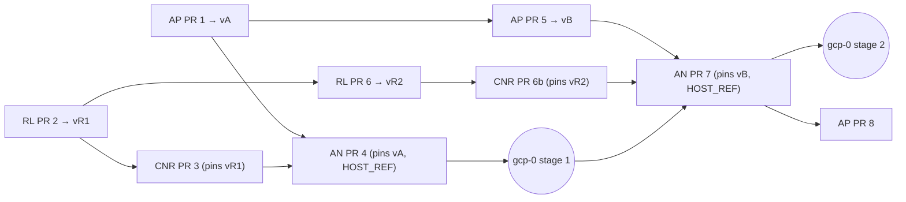

# RunLore agent-to-agent, ai-native-ref PRs 4 and 7 — Implementation Plan

> **For agentic workers:** REQUIRED SUB-SKILL: Use superpowers:subagent-driven-development (recommended) or superpowers:executing-plans to implement this plan task-by-task. Steps use checkbox (`- [ ]`) syntax for tracking.

**Goal:** Wire feature 14 into the platform: the factory declares RunLore an internal principal, the
broker sends it signed webhooks, RunLore calls the factory instead of `/intake/runlore` (PR 4, then
the stage 1 live session); the factory takes RunLore's verdict as a monitor signal on one class, and
the old intake is retired (PR 7, then the stage 2 live session).

**Architecture:** Two pull requests in this repository, 10 tasks, between the other three
repositories' releases. Every switch lands in gcp-0's own copies, as the Slack App's did (runbook 18):
the factory's `internalPrincipals` in `tooling/gcp-0/agent-factory/helm-values-sponsored.yaml`, the
broker's `runlore` subscriber in `infrastructure/gcp-0/room-broker/config.yaml`. RunLore's values stay
in `observability/base/runlore-factory/`, the one ConfigMap the host reads (H8); its client is inert
where its Secret is absent. One generator learns one host Service, so the broker's egress to RunLore
is generated like every other.

**Tech Stack:** Python 3 with PyYAML; Bash suites run by `scripts/ci/run-tests.sh` inside `.composite/`;
kustomize, Flux, ESO, Cilium; `task check`.

**Spec:** [the RunLore agent-to-agent design](../specs/2026-10-27-runlore-agent-to-agent-design.md):
RA1–RA14, "Interfaces", "Pull requests, in order", the Gate. The other plans:
[agent-platform](2026-10-27-runlore-a2a-agent-platform-plan.md) (PRs 1, 5, 8),
[RunLore](2026-10-27-runlore-a2a-runlore-plan.md) (PRs 2, 6),
[cloud-native-ref](2026-10-27-runlore-a2a-cloud-native-ref-plan.md) (PRs 3, 6b).

## Pull requests across the four repositories

Releases are named by the plan that cuts them: agent-platform `vA` (PR 1) and `vB` (PR 5), RunLore
`vR1` (PR 2) and `vR2` (PR 6). Read each from its repository's releases when the step that pins it
runs; never assume a number.

| # | Repository | Content | Pins | Proof | Depends on |
|---|---|---|---|---|---|
| 1 | agent-platform | internal principals, `factory/publish`, `spec.origin`, `origin` on events; release `vA` | — | offline 3 | — |
| 2 | RunLore | client, ledger, receiver, Slack lines; release `vR1` | — | offline 1, 2 | — |
| 3 | cloud-native-ref | machine user `runlore`, RunLore's egress and ingress, contract H5/H8 | RunLore `vR1` | host CI | 2 |
| 4 | ai-native-ref | Tasks 1–6 below | agent-platform `vA`, `HOST_REF` = PR 3's merge | `task check` | 1, 3 |
| — | gcp-0 | stage 1 session, runbook 20 part 1 | | live 1–3 | 4 |
| 5 | agent-platform | the verification endpoint, the signal, the follow-up, `runlore` optional; release `vB` | — | offline 4, 5 | 1 |
| 6 | RunLore | soak, Alertmanager, re-investigation, verdict; release `vR2` | — | offline 6 | 2 |
| 6b | cloud-native-ref | pin RunLore `vR2` | RunLore `vR2` | host CI | 6, 3 |
| 7 | ai-native-ref | Tasks 7–10 below | agent-platform `vB`, `HOST_REF` = 6b's merge | `task check` | 5, 6b, stage 1 live |
| — | gcp-0 | stage 2 session, runbook 20 part 2 | | live 4–5 | 7 |
| 8 | agent-platform | remove `/intake/runlore` | — | offline | 7 merged and running |



PRs 1, 2 and 5, 6 may be built in parallel (different repositories). Only one test-running agent per
repository at a time.

### Design gaps this plan resolves

| # | Gap | Resolution |
|---|---|---|
| G1 | Row 3 (host) waits on live 1, but row 4 waits on row 3 and live 1 runs after row 4: a cycle | CNR PR 3 merges on static evidence and host CI; live 1 proves the paths answer (cloud-native-ref plan R5) |
| G2 | The ZITADEL machine user and the RunLore pin are host-owned (H5; `flux/sources/gitrepo-runlore.yaml`), not ai-native-ref's as row 4 says | CNR PR 3 carries both; CNR PR 6b pins `vR2` (cloud-native-ref plan R1) |
| G3 | RunLore and the factory read different OpenBao mounts (`platform` through `openbao-platform`, `agents` through `agents-secrets`) | The machine user writes two keys; the factory's holds no secret (cloud-native-ref plan R2). The webhook key is seeded by the owner in both, as `runlore-intake` is today (runbook 14) |
| G4 | Row 2 keeps the templated notifier until PR 7, but live 3 needs `/intake/runlore` silent in stage 1, and both paths running would file two tasks per incident | PR 4 removes the notifier's values; the factory's `runlore` block, its ExternalSecret and the 8080 rule stay until PR 7, so reverting PR 4 restores the old path |
| G5 | Row 7 removes the factory's `runlore` block while pinning `vB`, whose parser requires it | agent-platform PR 5 makes the block optional (agent-platform plan R14) |
| G6 | RA13 stores the evidence on the origin room, which is closed long before a verdict | The evidence goes to the origin Task's status (agent-platform plan R11) |
| G7 | `gen-webhook-egress.py` requires the subscriber's Service among this repository's manifests with a numeric `targetPort`; RunLore's is the host chart's, `targetPort: http` | The generator gains a contract-backed host Service, `runlore/runlore` on 8080 (Task 3) |
| G8 | RunLore's StatefulSet gives each replica its own volume (`observability/base/runlore/helmrelease.yaml:59-66` on the host), so the factory ledger does not follow a failover live, whatever offline proof 6 shows on a shared file | Recorded, not fixed: a failover during a soak loses that soak, the factory answers `window_closed` later, and the monitor reads `inconclusive`. Runbook 20 checks for a failover and reruns the case if one happened. Shared storage or one replica is an owner decision |
| G9 | `maxFollowUps: 1` is a repository's breaker, not a class's, and is already set (`tooling/base/agent-factory/helm-values-configmap.yaml:136`) | PR 7 sets nothing; live 5 reads the class's pause from it |

## Global Constraints

- **Worktrees:** `/home/smana/Sources/ai-native-ref-f14-4` on `feat/runlore-a2a-stage1` (PR 4),
  `/home/smana/Sources/ai-native-ref-f14-7` on `feat/runlore-a2a-stage2` (PR 7), each from a freshly
  fetched `origin/main`, rebased before every push. `mise trust mise.toml` once per worktree.
- **`$SCRATCH`** is a scratch directory outside the repository holding `bin/python3 -> /usr/bin/python3`
  (the one with PyYAML) and `check.sh <worktree>` (`task check` with `$SCRATCH/bin` first in `PATH`,
  logged to `$SCRATCH/check-<dir>.log`, ending `exit=N`). Every suite runs as
  `PATH="$SCRATCH/bin:$PATH" <command>`.
- **`task check` is the evidence** (AGENTS.md). A new suite is `git add`ed before it runs
  (`run-tests.sh` discovers suites with `git ls-files`). `pre-commit run --all-files` before pushing.
- **Off by default (D4):** base copies declare no internal principal and no webhook subscriber;
  gcp-0's copies do. `test-factory-interfaces-off.py` holds it.
- **The suite contract:** line 1 the shebang, line 2 `# requires: <tools>`; exit 77 is SKIP.
- **Git hygiene:** `export PYTHONDONTWRITEBYTECODE=1`; `git add` named paths, never `-A`. Never `git stash`.
- **Commits:** conventional, in English, no trailers.
- **Verbatim from the spec:** the principal `{name: runlore, sponsor: Smana, repositories: [Smana/cloud-native-ref], dailyUSD: 10, maxCostUSD: 2, maxOpenTasks: 3, minConfidence: 0.75, dailyTasks: 5, verification: true}`
  (`verification` false until PR 7); the class monitor `monitor.verification: {within: 2h}`; the soak `30m`.

## File structure

| File | Change | Task |
|---|---|---|
| `HOST_REF`, `HOST-CONTRACT.md` | the host at CNR PR 3, contract version 5 | 1 |
| the agent-platform pin sites (`git grep` in Task 2) | `vA`, then `vB` | 2, 7 |
| `scripts/ci/gen-webhook-egress.py`, `scripts/ci/tests/test-gen-webhook-egress.py` | `HOST_SERVICES` | 3 |
| `infrastructure/gcp-0/room-broker/config.yaml`, `network-policy-webhooks-patch.yaml`, `kustomization.yaml`, new `externalsecret-webhook-runlore.yaml` | the `runlore` subscriber | 3 |
| `infrastructure/base/room-broker/app.yaml:113-150` | the key's mount | 3 |
| `tooling/gcp-0/agent-factory/helm-values-sponsored.yaml` | `internalPrincipals` | 4, 8 |
| `tooling/base/agent-factory/slack-app/externalsecret-sponsored.yaml` | `runlore-client-id` | 4 |
| `tooling/base/agent-factory/network-policy.yaml:26-37` | 8082 from RunLore; 8080 removed in PR 7 | 4, 8 |
| `scripts/ci/tests/test-factory-interfaces-off.py` | internal principals off outside gcp-0 | 4 |
| `observability/base/runlore-factory/{helm-values-configmap,kustomization}.yaml`, new `externalsecret-principal.yaml` | RunLore's client | 5, 8 |
| `clusters/{aws-0,gcp-0}-agent-platform/observability-runlore-factory.yaml` | `postBuild` substitution | 5 |
| new `scripts/ci/tests/test-runlore-factory-values.py` | RunLore's values hold their shape | 5, 8 |
| `tooling/base/agent-factory/helm-values-configmap.yaml` | the class `alert-rules`; `runlore:` removed | 8 |
| `tooling/base/agent-factory/{externalsecret-intake,kustomization}.yaml`, `observability/base/runlore-factory/externalsecret-intake.yaml` | removed | 8 |
| new `docs/runbooks/agent-factory/20-runlore-agent-to-agent.md`, `README.md`, `14-gcp-0-session.md` | the sessions, the secrets | 6, 9 |
| `website/content/docs/platform/ai-platform/status.md:125`, the design's status line | built | 6, 9 |

---

## PR 4: stage 1, RunLore as a standard client

### Task 1: The host at CNR PR 3

**Files:** `HOST_REF`, `HOST-CONTRACT.md` (header, H5 ZITADEL row, H8)

- [ ] **Step 1: Read the host.** `gh pr view <CNR PR 3> -R Smana/cloud-native-ref --json mergeCommit,state`.
  Expected: `MERGED` and a commit. Then
  `git -C /home/smana/Sources/cloud-native-ref show <commit>:flux/sources/gitrepo-runlore.yaml | grep tag:`
  names `vR1`.
- [ ] **Step 2: Bump.** Write the commit into `HOST_REF`. In `HOST-CONTRACT.md`: the version becomes 5,
  with "Changes from 4: H5 ZITADEL names the `runlore` machine user and its two keys; H8 names RunLore's
  factory paths (feature 14)." H5 and H8 take the cloud-native-ref plan's Task 4 words exactly.
- [ ] **Step 3: Check.** `bash $SCRATCH/check.sh "$PWD"`; expected `exit=0` (the host's gates on the
  composite at the new `HOST_REF`; the doc-path check resolves host paths against `.host/`).
- [ ] **Step 4: Commit**

```bash
git add HOST_REF HOST-CONTRACT.md
git commit -m "chore(host): HOST_REF at the host's RunLore client; contract version 5"
```

### Task 2: Pin agent-platform `vA`

**Files:** every agent-platform pin site: `flux/sources/ocirepo-agent-factory.yaml`,
`tooling/base/agent-factory/helm-values-configmap.yaml:17-19`, `infrastructure/base/room-broker/app.yaml:13-15`,
`infrastructure/base/room-broker/retention-cronjob.yaml:35`, `infrastructure/base/room-broker/sqlinstance.yaml:36`,
`infrastructure/base/room-broker/crd-rooms.yaml`, `tooling/base/agent-factory/slack-app/deployment.yaml:32-33`,
`infrastructure/base/karpenter-nodepools-agents/headroom/deployment.yaml:81,89`, and the "pinned here
at" mentions (`git grep -n -F "$BASE"` lists them all).

- [ ] **Step 1: Read the release and its digests**

```bash
BASE=$(git grep -h 'tag: "' flux/sources/ocirepo-agent-factory.yaml | grep -o -E '[0-9]+\.[0-9]+\.[0-9]+' | head -1)
gh release list -R Smana/agent-platform --limit 5 --json tagName,isDraft,isPrerelease,publishedAt
V=<vA without v>
git clone --quiet --filter=blob:none https://github.com/Smana/agent-platform "$SCRATCH/agent-platform" 2>/dev/null || git -C "$SCRATCH/agent-platform" fetch --tags -q
git -C "$SCRATCH/agent-platform" grep -n -E 'json:"internalPrincipals"|LabelPublish|json:"origin,omitempty"' "v$V" -- internal api
cat > "$SCRATCH/v$V.env" <<EOF
CHART_DIGEST=$(oras resolve ghcr.io/smana/charts/agent-factory:$V)
FACTORY_DIGEST=$(oras resolve ghcr.io/smana/agent-factory:v$V)
BROKER_DIGEST=$(oras resolve ghcr.io/smana/room-broker:v$V)
SLACK_DIGEST=$(oras resolve ghcr.io/smana/factory-slack-app:v$V)
BRIDGE_DIGEST=$(oras resolve ghcr.io/smana/room-bridge:v$V)
HARNESS_DIGEST=$(oras resolve ghcr.io/smana/agent-harness:v$V)
EOF
source "$SCRATCH/v$V.env"
cosign verify "ghcr.io/smana/charts/agent-factory@$CHART_DIGEST" \
  --certificate-oidc-issuer https://token.actions.githubusercontent.com \
  --certificate-identity-regexp '^https://github\.com/Smana/agent-platform/\.github/workflows/release\.yaml@refs/tags/v.*$' >/dev/null; echo "exit=$?"
git -C "$SCRATCH/agent-platform" diff --stat "v$BASE" "v$V" -- charts/agent-factory internal/factory/config internal/config internal/store/migrations
gh release download "v$V" --repo Smana/agent-platform --pattern crd-rooms.yaml --dir "$SCRATCH/crd-rooms-v$V"
```

Expected: `vA` released after agent-platform PR 1 merged; the three greps hit; six digests;
`exit=0`. **Stop and report** a new required config key or a new chart object beyond PR 1's.

- [ ] **Step 2: Move every pin.** The chart's tag has no `v`; each image's is `v$V@<digest>`;
  `sqlinstance.yaml`'s `ref` moves; re-copy `crd-rooms.yaml` under its 3-line header. Comments that say
  "since vX" keep their version.
- [ ] **Step 3: Check, commit.** `bash $SCRATCH/check.sh "$PWD"` → `exit=0`.

```bash
git add flux tooling infrastructure observability website
git commit -m "feat(agent-factory): agent-platform vA, internal principals and factory/publish"
```

### Task 3: The broker's `runlore` subscriber, its egress, its key

**Files:**
- Modify: `scripts/ci/gen-webhook-egress.py:149-166,210-220`, `scripts/ci/tests/test-gen-webhook-egress.py`
- Modify: `infrastructure/gcp-0/room-broker/config.yaml:61-72`, `infrastructure/gcp-0/room-broker/kustomization.yaml`
- Create: `infrastructure/gcp-0/room-broker/externalsecret-webhook-runlore.yaml`
- Modify: `infrastructure/base/room-broker/app.yaml:113-150`
- Regenerate: `infrastructure/gcp-0/room-broker/network-policy-webhooks-patch.yaml`

**Interfaces:**
- Produces: `HOST_SERVICES = {("runlore", "runlore"): {"selector": {"app.kubernetes.io/name": "runlore"}, "ports": [{"port": 8080}]}}`
  in the generator, merged under the services it finds.

- [ ] **Step 1: Write the failing test**

In `test-gen-webhook-egress.py`, after the `service_error` cases:

```python
# G7: RunLore's Service is the host chart's (HOST-CONTRACT H8): runlore/runlore on 8080, its backend 8080.
host = gen.HOST_SERVICES[("runlore", "runlore")]
rl = {"name": "runlore", "network": "cluster", "url": "http://runlore.runlore.svc.cluster.local:8080/factory/webhook"}
check("RunLore's host Service carries its rule", gen.service_error(rl, host) is None)
check("RunLore's rule is its namespace and name on 8080",
      gen.rule(rl) == {"toEndpoints": [{"matchLabels": {"io.kubernetes.pod.namespace": "runlore", "app.kubernetes.io/name": "runlore"}}],
                       "toPorts": [{"ports": [{"port": "8080", "protocol": "TCP"}]}]})
check("a host Service is only the contract's", set(gen.HOST_SERVICES) == {("runlore", "runlore")})
```

- [ ] **Step 2: Run it and watch it fail**

Run: `PATH="$SCRATCH/bin:$PATH" python3 scripts/ci/tests/test-gen-webhook-egress.py`
Expected: `AttributeError: module … has no attribute 'HOST_SERVICES'`.

- [ ] **Step 3: The generator**

```python
# Services the host renders from a chart, so no manifest here names them, which HOST-CONTRACT pins.
# H8: RunLore's Service `runlore` in `runlore` serves the broker's webhooks on 8080, its pods' port 8080
# (the chart's targetPort `http` is the container port 8080, so Cilium's backend port is 8080 too).
HOST_SERVICES = {("runlore", "runlore"): {"selector": {"app.kubernetes.io/name": "runlore"}, "ports": [{"port": 8080}]}}
```

In `main`, `have = {**HOST_SERVICES, **services(root, yaml)}`, and the module docstring's Service
paragraph names the exception. Run the test: PASS.

- [ ] **Step 4: The subscriber, the key, the mount**

`infrastructure/gcp-0/room-broker/config.yaml`, after `slack-app`:

```yaml
  # RunLore follows its incidents' tasks (feature 14, RA7): every event of the repository; it drops rooms
  # its ledger does not know. Its key is externalsecret-webhook-runlore.yaml, the owner's seed (runbook 14).
  - name: runlore
    network: cluster
    url: http://runlore.runlore.svc.cluster.local:8080/factory/webhook
    events: [room.task_received, room.task_triaged, room.run_started, room.run_ended, room.waiting_for_human,
             room.pr_opened, room.verdict_posted, room.merged, room.reverted, room.budget_reached, room.ended]
    secretFile: /etc/room-broker/webhooks/runlore/signing-key
    repositories: [Smana/cloud-native-ref]
```

`externalsecret-webhook-runlore.yaml` (listed in gcp-0's kustomization `resources`):

```yaml
# RunLore's webhook signing key, the broker's half (feature 14). The owner seeds the same value at
# agents/runlore-webhook and platform/runlore/factory-webhook (runbook 14): RunLore reads the second
# through openbao-platform, so a generated key here could not reach it.
apiVersion: external-secrets.io/v1
kind: ExternalSecret
metadata:
  name: room-broker-webhook-runlore
  namespace: agent-system
spec:
  refreshInterval: 1h
  secretStoreRef:
    kind: SecretStore
    name: agents-secrets
  target:
    name: room-broker-webhook-runlore
    creationPolicy: Owner
    deletionPolicy: Retain
  data:
    - secretKey: signing-key  # pragma: allowlist secret
      remoteRef: {key: runlore-webhook, property: signing-key}
```

`app.yaml`: a volume `webhook-runlore` (secret `room-broker-webhook-runlore`, `optional: true`,
`defaultMode: 0440`) and its mount at `/etc/room-broker/webhooks/runlore`, beside `webhook-slack-app`.
Then `PATH="$SCRATCH/bin:$PATH" python3 scripts/ci/gen-webhook-egress.py --write` rewrites the gcp-0
patch with a second rule.

- [ ] **Step 5: Run the suites, commit**

Run: `PATH="$SCRATCH/bin:$PATH" bash -c 'python3 scripts/ci/tests/test-gen-webhook-egress.py && bash scripts/ci/tests/test-room-broker-webhook-egress.sh && python3 scripts/ci/tests/test-factory-interfaces-off.py && python3 scripts/ci/tests/test-room-broker-suspend.py && python3 scripts/ci/tests/test-factory-slack-switchon.py'`
Expected: every suite PASS (the suspend check allows `webhooks` to differ on gcp-0).

```bash
git add scripts/ci/gen-webhook-egress.py scripts/ci/tests/test-gen-webhook-egress.py infrastructure/gcp-0/room-broker infrastructure/base/room-broker/app.yaml
git commit -m "feat(room-broker): RunLore as a webhook subscriber on gcp-0, its egress generated"
```

### Task 4: The factory's internal principal

**Files:**
- Modify: `tooling/gcp-0/agent-factory/helm-values-sponsored.yaml:19-32`
- Modify: `tooling/base/agent-factory/slack-app/externalsecret-sponsored.yaml:17-21`
- Modify: `tooling/base/agent-factory/network-policy.yaml:26-37`
- Test: `scripts/ci/tests/test-factory-interfaces-off.py:61-90`

- [ ] **Step 1: Write the failing check**

In `test-factory-interfaces-off.py`, `sponsored_in` also flags an `api` mapping holding
`internalPrincipals` (and a patch path naming `api/internalPrincipals`); its message becomes
`declares api.sponsored or api.internalPrincipals (D4)`. Add a scratch declaration:
`yq -i '.data["values.yaml"] |= (from_yaml | .config.api.internalPrincipals = [{"name": "runlore"}] | to_yaml)' tooling/base/agent-factory/helm-values-configmap.yaml`.

- [ ] **Step 2: Run it and watch it fail**, then restore

Run: `PATH="$SCRATCH/bin:$PATH" python3 scripts/ci/tests/test-factory-interfaces-off.py`
Expected: FAIL naming `tooling/base/agent-factory/helm-values-configmap.yaml`. Then
`git checkout -- tooling/base/agent-factory/helm-values-configmap.yaml` and run again: PASS.

- [ ] **Step 3: Declare it on gcp-0**

`helm-values-sponsored.yaml`, under `api:` after `sponsored:`:

```yaml
        # RunLore, the factory's one internal principal (feature 14, RA2): internal data, the investigate
        # template, today's gates. The dollar values: an investigate task (one triager run at tier
        # standard, $2.55 a run) fits maxCostUSD 2 only below the run cap; confirm against the stage 1
        # session's spend before raising them. verification stays false until stage 2 (PR 7).
        internalPrincipals:
          - name: runlore
            clientIDFile: /etc/agent-factory-sponsored/runlore-client-id
            sponsor: Smana
            repositories: [Smana/cloud-native-ref]
            dailyUSD: 10
            maxCostUSD: 2
            maxOpenTasks: 3
            minConfidence: 0.75
            dailyTasks: 5
```

Update the file's header comment: it now holds the API's principals on gcp-0, sponsored and internal.
`externalsecret-sponsored.yaml`:

```yaml
    - secretKey: runlore-client-id  # pragma: allowlist secret
      remoteRef: {key: runlore-principal, property: client-id}
```

`network-policy.yaml`, the RunLore rule: ports `8080` (the old notifier, until PR 7) **and** `8082`,
the comment "RunLore: its templated notifier on 8080 until feature 14's PR 7, and POST /v1/tasks on 8082".

- [ ] **Step 4: Run the suites, commit**

Run: `PATH="$SCRATCH/bin:$PATH" bash -c 'python3 scripts/ci/tests/test-factory-interfaces-off.py && python3 scripts/ci/tests/test-factory-slack-switchon.py'`
Expected: PASS twice.

```bash
git add tooling/gcp-0/agent-factory/helm-values-sponsored.yaml tooling/base/agent-factory/slack-app/externalsecret-sponsored.yaml tooling/base/agent-factory/network-policy.yaml scripts/ci/tests/test-factory-interfaces-off.py
git commit -m "feat(agent-factory): RunLore as an internal principal on gcp-0, its client id mounted, 8082 open to it"
```

### Task 5: RunLore's client values

**Files:**
- Modify: `observability/base/runlore-factory/helm-values-configmap.yaml`, `observability/base/runlore-factory/kustomization.yaml`
- Create: `observability/base/runlore-factory/externalsecret-principal.yaml`
- Modify: `clusters/gcp-0-agent-platform/observability-runlore-factory.yaml`, `clusters/aws-0-agent-platform/observability-runlore-factory.yaml`
- Create: `scripts/ci/tests/test-runlore-factory-values.py`

- [ ] **Step 1: Write the failing suite**

```python
#!/usr/bin/env python3
# requires: python3
"""RunLore's factory values (feature 14): the client calls POST /v1/tasks on the factory's API port, every
env name it reads comes from a Secret the envFrom list mounts, the list restates the host's three entries
first (lists replace, TW7), and no templated notifier calls /intake/runlore (G4)."""
import pathlib
import sys

try:
    import yaml
except ImportError:
    print("PyYAML is not installed")
    sys.exit(77)

ROOT = pathlib.Path(__file__).resolve().parents[3]
DIR = ROOT / "observability/base/runlore-factory"
problems = []
cm = yaml.safe_load((DIR / "helm-values-configmap.yaml").read_text())
values = yaml.safe_load(cm["data"]["values.yaml"])
factory = values.get("config", {}).get("factory") or {}
env_from = values.get("envFrom") or []

if [e["secretRef"]["name"] for e in env_from[:3]] != ["runlore-credentials", "runlore-slack", "runlore-webhook"]:
    problems.append("envFrom must restate the host's three Secrets first, in order")
principal = next((e for e in env_from if e["secretRef"]["name"] == "runlore-factory-principal"), None)
if not principal or principal["secretRef"].get("optional") is not True:
    problems.append("envFrom mounts runlore-factory-principal, optional: a cluster without its key keeps RunLore up")
if "templated" in (values.get("config", {}).get("notify") or {}):
    problems.append("the templated notifier still calls /intake/runlore (G4)")
if factory.get("url") != "http://agent-factory.agent-system.svc.cluster.local:8082":
    problems.append(f"factory.url is the factory's API port 8082, got {factory.get('url')!r}")
if factory.get("token_url") != "${identity_provider_url}/oauth/v2/token":
    problems.append("factory.token_url is ZITADEL's token endpoint, substituted per cluster")
es = yaml.safe_load((DIR / "externalsecret-principal.yaml").read_text())
keys = set(es["spec"]["target"]["template"]["data"])
for k in ("client_id_env", "client_secret_env", "project_id_env"):
    if factory.get(k) not in keys:
        problems.append(f"factory.{k} {factory.get(k)!r} is not a key of runlore-factory-principal")
if (factory.get("webhook") or {}).get("secret_env") not in keys:
    problems.append("factory.webhook.secret_env is not a key of runlore-factory-principal")
for cluster in ("aws-0", "gcp-0"):
    ks = yaml.safe_load((ROOT / f"clusters/{cluster}-agent-platform/observability-runlore-factory.yaml").read_text())
    if not (ks["spec"].get("postBuild") or {}).get("substituteFrom"):
        problems.append(f"{cluster}: the runlore-factory Kustomization substitutes ${{identity_provider_url}}")
if problems:
    print("\n".join(problems))
    sys.exit(1)
print("PASS: RunLore's factory values call the factory's API, with every credential mounted")
```

- [ ] **Step 2: Run it and watch it fail**

```bash
git add scripts/ci/tests/test-runlore-factory-values.py
PATH="$SCRATCH/bin:$PATH" python3 scripts/ci/tests/test-runlore-factory-values.py
```

Expected: FAIL, naming the optional mount, the templated notifier and `factory.url`.

- [ ] **Step 3: The values**

`helm-values-configmap.yaml` (keep the intake Secret in the list until PR 7; replace the `notify`
block):

```yaml
    envFrom:
      - secretRef: {name: runlore-credentials}
      - secretRef: {name: runlore-slack}
      - secretRef: {name: runlore-webhook}
      - secretRef: {name: runlore-factory-intake}
      # Feature 14: RunLore's client credentials and the webhook key. Optional: where the key is absent,
      # the env is empty and RunLore's client stays off.
      - secretRef: {name: runlore-factory-principal, optional: true}
    config:
      # RunLore hands each finding to the factory as its internal principal (feature 14): the factory
      # holds every gate (0.75, five a day), RunLore sends them all.
      factory:
        url: http://agent-factory.agent-system.svc.cluster.local:8082
        token_url: ${identity_provider_url}/oauth/v2/token
        client_id_env: FACTORY_CLIENT_ID
        client_secret_env: FACTORY_CLIENT_SECRET  # pragma: allowlist secret
        project_id_env: FACTORY_PROJECT_ID
        repository: Smana/cloud-native-ref
        max_cost_usd: 2
        webhook: {secret_env: FACTORY_WEBHOOK_KEY}  # pragma: allowlist secret
```

The header comment drops "notify.templated POSTs every finding" for "RunLore's factory client (feature
14) calls POST /v1/tasks". `externalsecret-principal.yaml`:

```yaml
# RunLore's half of feature 14: its machine user's credentials (written by the host's
# zitadel-oidc-clients.sh at platform/runlore/factory-principal) and the webhook key the owner seeds at
# platform/runlore/factory-webhook (runbook 14), both through RunLore's own store.
apiVersion: external-secrets.io/v1
kind: ExternalSecret
metadata:
  name: runlore-factory-principal
  namespace: runlore
spec:
  refreshInterval: 1h
  secretStoreRef:
    kind: ClusterSecretStore
    name: openbao-platform
  target:
    name: runlore-factory-principal
    creationPolicy: Owner
    deletionPolicy: Retain
    template:
      engineVersion: v2
      data:
        FACTORY_CLIENT_ID: "{{ .clientid }}"
        FACTORY_CLIENT_SECRET: "{{ .clientsecret }}"  # pragma: allowlist secret
        FACTORY_PROJECT_ID: "{{ .projectid }}"
        FACTORY_WEBHOOK_KEY: "{{ .signingkey }}"  # pragma: allowlist secret
  data:
    - {secretKey: clientid, remoteRef: {key: runlore/factory-principal, property: client-id}}
    - {secretKey: clientsecret, remoteRef: {key: runlore/factory-principal, property: client-secret}}  # pragma: allowlist secret
    - {secretKey: projectid, remoteRef: {key: runlore/factory-principal, property: project-id}}
    - {secretKey: signingkey, remoteRef: {key: runlore/factory-webhook, property: signing-key}}  # pragma: allowlist secret
```

List it in the kustomization. Both clusters' `observability-runlore-factory.yaml` gain
`postBuild: {substituteFrom: [{kind: ConfigMap, name: gke-gcp-0-vars}]}` (aws-0: `eks-aws-0-vars`).

- [ ] **Step 4: Run, commit**

Run: `PATH="$SCRATCH/bin:$PATH" python3 scripts/ci/tests/test-runlore-factory-values.py`
Expected: PASS.

```bash
git add observability/base/runlore-factory clusters/gcp-0-agent-platform/observability-runlore-factory.yaml clusters/aws-0-agent-platform/observability-runlore-factory.yaml scripts/ci/tests/test-runlore-factory-values.py
git commit -m "feat(runlore): RunLore calls the factory's API as its internal principal; the templated notifier goes"
```

### Task 6: Runbook 20 part 1, the secrets, the status; the PR

**Files:**
- Create: `docs/runbooks/agent-factory/20-runlore-agent-to-agent.md`
- Modify: `docs/runbooks/agent-factory/README.md:79-80` (a row), `docs/runbooks/agent-factory/14-gcp-0-session.md:153-165`
- Modify: `website/content/docs/platform/ai-platform/status.md:125`,
  `docs/superpowers/specs/2026-10-27-runlore-agent-to-agent-design.md` (status line: "stage 1 built")

- [ ] **Step 1: Runbook 14.** After the `runlore-intake` line:

```bash
# Feature 14 (runbook 20): one webhook key, two mounts: the broker reads agents/, RunLore platform/.
KEY=$(openssl rand -base64 48 | tr -d '\n')
bao kv put -mount=agents runlore-webhook signing-key="$KEY"
bao kv put -mount=platform runlore/factory-webhook signing-key="$KEY"
unset KEY
# runlore-factory-principal and agents-runlore-principal: zitadel-oidc-clients.sh sync --apply (host)
```

- [ ] **Step 2: Runbook 20, part 1** (stage 1, live proofs 1–3), each step a command and its pass
  condition:
  0. Prerequisites: the host synced (`zitadel-oidc-clients.sh sync --apply` created `runlore-gcp-0`;
     `bao kv get -mount=agents runlore-principal` holds no `client-secret`), the webhook key seeded, the
     label `factory/publish` created on `Smana/cloud-native-ref` (`gh label create factory/publish -R Smana/cloud-native-ref --color 0E8A16 --description "Publish the factory's proposal as a new issue"`).
  1. Live 1: from a RunLore pod, `kubectl -n runlore exec runlore-0 -- wget -qO- -T5 --post-data '{}' http://agent-factory.agent-system.svc.cluster.local:8082/v1/tasks`
     answers (a `401` is a pass: the path is open); the same for
     `http://vmalertmanager-victoria-metrics-k8s-stack.observability.svc:9093/api/v2/status`;
     RunLore's log shows a token obtained at its first finding (a drop on ZITADEL is the
     cloud-native-ref plan's R4 follow-up); `hubble observe --from-pod runlore/runlore-0 --verdict DROPPED`
     names no policy on these.
  2. Live 2: seed a broken alerting rule (a `VMRule` in `apps` whose expression is `vector(1)` with
     `severity: critical`, applied by hand, never through Git), wait for RunLore's finding: the factory
     answers `201` (RunLore's log), the task is `api`/`system:runlore`/`internal`/`investigate`, the stub
     issue is labelled `factory/proposed`; `kubectl delete pod runlore-0` mid-way changes nothing; a
     replay (`curl` the same body with the same `Idempotency-Key` using a token from the same client)
     answers `200 duplicate`; the Slack thread shows `task_received` and `ended` lines.
  3. Live 3: `agent_factory_intake_errors_total` and the intake's request counter for `runlore` are flat
     for the session (VictoriaMetrics query in the runbook), and RunLore's config holds no `templated`.
  End: the seeded rule stays for stage 2, or is deleted and recorded.

- [ ] **Step 3: Status.** The row's "Designed, not built" becomes "Stage 1 built (RunLore as a standard
  client); stage 2 designed". The design's status line gains "stage 1 built (PRs 1–4)".

- [ ] **Step 4: The whole check, pre-commit, PR**

```bash
git add docs/runbooks/agent-factory website/content/docs/platform/ai-platform/status.md docs/superpowers/specs/2026-10-27-runlore-agent-to-agent-design.md
git commit -m "docs(runbooks): runbook 20 part 1, RunLore's stage 1 session; the webhook key's seed"
bash $SCRATCH/check.sh "$PWD"; tail -1 "$SCRATCH/check-$(basename "$PWD").log"
pre-commit run --all-files
git fetch origin && git rebase origin/main && git push -u origin feat/runlore-a2a-stage1
```

Expected: `exit=0`; `PASS` for `test-gen-webhook-egress`, `test-room-broker-webhook-egress`,
`test-factory-interfaces-off`, `test-factory-slack-switchon`, `test-runlore-factory-values`.
Title: `feat(agent-factory): feature 14 stage 1, RunLore as the factory's internal principal`. Body:
the PR table above, G1–G4 and G7, the `task check` summary, what waits (runbook 20 part 1). No
attribution line.

---

## PR 7: stage 2, RunLore verifies the fix; `/intake/runlore` retired

Starts once agent-platform `vB` and CNR PR 6b are out and runbook 20 part 1 passed.

### Task 7: Pins: agent-platform `vB`, the host at 6b

**Files:** as Tasks 1 and 2.

- [ ] **Step 1:** Task 1's steps with CNR PR 6b's merge commit (its `gitrepo-runlore.yaml` names `vR2`;
  the contract does not change, so its version stays 5).
- [ ] **Step 2:** Task 2's steps with `vB`, the grep being
  `git -C "$SCRATCH/agent-platform" grep -n -E 'json:"verification,omitempty"|agent_factory_monitor_verifications_total' "v$V" -- internal`.
- [ ] **Step 3:** `bash $SCRATCH/check.sh "$PWD"` → `exit=0`; commit
  `feat(agent-factory): agent-platform vB, RunLore's verdict as a monitor signal; HOST_REF at RunLore vR2`.

### Task 8: `verification: true`, the class, the soak; the old intake out

**Files:**
- Modify: `tooling/gcp-0/agent-factory/helm-values-sponsored.yaml` (`verification: true`)
- Modify: `tooling/base/agent-factory/helm-values-configmap.yaml:40-133` (the class), `:256-263` (remove `runlore:`)
- Delete: `tooling/base/agent-factory/externalsecret-intake.yaml`, `observability/base/runlore-factory/externalsecret-intake.yaml`
- Modify: `tooling/base/agent-factory/kustomization.yaml:9`, `observability/base/runlore-factory/kustomization.yaml:8`,
  `tooling/base/agent-factory/network-policy.yaml` (8080 removed), `observability/base/runlore-factory/helm-values-configmap.yaml`
- Modify: `scripts/ci/tests/test-runlore-factory-values.py`

- [ ] **Step 1: Write the failing checks** in `test-runlore-factory-values.py`:

```python
if factory.get("soak") != "30m" or not (factory.get("verify") or {}).get("alertmanager_url", "").startswith(
        "http://vmalertmanager-victoria-metrics-k8s-stack.observability.svc:9093"):
    problems.append("stage 2: factory.soak 30m and verify.alertmanager_url on the host's Alertmanager")
if any(e["secretRef"]["name"] == "runlore-factory-intake" for e in env_from) or (DIR / "externalsecret-intake.yaml").exists():
    problems.append("RA8: the intake bearer is retired")
fvalues = yaml.safe_load(yaml.safe_load((ROOT / "tooling/base/agent-factory/helm-values-configmap.yaml").read_text())["data"]["values.yaml"])
if "runlore" in fvalues["config"]:
    problems.append("RA8: the factory's runlore block is retired")
alert = fvalues["config"]["repositories"][0]["classes"].get("alert-rules") or {}
if (alert.get("monitor") or {}).get("verification") != {"within": "2h"}:
    problems.append("the seeded fix's class watches RunLore's verdict for 2h")
cnp = yaml.safe_load((ROOT / "tooling/base/agent-factory/network-policy.yaml").read_text())
rl = [r for r in cnp["spec"]["ingress"] if any((e.get("matchLabels") or {}).get("io.kubernetes.pod.namespace") == "runlore"
                                               for e in r.get("fromEndpoints", []))]
if [p["port"] for r in rl for p in r["toPorts"][0]["ports"]] != ["8082"]:
    problems.append("RunLore reaches the factory on 8082 only")
```

Run it: FAIL on each line.

- [ ] **Step 2: The changes**

The class, under cloud-native-ref's `classes`, after `scripts: {}`:

```yaml
            # Feature 14's seeded fix (runbook 20): an alerting rule RunLore found broken. No switch: a
            # maintainer merges, the monitor watches. RunLore's verdict is a signal for 2h after the merge;
            # a persisting one is a regression, which with the breaker's maxFollowUps: 1 pauses the class.
            alert-rules:
              allowedFiles: ['^observability/.+\.ya?ml$']
              monitor: {verification: {within: 2h}, followUpWindow: 2h}
```

Remove the `runlore:` block and its comment; delete the two intake ExternalSecrets and their
kustomization lines; the RunLore CNP rule keeps 8082 only; `verification: true` on gcp-0. RunLore's
values: `runlore-factory-intake` leaves `envFrom`, and `factory` gains:

```yaml
        soak: 30m
        verify:
          alertmanager_url: http://vmalertmanager-victoria-metrics-k8s-stack.observability.svc:9093
          max_steps: 6
```

`git grep -n 'runlore-intake\|runlore-factory-intake\|/intake/runlore' -- ':!docs/superpowers'` lists
only runbook 14's history line, which now reads "retired by feature 14's PR 7".

- [ ] **Step 3: Run, commit**

Run: `PATH="$SCRATCH/bin:$PATH" bash -c 'python3 scripts/ci/tests/test-runlore-factory-values.py && python3 scripts/ci/tests/test-factory-interfaces-off.py'`
Expected: PASS.

```bash
git add tooling observability scripts/ci/tests/test-runlore-factory-values.py
git commit -m "feat(agent-factory): RunLore verifies its fixes on alert-rules; /intake/runlore retired (RA8)"
```

### Task 9: Runbook 20 part 2; status

- [ ] **Step 1: Part 2** (live proofs 4 and 5):
  4. The stage 1 incident end to end: the proposal comment names `factory/publish`; the owner labels the
     stub; the fix issue appears unlabelled with the footer; the owner labels it `class:alert-rules`
     and `factory/ready`; the fix's Task has `spec.origin`; the broker's deliveries to RunLore carry
     `origin` (`kubectl -n agent-system logs deploy/room-broker | grep runlore`); the fix merges (by the
     owner); RunLore posts "Soaking for 30m"; after it, `resolved`; `kubectl get task <fix> -o
     jsonpath='{.status.monitor}'` shows `verified: healthy` and, after `followUpWindow`, `verdict:
     healthy`; `agent_factory_monitor_verifications_total{class="alert-rules",verdict="resolved"}` is 1.
     Before reading the verdict, `kubectl -n runlore get lease runlore-leader -o yaml` shows one holder
     for the soak's span (G8); a change of holder reruns the case.
  5. A second seeded case whose fix does not hold (the published fix edits the rule's `for:` only, so
     it keeps firing): `persisting`; the PR labelled `factory/monitor:regression`; a follow-up stub
     issue labelled `factory/proposed` with no evidence text; the next arm of the class reads
     `class_paused`. Then the owner clears the pause as runbook 15 does, and deletes both seeded rules.
- [ ] **Step 2: Status** row: "Built; live proofs in runbook 20". Design status: "built (PRs 1–7)".
- [ ] **Step 3: Commit**

```bash
git add docs/runbooks/agent-factory website/content/docs/platform/ai-platform/status.md docs/superpowers/specs/2026-10-27-runlore-agent-to-agent-design.md
git commit -m "docs(runbooks): runbook 20 part 2, RunLore verifies the factory's fix"
```

### Task 10: The whole check; the PR

- [ ] **Step 1:** `bash $SCRATCH/check.sh "$PWD"` → `exit=0`; `pre-commit run --all-files`.
- [ ] **Step 2:** `git fetch origin && git rebase origin/main && git push -u origin feat/runlore-a2a-stage2`.
  Title: `feat(agent-factory): feature 14 stage 2, RunLore verifies the factory's fix`. Body: G5, G6, G8,
  G9, the check summary, runbook 20 part 2. No attribution line. Once merged and running on gcp-0,
  agent-platform PR 8 may start.

## Gate

- [ ] `task check` `exit=0` on each PR's head; the new and changed suites named in the PR body.
- [ ] Runbook 20 part 1 passed (live 1–3) before PR 7 opens; part 2 (live 4–5) recorded in the design's Gate section.
- [ ] Offline proofs 1–6 green in their repositories: agent-platform 3, 4, 5; RunLore 1, 2, 6 (each plan's Gate).
- [ ] Offline proof 7: this plan's `task check`.
