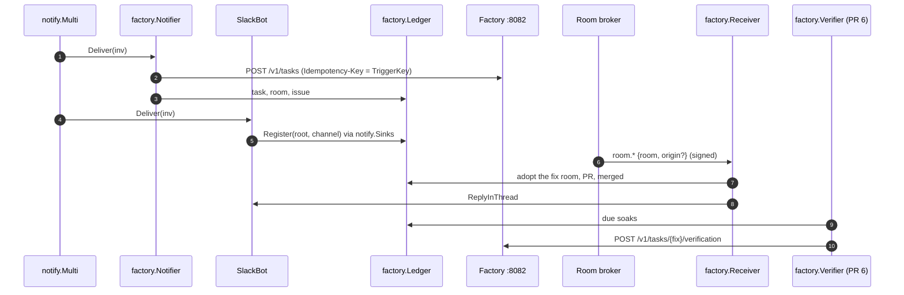

# RunLore agent-to-agent, RunLore PRs 2 and 6 — Implementation Plan

> **For agentic workers:** REQUIRED SUB-SKILL: Use superpowers:subagent-driven-development (recommended) or superpowers:executing-plans to implement this plan task-by-task. Steps use checkbox (`- [ ]`) syntax for tracking.

**Target repository:** `Smana/runlore` (`/home/smana/Sources/runlore`). Every path below is in that
repository unless it says otherwise. This file lives in ai-native-ref so that one pull request
carries the four feature-14 plans; copy it to `docs/superpowers/plans/` in RunLore when PR 2's branch
is cut.

**Goal:** RunLore hands each finding to the agent factory as an ordinary API client, follows the
work through the broker's signed webhooks into its Slack incident thread (PR 2), and once the fix is
merged, checks after a soak whether the alert is gone and tells the factory (PR 6).

**Architecture:** One new package, `internal/factory`, holds the whole integration: a client
(ZITADEL client credentials, `POST /v1/tasks`, `POST /v1/tasks/{task}/verification`), a ledger
(append-only JSONL per `TriggerKey`, beside the outcome ledger, replayed on start and on each
leadership), a webhook receiver mounted on the existing server as a work-bearing route (so a
follower forwards it to the leader), a notifier that the existing fan-out calls after each
investigation, and, in PR 6, a leader-only verifier. RunLore's existing seams carry it: `notify.Multi`
for delivery, `notify.ThreadSink` for the Slack root, `ThreadNotifier.ReplyInThread` for the posts,
`server.Forward` for leadership, the re-investigation's `LoopInvestigator` for the short check.



**Tech Stack:** Go 1.26 (toolchain go1.26.6), stdlib `net/http`, `crypto/hmac`, `encoding/json`,
`gopkg.in/yaml.v3`, `internal/httpx`, `httptest`; golangci-lint v2 through `hack/lint.sh`.

**Spec:** [the RunLore agent-to-agent design](../specs/2026-10-27-runlore-agent-to-agent-design.md)
(ai-native-ref): RA5, RA7, RA14, "Interfaces" (the RunLore row), "The closed loop", rows 2 and 6 of
"Pull requests, in order", offline proofs 1, 2 and 6. The factory's side is the
[agent-platform plan](2026-10-27-runlore-a2a-agent-platform-plan.md); the order across repositories
is in the [ai-native-ref plan](2026-10-27-runlore-a2a-ai-native-ref-plan.md).

**Out of this plan:** the factory, the host's network and machine user, the deployment values. An
"investigate X" API or an A2A card. RunLore's model behind agentgateway. Removing the `templated`
notifier: it is generic and stays; ai-native-ref stops configuring it.

### This plan's rulings

| # | Ruling | Why |
|---|---|---|
| R1 | **Config keys follow RunLore's conventions**: `factory: {url, token_url, client_id_env, client_secret_env, project_id_env, repository, max_cost_usd, webhook: {secret_env}}`, then in PR 6 `soak` (default `30m`) and `verify: {alertmanager_url, max_steps}` (default 6). Secrets are env names, never values; `url` empty is off | The design's `clientIDFile`, `clientSecretFile`, `webhook.listen` and `alertmanager.url` are the builder's to name (design, "Left to the builder"). RunLore's rule is `*_env` (`internal/config/config.go:78-88`); `sources.alertmanager` already names the inbound source, so the outbound URL lives under `factory.verify` |
| R2 | **The webhook route is `POST /factory/webhook` on the existing server (`:8080`)**, work-bearing: a follower forwards it to the leader, unchanged, so the signature verifies there | `internal/server/server.go:270-300`. One port means one ingress rule on the host, and the leader is where the ledger is written |
| R3 | **The Idempotency-Key is the `TriggerKey`**, or its SHA-256 hex when the key is past 255 bytes | RA5; the factory refuses a key past 255 (`maxKeyLen`) |
| R4 | **The ledger is its own file, `factory.jsonl`, in the outcome ledger's directory**, append-only with a replay on start and on `Reload` at each leadership, as `outcome.Ledger` is | The outcome ledger is a 1,687-line learning record; the factory's state is another concern. Same durability contract, same directory (`internal/app/notify.go:56-61` reasons the same way for `threads.jsonl`) |
| R5 | **The Slack root reaches the ledger through `notify.ThreadSink`**: `notify.Sinks` fans `Register` out to the thread registry and the factory ledger, and the Slack bot registers its root whenever thread capture **or** the factory is on | Today the bot registers only with `thread_capture` (`internal/notify/slack.go:88-90`), which the host leaves off |
| R6 | **The receiver acknowledges every verified event `204`**, known room or not, and drops one whose `webhook-id` it has seen in the last 10 minutes. It refuses `401` a bad signature or a timestamp more than 5 minutes from its clock | The broker's subscriber rules (agent-platform `docs/api.md`, "Webhooks"): verify, ±5 min, dedup on `webhook-id`. A 10-minute window covers every id a fresh timestamp can carry |
| R7 | **Thread posts are fixed English lines built from ids only**: no room text reaches Slack | Webhook payloads are id-only; the incident thread is in a shared channel |
| R8 | **The verdict is Alertmanager's, the re-investigation is the evidence.** After the soak, `firingNow` is read from Alertmanager (`GET /api/v2/alerts?active=true&silenced=false&inhibited=false&filter=alertname="<a>"`, plus `namespace="<ns>"` when the ledger holds one). `firingNow` is `persisting`, otherwise `resolved`. The re-investigation runs on the same `TriggerKey` with `verify.max_steps` and the configured cost ceiling, and its text is the evidence | The model never decides a verdict the monitor counts: the test is deterministic. Matching `alertname` and `namespace` is the builder's choice the design leaves open; `cluster` is not on this host's alerts |
| R9 | **Alertmanager unreachable posts nothing**: the entry stays due and is retried each minute until the factory answers `409 window_closed` | Offline proof 6 |
| R10 | **The soak's deadline is in the ledger** (`merged_at + soak`), and the verifier runs in `startWork` (leader-only) after a `Reload` | RA14, offline proof 6: a new leader resumes from the file |

## Global Constraints

- **Worktrees:** `/home/smana/Sources/runlore-f14-client` on `feat/factory-client` (PR 2) and
  `/home/smana/Sources/runlore-f14-verify` on `feat/factory-verify` (PR 6), each from a freshly
  fetched `origin/main` (`f340b4e1` when written), rebased before every push.
- **Quality gate, before every commit:** `go build ./... && go vet ./... && go test ./... && gofmt -l . && hack/lint.sh`;
  `gofmt -l .` prints nothing, `hack/lint.sh` reports `0 issues`.
- **TDD, table-driven, `httptest`, no third-party dependency.**
- **Off by default:** with `factory.url` empty nothing is built, no route is mounted, and every
  existing test is unchanged. With `url` set but an env var empty, the client is off and one warning
  is logged at start (the `templated` notifier's `url_env` rule).
- **Redact before the wire:** the finding text and the evidence go through `redact.Secrets`
  (the investigation is already redacted before notifiers run, `internal/notify/templated/templated.go:6-8`;
  the re-investigation's text is redacted again by the verifier).
- **Names, verbatim from the spec:** `POST /v1/tasks`, `Idempotency-Key`, `dataClass: internal`,
  `incident: {alert, resource, severity, cluster, verdict, confidence}`, `maxCostUSD`,
  `POST /v1/tasks/{task}/verification`, `resolved`, `persisting`, `firingAtMerge`, `firingNow`,
  `checkedAt`, `evidence`, `origin`, the event names `room.task_received` … `room.ended`.
- **Commits:** conventional, in English, no trailers. Never co-author.

## File structure

| File | Change | Task |
|---|---|---|
| `internal/config/config.go` (+ `config_factory_test.go`) | `Factory`, defaults, validation | 1, 7 |
| `internal/factory/client.go` (+ test) | token, `CreateTask`, `IdempotencyKey`, in PR 6 `PostVerification` | 2, 8 |
| `internal/factory/ledger.go` (+ test) | the JSONL ledger, `Register` | 3 |
| `internal/factory/notifier.go` (+ test) | `Deliver` | 4 |
| `internal/factory/webhook.go` (+ test) | verify, dedup, adopt, thread lines | 5 |
| `internal/notify/sinks.go` (+ test), `internal/notify/slack.go:88-90`, `:1236-1246` | `Sinks`; the root registered for the factory; `Multi.Add` | 4 |
| `internal/server/server.go:215-300` | `Actions.Factory`, the route | 6 |
| `internal/app/factory.go` (new), `internal/app/serve.go` | wiring | 6, 9 |
| `internal/factory/alertmanager.go`, `internal/factory/verifier.go` (+ tests) | PR 6 | 8, 9 |
| `internal/app/curator.go:157-189` | the run closure shared with the verifier | 9 |
| `website/content/docs/configuration/configuration.md` | the `factory` keys | 6, 9 |

---

## PR 2: the factory client, the receiver, the thread

### Task 1: The `factory` config block

**Files:**
- Modify: `internal/config/config.go:32-67` (a `Factory` field), beside `Endpoint`'s type
- Create: `internal/config/config_factory_test.go`

**Interfaces:**
- Produces: `type Factory struct { URL string \`yaml:"url"\`; TokenURL string \`yaml:"token_url"\`; ClientIDEnv string \`yaml:"client_id_env"\`; ClientSecretEnv string \`yaml:"client_secret_env"\`; ProjectIDEnv string \`yaml:"project_id_env"\`; Repository string \`yaml:"repository"\`; MaxCostUSD float64 \`yaml:"max_cost_usd"\`; Webhook FactoryWebhook \`yaml:"webhook"\` }`,
  `type FactoryWebhook struct { SecretEnv string \`yaml:"secret_env"\` }`, `Config.Factory Factory \`yaml:"factory"\``,
  `func (f Factory) Enabled() bool { return f.URL != "" }`.

- [ ] **Step 1: Write the failing test**

```go
// SPDX-License-Identifier: Apache-2.0

package config

import (
	"os"
	"path/filepath"
	"strings"
	"testing"
)

const factoryBlock = `factory:
  url: http://agent-factory.agent-system.svc.cluster.local:8082
  token_url: https://auth.example.com/oauth/v2/token
  client_id_env: FACTORY_CLIENT_ID
  client_secret_env: FACTORY_CLIENT_SECRET
  project_id_env: FACTORY_PROJECT_ID
  repository: Smana/cloud-native-ref
  max_cost_usd: 2
  webhook: {secret_env: FACTORY_WEBHOOK_KEY}
`

func loadString(t *testing.T, s string) (*Config, error) {
	t.Helper()
	p := filepath.Join(t.TempDir(), "runlore.yaml")
	if err := os.WriteFile(p, []byte(s), 0o600); err != nil {
		t.Fatal(err)
	}
	return Load(p)
}

func TestFactoryConfig(t *testing.T) {
	c, err := loadString(t, factoryBlock)
	if err != nil {
		t.Fatal(err)
	}
	if !c.Factory.Enabled() || c.Factory.MaxCostUSD != 2 || c.Factory.Webhook.SecretEnv != "FACTORY_WEBHOOK_KEY" {
		t.Fatalf("%+v", c.Factory)
	}
	if c, err := loadString(t, "logging: {format: json}\n"); err != nil || c.Factory.Enabled() {
		t.Fatalf("absent is off: %v", err)
	}
	for name, tc := range map[string]struct{ from, to, want string }{
		"no token url":      {"  token_url: https://auth.example.com/oauth/v2/token\n", "", "factory.token_url is required"},
		"a plain token url": {"https://auth.example.com/oauth", "http://auth.example.com/oauth", "factory.token_url must be https"},
		"no repository":     {"  repository: Smana/cloud-native-ref\n", "", "factory.repository must be owner/name"},
		"no ceiling":        {"max_cost_usd: 2", "max_cost_usd: 0", "factory.max_cost_usd must be above 0"},
		"no webhook key":    {"  webhook: {secret_env: FACTORY_WEBHOOK_KEY}\n", "", "factory.webhook.secret_env is required"},
		"an unknown key":    {"max_cost_usd: 2", "max_cost_usd: 2\n  maxCost: 2", "field maxCost not found"},
	} {
		t.Run(name, func(t *testing.T) {
			if _, err := loadString(t, strings.Replace(factoryBlock, tc.from, tc.to, 1)); err == nil || !strings.Contains(err.Error(), tc.want) {
				t.Fatalf("want %q, got %v", tc.want, err)
			}
		})
	}
}
```

- [ ] **Step 2: Run it and watch it fail**

Run: `go test ./internal/config -run TestFactoryConfig`
Expected: FAIL: `field factory not found in type config.Config`.

- [ ] **Step 3: Implement** the types with doc comments and, in `Validate`, `validateFactory(c.Factory)`
  returning the messages above when `Enabled()`; the three credential env names are required too
  (`factory.client_id_env is required`, likewise the others).

- [ ] **Step 4: Run, gate, commit**

Run: `go test ./internal/config` → PASS; then the quality gate.

```bash
git add internal/config
git commit -m "feat(config): a factory block, off unless url is set"
```

### Task 2: The client: a token, `POST /v1/tasks`

**Files:**
- Create: `internal/factory/client.go`, `internal/factory/client_test.go`, `internal/factory/doc.go`

**Interfaces:**
- Consumes: `config.Factory`.
- Produces:
  - `type Incident struct { Alert, Resource, Severity, Cluster, Verdict string; Confidence float64 }` (json lower camel);
  - `type TaskRequest struct { Repository, Text, DataClass string; MaxCostUSD float64; Incident Incident }` (json `repository, text, dataClass, maxCostUSD, incident`);
  - `type Created struct { Status int; Task, Room string; Issue int; Duplicate bool; Reason string }`;
  - `func NewClient(cfg config.Factory, getenv func(string) string, hc *http.Client, now func() time.Time) *Client`;
  - `func (c *Client) Enabled() bool`; `func (c *Client) CreateTask(ctx context.Context, key string, req TaskRequest) (Created, error)`;
  - `func IdempotencyKey(triggerKey string) string`.

- [ ] **Step 1: Write the failing tests** (offline proof 1, the client half)

```go
// SPDX-License-Identifier: Apache-2.0

package factory

import (
	"context"
	"encoding/json"
	"net/http"
	"net/http/httptest"
	"strings"
	"sync/atomic"
	"testing"
	"time"

	"github.com/Smana/runlore/internal/config"
)

// fakeFactory is ZITADEL's token endpoint and the factory's API in one server: tokens expire after
// ttl, and /v1/tasks answers from script, one reply per call, recording each Idempotency-Key.
type fakeFactory struct {
	ttl    time.Duration
	tokens atomic.Int32
	keys   []string
	script []int
}

func (f *fakeFactory) server(t *testing.T) *httptest.Server {
	srv := httptest.NewServer(http.HandlerFunc(func(w http.ResponseWriter, r *http.Request) {
		switch r.URL.Path {
		case "/oauth/v2/token":
			_ = r.ParseForm()
			if r.Form.Get("grant_type") != "client_credentials" || !strings.Contains(r.Form.Get("scope"), "urn:zitadel:iam:org:project:id:proj1:aud") {
				http.Error(w, "bad", http.StatusBadRequest)
				return
			}
			n := f.tokens.Add(1)
			_ = json.NewEncoder(w).Encode(map[string]any{"access_token": "tok" + string(rune('0'+n)), "expires_in": int(f.ttl.Seconds())})
		case "/v1/tasks":
			f.keys = append(f.keys, r.Header.Get("Idempotency-Key"))
			code := f.script[0]
			f.script = f.script[1:]
			w.WriteHeader(code)
			switch code {
			case http.StatusCreated:
				_, _ = w.Write([]byte(`{"task":"abcdefgh","room":"abcdefgh","issue":42}`))
			case http.StatusOK:
				_, _ = w.Write([]byte(`{"task":"abcdefgh","room":"abcdefgh","issue":42,"duplicate":true}`))
			case http.StatusAccepted:
				_, _ = w.Write([]byte(`{"accepted":false,"reason":"below_threshold"}`))
			case http.StatusTooManyRequests:
				_, _ = w.Write([]byte(`{"error":"principal_daily_tasks"}`))
			default:
				_, _ = w.Write([]byte(`{"error":"tasks_unavailable"}`))
			}
		}
	}))
	t.Cleanup(srv.Close)
	return srv
}

func newTestClient(t *testing.T, f *fakeFactory, clock *time.Time) *Client {
	srv := f.server(t)
	env := map[string]string{"ID": "runlore", "SECRET": "s3cret", "PROJ": "proj1"}
	return NewClient(config.Factory{URL: srv.URL, TokenURL: srv.URL + "/oauth/v2/token", ClientIDEnv: "ID",
		ClientSecretEnv: "SECRET", ProjectIDEnv: "PROJ", Repository: "Smana/cloud-native-ref", MaxCostUSD: 2}, // pragma: allowlist secret
		func(k string) string { return env[k] }, srv.Client(), func() time.Time { return *clock })
}

var req = TaskRequest{Repository: "Smana/cloud-native-ref", Text: "t", DataClass: "internal", MaxCostUSD: 2,
	Incident: Incident{Alert: "KubePodCrashLooping", Resource: "apps/web", Verdict: "action_required", Confidence: 0.9}}

func TestCreateTaskAnswers(t *testing.T) {
	clock := time.Unix(1_800_000_000, 0)
	f := &fakeFactory{ttl: time.Hour, script: []int{201, 200, 202, 429, 503, 503, 201}}
	c := newTestClient(t, f, &clock)
	ctx := context.Background()
	for _, want := range []Created{
		{Status: 201, Task: "abcdefgh", Room: "abcdefgh", Issue: 42},
		{Status: 200, Task: "abcdefgh", Room: "abcdefgh", Issue: 42, Duplicate: true},
		{Status: 202, Reason: "below_threshold"},
		{Status: 429, Reason: "principal_daily_tasks"},
		{Status: 201, Task: "abcdefgh", Room: "abcdefgh", Issue: 42}, // two 503s, retried
	} {
		got, err := c.CreateTask(ctx, "k1", req)
		if err != nil || got != want {
			t.Fatalf("want %+v, got %+v %v", want, got, err)
		}
	}
	for _, k := range f.keys {
		if k != "k1" {
			t.Fatalf("a retry changed the key: %v", f.keys)
		}
	}
	if f.tokens.Load() != 1 {
		t.Fatalf("one token for an hour's calls, got %d", f.tokens.Load())
	}
	clock = clock.Add(59*time.Minute + 30*time.Second) // within 60 s of expiry: refresh
	f.script = []int{201}
	if _, err := c.CreateTask(ctx, "k2", req); err != nil || f.tokens.Load() != 2 {
		t.Fatalf("refresh: %v, %d tokens", err, f.tokens.Load())
	}
}

func TestCreateTaskGivesUpAfterThree503(t *testing.T) {
	clock := time.Unix(1_800_000_000, 0)
	c := newTestClient(t, &fakeFactory{ttl: time.Hour, script: []int{503, 503, 503}}, &clock)
	if _, err := c.CreateTask(context.Background(), "k", req); err == nil {
		t.Fatal("three 503s are an error")
	}
}

func TestIdempotencyKey(t *testing.T) {
	short := "kubepodcrashlooping|apps|deployment|web|gcp-0"
	if IdempotencyKey(short) != short {
		t.Fatal("a short key is the TriggerKey itself")
	}
	long := strings.Repeat("x", 256)
	if k := IdempotencyKey(long); len(k) != 64 || k == long {
		t.Fatalf("past 255 bytes the key is its SHA-256 hex: %q", k)
	}
}

func TestClientOffWithoutItsEnv(t *testing.T) {
	c := NewClient(config.Factory{URL: "http://f", TokenURL: "https://a", ClientIDEnv: "ID", ClientSecretEnv: "S", ProjectIDEnv: "P"},
		func(string) string { return "" }, http.DefaultClient, time.Now)
	if c.Enabled() {
		t.Fatal("empty credentials: off")
	}
}
```

- [ ] **Step 2: Run them and watch them fail**

Run: `go test ./internal/factory -run 'CreateTask|IdempotencyKey|ClientOff'`
Expected: FAIL: `no non-test Go files` / `undefined: NewClient`.

- [ ] **Step 3: Implement**

`doc.go`: `// Package factory is RunLore's client of the agent factory (agent-to-agent design): …`.
`client.go`: credentials read through `getenv` at construction; `Enabled` is all three non-empty and
`URL` set. `token(ctx)` caches the access token until 60 s before `expires_in`, under a mutex,
posting `grant_type=client_credentials`, `client_id`, `client_secret` and
`scope=openid urn:zitadel:iam:org:project:id:<project>:aud` as a form. `CreateTask` marshals the
request, sets `Authorization: Bearer`, `Idempotency-Key`, `Content-Type`, and maps the answer to
`Created`; a `503` or a transport error is retried twice more with the **same** key after 1 s and
3 s (the clock's sleep is `time.Sleep` scaled by a package var the test sets to zero); any other
status is returned, its `error` or `reason` in `Reason`. The body read is capped at 64 KiB
(`io.LimitReader`). `IdempotencyKey` returns the key, or `hex(sha256(key))` past 255 bytes. Use
`httpx.SanitizeURLError` on transport errors.

- [ ] **Step 4: Run, gate, commit**

```bash
git add internal/factory
git commit -m "feat(factory): a client of the agent factory: client-credentials token, POST /v1/tasks"
```

### Task 3: The ledger

**Files:**
- Create: `internal/factory/ledger.go`, `internal/factory/ledger_test.go`

**Interfaces:**
- Produces:
  - `type Record struct { TriggerKey, Alert, Namespace, Workload, Task, Room string; Issue int; SlackRoot, SlackChannel, FixRoom string; PR int; MergedAt time.Time; FiringAtMerge bool; SoakUntil time.Time; Verdict, Outcome string; Events []string }` (json snake case; `Events` the last 20 event types seen);
  - `func OpenLedger(path string, now func() time.Time) (*Ledger, error)`; `(*Ledger).Upsert(key string, fn func(*Record)) error`;
    `Get(key string) (Record, bool)`; `ByRoom(room string) (Record, bool)` (task room or fix room); `Due(at time.Time) []Record`
    (merged, a `SoakUntil` at or before `at`, no verdict, no terminal outcome); `Seen(id string, at time.Time) (bool, error)`;
    `Reload() error`; `Register(transport, root, channel string, inv providers.Investigation)` (the `notify.ThreadSink`
    contract; `slack` only, keyed by `inv.TriggerKey`).

- [ ] **Step 1: Write the failing tests**

```go
func TestLedgerSurvivesAReopen(t *testing.T) {
	p := filepath.Join(t.TempDir(), "factory.jsonl")
	now := time.Unix(1_800_000_000, 0)
	l, err := OpenLedger(p, func() time.Time { return now })
	if err != nil {
		t.Fatal(err)
	}
	must(t, l.Upsert("k1", func(r *Record) { r.Task, r.Room, r.Issue = "abcdefgh", "abcdefgh", 42 }))
	l.Register("slack", "1729.0001", "C01", providers.Investigation{TriggerKey: "k1"})
	must(t, l.Upsert("k1", func(r *Record) { r.FixRoom, r.PR, r.MergedAt, r.SoakUntil = "fix00001", 7, now, now.Add(30*time.Minute) }))
	again, err := OpenLedger(p, func() time.Time { return now })
	if err != nil {
		t.Fatal(err)
	}
	r, ok := again.ByRoom("fix00001")
	if !ok || r.TriggerKey != "k1" || r.Issue != 42 || r.SlackRoot != "1729.0001" || r.PR != 7 {
		t.Fatalf("%+v", r)
	}
	if got := again.Due(now.Add(29 * time.Minute)); len(got) != 0 {
		t.Fatal("not due before the soak ends")
	}
	if got := again.Due(now.Add(30 * time.Minute)); len(got) != 1 {
		t.Fatal("due once it ends")
	}
}

func TestLedgerSeenWindow(t *testing.T) {
	now := time.Unix(1_800_000_000, 0)
	l, _ := OpenLedger(filepath.Join(t.TempDir(), "f.jsonl"), func() time.Time { return now })
	if seen, _ := l.Seen("evt_a", now); seen {
		t.Fatal("first sight")
	}
	if seen, _ := l.Seen("evt_a", now.Add(time.Minute)); !seen {
		t.Fatal("a replay within the window")
	}
	if seen, _ := l.Seen("evt_a", now.Add(11*time.Minute)); seen {
		t.Fatal("forgotten after 10 minutes; the timestamp check refuses it anyway")
	}
}

func TestLedgerDisabledWithoutAPath(t *testing.T) {
	l, err := OpenLedger("", time.Now)
	if err != nil || l.Upsert("k", func(*Record) {}) != nil {
		t.Fatal("an empty path is a no-op ledger")
	}
}
```

(`must` is a two-line helper in the test file.)

- [ ] **Step 2: Run them and watch them fail**

Run: `go test ./internal/factory -run Ledger`
Expected: FAIL: `undefined: OpenLedger`.

- [ ] **Step 3: Implement**

Each `Upsert` appends one line `{"record": <the whole record after fn>}`; each `Seen` that records
appends `{"seen": id, "at": t}`. Replay keeps the last record per key and the seen ids younger than
10 minutes; it compacts (write a temp file, `fsync`, rename, `fsync` the directory, as
`outcome.Ledger` does) once the file holds four times the live lines. A torn last line is skipped
with a warning, never an error. An empty path makes every method a no-op returning zero values.
`Register` ignores a transport other than `slack` and an empty key.

- [ ] **Step 4: Run, gate, commit**

```bash
git add internal/factory
git commit -m "feat(factory): the factory ledger, per TriggerKey, replayed on open"
```

### Task 4: The notifier, `notify.Sinks`, `Multi.Add`

**Files:**
- Create: `internal/factory/notifier.go`, `internal/factory/notifier_test.go`, `internal/notify/sinks.go`, `internal/notify/sinks_test.go`
- Modify: `internal/notify/slack.go:88-90` (the root), `:1236-1246` (`Multi.Add`)

**Interfaces:**
- Consumes: Tasks 2 and 3.
- Produces:
  - `type Notifier struct { Client *Client; Ledger *Ledger; Repository string; MaxCostUSD float64; Log *slog.Logger }`
    implementing `providers.Notifier`;
  - `type notify.Sinks []notify.ThreadSink` with `Register` fanning out, nil entries skipped;
  - `func (m *Multi) Add(n ...providers.Notifier)`.

- [ ] **Step 1: Write the failing tests**

`notifier_test.go`: with the Task 2 fake, `Deliver` of an investigation (`TriggerKey: "k1"`,
`AlertName: "KubePodCrashLooping"`, `Resource: {Namespace: "apps", Kind: "Deployment", Name: "web"}`,
`Verdict: "action_required"`, `Confidence: 0.9`, `Severity: "critical"`, `Cluster: "gcp-0"`) posts
`incident.resource == "apps/web"`, `dataClass == "internal"`, key `k1`; the ledger then holds
`Task`, `Room`, `Issue`, `Alert`, `Namespace: "apps"`, `Workload: "Deployment/web"` (offline proof 1:
"the ledger holds task, room, issue"). A `202` writes nothing and returns nil; a `429` returns nil
and logs the reason; three `503`s return an error. An investigation without a `TriggerKey` posts
nothing.

`sinks_test.go`: `Sinks{a, nil, b}.Register(...)` reaches `a` and `b` once each.

In `slack_test.go`, one case: with `notify.slack.thread_capture: false` and `factory.url` set, the
built bot's `Threads` is the deps' sink.

- [ ] **Step 2: Run them and watch them fail**

Run: `go test ./internal/factory ./internal/notify -run 'Deliver|Sinks|Thread'`
Expected: FAIL to compile.

- [ ] **Step 3: Implement**

`Deliver`: skip without `inv.TriggerKey` or `!Client.Enabled()`; build the request from
`notify.NewPayload(inv)` (`Text`, `ResourceRef`, `AlertName`, `Severity`, `Cluster`, `Verdict`,
`Confidence`); `CreateTask(ctx, IdempotencyKey(inv.TriggerKey), req)`; on `201` or `200`,
`Ledger.Upsert(inv.TriggerKey, …)`. `slack.go:88`: `if sl.ThreadCapture || d.Cfg.Factory.Enabled() {`.
`Multi.Add` appends.

- [ ] **Step 4: Run, gate, commit**

```bash
git add internal/factory internal/notify
git commit -m "feat(factory): each finding goes to the factory; the Slack root is recorded for its thread"
```

### Task 5: The webhook receiver

**Files:**
- Create: `internal/factory/webhook.go`, `internal/factory/webhook_test.go`

**Interfaces:**
- Consumes: Task 3's ledger; `providers.ThreadNotifier`.
- Produces:
  - `type Event struct { Type, Room, Repo, Run, Reason, Limit, State, Origin string; PR int }` (json as agent-platform's `webhook.Event`);
  - `func ReadKeys(raw string) ([][]byte, error)` (one or two base64 lines, each ≥ 32 bytes decoded);
  - `func Verify(keys [][]byte, h http.Header, body []byte, now time.Time) (string, error)`;
  - `type Receiver struct { Keys func() [][]byte; Ledger *Ledger; Replier providers.ThreadNotifier; Now func() time.Time; Log *slog.Logger; OnMerged func(ctx context.Context, key string) }` implementing `http.Handler`
    (`OnMerged` is nil in PR 2; PR 6 sets it).

- [ ] **Step 1: Write the failing tests** (offline proof 2)

```go
func sign(key []byte, id string, ts time.Time, body []byte) http.Header {
	t := strconv.FormatInt(ts.Unix(), 10)
	m := hmac.New(sha256.New, key)
	m.Write([]byte(id + "." + t + "."))
	m.Write(body)
	h := http.Header{}
	h.Set("webhook-id", id)
	h.Set("webhook-timestamp", t)
	h.Set("webhook-signature", "v1,"+base64.StdEncoding.EncodeToString(m.Sum(nil)))
	return h
}

type replies struct{ got []string }

func (r *replies) ReplyInThread(_ context.Context, root, channel, text string) error {
	r.got = append(r.got, root+"|"+channel+"|"+text)
	return nil
}
func (r *replies) Deliver(context.Context, providers.Investigation) error { return nil }
func (r *replies) Transport() string                                       { return "slack" }

func TestReceiver(t *testing.T) {
	key := bytes.Repeat([]byte{7}, 32)
	now := time.Unix(1_800_000_000, 0)
	l, _ := OpenLedger(filepath.Join(t.TempDir(), "f.jsonl"), func() time.Time { return now })
	_ = l.Upsert("k1", func(r *Record) { r.Room, r.SlackRoot, r.SlackChannel = "abcdefgh", "1729.0001", "C01" })
	rep := &replies{}
	rc := &Receiver{Keys: func() [][]byte { return [][]byte{key} }, Ledger: l, Replier: rep, Now: func() time.Time { return now }}
	post := func(h http.Header, body string) int {
		r := httptest.NewRequest(http.MethodPost, "/factory/webhook", strings.NewReader(body))
		maps.Copy(r.Header, h)
		w := httptest.NewRecorder()
		rc.ServeHTTP(w, r)
		return w.Code
	}
	ended := `{"type":"room.ended","room":"abcdefgh","state":"done"}`
	for name, c := range map[string]struct {
		h    http.Header
		body string
		want int
	}{
		"a wrong key":         {sign(bytes.Repeat([]byte{8}, 32), "evt_1", now, []byte(ended)), ended, 401},
		"one byte changed":    {sign(key, "evt_2", now, []byte(ended)), strings.Replace(ended, "done", "dona", 1), 401},
		"6 minutes old":       {sign(key, "evt_3", now.Add(-6*time.Minute), []byte(ended)), ended, 401},
		"6 minutes ahead":     {sign(key, "evt_4", now.Add(6*time.Minute), []byte(ended)), ended, 401},
	} {
		if got := post(c.h, c.body); got != c.want || len(rep.got) != 0 {
			t.Fatalf("%s: %d, %d replies", name, got, len(rep.got))
		}
	}
	if got := post(sign(key, "evt_5", now, []byte(ended)), ended); got != 204 || len(rep.got) != 1 ||
		!strings.HasPrefix(rep.got[0], "1729.0001|C01|") {
		t.Fatalf("a good signature: %d %v", got, rep.got)
	}
	if got := post(sign(key, "evt_5", now, []byte(ended)), ended); got != 204 || len(rep.got) != 1 {
		t.Fatalf("a replayed webhook-id is acknowledged and dropped: %d %v", got, rep.got)
	}
	unknown := `{"type":"room.pr_opened","room":"zzzzzzzz","pr":9}`
	if got := post(sign(key, "evt_6", now, []byte(unknown)), unknown); got != 204 || len(rep.got) != 1 {
		t.Fatalf("an unknown room is acknowledged and ignored: %d", got)
	}
	fix := `{"type":"room.pr_opened","room":"fix00001","pr":7,"origin":"abcdefgh"}`
	if got := post(sign(key, "evt_7", now, []byte(fix)), fix); got != 204 || len(rep.got) != 2 {
		t.Fatalf("an origin that is a known room adopts the fix's room: %d %v", got, rep.got)
	}
	if r, ok := l.ByRoom("fix00001"); !ok || r.TriggerKey != "k1" || r.PR != 7 {
		t.Fatalf("%+v", r)
	}
	merged := `{"type":"room.merged","room":"fix00001","pr":7,"origin":"abcdefgh"}`
	if got := post(sign(key, "evt_8", now, []byte(merged)), merged); got != 204 {
		t.Fatal(got)
	}
	if r, _ := l.Get("k1"); r.MergedAt.IsZero() {
		t.Fatal("room.merged records the merge")
	}
}
```

- [ ] **Step 2: Run it and watch it fail**

Run: `go test ./internal/factory -run TestReceiver`
Expected: FAIL: `undefined: Receiver`.

- [ ] **Step 3: Implement**

`ServeHTTP`: body capped at 64 KiB; `Verify` (constant-time `hmac.Equal`, every `v1,` signature
against every key, timestamp within ±5 min) → `401` on failure, with no detail; `Ledger.Seen(id)` →
`204` when seen; decode `Event` (`400` on bad JSON, after the signature); find the record by
`Room`, else by `Origin` (then `Upsert` `FixRoom = Room`); none → `204`. Record the type in
`Events`, `PR` when set; on `room.merged` of the fix room set `MergedAt = now` and, when `OnMerged`
is set, call it in a goroutine with a 30 s detached context. Post the line for the type, when the
record has a Slack root:

| Event | Line |
|---|---|
| `room.task_received` (task room) | `Agent factory task \`<room>\` took this incident; its public stub is issue #<issue>.` |
| `room.ended` (task room) | `Agent factory task \`<room>\` ended: <state>. A maintainer publishes its proposal with \`factory/publish\`.` |
| `room.task_received` (fix room) | `The fix was published and started as task \`<room>\`.` |
| `room.pr_opened` | `The fix's pull request is #<pr>.` |
| `room.waiting_for_human` | `The fix waits for a human: <reason>.` |
| `room.merged` | `The fix #<pr> is merged.` |
| `room.reverted` | `The fix #<pr> was reverted.` |
| `room.ended` (fix room) | `The fix's task ended: <state>.` |

Other events update the ledger and post nothing. `204` once handled.

- [ ] **Step 4: Run, gate, commit**

```bash
git add internal/factory
git commit -m "feat(factory): the broker's signed webhooks into the incident's Slack thread"
```

### Task 6: Wiring, docs, the PR, the release

**Files:**
- Modify: `internal/server/server.go:215-235` (`Actions.Factory http.Handler`), `:249-300` (mount)
- Create: `internal/app/factory.go`, `internal/app/factory_test.go`
- Modify: `internal/app/serve.go:203-216` (ledger, sinks, notifier), `:386-395` (`Reload` at leadership), `:462-541` (`Actions`)
- Modify: `website/content/docs/configuration/configuration.md` (an "Agent factory" section)

**Interfaces:**
- Produces: `func BuildFactory(cfg *config.Config, log *slog.Logger) (*factory.Ledger, *factory.Client, error)`
  (nil, nil when off); `server.Actions.Factory http.Handler`, mounted as
  `mux.Handle("POST /factory/webhook", work(s.factory))` when non-nil, through `liveIface`.

- [ ] **Step 1: Write the failing test**

`internal/app/factory_test.go`: a config with `factory.url` set and the env present builds a ledger
at `<dir of outcome.ledger_path>/factory.jsonl` and an enabled client; with `url` empty both are nil;
with an env var empty the client is disabled and one warning is logged. In
`internal/server/server_test.go`, a server built with `Actions.Factory` set answers
`POST /factory/webhook` from its handler, and one without it answers `404`.

- [ ] **Step 2: Run, watch it fail; implement; run**

Run: `go test ./internal/app ./internal/server -run 'Factory'` → FAIL, then implement:
`serve.go` builds the factory ledger after the thread registry, passes
`notify.Sinks{threadRegistry, factoryLedger}` to `BuildInvestigator` in place of `threadRegistry`,
then `notifier.Add(&factory.Notifier{…})` when `notifier != nil` and the client is enabled; the
`Receiver` (keys read from the env at each request through `factory.ReadKeys`, replier
`notifier.ThreadRepliers()["slack"]`) goes into `acts.Factory`; `startWork` calls
`factoryLedger.Reload()` beside `ledger.Reload()`. Run `go test ./...`, including
`TestActionsInterfaceFieldsAreNeverAssignedRawBuilderResults`: assign `acts.Factory` guarded, as
that test requires.

- [ ] **Step 3: Docs.** The "Agent factory" section: the keys of R1 with one example fence (it must
  parse: `internal/docsguard/config_fences_test.go`), what is posted to Slack, the route, and that
  the factory decides every gate.

- [ ] **Step 4: Gate, commit, push, PR**

```bash
git add internal website
git commit -m "feat(serve): wire the factory client, its ledger and POST /factory/webhook"
git fetch origin && git rebase origin/main && git push -u origin feat/factory-client
```

Title: `feat(factory): RunLore hands findings to the agent factory and follows the fix in Slack`.
Body: R1–R7, offline proofs 1 and 2 with their tests, "off unless `factory.url` is set". Once merged,
merge release-please's PR: the release is `vR1` (the next minor), which the cloud-native-ref plan pins.

---

## PR 6: the soak, the Alertmanager check, the verdict

### Task 7: `factory.soak` and `factory.verify`

**Files:** Modify `internal/config/config.go` (`Factory.Soak Duration \`yaml:"soak"\``,
`Factory.Verify FactoryVerify \`yaml:"verify"\``, `type FactoryVerify struct { AlertmanagerURL string \`yaml:"alertmanager_url"\`; MaxSteps int \`yaml:"max_steps"\` }`),
`ApplyDefaults` (`soak: 30m`, `max_steps: 6` when `Enabled()`), `internal/config/config_factory_test.go`.

- [ ] **Step 1: Failing cases** in `TestFactoryConfig`: defaults read `30m` and `6`; `soak: 2m` is
  refused (`factory.soak must be at least 5m`); `alertmanager_url: ftp://x` is refused
  (`factory.verify.alertmanager_url must be http(s)`); empty `alertmanager_url` leaves verification off.
- [ ] **Step 2:** `go test ./internal/config -run TestFactoryConfig` → FAIL; implement; → PASS; gate.
- [ ] **Step 3: Commit**

```bash
git add internal/config
git commit -m "feat(config): factory.soak and factory.verify"
```

### Task 8: Alertmanager, and `PostVerification`

**Files:**
- Create: `internal/factory/alertmanager.go`, `internal/factory/alertmanager_test.go`
- Modify: `internal/factory/client.go`, `client_test.go`

**Interfaces:**
- Produces: `func Firing(ctx context.Context, hc *http.Client, baseURL, alert, namespace string) (bool, error)`;
  `type Verification struct { Verdict string; Alert VerifiedAlert; CheckedAt time.Time; Evidence string }` with
  `VerifiedAlert{Name string; FiringAtMerge, FiringNow bool}` (json as the design's body);
  `func (c *Client) PostVerification(ctx context.Context, task string, v Verification) (int, string, error)` (status, reason).

- [ ] **Step 1: Failing tests**: `Firing` against an `httptest` Alertmanager asserts the query
  (`active=true`, `silenced=false`, `inhibited=false`, `filter=alertname="KubePodCrashLooping"`,
  `filter=namespace="apps"`), returns true for one alert, false for `[]`, an error for a `500` and for
  a closed server. `PostVerification` sends the body exactly as the design shows it, with a token,
  and returns `201`, `200` and `409 window_closed` as given; a `503` is retried with the same body.
- [ ] **Step 2:** `go test ./internal/factory -run 'Firing|PostVerification'` → FAIL; implement; → PASS; gate.
- [ ] **Step 3: Commit**

```bash
git add internal/factory
git commit -m "feat(factory): ask Alertmanager whether an alert fires; post a verdict to the factory"
```

### Task 9: The verifier

**Files:**
- Create: `internal/factory/verifier.go`, `internal/factory/verifier_test.go`
- Modify: `internal/app/curator.go:157-189` (lift `run` into `reinvestigateRun(cfg, deps, metrics, log, maxSteps int)`),
  `internal/app/factory.go`, `internal/app/serve.go:386-440` (start it in `startWork`),
  `website/content/docs/configuration/configuration.md`

**Interfaces:**
- Consumes: Tasks 3, 5, 7, 8.
- Produces: `type Verifier struct { Ledger *Ledger; Client *Client; Firing func(ctx context.Context, alert, ns string) (bool, error); Reinvestigate func(ctx context.Context, r Record) (string, error); Replier providers.ThreadNotifier; Soak time.Duration; Now func() time.Time; Log *slog.Logger }`;
  `func (v *Verifier) OnMerged(ctx context.Context, key string)` (records `FiringAtMerge` and `SoakUntil`);
  `func (v *Verifier) Run(ctx context.Context, every time.Duration)`; `func (v *Verifier) Once(ctx context.Context)`.

- [ ] **Step 1: Write the failing tests** (offline proof 6 and the verdict)

| Case | Expect |
|---|---|
| `OnMerged`, alert firing | `FiringAtMerge` true, `SoakUntil = now + 30m`, a thread line "Soaking for 30m before checking `KubePodCrashLooping`." |
| `Once` before `SoakUntil` | nothing posted, no verdict |
| `Once` after, alert not firing | one `POST …/verification` with `resolved`, `firingAtMerge: true`, `firingNow: false`, the re-investigation's text as `evidence`; `Verdict == resolved`; thread line "The alert is gone 30m after the fix: resolved." |
| After, alert firing | `persisting`; line "The alert still fires 30m after the fix: persisting. The factory opens a follow-up." |
| Alertmanager unreachable | nothing posted to the factory or Slack; still due |
| Factory answers `409 window_closed` | `Outcome == window_closed`; never due again; line "The factory's window for a verdict closed." |
| Leader change: a ledger written by one `Verifier` with `SoakUntil` passed, reopened by a second `Ledger` on the same file after `Reload`, then `Once` | the second posts the verdict, once |
| The re-investigation errors | the verdict is still posted, with evidence "re-investigation unavailable: <error class>" |

- [ ] **Step 2:** `go test ./internal/factory -run Verifier` → FAIL.

- [ ] **Step 3: Implement**

`Once`: for each `Ledger.Due(now)`: `Firing` (error → log, continue); `Reinvestigate` (bounded by
its own `context.WithTimeout` of 5 min); `redact.Secrets` on its text, cut to 16 KiB;
`PostVerification(record.FixRoom …)`; `201`/`200` → `Verdict`; `409`/`403`/`404` → `Outcome` = the
reason; a `503` or transport error leaves it due. `Run` ticks every minute until `ctx` ends.
`reinvestigateRun` keeps the closure's body; `BuildReinvestigator` calls it with
`cfg.Investigation.MaxSteps`, the verifier with `cfg.Factory.Verify.MaxSteps`. The verifier's
request is `investigate.Request{Source: investigate.SourceAlert, Title: "Verify the fix for " + alert,
Workload: <from the record>, Reason: "the fix merged in #<pr> should have resolved this alert; check whether it still fires and why", TriggerKey: key}`.
In `startWork`, after the ledgers' `Reload`, `go verifier.Run(workCtx, time.Minute)` when
`cfg.Factory.Verify.AlertmanagerURL != ""`; the receiver's `OnMerged` is `verifier.OnMerged`.

- [ ] **Step 4: Run, docs, gate, commit, push, PR**

```bash
git add internal website
git commit -m "feat(factory): soak, ask Alertmanager, re-investigate briefly, tell the factory whether the fix held"
git fetch origin && git rebase origin/main && git push -u origin feat/factory-verify
```

Title: `feat(factory): RunLore verifies the factory's fix after a soak`. Body: R8–R10, offline proof 6.
Once merged, release `vR2` through release-please; the cloud-native-ref plan pins it.

## Gate

- [ ] The quality gate on each PR's head: `go build ./... && go vet ./... && go test ./... && gofmt -l . && hack/lint.sh`, `0 issues`.
- [ ] Offline proofs 1 (`TestCreateTaskAnswers`, `TestCreateTaskGivesUpAfterThree503`, the notifier's ledger case),
  2 (`TestReceiver`) and 6 (the verifier table) named in the PR bodies.
- [ ] `vR1` and `vR2` released, each image published (`ghcr.io/smana/runlore:<version>`, no `v`).
