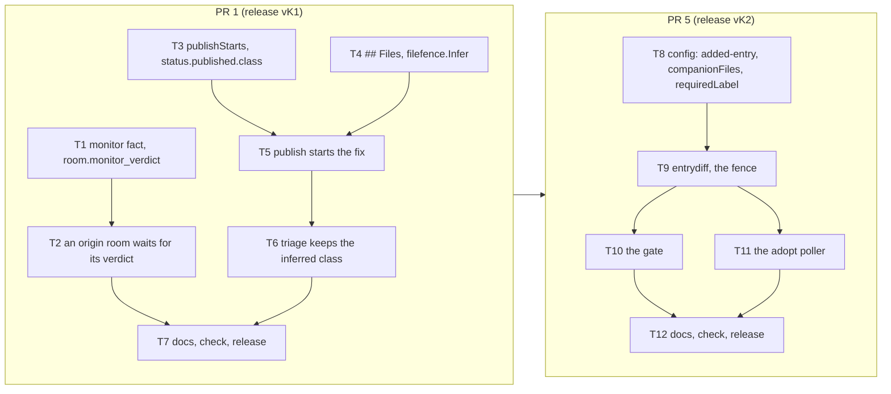

# RunLore's knowledge base from the factory, Maku PRs 1 and 5 — Implementation Plan

> **For agentic workers:** REQUIRED SUB-SKILL: Use superpowers:subagent-driven-development (recommended) or superpowers:executing-plans to implement this plan task-by-task. Steps use checkbox (`- [ ]`) syntax for tracking.

**Target repository:** Maku, `Smana/maku` (Go module `github.com/Smana/maku`, chart
`charts/maku-factory`; local checkout `/Users/s.kahlouch@ext.go-electra.com/Personal/Sources/agent-platform`).
Every path below is in that repository unless it says otherwise. The checkout's working tree is a
stale docs branch: work from `origin/main` only. This file lives in ai-native-ref beside the spec
(RK21); copy it to `docs/superpowers/plans/` in Maku when PR 1's branch is cut.

**Goal:** The factory tells RunLore its post-merge monitor's verdict on a fix (`room.monitor_verdict`),
and one maintainer label (`factory/publish`) both files RunLore's proposal and starts its fix, in the
class its paths name (PR 1). A new adopted diff shape lets the merge gate decide a knowledge-base
entry RunLore's App opened (PR 5).

**Architecture:** Two pull requests, 12 tasks. The verdict rides the task facts, the broker's one
source: a new `monitor` fact, set only for a task with `spec.origin`, which the webhook tracker
turns into one event; the origin task's room stays open until that fact lands. Publishing infers the
class from a `## Files` section the triager now writes, against the `allowedFiles` the classes
already declare (`filefence`, the gate's own fence), records it in `status.published.class`, and,
for a principal with `publishStarts`, creates the fix Task the way `factory/ready` would. The KB
shape is one more adopted shape (`added-entry`: one added entry plus additions-only appends to
declared companion files) beside the semver ones, its validator a holdout check and its label part
of the author mode's evidence.



**Tech Stack:** Go 1.27.3, controller-runtime fake client, `forgetest.Fake`, `httptest`, stdlib
`testing`, table-driven; golangci-lint v2 through `task lint`; the CRD regenerated by `task crd:gen`.

**Spec:** [RunLore's knowledge base, filled by the agent factory](../specs/2026-11-03-runlore-kb-from-the-factory-design.md)
(ai-native-ref): RK3, RK5, RK15, "Interfaces" (`room.monitor_verdict`, Publish, The KB class),
"Pull requests, in order" rows 1 and 5, offline proofs 1, 2, 7 and 8.

**Out of this plan:** RunLore's PR 2 (deferral, the outcome observation, `lore kb resolve`, the
weekly issue), cloud-native-ref PR 3, ai-native-ref PRs 4 and 7 (the pins, `publishStarts: true`,
the subscriber's event list, `classes.kb-entries` and its `autoMergesPerDay: 5`), runlore-kb PR 6
(the fence file, the policy, the workflow that runs `lore validate-kb`), and phases 3 and 4
(`status: draft`, RK19's breaker, the threat check, the lesson endpoint).

### This plan's rulings

| # | Ruling | Why |
|---|---|---|
| K1 | **`room.monitor_verdict` rides the task facts.** `TaskFacts.Monitor` (`healthy`, `regression`, `inconclusive`) is set by `factsOf` only for a task with `spec.origin` whose `status.monitor.verdict` is set. The tracker sends `{type, room, repo, pr, origin, verdict}` once per room, only when the room's facts named an origin | The broker reads events from the room log only (`internal/webhook/emitter.go:48-52`), and the factory's one write route into it is the facts (`internal/bridgeapi/system.go:94-110`). A verdict is set once and never changes (`internal/factory/reconciler/monitor.go:192-201`), so a regression decided before the window ends is final at once |
| K2 | **An origin task's room stays open until its verdict's facts land**: `roomState` is not due while the task has `spec.origin`, `monitorDue` holds and `status.monitor.verdict` is empty; it looks again after `monitorEvery`. A task without an origin closes as today | A human merge's room closes once facts and usage settle (`internal/factory/reconciler/roomclose.go:26-68`; the revert-window wait at `:42-47` is the merger's merges only), hours before `followUpWindow` ends, and a sealed log takes no facts (`facts.go:228`). The wait is bounded by `monitorDue`: `followUpWindow` + 5 min, at most 720 h |
| K3 | **The class is inferred from a `## Files` section** the triager's proposal now ends with: one `` - `path` `` line per repository path the change touches, at most 10. A path with a `..` segment, a leading `/`, whitespace or more than 200 bytes, a line of any other form, or an 11th line, empties the list | A proposal carries no paths today (`internal/factory/reconciler/text.go:182-193`, `internal/factory/sanitize/draft.go:23`). Paths are matched against the scope classes already declare, `allowedFiles`, which the gate holds the real diff to (row 8): a wrong list predicts a class whose gate the PR must still pass. A class the model names is a claim the alert's text can steer, with no fence behind it |
| K4 | **`filefence.Infer`**: the candidates declare `allowedFiles` and are not `review`, `revert`, adopted or oracle-backed; one matches when every path is allowed and none is protected. Exactly one match is the class; none, several or no paths is `review` | Adopted classes take another author's pull requests (MC10) and oracle classes a detector's findings (MC6). On the host, `deps-patch` and `deps-minor` allow `observability/…yaml` beside `alert-rules` (ai-native-ref `tooling/base/agent-factory/helm-values-configmap.yaml`): counted, every alert fix would be ambiguous. Ambiguity is no inference |
| K5 | **The class rides the factory's state, not the label.** `status.published.class` on the origin task; the fix Task's `spec.predictedClass` copies it at creation (publish start or `factory/ready`); triage keeps it for a task with `spec.origin` unless a maintainer's `class:` label names another. The issue also gets `class:<c>`, for its reader | Triage counts a `class:` label only when a maintainer applied it last (`internal/factory/triage/classify.go:148-160`): the factory's label alone reads `review` |
| K6 | **`publishStarts`** is `api.internalPrincipals[].publishStarts` (off). `factory/publish` on the stub of an `api` task of such a principal files the issue, then creates the fix Task as `factory/ready` would: generation 0 (`taskid.IssueKey(repo, n, 0)`), `requestedBy: github:<publisher>`, so `Task.Payer()` charges the publisher (`api/factory/v1alpha1/person.go:23-37`). The Task is created before the record; `AlreadyExists` is the dedup | RK15. A first maintainer `factory/ready` is generation 1 (`internal/factory/intake/issues.go:283,311`): a shared generation would make a later restart of the fix a silent no-op |
| K7 | **The start snapshots the filed issue as GitHub holds it** (`Forge.Issue`, then `snapshot`). An issue edited since it was filed, or a withheld snapshot, starts nothing and is answered as today: "label it `factory/ready`" | R5: the snapshot is what the maintainer read. On a retry after a crash an edit may sit between the filing and the start |
| K8 | **The start skips intake's advisory day check** (`personSpent`): the Queued reservation (D3) binds, and a spent day waits as `waiting_daily_budget` | `personSpent` consumes `factory/ready` on the issue it answers (`issues.go:406-436`); here the label is `factory/publish` on another issue |
| K9 | **Anything else publishes only**: a stub of a legacy `runlore`-kind task, of a sponsored principal's task, or of an internal principal without `publishStarts`. Offline proof 2's "a sponsored principal's stub" is tested as these three | Stubs are filed for internal principals and the legacy intake only (`internal/factory/api/internal.go`, `internal/factory/intake/runlore.go`); `publishStarts` on `api.sponsored` is an unknown field |
| K10 | **`diffShape: added-entry`** (package `entrydiff`): exactly one file `added`, matching `allowedFiles`, absent on the base, non-empty valid UTF-8 on the head; every other file `modified`, matching the class's new `companionFiles` (anchored like `allowedFiles`), additions only (0 deleted, 1 to 10 added, the base's lines kept in order); no control character but tab and newline and no Unicode format character in the entry or an added line; nothing else. `filefence.AllowedFiles` admits `companionFiles` too. The shape needs `author.adopt`, `allowedFiles`, `holdoutChecks` (the validator's job) and `requiredLabel`, and refuses `modifyOnly`. | Every real entry pull request (runlore-kb #111, #163, by `runlore[bot]` on `runlore/kb-<slug>-<unix>`) adds `incidents/<slug>-<8 hex>.md` and appends to `index.md` (+1) and `log.md` (+4): a one-file shape refuses them all. The gate runs no command, it reads the diff through GitHub's API (`internal/factory/forge/github.go:1184-1223`), and `lore validate-kb` is a CLI (RunLore `cmd/lore/validate.go:32`); "passes a validator" is the holdout check `validate` (job `validate` of "Validate KB", `.github/workflows/validate-kb.yml`, running `lore validate-kb --format github .`). Adopted classes must be semver with `modifyOnly` today (`internal/factory/config/classes.go:215-227`): both rules widen for this shape only |
| K11 | **`requiredLabel`** (needs `author.adopt`). The poller adopts only a pull request carrying it, filtered before the judged-head cache; the gate's author-mode evidence (`adoptEvidence`, recorded as `evidence=`) refuses `label_missing` when it is absent and `label_not_adopted` when its newest `labeled` event is not an adopted login's, a truncated event list included. Both are terminal hand-offs | RK3: machine evidence sets `ready-to-merge`; a maintainer who judges an entry merges it. The cache (`internal/factory/intake/adopt.go:232-238`) would otherwise hide a pull request read before its label. No decision-record format change |
| K12 | **Releases:** each PR is the next minor after the latest tag (`v0.32.3` when written), named `vK1` and `vK2` here | The ai-native-ref plan pins both |

## Global Constraints

- **Worktrees:** one per PR beside the repository, from a freshly fetched `origin/main` (`2816bce`
  when this plan was written), rebased before every push. Branches `feat/monitor-verdict-publish-starts`
  (PR 1), `feat/adopted-added-entry` (PR 5).
- **`task check` is the evidence** (AGENTS.md): exit 0, Docker running for the store tests. Each
  task's steps run `go test -race -count=1` on the packages they touch.
- **Every `.go` file** starts with `// SPDX-License-Identifier: Apache-2.0`. Lint only through
  `task lint`. No literal zero-width or bidi character in Go source: write `"​"`, `"‮"`.
- **CRD changes** are followed by `task crd:gen`; the generated CRD, deepcopy and chart copy are
  committed with the types (`crd:check`).
- **Strict ingest:** the broker decodes facts strictly (`internal/bridgeapi/system.go:94-99`): Task 1's
  field ships in the release of its first writer, and its notes say "roll the broker first".
- **Off by default (D4):** `publishStarts` is false; no class declares `added-entry`,
  `companionFiles` or `requiredLabel`; the room wait holds only origin tasks; a subscriber gets `room.monitor_verdict`
  only when its `events` list names it.
- **Names, verbatim from the spec:** `room.monitor_verdict`, its fields `type`, `room`, `repo`, `pr`,
  `origin`, `verdict`, the verdicts `healthy`, `regression`, `inconclusive`,
  `api.internalPrincipals[].publishStarts`, `factory/publish`, `factory/ready`, `class:<c>`, `review`,
  `ready-to-merge`, `lore validate-kb`. This plan's: the fact `monitor`, `status.published.class`,
  `## Files`, `added-entry`, `companionFiles`, `requiredLabel`, `label_missing`, `label_not_adopted`.
  The KB fixtures are runlore-kb's real values: author `runlore[bot]`, branch `^runlore/kb-`, entries
  `^incidents/[^/]+\.md$`, companions `^index\.md$` and `^log\.md$`, label `ready-to-merge`, check `validate`.
- **Commits:** conventional, in English, no trailers. One concern per commit.

## Review Focus

| # | Input or failure mode | Test, in its task |
|---|---|---|
| 1 | A human-merged fix's room closes before its verdict: the event is never sent | `TestAnOriginRoomWaitsForItsVerdict` (Task 2) |
| 2 | A regression is decided before the window ends and the watch goes on: the event goes once, never again at the window's end or on a facts rewrite | `TestMonitorVerdictIsSentOncePerRoom` (Task 1) |
| 3 | A maintainer's later `factory/ready` on the published issue collides with the publish's own Task and starts nothing | `TestFactoryReadyAfterAPublishedStartIsGenerationOne` (Task 5) |
| 4 | The host's adopted classes overlap `alert-rules`' paths: an alert fix infers `review` | `TestInferOnTheHostsClasses` (Task 4) |
| 5 | A KB pull request read before RunLore labels it stays cached as "no class" at the same head | `TestALabelAddedLaterAdoptsTheSameHead` (Task 11) |

## File structure

| File | Change | Task |
|---|---|---|
| `internal/envelope/payloads.go` (+ test) | `TaskFacts.Monitor`, `MonitorVerdicts`, its validation | 1 |
| `internal/factory/reconciler/facts.go` (+ test) | `factsOf` sets `Monitor` | 1 |
| `internal/webhook/webhook.go`, `events.go` (+ test) | `Event.Verdict`, the type, `Clip("verdict")`, the tracker | 1 |
| `internal/factory/reconciler/roomclose.go` (+ test) | `verdictHolds` | 2 |
| `internal/factory/config/config.go`, `internal_test.go` | `PublishStarts` field and method | 3 |
| `api/factory/v1alpha1/task_types.go`, generated files | `Published.Class` | 3 |
| `internal/factory/filefence/filefence.go` (+ test) | `Infer` | 4 |
| `internal/factory/intake/publish.go` (+ test), `issues.go` | `proposalPaths`, the class, the start, `originOf` | 4, 5 |
| `internal/factory/reconciler/text.go` (+ `text_test.go`), `implement.go:572` | `## Files` in the brief; `ProposalReady`'s new argument | 4, 5 |
| `internal/factory/narrate/narrate.go` (+ test) | `ProposalReady`, `PublishedStarted` | 5 |
| `internal/factory/triage/classify.go` (+ test) | `inferred` | 6 |
| `docs/api.md`, `docs/factory.md`, `docs/event-envelope.md`, `docs/operations.md`, `docs/security.md` | the reader's contract | 7, 12 |
| `internal/factory/config/classes.go` (+ test) | `RequiredLabel`, `CompanionFiles`, `added-entry`, validation | 8 |
| new `internal/factory/entrydiff/entrydiff.go` (+ test); `internal/factory/filefence/filefence.go` (+ test) | `Added`; companions are allowed files | 9 |
| `internal/factory/reconciler/gate.go`, `arm.go`, `merge.go`, `adopt_gate_test.go`; `internal/factory/narrate/narrate.go`, `internal/summary/waiting.go` | the shape, the label evidence, two reasons | 10 |
| `internal/factory/forge/forge.go`, `github.go` (+ test), `internal/factory/intake/adopt.go` (+ test) | `PRSummary.Labels`, the shape list, the label filter | 11 |

---

## PR 1: `room.monitor_verdict`, `publishStarts`, the inferred class

### Task 1: the `monitor` fact and `room.monitor_verdict`

**Files:**
- Modify: `internal/envelope/payloads.go:134-152` (`TaskFacts`), `:270-288` (`Validate`), `payloads_test.go`
- Modify: `internal/factory/reconciler/facts.go:25-26` (`factsOf`), `facts_test.go`
- Modify: `internal/webhook/webhook.go:32-45` (`Event`); `internal/webhook/events.go:14-17` (`types`), `:48-64` (`Clip`), `:69-77` (`Tracker`), `:125-145` (`task`); `events_test.go`

**Interfaces:**
- Produces: `TaskFacts.Monitor string \`json:"monitor,omitempty"\``; `func envelope.MonitorVerdicts() []string`
  (`healthy`, `regression`, `inconclusive`); `webhook.Event.Verdict string \`json:"verdict,omitempty"\``
  (declared after `Origin`); `Tracker.monitorSent bool`; `Clip("verdict", v)` over `MonitorVerdicts()`.

- [ ] **Step 1: Write the failing tests.** `payloads_test.go`, `TestTaskFactsMonitor`: each of
  `MonitorVerdicts()` validates on `TaskFacts{Phase: "Done", Monitor: v}`; `Monitor: "fixed"` is an
  error whose text holds `monitor`. `facts_test.go`, `TestFactsCarryAnOriginTasksVerdict`:
  `factsOf(issueTask(…))` with `status.monitor.verdict: healthy` has `Monitor == ""`; with
  `spec.origin: abcdefgh` too, `Monitor == "healthy"`; with the origin and an empty verdict, `""`.
  `events_test.go` (offline proof 1, Review Focus 2):

```go
func TestMonitorVerdictIsSentOncePerRoom(t *testing.T) {
	pr := &envelope.PRFact{Number: 42, URL: "https://github.com/Smana/cloud-native-ref/pull/42"}
	run := func(origin string, facts ...envelope.TaskFacts) (out []Event) {
		var tr Tracker
		for i, f := range facts {
			f.Origin, f.PR = origin, pr
			for _, e := range tr.Events("aaaaaaaa", "Smana/cloud-native-ref", fact(int64(i+1), f)) {
				if e.Type == "room.monitor_verdict" {
					out = append(out, e)
				}
			}
		}
		return out
	}
	done := envelope.TaskFacts{Phase: "Done", Reason: "merged"}
	reg, rewrite := done, done
	reg.Monitor, rewrite.Monitor, rewrite.Spend = "regression", "regression", &envelope.SpendFact{UsedMicroUSD: 1}
	if b, _ := json.Marshal(run("abcdefgh", done, reg, rewrite, reg)); string(b) !=
		`[{"type":"room.monitor_verdict","room":"aaaaaaaa","repo":"Smana/cloud-native-ref","pr":42,"origin":"abcdefgh","verdict":"regression"}]` {
		t.Fatalf("once, ids and a closed code, no text: %s", b)
	}
	if got := run("abcdefgh", done, envelope.TaskFacts{Phase: "Done", Monitor: "inconclusive"}); len(got) != 1 || got[0].Verdict != "inconclusive" {
		t.Fatalf("inconclusive is sent as such: %+v", got)
	}
	if got := run("", done, reg); len(got) != 0 || !slices.Contains(Types(), "room.monitor_verdict") || Clip("verdict", "fixed") != "other" {
		t.Fatalf("no origin, no event; subscribable; clipped: %+v", got)
	}
}
```

- [ ] **Step 2: Run** `go test -race -count=1 ./internal/envelope ./internal/factory/reconciler ./internal/webhook -run 'Monitor|Verdict'`
  → FAIL to compile: `unknown field Monitor in struct literal of type envelope.TaskFacts`.
- [ ] **Step 3: Implement.** `Validate` gains `case f.Monitor != "" && !slices.Contains(MonitorVerdicts(), f.Monitor)`:
  "task facts: the monitor verdict is healthy, regression or inconclusive". `factsOf`:
  `if m := t.Status.Monitor; t.Spec.Origin != "" && m != nil { f.Monitor = m.Verdict }`. `types` gains
  `"room.monitor_verdict"` after `"room.reverted"`. In `task()`, after the `room.merged` block and
  before the `f.Phase == t.phase` return (the verdict comes on a `Done` to `Done` rewrite):

```go
	if f.Monitor != "" && t.origin != "" && !t.monitorSent {
		t.monitorSent = true // final once set (MC7): a later rewrite of the facts repeats it
		out = append(out, Event{Type: "room.monitor_verdict", Room: room, Repo: repo, PR: t.pr, Verdict: Clip("verdict", f.Monitor)})
	}
```

- [ ] **Step 4: Run** `go test -race -count=1 ./internal/envelope ./internal/bridgeapi ./internal/factory/reconciler ./internal/webhook ./internal/config ./internal/slackapp`
  → PASS; `TestEvents` and `TestEveryEventOfAnOriginRoomCarriesIt` unchanged. **Commit** `internal/envelope
  internal/factory/reconciler/facts*.go internal/webhook`: `feat(webhook): room.monitor_verdict, once per final verdict on a room with an origin`.

### Task 2: an origin task's room waits for its verdict

**Files:**
- Modify: `internal/factory/reconciler/roomclose.go:42-47` (after the revert-window wait), `roomclose_test.go`

**Interfaces:**
- Consumes: Task 1's `Monitor` fact.
- Produces: `func (r *Reconciler) verdictHolds(t *v1alpha1.Task) bool`:
  `t.Spec.Origin != "" && r.monitorDue(t) && (t.Status.Monitor == nil || t.Status.Monitor.Verdict == "")`.

- [ ] **Step 1: Write the failing test** (Review Focus 1). `TestAnOriginRoomWaitsForItsVerdict`, for
  `spec.origin` `orig0001` and `""`: `endedTask(PhaseDone)` with a human merge
  (`PullRequest{Number: 12, MergedAt: now-1h, MergeCommitSHA: "m1"}`, not `AutoMerged`),
  `spec.predictedClass: alert-rules`, `g.r.Cfg.Classes = map[string]config.Class{"alert-rules":
  {Monitor: &config.Monitor{FollowUpWindow: config.Duration{Duration: 2 * time.Hour}}}}`, `withRoom`, main CI pending:

```go
	g.reconcile(t, "3buqdlot", 1)
	if gone := roomGone(t, g); gone != (origin == "") {
		t.Fatalf("origin %q: room gone %v before the verdict", origin, gone)
	}
	// origin only: past the window the monitor decides, the facts carry it, the room closes
	g.r.Now = func() time.Time { return merged.Add(2*time.Hour + searchLag + time.Minute) }
	if got := g.reconcile(t, "3buqdlot", 2); got.Status.Monitor.Verdict != "inconclusive" || !got.Status.Facts.Posted || !roomGone(t, g) {
		t.Fatalf("%+v", got.Status)
	}
```

- [ ] **Step 2: Run** `go test -race -count=1 ./internal/factory/reconciler -run TestAnOriginRoomWaitsForItsVerdict`
  → FAIL: `origin "orig0001": room gone true before the verdict`.
- [ ] **Step 3: Implement** `verdictHolds` beside `roomState`; in `roomState`, after the revert-window
  block, `if r.verdictHolds(t) { return false, "", monitorEvery, nil }`, commented "room.monitor_verdict
  rides the facts (K2): a sealed log takes none". `Reconcile`'s terminal branch already requeues at
  `monitorEvery` while `monitorDue` holds (`reconciler.go:304-306`).
- [ ] **Step 4: Run** `go test -race -count=1 ./internal/factory/reconciler` → PASS;
  `TestATerminalTaskClosesItsRoom` and `TestTheRoomOutlivesTheRevertWindow` unchanged. **Commit**
  `internal/factory/reconciler/roomclose*.go`: `feat(factory): an origin task's room stays open until its monitor verdict is posted`.

### Task 3: `publishStarts` and `status.published.class`

**Files:**
- Modify: `internal/factory/config/config.go:732-748` (`InternalPrincipal`, beside `InternalBy`), `internal_test.go`
- Modify: `api/factory/v1alpha1/task_types.go:139-157` (`Published`); regenerate with `task crd:gen`

**Interfaces:**
- Produces: `InternalPrincipal.PublishStarts bool \`json:"publishStarts,omitempty"\``;
  `func (c *Config) PublishStarts(kind, requestedBy string) bool`: `kind == "api"` and
  `InternalBy(requestedBy)` declares it; `Published.Class string \`json:"class,omitempty"\`` (`MaxLength=64`).

- [ ] **Step 1: Write the failing test.** `TestPublishStartsConfig`: `runloreBlock` with
  `publishStarts: true` after `verification: true`, parsed beside `slackApp`:
  `cfg.PublishStarts("api", "system:runlore")` is true; `PublishStarts("runlore", "system:runlore")`
  and `PublishStarts("api", "system:slack-app")` are false; `runloreBlock` unchanged reads false;
  `slackApp` with `publishStarts: true` after `maxCostUSD: 5` is refused with `unknown field "publishStarts"` (K9).
- [ ] **Step 2: Run** `go test -race -count=1 ./internal/factory/config -run TestPublishStartsConfig`
  → FAIL to compile: `cfg.PublishStarts undefined`.
- [ ] **Step 3: Implement** the field, the method and `Published.Class` (doc: "the class inferred
  from the proposal's paths at publish (K4), which the fix task's spec.predictedClass copies"); `task crd:gen`.
- [ ] **Step 4: Run** `go test -race -count=1 ./internal/factory/config ./api/... && task crd:check`
  → PASS, no diff after generation. **Commit** `internal/factory/config api config/crd charts/maku-factory`:
  `feat(factory): api.internalPrincipals[].publishStarts and status.published.class`.

### Task 4: `## Files` and `filefence.Infer`

**Files:**
- Modify: `internal/factory/filefence/filefence.go` (append), `filefence_test.go`
- Modify: `internal/factory/intake/publish.go` (append `proposalPaths`), `publish_test.go`
- Modify: `internal/factory/reconciler/text.go:182-193` (`TriagerBrief`), `text_test.go`

**Interfaces:**
- Produces: `func filefence.Infer(classes map[string]config.Class, paths []string) string`;
  `func proposalPaths(body string) []string` in `intake`, `const maxProposalPaths = 10`, `const maxPathBytes = 200`.

- [ ] **Step 1: Write the failing tests.** `filefence_test.go`, `TestInferOnTheHostsClasses`
  (Review Focus 4), on the host's classes as ai-native-ref declares them: `alert-rules`
  (`allowedFiles: ['^observability/.+\.ya?ml$']`), `deps-patch` and `deps-minor` (adopted by
  `renovate[bot]`, `^(apps|flux|infrastructure|observability|security|tooling)/.+\.ya?ml$`),
  `dead-links` (oracle, `^(docs|website/content)/.+\.md$`), and `docs-links`, `docs`, `review`,
  `revert` with none:

| Paths | `Infer` |
|---|---|
| `observability/base/rules/apps.yaml`, `observability/aws-0/rules.yml` | `alert-rules` |
| `observability/base/rules/apps.yaml`, `docs/alerts.md` | `review` |
| none; `docs/a.md` (the oracle class's); `apps/x.yaml` (the adopted classes') | `review` |
| `observability/a.yaml`, with `obs: {allowedFiles: ['^observability/.+$']}` added | `review` (two match) |
| the same, `obs` also `protectedFiles: ['^observability/']` | `alert-rules` |

  `publish_test.go`, `TestProposalPaths`:

| Body | `proposalPaths` |
|---|---|
| ``"## Acceptance check\nquiet\n## Files\n- `observability/a.yaml`\n- `observability/b.yml`\n"`` | `[observability/a.yaml observability/b.yml]` |
| ``"## Files\n- `a.yaml`\n## Notes\n- `b.yaml`\n"`` | `[a.yaml]`: the section ends at the next heading |
| no `## Files`; `` `../etc/passwd` ``; `` `/abs/x` ``; a path outside a code span; `` `a b.yaml` ``; a 201-byte path; 11 lines | `nil` |

  `text_test.go`, `TestTheTriagerListsItsFiles`: `TriagerBrief(tk, "n")` names `## Files` after
  `## Acceptance check`, with the `` - `path` `` form and "at most 10".
- [ ] **Step 2: Run** `go test -race -count=1 ./internal/factory/filefence ./internal/factory/intake ./internal/factory/reconciler -run 'Infer|ProposalPaths|ListsItsFiles'`
  → FAIL to compile: `undefined: Infer`.
- [ ] **Step 3: Implement.**

```go
// Infer is the class a change to paths belongs to (RunLore KB, RK15): among the classes that
// declare allowedFiles and are neither review, revert, adopted nor oracle-backed, the one whose
// allowedFiles admit every path and whose protectedFiles admit none. "review" when none or several
// do, or paths is empty: an ambiguous scope infers nothing.
func Infer(classes map[string]config.Class, paths []string) string
```

  It builds `[]forge.FileStat{{Path: p, Status: "modified"}}` and calls `AllowedFiles` and
  `ProtectedFiles`, so the fence is the gate's. `proposalPaths` finds the line `## Files` and reads
  each following line until the next `## ` heading; each non-blank line must match ``^- `([^`\s]+)`$``
  with no `..` segment, no leading `/` and at most `maxPathBytes`; more than `maxProposalPaths` lines,
  or any line that fails, returns nil. `TriagerBrief`: after "`## Acceptance check`, in that order"
  insert ", then `## Files`: each repository path the change touches, one per line as `` - `path` ``, at most 10".
- [ ] **Step 4: Run** `go test -race -count=1 ./internal/factory/filefence ./internal/factory/intake ./internal/factory/reconciler`
  → PASS; `TestRefusal` and the `first_brief` goldens unchanged. **Commit** `internal/factory/filefence
  internal/factory/intake/publish*.go internal/factory/reconciler/text*.go`:
  `feat(factory): a proposal lists its files; filefence.Infer names the one class they fit`.

### Task 5: `factory/publish` records the class and, with `publishStarts`, starts the fix

**Files:**
- Modify: `internal/factory/intake/publish.go:99-142` (`publishOne`), `:204-217` (`recordPublished`), `:230-245` (`originOf`), `publish_test.go`
- Modify: `internal/factory/intake/issues.go:355-359` (`one()`: origin and class)
- Modify: `internal/factory/narrate/narrate.go:341-354`, `narrate_test.go`; `internal/factory/reconciler/implement.go:572`

**Interfaces:**
- Consumes: Task 3's `PublishStarts`, `Published.Class`; Task 4's `Infer`, `proposalPaths`.
- Produces:
  - `func (p *IssuePoller) startPublished(ctx context.Context, origin *v1alpha1.Task, n int, by, class string) (string, error)`:
    the started Task's name, "" when K7 starts nothing.
  - `recordPublished(ctx, t *v1alpha1.Task, issue int, by, class string) error`; `originOf(ctx, n int) (*v1alpha1.Task, error)`.
  - `narrate.ProposalReady(t *v1alpha1.Task, roomsURL string, starts bool) Event`;
    `narrate.PublishedStarted(issue int, by, task, class string) Event`, key `published-<issue>` (as
    `Published`'s, so a replay posts nothing new).

- [ ] **Step 1: Write the failing tests** (offline proof 2). `publish_test.go`, `TestPublishStarts`,
  on `publishing` with `p.Cfg.API.InternalPrincipals` holding `runlore` (`publishStarts` per case)
  and `p.Cfg.Classes` = Task 4's host classes; the proposal is `proposalOK` plus
  ``"\n## Files\n- `observability/base/rules/apps.yaml`"``:

| Case | Expect |
|---|---|
| `publishStarts: true`, `Smana` labels #7 | one issue, labels `factory/published-from:3buqdlot` and `class:alert-rules`; one Task named `taskid.Name(taskid.IssueKey("Smana/cloud-native-ref", 501, 0))`: kind `issue`, `requestedBy: github:Smana`, `Payer() == "github:smana"`, `spec.issue: 501`, `spec.origin: 3buqdlot`, `spec.predictedClass: alert-rules`, `dataClass: public`; the origin's `status.published.class: alert-rules`; the stub's comment names #501, the Task and `alert-rules` |
| the same label again | no second issue, no second Task |
| the proposal with no `## Files` | `class:review`; `spec.predictedClass: review` |
| `publishStarts: false`; a `runlore`-kind stub task; a sponsored principal's (`system:slack-app`) investigate task | the issue, no Task; the comment says `factory/ready` |
| the first Task create fails (the fake client refuses once) | the poll errs, the label stays; the retry files no second issue and creates the Task once |
| a retry finds the marker issue edited (`LastEditedAt` set) | no Task; the comment says `factory/ready` |

  `TestFactoryReadyAfterAPublishedStartIsGenerationOne` (Review Focus 3): after the first case, the
  gen-0 Task set `Done`, `labelled(f, 501, "Smana")` and a poll create
  `taskid.Name(taskid.IssueKey("Smana/cloud-native-ref", 501, 1))` with `spec.origin: 3buqdlot` and
  `spec.predictedClass: alert-rules`. `narrate_test.go`: `ProposalReady(tk, url, true).Body` says the
  fix starts at once, charged to the labeller; with `false` it is today's text.
- [ ] **Step 2: Run** `go test -race -count=1 ./internal/factory/intake ./internal/factory/narrate -run 'Publish|Generation|ProposalReady'`
  → FAIL to compile: `too many arguments in call to narrate.ProposalReady`.
- [ ] **Step 3: Implement.** `publishOne`, once the issue is filed or found (`issueBody` is the
  draft's body when filing, else `filed.Body`):

```go
	class := filefence.Infer(p.repo().Classes, proposalPaths(issueBody))
	// filing: CreateIssue(ctx, title, body+footer, []string{marker, "class:" + class});
	// found:  AddLabels(ctx, filed.Number, "class:"+class) when filed.Labels lacks it.
	started := ""
	if p.Cfg.PublishStarts(t.Spec.Source.Kind, t.Spec.Source.RequestedBy) {
		if started, err = p.startPublished(ctx, t, filed.Number, last.Actor, class); err != nil {
			return err // the label stays: the retry finds the issue by its marker
		}
	}
```

  then `recordPublished(…, class)`, then `PublishedStarted(filed.Number, by, started, class)` when
  `started != ""`, else `Published`, then the label removed. `startPublished` reads
  `p.Forge.Issue(ctx, n)`; edited (`LastEditedAt` or `TitleEditedAt` non-zero) or a withheld snapshot
  returns `"", nil`; otherwise it creates the Task as `one()` does (`issues.go:339-346`), with
  `key := taskid.IssueKey(p.repo().Name, n, 0)`, `RequestedBy: "github:" + by`, `Origin: origin.Name`,
  `PredictedClass: class` and the label `LabelIssue: n`; `AlreadyExists` returns the name. `one()`
  sets `t.Spec.Origin = o.Name` and `t.Spec.PredictedClass = o.Status.Published.Class` from `originOf`.
  `implement.go:572` passes `r.Cfg.PublishStarts(t.Spec.Source.Kind, t.Spec.Source.RequestedBy)`.
- [ ] **Step 4: Run** `go test -race -count=1 ./internal/factory/...` → PASS; `TestPublishFilesTheProposalOnce`
  (its labels now end `class:review`) and `TestOriginOfAStartedIssue` change only for the new label
  and return type. **Commit** `internal/factory`:
  `feat(factory): factory/publish infers the fix's class; with publishStarts it starts the fix`.

### Task 6: triage keeps an origin task's inferred class

**Files:**
- Modify: `internal/factory/triage/classify.go:128-162` (`predictClass`), `classify_test.go`

**Interfaces:**
- Produces: `func (c Classify) inferred(t *v1alpha1.Task) string`: `t.Spec.PredictedClass` when
  `t.Spec.Origin != ""`, the task's repository declares it and it is not `revert`; else `review`.
  `predictClass` returns it wherever it returned `review` for an issue task.

- [ ] **Step 1: Write the failing test.** `TestAnOriginTaskKeepsItsInferredClass`, on `testCfg()`
  plus `alert-rules`, an `issueTask()` with `Origin: "3buqdlot"`:

| `spec.predictedClass` | The issue's labels (last applier) | `PredictedClass` |
|---|---|---|
| `alert-rules` | `class:alert-rules` (`ogenki-agent-factory[bot]`) | `alert-rules` |
| `alert-rules` | `class:docs` (`Smana`) | `docs` |
| `revert`; `gone` (undeclared); `alert-rules` with `Origin` empty | none | `review` |

- [ ] **Step 2: Run** `go test -race -count=1 ./internal/factory/triage -run TestAnOriginTaskKeepsItsInferredClass`
  → FAIL: `PredictedClass "review", want "alert-rules"`.
- [ ] **Step 3: Implement** `inferred`, doc "K5: the factory's own record, never a label it applied".
- [ ] **Step 4: Run** `go test -race -count=1 ./internal/factory/triage ./internal/factory/reconciler`
  → PASS. **Commit** `internal/factory/triage`:
  `feat(triage): an origin task keeps the class inferred at publish unless a maintainer labels another`.

### Task 7: docs, the whole check, the PR, the release

**Files:**
- Modify: `docs/api.md:663-699` (the `room.monitor_verdict` row with `repo`, `pr`, `verdict`; `verdict`
  in the clipped-fields table), `docs/event-envelope.md:136` (the task row gains `monitor?`),
  `docs/factory.md:655-715` (the `publishStarts` row; the `verification` row names the endpoint, not "no
  effect yet"; `## Files` and the inferred class; the start and its generation 0; the sequence
  diagram), `docs/factory.md` "The post-merge monitor" (an origin task's room waits for the verdict),
  `docs/operations.md` (subscribers add `room.monitor_verdict`; `class:<c>` labels; roll the broker
  first), `docs/security.md` (`factory/publish` is the one human read; the start is charged to the
  publisher; R38 holds: the fix reads the public issue)

- [ ] **Step 1: Write the docs**, each sentence matching the code above. `hack/docs.sh` must pass.
- [ ] **Step 2: The whole check.** Run `task check` → exit 0.
- [ ] **Step 3: Commit, push, PR.** Commit `docs`: `docs(factory): room.monitor_verdict, publishStarts
  and the class inferred at publish`; then `git fetch origin && git rebase origin/main && git push -u
  origin feat/monitor-verdict-publish-starts`. Title: `feat(factory): room.monitor_verdict;
  factory/publish infers the class and can start the fix`. Body: the outcome, K1–K9, offline proofs 1
  and 2 case by case with their test names, the rollout order ("roll the broker first"), D4. No
  attribution line.
- [ ] **Step 4: Release `vK1`** once merged and CI is green on `main`: the next minor after
  `git tag --sort=-v:refname | head -1`, through CONTRIBUTING.md "Releases". Record `vK1` in the
  ai-native-ref plan for this spec.

---

## PR 5: the adopted `added-entry` shape

### Task 8: `added-entry`, `companionFiles` and `requiredLabel` in the config

**Files:**
- Modify: `internal/factory/config/classes.go:19-58` (`Class`), `:124-125` (`DiffShapes`), `:184-200` (pattern checks), `:215-227` (the adopt rules), `classes_test.go:167-189`

**Interfaces:**
- Produces: `Class.RequiredLabel string \`json:"requiredLabel,omitempty"\``;
  `Class.CompanionFiles []string \`json:"companionFiles,omitempty"\``; `DiffShapes()` gains `added-entry`.

- [ ] **Step 1: Write the failing tests.** The fixture `kbEntries`: `kb-entries: {shadow: true,
  author: {adopt: {logins: ["runlore[bot]"], branches: ["^runlore/kb-"]}}, diffShape: added-entry,
  allowedFiles: ['^incidents/[^/]+\.md$'], companionFiles: ['^index\.md$', '^log\.md$'],
  requiredLabel: ready-to-merge, holdoutChecks: [validate], maxPerDay: 5}`.
  `TestACatalogClassParses`: it parses beside `docs-links` and `revert`; the class is `Adopted()`,
  `DiffShape == "added-entry"`, two `CompanionFiles`, `RequiredLabel == "ready-to-merge"`.
  `TestBadCatalogClassFails`, one change to `kbEntries` per case:

| Case | Error holds |
|---|---|
| `modifyOnly: true` added | `class kb-entries: added-entry adds a file: modifyOnly must be false` |
| no `allowedFiles` | `class kb-entries: added-entry needs allowedFiles: the entries' paths` |
| no `holdoutChecks` | `class kb-entries: added-entry needs holdoutChecks: the validator's check` |
| no `requiredLabel` | `class kb-entries: added-entry needs requiredLabel` |
| no `author` | `class kb-entries: diffShape added-entry needs author.adopt (MC10)` |
| `companionFiles: ['index\.md']` | `class kb-entries: companionFiles "index\\.md" must start with ^ and end with $` |
| `x: {companionFiles: ['^a$']}` | `class x: companionFiles needs diffShape added-entry` |
| `x: {requiredLabel: l}` | `class x: requiredLabel needs author.adopt` |
| a 51-character label | `class kb-entries: requiredLabel is 1..50 characters, GitHub's bound` |

  `TestBadAdoptionFails`' "adopt without semver" now expects
  `class x: author.adopt needs diffShape semver-patch, semver-minor or added-entry`.
- [ ] **Step 2: Run** `go test -race -count=1 ./internal/factory/config -run 'Catalog|Adoption'`
  → FAIL: `unknown field "requiredLabel"`.
- [ ] **Step 3: Implement** the fields and the shape. `companionFiles` joins `allowedFiles` in the
  anchor and compile checks (`:184-200`). In the switch at `:215-227`,
  `entry := cl.DiffShape == "added-entry"` joins `semver` in the two adopt rules and adds the four
  `entry` rules above; then the companion and label rules.
- [ ] **Step 4: Run** the same → PASS. **Commit** `internal/factory/config`:
  `feat(factory): the added-entry shape, companionFiles and requiredLabel for an adopted class`.

### Task 9: `entrydiff`, and companions in the fence

**Files:**
- Create: `internal/factory/entrydiff/entrydiff.go`, `internal/factory/entrydiff/entrydiff_test.go`
- Modify: `internal/factory/filefence/filefence.go:49-59` (`AllowedFiles`), `filefence_test.go`

**Interfaces:**
- Produces:

```go
// Package entrydiff decides whether a diff adds one catalog entry and only appends to the
// catalog's companion files (RunLore KB, the KB class), from the diff alone: allowedFiles bound
// where the entry goes, companionFiles what else may grow, the holdout checks what it says.
package entrydiff

// MaxCompanionLines bounds the lines one companion file gains.
const MaxCompanionLines = 10

// Added reports whether d adds exactly one file matching cl.AllowedFiles, absent on the base and
// non-empty valid UTF-8 on the head, and changes every other file only by appending lines: modified,
// matching cl.CompanionFiles, 0 deleted, 1..MaxCompanionLines added, the base's lines kept in
// order. No control character but tab and newline, and no Unicode format character (zero-width,
// bidi), in the entry or an added line. The reason when it does not.
func Added(cl config.Class, d forge.Diff) (bool, string)
```

  `filefence.AllowedFiles` admits a path matching `cl.AllowedFiles` or `cl.CompanionFiles` (both
  anchored), so the gate's row 8 and the poller pass the companions.

- [ ] **Step 1: Write the failing tests.** `entrydiff_test.go`, `TestAdded`, on `kbEntries`' class
  and, unless the case says, the shape of runlore-kb #163: `incidents/kube-pod-crashlooping-3f9a1c2e.md`
  added (48 lines), `index.md` modified `+1/-0` (base `"# Index\n- a\n"`, head `"# Index\n- a\n- b\n"`),
  `log.md` modified `+4/-0`:

| Case | Holds |
|---|---|
| as RunLore opens it; the entry alone, no companion | yes |
| `index.md` also deletes a line; `index.md` rewrites a base line (`+1/-0` claimed, the base's lines out of order); `log.md` gains 11 lines | no |
| `index.md` added, not modified; `README.md` modified; a second added entry; the entry `modified` or `renamed` | no |
| the entry under `notes/`; no added entry, companions only; the entry empty | no |
| the entry holds `"‮"`, `"​"`, `"\x00"` or `"\xff"`; an added `log.md` line holds `"‮"` | no |

  `filefence_test.go`, `TestCompanionFilesAreAllowed`: `AllowedFiles` passes the three files above,
  refuses `README.md` with `file_not_allowed`, and a class without `companionFiles` refuses `index.md`.
- [ ] **Step 2: Run** `go test -race -count=1 ./internal/factory/entrydiff ./internal/factory/filefence`
  → FAIL to compile: `undefined: Added`.
- [ ] **Step 3: Implement** `Added` as its doc says, the patterns through `filefence.Compile(…, true)`;
  "the base's lines kept in order" is the base's lines a subsequence of the head's, and the head's
  count minus the base's equals the stat's additions.
- [ ] **Step 4: Run** the same → PASS; `TestRefusal` unchanged. **Commit** `internal/factory/entrydiff
  internal/factory/filefence`: `feat(factory): entrydiff, one added entry and appends to its companion files`.

### Task 10: the gate decides the KB shape and its label

**Files:**
- Modify: `internal/factory/reconciler/gate.go:76-92` (`diffShape`), `:213-221` (`onDiffFor`)
- Modify: `internal/factory/reconciler/arm.go:62-67` (`Adoption`), `:471-489` (`adoptEvidence`); `merge.go:640-658` (`adoption`)
- Modify: `internal/factory/narrate/narrate.go:179-277` (reason prose), `internal/summary/waiting.go:110-130`
- Modify: `internal/factory/reconciler/adopt_gate_test.go`

**Interfaces:**
- Consumes: Task 8's fields, Task 9's `Added` and fence.
- Produces: `Adoption.LabelledBy string` (the newest `labeled` actor of `cl.RequiredLabel`; "" when
  unread or truncated); the reasons `label_missing`, `label_not_adopted`.

- [ ] **Step 1: Write the failing test** (offline proof 7). `kbRig(t)`, an `adoptRig` variant on
  PR 30: class `kb-entries` as Task 8's fixture; the PR by `runlore[bot]` on
  `runlore/kb-kube-pod-crashlooping-1762160000`, labels `[ready-to-merge]`, label events
  `[{runlore[bot], ready-to-merge}]`; files and stats as `TestAdded`'s first case; CI, policy-bot and
  `validate` (GitHub Actions) green; commits and pushes `runlore[bot]`'s. `TestTheCatalogEntryGate`:

| Case | Reason |
|---|---|
| as built | `shadow_would_arm` |
| `index.md` deletes a line; a second added entry; the entry modified | `class_mismatch` |
| `README.md` modified too; the entry under `notes/` | `file_not_allowed` |
| `validate` red (an invalid entry) | `holdout_red` |
| the PR by `someone[bot]` | `not_adopted_author` |
| no `ready-to-merge` | `label_missing` |
| the label applied by `Smana`; the label's events truncated | `label_not_adopted` |

- [ ] **Step 2: Run** `go test -race -count=1 ./internal/factory/reconciler -run TestTheCatalogEntryGate`
  → FAIL: `reason "shadow_would_arm", want "class_mismatch"` (the shape is not read yet).
- [ ] **Step 3: Implement.** `diffShape` gains `case "added-entry"`: `class_mismatch` unless
  `entrydiff.Added(cl, forge.Diff{Base: in.Files.Base, Head: in.Files.Head, Files: in.Stats})`;
  `onDiffFor` counts `added-entry`. `adoption()` reads `r.gh(ctx).LabelEvents(ctx, pr.Number, cl.RequiredLabel)`
  when the class declares one (`forge.ErrEventsTruncated` leaves `LabelledBy` empty). `adoptEvidence`,
  after the push rows:

```go
	if l := cl.RequiredLabel; l != "" {
		switch {
		case !slices.Contains(in.PR.Labels, l):
			return "label_missing"
		case !slices.ContainsFunc(cl.Author.Adopt.Logins, func(a string) bool { return forge.SameLogin(in.Adoption.LabelledBy, a) }):
			return "label_not_adopted" // RK3: machine evidence; a maintainer who judges it merges it
		}
	}
```

  Prose for both in `narrate` and `summary`: "it does not carry the label its class requires", "its
  required label was not applied by a login the class adopts". `reenter` is unchanged: both are terminal.
- [ ] **Step 4: Run** `go test -race -count=1 ./internal/factory/... ./internal/summary` → PASS;
  `TestAdoptedGate` unchanged. **Commit** `internal/factory internal/summary`:
  `feat(factory): the gate decides added-entry and an adopted login's required label`.

### Task 11: the adopt poller takes a labelled KB entry

**Files:**
- Modify: `internal/factory/forge/forge.go:443-455` (`PRSummary`), `github.go:1164-1177` (`OpenPullRequests`), `github_test.go`
- Modify: `internal/factory/intake/adopt.go:99-105` (`adoptShapes`), `:197-214` (`candidates`), `:247-258`, `adopt_test.go`

**Interfaces:**
- Produces: `PRSummary.Labels []string`; `adoptShape.ok func(cl config.Class, d forge.Diff) (bool, string)`,
  the semver entries wrapping `semverdiff.Patch(d.Base, d.Head)` and `Minor`, a third
  `{"added-entry", entrydiff.Added}`.

- [ ] **Step 1: Write the failing tests.** `github_test.go`, `TestOpenPullRequestsCarryTheirLabels`:
  the REST fake's open pull request labelled `ready-to-merge` and `kb` reads as
  `PRSummary.Labels == ["ready-to-merge", "kb"]`. `adopt_test.go`, `kbAdopter(t)`: `adopter` with
  `kb-entries` on `Smana/runlore-kb` and `TestAdded`'s first diff:

```go
// Review Focus 5, K11: a pull request read before its label is adopted once labelled, at the same head.
func TestALabelAddedLaterAdoptsTheSameHead(t *testing.T) {
	f, a, c := kbAdopter(t)
	pr := forge.PRSummary{Number: 163, Author: "runlore[bot]", HeadRef: "runlore/kb-kube-pod-crashlooping-1762160000", HeadSHA: "h1", BaseRef: "main"}
	for i, labels := range [][]string{nil, {"ready-to-merge"}} { // the same head both ticks
		pr.Labels = labels
		f.SetOpenPRs(pr)
		if err := a.Tick(t.Context()); err != nil {
			t.Fatal(err)
		}
		if got := adoptedTasks(t, c); len(got) != i || (i == 1 && got[0].Spec.PredictedClass != "kb-entries") {
			t.Fatalf("tick %d: %+v", i, got)
		}
	}
}
```

  `TestAdopterTakesALabelledCatalogEntry`: a labelled pull request whose diff deletes a line of
  `index.md`, adds two entries, or modifies `README.md`, adopts nothing; Renovate's semver pull
  requests on another repository are adopted as before.
- [ ] **Step 2: Run** `go test -race -count=1 ./internal/factory/forge ./internal/factory/intake -run 'Labels|Catalog|LabelAdded'`
  → FAIL to compile: `unknown field Labels in struct literal of type forge.PRSummary`.
- [ ] **Step 3: Implement.** `OpenPullRequests` fills `Labels` from `p.Labels`' names; `candidates`
  skips a class whose `RequiredLabel` is not in `p.Labels`, so an unlabelled pull request is never
  diffed nor judged; `classOf` calls `s.ok(rc.Classes[class], d)`.
- [ ] **Step 4: Run** `go test -race -count=1 ./internal/factory/...` → PASS; `TestAdopter` and
  `TestAdopterAppliesTheClassFence` unchanged. **Commit** `internal/factory/forge internal/factory/intake`:
  `feat(factory): the adopt poller takes a labelled added-entry pull request`.

### Task 12: docs, the whole check, the PR, the release

**Files:**
- Modify: `docs/factory.md:899-1000` ("Adopted classes": the key table gains `companionFiles`,
  `requiredLabel` and the `added-entry` value of `diffShape`; "The shapes" gains it; row 8's
  `allowedFiles` admits `companionFiles`; the author-mode table gains `label_missing` and
  `label_not_adopted`; the lifecycle's terminal row names them, `holdout_red` included; an example
  `kb-entries` block with runlore-kb's values, its validator the holdout check `validate`),
  `docs/operations.md` (an adopted KB repository: the fence file, policy-bot, `.github/workflows/validate-kb.yml` as a gate path)

- [ ] **Step 1: Write the docs.** `hack/docs.sh` must pass.
- [ ] **Step 2: The whole check.** Run `task check` → exit 0 (offline proof 8).
- [ ] **Step 3: Commit, push, PR.** Commit `docs`: `docs(factory): the added-entry shape,
  companionFiles and requiredLabel`; then `git fetch origin && git rebase origin/main && git push -u
  origin feat/adopted-added-entry`. Title: `feat(factory): an adopted class for one added KB entry,
  validated and labelled`. Body: K10, K11, offline proof 7 case by case with `TestTheCatalogEntryGate`,
  D4. No attribution line.
- [ ] **Step 4: Release `vK2`**, the next minor, as Task 7's Step 4.

## Offline proofs, where they run

| Design proof | Tests |
|---|---|
| 1 | `TestTaskFactsMonitor`, `TestFactsCarryAnOriginTasksVerdict`, `TestMonitorVerdictIsSentOncePerRoom`, `TestAnOriginRoomWaitsForItsVerdict` |
| 2 | `TestPublishStartsConfig`, `TestInferOnTheHostsClasses`, `TestProposalPaths`, the `TestPublishStarts` table, `TestFactoryReadyAfterAPublishedStartIsGenerationOne`, `TestAnOriginTaskKeepsItsInferredClass` |
| 7 | `TestACatalogClassParses`, `TestBadCatalogClassFails`, `TestAdded`, `TestCompanionFilesAreAllowed`, `TestTheCatalogEntryGate`, `TestALabelAddedLaterAdoptsTheSameHead`, `TestAdopterTakesALabelledCatalogEntry` |
| 8 | `task check` on each PR's head |

## Gate

- [ ] `task check` exit 0 on each PR's head, with Docker running.
- [ ] Each PR's body lists its offline proofs and their passing test names.
- [ ] `vK1` and `vK2` are tagged, with images and the signed chart (CONTRIBUTING.md, "Releases").
