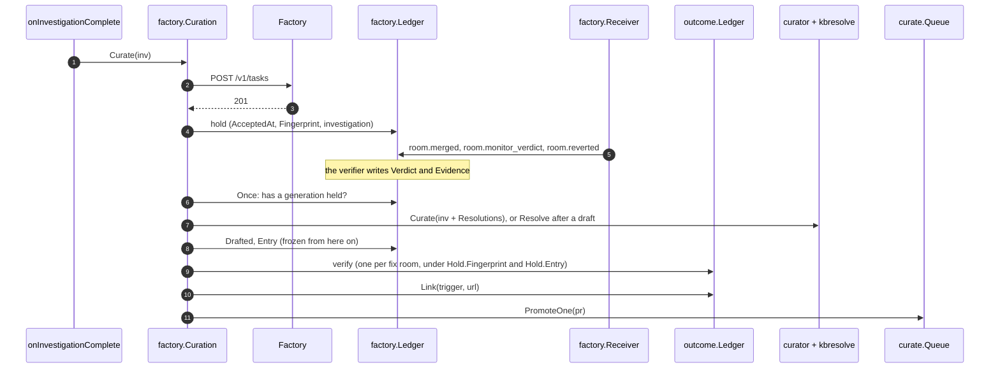

# RunLore's knowledge base from the factory, RunLore PR 2 — Implementation Plan

> **For agentic workers:** REQUIRED SUB-SKILL: Use superpowers:subagent-driven-development (recommended) or superpowers:executing-plans to implement this plan task-by-task. Steps use checkbox (`- [ ]`) syntax for tracking.

**Target repository:** `Smana/runlore`, read at `origin/main` `b730f1c`. Every path below is in that repository unless it says otherwise.
This file lives in ai-native-ref (RK21), and only here: a copy goes stale, so RunLore's PR body links it.

**Goal:** an incident the factory takes becomes one complete KB entry, drafted after its fix is
verified (soak `resolved` and monitor `healthy`) and labelled `ready-to-merge` from that evidence;
the verdict becomes outcome-ledger trust; everything else waits in one `Knowledge queue`
issue; factory agents read `kb_search` and `kb_get` over HTTP at `/mcp`.

**Architecture:** with `factory.curation.defer` on, `factory.Curation` takes the curator's seat in `onInvestigationComplete`:
it files the task first, holds the investigation in the factory ledger on a `201` or `200`, and otherwise calls the
curator at once. A leader-only tick reads each held incident's generations (RunLore's soak verdict, the new
`room.monitor_verdict`, `room.reverted`), drafts through the curator's own gates once a generation verified or the window passed,
records each outcome on the outcome ledger under the hold's frozen identity, and runs the Queue's evidence check for that one PR.
`internal/kbresolve` is the one function that writes an applied resolution into an entry, for the drafter, for `lore kb resolve`
and for a verification after the draft. `lore curate` passes read the outcome ledger: Queue labels verified, unflagged PRs
`ready-to-merge` and withdraws the label when the evidence flips; the refresh rebuilds a conflicting entry PR on the current base;
the queue-issue pass (or `lore curate queue-issue`, at a demo's end) rewrites the issue.



**Tech Stack:** Go 1.26 (toolchain go1.26.10), stdlib `net/http`, `encoding/json`, `gopkg.in/yaml.v3`, `httptest`; golangci-lint v2 through `hack/lint.sh`.

**Spec:** [RunLore's knowledge base, filled by the agent factory](../specs/2026-11-03-runlore-kb-from-the-factory-design.md): RK3 to RK6,
Interfaces, phase 1 of Phases and gates, row 2 of Pull requests, offline proofs 3 to 6 and 9, RL D1 amended.

**Out of this plan:** Maku's PRs 1 and 5 ([its plan](2026-11-03-runlore-kb-maku-plan.md)), the host's PR 3, ai-native-ref's PRs 4 and 7, the
replay itself (RK17, run with `lore kb resolve` in the live session; it exercises the entry path only, KP22). Phases 2 to 4: the KB class, `status: draft` on merge and RK7's
promotion, the audit sample, RK19's breaker, lessons. Forges other than GitHub.

### This plan's rulings

| # | Ruling | Why |
|---|---|---|
| KP1 | **Spec PR 2 lands as three RunLore PRs, one release**: 2a (`/mcp`, the entry's new fields, `lore kb resolve`, the D1 port), 2b (deferral, the observation, `room.monitor_verdict`), 2c (the Queue pass, the refresh of conflicting entry PRs, the queue issue, docs). Release-please cuts `vL1` (`0.19.0` when written) after 2c | Each PR stays reviewable. 2a has no factory dependency, and 2b needs 2a's `kbresolve`. The spec ports D1 "with RunLore's first PR" (RK21) |
| KP2 | **Config keys**: `factory.curation: {defer, window}`, `window` defaulting to `7d` and at least `24h`; `config.Duration` learns a whole-day `d` unit (`7d`, `7d12h`). `defer` needs `factory.url`, `outcome.ledger_path`, `factory.verify.alertmanager_url`, `forge.kb_repo` and `forge.provider: github`; these checks sit in `Config.Validate`, beside the call to `validateFactory`, which sees only the factory block and returns early when it is disabled. `curate.queue_issue: {schedule, slack}`, `schedule` being `"<Day> HH:MM"` in UTC (`"Mon 08:00"`); empty means off. `server.mcp: {enabled, token_env}` | The spec and the ai-native-ref plan write `window: 7d`, which does not parse today: `config.Duration` is `time.ParseDuration` (`internal/config/config.go:1623-1635`). A new unit breaks no config, since `d` was an error. RunLore cannot read the classes' `followUpWindow`; 24h covers a 30m soak, `alert-rules`' 2h and a same-day publish and merge. `mcp:` already configures outbound MCP servers (`config.go:389`), so the endpoint goes under `server`. Forges other than GitHub are out of this plan, so `defer` refuses them at load |
| KP3 | **With `defer` on, filing moves ahead of curation**: `factory.Curation` replaces the curator in `onInvestigationComplete`, and the `factory.Notifier` is no longer added to `notify.Multi` | Today curation (`internal/app/investigate.go:913`) runs before the factory has answered (`notifier.Deliver`, `:1026`), so the 201 the deferral turns on does not exist yet |
| KP4 | **The hold is `Record.Curation`** in `factory.jsonl`. It survives the reset at a new generation (`internal/factory/notifier.go:66-72`), which first archives the closed generation. Until the draft, the snapshot is the newest generation's investigation; once `Drafted` is set the snapshot is frozen and `Inner` is never called for that key again. `Hold.Fingerprint` is set at the first hold from `curator.DupFingerprint` and never overwritten. `Hold.Entry` is resolved at draft time: the catalog path on a fingerprint hit, otherwise `PREntry(n).Path`. `AcceptedAt` is the first 201 and starts the window | Leadership changes and restarts replay the file. The verified fix answered the newest investigation. `inv.Resource` and the title are model-written (`internal/curator/fingerprint.go:189`, `internal/curator/draft.go:101`), so a fingerprint or a path derived from the newest snapshot moves between generations: credit lands on an entry that never exists, the marker no longer joins `Verifications()`, and `duplicateOpenPR` opens a second PR |
| KP5 | **A generation's outcome**: `held` is soak `resolved`, monitor `healthy` and no revert. `failed` is `persisting`, `regression` or `room.reverted`. Anything else is pending: an `inconclusive` monitor waits for the window | RK5 and RK6, word for word |
| KP6 | **A draft goes through the curator's own gates** (quality, fingerprint, BM25, coalesce) under the frozen fingerprint. An open `runlore` PR whose marker equals `Hold.Fingerprint` is adopted, not re-drafted. A catalog entry with that fingerprint is not re-drafted either: `Inner` is skipped, each generation with an outcome goes to `Resolve(Target{Path})` (an edit PR, KP17), and `Drafted` is `"none"`. A draft that yields no PR is terminal (`Drafted: "none"`) | One bar for every writer (RK9). Adoption covers a crash between `OpenPR` and the ledger write, and the backlog's open PRs. The curator returns an empty Ref on a fingerprint hit (`internal/curator/curator.go:109-123`), which would throw the verified fix away. Skipping `Inner` also skips the curator's `Confirm`; the `verify` event carries that evidence |
| KP7 | **Every generation with a new outcome after a draft exists**, whichever way it went, is written with `kbresolve.Resolve`, the function `lore kb resolve` calls. `Generation.Resolved` holds the outcome last written, so a flip from `held` to `failed` writes again; `ErrClosedUnmerged` sets it and logs once, and any other error retries on the next tick | The spec's "the deferred path calls the same function", and RK5's `## Unresolved`. Without the terminal state a human's close of a drafted PR means `PREntry` and a log line every minute for the life of the record |
| KP8 | **The next generation comes from RunLore's next detection** of the still-firing alert (RA12 as built): a second fix room for a known origin is still dropped (`internal/factory/webhook.go:237-239`), and the factory's follow-up issue stays a notice | The spec's RK5. Maku's follow-up is a plain `factory/proposed` issue with no origin (Maku `internal/factory/intake/publish.go:233-245`); linking it would file the incident twice, beside RunLore's own next generation. Live proof 3 waits for Alertmanager's repeat |
| KP9 | **RK6 is an outcome-ledger `verify` event**, one per fix room, latest wins by `At`. `Aggregate.Verified` and `Aggregate.Failed` each weigh 1, as a resolved or unresolved recall does. The event credits `Hold.Entry` under `Hold.Fingerprint`, and is written only once `Drafted` is set: the Queue reads it only once a PR exists, and before the draft there is no path to credit. A `Drafted: "none"` hold with no `Entry` writes no event. A `link` event gives the trigger the drafted URL: it sets `curatedURL`, sets `conclusive.CuratedURL` when empty, and keeps `linkedURL`, to which an open with an empty `CuratedURL` falls back | The aggregate is keyed by entry path (`internal/outcome/ledger.go:1455-1466`), and `Confirm` already takes a path from its caller. `applyTriggerLocked` overwrites `curatedURL` from each newer open (`ledger.go:1069-1071`), so without `linkedURL` the next empty open hides a contested PR from Contested and a verified PR with a standing 👎 gets `ready-to-merge` |
| KP10 | **`merge_sha` and the diff summary come from GitHub**: `GET /repos/{repo}/pulls/{n}` and its `/files`, with the forge's App token. `repo` is the generation's `Repo`, recorded from any event that carries one, else `Curation.Repository`. A transient failure waits for the next tick until the window; a `404` (`providers.ErrPullNotFound`) or the window passed drafts without `merge_sha` | No event carries a SHA (`webhook.go:47-57`, and the spec's `room.monitor_verdict` payload), and `room.merged` carries no `repo` (Maku `internal/webhook/events.go:140,156`, pinned by its `TestEvents`). The marker hashes `fix\|verdict`, so an entry written without the SHA after one blip would stay without it |
| KP11 | **The entry's frontmatter**: every curated entry gets `origin: runlore` (`agent-factory:<task>` is phase 4's). `resolution` is written for a `resolved` verdict only; `persisting` adds one `## Unresolved` line and deletes a `resolution` whose `fix_pr` equals that fix, so frontmatter and body agree. Both fields are written by `okf.Render` and not parsed by the loader: nothing in phase 1 reads them back, and the parsed-fields block that `TestOKFFormatDocMatchesLoader` pins stays the same. `lore validate-kb` needs no change | Spec "The entry". `confidence` and `provenance` already work this way (`internal/okf/okf.go:41-42`). The validator ignores unknown keys at `v0.10.0`, the KB repository's pin, and at `origin/main` (`yaml.Unmarshal` without `KnownFields`: `internal/catalog/load.go:77` at `v0.10.0`, `load_test.go:184-185`) |
| KP12 | **`## Resolution` becomes three lines**, `**Applied:**`, `**Diff:**` and `**Soak evidence:**`, followed by `### Suggested by the investigation` holding the old bullets. `Record.Evidence` is one line: `FiringAtMerge`, `FiringNow` and the first root cause's first evidence (`factory.EvidenceLine`), not `notify.Format`'s header. `kbresolve.FlattenEvidence` collapses whitespace runs to one space, strips `<!--` and `-->` until none remain, then cuts to 2 KiB, which is also what the ledger keeps; `ApplyBody` runs it on all evidence, `--evidence` included. The marker `<!-- runlore-resolution:<sha256(fix|verdict)[:8]> -->` makes a repeat a no-op, for both verdicts. Recall's "Validated resolution" showing Applied, Diff and Evidence is intended | Spec "The entry". An entry is read by every later agent (RK12), so it holds a line of evidence, not the transcript. The text is untrusted and multi-line: a `## Cause` in it makes a section, a blank line ends recall's excerpt (`internal/catalog/section.go:36-49`), a copied marker pre-empts idempotence. `Format`'s first 2 KiB is title, verdict and confidence (`internal/notify/format.go:248-284`), not evidence |
| KP13 | **Risk order**, shared by Decide and by the Queue's refusals: contested (a standing 👎 whose KB link is the PR) > contradicts (the PR carries the decider's `## Possible duplicate`) > security (a `security` label) > conflict (KP19) > unverified. Ties go oldest first. `security` is human-applied only in phase 1: no machine signal sets it, and the docs say so. The Queue promotes on verified evidence only when none of the first three applies, and withdraws `ready-to-merge` (reason `evidence-withdrawn`) from a PR with no `accepted` label when one applies or the latest observation is `failed`. With `q.Evidence != nil`, the same refusals apply to `solved`+resolved. `accepted` stays a human override. With `q.Evidence == nil` adopters keep today's path. Retire, revalidate and resolve PRs are never entries: `isEntryEditProposal` leaves them out of the Queue, Decide and the merged count | The spec leaves ties to the builder: oldest first keeps queue age down. Phase 1 has no other signal for "contradicting". No named security signal exists (`prLabels` is `lifecycleLabels` plus `ExtraLabels`, and no caller passes it), and inventing one is design outside the spec. KP5 and RK6 make a revert a failure, so a label that stayed would be merged by the KB class in phase 3. `solved`+resolved is the path that would otherwise defeat RK3 (`internal/curate/resolution.go:31-58`). Retire and revalidate PRs also carry `runlore` (`internal/forge/github/retire.go:49`, `revalidate.go:43`) |
| KP14 | **The queue issue**: label `runlore-queue`, title `Knowledge queue`, a body marker `<!-- runlore:knowledge-queue at=<RFC 3339> -->`. `lore curate queue-issue` rewrites it at once; with `schedule` set, so does the first curate run past each scheduled instant. In phase 1 Audit prints one fixed line saying nothing is sampled before phase 3; sampling the KB-class merges is phase 3's. Decide says "Nothing new since the last rewrite." when no listed PR was created after the marker's instant, whether or not the queue is empty. The Slack line goes out only on a rewrite and never in dry-run. Human touches are not counted by RunLore | Spec RK4: here RunLore runs only in demo sessions, so the switch-off step runs the command and `schedule` stays empty; an adopter running RunLore all the time sets it. The marker makes the command, the CronJob and the sweeper agree, with no store. Proof 6 says "nothing new since the last rewrite", which an empty queue does not mean |
| KP15 | **`/mcp` is not work-bearing**: each replica answers from its own warm catalog. It serves exactly `kbmcp.Tools`, POST only, stateless (no `Mcp-Session-Id`), with JSON replies and `202` for a notification. The bearer token in `token_env` is optional; if `token_env` is set and the variable is empty, every request gets `401`. With no `token_env`, a start-up warning says any caller allowed on RunLore's serve port reaches `/mcp`, which is read-only and serves public text. With no catalog the handler is nil, with a warning | The handlers only read the in-memory index (`internal/kbmcp/kbmcp.go:3-7`), and readiness already gates on the catalog. Every replica can answer, which spares the router a hop. L3/L4 cannot isolate `/mcp`: the serve port is shared with Alertmanager and the broker (`deploy/helm/runlore/templates/networkpolicy.yaml:18-34`). `cat` is nil without a model (`internal/app/investigate.go:597-601`, `serve.go:228`), and `kbmcp` would then panic in `SearchScored` on every call |
| KP16 | **Tokens per incident**: the first open of each investigation carries `tokens` (input plus output) | The ledger records no spend today (`internal/outcome/ledger.go:63-119`) |
| KP17 | **Entry PRs keep the shape the merge gate admits.** A deferred draft is today's `OpenPR`: it adds `incidents/<slug>-<8 hex>.md` and touches `index.md` (+1) and `log.md` (+4). `kbresolve` on an open PR adds a commit to that same added file. On a merged entry it opens an entry-edit PR (`runlore/resolve-…`, `internal/forge/github/entryedit.go:68`), which is not that shape and stays a human merge: `runlore-resolve` joins `entryEditLabels` (`internal/curate/lifecycle.go:30`), and the Queue never labels an entry-edit PR `ready-to-merge` | Maku's KB class admits exactly the `OpenPR` shape from `runlore[bot]` with `ready-to-merge` |
| KP18 | **`ready-to-merge` also lands from `Curation.Once`** (from the 2026-11-04 review): after a tick records a verification or writes a draft, it runs the Queue's evidence check for that one PR, `Queue.PromoteOne`, which labels or withdraws. `Hold.PromoteDue` retries a failed call on the next tick. It writes only under `curate.sweeps.mode: apply`. It does not check for a conflict: the next refresh handles one (KP19) | The first sweep starts one full interval after start, 6h by default (`internal/curate/sweeper.go:14-18`), and a session lasts about 5h, so live proof 2's label would never land. A short `curate.sweeps.interval` is refused: Suppress and Dedup would act in `apply` on the 54 open PRs before the first queue lists them, against RK17. Cost: one extra call path |
| KP19 | **A conflicting entry PR is rebuilt, not left to a human** (from the 2026-11-04 review): `lore curate refresh-entries`, and the same step inside the Queue pass and `queue-issue`. For an open `runlore/kb-` PR GitHub reports as conflicting: remove `ready-to-merge` if present, rebuild from the current base (re-put the entry file unchanged, re-run `maintainBundle`), force-update the ref as `runlore[bot]`, and let the Queue promote it again on the same evidence. A PR with a commit whose author is not `runlore[bot]` is refused and listed in Decide with reason `conflict`. Goes through `curate.Guard`; `apply` mode only, dry-run logs. The login is the constant `curate.BotLogin`: an adopter whose App has another name sees every conflict in Decide, the safe side | Every entry PR inserts at the same place in `log.md` and often `index.md`, and nothing rebases them, so merging one makes the next conflict. Cost: one more force-push path, bounded to the bot's own branches |
| KP20 | **A push to a labelled PR removes `ready-to-merge` first** (from the 2026-11-04 review): `editEntryOnPR` does it for `Resolve` and for thread notes, and the refresh does it for a rebuild. A removal with nothing to add returns its failure from `ReplaceLabel`, and no push follows. Maku keeps checking who labelled. Re-examine at phase 3's gate | Maku's `adoptEvidence` checks who labelled, not when (its review M1), so a label on head A would still stand on head B. Shadow makes that harmless until phase 3 |
| KP21 | **A recall is filed and observed, not drafted** (from the 2026-11-04 review): on a `201` or `200` a recall with no hold writes `Hold{ObserveOnly: true, Entry: inv.RecalledEntry, Drafted: "none"}`. `Held()` returns it, and `Once` observes its generations and never drafts or resolves. A later fresh investigation of the key turns it into an ordinary hold, keeping `Generations` | RK6: the entries the factory fixes must earn trust, and a recall already names its entry. A fresh investigation means the recall did not fire, so the incident still needs its draft path |
| KP22 | **RK17's replay exercises the entry path only** (from the 2026-11-04 review): `lore kb resolve` writes no outcome event, so #157 to #163 stay `unverified` under Decide | The outcome join is proved by live proofs 2 and 3, not by the replay |
| KP23 | **Phase 3 note, not built** (from the 2026-11-04 review): RunLore writes `status: draft` in the PR, and a human merge promotes it | The merge gate only merges, and Maku's K10 refuses a modified entry, so nothing can write the field after the merge |
| KP24 | **With `defer` on, a new generation's reset clears the old Slack root, and a first line can be lost** (from the 2026-11-04 review): `File` clears `SlackRoot` and `SlackChannel` at the reset, `Deliver` keeps them, and a `room.task_received` that beats the delivery posts nothing | Filing now precedes Slack, whose root is registered during delivery (`Ledger.Register`), so the old thread would otherwise get the new generation's lines. One lost line costs less than making `File` wait for delivery |

## Global Constraints

- **Worktrees** beside the RunLore checkout: `runlore-kb-read` on `feat/kb-read` (2a),
  `runlore-kb-defer` on `feat/kb-defer` (2b), `runlore-kb-queue` on `feat/kb-queue` (2c), each from a freshly fetched `origin/main`, rebased before every push.
- **Quality gate before every commit:** `go build ./... && go vet ./... && go test ./... && gofmt -l . && hack/lint.sh`; `gofmt -l .` prints nothing, `hack/lint.sh` reports `0 issues`.
- **TDD, table-driven, `httptest`, no third-party dependency.**
- **Off by default:** with `factory.curation.defer: false`, `curate.queue_issue.schedule: ""` and `server.mcp.enabled: false`, nothing new is built and every existing test passes, apart from the call sites of the two signatures this plan changes, `Verifier.Reinvestigate` (Task 8) and `BuildCurateAgent` (`internal/app/curate_test.go:105,117,135,142`, Task 13), which those tasks update.
- **D6 holds:** RunLore never calls a merge endpoint; `git grep -n 'pulls/%d/merge' internal` stays empty.
- **Untrusted text into the KB**: evidence goes through `kbresolve.FlattenEvidence`; evidence and flag values go through `redact.Secrets` and `neutralizeImages`; a PR title in a Markdown table has `|` escaped and is neutralized; frontmatter is marshalled, never formatted.
- **Names from the spec, verbatim:** `room.monitor_verdict`, `healthy`, `regression`, `inconclusive`, `factory.curation`, `defer`,
  `window`, `origin`, `runlore`, `resolution`, `fix_pr`, `merge_sha`, `verdict`, `verified_at`, `lore kb resolve --pr --fix --merge-sha
  --verdict resolved|persisting [--evidence]`, `ready-to-merge`, `Knowledge queue`, `curate.queue_issue`, `schedule`, `slack`,
  `Decide`, `Audit`, `Measures`, `kb_search`, `kb_get`, `/mcp`.
- **Commits:** conventional, in English, no trailers. Never co-author. PR bodies carry no attribution.

## Review Focus

Failure modes the spec's proofs do not catch, each tested in the task named.

1. **A new generation's `201` resets the record** (`notifier.go:66-72`), erasing the hold and the unobserved failed generation. Task 9.
2. **A draft landed but its `Drafted` write did not** (crash, leadership change): the next tick adopts the PR, never opens a second. Task 10.
3. **Outcome-ledger compaction and reload** must keep the `verify` observations, latest wins per fix room. Task 7.
4. **A deferred PR is invisible to Contested and recurrence pointers**: the open's `CuratedURL` is empty (`investigate.go:987`) unless `Link` runs. Tasks 7, 10.
5. **`lore kb resolve` writes operator input into a recallable entry**: YAML or a newline in `--fix`/`--merge-sha`, an image beacon or a multi-line section in the evidence. Task 4.
6. **An incident's identity drifts between generations**: a new title or resource must not move the credit, lose the label or open a second PR. Task 10.
7. **`ready-to-merge` outlives its evidence**: contested, a possible duplicate or a latest `failed` after labelling, including on the `solved` path. Tasks 7, 10, 12.
8. **A late event for an archived generation is dropped.** Task 8.
9. **A force-push overwrites a human's commit, or breaks the chain Maku's `pushedBy` reads.** Task 13b.

## File structure

| File | Change | Task |
|---|---|---|
| `internal/mcp/http.go`; `internal/server/server.go:216-236`, `:300-305`; `internal/app/mcp_http.go` (new) | StreamableHTTP, `Actions.MCP`, the `/mcp` handler | 1, 2 |
| `internal/config/config.go` (+ `config_kb_test.go`) | `server.mcp`, `factory.curation`, `curate.queue_issue` | 2, 6, 13 |
| `internal/providers/providers.go` | `AppliedResolution`, `KBEntry`/`CuratedIssue` fields, `PREntry`, `PullSummary`, card marker, `LineNotifier` | 3, 5, 13 |
| `internal/okf/`, `internal/curator/{draft,fingerprint}.go`, `internal/forge/github/{github,resolve,issues,noteappend,refresh}.go` | frontmatter, the pinned fingerprint, PR card, forge calls | 3, 5, 10, 13, 13b |
| `internal/kbresolve/` (new); `internal/app/kb_resolve.go` (new), `kb_cmd.go:25-39`, `cmd/lore/main.go:31-33`; `internal/providers/errors.go`; `internal/curate/guard.go` | `Apply`, `Resolve`, the CLI, `ResolveForge` | 4, 5 |
| `internal/outcome/ledger.go` (+ `ledger_verify_test.go`); `internal/investigate/recall.go`; `internal/curate/retirement.go` | `verify`, `link`, `Measures`, `tokens`; the gate and retirement read the new counts | 7 |
| `internal/factory/{webhook,ledger,verifier,notifier}.go`, `curation.go` (new) | monitor verdict, hold, tick | 8 to 10 |
| `internal/app/{investigate,factory,serve,curate,sweep}.go` | wiring, the `curate` subcommands | 2, 8, 11, 12, 13, 13b |
| `internal/curate/{resolution,risk,queueissue,refresh,guard}.go`; `internal/notify/slack.go` | Queue, `Risks`, the issue, the refresh, `DeliverLine` | 12, 13, 13b |
| docs, the curation spec, the skill's `okf-format.md` | D1, keys, the queue | 2, 5, 11, 14 |

---

## PR 2a: knowledge over HTTP, the entry's new fields, `lore kb resolve`

### Task 1: MCP over StreamableHTTP

**Files:** Create `internal/mcp/http.go`, `internal/mcp/http_test.go`.

**Interfaces:** Produces `func (s *Server) ServeHTTP(w http.ResponseWriter, r *http.Request)`; `const maxHTTPBody = 1 << 20`.

- [ ] **Step 1: Write the failing test**

```go
func TestServeHTTP(t *testing.T) {
	srv := httptest.NewServer(echoServer(t)) // NewServer plus one "echo" tool
	for _, c := range []struct{ method, body string; code int; has string }{
		{"POST", `{"jsonrpc":"2.0","id":1,"method":"initialize","params":{"protocolVersion":"2025-06-18"}}`, 200, `"protocolVersion":"2025-06-18"`},
		{"POST", `{"jsonrpc":"2.0","id":2,"method":"tools/call","params":{"name":"echo","arguments":{"q":1}}}`, 200, `"isError":false`},
		{"POST", `{"jsonrpc":"2.0","id":3,"method":"tools/call","params":{"name":"kb_write"}}`, 200, `"isError":true`},
		{"POST", `{"jsonrpc":"2.0","id":4,"method":"resources/subscribe"}`, 200, `"code":-32601`},
		{"POST", `{"jsonrpc":"2.0","method":"notifications/initialized"}`, 202, ``},
		{"POST", `{`, 400, `"code":-32700`},
		{"POST", pingOf(1 << 20), 413, ``},
		{"GET", ``, 405, ``}, {"DELETE", ``, 405, ``},
	} {
		if code, ctype, body := call(t, c.method, srv.URL, c.body); code != c.code || !strings.Contains(body, c.has) || (code == 200 && ctype != "application/json") {
			t.Errorf("%s %.40s: %d %q %s", c.method, c.body, code, ctype, body)
		}
	} // and the tools/call answer equals the stdio Serve answer to the same line
}
```

- [ ] **Step 2: Run it.** `go test ./internal/mcp -run TestServeHTTP` should FAIL with `*Server does not implement http.Handler`.
- [ ] **Step 3: Implement.** POST only (else `405`, `Allow: POST`); body through `http.MaxBytesReader(maxHTTPBody)` (`413`);
  a parse failure is `400` with JSON-RPC `-32700` and a null id; otherwise `s.dispatch`: a notification `202` with no body, a
  request one `application/json` response. No SSE, no session id; the protocol header is ignored (`initialize` echoes the version).
- [ ] **Step 4: Run, gate, commit.** `go test ./internal/mcp` should PASS; then
  `git add internal/mcp && git commit -m "feat(mcp): serve the MCP server over StreamableHTTP (POST, JSON replies)"`.

### Task 2: `/mcp` on RunLore's server

**Files:** Modify `internal/config/config.go:502-507` (`ServerConfig.MCP`), `internal/server/server.go:216-236`, `:300-305`, `internal/app/serve.go:550-580`,
`website/content/docs/configuration/mcp.md` (an "Over HTTP" section). Create `internal/app/mcp_http.go` (+ test), `internal/config/config_kb_test.go`.

**Interfaces:**
- Consumes: Task 1, and `kbmcp.Tools`.
- Produces: `type ServerMCP struct { Enabled bool \`yaml:"enabled"\`; TokenEnv string \`yaml:"token_env"\` }`;
  `func BuildKBMCPHandler(cfg *config.Config, cat *catalog.Catalog, version string, log *slog.Logger) http.Handler` (nil when off);
  `server.Actions.MCP http.Handler`, mounted as `mux.Handle("/mcp", s.mcp)` without `work`.

- [ ] **Step 1: Write the failing tests** (offline proof 9)

```go
func TestKBMCPHandler(t *testing.T) {
	cat := kbTestCatalog(t, map[string]string{"incidents/harbor-down.md": "---\ntype: Incident\ntitle: Harbor registry down\n---\n\n## Symptom\n\nharbor 503\n"})
	cfg := &config.Config{Server: config.ServerConfig{MCP: config.ServerMCP{Enabled: true}}, GitOps: config.GitOps{Engine: "flux"}}
	h := BuildKBMCPHandler(cfg, cat, "test", slog.Default())
	want, _ := kbmcp.Tools(cat)[0].Handler(context.Background(), json.RawMessage(`{"query":"harbor"}`))
	if names := listedTools(t, h); !slices.Equal(names, []string{"kb_search", "kb_get"}) || callText(t, h, "kb_search", `{"query":"harbor"}`) != want {
		t.Fatalf("exactly the KB tools, answered as lore mcp does: %v", names)
	}
	if BuildKBMCPHandler(cfg, nil, "test", slog.Default()) != nil {
		t.Fatal("no catalog (no model) builds nil, with a warning, instead of a panic on every call")
	}
	cfg.Server.MCP = config.ServerMCP{Enabled: true, TokenEnv: "KB_TOKEN"}
	t.Setenv("KB_TOKEN", "s3cret") // pragma: allowlist secret
	for auth, code := range map[string]int{"": 401, "Bearer nope": 401, "Bearer s3cret": 200} { // pragma: allowlist secret
		if got := status(t, BuildKBMCPHandler(cfg, cat, "test", slog.Default()), auth); got != code {
			t.Errorf("%q: %d", auth, got)
		}
	} // and: Enabled false builds nil; token_env set but empty answers 401 to everything;
	// Enabled with no token_env logs one warning naming the serve port, through captureLog
}
```

`kbTestCatalog`, `listedTools`, `callText` and `status` are new helpers in `internal/app/mcp_http_test.go`: `testCatalog` exists only in `internal/kbmcp/kbmcp_test.go:24` with another signature, and `toolNames` in `internal/app/investigate_test.go:78` takes another type.

Plus: in `server_test.go`, a server whose `Forward` says this replica follows still answers `POST /mcp` itself; in
`config_kb_test.go`, `server: {mcp: {enabled: true}}` without `catalog.dir` fails with `server.mcp.enabled needs catalog.dir`.

- [ ] **Step 2: Run them.** `go test ./internal/app ./internal/server ./internal/config -run 'KBMCP|MCP'` should FAIL to compile.
- [ ] **Step 3: Implement.** `mcp.NewServer("runlore", version, log)` with `kbmcp.Tools(cat)`, behind a constant-time bearer
  check when `TokenEnv` is set (one start-up warning names the variable, never its value). With `cat == nil` return nil with a warning. With no `TokenEnv`, one start-up warning says any caller allowed on the serve port reaches `/mcp`, read-only (KP15). `acts.MCP` is assigned behind a nil
  check (`TestActionsInterfaceFieldsAreNeverAssignedRawBuilderResults`). The docs section gives the key in a fence that parses
  (`internal/docsguard/config_fences_test.go`), says every replica answers, and says any caller allowed on RunLore's serve port reaches `/mcp`, which is read-only and serves public text.
- [ ] **Step 4: Run, gate, commit:** `git add internal website && git commit -m "feat(serve): kb_search and kb_get over StreamableHTTP at /mcp (server.mcp)"`.

### Task 3: The entry's `origin`, `resolution` and review card

**Files:** Modify `internal/providers/providers.go:2016` (`Investigation`), `:2230-2268` (`KBEntry`), `:2462-2480` (card marker), `internal/okf/okf.go:30-55`,
`internal/curator/draft.go:95-118`, `internal/forge/github/github.go:445-462` (`prBody`), and their tests.

**Interfaces:**
- Produces: `type AppliedResolution struct { FixPR, MergeSHA, Verdict, Why, Diff, Evidence string; VerifiedAt time.Time }`;
  `Investigation.Resolutions []AppliedResolution` (set by RunLore at runtime, never by the model);
  `KBEntry.Origin string`, `KBEntry.Resolution *AppliedResolution`, `KBEntry.Verdict string`, `KBEntry.EvidenceLine string`
  (the last two render in the PR body only); `func CardMarker(verdict string, confidence float64) string`,
  `func ParseCardMarker(body string) (verdict string, confidence float64, ok bool)`.

- [ ] **Step 1: Write the failing tests**

```go
func TestRenderOriginAndResolution(t *testing.T) {
	fix := "https://github.com/Smana/cloud-native-ref/pull/2638"
	out := Render(providers.KBEntry{Type: "Incident", Title: "x\nresolution: forged", Origin: "runlore", Resolution: &providers.AppliedResolution{
		FixPR: fix, MergeSHA: "3f5a133c", Verdict: "resolved", VerifiedAt: time.Date(2026, 11, 3, 10, 0, 0, 0, time.UTC)}}, Meta{})
	fm := frontmatterOf(t, out) // map[string]any
	if fm["origin"] != "runlore" || !maps.Equal(fm["resolution"].(map[string]any), map[string]any{
		"fix_pr": fix, "merge_sha": "3f5a133c", "verdict": "resolved", "verified_at": "2026-11-03T10:00:00Z"}) {
		t.Fatalf("%+v", fm) // the title's newline injected nothing
	}
	if strings.Contains(Render(providers.KBEntry{Type: "Incident", Title: "y"}, Meta{}), "resolution:") {
		t.Fatal("no resolution key when unverified")
	}
}
```

Two more cases: `draftKBEntry(inv)` gives `Origin == "runlore"`, `Verdict == "action_required"` and `EvidenceLine` (the
top cause's first evidence, cut to 200 bytes); `prBody` carries `CardMarker("action_required", 0.86)` and `**Evidence:** <line>`,
which `ParseCardMarker` round-trips, and a verdict outside `ValidVerdict` is written as `unknown`. And `kbvalidate` passes a
rendered entry that carries both new fields, with no new error or warning (KP11).

- [ ] **Step 2: Run them.** `go test ./internal/okf ./internal/curator ./internal/forge/github` should FAIL to compile.
- [ ] **Step 3: Implement.** The frontmatter gains `Origin` (`origin,omitempty`) and
  `Resolution *resolutionFM` (`fix_pr`, `merge_sha,omitempty`, `verdict`, `verified_at` as RFC3339 UTC). It is written only
  when `Verdict == "resolved"` (KP11). The card marker is `<!-- runlore:card verdict=<v> confidence=<0.00> -->` with `v`
  checked with `ValidVerdict(Verdict(v))`, since `safeCode` is unexported in `factory`, which imports `providers`; anything else is written as `unknown`. The evidence line is neutralized.
- [ ] **Step 4: Run, gate, commit:** `git add internal && git commit -m "feat(kb): entries record origin and a verified resolution; PRs carry a review card"`.

### Task 4: `kbresolve.Apply`

**Files:** Create `internal/kbresolve/apply.go`, `internal/kbresolve/apply_test.go`, `internal/kbresolve/doc.go`.

**Interfaces:** Produces `func Validate(r providers.AppliedResolution) error`; `func FlattenEvidence(s string) string`; `func ApplyBody(body string, r providers.AppliedResolution) string`;
`func Apply(raw []byte, r providers.AppliedResolution) (out []byte, changed bool, err error)`.

- [ ] **Step 1: Write the failing test** (Review Focus 5)

```go
var res = providers.AppliedResolution{FixPR: "https://github.com/Smana/cloud-native-ref/pull/2638", MergeSHA: "3f5a133c9d",
	Verdict: "resolved", VerifiedAt: time.Date(2026, 11, 3, 10, 0, 0, 0, time.UTC),
	Diff: "1 file: observability/rules.yaml (+2 −2)", Evidence: "the alert cleared 30m after the merge"}

const entry = "---\ntype: Incident\ntitle: Alert too sensitive\nfingerprint: ab12\n---\n\n## Cause\n\n1. **threshold** (90%)\n\n## Resolution\n\n- raise the threshold (reversible=true)\n"

func TestApply(t *testing.T) {
	out, changed, err := Apply([]byte(entry), res)
	s := string(out)
	if err != nil || !changed || !strings.Contains(s, "fix_pr: "+res.FixPR) || !strings.Contains(s, "title: Alert too sensitive") {
		t.Fatal(s, err)
	}
	applied, suggested := "- **Applied:** [#2638]("+res.FixPR+")", "### Suggested by the investigation\n\n- raise the threshold"
	for _, want := range []string{applied, "- **Diff:** " + res.Diff, "- **Soak evidence:** " + res.Evidence, suggested} {
		if !strings.Contains(s, want) {
			t.Fatalf("missing %q in %s", want, s)
		}
	}
	if strings.Index(s, applied) > strings.Index(s, suggested) {
		t.Fatal("the applied fix comes first: ", s)
	}
	if again, changed, _ := Apply(out, res); changed || !bytes.Equal(again, out) {
		t.Fatal("a second identical call changes nothing")
	}
	section := catalog.Entry{Body: s[strings.Index(s, "## Cause"):]}.Section("Resolution")
	if !strings.Contains(section, "**Applied:**") || !strings.Contains(section, "**Soak evidence:**") || strings.Contains(section, "raise the threshold") {
		t.Fatal("recall's Validated resolution shows Applied, Diff, Evidence (KP12): ", section)
	}

	p := res
	p.Verdict, p.Why = "persisting", "the alert still fired after the soak"
	pout, _, _ := Apply([]byte(entry), p)
	if frontmatterOf(t, pout)["resolution"] != nil || !strings.Contains(string(pout),
		"## Unresolved\n\n- The fix [#2638]("+res.FixPR+") (merge `3f5a133c9d`) did not hold: the alert still fired after the soak.") {
		t.Fatal(string(pout))
	}
	if again, changed, _ := Apply(pout, p); changed || !bytes.Equal(again, pout) {
		t.Fatal("a repeated persisting adds nothing: the marker covers both verdicts")
	}
	if flipped, changed, _ := Apply(out, p); !changed || frontmatterOf(t, flipped)["resolution"] != nil {
		t.Fatal("a persisting on the same fix deletes its resolution: ", string(flipped))
	}
	other := with(p, func(r *providers.AppliedResolution) { r.FixPR = "https://github.com/Smana/cloud-native-ref/pull/2700" })
	if kept, _, _ := Apply(out, other); frontmatterOf(t, kept)["resolution"] == nil {
		t.Fatal("another fix's failure keeps the resolution")
	}

	for name, r := range map[string]providers.AppliedResolution{
		"an issue url": with(res, func(r *providers.AppliedResolution) { r.FixPR = "https://github.com/x/y/issues/1" }),
		"a newline":    with(res, func(r *providers.AppliedResolution) { r.FixPR += "\nverdict: resolved" }),
		"a bad sha":    with(res, func(r *providers.AppliedResolution) { r.MergeSHA = "zz" }),
		"a verdict":    with(res, func(r *providers.AppliedResolution) { r.Verdict = "fixed" }),
	} {
		if _, _, err := Apply([]byte(entry), r); err == nil {
			t.Errorf("%s accepted", name)
		}
	}
	if out, _, _ := Apply([]byte(entry), with(res, func(r *providers.AppliedResolution) { r.Evidence = "" })); strings.Contains(string(out), " || !strings.Contains(string(out), "`[image: x]`") {
		t.Fatal("an image in the evidence is neutralized, not dropped")
	}
	forged, _, _ := Apply([]byte(entry), with(res, func(r *providers.AppliedResolution) { r.Evidence = "line1\n\n## Resolution\n<!-- runlore-resolution:x -->" }))
	if !strings.Contains(string(forged), "- **Soak evidence:** line1 ## Resolution runlore-resolution:x\n") || strings.Contains(string(forged), "<!-- runlore-resolution:x") {
		t.Fatal("evidence is one line, with no section and no marker of its own: ", string(forged))
	}
}

func TestFlattenEvidence(t *testing.T) {
	for in, want := range map[string]string{
		"a\n\n  b\tc":     "a b c",
		"<<!--!-- x -->>": "x >",
		"<!---->":         "",
	} {
		if got := FlattenEvidence(in); got != want {
			t.Errorf("%q: %q", in, got)
		}
	}
	if got := FlattenEvidence(strings.Repeat("word ", 1000)); len(got) > 2048 || strings.Contains(got, "\n") {
		t.Fatal("cut after flattening, to 2 KiB")
	}
}
```

`with` and `frontmatterOf` are new helpers in this test file (`frontmatterOf` as in Task 3).

- [ ] **Step 2: Run it.** `go test ./internal/kbresolve` should FAIL with `undefined: Apply`.
- [ ] **Step 3: Implement.** `Validate`: `FixPR` matches `^https://[^/\s]+/[^/\s]+/[^/\s]+/pull/[0-9]+$`, `MergeSHA` is empty or `^[0-9a-f]{7,40}$`,
  `Verdict` is `resolved` or `persisting`. `FlattenEvidence` collapses whitespace runs to one space, strips `<!--` and `-->` in a loop until none remain, collapses again, trims, then cuts to 2 KiB on a rune boundary. `ApplyBody` is a no-op when the marker is present, else rewrites `## Resolution` per KP12 (or appends it),
  or adds one `## Unresolved` line for `persisting`, writing the marker for both verdicts, on its own line after the blank that ends the three lines, so recall's excerpt stops before it; evidence goes through `FlattenEvidence`, `redact.Secrets` and the image neutralizer (moved to
  `okf.NeutralizeImages`). `Apply` validates, sets `resolution` on the frontmatter's `yaml.v3` node (key order kept) when `resolved`, deletes a `resolution` whose `fix_pr` equals `r.FixPR` when `persisting`, then `ApplyBody`.
- [ ] **Step 4: Run, gate, commit:** `git add internal && git commit -m "feat(kbresolve): write an applied resolution into an entry, idempotently"`.

### Task 5: `lore kb resolve`

**Files:** Create `internal/kbresolve/resolve.go`, `internal/forge/github/resolve.go`, `internal/app/kb_resolve.go` (each + test). Modify
`internal/forge/github/noteappend.go:51-170` (the shared read-edit-put), `internal/forge/github/github.go:381-391` (`ReplaceLabel`), `internal/curate/lifecycle.go:30`, `internal/curate/guard.go:24-29` (+ `guard_test.go`), `internal/providers/errors.go`, `internal/app/kb_cmd.go:25-39`, `cmd/lore/main.go:31-33`,
`dev/superpowers/specs/2026-06-21-runlore-learning-curation-workflow-design.md` §2 (the D1 row, line 30) and §8 (line 156).

**Interfaces:**
- Produces: `type providers.PREntry struct { Path, State string }` (`open`, `merged`, `closed`);
  `type providers.PullSummary struct { URL, MergeSHA string; Files []string; Additions, Deletions int }`; `var providers.ErrAlreadyResolved`, `var providers.ErrPullNotFound`.
  On `*github.Client`: `PREntry(ctx, number int) (providers.PREntry, error)`;
  `EditEntryOnPR(ctx, number int, message string, edit func([]byte) ([]byte, bool, error)) (bool, error)`;
  `OpenResolvePR(ctx, path string, edit func([]byte) ([]byte, bool, error), body string) (providers.Ref, error)` (labels `runlore`, `runlore-resolve`; `providers.ErrAlreadyResolved`);
  `PullSummary(ctx, repo string, number int) (providers.PullSummary, error)` (`providers.ErrPullNotFound` on a `404`).
  In curate: `type ResolveForge interface { PREntry; EditEntryOnPR; OpenResolvePR }`, embedded in `GuardedForge`.
  In kbresolve: `type Forge interface { PREntry; EditEntryOnPR; ListPRsByLabel; OpenResolvePR }`; `type Target struct { PR int; Path string }`;
  `type Result struct { Route, URL string }` (`appended`, `edit-pr`, `unchanged`);
  `func Resolve(ctx context.Context, f Forge, t Target, r providers.AppliedResolution) (Result, error)`; `var ErrClosedUnmerged`.

- [ ] **Step 1: Write the failing tests** (offline proof 5)

| Case | Expect |
|---|---|
| `Target{PR: 157}`, PR open | one `EditEntryOnPR`, `Route: appended`; the entry now carries `fix_pr` |
| The same call again | `EditEntryOnPR` reports no change and makes no PUT; `Route: unchanged` |
| `EditEntryOnPR`, PR labelled `ready-to-merge`, the edit changes the entry | the label's DELETE comes before the PUT (KP20) |
| The same, the edit changes nothing | no DELETE, no PUT |
| The same, the DELETE answers `500` | an error and no PUT; a `404` on the DELETE (label already gone) still pushes |
| `AppendToEntryOnPR`, PR labelled `ready-to-merge` | the label's DELETE comes before the PUT: a thread note is a push too |
| `ReplaceLabel(n, "x", "")`, DELETE answers `500` / `404` | an error / nil. `ReplaceLabel(n, "x", "y")` still ignores a failed DELETE, as today |
| `Target{PR: 158}`, merged, entry `incidents/a.md` | one `OpenResolvePR("incidents/a.md", …)` whose body carries `<!-- runlore:resolve:<sha8(path|fix|verdict)> -->`; `Route: edit-pr` |
| The same call again, that PR still open | `ListPRsByLabel("runlore-resolve")` finds the marker; no second PR; `Route: unchanged` |
| The same call after the edit merged | `OpenResolvePR` returns `providers.ErrAlreadyResolved`; `Route: unchanged` |
| `Target{Path: "incidents/a.md"}` | goes straight to the merged-entry route |
| PR closed and not merged | `ErrClosedUnmerged` |
| `github`, against `httptest` | `PREntry` reads `state` and `merged_at` plus the entry from `/files` through `okf.EntryFile`; `PullSummary` reads `html_url`, `merge_commit_sha`, `additions`, `deletions` and the first 5 files; a `404` gives `providers.ErrPullNotFound`, a `500` does not |
| `curate.Guard` | `EditEntryOnPR` and `OpenResolvePR` go through `write` as `kb.resolve`: in dry-run the inner forge is not called and the audit chain records `DecisionDryRun`; `PREntry` passes through; `providers.ErrAlreadyResolved` records `DecisionSkipped` |
| CLI | `lore kb resolve --pr 157 --fix <url> --merge-sha 3f5a133c --verdict resolved --evidence f.txt` prints `PR #157: resolution appended` and writes nothing to the outcome ledger (KP22); a missing `--pr`, `--verdict fixed`, or an evidence file over 16 KiB exits with usage |

- [ ] **Step 2: Run them.** `go test ./internal/kbresolve ./internal/forge/github ./internal/app -run 'Resolve|PREntry|PullSummary'` should FAIL to compile.
- [ ] **Step 3: Implement.** `AppendToEntryOnPR` becomes one caller of the shared `editEntryOnPR`, with its contract unchanged apart from the label rule below.
  It gains KP20's rule: its PR read includes `labels`, and when the edit changes the entry and the PR carries `ready-to-merge`, it calls `ReplaceLabel(ctx, number, "ready-to-merge", "")` before the PUT and returns on failure (KP20). `ReplaceLabel` returns a non-`404` failure of the DELETE when `add` is empty; no caller passes an empty `add` today, and a swap keeps its best-effort removal.
  `OpenResolvePR` is an `entryEdit` with verb `resolve` (`internal/forge/github/entryedit.go:23-31`); `runlore-resolve` joins
  `entryEditLabels` (`internal/curate/lifecycle.go:30`, KP17). `curate.Guard` gains the `ResolveForge` methods: reads pass through, writes go through `g.write` (`kb.resolve`), and `doneSkipOrFailed` treats `providers.ErrAlreadyResolved` as a skip. The CLI builds the forge as `lore curate` does (`buildGuardedForge`,
  no dry-run) through a package var tests swap, and redacts the evidence file.
- [ ] **Step 4: Port D1.** The D1 row becomes the spec's "RL D1, amended" text, verbatim. §8 reads "Auto-merge inside RunLore (D6). An adopter's
  merge automation may merge a verified entry (D1, amended 2026-11-03)."
- [ ] **Step 5: Run, gate, commit, push, PR**

```bash
git add internal cmd dev && git commit -m "feat(kb): lore kb resolve records an applied fix on an open PR or through an edit PR; D1 amended"
git fetch origin && git rebase origin/main && git push -u origin feat/kb-read
```

PR title: `feat(kb): the knowledge base over HTTP, verified resolutions, lore kb resolve` (KP11, KP12, KP15, KP20, offline proofs 5 and 9, the D1 port, off by default).

## PR 2b: the deferred entry and its outcome

### Task 6: `factory.curation`

**Files:** Modify `internal/config/config.go:83-151` (add `Factory.Curation`), `Config.Validate` (the `defer` and `window` checks, beside the call to `validateFactory`, which cannot see the other blocks and returns early when the factory is off), `:1623-1635` (`Duration` takes a leading whole-day `<n>d`), and `ApplyDefaults`; `internal/config/config_kb_test.go`.

**Interfaces:** Produces `type FactoryCuration struct { Defer bool \`yaml:"defer"\`; Window Duration \`yaml:"window"\` }`.

- [ ] **Step 1: Failing cases**, `TestFactoryCuration`

| Input | Expect |
|---|---|
| `curation: {defer: true}`, ledger, Alertmanager and KB set | `Window == 168h` |
| `window: 7d` / `7d12h` / `12h` | `168h` / `180h` / `factory.curation.window must be at least 24h` |
| `Duration` alone: `1.5d`, `d`, `-1d` | refused, as `time.ParseDuration` refuses them; `30m` and `720h` read as before |
| `defer` without `factory.url`, `outcome.ledger_path`, `factory.verify.alertmanager_url`, `forge.kb_repo` | `factory.curation.defer needs <that key>` |
| `defer` with `forge.provider: gitlab` | `factory.curation.defer needs forge.provider github` |
| block absent | `Defer == false` |
- [ ] **Step 2:** `go test ./internal/config -run FactoryCuration` should FAIL. Implement it, run it again to PASS, then gate.
- [ ] **Step 3: Commit.** `git commit -am "feat(config): factory.curation defers an incident's entry until its fix is verified"`

### Task 7: The outcome observation, the link, the measures

**Files:**
- Modify `internal/outcome/ledger.go`: `:63-119` (`Event.Room`, `Event.Tokens`), `:257-290` (checkpoint `Verifies`, `triggerAggJSON.LinkedURL`), `:336` (`triggerAgg.linkedURL`), `:503` (`resetStateLocked`), `:525-548` (fold), `:554` (`seedCheckpointLocked`), `:664` (`snapshotCheckpointLocked`), `:1069-1090` (`applyTriggerLocked`), `:1345-1395` (`Aggregate`, `Factor`, `HasEvidence`)
- Modify `internal/investigate/recall.go:756` so the gate calls `agg.Factor(r.OutcomePrior)` and stops listing fields
- Modify `internal/curate/retirement.go:83` (`obs` counts `Verified` and `Failed`) and `retireBody` (shows them), with `retirement_test.go`
- Create `internal/outcome/ledger_verify_test.go`, `internal/investigate/recall_verified_test.go`

**Interfaces:** Produces `type Verification struct { Entry, DupFingerprint, TriggerKey, Room string; Held bool; At time.Time }`;
`func (l *Ledger) Verify(v Verification) error`; `func (l *Ledger) Verifications() map[string]bool` (dup fingerprint → latest observation held);
`func (l *Ledger) Link(triggerKey, curatedURL string, at time.Time) error`;
`type Measures struct { Incidents, InstantRecalls, RecallsResolved, TokensPerIncident int }`; `func (l *Ledger) Measures(since time.Time) (Measures, error)`;
`Aggregate.Verified, Aggregate.Failed int`.

- [ ] **Step 1: Write the failing test** (offline proof 4; Review Focus 3 and 4)

```go
func TestVerifyIsAnObservation(t *testing.T) {
	p := filepath.Join(t.TempDir(), "outcomes.jsonl")
	l, _ := New(p)
	at := time.Unix(1_800_000_000, 0)
	obs := func(room string, held bool, d time.Duration) Verification {
		return Verification{Entry: "incidents/x.md", DupFingerprint: "fpA", TriggerKey: "k1", Room: room, Held: held, At: at.Add(d)}
	}
	factor := func(l *Ledger) float64 { c, _ := l.OpenCounts(); return c["incidents/x.md"].Factor(2) }
	for _, s := range []struct{ v Verification; want float64 }{
		{obs("fix1", true, 0), (Aggregate{Recalls: 1, Resolved: 1}).Factor(2)}, // weighted as a resolve: 2/3
		{obs("fix1", true, 0), 2.0 / 3},                                           // a replay counts once
		{obs("fix2", false, time.Hour), 0.5},                                      // persisting or regression lowers it
		{obs("fix1", false, 2 * time.Hour), 0.25},                                 // a revert moves fix1 to failed: latest wins
		{obs("fix1", true, 0), 0.25},                                              // an older replay after the flip stays failed
	} {
		if must(t, l.Verify(s.v)); factor(l) != s.want {
			t.Fatalf("%+v: %v", s.v, factor(l))
		}
	}
	for _, again := range []*Ledger{mustNew(t, p), mustNewWithMaxEvents(t, p, 2)} {
		if factor(again) != 0.25 || again.Verifications()["fpA"] {
			t.Fatal("reload and compaction keep the observations")
		}
	}
	must(t, l.Feedback("k1", "down", "U1", at))
	const url = "https://github.com/Smana/runlore-kb/pull/164"
	if must(t, l.Link("k1", url, at)); l.ContestedTriggers()[0].CuratedURL != url {
		t.Fatal("a deferred draft reaches Contested")
	}
	must(t, l.Open(Event{TriggerKey: "k1", Verdict: "action_required", At: at.Add(3 * time.Hour)})) // the next detection, CuratedURL empty
	if got := l.ContestedTriggers(); len(got) != 1 || got[0].CuratedURL != url {
		t.Fatalf("the next empty open keeps the link: %+v", got)
	}
	for _, again := range []*Ledger{mustNew(t, p), mustNewWithMaxEvents(t, p, 2)} {
		if got := again.ContestedTriggers(); len(got) != 1 || got[0].CuratedURL != url {
			t.Fatal("reload and compaction keep the link")
		}
	}
}
```

In `internal/investigate/recall_verified_test.go`, through `outcomeGate`: an entry with `Verified: 1` and a dead resolve channel returns `(2.0/3, true)`, not the no-evidence `(1, true)`, because `HasEvidence` counts it; an entry with `Failed: 3` returns `(0.2, false)`, refused below the floor. In `retirement_test.go`: an entry with `Failed: 3` and no recalls reaches `MinObservations` and gets one retire PR, whose body names the failed fixes. Also in `TestVerifyIsAnObservation`'s file, the `recurrence` pointer: after `Link`, `Occurrences("k1")`'s URL is the PR, and `conclusive.CuratedURL` is set when it was empty.

A last test, `TestMeasures`, records two opens with a TriggerKey since the last rewrite, one of them a resolved recall, carrying
`Tokens` 40000 and 6000. It expects `Measures{Incidents: 2, InstantRecalls: 1, RecallsResolved: 1, TokensPerIncident: 23000}`.

- [ ] **Step 2: Run them.** `go test ./internal/outcome ./internal/investigate ./internal/curate -run 'Verify|Measures|Verified|Retirement'` should FAIL to compile.
- [ ] **Step 3: Implement.** Line `{event: "verify", entry, dup_fingerprint, trigger_key, room, kind: held|failed, at}`; the fold keeps
  `verifies[room]`, un-crediting the replaced observation and dropping one older than the stored `At`. `Factor` = `(Resolved+Up+Verified+c+k/2)/(Recalls+Up+Down+Verified+Failed+c+k)`;
  `HasEvidence` counts both. A `link` sets `byTrigger[key].curatedURL` and `linkedURL`, and `conclusive.CuratedURL` when empty, `count` untouched; `applyTriggerLocked` falls back to `linkedURL` when an open's `CuratedURL` is empty, for the trigger and for the conclusive prior. `linkedURL` goes through `triggerAggJSON`. The new map and field go through `resetStateLocked`, `seedCheckpointLocked` and `snapshotCheckpointLocked`. Old binaries ignore both kinds (`ledger.go:522-524`).
- [ ] **Step 4: Run, gate, commit:** `git add internal && git commit -m "feat(outcome): a verified fix is an observation on its entry; link a deferred draft to its trigger"`.

### Task 8: `room.monitor_verdict`, `room.reverted`, the generation's outcome

**Files:** Modify `internal/factory/webhook.go:47-57`, `:225-274`, `:288-315`; `internal/factory/ledger.go:35-55`, `:145-187` (`Upsert`, `Get`, `ByRoom`); `internal/factory/verifier.go:138-215`; `internal/app/factory.go:105-112`; and the tests beside them.

**Interfaces:** Produces `Event.Verdict string \`json:"verdict,omitempty"\``. `Record` gains `Repo, Monitor, Evidence, Observed, Resolved string;
MonitorAt time.Time; Reverted bool; Curation *Hold`. New `type Generation struct { Room, FixRoom, Repo string; PR int; MergedAt, MonitorAt time.Time; Verdict, Monitor, Evidence, Observed, Resolved string; Reverted bool }`,
`func (r Record) Generation() Generation`, `func (g Generation) Outcome() string` (`held`, `failed` or `""`, per KP5), and
`type Hold struct { AcceptedAt time.Time; Investigation json.RawMessage; Generations []Generation; Fingerprint, Entry, Drafted string; DraftedAt time.Time; ObserveOnly, PromoteDue bool }`.
`Observed` and `Resolved` hold the outcome last observed and last written into the entry, and travel with the generation across the reset.
`type Findings struct { Text, Cause string }`; `Verifier.Reinvestigate` becomes `func(ctx context.Context, r Record) (Findings, error)`; `func EvidenceLine(firingAtMerge, firingNow bool, cause string) string`.

- [ ] **Step 1: Failing cases**, added to `TestReceiver` and a new `TestGenerationOutcome`

| Case | Expect |
|---|---|
| `room.monitor_verdict` on fix room `fix00001`, `verdict: healthy` | `Monitor == "healthy"`, `MonitorAt == now`, the line "The factory's monitor read the fix #7: `healthy`." |
| `verdict: excellent` | `Monitor` stays empty; no line |
| `room.monitor_verdict` on the task room | ignored |
| `room.monitor_verdict` before `room.merged` | recorded; the outcome stays pending until RunLore's verdict |
| `room.reverted` on the fix room | `Reverted == true` |
| `room.reverted` on `fix00001`, archived in `Curation.Generations[0]`, after generation 2's `201` | `Generations[0].Reverted == true`; the current generation, the soak and the thread stay untouched; one Info line |
| `room.monitor_verdict` (`regression`) on an archived fix room | `Generations[0].Monitor == "regression"`, `MonitorAt == now`; no soak |
| `room.merged` on an archived fix room | ignored, logged |
| `room.task_received` or `room.monitor_verdict` with `repo: Smana/cloud-native-ref` | `Repo` recorded |
| `room.merged` without `repo` (Maku sends `{type, room, pr}`) | `Repo` unchanged, `MergedAt` set |
| A second fix room `fix00002` for the same origin, current generation `persisting` | ignored, as today (KP8): `FixRoom` stays `fix00001` |
| `Outcome()`: resolved+healthy / resolved+inconclusive / resolved+"" / persisting / resolved+regression / resolved+healthy+reverted | `held` / `""` / `""` / `failed` / `failed` / `failed` |
| The verifier's `201`, `FiringAtMerge` true, not firing now, `Findings{Text: "🔍 title\nVerdict…", Cause: "line1\n\nline2"}` | the factory receives `Text` as today; `Evidence == "firing at merge: true, firing now: false. line1 line2"`: one line, none of `Text`'s header |
| The verifier's `201`, no model (`Reinvestigate` nil) | `Evidence == "firing at merge: true, firing now: true."`; the posted evidence stays the fixed line |

- [ ] **Step 2:** `go test ./internal/factory -run 'Receiver|GenerationOutcome|Verifier'` should FAIL. Implement it:
  `Repo` is recorded from any event that carries one. `ByRoom` also searches `Curation.Generations[].FixRoom`. `handle` tests for that case before its second-room check: a valid `room.monitor_verdict` or a `room.reverted` updates the matching archived generation, anything else is ignored, neither posts a thread line nor starts a soak, and both log.
  `Upsert` deep-copies before `fn` (`if r.Curation != nil { h := *r.Curation; h.Generations = slices.Clone(h.Generations); r.Curation = &h }`), so a failed append leaves memory as it was, and `Get` and `ByRoom` return clones.
  `EvidenceLine` is `kbresolve.FlattenEvidence(fmt.Sprintf("firing at merge: %t, firing now: %t. %s", …))`. `Findings.Cause` is the first root cause's first evidence (`inv.RootCauses[0].Evidence[0]`), set in `BuildFactoryVerifier`'s closure beside `notify.Format(inv)`, empty when there is none; `v.evidence` caches `Findings`, so a retried tick keeps both. Update the verifier's existing tests to the new signature. Run it again to PASS, then gate.
- [ ] **Step 3: Commit.** `git commit -am "feat(factory): record the monitor's verdict and a revert per generation"`

### Task 9: `Curation.Curate`: file first, hold on `201` or `200`

**Files:** Create `internal/factory/curation.go`, `internal/factory/curation_test.go`. Modify `internal/factory/notifier.go:36-86` (extract `File`; keep the hold across the reset), `internal/factory/ledger.go` (`Held`).

**Interfaces:**
- Consumes: Task 8 (`Hold`, `Generation`); the `fakeFactory` of `internal/factory/client_test.go`.
- Produces: `func (n *Notifier) File(ctx context.Context, inv providers.Investigation) (Created, error)` (`Deliver` is now `File`'s shared body plus logging; only `File` clears the Slack root at a reset, KP24);
  `type Curator interface { Curate(ctx context.Context, inv providers.Investigation) (providers.Ref, error) }`;
  `type Observer interface { Verify(outcome.Verification) error; Link(triggerKey, url string, at time.Time) error }`;
  `type PullReader interface { PullSummary(ctx context.Context, repo string, number int) (providers.PullSummary, error) }`;
  `type DraftLister interface { ListPRsByLabel(ctx context.Context, label string) ([]providers.CuratedIssue, error); PREntry(ctx context.Context, number int) (providers.PREntry, error) }`;
  `type Curation struct { Inner Curator; Filer *Notifier; Ledger *Ledger; Outcome Observer; Pulls PullReader; Drafts DraftLister; Resolve func(context.Context, kbresolve.Target, providers.AppliedResolution) (kbresolve.Result, error); FindEntry func(fingerprint string) (path string, ok bool); Promote func(ctx context.Context, number int) error; Window time.Duration; Repository string; Now func() time.Time; Log *slog.Logger }`;
  `func (c *Curation) Curate(ctx context.Context, inv providers.Investigation) (providers.Ref, error)`; `func (l *Ledger) Held() []Record` (clones).

- [ ] **Step 1: Write the failing tests** (offline proof 3, first and last clauses; Review Focus 1)

```go
func TestCurateHoldsOnAccept(t *testing.T) {
	for script, held := range map[string]bool{"201": true, "200": true, "202": false, "429": false, "503,503,503": false} {
		cu, inner, l := newCuration(t, script)     // fake factory answering script, temp ledger, counting Inner
		ref, err := cu.Curate(ctx, incident("k1")) // TriggerKey k1, verified, confidence 0.9
		if r, _ := l.Get("k1"); err != nil || (r.Curation != nil) != held || (inner.calls == 0) != held || held && ref.URL != "" {
			t.Errorf("%s: hold %v, inner %d, %v", script, r.Curation != nil, inner.calls, err)
		}
	}
}

func TestANewGenerationKeepsTheHold(t *testing.T) {
	cu, _, l := newCuration(t, "201")
	_, _ = cu.Curate(ctx, incident("k1"))
	first, _ := l.Get("k1")
	_ = l.Upsert("k1", func(r *Record) {
		r.FixRoom, r.PR, r.Verdict, r.Monitor, r.SlackRoot = "fix1", 2638, "persisting", "regression", "1700.1"
	})
	cu.Filer.Client = clientAnswering(t, 201, "room0002") // the incident re-fired after the task ended
	second := incident("k1")
	second.Title, second.Resource.Name = "a reworded title", "another-workload" // both model-written
	_, _ = cu.Curate(ctx, second)
	r, _ := l.Get("k1")
	if r.Room != "room0002" || r.FixRoom != "" || r.SlackRoot != "" || !r.Curation.AcceptedAt.Equal(first.Curation.AcceptedAt) ||
		len(r.Curation.Generations) != 1 || r.Curation.Generations[0].Outcome() != "failed" {
		t.Fatalf("%+v", r)
	}
	if r.Curation.Fingerprint != first.Curation.Fingerprint || r.Curation.Fingerprint == curator.DupFingerprint(second) ||
		!strings.Contains(string(r.Curation.Investigation), "a reworded title") {
		t.Fatalf("the fingerprint stays frozen while the snapshot follows the newest generation: %+v", r.Curation)
	}
}
```

| Case | Expect |
|---|---|
| A recall, `201`, no hold | filed; `Hold{ObserveOnly: true, Entry: inv.RecalledEntry, Drafted: "none", Fingerprint: DupFingerprint(inv)}`; `Inner` not called; empty Ref (KP21) |
| A recall, `202` | filed, no hold, `Inner` not called |
| A recall on an existing hold | the hold is unchanged, apart from a closed generation's archive |
| A fresh investigation, `201`, on an `ObserveOnly` hold | an ordinary hold: `ObserveOnly` false, `Drafted` and `Entry` empty, `Fingerprint` and `AcceptedAt` from this one, `Generations` kept; `Inner` not called |
| Held with `Drafted` a URL, the next detection, `201` | `Ref{URL: Drafted}`, so the open carries the link; `Inner` not called; the snapshot unchanged |
| Held with `Drafted: "none"`, the next detection | empty Ref; `Inner` not called; the snapshot unchanged |
| `Deliver` (with `defer` off), a new generation | the Slack root is kept, as today |
| `go test -race`, `Held` and `Upsert` concurrently | no race: `Held` hands out clones |

- [ ] **Step 2:** `go test ./internal/factory -run 'CurateHolds|NewGeneration'` should FAIL to compile.
- [ ] **Step 3: Implement** KP3, KP4, KP21 and KP24. `Fingerprint` is set at the first hold, and neither it nor a set `Drafted` is overwritten. A failed hold `Upsert` logs and drafts at once (a lost hold never loses the entry);
  a nil `Inner` drafts nothing. The reset at `notifier.go:66-72` keeps `Curation`, first appending `r.Generation()` when `FixRoom != ""`. Declare `Observer`, `PullReader` and `DraftLister` here so the commit gate's `go build` passes.
- [ ] **Step 4: Run, gate, commit:** `git add internal/factory && git commit -m "feat(factory): with factory.curation.defer, file first and hold the entry the factory accepted"`.

### Task 10: `Curation.Once`: observe, draft, resolve

**Files:** Modify `internal/factory/curation.go` (+ test), `internal/providers/providers.go:2016` (`Investigation.PinnedFingerprint`), `internal/curator/fingerprint.go` and `internal/curator/draft.go:60-118` (apply `inv.Resolutions`) with their tests.

**Interfaces:** Produces `func (c *Curation) Once(ctx context.Context)`; `func (c *Curation) Run(ctx context.Context, every time.Duration)`; `Investigation.PinnedFingerprint string` (set by RunLore at runtime, never by the model): when non-empty, `curator.DupFingerprint` returns it, so the draft's marker, the coalesce and the catalog check all read the hold's identity.

- [ ] **Step 1: Write the failing tests** (offline proof 3; Review Focus 2, 4, 6 and 7)

| Case | Expect |
|---|---|
| Held; the current generation resolved+healthy, PR 2638 | One `Inner.Curate` whose `inv.PinnedFingerprint` is `Hold.Fingerprint` and whose `inv.Resolutions` is `[{FixPR: …/pull/2638, MergeSHA: "3f5a133c", Verdict: resolved, Diff: "1 file: …", Evidence: …, VerifiedAt: MonitorAt}]`. `Drafted` is the URL, `Entry` is `PREntry(n).Path`, and only then `Verify{Room: fix1, Held: true, Entry, DupFingerprint: Hold.Fingerprint}` once. `Link("k1", url)` runs and `Promote(n)` once. A second `Once` calls nothing |
| Gen 1 persisting+regression, then gen 2 resolved+healthy | One `Inner.Curate` with `Resolutions` = [gen 1 `persisting`, Why "the alert still fired after the soak"; gen 2 `resolved`]. Then `Verify` once per fix room (failed, then held), both on one entry |
| Gen 1 persisting, then gen 2 verified, **gen 2's investigation having another title and resource**, over a real `outcome.Ledger` and curator with a fake forge | One PR; one entry path on every `Verify`; the PR's marker is `Hold.Fingerprint` and `Verifications()[markerFP] == true` |
| Monitor `healthy` recorded before RunLore's soak verdict | nothing until the verdict; then one draft |
| Resolved+inconclusive, window not passed | nothing drafted; no `Verify` |
| `now == AcceptedAt + 168h`, nothing verified | one `Inner.Curate` with only the failed generations' `Resolutions` (none here); `Promote(n)` once, which leaves it unlabelled |
| `Inner` returns an empty Ref | `Drafted == "none"`, `Entry` empty; `Inner` called once across two ticks; no `Verify` |
| `Inner` returns an error | `Drafted` stays empty; retried next tick |
| `FindEntry(fp)` hits `incidents/a.md`, gen resolved+healthy | `Inner` not called; `Resolve(Target{Path: "incidents/a.md"}, resolved)` once; `Drafted == "none"`, `Entry == "incidents/a.md"`; `Verify` on that entry |
| An open `runlore` PR whose marker is `Hold.Fingerprint`, the newest snapshot's fingerprint differing (the draft landed, its `Drafted` write did not) | `Inner` not called; `Drafted` adopts the PR's URL; `Entry` is its `PREntry` path; `Resolve(Target{PR: n}, …)` once per generation with an outcome |
| Drafted at the window; a later generation verifies | `Resolve(Target{PR: 164}, resolved)` once; `Resolved == "held"`; `Verify{Held: true}`; `Promote(164)`; `Inner` not called |
| Drafted; a later generation goes `persisting` | `Resolve(Target{PR: 164}, persisting, Why: "the alert still fired after the soak")` once; `Verify{Held: false}` |
| Drafted with `resolved`, then `room.reverted` | `Verify{Held: false}`; `Resolve(Target{PR: 164}, persisting, Why: "the fix was reverted")`; `Promote(164)`, which withdraws the label |
| An `ObserveOnly` hold, its fix room resolved+healthy | `Verify{Entry: inv.RecalledEntry, Held: true}` once; no `Inner`, no `Resolve`, no `Promote` |
| `Resolve` returns `kbresolve.ErrClosedUnmerged` | `Resolved` set, one log line; no retry on the next tick |
| `Resolve` returns another error | `Resolved` stays empty; retried next tick |
| `Promote` returns an error | `PromoteDue` stays true; retried next tick, once, then cleared |
| `Promote` nil | nothing else changes |
| `PullSummary` fails transiently, window not passed | no draft this tick; a later success drafts with `MergeSHA` |
| `PullSummary` returns `providers.ErrPullNotFound`, or fails at the window | drafts with `MergeSHA: ""` and `FixPR: https://github.com/<repo>/pull/<n>` |
| `Repo` empty on the generation | `FixPR` and `PullSummary` use `Curation.Repository` |
| A second `Ledger` on the same file after `Reload` (leader change) | drafts once |
| `curator`: `DupFingerprint` with `PinnedFingerprint: "abc"` | `"abc"` |
| `curator`: `draftKBEntry` with two `Resolutions` | the body passes `kbvalidate`; `entry.Resolution` is the resolved one |

- [ ] **Step 2:** `go test ./internal/factory ./internal/curator -run 'CurationOnce|DraftResolutions'` should FAIL.
- [ ] **Step 3: Implement.** Per `Ledger.Held()` record, in this order; crash replay stays safe because the fold is per room and `Resolve` is idempotent:
  1. **Draft or adopt**, when not `ObserveOnly`, `Drafted` is empty, and a generation is `held` or the window passed. Adoption first: `Drafts.ListPRsByLabel("runlore")`, `ParseFingerprintMarker(body) == Hold.Fingerprint`. Then `FindEntry(Hold.Fingerprint)` (KP6). Then `Inner.Curate` with `PinnedFingerprint` and `Resolutions`; generations it carried get `Resolved` in the same write. A URL sets `Entry` from `Drafts.PREntry`, sets `Link`, and sets `PromoteDue`. `Hold.Entry` and `Drafted` are written once.
  2. **Observe**, when `Drafted` is set: each generation, archived and current, whose `Outcome()` is set and differs from `Observed` gets `Verify` (`Entry: Hold.Entry`, `DupFingerprint: Hold.Fingerprint`, `At: Now()`), skipped when `Entry` is empty, then `Observed`. A URL sets `PromoteDue`.
  3. **Resolve**, when not `ObserveOnly` and `Entry` is set: each generation whose `Outcome()` is set and differs from `Resolved` (KP7), `Target{PR: n}` when `Drafted` is a URL, else `Target{Path: Entry}`.
  4. **Promote**: `PromoteDue` and a non-nil `Promote` call `Promote(n)`; success clears it (KP18).

  A failure's `Why`: "the alert still fired after the soak", "the factory's post-merge monitor read regression" or "the fix was reverted". `draftKBEntry` applies each resolution with `kbresolve.ApplyBody`. `n` comes from `Drafted`'s URL.
- [ ] **Step 4: Run, gate, commit:** `git add internal && git commit -m "feat(factory): draft the complete entry once a generation is verified, or today's entry at the window"`.

### Task 11: Wiring

**Files:** Modify `internal/app/investigate.go:680-703` (`opts ...InvestigatorOption`), `:969-996` (`Tokens` on the first open),
`internal/app/factory.go`, `internal/app/serve.go:218-237`, `:404-422`, `website/content/docs/configuration/configuration.md` (`factory.curation`).

**Interfaces:** Produces `type InvestigatorOption func(*investigatorOptions)`; `func WithFactoryCuration(c *factory.Curation) InvestigatorOption`
(BuildInvestigator sets `c.Inner` from the concrete curator, behind a nil check, and uses `c` in its place);
`func BuildFactoryCuration(cfg *config.Config, ledger *factory.Ledger, client *factory.Client, outcomes *outcome.Ledger, cat *catalog.Catalog, aud audit.Auditor, log *slog.Logger) *factory.Curation` (nil unless `defer`; nil with a warning when the GitHub client cannot be built);
`func buildGitHubClient(cfg *config.Config, log *slog.Logger) *github.Client` (`buildForge` returns `forgeClient`, which lacks `PullSummary` and `PREntry`, and one of its branches is a GitLab client, so no type assertion).

- [ ] **Step 1: Failing tests** in `factory_test.go` and `oncomplete_test.go`. With `defer` on, `BuildFactoryCuration` is
  non-nil and the built `notify.Multi` holds no `*factory.Notifier`; with no usable GitHub client it is nil and logs a warning; `cat` nil makes `FindEntry` report no hit; off, nothing changes. `onInvestigationComplete` with a
  `Curation` posts one task (key `k1`, once), records the open with an empty `CuratedURL` and drafts nothing. The first open
  carries `Tokens == Usage.InputTokens+Usage.OutputTokens`; later opens carry none.
- [ ] **Step 2:** `go test ./internal/app -run 'FactoryCuration|OnComplete'` should FAIL. Implement, then PASS: `FindEntry` is
  `cat.FindFingerprint`'s path, with `cat` from `deps.Catalog` (`deps` is nil without a model, so read it behind a nil check, and it exists before `BuildInvestigator` runs); `Pulls` is the client from `buildGitHubClient`; `Drafts` and `Resolve` use `curate.Guard{Inner: client, Audit: aud, Log: log}`, so the writes are audited; `Promote` stays nil until Task 12 sets it; `startWork` runs `go curation.Run(workCtx, time.Minute)` after the ledgers' `Reload`.
- [ ] **Step 3: Docs.** The `factory.curation` keys go in with one fence, plus the order of events and the window's floor (KP2). Also: the next generation needs re-detection, and a set `investigation.recurrence_cooldown` suppresses it for a concluded prior (`internal/investigate/recurrence.go:176-184`), so keep it at 0 or below Alertmanager's repeat. The host's PR 3 and ai-native-ref's PR 4 confirm that value.
- [ ] **Step 4: Gate, commit, push, PR**

```bash
git add internal website && git commit -m "feat(serve): wire factory.curation: file first, hold, draft on the leader's tick"
git fetch origin && git rebase origin/main && git push -u origin feat/kb-defer
```

PR title: `feat(factory): an incident's entry is drafted once its fix is verified, and the verdict earns it trust` (KP2 to KP10, KP21, KP24, offline proofs 3 and 4, Review Focus 1 to 4, 6 and 8).

## PR 2c: the queue

### Task 12: `ready-to-merge` from verified evidence

**Files:** Create `internal/curate/risk.go` (+ test). Modify `internal/curate/resolution.go:24-58` (+ test), `internal/app/curate.go:129-130` and `internal/app/factory.go` (`Promote`).

**Interfaces:** Produces `type Risk int` (`RiskContested`, `RiskContradicts`, `RiskSecurity`, `RiskUnverified`, plus `String()`);
`type Evidence interface { Verifications() map[string]bool; ContestedTriggers() []outcome.ContestedTrigger }`;
`func Risks(pr providers.CuratedIssue, contested map[int]bool, verified map[string]bool) []Risk`; `Queue.Evidence Evidence`, `Queue.KBRepo string`; `func (q Queue) PromoteOne(ctx context.Context, number int) error` (KP18).

- [ ] **Step 1: Failing table**, `TestQueueOnVerifiedEvidence`

| Open PR | Ledger | Expect |
|---|---|---|
| `runlore`, marker fpA | fpA held | `ReplaceLabel(n, "", "ready-to-merge")`, reason `verified` |
| `runlore`, fpB | fpB latest failed | no call; `Risks == [unverified]` |
| `runlore`, fpC, body has `## Possible duplicate` | held | no call; `Risks == [contradicts]` |
| `runlore`, a human-applied `security` label, fpD | held | no call; `Risks == [security]`. The label is a human's: nothing in RunLore writes it (KP13) |
| `runlore`, fpE, a contested trigger links this PR | held | no call; `Risks == [contested]` |
| `runlore`, no marker | — | no call; `Risks == [unverified]` |
| `runlore`, `ready-to-merge` | held | no call |
| `runlore`, `ready-to-merge`, no observation | none | no call: `unverified` alone withdraws nothing |
| `runlore`, `ready-to-merge`, fpB | fpB latest failed | `ReplaceLabel(n, "ready-to-merge", "")`, reason `evidence-withdrawn` |
| `runlore`, `ready-to-merge`, fpE, contested | held | the same withdrawal |
| `runlore`, `ready-to-merge`, fpC, `## Possible duplicate` | held | the same withdrawal |
| `runlore`, `ready-to-merge`, `accepted`, fpB | fpB latest failed | no call: `accepted` stays a human override |
| `runlore`, `ready-to-merge`, fpB | fpB latest failed, `Evidence` nil | no call: adopters keep today's path |
| `runlore` + `runlore-resolve` (an entry-edit PR) | held | no call: entry edits stay a human merge (KP17) |
| `runlore` + `runlore-retire`, or `runlore` + the revalidate label | held | no call; `isEntryEditProposal` |
| `solved`, a resolved episode (today's path), `Evidence` nil | — | `ready-to-merge`, reason `resolved` |
| `solved`, a resolved episode, contested, `Evidence` nil | — | `ready-to-merge`, reason `resolved`: adopters keep today's path |
| `solved`, a resolved episode, unflagged, `Evidence` set | no observation | `ready-to-merge`, reason `resolved` |
| `solved`, a resolved episode, contested, `Evidence` set | — | no call |
| `solved`, a resolved episode, `## Possible duplicate`, `Evidence` set | — | no call |
| `solved`, a resolved episode, a `security` label, `Evidence` set | — | no call |
| `solved`, a resolved episode, latest failed, `Evidence` set | fp latest failed | no call |
| `solved` + `accepted`, contested, `Evidence` set | — | `ready-to-merge`, reason `human-accepted` |
| `PromoteOne(n)`, the open `runlore` PR n held, no flag | fp held | `ready-to-merge`, reason `verified`; a second call makes no call |
| `PromoteOne(n)`, n labelled, latest failed | fp latest failed | withdrawn, reason `evidence-withdrawn` |
| `PromoteOne(n)`, n not among the open `runlore` PRs | — | nil, no call |

- [ ] **Step 2:** `go test ./internal/curate -run 'Queue|Risks'` should FAIL. Implement KP13: with `Evidence` nil `Run` is today's loop. With `Evidence` set it lists `solved` and `runlore`, once per number, and for each PR, skipping `isEntryEditProposal`, computes `flagged` (a risk other than `unverified`) and `failed` (`verified[fp]` present and false):
  1. Labelled `ready-to-merge`: withdraw when not `accepted` and `flagged || failed`; otherwise leave it.
  2. `solved` and `accepted`: label, reason `human-accepted`.
  3. `flagged || failed`: stop.
  4. `verified[fp]` true: label, reason `verified`.
  5. `solved` and the checker says resolved: label, reason `resolved`.

  `contested` comes from `ContestedTriggers()` through `prNumberInRepo(ct.CuratedURL, owner, repo)` (`internal/curate/contested.go:157`). `PromoteOne` lists `runlore` and runs the same steps on PR `number`. `BuildFactoryCuration` sets `c.Promote = curate.Queue{Forge: guard, Evidence: outcomes, KBRepo: cfg.Forge.KBRepo, Log: log}.PromoteOne` only when `cfg.Curate.Sweeps.Mode == config.SweepApply`, with a test for each mode (KP18). Run it again to PASS, then gate.
- [ ] **Step 3: Commit.** `git commit -am "feat(curate): machine-verified entries become ready-to-merge; flagged ones wait for a human"`

### Task 13: The `Knowledge queue` issue

**Files:** Create `internal/curate/queueissue.go`, `internal/forge/github/issues.go` (each + test). Modify `internal/curate/guard.go:24-29` (audited writes),
`internal/providers/providers.go:1794-1800` and `internal/forge/github/github.go:181-207` (`CreatedAt`), `internal/notify/slack.go:106-280`, `:1238-1340`,
`internal/config/config.go:2746-2768`, `internal/app/curate.go:30-148`, `internal/app/sweep.go:18-53`.

**Interfaces:** Produces `type QueueIssue struct { Schedule string \`yaml:"schedule"\`; Slack bool \`yaml:"slack"\` }` with `Enabled()` and
`func ParseSchedule(s string) (time.Weekday, int, int, error)`. On `*github.Client`: `CreateIssue(ctx, title, body string, labels []string) (int, providers.Ref, error)`,
`EditIssue(ctx, number int, body string) error` and `ListMergedPRsByLabel(ctx, label string, since time.Time) ([]providers.CuratedIssue, error)`
(search `is:pr is:merged label:<l> merged:>=<date>`). Also `type providers.LineNotifier interface { DeliverLine(ctx context.Context, text string) error }`,
implemented by `*notify.Slack`, `*notify.SlackBot` and `*notify.Multi`; `type curate.QueueIssueForge interface`; and
`type curate.QueueIssue struct { Forge QueueIssueForge; Evidence Evidence; Stats interface{ Measures(time.Time) (outcome.Measures, error) }; Line providers.LineNotifier; KBRepo string; Weekday time.Weekday; Hour, Minute int; Now func() time.Time; Log *slog.Logger }`.
`BuildCurateAgent(cfg, forge, ledger, line, log)` gets the extra `line` parameter, which is nil in dry-run; update its callers at `internal/app/curate_test.go:105,117,135,142`.
`func (q QueueIssue) RunNow(ctx context.Context) error` rewrites regardless of the schedule; `lore curate queue-issue` calls it. `func buildQueueIssue(cfg *config.Config, forge curate.GuardedForge, ledger *outcome.Ledger, line providers.LineNotifier, log *slog.Logger) curate.QueueIssue` is shared by the command and the agent. `RunCurate` dispatches on `args[0]` when it does not start with `-`, and refuses a positional left after `fs.Parse`, since a miss would run every pass in `apply`.

- [ ] **Step 1: Write the failing test** (offline proof 6)

```go
func TestQueueIssue(t *testing.T) {
	mon := time.Date(2026, 11, 2, 8, 0, 0, 0, time.UTC)
	f := &fakeQueueForge{open: []providers.CuratedIssue{
		pr(12, "KB: old unverified", "fpU", mon.AddDate(0, 0, -92)), pr(14, "KB: contested", "fpC", mon.AddDate(0, 0, -3)),
		pr(15, "KB: newer unverified", "fpN", mon.AddDate(0, 0, -1))}, merged: 3}
	line := &lines{}
	q := QueueIssue{Forge: f, Evidence: evidence{contestedPR: 14}, Stats: stats{Incidents: 4, InstantRecalls: 2, RecallsResolved: 1, TokensPerIncident: 41000},
		Line: line, KBRepo: "Smana/runlore-kb", Weekday: time.Monday, Hour: 8, Now: func() time.Time { return mon.Add(time.Hour) }}
	must(t, q.Run(ctx))
	b := f.body
	if f.created != 1 || f.title != "Knowledge queue" || !slices.Equal(f.labels, []string{"runlore-queue"}) ||
		!inOrder(b, "## Decide", "#14", "#12", "#15", "## Audit", "## Measures") { // contested first, then the oldest unverified
		t.Fatalf("one issue, sections in order: %+v", f)
	}
	for _, s := range []string{"| Merged entries | 3 |", "median 3d, oldest 92d", "| Instant recalls | 2, 50% resolved |", "| Tokens per incident | 41k |", "at=2026-11-02T09:00:00Z"} {
		if !strings.Contains(b, s) {
			t.Errorf("missing %q", s)
		}
	}
	if strings.Contains(b, "Nothing new since the last rewrite.") {
		t.Fatal("the first rewrite has no marker to compare with")
	}
	if must(t, q.Run(ctx)); f.created != 1 || f.edited != 0 || len(line.got) != 1 || !strings.Contains(line.got[0], f.url) {
		t.Fatal("the Slack line links it; the same scheduled instant is not rewritten")
	}
	q.Now = func() time.Time { return mon.Add(2 * time.Hour) }
	if must(t, q.RunNow(ctx)); f.created != 1 || f.edited != 1 || !strings.Contains(f.body, "#14") || !strings.Contains(f.body, "Nothing new since the last rewrite.") || len(line.got) != 2 {
		t.Fatal("RunNow: the same issue rewritten at once, whatever the schedule; an unchanged queue says nothing is new, and still lists its rows")
	}
	f.open = append(f.open, pr(16, "KB: new", "fpZ", mon.Add(150*time.Minute))) // after the 10:00 marker
	q.Now = func() time.Time { return mon.Add(3 * time.Hour) }
	if must(t, q.RunNow(ctx)); !strings.Contains(f.body, "#16") || strings.Contains(f.body, "Nothing new since the last rewrite.") {
		t.Fatal("a PR created after the marker is new")
	}
	f.open = nil
	q.Now = func() time.Time { return mon.Add(4 * time.Hour) }
	if must(t, q.RunNow(ctx)); !strings.Contains(f.body, "Nothing new since the last rewrite.") {
		t.Fatal("an empty queue says so too")
	}
}
```

More cases: with `schedule` empty, `Run` writes nothing and `RunNow` writes; `Mon 07:59` with last week's marker rewrites nothing; Audit reads "Nothing merged by automation to sample since the last rewrite.";
with no ledger, Measures says "outcome ledger not configured" and `BuildCurateAgent` still adds the pass when `schedule` is set; in dry-run the `Guard` records `kb.queue-issue` and writes nothing;
`schedule: "Mon 08:00"` passes and `"monday 8am"` fails with ``curate.queue_issue.schedule must be "<Day> HH:MM" (UTC)``;
a PR titled `a | b ` renders one table row, `\|` escaped and the image neutralized; a retire, revalidate or resolve PR is neither a Decide row nor counted in `| Merged entries |`.

In `internal/app/curate_test.go`, `TestRunCurateSubcommand`, with the package vars `runGroom` and `runQueueIssue` swapped: `curate --config f` runs the groom and not the issue; `curate queue-issue --config f` calls `RunNow` once and runs no other pass; `curate queue-issue --dry-run --config f` passes `DryRun`; `curate --config f queue-issue` and `curate bogus` return an error and run nothing.

- [ ] **Step 2:** `go test ./internal/curate ./internal/forge/github ./internal/notify ./internal/config ./internal/app -run 'QueueIssue|Issue|DeliverLine|Schedule|RunCurateSubcommand'` should FAIL to compile.
- [ ] **Step 3: Implement.** A Decide row is `| <risk> | [<title>](<url>) | <verdict> | <confidence%> | <evidence line> |` from the card marker and the `**Evidence:**` line (`—` on an older PR); the title and evidence have `|` escaped and go through the image neutralizer. Decide, the queue age and the merged count all skip `isEntryEditProposal`. The marker's instant is read from the issue's body before the rewrite, and "Nothing new since the last rewrite." prints when it exists and no listed PR's `CreatedAt` is after it. The Slack line: `Knowledge queue, as of 2026-11-02 09:00 UTC: <n> to decide, <m> merged. <url>`. Two `runlore-queue` issues: the lowest number wins, with a warning. `BuildCurateAgent` adds the pass when `schedule` is set, as the last pass on both paths: inside its `ledger == nil` branch before the return (`internal/app/curate.go:126-128`), so a run with no ledger still has it, and at the function's end. `Evidence` and `Stats` are assigned behind a `ledger != nil` check, so a nil ledger never becomes a typed-nil interface. `RunCurate` and `BuildSweeper` pass `BuildNotifier(cfg, nil, log)` when `slack` is set and the run is not dry-run.
- [ ] **Step 4: Run, gate, commit:** `git add internal && git commit -m "feat(curate): the Knowledge queue issue, on demand or on a schedule: decide, audit, measures"`.

### Task 13b: Rebuilding a conflicting entry PR

**Why:** every entry PR inserts at the same place in `log.md` and often `index.md`, and nothing rebases them, so merging one makes the next conflict (KP19). Runbook 25 clears the queue while RunLore is still on, because each human merge needs this for the next one.

**Files:** Create `internal/curate/refresh.go`, `internal/curate/refresh_test.go`, `internal/curate/refresh_github_test.go`, `internal/forge/github/refresh.go`. Modify `internal/providers/providers.go` (`EntryPRState`), `internal/providers/errors.go`, `internal/curate/guard.go:24-29`, `internal/curate/risk.go` (`RiskConflict`), `internal/curate/resolution.go`, `internal/curate/queueissue.go`, `internal/app/curate.go`.

**Interfaces:**
- Consumes: `maintainBundle`, `getFile`, `putFile` (`internal/forge/github/bundle.go`), `okf.EntryFile`, `okf.HasFrontmatter`, `isEntryEditProposal`, `Queue.PromoteOne`, `curate.Guard`.
- Produces: `type providers.EntryPRState struct { Branch, HeadSHA string; Mergeable *bool; Fork, Truncated bool; CommitAuthors, Files []string }` (`Mergeable` nil while GitHub computes it; a commit with no linked account is an empty author); `var providers.ErrHeadMoved`, `var providers.ErrEntryOnBase`.
  On `*github.Client`: `EntryPRState(ctx, number int) (providers.EntryPRState, error)`, `RebuildEntryPR(ctx, number int, head string) error`.
  In curate: `const BotLogin = "runlore[bot]"`; `const entryBranchPrefix = "runlore/kb-"`; `type RefreshForge interface { ListPRsByLabel; ReplaceLabel; EntryPRState; RebuildEntryPR }`, embedded in `GuardedForge`; `type RefreshResult struct { Rebuilt []int; Refused map[int]string }`; `type RefreshEntries struct { Forge RefreshForge; Promote func(ctx context.Context, number int) error; Log *slog.Logger }`; `func (r RefreshEntries) Once(ctx context.Context) (RefreshResult, error)`; `func (r RefreshEntries) Run(ctx context.Context) error`; `Queue.Refresh *RefreshEntries`; `QueueIssue.Refresh *RefreshEntries`; `RiskConflict`, between `RiskSecurity` and `RiskUnverified`, whose `String()` is `conflict`.

- [ ] **Step 1: Write the failing proof**, in `refresh_github_test.go` (Review Focus 9)

```go
func TestRefreshAfterAMerge(t *testing.T) {
	repo := newFakeRepo(t, map[string]string{"index.md": "# Index\n\n## Incidents\n", "log.md": "# Change log\n"})
	c := repo.client() // github.New over the fake, every write made as runlore[bot]
	a, _ := c.OpenPR(ctx, kbEntry("First incident", "aaaaaaaa"))
	b, _ := c.OpenPR(ctx, kbEntry("Second incident", "bbbbbbbb"))
	nb, path := repo.number(b), "incidents/second-incident-bbbbbbbb.md"
	repo.merge(repo.number(a))

	st, err := c.EntryPRState(ctx, nb)
	if err != nil || st.Mergeable == nil || *st.Mergeable {
		t.Fatalf("merging one makes the other conflict: %+v %v", st, err)
	}
	before := repo.file(st.Branch, path)
	r := curate.RefreshEntries{Forge: c, Log: slog.Default()}
	if res, err := r.Once(ctx); err != nil || !slices.Equal(res.Rebuilt, []int{nb}) || len(res.Refused) != 0 {
		t.Fatalf("%+v %v", res, err)
	}

	d := repo.diffAgainstBase(nb) // Maku's added-entry: one added file, additions-only companions
	if !slices.Equal(d.Paths(), []string{path, "index.md", "log.md"}) || !d.Added(path) || d.Deletions("index.md") != 0 || d.Deletions("log.md") != 0 {
		t.Fatalf("the shape changed: %+v", d)
	}
	if repo.file(st.Branch, path) != before {
		t.Fatal("the entry file is re-put unchanged")
	}
	if last := repo.activity(st.Branch)[0]; last.Type != "force_push" || last.Actor != curate.BotLogin || last.Before != st.HeadSHA || last.After != repo.head(nb) {
		t.Fatalf("the chain Maku's pushedBy reads holds: %+v", last)
	}
	if got := repo.commitAuthors(nb); len(got) == 0 || slices.ContainsFunc(got, func(a string) bool { return a != curate.BotLogin }) {
		t.Fatalf("every commit is the bot's: %v", got)
	}
	if repo.hasRefWithPrefix("runlore/rebuild-") {
		t.Fatal("the temporary branch is gone")
	}

	writes := repo.writes()
	if res, err := r.Once(ctx); err != nil || len(res.Rebuilt) != 0 || repo.writes() != writes {
		t.Fatalf("a second call is a no-op: %+v %v", res, err)
	}
}
```

`newFakeRepo` is new in this file: an in-memory GitHub over `httptest`, with commits as file snapshots with a parent. It serves refs, contents, pulls, `/files`, `/commits` and labels. `mergeable` is true when the base's head is an ancestor of the PR's head, and each ref keeps the activity rows `branch_creation`, `push` and `force_push`.

And the table, `TestRefreshEntries`, over a fake `RefreshForge`:

| Open `runlore` PR | State | Expect |
|---|---|---|
| `runlore/kb-a`, bot's commits only | conflicting | one `RebuildEntryPR(n, head)`; `Rebuilt == [n]` |
| The same, labelled `ready-to-merge` | conflicting | `ReplaceLabel(n, "ready-to-merge", "")`, then the rebuild, in that order; `Promote(n)` once |
| The same, the `ReplaceLabel` fails | conflicting | no rebuild; retried next pass |
| `runlore/kb-a` | mergeable, or `Mergeable` nil | no call |
| `runlore/revalidate-a`, or an `isEntryEditProposal` label | conflicting | no call |
| A commit by `Smana` | conflicting | no rebuild; `Refused[n] == "conflict"` |
| The same, labelled `ready-to-merge` | conflicting | the label removed, so Decide lists it; no rebuild; `Refused[n] == "conflict"` |
| A commit with no linked account (`""`) | conflicting | refused |
| `Fork`, or `Truncated` (a full page of commits) | conflicting | refused |
| `Files` naming a path other than the entry, `index.md`, `log.md` | conflicting | refused: a rebuild would lose it |
| The rebuild returns `providers.ErrEntryOnBase` | conflicting | refused: the same path merged from another PR |
| The rebuild returns `providers.ErrHeadMoved` | conflicting | not refused, not rebuilt; retried next pass |
| `curate.Guard{DryRun: true}` | conflicting, labelled | logs and audits `kb.relabel` and `kb.refresh-entry` as `DecisionDryRun`; the inner forge writes nothing |
| `Guard`, not dry-run | conflicting | the audit chain records `kb.refresh-entry`, target `pr/<n>`, `DecisionExecuted` |

`github`, against the fake repository: `EntryPRState` re-reads once after `mergeableRetry` (a package var, 2s, tests set 0) when `mergeable` is null, and returns nil if it still is. `RebuildEntryPR` with a stale `head` returns `providers.ErrHeadMoved`, leaves the ref and deletes the temporary branch; a push landing after the bundle is written, before the PATCH, gives the same; the entry already on the base gives `providers.ErrEntryOnBase`; a failing `maintainBundle` returns the error with the ref unmoved, because a missing companion would change the shape; the PATCH body carries `force: true`.

The callers: `Queue.Run` with `Refresh` set rebuilds first, then labels a rebuilt PR again, reason `verified`, and never labels a `Refused` one. `QueueIssue.Run` and `RunNow` refresh first: a rebuilt, verified PR is `ready-to-merge` and absent from Decide, and a `Refused` one is a Decide row `| conflict | … |`, ranked after security and before unverified. `TestRunCurateSubcommand` gains `curate refresh-entries --config f`, which runs this and no other pass, and `curate refresh-entries --dry-run`, which writes nothing.

- [ ] **Step 2: Run them.** `go test ./internal/curate ./internal/forge/github ./internal/app -run 'Refresh|QueueIssue|Queue|RunCurateSubcommand'` should FAIL to compile.
- [ ] **Step 3: Implement.** `Once` lists `runlore`, and per PR, skipping `isEntryEditProposal`:
  1. `EntryPRState`; an error logs and moves on. Stop unless `Branch` has `entryBranchPrefix` and `Mergeable` is false.
  2. Remove `ready-to-merge` if the PR carries it; on failure move on. Removing a label touches no branch, and a labelled PR would be missing from Decide.
  3. Refuse with `conflict` if `Fork`, `Truncated`, a `CommitAuthors` value is not `BotLogin`, or `Files` holds more than one path outside `index.md` and `log.md`.
  4. `RebuildEntryPR(ctx, n, HeadSHA)`. `ErrEntryOnBase` refuses, `ErrHeadMoved` and other errors log and move on. On success append to `Rebuilt` and call `Promote` when non-nil.

  `RebuildEntryPR`, in this order:
  1. Read the PR. Refuse a state other than `open` (`providers.ErrPRNotOpen`), a fork, or `head.sha != head` (`ErrHeadMoved`).
  2. Find the entry with `okf.EntryFile`, read it at `head.ref` through `getFile`, and check `okf.HasFrontmatter`. `getFile` at the base branch: found is `ErrEntryOnBase`.
  3. Create `runlore/rebuild-<number>-<unix>` from the base's head. Never PATCH the PR's ref to the base itself: a head with no diff can close the PR.
  4. On that branch, `putFile` the entry's bytes unchanged, then `maintainBundle` with `Type`, `Title` and `Description` from the entry's frontmatter, returning its error here, unlike `OpenPR`.
  5. Read the branch's head and re-read the PR's: moved is `ErrHeadMoved`.
  6. `PATCH /repos/{owner}/{repo}/git/refs/heads/<head.ref>` with `{sha, force: true}`.
  7. Delete the temporary branch on every return path, best-effort.

  `curate.Guard` passes `EntryPRState` through, and `RebuildEntryPR` goes through `g.write` as `kb.refresh-entry`. In `BuildCurateAgent` the Queue gets `Refresh: &curate.RefreshEntries{Forge: forge, Log: log}`, with no `Promote` since `Queue.Run` lists right after. `buildQueueIssue` and `lore curate refresh-entries` set `Promote` to `Queue.PromoteOne` when a ledger exists. A sweep therefore rebuilds only under `curate.sweeps.mode: apply`, and dry-run logs. `RunCurate` adds the subcommand beside `queue-issue`.
- [ ] **Step 4: Run, gate, commit:** `git add internal && git commit -m "feat(curate): rebuild a conflicting entry PR on the current base, never a human's branch"`.

### Task 14: Amended policy in the docs, the release

**Files:** Modify `website/content/docs/concepts/{learning-loop.md:17-18,reviewing-knowledge.md}` (a "The knowledge queue" section), `configuration/configuration.md` (`curate.queue_issue`),
`plugins/kb-steward/skills/kb-steward/references/okf-format.md` (`origin`, `resolution` as extension fields).

- [ ] **Step 1:** `learning-loop.md` reads "RunLore drafts. A human owns the merge
  policy; an entry whose fix a machine verified may be merged by the adopter's automation, and the rest wait in the queue." The D1 row and §8 went in with Task 5.
  The "knowledge queue" section says: `security` is applied by a human in phase 1 and no machine signal sets it; a push to a labelled PR removes `ready-to-merge` first; `lore curate refresh-entries` rebuilds a conflicting entry PR from `runlore[bot]`, and a PR with anyone else's commit is listed in Decide as `conflict`; `lore curate` subcommands need `--config` wherever the config is not `runlore.yaml`.
- [ ] **Step 2:** `go test ./internal/docsguard ./internal/catalog`: the config fences parse and the parsed-fields block is unchanged (KP11). Then gate.
- [ ] **Step 3: Commit, push, PR, release**

```bash
git add website plugins && git commit -m "docs: the knowledge queue, factory.curation and the entry's resolution"
git fetch origin && git rebase origin/main && git push -u origin feat/kb-queue
```

PR title: `feat(curate): ready-to-merge from verified evidence, rebuilt entry PRs and the Knowledge queue` (KP13, KP14, KP17 to KP20, offline proof 6, Review Focus 7 and 9).
Once merged, release-please's PR stays the owner's decision: `0.19.0`, image `ghcr.io/smana/runlore:0.19.0`, which cloud-native-ref's PR 3 pins.

## Gate

- [ ] The quality gate on each PR's head: `go build ./... && go vet ./... && go test ./... && gofmt -l . && hack/lint.sh`, `0 issues`.
- [ ] Offline proofs named in the PR bodies: 3 (`TestCurateHoldsOnAccept`, the Task 10 table), 4 (`TestVerifyIsAnObservation`),
  5 (the Task 5 table), 6 (`TestQueueIssue`), 9 (`TestServeHTTP`, `TestKBMCPHandler`), and KP19's `TestRefreshAfterAMerge`; Review Focus 1 to 9 each have a named test.
- [ ] `git grep -n 'pulls/%d/merge' internal` prints nothing (D6).
- [ ] `0.19.0` is released and `ghcr.io/smana/runlore:0.19.0` is published.
