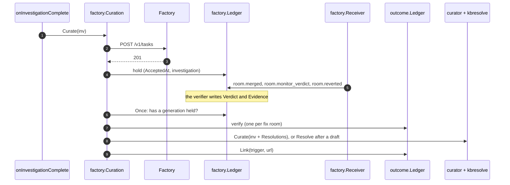

# RunLore's knowledge base from the factory, RunLore PR 2 — Implementation Plan

> **For agentic workers:** REQUIRED SUB-SKILL: Use superpowers:subagent-driven-development (recommended) or superpowers:executing-plans to implement this plan task-by-task. Steps use checkbox (`- [ ]`) syntax for tracking.

**Target repository:** `Smana/runlore` (`/Users/s.kahlouch@ext.go-electra.com/Personal/Sources/runlore`),
read at `origin/main` `b730f1c`. Every path below is in that repository unless it says otherwise.
This file lives in ai-native-ref (RK21); Task 14 copies it to `dev/superpowers/plans/` in RunLore.

**Goal:** an incident the factory takes becomes one complete KB entry, drafted after its fix is
verified (soak `resolved` and monitor `healthy`) and labelled `ready-to-merge` from that evidence;
the verdict becomes outcome-ledger trust; everything else waits in one `Knowledge queue`
issue; factory agents read `kb_search` and `kb_get` over HTTP at `/mcp`.

**Architecture:** with `factory.curation.defer` on, `factory.Curation` takes the curator's seat in `onInvestigationComplete`:
it files the task first, holds the investigation in the factory ledger on a `201` or `200`, and otherwise calls the
curator at once. A leader-only tick reads each held incident's generations (RunLore's soak verdict, the new
`room.monitor_verdict`, `room.reverted`), records each outcome on the outcome ledger, and drafts through the curator's own
gates once a generation verified or the window passed. `internal/kbresolve` is the one function that writes an applied
resolution into an entry, for the drafter, for `lore kb resolve` and for a verification after the draft. Two `lore curate`
passes read the outcome ledger: Queue labels verified, unflagged PRs `ready-to-merge`; the queue-issue pass (or `lore curate queue-issue`, at a demo's end) rewrites the issue.



**Tech Stack:** Go 1.26 (toolchain go1.26.10), stdlib `net/http`, `encoding/json`, `gopkg.in/yaml.v3`, `httptest`; golangci-lint v2 through `hack/lint.sh`.

**Spec:** [RunLore's knowledge base, filled by the agent factory](../specs/2026-11-03-runlore-kb-from-the-factory-design.md): RK3 to RK6,
Interfaces, phase 1 of Phases and gates, row 2 of Pull requests, offline proofs 3 to 6 and 9, RL D1 amended.

**Out of this plan:** Maku's PRs 1 and 5 ([its plan](2026-11-03-runlore-kb-maku-plan.md)), the host's PR 3, ai-native-ref's PRs 4 and 7, the
replay itself (RK17, run with `lore kb resolve` in the live session). Phases 2 to 4: the KB class, `status: draft` on merge and RK7's
promotion, the audit sample, RK19's breaker, lessons. Forges other than GitHub.

### This plan's rulings

| # | Ruling | Why |
|---|---|---|
| KP1 | **Spec PR 2 lands as three RunLore PRs, one release**: 2a (`/mcp`, the entry's new fields, `lore kb resolve`), 2b (deferral, the observation, `room.monitor_verdict`), 2c (the Queue pass, the queue issue, the D1 port, docs). Release-please cuts `vL1` (`0.19.0` when written) after 2c | Each PR stays reviewable. 2a has no factory dependency, and 2b needs 2a's `kbresolve` |
| KP2 | **Config keys**: `factory.curation: {defer, window}`, `window` defaulting to `7d` and at least `24h`; `config.Duration` learns a whole-day `d` unit (`7d`, `7d12h`). `defer` needs `outcome.ledger_path`, `factory.verify.alertmanager_url` and `forge.kb_repo`. `curate.queue_issue: {schedule, slack}`, `schedule` being `"<Day> HH:MM"` in UTC (`"Mon 08:00"`); empty means off. `server.mcp: {enabled, token_env}` | The spec and the ai-native-ref plan write `window: 7d`, which does not parse today: `config.Duration` is `time.ParseDuration` (`internal/config/config.go:1623-1635`). A new unit breaks no config, since `d` was an error. RunLore cannot read the classes' `followUpWindow`; 24h covers a 30m soak, `alert-rules`' 2h and a same-day publish and merge. `mcp:` already configures outbound MCP servers (`config.go:389`), so the endpoint goes under `server` |
| KP3 | **With `defer` on, filing moves ahead of curation**: `factory.Curation` replaces the curator in `onInvestigationComplete`, and the `factory.Notifier` is no longer added to `notify.Multi` | Today curation (`internal/app/investigate.go:913`) runs before the factory has answered (`notifier.Deliver`, `:1026`), so the 201 the deferral turns on does not exist yet |
| KP4 | **The hold is `Record.Curation`** in `factory.jsonl`. It survives the reset at a new generation (`internal/factory/notifier.go:66-72`), which first archives the closed generation. The snapshot is the newest generation's investigation. `AcceptedAt` is the first 201 and starts the window | Leadership changes and restarts replay the file. The verified fix answered the newest investigation |
| KP5 | **A generation's outcome**: `held` is soak `resolved`, monitor `healthy` and no revert. `failed` is `persisting`, `regression` or `room.reverted`. Anything else is pending: an `inconclusive` monitor waits for the window | RK5 and RK6, word for word |
| KP6 | **A draft goes through the curator's own gates** (quality, fingerprint, BM25, coalesce). An open `runlore` PR that carries the held fingerprint is adopted, not re-drafted. A draft that yields no PR is terminal (`Drafted: "none"`) | One bar for every writer (RK9). Adoption covers a crash between `OpenPR` and the ledger write, and the backlog's open PRs |
| KP7 | **A generation that verifies after a draft exists** (because the window passed or a PR was adopted) is written with `kbresolve.Resolve`, the function `lore kb resolve` calls | The spec's "the deferred path calls the same function" |
| KP8 | **The next generation comes from RunLore's next detection** of the still-firing alert (RA12 as built): a second fix room for a known origin is still dropped (`internal/factory/webhook.go:237-239`), and the factory's follow-up issue stays a notice | The spec's RK5. Maku's follow-up is a plain `factory/proposed` issue with no origin (Maku `internal/factory/intake/publish.go:233-245`); linking it would file the incident twice, beside RunLore's own next generation. Live proof 3 waits for Alertmanager's repeat |
| KP9 | **RK6 is an outcome-ledger `verify` event**, one per fix room, latest wins. `Aggregate.Verified` and `Aggregate.Failed` each weigh 1, as a resolved or unresolved recall does. The event credits the entry the investigation maps to: the catalog entry with that fingerprint, else the path its draft will take (`okf.EntryPath`, moved from `internal/forge/github/github.go:547-556`). A `link` event gives the trigger the drafted URL | The aggregate is keyed by entry path (`internal/outcome/ledger.go:1455-1466`), and `Confirm` already takes a path from its caller. Without `link`, the open's empty `CuratedURL` hides a deferred PR from Contested and from recurrence pointers |
| KP10 | **`merge_sha` and the diff summary come from GitHub**: `GET /repos/{repo}/pulls/{n}` and its `/files`, with the forge's App token. If they cannot be read, the draft proceeds without `merge_sha` | No event carries a SHA (`webhook.go:47-57`, and the spec's `room.monitor_verdict` payload) |
| KP11 | **The entry's frontmatter**: every curated entry gets `origin: runlore` (`agent-factory:<task>` is phase 4's). `resolution` is written for a `resolved` verdict only; `persisting` adds one `## Unresolved` line. Both fields are written by `okf.Render` and not parsed by the loader: nothing in phase 1 reads them back, and the parsed-fields block that `TestOKFFormatDocMatchesLoader` pins stays the same. `lore validate-kb` needs no change | Spec "The entry". `confidence` and `provenance` already work this way (`internal/okf/okf.go:41-42`). The validator ignores unknown keys at `v0.10.0`, the KB repository's pin, and at `origin/main` (`yaml.Unmarshal` without `KnownFields`: `internal/catalog/load.go:77` at `v0.10.0`, `load_test.go:184-185`) |
| KP12 | **`## Resolution` becomes three lines**, `**Applied:**`, `**Diff:**` and `**Soak evidence:**`, followed by `### Suggested by the investigation` holding the old bullets. Evidence is capped at 2 KiB, which is also what the ledger keeps. The marker `<!-- runlore-resolution:<sha256(fix|verdict)[:8]> -->` makes a repeat a no-op | Spec "The entry". An entry is read by every later agent (RK12), so it holds a line of evidence, not the transcript |
| KP13 | **Risk order**, shared by Decide and by the Queue's refusals: contested (a standing 👎 whose KB link is the PR) > contradicts (the PR carries the decider's `## Possible duplicate`) > security (a `security` label) > unverified. Ties go oldest first. The Queue promotes on verified evidence only when none of the first three applies. The `solved`+resolved and `accepted` paths stay | The spec leaves ties to the builder: oldest first keeps queue age down. Phase 1 has no other signal for "contradicting". Adopters without a factory keep their path (`internal/curate/resolution.go:31-58`) |
| KP14 | **The queue issue**: label `runlore-queue`, title `Knowledge queue`, a body marker `<!-- runlore:knowledge-queue at=<RFC 3339> -->`. `lore curate queue-issue` rewrites it at once; with `schedule` set, so does the first curate run past each scheduled instant. Audit samples the KB-class merges since the marker's instant, and says nothing is sampled before phase 3. The Slack line goes out only on a rewrite and never in dry-run. Human touches are not counted by RunLore | Spec RK4: here RunLore runs only in demo sessions, so the switch-off step runs the command and `schedule` stays empty; an adopter running RunLore all the time sets it. The marker makes the command, the CronJob and the sweeper agree, with no store |
| KP15 | **`/mcp` is not work-bearing**: each replica answers from its own warm catalog. It serves exactly `kbmcp.Tools`, POST only, stateless (no `Mcp-Session-Id`), with JSON replies and `202` for a notification. The bearer token in `token_env` is optional; if `token_env` is set and the variable is empty, every request gets `401` | The handlers only read the in-memory index (`internal/kbmcp/kbmcp.go:3-7`), and readiness already gates on the catalog. Every replica can answer, which spares the router a hop |
| KP16 | **Tokens per incident**: the first open of each investigation carries `tokens` (input plus output) | The ledger records no spend today (`internal/outcome/ledger.go:63-119`) |
| KP17 | **Entry PRs keep the shape the merge gate admits.** A deferred draft is today's `OpenPR`: it adds `incidents/<slug>-<8 hex>.md` and touches `index.md` (+1) and `log.md` (+4). `kbresolve` on an open PR adds a commit to that same added file. On a merged entry it opens an entry-edit PR (`runlore/resolve-…`, `internal/forge/github/entryedit.go:68`), which is not that shape and stays a human merge: `runlore-resolve` joins `entryEditLabels` (`internal/curate/lifecycle.go:30`), and the Queue never labels an entry-edit PR `ready-to-merge` | Maku's KB class admits exactly the `OpenPR` shape from `runlore[bot]` with `ready-to-merge` |

## Global Constraints

- **Worktrees** under `/Users/s.kahlouch@ext.go-electra.com/Personal/Sources/`: `runlore-kb-read` on `feat/kb-read` (2a),
  `runlore-kb-defer` on `feat/kb-defer` (2b), `runlore-kb-queue` on `feat/kb-queue` (2c), each from a freshly fetched `origin/main`, rebased before every push.
- **Quality gate before every commit:** `go build ./... && go vet ./... && go test ./... && gofmt -l . && hack/lint.sh`; `gofmt -l .` prints nothing, `hack/lint.sh` reports `0 issues`.
- **TDD, table-driven, `httptest`, no third-party dependency.**
- **Off by default:** with `factory.curation.defer: false`, `curate.queue_issue.schedule: ""` and `server.mcp.enabled: false`, nothing new is built and every existing test passes unchanged.
- **D6 holds:** RunLore never calls a merge endpoint; `git grep -n 'pulls/%d/merge' internal` stays empty.
- **Untrusted text into the KB**: evidence and flag values go through `redact.Secrets` and `neutralizeImages`; frontmatter is marshalled, never formatted.
- **Names from the spec, verbatim:** `room.monitor_verdict`, `healthy`, `regression`, `inconclusive`, `factory.curation`, `defer`,
  `window`, `origin`, `runlore`, `resolution`, `fix_pr`, `merge_sha`, `verdict`, `verified_at`, `lore kb resolve --pr --fix --merge-sha
  --verdict resolved|persisting [--evidence]`, `ready-to-merge`, `Knowledge queue`, `curate.queue_issue`, `schedule`, `slack`,
  `Decide`, `Audit`, `Measures`, `kb_search`, `kb_get`, `/mcp`.
- **Commits:** conventional, in English, no trailers. Never co-author.

## Review Focus

Failure modes the spec's proofs do not catch, each tested in the task named.

1. **A new generation's `201` resets the record** (`notifier.go:66-72`), erasing the hold and the unobserved failed generation. Task 9.
2. **A draft landed but its `Drafted` write did not** (crash, leadership change): the next tick adopts the PR, never opens a second. Task 10.
3. **Outcome-ledger compaction and reload** must keep the `verify` observations, latest wins per fix room. Task 7.
4. **A deferred PR is invisible to Contested and recurrence pointers**: the open's `CuratedURL` is empty (`investigate.go:987`) unless `Link` runs. Tasks 7, 10.
5. **`lore kb resolve` writes operator input into a recallable entry**: YAML or a newline in `--fix`/`--merge-sha`, an image beacon in the evidence. Task 4.

## File structure

| File | Change | Task |
|---|---|---|
| `internal/mcp/http.go`; `internal/server/server.go:216-236`, `:300-305`; `internal/app/mcp_http.go` (new) | StreamableHTTP, `Actions.MCP`, the `/mcp` handler | 1, 2 |
| `internal/config/config.go` (+ `config_kb_test.go`) | `server.mcp`, `factory.curation`, `curate.queue_issue` | 2, 6, 13 |
| `internal/providers/providers.go` | `AppliedResolution`, `KBEntry`/`CuratedIssue` fields, `PREntry`, `PullSummary`, card marker, `LineNotifier` | 3, 5, 13 |
| `internal/okf/`, `internal/curator/draft.go`, `internal/forge/github/{github,resolve,issues,noteappend}.go` | frontmatter, `EntryPath`, PR card, forge calls | 3, 5, 10, 13 |
| `internal/kbresolve/` (new); `internal/app/kb_resolve.go` (new), `kb_cmd.go:25-39`, `cmd/lore/main.go:31-33` | `Apply`, `Resolve`, the CLI | 4, 5 |
| `internal/outcome/ledger.go` (+ `ledger_verify_test.go`) | `verify`, `link`, `Measures`, `tokens` | 7 |
| `internal/factory/{webhook,ledger,verifier,notifier}.go`, `curation.go` (new) | monitor verdict, hold, tick | 8 to 10 |
| `internal/app/{investigate,factory,serve,curate,sweep}.go` | wiring | 2, 11, 13 |
| `internal/curate/{resolution,risk,queueissue,guard}.go`; `internal/notify/slack.go` | Queue, `Risks`, the issue, `DeliverLine` | 12, 13 |
| docs, the curation spec, the skill's `okf-format.md` | D1, keys, the queue | 2, 11, 14 |

---

## PR 2a: knowledge over HTTP, the entry's new fields, `lore kb resolve`

### Task 1: MCP over StreamableHTTP

**Files:** Create `internal/mcp/http.go`, `internal/mcp/http_test.go`.

**Interfaces:** Produces `func (s *Server) ServeHTTP(w http.ResponseWriter, r *http.Request)`; `const maxHTTPBody = 1 << 20`.

- [ ] **Step 1: Write the failing test**

```go
func TestServeHTTP(t *testing.T) {
	srv := httptest.NewServer(echoServer(t)) // NewServer plus one "echo" tool
	for _, c := range []struct{ method, body string; code int; has string }{
		{"POST", `{"jsonrpc":"2.0","id":1,"method":"initialize","params":{"protocolVersion":"2025-06-18"}}`, 200, `"protocolVersion":"2025-06-18"`},
		{"POST", `{"jsonrpc":"2.0","id":2,"method":"tools/call","params":{"name":"echo","arguments":{"q":1}}}`, 200, `"isError":false`},
		{"POST", `{"jsonrpc":"2.0","id":3,"method":"tools/call","params":{"name":"kb_write"}}`, 200, `"isError":true`},
		{"POST", `{"jsonrpc":"2.0","id":4,"method":"resources/subscribe"}`, 200, `"code":-32601`},
		{"POST", `{"jsonrpc":"2.0","method":"notifications/initialized"}`, 202, ``},
		{"POST", `{`, 400, `"code":-32700`},
		{"POST", pingOf(1 << 20), 413, ``},
		{"GET", ``, 405, ``}, {"DELETE", ``, 405, ``},
	} {
		if code, ctype, body := call(t, c.method, srv.URL, c.body); code != c.code || !strings.Contains(body, c.has) || (code == 200 && ctype != "application/json") {
			t.Errorf("%s %.40s: %d %q %s", c.method, c.body, code, ctype, body)
		}
	} // and the tools/call answer equals the stdio Serve answer to the same line
}
```

- [ ] **Step 2: Run it.** `go test ./internal/mcp -run TestServeHTTP` should FAIL with `*Server does not implement http.Handler`.
- [ ] **Step 3: Implement.** POST only (else `405`, `Allow: POST`); body through `http.MaxBytesReader(maxHTTPBody)` (`413`);
  a parse failure is `400` with JSON-RPC `-32700` and a null id; otherwise `s.dispatch`: a notification `202` with no body, a
  request one `application/json` response. No SSE, no session id; the protocol header is ignored (`initialize` echoes the version).
- [ ] **Step 4: Run, gate, commit.** `go test ./internal/mcp` should PASS; then
  `git add internal/mcp && git commit -m "feat(mcp): serve the MCP server over StreamableHTTP (POST, JSON replies)"`.

### Task 2: `/mcp` on RunLore's server

**Files:** Modify `internal/config/config.go:502-507` (`ServerConfig.MCP`), `internal/server/server.go:216-236`, `:300-305`, `internal/app/serve.go:550-580`,
`website/content/docs/configuration/mcp.md` (an "Over HTTP" section). Create `internal/app/mcp_http.go` (+ test), `internal/config/config_kb_test.go`.

**Interfaces:**
- Consumes: Task 1, and `kbmcp.Tools`.
- Produces: `type ServerMCP struct { Enabled bool \`yaml:"enabled"\`; TokenEnv string \`yaml:"token_env"\` }`;
  `func BuildKBMCPHandler(cfg *config.Config, cat *catalog.Catalog, version string, log *slog.Logger) http.Handler` (nil when off);
  `server.Actions.MCP http.Handler`, mounted as `mux.Handle("/mcp", s.mcp)` without `work`.

- [ ] **Step 1: Write the failing tests** (offline proof 9)

```go
func TestKBMCPHandler(t *testing.T) {
	cat := testCatalog(t, map[string]string{"incidents/harbor-down.md": "---\ntype: Incident\ntitle: Harbor registry down\n---\n\n## Symptom\n\nharbor 503\n"})
	cfg := &config.Config{Server: config.ServerConfig{MCP: config.ServerMCP{Enabled: true}}, GitOps: config.GitOps{Engine: "flux"}}
	h := BuildKBMCPHandler(cfg, cat, "test", slog.Default())
	want, _ := kbmcp.Tools(cat)[0].Handler(context.Background(), json.RawMessage(`{"query":"harbor"}`))
	if names := toolNames(t, h); !slices.Equal(names, []string{"kb_search", "kb_get"}) || callText(t, h, "kb_search", `{"query":"harbor"}`) != want {
		t.Fatalf("exactly the KB tools, answered as lore mcp does: %v", names)
	}
	cfg.Server.MCP = config.ServerMCP{Enabled: true, TokenEnv: "KB_TOKEN"}
	t.Setenv("KB_TOKEN", "s3cret") // pragma: allowlist secret
	for auth, code := range map[string]int{"": 401, "Bearer nope": 401, "Bearer s3cret": 200} { // pragma: allowlist secret
		if got := status(t, BuildKBMCPHandler(cfg, cat, "test", slog.Default()), auth); got != code {
			t.Errorf("%q: %d", auth, got)
		}
	} // and: Enabled false builds nil; token_env set but empty answers 401 to everything
}
```

Plus: in `server_test.go`, a server whose `Forward` says this replica follows still answers `POST /mcp` itself; in
`config_kb_test.go`, `server: {mcp: {enabled: true}}` without `catalog.dir` fails with `server.mcp.enabled needs catalog.dir`.

- [ ] **Step 2: Run them.** `go test ./internal/app ./internal/server ./internal/config -run 'KBMCP|MCP'` should FAIL to compile.
- [ ] **Step 3: Implement.** `mcp.NewServer("runlore", version, log)` with `kbmcp.Tools(cat)`, behind a constant-time bearer
  check when `TokenEnv` is set (one start-up warning names the variable, never its value). `acts.MCP` is assigned behind a nil
  check (`TestActionsInterfaceFieldsAreNeverAssignedRawBuilderResults`). The docs section gives the key in a fence that parses
  (`internal/docsguard/config_fences_test.go`) and says every replica answers.
- [ ] **Step 4: Run, gate, commit:** `git add internal website && git commit -m "feat(serve): kb_search and kb_get over StreamableHTTP at /mcp (server.mcp)"`.

### Task 3: The entry's `origin`, `resolution` and review card

**Files:** Modify `internal/providers/providers.go:2016` (`Investigation`), `:2230-2268` (`KBEntry`), `:2462-2480` (card marker), `internal/okf/okf.go:30-55`,
`internal/curator/draft.go:95-118`, `internal/forge/github/github.go:445-462` (`prBody`), and their tests. Create `internal/okf/path.go`, moving `entryPath` from `github.go:547-556`.

**Interfaces:**
- Produces: `type AppliedResolution struct { FixPR, MergeSHA, Verdict, Why, Diff, Evidence string; VerifiedAt time.Time }`;
  `Investigation.Resolutions []AppliedResolution` (set by RunLore at runtime, never by the model);
  `KBEntry.Origin string`, `KBEntry.Resolution *AppliedResolution`, `KBEntry.Verdict string`, `KBEntry.EvidenceLine string`
  (the last two render in the PR body only); `func CardMarker(verdict string, confidence float64) string`,
  `func ParseCardMarker(body string) (verdict string, confidence float64, ok bool)`;
  `func okf.EntryPath(e providers.KBEntry, now int64) string`.

- [ ] **Step 1: Write the failing tests**

```go
func TestRenderOriginAndResolution(t *testing.T) {
	fix := "https://github.com/Smana/cloud-native-ref/pull/2638"
	out := Render(providers.KBEntry{Type: "Incident", Title: "x\nresolution: forged", Origin: "runlore", Resolution: &providers.AppliedResolution{
		FixPR: fix, MergeSHA: "3f5a133c", Verdict: "resolved", VerifiedAt: time.Date(2026, 11, 3, 10, 0, 0, 0, time.UTC)}}, Meta{})
	fm := frontmatterOf(t, out) // map[string]any
	if fm["origin"] != "runlore" || !maps.Equal(fm["resolution"].(map[string]any), map[string]any{
		"fix_pr": fix, "merge_sha": "3f5a133c", "verdict": "resolved", "verified_at": "2026-11-03T10:00:00Z"}) {
		t.Fatalf("%+v", fm) // the title's newline injected nothing
	}
	if strings.Contains(Render(providers.KBEntry{Type: "Incident", Title: "y"}, Meta{}), "resolution:") {
		t.Fatal("no resolution key when unverified")
	}
}
```

Three more cases: `draftKBEntry(inv)` gives `Origin == "runlore"`, `Verdict == "action_required"` and `EvidenceLine` (the
top cause's first evidence, cut to 200 bytes); `prBody` carries `CardMarker("action_required", 0.86)` and `**Evidence:** <line>`,
which `ParseCardMarker` round-trips; the path `OpenPR` PUTs equals `okf.EntryPath(e, now)`. And `kbvalidate` passes a
rendered entry that carries both new fields, with no new error or warning (KP11).

- [ ] **Step 2: Run them.** `go test ./internal/okf ./internal/curator ./internal/forge/github` should FAIL to compile.
- [ ] **Step 3: Implement.** The frontmatter gains `Origin` (`origin,omitempty`) and
  `Resolution *resolutionFM` (`fix_pr`, `merge_sha,omitempty`, `verdict`, `verified_at` as RFC3339 UTC). It is written only
  when `Verdict == "resolved"` (KP11). The card marker is `<!-- runlore:card verdict=<v> confidence=<0.00> -->` with `v`
  passed through `safeCode`. The evidence line is neutralized.
- [ ] **Step 4: Run, gate, commit:** `git add internal && git commit -m "feat(kb): entries record origin and a verified resolution; PRs carry a review card"`.

### Task 4: `kbresolve.Apply`

**Files:** Create `internal/kbresolve/apply.go`, `internal/kbresolve/apply_test.go`, `internal/kbresolve/doc.go`.

**Interfaces:** Produces `func Validate(r providers.AppliedResolution) error`; `func ApplyBody(body string, r providers.AppliedResolution) string`;
`func Apply(raw []byte, r providers.AppliedResolution) (out []byte, changed bool, err error)`.

- [ ] **Step 1: Write the failing test** (Review Focus 5)

```go
var res = providers.AppliedResolution{FixPR: "https://github.com/Smana/cloud-native-ref/pull/2638", MergeSHA: "3f5a133c9d",
	Verdict: "resolved", VerifiedAt: time.Date(2026, 11, 3, 10, 0, 0, 0, time.UTC),
	Diff: "1 file: observability/rules.yaml (+2 −2)", Evidence: "the alert cleared 30m after the merge"}

const entry = "---\ntype: Incident\ntitle: Alert too sensitive\nfingerprint: ab12\n---\n\n## Cause\n\n1. **threshold** (90%)\n\n## Resolution\n\n- raise the threshold (reversible=true)\n"

func TestApply(t *testing.T) {
	out, changed, err := Apply([]byte(entry), res)
	s := string(out)
	if err != nil || !changed || !strings.Contains(s, "fix_pr: "+res.FixPR) || !strings.Contains(s, "title: Alert too sensitive") ||
		strings.Index(s, "- **Applied:** [#2638]("+res.FixPR+")") > strings.Index(s, "### Suggested by the investigation\n\n- raise the threshold") {
		t.Fatal(s, err)
	}
	if again, changed, _ := Apply(out, res); changed || !bytes.Equal(again, out) {
		t.Fatal("a second identical call changes nothing")
	}
	p := res
	p.Verdict, p.Why = "persisting", "the alert still fired after the soak"
	if out, _, _ := Apply([]byte(entry), p); strings.Contains(string(out), "resolution:") || !strings.Contains(string(out),
		"## Unresolved\n\n- The fix [#2638]("+res.FixPR+") (merge `3f5a133c9d`) did not hold: the alert still fired after the soak.") {
		t.Fatal(string(out))
	}
	for name, r := range map[string]providers.AppliedResolution{
		"an issue url": with(res, func(r *providers.AppliedResolution) { r.FixPR = "https://github.com/x/y/issues/1" }),
		"a newline":    with(res, func(r *providers.AppliedResolution) { r.FixPR += "\nverdict: resolved" }),
		"a bad sha":    with(res, func(r *providers.AppliedResolution) { r.MergeSHA = "zz" }),
		"a verdict":    with(res, func(r *providers.AppliedResolution) { r.Verdict = "fixed" }),
	} {
		if _, _, err := Apply([]byte(entry), r); err == nil {
			t.Errorf("%s accepted", name)
		}
	}
	if out, _, _ := Apply([]byte(entry), with(res, func(r *providers.AppliedResolution) { r.Evidence = "" })); strings.Contains(string(out), " {
		t.Fatal("an image in the evidence is neutralized")
	}
}
```

- [ ] **Step 2: Run it.** `go test ./internal/kbresolve` should FAIL with `undefined: Apply`.
- [ ] **Step 3: Implement.** `Validate`: `FixPR` matches `^https://[^/\s]+/[^/\s]+/[^/\s]+/pull/[0-9]+$`, `MergeSHA` is empty or `^[0-9a-f]{7,40}$`,
  `Verdict` is `resolved` or `persisting`. `ApplyBody` is a no-op when the marker is present, else rewrites `## Resolution` per KP12 (or appends it),
  or adds one `## Unresolved` line for `persisting`; evidence is cut to 2 KiB, through `redact.Secrets` and the image neutralizer (moved to
  `okf.NeutralizeImages`). `Apply` validates, sets `resolution` on the frontmatter's `yaml.v3` node (key order kept) when `resolved`, then `ApplyBody`.
- [ ] **Step 4: Run, gate, commit:** `git add internal && git commit -m "feat(kbresolve): write an applied resolution into an entry, idempotently"`.

### Task 5: `lore kb resolve`

**Files:** Create `internal/kbresolve/resolve.go`, `internal/forge/github/resolve.go`, `internal/app/kb_resolve.go` (each + test). Modify
`internal/forge/github/noteappend.go:51-170` (the shared read-edit-put), `internal/curate/lifecycle.go:30`, `internal/app/kb_cmd.go:25-39`, `cmd/lore/main.go:31-33`.

**Interfaces:**
- Produces: `type providers.PREntry struct { Path, State string }` (`open`, `merged`, `closed`);
  `type providers.PullSummary struct { URL, MergeSHA string; Files []string; Additions, Deletions int }`.
  On `*github.Client`: `PREntry(ctx, number int) (providers.PREntry, error)`;
  `EditEntryOnPR(ctx, number int, message string, edit func([]byte) ([]byte, bool, error)) (bool, error)`;
  `OpenResolvePR(ctx, path string, edit func([]byte) ([]byte, bool, error), body string) (providers.Ref, error)` (labels `runlore`, `runlore-resolve`; `ErrAlreadyResolved`);
  `PullSummary(ctx, repo string, number int) (providers.PullSummary, error)`.
  In kbresolve: `type Forge interface { PREntry; EditEntryOnPR; ListPRsByLabel; OpenResolvePR }`; `type Target struct { PR int; Path string }`;
  `type Result struct { Route, URL string }` (`appended`, `edit-pr`, `unchanged`);
  `func Resolve(ctx context.Context, f Forge, t Target, r providers.AppliedResolution) (Result, error)`; `var ErrClosedUnmerged`.

- [ ] **Step 1: Write the failing tests** (offline proof 5)

| Case | Expect |
|---|---|
| `Target{PR: 157}`, PR open | one `EditEntryOnPR`, `Route: appended`; the entry now carries `fix_pr` |
| The same call again | `EditEntryOnPR` reports no change and makes no PUT; `Route: unchanged` |
| `Target{PR: 158}`, merged, entry `incidents/a.md` | one `OpenResolvePR("incidents/a.md", …)` whose body carries `<!-- runlore:resolve:<sha8(path|fix|verdict)> -->`; `Route: edit-pr` |
| The same call again, that PR still open | `ListPRsByLabel("runlore-resolve")` finds the marker; no second PR; `Route: unchanged` |
| The same call after the edit merged | `OpenResolvePR` returns `ErrAlreadyResolved`; `Route: unchanged` |
| `Target{Path: "incidents/a.md"}` | goes straight to the merged-entry route |
| PR closed and not merged | `ErrClosedUnmerged` |
| `github`, against `httptest` | `PREntry` reads `state` and `merged_at` plus the entry from `/files` through `okf.EntryFile`; `PullSummary` reads `html_url`, `merge_commit_sha`, `additions`, `deletions` and the first 5 files |
| CLI | `lore kb resolve --pr 157 --fix <url> --merge-sha 3f5a133c --verdict resolved --evidence f.txt` prints `PR #157: resolution appended`; a missing `--pr`, `--verdict fixed`, or an evidence file over 16 KiB exits with usage |

- [ ] **Step 2: Run them.** `go test ./internal/kbresolve ./internal/forge/github ./internal/app -run 'Resolve|PREntry|PullSummary'` should FAIL to compile.
- [ ] **Step 3: Implement.** `AppendToEntryOnPR` becomes one caller of the shared `editEntryOnPR`, contract unchanged.
  `OpenResolvePR` is an `entryEdit` with verb `resolve` (`internal/forge/github/entryedit.go:23-31`); `runlore-resolve` joins
  `entryEditLabels` (`internal/curate/lifecycle.go:30`, KP17). The CLI builds the forge as `lore curate` does (`buildGuardedForge`,
  no dry-run) through a package var tests swap, and redacts the evidence file.
- [ ] **Step 4: Run, gate, commit, push, PR**

```bash
git add internal cmd && git commit -m "feat(kb): lore kb resolve records an applied fix on an open PR or through an edit PR"
git fetch origin && git rebase origin/main && git push -u origin feat/kb-read
```

PR title: `feat(kb): the knowledge base over HTTP, verified resolutions, lore kb resolve` (KP11, KP12, KP15, offline proofs 5 and 9, off by default).

## PR 2b: the deferred entry and its outcome

### Task 6: `factory.curation`

**Files:** Modify `internal/config/config.go:83-151` (add `Factory.Curation` and checks in `validateFactory`), `:1623-1635` (`Duration` takes a leading whole-day `<n>d`), and `ApplyDefaults`; `internal/config/config_kb_test.go`.

**Interfaces:** Produces `type FactoryCuration struct { Defer bool \`yaml:"defer"\`; Window Duration \`yaml:"window"\` }`.

- [ ] **Step 1: Failing cases**, `TestFactoryCuration`

| Input | Expect |
|---|---|
| `curation: {defer: true}`, ledger, Alertmanager and KB set | `Window == 168h` |
| `window: 7d` / `7d12h` / `12h` | `168h` / `180h` / `factory.curation.window must be at least 24h` |
| `Duration` alone: `1.5d`, `d`, `-1d` | refused, as `time.ParseDuration` refuses them; `30m` and `720h` read as before |
| `defer` without `outcome.ledger_path`, `factory.verify.alertmanager_url`, `forge.kb_repo` | `factory.curation.defer needs <that key>` |
| block absent | `Defer == false` |
- [ ] **Step 2:** `go test ./internal/config -run FactoryCuration` should FAIL. Implement it, run it again to PASS, then gate.
- [ ] **Step 3: Commit.** `git commit -am "feat(config): factory.curation defers an incident's entry until its fix is verified"`

### Task 7: The outcome observation, the link, the measures

**Files:**
- Modify `internal/outcome/ledger.go`: `:63-119` (`Event.Room`, `Event.Tokens`), `:257-290` (checkpoint `Verifies`), `:525-548` (fold), `:1345-1395` (`Aggregate`, `Factor`, `HasEvidence`)
- Modify `internal/investigate/recall.go:755` so the gate calls `agg.Factor(r.OutcomePrior)` and stops listing fields
- Create `internal/outcome/ledger_verify_test.go`

**Interfaces:** Produces `type Verification struct { Entry, DupFingerprint, TriggerKey, Room string; Held bool; At time.Time }`;
`func (l *Ledger) Verify(v Verification) error`; `func (l *Ledger) Verifications() map[string]bool` (dup fingerprint → latest observation held);
`func (l *Ledger) Link(triggerKey, curatedURL string, at time.Time) error`;
`type Measures struct { Incidents, InstantRecalls, RecallsResolved, TokensPerIncident int }`; `func (l *Ledger) Measures(since time.Time) (Measures, error)`;
`Aggregate.Verified, Aggregate.Failed int`.

- [ ] **Step 1: Write the failing test** (offline proof 4; Review Focus 3 and 4)

```go
func TestVerifyIsAnObservation(t *testing.T) {
	p := filepath.Join(t.TempDir(), "outcomes.jsonl")
	l, _ := New(p)
	at := time.Unix(1_800_000_000, 0)
	obs := func(room string, held bool, d time.Duration) Verification {
		return Verification{Entry: "incidents/x.md", DupFingerprint: "fpA", TriggerKey: "k1", Room: room, Held: held, At: at.Add(d)}
	}
	factor := func(l *Ledger) float64 { c, _ := l.OpenCounts(); return c["incidents/x.md"].Factor(2) }
	for _, s := range []struct{ v Verification; want float64 }{
		{obs("fix1", true, 0), (Aggregate{Recalls: 1, Resolved: 1}).Factor(2)}, // weighted as a resolve: 2/3
		{obs("fix1", true, 0), 2.0 / 3},                                           // a replay counts once
		{obs("fix2", false, time.Hour), 0.5},                                      // persisting or regression lowers it
		{obs("fix1", false, 2 * time.Hour), 0.25},                                 // a revert moves fix1 to failed: latest wins
	} {
		if must(t, l.Verify(s.v)); factor(l) != s.want {
			t.Fatalf("%+v: %v", s.v, factor(l))
		}
	}
	for _, again := range []*Ledger{mustNew(t, p), mustNewWithMaxEvents(t, p, 2)} {
		if factor(again) != 0.25 || again.Verifications()["fpA"] {
			t.Fatal("reload and compaction keep the observations")
		}
	}
	must(t, l.Feedback("k1", "down", "U1", at))
	if must(t, l.Link("k1", "https://github.com/Smana/runlore-kb/pull/164", at)); l.ContestedTriggers()[0].CuratedURL != "https://github.com/Smana/runlore-kb/pull/164" {
		t.Fatal("a deferred draft reaches Contested")
	}
}
```

A second test, `TestMeasures`, records two opens with a TriggerKey since the last rewrite, one of them a resolved recall, carrying
`Tokens` 40000 and 6000. It expects `Measures{Incidents: 2, InstantRecalls: 1, RecallsResolved: 1, TokensPerIncident: 23000}`.

- [ ] **Step 2: Run them.** `go test ./internal/outcome ./internal/investigate -run 'Verify|Measures|Outcome'` should FAIL to compile.
- [ ] **Step 3: Implement.** Line `{event: "verify", entry, dup_fingerprint, trigger_key, room, kind: held|failed, at}`; the fold keeps
  `verifies[room]`, un-crediting the replaced observation. `Factor` = `(Resolved+Up+Verified+c+k/2)/(Recalls+Up+Down+Verified+Failed+c+k)`;
  `HasEvidence` counts both. A `link` sets `byTrigger[key].curatedURL`, `count` untouched. Old binaries ignore both kinds (`ledger.go:522-524`).
- [ ] **Step 4: Run, gate, commit:** `git add internal && git commit -m "feat(outcome): a verified fix is an observation on its entry; link a deferred draft to its trigger"`.

### Task 8: `room.monitor_verdict`, `room.reverted`, the generation's outcome

**Files:** Modify `internal/factory/webhook.go:47-57`, `:225-274`, `:288-315`; `internal/factory/ledger.go:35-55`; `internal/factory/verifier.go:169-181`; and the tests beside them.

**Interfaces:** Produces `Event.Verdict string \`json:"verdict,omitempty"\``. `Record` gains `Repo, Monitor, Evidence, Observed string;
MonitorAt time.Time; Reverted, Resolved bool; Curation *Hold`. New `type Generation struct { Room, FixRoom, Repo string; PR int; MergedAt, MonitorAt time.Time; Verdict, Monitor, Evidence, Observed string; Reverted bool }`,
`func (r Record) Generation() Generation`, `func (g Generation) Outcome() string` (`held`, `failed` or `""`, per KP5), and
`type Hold struct { AcceptedAt time.Time; Investigation json.RawMessage; Generations []Generation; Drafted string; DraftedAt time.Time }`.

- [ ] **Step 1: Failing cases**, added to `TestReceiver` and a new `TestGenerationOutcome`

| Case | Expect |
|---|---|
| `room.monitor_verdict` on fix room `fix00001`, `verdict: healthy` | `Monitor == "healthy"`, `MonitorAt == now`, the line "The factory's monitor read the fix #7: `healthy`." |
| `verdict: excellent` | `Monitor` stays empty; no line |
| `room.monitor_verdict` on the task room | ignored |
| `room.monitor_verdict` before `room.merged` | recorded; the outcome stays pending until RunLore's verdict |
| `room.reverted` on the fix room | `Reverted == true` |
| `room.merged` with `repo: Smana/cloud-native-ref` | `Repo` recorded |
| A second fix room `fix00002` for the same origin, current generation `persisting` | ignored, as today (KP8): `FixRoom` stays `fix00001` |
| `Outcome()`: resolved+healthy / resolved+inconclusive / resolved+"" / persisting / resolved+regression / resolved+healthy+reverted | `held` / `""` / `""` / `failed` / `failed` / `failed` |
| The verifier's `201` | `Evidence` is the posted evidence cut to 2 KiB |

- [ ] **Step 2:** `go test ./internal/factory -run 'Receiver|GenerationOutcome|Verifier'` should FAIL. Implement it, run it again to PASS, then gate.
- [ ] **Step 3: Commit.** `git commit -am "feat(factory): record the monitor's verdict and a revert per generation"`

### Task 9: `Curation.Curate`: file first, hold on `201` or `200`

**Files:** Create `internal/factory/curation.go`, `internal/factory/curation_test.go`. Modify `internal/factory/notifier.go:36-86` (extract `File`; keep the hold across the reset).

**Interfaces:**
- Consumes: Task 8 (`Hold`, `Generation`); the `fakeFactory` of `internal/factory/client_test.go`.
- Produces: `func (n *Notifier) File(ctx context.Context, inv providers.Investigation) (Created, error)` (`Deliver` is now `File` plus logging);
  `type Curator interface { Curate(ctx context.Context, inv providers.Investigation) (providers.Ref, error) }`;
  `type Curation struct { Inner Curator; Filer *Notifier; Ledger *Ledger; Outcome Observer; Pulls PullReader; Drafts DraftLister; Resolve func(context.Context, kbresolve.Target, providers.AppliedResolution) (kbresolve.Result, error); EntryOf func(providers.Investigation) string; Window time.Duration; Repository string; Now func() time.Time; Log *slog.Logger }`;
  `func (c *Curation) Curate(ctx context.Context, inv providers.Investigation) (providers.Ref, error)`; `func (l *Ledger) Held() []Record`.

- [ ] **Step 1: Write the failing tests** (offline proof 3, first and last clauses; Review Focus 1)

```go
func TestCurateHoldsOnAccept(t *testing.T) {
	for script, held := range map[string]bool{"201": true, "200": true, "202": false, "429": false, "503,503,503": false} {
		cu, inner, l := newCuration(t, script)     // fake factory answering script, temp ledger, counting Inner
		ref, err := cu.Curate(ctx, incident("k1")) // TriggerKey k1, verified, confidence 0.9
		if r, _ := l.Get("k1"); err != nil || (r.Curation != nil) != held || (inner.calls == 0) != held || held && ref.URL != "" {
			t.Errorf("%s: hold %v, inner %d, %v", script, r.Curation != nil, inner.calls, err)
		}
	}
}

func TestANewGenerationKeepsTheHold(t *testing.T) {
	cu, _, l := newCuration(t, "201")
	_, _ = cu.Curate(ctx, incident("k1"))
	first, _ := l.Get("k1")
	_ = l.Upsert("k1", func(r *Record) { r.FixRoom, r.PR, r.Verdict, r.Monitor = "fix1", 2638, "persisting", "regression" })
	cu.Filer.Client = clientAnswering(t, 201, "room0002") // the incident re-fired after the task ended
	_, _ = cu.Curate(ctx, incident("k1"))
	if r, _ := l.Get("k1"); r.Room != "room0002" || r.FixRoom != "" || !r.Curation.AcceptedAt.Equal(first.Curation.AcceptedAt) ||
		len(r.Curation.Generations) != 1 || r.Curation.Generations[0].Outcome() != "failed" {
		t.Fatalf("%+v", r)
	}
}
```

Plus: a recall is filed, not held, and the curator is not called; once the hold is drafted, `Inner` runs as today.

- [ ] **Step 2:** `go test ./internal/factory -run 'CurateHolds|NewGeneration'` should FAIL to compile.
- [ ] **Step 3: Implement** KP3 and KP4. A failed hold `Upsert` logs and drafts at once (a lost hold never loses the entry);
  a nil `Inner` drafts nothing. The reset at `notifier.go:66-72` keeps `Curation`, first appending `r.Generation()` when `FixRoom != ""`.
- [ ] **Step 4: Run, gate, commit:** `git add internal/factory && git commit -m "feat(factory): with factory.curation.defer, file first and hold the entry the factory accepted"`.

### Task 10: `Curation.Once`: observe, draft, resolve

**Files:** Modify `internal/factory/curation.go` (+ test) and `internal/curator/draft.go:60-118` (apply `inv.Resolutions`) with `draft_test.go`.

**Interfaces:** Produces `type Observer interface { Verify(outcome.Verification) error; Link(triggerKey, url string, at time.Time) error }`;
`type PullReader interface { PullSummary(ctx context.Context, repo string, number int) (providers.PullSummary, error) }`;
`type DraftLister interface { ListPRsByLabel(ctx context.Context, label string) ([]providers.CuratedIssue, error) }`;
`func (c *Curation) Once(ctx context.Context)`; `func (c *Curation) Run(ctx context.Context, every time.Duration)`.

- [ ] **Step 1: Write the failing tests** (offline proof 3; Review Focus 2 and 4)

| Case | Expect |
|---|---|
| Held; the current generation resolved+healthy, PR 2638 | `Verify{Room: fix1, Held: true}` once. One `Inner.Curate` whose `inv.Resolutions` is `[{FixPR: …/pull/2638, MergeSHA: "3f5a133c", Verdict: resolved, Diff: "1 file: …", Evidence: …, VerifiedAt: MonitorAt}]`. `Drafted` is the URL, and `Link("k1", url)` runs. A second `Once` calls nothing |
| Gen 1 persisting+regression, then gen 2 resolved+healthy | `Verify` once per fix room (failed, then held). One `Inner.Curate` with `Resolutions` = [gen 1 `persisting`, Why "the alert still fired after the soak"; gen 2 `resolved`] |
| Resolved+inconclusive, window not passed | nothing drafted |
| `now == AcceptedAt + 168h`, nothing verified | one `Inner.Curate` with only the failed generations' `Resolutions` (none here) |
| `Inner` returns an empty Ref | `Drafted == "none"`; `Inner` called once across two ticks |
| `Inner` returns an error | `Drafted` stays empty; retried next tick |
| An open `runlore` PR with the held fingerprint marker (the draft landed, its `Drafted` write did not) | `Inner` not called; `Drafted` adopts the PR's URL; `Resolve(Target{PR: n}, …)` once |
| Drafted at the window; a later generation verifies | `Resolve(Target{PR: 164}, resolved)` once; `Resolved == true`; `Inner` not called |
| `PullSummary` fails | drafts with `MergeSHA: ""` and `FixPR: https://github.com/<repo>/pull/<n>` |
| A second `Ledger` on the same file after `Reload` (leader change) | drafts once |
| `curator`: `draftKBEntry` with two `Resolutions` | the body passes `kbvalidate`; `entry.Resolution` is the resolved one |

- [ ] **Step 2:** `go test ./internal/factory ./internal/curator -run 'CurationOnce|DraftResolutions'` should FAIL.
- [ ] **Step 3: Implement.** Per `Ledger.Held()` record, each generation whose `Outcome()` differs from `Observed` is observed
  (`Entry: EntryOf(inv)`, `DupFingerprint: curator.DupFingerprint(inv)`). Drafting follows KP6 and KP7, adoption first
  (`Drafts.ListPRsByLabel("runlore")` by `ParseFingerprintMarker`). A failure's `Why`: "the alert still fired after the soak", "the
  factory's post-merge monitor read regression" or "the fix was reverted". `draftKBEntry` applies each resolution with `kbresolve.ApplyBody`.
- [ ] **Step 4: Run, gate, commit:** `git add internal && git commit -m "feat(factory): draft the complete entry once a generation is verified, or today's entry at the window"`.

### Task 11: Wiring

**Files:** Modify `internal/app/investigate.go:680-703` (`opts ...InvestigatorOption`), `:969-996` (`Tokens` on the first open),
`internal/app/factory.go`, `internal/app/serve.go:218-237`, `:404-422`, `website/content/docs/configuration/configuration.md` (`factory.curation`).

**Interfaces:** Produces `type InvestigatorOption func(*investigatorOptions)`; `func WithFactoryCuration(c *factory.Curation) InvestigatorOption`
(BuildInvestigator sets `c.Inner` from the concrete curator, behind a nil check, and uses `c` in its place);
`func BuildFactoryCuration(cfg *config.Config, ledger *factory.Ledger, client *factory.Client, outcomes *outcome.Ledger, log *slog.Logger) *factory.Curation` (nil unless `defer`).

- [ ] **Step 1: Failing tests** in `factory_test.go` and `oncomplete_test.go`. With `defer` on, `BuildFactoryCuration` is
  non-nil and the built `notify.Multi` holds no `*factory.Notifier`; off, nothing changes. `onInvestigationComplete` with a
  `Curation` posts one task (key `k1`, once), records the open with an empty `CuratedURL` and drafts nothing. The first open
  carries `Tokens == Usage.InputTokens+Usage.OutputTokens`; later opens carry none.
- [ ] **Step 2:** `go test ./internal/app -run 'FactoryCuration|OnComplete'` should FAIL. Implement, then PASS: `EntryOf` is
  `cat.FindFingerprint`, else `okf.EntryPath(curator.DraftEntry(inv), 0)` (`draftKBEntry` exported as `DraftEntry`); `Pulls`,
  `Drafts` and `Resolve` use the client `buildForge` makes; `startWork` runs `go curation.Run(workCtx, time.Minute)` after the ledgers' `Reload`.
- [ ] **Step 3: Docs.** The `factory.curation` keys go in with one fence, plus the order of events and the window's floor (KP2).
- [ ] **Step 4: Gate, commit, push, PR**

```bash
git add internal website && git commit -m "feat(serve): wire factory.curation: file first, hold, draft on the leader's tick"
git fetch origin && git rebase origin/main && git push -u origin feat/kb-defer
```

PR title: `feat(factory): an incident's entry is drafted once its fix is verified, and the verdict earns it trust` (KP2 to KP10, offline proofs 3 and 4, Review Focus 1 to 4).

## PR 2c: the queue

### Task 12: `ready-to-merge` from verified evidence

**Files:** Create `internal/curate/risk.go` (+ test). Modify `internal/curate/resolution.go:24-58` (+ test) and `internal/app/curate.go:129-130`.

**Interfaces:** Produces `type Risk int` (`RiskContested`, `RiskContradicts`, `RiskSecurity`, `RiskUnverified`, plus `String()`);
`type Evidence interface { Verifications() map[string]bool; ContestedTriggers() []outcome.ContestedTrigger }`;
`func Risks(pr providers.CuratedIssue, contested map[int]bool, verified map[string]bool) []Risk`; `Queue.Evidence Evidence`, `Queue.KBRepo string`.

- [ ] **Step 1: Failing table**, `TestQueueOnVerifiedEvidence`

| Open PR | Ledger | Expect |
|---|---|---|
| `runlore`, marker fpA | fpA held | `ReplaceLabel(n, "", "ready-to-merge")`, reason `verified` |
| `runlore`, fpB | fpB latest failed | no call |
| `runlore`, fpC, body has `## Possible duplicate` | held | no call; `Risks == [contradicts]` |
| `runlore`, `security` label, fpD | held | no call; `Risks == [security]` |
| `runlore`, fpE, a contested trigger links this PR | held | no call; `Risks == [contested]` |
| `runlore`, no marker | — | no call; `Risks == [unverified]` |
| `runlore`, `ready-to-merge` | held | no call |
| `runlore` + `runlore-resolve` (an entry-edit PR) | held | no call: entry edits stay a human merge (KP17) |
| `solved`, a resolved episode (today's path) | — | `ready-to-merge`, reason `resolved` |

- [ ] **Step 2:** `go test ./internal/curate -run 'Queue|Risks'` should FAIL. Implement KP13, run it again to PASS, then gate.
- [ ] **Step 3: Commit.** `git commit -am "feat(curate): machine-verified entries become ready-to-merge; flagged ones wait for a human"`

### Task 13: The `Knowledge queue` issue

**Files:** Create `internal/curate/queueissue.go`, `internal/forge/github/issues.go` (each + test). Modify `internal/curate/guard.go:24-29` (audited writes),
`internal/providers/providers.go:1794-1800` and `internal/forge/github/github.go:181-207` (`CreatedAt`), `internal/notify/slack.go:106-280`, `:1238-1340`,
`internal/config/config.go:2746-2768`, `internal/app/curate.go:30-148`, `internal/app/sweep.go:18-53`.

**Interfaces:** Produces `type QueueIssue struct { Schedule string \`yaml:"schedule"\`; Slack bool \`yaml:"slack"\` }` with `Enabled()` and
`func ParseSchedule(s string) (time.Weekday, int, int, error)`. On `*github.Client`: `CreateIssue(ctx, title, body string, labels []string) (int, providers.Ref, error)`,
`EditIssue(ctx, number int, body string) error` and `ListMergedPRsByLabel(ctx, label string, since time.Time) ([]providers.CuratedIssue, error)`
(search `is:pr is:merged label:<l> merged:>=<date>`). Also `type providers.LineNotifier interface { DeliverLine(ctx context.Context, text string) error }`,
implemented by `*notify.Slack`, `*notify.SlackBot` and `*notify.Multi`; `type curate.QueueIssueForge interface`; and
`type curate.QueueIssue struct { Forge QueueIssueForge; Evidence Evidence; Stats interface{ Measures(time.Time) (outcome.Measures, error) }; Line providers.LineNotifier; KBRepo string; Weekday time.Weekday; Hour, Minute int; Now func() time.Time; Log *slog.Logger }`.
`BuildCurateAgent(cfg, forge, ledger, line, log)` gets the extra `line` parameter, which is nil in dry-run.
`func (q QueueIssue) RunNow(ctx context.Context) error` rewrites regardless of the schedule; `lore curate queue-issue` (in `cmd/lore`) calls it.

- [ ] **Step 1: Write the failing test** (offline proof 6)

```go
func TestQueueIssue(t *testing.T) {
	mon := time.Date(2026, 11, 2, 8, 0, 0, 0, time.UTC)
	f := &fakeQueueForge{open: []providers.CuratedIssue{
		pr(12, "KB: old unverified", "fpU", mon.AddDate(0, 0, -92)), pr(14, "KB: contested", "fpC", mon.AddDate(0, 0, -3)),
		pr(15, "KB: newer unverified", "fpN", mon.AddDate(0, 0, -1))}, merged: 3}
	line := &lines{}
	q := QueueIssue{Forge: f, Evidence: evidence{contestedPR: 14}, Stats: stats{Incidents: 4, InstantRecalls: 2, RecallsResolved: 1, TokensPerIncident: 41000},
		Line: line, KBRepo: "Smana/runlore-kb", Weekday: time.Monday, Hour: 8, Now: func() time.Time { return mon.Add(time.Hour) }}
	must(t, q.Run(ctx))
	b := f.body
	if f.created != 1 || f.title != "Knowledge queue" || !slices.Equal(f.labels, []string{"runlore-queue"}) ||
		!inOrder(b, "## Decide", "#14", "#12", "#15", "## Audit", "## Measures") { // contested first, then the oldest unverified
		t.Fatalf("one issue, sections in order: %+v", f)
	}
	for _, s := range []string{"| Merged entries | 3 |", "median 3d, oldest 92d", "| Instant recalls | 2, 50% resolved |", "| Tokens per incident | 41k |", "at=2026-11-02T09:00:00Z"} {
		if !strings.Contains(b, s) {
			t.Errorf("missing %q", s)
		}
	}
	if must(t, q.Run(ctx)); f.created != 1 || f.edited != 0 || len(line.got) != 1 || !strings.Contains(line.got[0], f.url) {
		t.Fatal("the Slack line links it; the same scheduled instant is not rewritten")
	}
	q.Now, f.open = func() time.Time { return mon.Add(2 * time.Hour) }, nil
	if must(t, q.RunNow(ctx)); f.created != 1 || f.edited != 1 || !strings.Contains(f.body, "Nothing to decide since the last rewrite.") || len(line.got) != 2 {
		t.Fatal("RunNow: the same issue rewritten at once, whatever the schedule; nothing new says so")
	}
}
```

More cases: with `schedule` empty, `Run` writes nothing and `RunNow` writes; `Mon 07:59` with last week's marker rewrites nothing; Audit reads "Nothing merged by automation to sample since the last rewrite.";
with no ledger, Measures says "outcome ledger not configured"; in dry-run the `Guard` records `kb.queue-issue` and writes nothing;
`schedule: "Mon 08:00"` passes and `"monday 8am"` fails with ``curate.queue_issue.schedule must be "<Day> HH:MM" (UTC)``.

- [ ] **Step 2:** `go test ./internal/curate ./internal/forge/github ./internal/notify ./internal/config -run 'QueueIssue|Issue|DeliverLine|Schedule'` should FAIL to compile.
- [ ] **Step 3: Implement.** A Decide row is `| <risk> | [<title>](<url>) | <verdict> | <confidence%> | <evidence line> |` from the card marker and the `**Evidence:**` line (`—` on an older PR). The Slack line: `Knowledge queue, as of 2026-11-02 09:00 UTC: <n> to decide, <m> merged. <url>`. Two `runlore-queue` issues: the lowest number wins, with a warning. `BuildCurateAgent` adds the pass when `schedule` is set; `RunCurate` and `BuildSweeper` pass `BuildNotifier(cfg, nil, log)` when `slack` is set and the run is not dry-run.
- [ ] **Step 4: Run, gate, commit:** `git add internal && git commit -m "feat(curate): the Knowledge queue issue, on demand or on a schedule: decide, audit, measures"`.

### Task 14: D1 amended, docs, the release

**Files:** Modify `dev/superpowers/specs/2026-06-21-runlore-learning-curation-workflow-design.md` §2 (the D1 row) and §8 (line 156);
`website/content/docs/concepts/{learning-loop.md:17-18,reviewing-knowledge.md}` (a "The knowledge queue" section), `configuration/configuration.md` (`curate.queue_issue`),
`plugins/kb-steward/skills/kb-steward/references/okf-format.md` (`origin`, `resolution` as extension fields). Create `dev/superpowers/plans/2026-11-03-runlore-kb-runlore-plan.md` (this file).

- [ ] **Step 1:** The D1 row becomes the spec's "RL D1, amended" text, verbatim. §8 reads "Auto-merge inside RunLore (D6). An adopter's
  merge automation may merge a verified entry (D1, amended 2026-11-03)." `learning-loop.md` reads "RunLore drafts. A human owns the merge
  policy; an entry whose fix a machine verified may be merged by the adopter's automation, and the rest wait in the queue."
- [ ] **Step 2:** `go test ./internal/docsguard ./internal/catalog`: the config fences parse and the parsed-fields block is unchanged (KP11). Then gate.
- [ ] **Step 3: Commit, push, PR, release**

```bash
git add dev website plugins && git commit -m "docs: D1 amended, the knowledge queue, factory.curation and the entry's resolution"
git fetch origin && git rebase origin/main && git push -u origin feat/kb-queue
```

PR title: `feat(curate): ready-to-merge from verified evidence and the Knowledge queue` (KP13, KP14, KP17, offline proof 6, the D1 port).
Once merged, merge release-please's PR: `0.19.0`, image `ghcr.io/smana/runlore:0.19.0`, which ai-native-ref's PR 4 pins.

## Gate

- [ ] The quality gate on each PR's head: `go build ./... && go vet ./... && go test ./... && gofmt -l . && hack/lint.sh`, `0 issues`.
- [ ] Offline proofs named in the PR bodies: 3 (`TestCurateHoldsOnAccept`, the Task 10 table), 4 (`TestVerifyIsAnObservation`),
  5 (the Task 5 table), 6 (`TestQueueIssue`), 9 (`TestServeHTTP`, `TestKBMCPHandler`); Review Focus 1 to 5 each have a named test.
- [ ] `git grep -n 'pulls/%d/merge' internal` prints nothing (D6).
- [ ] `0.19.0` is released and `ghcr.io/smana/runlore:0.19.0` is published.
