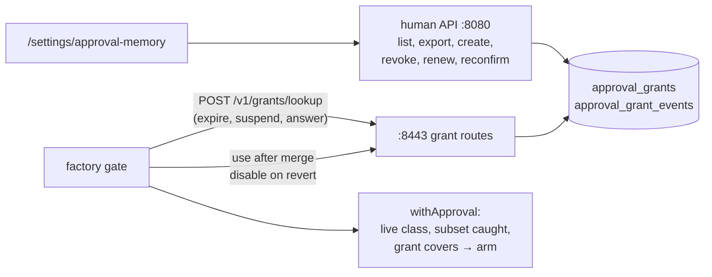

# Merge policy self-service, stage 5 (approval memory) Implementation Plan

> **For agentic workers:** REQUIRED SUB-SKILL: Use superpowers:subagent-driven-development (recommended) or superpowers:executing-plans to implement this plan task-by-task. Steps use checkbox (`- [ ]`) syntax for tracking.

**Goal:** A maintainer turns one approval of a pull request in a live class's `requiresApproval` subset into a saved, exact, revocable grant; the gate consults active grants there, immediately before deciding and again before the merge call, and a revert disables the grant that authorized the merge. All of it behind `policyManagement.approvalMemory` (factory) and `human.approvalMemory` (broker), both off.

**Architecture:** The broker's store holds `approval_grants` (current state, moved only along trigger-enforced transitions) and `approval_grant_events` (insert-only audit). The factory reaches them through three system routes on `:8443`, beside `GET /v1/links/slack`; humans through `/api/approval-memory/…` on `:8080` and the `/settings/approval-memory` page. Matching is pure: `withApproval` (the evaluator's approval branch) keeps a live class's arm when a grant in `ArmInputs.Grants` covers every file the subset caught, and the decision record names it (`grant=<id>:<version>`).



**Tech Stack:** Go (Maku), PostgreSQL triggers and RLS through Atlas migrations, testcontainers, TypeScript and Vitest for the page.

**Spec:** [`docs/superpowers/specs/2026-11-04-merge-policy-self-service-design.md`](../specs/2026-11-04-merge-policy-self-service-design.md) (Saved grants, Approval memory, Storage, MP9, MP10, MP12, MP13, MP17, MP18) · **Predecessor:** [the stage 3 plan](2026-11-07-merge-policy-stage-3-dual-evaluation-plan.md)

**Read against:** Maku `origin/main` `c2a07b58`. Every code block is the compiled code of [Smana/maku#402](https://github.com/Smana/maku/pull/402), written test first.

## Deviation: built beside stage 4, not after it

The stage 3 plan's "Out of scope" puts stage 5 after plan 4 (repository authority). The owner asked
on 2026-11-08 for stages 4 and 5 to be built in parallel on separate branches. This plan is
therefore independent of stage 4: grants are matched inside the pure evaluator (`DecideArmUnder`),
which on `main` decides only the dual evaluation's repository decision and `reconciler.Simulate`.
Until stage 4's gate decides on `DecideArmUnder` for a cut-over repository, a grant changes no merge,
and the factory's pre-merge re-read, use record and disable-on-revert are wired but dormant (a
central decision never carries a grant). Stage 5's exit (Task 9) waits for stage 4.

## Global Constraints

- Off is today: with `policyManagement.approvalMemory` off the factory makes no grant call (a test's source calls `t.Fatal`), and every decision record is byte-identical (`grant=` prints only when set). With `human.approvalMemory` off every grant path, page and API, is the mux's `404`.
- A grant never broadens its class (MP9): it is consulted only in a live class's arm inside the approval subset; the base, the class's conditions and deny rules, the breaker and the caps are decided before it.
- A failed lookup never authorizes (MP13); a grant bound to another policy hash is suspended, an expired one expired, at lookup and under the row lock.
- Labels stay bounded (MP18): `repository` through `s.repository()`, `class` the task's, `event` from `grant.Events()`. Grant ids live in the record and the audit, never in a label or a span.
- The broker stays append-only on `events`; the new tables give `rooms_broker` no `DELETE`, and `approval_grant_events` refuses `UPDATE`, `DELETE` and `TRUNCATE` from every role.
- Maku: `task check` exits 0; SPDX line; stdlib `testing`; testcontainers only in `internal/store`; conventional commits in English, no trailers. Test runs wrapped in `systemd-run --user --scope -q -p MemoryMax=6G`.

## Rulings this plan takes from reading the code

| # | The spec or brief says | The code says | This plan |
|---|---|---|---|
| R1 | Grants consulted "by the approval branch" | The branch is `withApproval` (`internal/factory/reconciler/evaluate.go:51`), whose live case hands off at `evaluate.go:63` | `grantFor` there: a covering grant keeps the arm and sets `Rows.Grant`; `ArmInputs.Grants` (`GrantRead{Read, List, PolicyHash, At}`, `json:"-"`, beside `Integration` at `arm.go:57`) carries the lookup, so fixtures are unchanged |
| R2 | "Every file the approval subset caught must match one" | The subset's match is `filefence.ProtectedFiles` over `filefence.Paths` (`filefence.go:38`), a rename's two names included | Caught = `Paths(in.Stats)` matching the subset; each must match one grant pattern anchored `^(?:p)$`; an empty catch covers nothing |
| R3 | Optional `diffShape` (MP10) | `diffShape` (`gate.go:77`) computes `links-only` and the semver shapes from the diff alone; `added-entry` reads its class's entry files | A grant may name `links-only`, `semver-patch` or `semver-minor` only (`grant.Shapes`) |
| R4 | Bound to the policy hash (MP12) | The record carries 12 hex digits (`policy=`, `decision.go:36`); `Snapshot.Hash` (`watch.go:32`) is the full sha256 | A grant stores 12 to 64 hex digits; it is bound when its hash is a prefix of the snapshot's (`Grant.BoundTo`). The lookup suspends any other active grant, recording the hash it was found under; a reconfirmation rebinds to that hash, never one a caller names |
| R5 | "Find the merge call in `autoMerging`" | `autoMerging` (`merge.go:863`) only watches; the merge call is `awaitingCI`'s, `merge.go:264`, after `integrationRecheck` (`merge.go:258`) | `grantHolds` sits between the two: the decision's grant re-read (same id, same version, active, bound, unexpired) or the pull request goes to a human, `approval_required` |
| R6 | "Disable after revert" | The factory's revert is `revert` (`merge.go:1024`); it reads the task, not the decision | `PullRequestRef.Grant` (beside `Drill`, `task_types.go:878`) is written with the merge; `revert` disables it once the revert PR exists. A drill (AM6) exercises the revert path and keeps the grant |
| R7 | Lifetime cap "in central config" | The broker creates grants and has no factory config | `mergeGuardrails.maxGrantLifetime` (default 90 days, at most 365) is sent with every lookup; the broker expires a grant past `least(expires_at, renewed_at + cap)`. A create asks 1–365 days (default 90); the cap shortens it |
| R8 | "Factory→broker internal API" | The factory's broker client (`rooms.Client.do`, `client.go:382`) and `SlackLinkReader` (`slacklinks.go:31`, wired `broker.go:221`) are the pattern | `POST /v1/grants/lookup`, `/v1/grants/{id}/use`, `/v1/grants/{id}/disable`, to `GrantClient` (`system:factory`) alone. A grant route's span names the route template, never the grant id (`Client.call`) |
| R9 | Server-side authz (MP17) | `gate` (`access.go:43`) is the room rule; writes elsewhere check `CanWrite` and the web UI's session (`linkHuman`, `slacklink.go:259`) and the broker's own Origin (`slacklink.go:302`) | Readers of a repository (an admin reads all) list, read and export; GitHub write creates, renews, reconfirms; write or an admin revokes. Writes take the web UI session and the broker's Origin; bodies 16 KiB |
| R10 | "Merge and create rule" for a PR in a live class's approval subset: the exact predicate, the future PRs it would match, the conditions outside it, expiry, revocation; "merge once" keeps the approved-merge path | The broker cannot see the policy or the PR's diff; the factory's internal simulation API is stage 6's | `POST /api/approval-memory/preview` saves nothing and answers the predicate (each caught file as an exact pattern, `grant.Exact`), the future pull requests it would match (in words: the class, the policy, the subset's files), what stays outside it, its expiry, its revoke path and what merge once does (approve the head; AM1's path, unchanged); `POST …/grants` saves the same proposal. The page prefills the form from `?repository=&class=&pr=&policy=&file=…`, the link a decision can carry. A grant outside a live class's subset can never match (R1), so it cannot widen anything; checking the PR against the subset server-side waits for stage 6's simulation endpoint |
| R12 | The page: search, revoke, renew, reconfirm, YAML export, usage and outcome history | `GET grants/{id}` returns the audit | The page lists with search and a status filter, acts in place, exports, and opens each grant's history on demand: `used` events are its usage, every status change its outcome. Self-contained under `/settings/approval-memory` (`main.ts` routes it; stage 6 owns `/settings` and its other pages, and whichever lands second rebases the router) |
| R11 | Broker-side switch | Each human feature has its own broker switch (`human.slackDecide`, `human.intake`; `HumanConfig` ends at `config.go:107`) | `human.approvalMemory: true` serves the page, the API and the factory routes; the factory's `policyManagement.approvalMemory` decides whether grants are consulted |

## Files

| File | Responsibility |
|---|---|
| `internal/factory/config/mergepolicy.go` | `PolicyManagement.ApprovalMemory`, `MergeGuardrails.MaxGrantLifetime`, `GrantLifetime()`, validation |
| `internal/store/migrations/20261108120000_approval_grants.sql` | The two tables, transitions, event-by-commit, insert-only audit, grants and RLS |
| `internal/store/grants.go` | `CreateGrant`, `Grant`, `Grants`, `GrantEvents`, `MoveGrant`, `LookupGrants` |
| `internal/factory/grant/grant.go` | The grant as both sides read it: statuses, events, `Covers`, `BoundTo`, `Predicate.Validate` |
| `internal/factory/decision/decision.go` | `Rows.Grant`, printed before `reviewer=` only when set |
| `internal/factory/reconciler/{arm,evaluate}.go` | `ArmInputs.Grants`, `grantFor` in `withApproval` |
| `internal/wire/bridge.go`, `internal/bridgeapi/grants.go` | `bad_grant`, `no_grant`, `grant_state`; the three factory routes |
| `internal/factory/rooms/{client,grants}.go` | `LookupGrants`, `UseGrant`, `DisableGrant`, `ErrGrantState`; `call` |
| `internal/factory/fmetrics/fmetrics.go` | `maku_factory_approval_grants_active`, `maku_factory_approval_grant_events_total` |
| `internal/factory/reconciler/{grants,dual,merge,reconciler}.go` | `GrantClient`, the reads, the pre-merge re-read, the use record, the disable on revert |
| `api/factory/v1alpha1/task_types.go` (+ generated CRDs) | `PullRequestRef.Grant` |
| `internal/config/config.go`, `internal/humanapi/grants.go`, `internal/app/{broker,factory}.go` | `human.approvalMemory`; the human API; the wiring |
| `web/src/approval-memory.ts`, `web/src/main.ts`, `web/src/app.css` | The page and its direct-load route; the committed bundle |
| `docs/{factory,operations,api,integration}.md` | The switches, the record field, the routes, the metrics |

---

### Task 1: The switches

**Files:**
- Modify: `internal/factory/config/mergepolicy.go`
- Test: `internal/factory/config/mergepolicy_test.go`

**Interfaces:**
- Produces: `PolicyManagement.ApprovalMemory bool`; `MergeGuardrails.MaxGrantLifetime Duration`; `(MergeGuardrails).GrantLifetime() time.Duration`; `DefaultGrantLifetime`, `MaxGrantLifetime`

- [ ] **Step 1: Write the failing tests**

```diff
@@ -38,6 +38,11 @@ func TestHarnessProfilesAndGuardrailsValidate(t *testing.T) {
 		"simulation alone": {Config{PolicyManagement: PolicyManagement{Simulation: true}}, ""},
 		"dual with read":   {Config{PolicyManagement: PolicyManagement{Read: true, DualEvaluation: true}}, ""},
 		"dual alone":       {Config{PolicyManagement: PolicyManagement{DualEvaluation: true}}, "dualEvaluation needs read"},
+		"memory with read": {Config{PolicyManagement: PolicyManagement{Read: true, ApprovalMemory: true}}, ""},
+		"memory alone":     {Config{PolicyManagement: PolicyManagement{ApprovalMemory: true}}, "approvalMemory needs read"},
+		"a year of grant":  {Config{MergeGuardrails: MergeGuardrails{MaxGrantLifetime: Duration{MaxGrantLifetime}}}, ""},
+		"negative grant":   {Config{MergeGuardrails: MergeGuardrails{MaxGrantLifetime: Duration{-time.Hour}}}, "maxGrantLifetime"},
+		"too long a grant": {Config{MergeGuardrails: MergeGuardrails{MaxGrantLifetime: Duration{MaxGrantLifetime + time.Hour}}}, "maxGrantLifetime"},
 	} {
 		t.Run(name, func(t *testing.T) {
 			got := policyProblems(&tc.cfg)
@@ -48,6 +53,16 @@ func TestHarnessProfilesAndGuardrailsValidate(t *testing.T) {
 	}
 }

+// A grant lives 90 days unless the operator caps it lower (merge policy stage 5).
+func TestGrantLifetimeDefaultsToNinetyDays(t *testing.T) {
+	if got := (MergeGuardrails{}).GrantLifetime(); got != 90*24*time.Hour {
+		t.Fatal(got)
+	}
+	if got := (MergeGuardrails{MaxGrantLifetime: Duration{time.Hour}}).GrantLifetime(); got != time.Hour {
+		t.Fatal(got)
+	}
+}
+
 // A bare off is YAML's false (ScopeMode's reason): the profile must still read it.
 func TestLoopRefReadsFalseAsOff(t *testing.T) {
 	var p HarnessProfile
```

- [ ] **Step 2: Run them to verify they fail**

Run: `systemd-run --user --scope -q -p MemoryMax=6G go test -count=1 ./internal/factory/config/`
Expected: FAIL to build: unknown field `ApprovalMemory`, `MaxGrantLifetime`.

- [ ] **Step 3: Implement**

```diff
@@ -8,6 +8,7 @@ import (
 	"maps"
 	"regexp"
 	"slices"
+	"time"
 )

 // TemplateNone is the harness of an adopted class: another author's pull requests, no run.
@@ -52,6 +53,23 @@ type MergeGuardrails struct {
 	MaxPatchFiles    int      `json:"maxPatchFiles,omitempty"`
 	MaxModifiedLines int      `json:"maxModifiedLines,omitempty"`
 	MaxPerDay        int      `json:"maxPerDay,omitempty"`
+	// MaxGrantLifetime caps a saved approval grant's life from its creation or last renewal (merge
+	// policy stage 5): the factory's lookup expires an older grant. 0 is DefaultGrantLifetime.
+	MaxGrantLifetime Duration `json:"maxGrantLifetime,omitzero"`
+}
+
+// The bounds of mergeGuardrails.maxGrantLifetime: 90 days by default (the spec's), a year at most.
+const (
+	DefaultGrantLifetime = 90 * 24 * time.Hour
+	MaxGrantLifetime     = 365 * 24 * time.Hour
+)
+
+// GrantLifetime is the cap in force: MaxGrantLifetime, or DefaultGrantLifetime when unset.
+func (g MergeGuardrails) GrantLifetime() time.Duration {
+	if g.MaxGrantLifetime.Duration == 0 {
+		return DefaultGrantLifetime
+	}
+	return g.MaxGrantLifetime.Duration
 }

 // PolicyManagement holds the rollout's switches, all off by default (merge policy stages).
@@ -66,6 +84,10 @@ type PolicyManagement struct {
 	// Read last observed it, and records whether the two agree (stage 3). It decides nothing: the
 	// central decision is the one acted on. Needs Read.
 	DualEvaluation bool `json:"dualEvaluation,omitempty"`
+	// ApprovalMemory consults saved approval grants where a live class's requiresApproval subset
+	// would ask a human (stage 5): an active grant whose predicate covers the decision lets it arm.
+	// Off, no grant is read. Needs Read: a grant is bound to the policy Read observes.
+	ApprovalMemory bool `json:"approvalMemory,omitempty"`
 }

 var profileRE = regexp.MustCompile(`^[a-z0-9]([-a-z0-9]{0,38}[a-z0-9])?$`)
@@ -95,6 +117,12 @@ func (c *Config) validateMergePolicy(bad func(string, ...any)) {
 	if pm := c.PolicyManagement; pm.DualEvaluation && !pm.Read {
 		bad("policyManagement.dualEvaluation needs read: it evaluates the policy read observes")
 	}
+	if pm := c.PolicyManagement; pm.ApprovalMemory && !pm.Read {
+		bad("policyManagement.approvalMemory needs read: a grant is bound to the policy read observes")
+	}
+	if l := c.MergeGuardrails.MaxGrantLifetime.Duration; l < 0 || l > MaxGrantLifetime {
+		bad("mergeGuardrails.maxGrantLifetime must be 0 (the default, %s) to %s", DefaultGrantLifetime, MaxGrantLifetime)
+	}
 	g := c.MergeGuardrails
 	for _, f := range []struct {
 		key string
```

- [ ] **Step 4: Run them to verify they pass**, same command: PASS.
- [ ] **Step 5: Commit** `feat(config): policyManagement.approvalMemory and mergeGuardrails.maxGrantLifetime`

### Task 2: The store

**Files:**
- Create: `internal/store/migrations/20261108120000_approval_grants.sql`, `internal/store/grants.go`
- Modify: `internal/store/migrations/kustomization.yaml`, `atlas.sum`, `embed_test.go`
- Test: `internal/store/grants_test.go`

**Interfaces:**
- Produces: `store.Grant`, `GrantEvent`, `NewGrant`, `GrantMove`, `GrantFilter`; `ErrNoGrant`, `ErrGrantState`, `ErrGrantVersion`; `(*Store).CreateGrant`, `Grant`, `Grants`, `GrantEvents`, `MoveGrant`, `LookupGrants`

The pattern is `approvals.sql`'s: a `BEFORE` trigger for the transitions (`approvals_are_their_events`, `20261005120000_approvals.sql:32`), a deferred constraint trigger that every move has its event by commit (`:76`), column-scoped grants and RLS (`:86`).

- [ ] **Step 1: Write the failing tests** (testcontainers: transitions, off-transition writes refused even from the owner, insert-only events even for the superuser, eight concurrent revokes of which one wins, eight concurrent lookups that suspend once, expiry by the operator's cap)

```go
// SPDX-License-Identifier: Apache-2.0

package store

import (
	"context"
	"errors"
	"fmt"
	"strings"
	"sync"
	"testing"
	"time"
)

const (
	grantHash  = "0123456789abcdef0123456789abcdef0123456789abcdef0123456789abcdef"
	otherHash  = "ffffffffffffffffffffffffffffffffffffffffffffffffffffffffffffffff"
	grantActor = "system:factory"
)

func newGrant(id string) NewGrant {
	return NewGrant{ID: id, Repository: "smana/cloud-native-ref", Class: "docs-broad",
		Files: []string{`docs/security/threat-model\.md`}, PolicyHash: grantHash[:12], OriginPR: 42,
		CreatedBy: "dana", Lifetime: 24 * time.Hour}
}

func grantID(n int) string { return strings.Repeat("a", 25) + string(rune('a'+n)) }

func eventsOf(t *testing.T, s *Store, id string) []string {
	t.Helper()
	evs, err := s.GrantEvents(t.Context(), id)
	if err != nil {
		t.Fatal(err)
	}
	var out []string
	for _, e := range evs {
		out = append(out, fmt.Sprintf("%s@%d", e.Event, e.Version))
	}
	return out
}

// Merge policy stage 5: a grant is created active at version 1 with its created event, then moves
// only along its transitions, each with its event: suspended, reconfirmed (version 2, rebound),
// used, renewed (version 3), revoked for good.
func TestAGrantMovesAlongItsTransitions(t *testing.T) {
	ctx := t.Context()
	s, _, _, _ := open(t)
	g, err := s.CreateGrant(ctx, newGrant(grantID(0)))
	if err != nil {
		t.Fatal(err)
	}
	if g.Status != "active" || g.Version != 1 || !g.ExpiresAt.After(g.CreatedAt) || !g.LastUsedAt.IsZero() {
		t.Fatalf("%+v", g)
	}
	step := func(m GrantMove, wantErr error) Grant {
		t.Helper()
		m.Actor = grantActor
		got, err := s.MoveGrant(ctx, g.ID, m)
		if !errors.Is(err, wantErr) {
			t.Fatalf("%s: %v, want %v", m.Event, err, wantErr)
		}
		return got
	}
	step(GrantMove{Event: "reconfirmed", PolicyHash: otherHash}, ErrGrantState) // only a suspended grant is reconfirmed
	step(GrantMove{Event: "suspended", PolicyHash: otherHash}, nil)
	step(GrantMove{Event: "used", PR: 7}, ErrGrantState) // a suspended grant is never used
	if got := step(GrantMove{Event: "reconfirmed", PolicyHash: otherHash[:12]}, nil); got.Version != 2 || got.PolicyHash != otherHash[:12] {
		t.Fatalf("%+v", got)
	}
	step(GrantMove{Event: "used", Version: 1, PR: 7}, ErrGrantVersion) // bound to a version since left
	if got := step(GrantMove{Event: "used", Version: 2, PR: 7, Head: strings.Repeat("a", 40)}, nil); got.LastUsedPR != 7 || got.LastUsedAt.IsZero() || got.Version != 2 {
		t.Fatalf("%+v", got)
	}
	if got := step(GrantMove{Event: "renewed", Lifetime: 48 * time.Hour}, nil); got.Version != 3 || !got.ExpiresAt.After(g.ExpiresAt) {
		t.Fatalf("%+v", got)
	}
	step(GrantMove{Event: "revoked", Reason: "no longer wanted"}, nil)
	for _, ev := range []string{"renewed", "reconfirmed", "used", "revoked", "disabled", "suspended", "expired"} {
		step(GrantMove{Event: ev, PolicyHash: grantHash, Lifetime: time.Hour, PR: 1}, ErrGrantState) // revoked is for good
	}
	want := "created@1 suspended@1 reconfirmed@2 used@2 renewed@3 revoked@3"
	if got := strings.Join(eventsOf(t, s, g.ID), " "); got != want {
		t.Fatalf("events %q, want %q", got, want)
	}
	if _, err := s.MoveGrant(ctx, grantID(9), GrantMove{Event: "revoked", Actor: "dana"}); !errors.Is(err, ErrNoGrant) {
		t.Fatal(err)
	}
}

// The table refuses what the methods would never write, even from its owner: a grant planted
// suspended, a predicate rewritten, a move without its event, a renewal skipping a version or
// rebinding the policy. The broker may not even try to rewrite a predicate or delete a grant.
func TestTheGrantTableRefusesOffTransitionWrites(t *testing.T) {
	ctx := t.Context()
	s, broker, _, super := open(t)
	owner := as(super, "rooms_owner", "owner")
	g, err := s.CreateGrant(ctx, newGrant(grantID(1)))
	if err != nil {
		t.Fatal(err)
	}
	for name, sql := range map[string]string{
		"planted suspended": `INSERT INTO approval_grants (grant_id, version, repository, class, files, policy_hash, origin_pr,
			created_by, created_at, renewed_at, expires_at, status, status_at)
			VALUES ('bbbbbbbbbbbbbbbbbbbbbbbbbb', 1, 'smana/x', 'c', '{a}', '0123456789ab', 1, 'x', now(), now(), now() + interval '1 h', 'suspended', now())`,
		"the predicate rewritten":  `UPDATE approval_grants SET files = '{.*}' WHERE grant_id = '` + g.ID + `'`,
		"a move without its event": `UPDATE approval_grants SET status = 'revoked', status_at = now() WHERE grant_id = '` + g.ID + `'`,
		"a renewal skipping a version": `UPDATE approval_grants SET version = version + 2, renewed_at = now(), status_at = now(),
			expires_at = now() + interval '1 h' WHERE grant_id = '` + g.ID + `'`,
		"a policy rebound by a renewal": `UPDATE approval_grants SET version = version + 1, renewed_at = now(), status_at = now(),
			expires_at = now() + interval '1 h', policy_hash = 'ffffffffffff' WHERE grant_id = '` + g.ID + `'`,
	} {
		t.Run(name, func(t *testing.T) {
			if err := run(ctx, owner, sql); err == nil {
				t.Fatal("accepted")
			}
		})
	}
	if err := run(ctx, broker, `UPDATE approval_grants SET files = '{.*}' WHERE grant_id = $1`, g.ID); err == nil {
		t.Fatal("the broker rewrote a predicate")
	}
	if err := run(ctx, broker, `DELETE FROM approval_grants WHERE grant_id = $1`, g.ID); err == nil {
		t.Fatal("the broker deleted a grant")
	}
}

// The audit is insert-only for every role, its owner included: no event is rewritten or removed.
func TestGrantEventsAreInsertOnly(t *testing.T) {
	ctx := t.Context()
	s, broker, _, super := open(t)
	g, err := s.CreateGrant(ctx, newGrant(grantID(2)))
	if err != nil {
		t.Fatal(err)
	}
	for _, sql := range []string{
		`UPDATE approval_grant_events SET reason = 'x'`,
		`DELETE FROM approval_grant_events`,
		`TRUNCATE approval_grant_events CASCADE`,
	} {
		if err := run(ctx, broker, sql); err == nil {
			t.Fatalf("the broker ran %s", sql)
		}
		if err := run(ctx, super, sql); err == nil {
			t.Fatalf("even the superuser ran %s", sql)
		}
	}
	if err := run(ctx, broker, `INSERT INTO approval_grant_events (grant_id, version, event, actor, at)
		VALUES ($1, 1, 'used', 'x', now() - interval '1 day')`, g.ID); err == nil {
		t.Fatal("an event was backdated")
	}
	if got := eventsOf(t, s, g.ID); len(got) != 1 {
		t.Fatalf("%q", got)
	}
}

// Concurrent moves serialize on the grant's row: of eight revokes one wins and seven are refused,
// and the audit holds one revoked event; eight lookups under a new policy suspend it once.
func TestConcurrentGrantMovesSerialize(t *testing.T) {
	ctx := t.Context()
	s, _, _, _ := open(t)
	race := func(n int, f func() error) (ok, refused int) {
		var mu sync.Mutex
		var wg sync.WaitGroup
		for range n {
			wg.Go(func() {
				err := f()
				mu.Lock()
				defer mu.Unlock()
				switch {
				case err == nil:
					ok++
				case errors.Is(err, ErrGrantState):
					refused++
				default:
					t.Error(err)
				}
			})
		}
		wg.Wait()
		return ok, refused
	}
	revoked, err := s.CreateGrant(ctx, newGrant(grantID(3)))
	if err != nil {
		t.Fatal(err)
	}
	if ok, refused := race(8, func() error {
		_, err := s.MoveGrant(context.WithoutCancel(ctx), revoked.ID, GrantMove{Event: "revoked", Actor: "dana"})
		return err
	}); ok != 1 || refused != 7 {
		t.Fatalf("%d revokes won, %d refused", ok, refused)
	}
	if got := strings.Join(eventsOf(t, s, revoked.ID), " "); got != "created@1 revoked@1" {
		t.Fatal(got)
	}
	n := newGrant(grantID(4))
	if _, err := s.CreateGrant(ctx, n); err != nil {
		t.Fatal(err)
	}
	if ok, _ := race(8, func() error {
		_, _, err := s.LookupGrants(context.WithoutCancel(ctx), n.Repository, n.Class, otherHash, time.Hour*24*90, grantActor)
		return err
	}); ok != 8 {
		t.Fatalf("%d lookups answered", ok)
	}
	if got := strings.Join(eventsOf(t, s, n.ID), " "); got != "created@1 suspended@1" {
		t.Fatal(got)
	}
}

// A lookup answers the active grants of the class under the policy decided under: one made under
// another policy is suspended, one past its expiry or the operator's maximum lifetime expired,
// each with its event; another class's grant is not read.
func TestLookupExpiresAndSuspendsBeforeItAnswers(t *testing.T) {
	ctx := t.Context()
	s, _, _, super := open(t)
	bound, stale, old, other := newGrant(grantID(5)), newGrant(grantID(6)), newGrant(grantID(7)), newGrant(grantID(8))
	stale.PolicyHash = otherHash[:12]
	other.Class = "deps-patch"
	for _, n := range []NewGrant{bound, stale, old, other} {
		if _, err := s.CreateGrant(ctx, n); err != nil {
			t.Fatal(err)
		}
	}
	// old was renewed two days ago: past a one-day maximum lifetime, however far its own expiry.
	forge(t, super, `UPDATE approval_grants SET renewed_at = now() - interval '2 days', expires_at = now() + interval '30 days'
		WHERE grant_id = '`+old.ID+`'`)
	active, events, err := s.LookupGrants(ctx, bound.Repository, bound.Class, grantHash, 24*time.Hour, grantActor)
	if err != nil {
		t.Fatal(err)
	}
	if len(active) != 1 || active[0].ID != bound.ID {
		t.Fatalf("%+v", active)
	}
	if got := strings.Join(events, " "); got != "suspended expired" && got != "expired suspended" {
		t.Fatal(got)
	}
	for id, want := range map[string]string{stale.ID: "suspended", old.ID: "expired", other.ID: "active"} {
		if g, _ := s.Grant(ctx, id); g.Status != want {
			t.Fatalf("%s is %s, want %s", id, g.Status, want)
		}
	}
	// A suspended grant reconfirmed under the current policy is read again.
	if _, err := s.MoveGrant(ctx, stale.ID, GrantMove{Event: "reconfirmed", Actor: "dana", PolicyHash: grantHash[:12]}); err != nil {
		t.Fatal(err)
	}
	if active, _, _ := s.LookupGrants(ctx, bound.Repository, bound.Class, grantHash, 24*time.Hour, grantActor); len(active) != 2 {
		t.Fatalf("%+v", active)
	}
	if gs, err := s.Grants(ctx, GrantFilter{Repository: bound.Repository, Status: "active"}); err != nil || len(gs) != 3 {
		t.Fatalf("%d %v", len(gs), err)
	}
}
```

- [ ] **Step 2: Run them to verify they fail**

Run: `systemd-run --user --scope -q -p MemoryMax=6G go test -race -count=1 -run 'Grant|Lookup' ./internal/store/`
Expected: FAIL to build: `s.CreateGrant undefined`.

- [ ] **Step 3: Implement the migration**

```sql
-- Saved approval grants (merge policy stage 5, MP9, MP10): a maintainer's approval turned into an
-- exact predicate inside one live class's requiresApproval subset. approval_grants is the current
-- state, which moves only along its transitions; approval_grant_events is the audit, insert-only.
-- Repository-wide audit lives here, never in a room's log.
CREATE TABLE approval_grants (
  grant_id     text        PRIMARY KEY CHECK (grant_id ~ '^[a-z2-7]{26}$'),
  version      integer     NOT NULL CHECK (version >= 1),
  repository   text        NOT NULL CHECK (repository ~ '^[a-z0-9_.-]{1,100}/[a-z0-9_.-]{1,100}$'),
  class        text        NOT NULL CHECK (class ~ '^[a-z0-9]([-a-z0-9]{0,38}[a-z0-9])?$'),
  files        text[]      NOT NULL CHECK (cardinality(files) BETWEEN 1 AND 32
                             AND array_position(files, NULL) IS NULL),
  diff_shape   text        NOT NULL DEFAULT '' CHECK (diff_shape IN ('', 'links-only', 'semver-patch', 'semver-minor')),
  policy_hash  text        NOT NULL CHECK (policy_hash ~ '^[0-9a-f]{12,64}$'),
  origin_pr    integer     NOT NULL CHECK (origin_pr >= 1),
  created_by   text        NOT NULL CHECK (length(created_by) BETWEEN 1 AND 128),
  created_at   timestamptz NOT NULL,
  renewed_at   timestamptz NOT NULL,
  expires_at   timestamptz NOT NULL,
  status       text        NOT NULL CHECK (status IN ('active', 'suspended', 'revoked', 'expired', 'disabled')),
  status_at    timestamptz NOT NULL,
  last_used_at timestamptz,
  last_used_pr integer     CHECK (last_used_pr >= 1)
);
CREATE INDEX approval_grants_lookup ON approval_grants (repository, class, status);

CREATE TABLE approval_grant_events (
  event_id    bigint      GENERATED ALWAYS AS IDENTITY PRIMARY KEY,
  grant_id    text        NOT NULL REFERENCES approval_grants (grant_id),
  version     integer     NOT NULL,
  event       text        NOT NULL CHECK (event IN ('created', 'used', 'suspended', 'reconfirmed', 'revoked',
                            'expired', 'disabled', 'renewed')),
  actor       text        NOT NULL CHECK (length(actor) BETWEEN 1 AND 128),
  reason      text        NOT NULL DEFAULT '' CHECK (length(reason) <= 200),
  policy_hash text        NOT NULL DEFAULT '' CHECK (policy_hash ~ '^([0-9a-f]{12,64})?$'),
  pr          integer     CHECK (pr >= 1),
  head        text        NOT NULL DEFAULT '' CHECK (head ~ '^([0-9a-f]{40})?$'),
  at          timestamptz NOT NULL DEFAULT now()
);
CREATE INDEX approval_grant_events_grant ON approval_grant_events (grant_id, event_id);

-- A grant enters active, version 1, at now(). Its predicate, origin and creator never change. It
-- moves only along these transitions, at now():
--   active    -> suspended | revoked | expired | disabled
--   suspended -> active (reconfirmed: version + 1, its policy hash rebound) | revoked | expired | disabled
--   active    -> active (renewed: version + 1, a later expiry, renewed_at now(); or used: last use only)
--   expired   -> active (renewed: version + 1) | revoked | disabled
-- revoked and disabled are terminal. Only a reconfirmation rebinds the policy hash.
CREATE FUNCTION approval_grants_transition() RETURNS trigger
  LANGUAGE plpgsql SET search_path = pg_catalog, public, pg_temp AS $$
BEGIN
  IF TG_OP = 'INSERT' THEN
    IF NEW.status <> 'active' OR NEW.version <> 1 OR NEW.created_at <> now() OR NEW.renewed_at <> now()
        OR NEW.status_at <> now() OR NEW.expires_at <= now() OR NEW.last_used_at IS NOT NULL OR NEW.last_used_pr IS NOT NULL THEN
      RAISE EXCEPTION 'approval grant % enters active, version 1, at now(), unused, unexpired', NEW.grant_id
        USING ERRCODE = 'check_violation';
    END IF;
    RETURN NEW;
  END IF;
  IF NEW.grant_id <> OLD.grant_id OR NEW.repository <> OLD.repository OR NEW.class <> OLD.class OR NEW.files <> OLD.files
      OR NEW.diff_shape <> OLD.diff_shape OR NEW.origin_pr <> OLD.origin_pr OR NEW.created_by <> OLD.created_by
      OR NEW.created_at <> OLD.created_at THEN
    RAISE EXCEPTION 'approval grant %: its predicate, origin and creator never change', OLD.grant_id
      USING ERRCODE = 'check_violation';
  END IF;
  IF OLD.status IN ('revoked', 'disabled') THEN
    RAISE EXCEPTION 'approval grant % is % for good', OLD.grant_id, OLD.status USING ERRCODE = 'check_violation';
  END IF;
  IF NEW.status = OLD.status AND NEW.status <> 'active' THEN
    RAISE EXCEPTION 'approval grant % is already %', OLD.grant_id, OLD.status USING ERRCODE = 'check_violation';
  END IF;
  IF NEW.status = 'active' AND OLD.status = 'active' THEN
    IF NEW.version = OLD.version THEN -- used: the last use moves, nothing else
      IF NEW.policy_hash <> OLD.policy_hash OR NEW.expires_at <> OLD.expires_at OR NEW.renewed_at <> OLD.renewed_at
          OR NEW.status_at <> OLD.status_at OR NEW.last_used_at IS DISTINCT FROM now() OR NEW.last_used_pr IS NULL THEN
        RAISE EXCEPTION 'approval grant %: a use moves its last use, at now(), alone', OLD.grant_id USING ERRCODE = 'check_violation';
      END IF;
      RETURN NEW;
    END IF;
  END IF;
  IF NEW.status = 'active' AND OLD.status IN ('active', 'expired') THEN -- renewed
    IF NEW.version <> OLD.version + 1 OR NEW.policy_hash <> OLD.policy_hash OR NEW.renewed_at <> now()
        OR NEW.expires_at <= now() OR NEW.status_at <> now() THEN
      RAISE EXCEPTION 'approval grant %: a renewal is version + 1, at now(), to a later expiry, under the same policy', OLD.grant_id
        USING ERRCODE = 'check_violation';
    END IF;
  ELSIF NEW.status = 'active' AND OLD.status = 'suspended' THEN -- reconfirmed
    IF NEW.version <> OLD.version + 1 OR NEW.expires_at <> OLD.expires_at OR NEW.renewed_at <> OLD.renewed_at
        OR NEW.status_at <> now() THEN
      RAISE EXCEPTION 'approval grant %: a reconfirmation is version + 1, at now(), its expiry unchanged', OLD.grant_id
        USING ERRCODE = 'check_violation';
    END IF;
  ELSIF (NEW.status IN ('revoked', 'disabled') AND OLD.status IN ('active', 'suspended', 'expired'))
      OR (NEW.status IN ('suspended', 'expired') AND OLD.status IN ('active', 'suspended')) THEN
    IF NEW.version <> OLD.version OR NEW.policy_hash <> OLD.policy_hash OR NEW.expires_at <> OLD.expires_at
        OR NEW.renewed_at <> OLD.renewed_at OR NEW.status_at <> now() THEN
      RAISE EXCEPTION 'approval grant %: % moves its status, at now(), alone', OLD.grant_id, NEW.status
        USING ERRCODE = 'check_violation';
    END IF;
  ELSE
    RAISE EXCEPTION 'approval grant % does not move from % to %', OLD.grant_id, OLD.status, NEW.status
      USING ERRCODE = 'check_violation';
  END IF;
  IF NEW.last_used_at IS DISTINCT FROM OLD.last_used_at OR NEW.last_used_pr IS DISTINCT FROM OLD.last_used_pr THEN
    RAISE EXCEPTION 'approval grant %: only a use moves its last use', OLD.grant_id USING ERRCODE = 'check_violation';
  END IF;
  RETURN NEW;
END $$;

CREATE TRIGGER approval_grants_transition BEFORE INSERT OR UPDATE ON approval_grants
  FOR EACH ROW EXECUTE FUNCTION approval_grants_transition();

-- Every change has its event by commit, at the same now(), of the grant's new version, so no grant
-- moves off the record. Deferred, like approvals_decision_has_event.
CREATE FUNCTION approval_grants_have_events() RETURNS trigger
  LANGUAGE plpgsql SET search_path = pg_catalog, public, pg_temp AS $$
DECLARE
  want text;
BEGIN
  want := CASE
    WHEN TG_OP = 'INSERT' THEN 'created'
    WHEN NEW.status = 'active' AND OLD.status = 'active' AND NEW.version = OLD.version THEN 'used'
    WHEN NEW.status = 'active' AND OLD.status = 'suspended' THEN 'reconfirmed'
    WHEN NEW.status = 'active' THEN 'renewed'
    ELSE NEW.status END;
  IF NOT EXISTS (SELECT 1 FROM public.approval_grant_events WHERE grant_id = NEW.grant_id AND version = NEW.version
      AND event = want AND at = now()) THEN
    RAISE EXCEPTION 'approval grant % has no % event for version %', NEW.grant_id, want, NEW.version
      USING ERRCODE = 'check_violation';
  END IF;
  RETURN NULL;
END $$;

CREATE CONSTRAINT TRIGGER approval_grants_have_events AFTER INSERT OR UPDATE ON approval_grants
  DEFERRABLE INITIALLY DEFERRED FOR EACH ROW EXECUTE FUNCTION approval_grants_have_events();

-- The audit is insert-only, for every role: an event at now(), never rewritten or removed.
CREATE FUNCTION approval_grant_events_insert_only() RETURNS trigger
  LANGUAGE plpgsql SET search_path = pg_catalog, public, pg_temp AS $$
BEGIN
  IF TG_OP = 'INSERT' THEN
    IF NEW.at <> now() THEN
      RAISE EXCEPTION 'approval grant event of % is recorded at now()', NEW.grant_id USING ERRCODE = 'check_violation';
    END IF;
    RETURN NEW;
  END IF;
  RAISE EXCEPTION 'approval grant events are insert-only' USING ERRCODE = 'insufficient_privilege';
END $$;

CREATE TRIGGER approval_grant_events_insert_only BEFORE INSERT OR UPDATE OR DELETE ON approval_grant_events
  FOR EACH ROW EXECUTE FUNCTION approval_grant_events_insert_only();
CREATE TRIGGER approval_grant_events_no_truncate BEFORE TRUNCATE ON approval_grant_events
  FOR EACH STATEMENT EXECUTE FUNCTION approval_grant_events_insert_only();

-- The broker moves a grant along its transitions and appends its audit; it never deletes either.
GRANT SELECT, INSERT ON approval_grants TO rooms_broker;
GRANT UPDATE (version, policy_hash, renewed_at, expires_at, status, status_at, last_used_at, last_used_pr)
  ON approval_grants TO rooms_broker;
GRANT SELECT, INSERT ON approval_grant_events TO rooms_broker;
ALTER TABLE approval_grants ENABLE ROW LEVEL SECURITY;
ALTER TABLE approval_grant_events ENABLE ROW LEVEL SECURITY;
CREATE POLICY broker_approval_grants             ON approval_grants       FOR ALL    TO rooms_broker USING (true) WITH CHECK (true);
CREATE POLICY broker_read_approval_grant_events  ON approval_grant_events FOR SELECT TO rooms_broker USING (true);
CREATE POLICY broker_write_approval_grant_events ON approval_grant_events FOR INSERT TO rooms_broker WITH CHECK (true);
```

List it in `kustomization.yaml`, add it to `embed_test.go`'s catalog (twelve files, the last version `20261108120000`), then `atlas migrate hash --dir file://internal/store/migrations`.

- [ ] **Step 4: Implement the methods**

```go
// SPDX-License-Identifier: Apache-2.0

package store

import (
	"context"
	"errors"
	"fmt"
	"slices"
	"strings"
	"time"

	"github.com/jackc/pgx/v5"
)

// Saved approval grants (merge policy stage 5): the current state in approval_grants, moved only
// along its transitions, and each move's event in approval_grant_events, insert-only. The
// migration's triggers refuse any other move; the methods here refuse them first, by name.

// The grant refusals callers branch on.
var (
	ErrNoGrant = errors.New("no such approval grant")
	// ErrGrantState is a move the grant's status does not allow: revoking a revoked grant,
	// reconfirming an active one, using a suspended one.
	ErrGrantState = errors.New("the approval grant does not move that way from its status")
	// ErrGrantVersion is a move bound to a version the grant has since left (MP12).
	ErrGrantVersion = errors.New("the approval grant moved on since that version was read")
)

// MaxGrantList bounds one listing of grants, and MaxGrantEvents one grant's history.
const (
	MaxGrantList   = 500
	MaxGrantEvents = 200
)

// Grant is one saved approval grant as stored. LastUsedAt is zero and LastUsedPR 0 until it is used.
type Grant struct {
	ID, Repository, Class string
	Version               int
	Files                 []string
	DiffShape, PolicyHash string
	OriginPR              int
	CreatedBy             string
	CreatedAt, RenewedAt  time.Time
	ExpiresAt             time.Time
	Status                string
	StatusAt, LastUsedAt  time.Time
	LastUsedPR            int
}

// GrantEvent is one entry of a grant's audit.
type GrantEvent struct {
	ID                   int64
	GrantID              string
	Version              int
	Event, Actor, Reason string
	PolicyHash, Head     string
	PR                   int
	At                   time.Time
}

// NewGrant is a grant to create: its predicate (validated by the caller, checked again by the
// table), its origin, its creator and its lifetime from now.
type NewGrant struct {
	ID, Repository, Class string
	Files                 []string
	DiffShape, PolicyHash string
	OriginPR              int
	CreatedBy             string
	Lifetime              time.Duration
}

// GrantMove is one move of a grant: its event, the version it was read at (0 for whichever is
// current), who made it and why. PolicyHash is the policy a reconfirmation binds to, or the one a
// suspension was found under; Lifetime is a renewal's, from now; PR and Head are a use's.
type GrantMove struct {
	Event, Actor, Reason string
	Version              int
	PolicyHash           string
	Lifetime             time.Duration
	PR                   int
	Head                 string
}

// GrantFilter narrows a listing: by repository (lowercase owner/name), class and status; "" is any.
type GrantFilter struct {
	Repository, Class, Status string
	Limit                     int
}

const grantColumns = `grant_id, version, repository, class, files, diff_shape, policy_hash, origin_pr, created_by,
	created_at, renewed_at, expires_at, status, status_at, last_used_at, last_used_pr`

func scanGrant(r pgx.Row) (Grant, error) {
	var g Grant
	var used *time.Time
	var usedPR *int
	err := r.Scan(&g.ID, &g.Version, &g.Repository, &g.Class, &g.Files, &g.DiffShape, &g.PolicyHash, &g.OriginPR,
		&g.CreatedBy, &g.CreatedAt, &g.RenewedAt, &g.ExpiresAt, &g.Status, &g.StatusAt, &used, &usedPR)
	if used != nil {
		g.LastUsedAt = *used
	}
	if usedPR != nil {
		g.LastUsedPR = *usedPR
	}
	return g, err
}

func seconds(d time.Duration) float64 { return d.Seconds() }

// CreateGrant stores a grant, active at version 1 until now plus its lifetime, with its created event.
func (s *Store) CreateGrant(ctx context.Context, n NewGrant) (Grant, error) {
	if n.Lifetime <= 0 {
		return Grant{}, errors.New("a grant's lifetime is positive")
	}
	tx, err := s.pool.Begin(ctx)
	if err != nil {
		return Grant{}, err
	}
	defer func() { _ = tx.Rollback(ctx) }()
	g, err := scanGrant(tx.QueryRow(ctx, `INSERT INTO approval_grants (grant_id, version, repository, class, files, diff_shape,
		policy_hash, origin_pr, created_by, created_at, renewed_at, expires_at, status, status_at)
		VALUES ($1, 1, $2, $3, $4, $5, $6, $7, $8, now(), now(), now() + make_interval(secs => $9), 'active', now())
		RETURNING `+grantColumns, n.ID, n.Repository, n.Class, n.Files, n.DiffShape, n.PolicyHash, n.OriginPR, n.CreatedBy, seconds(n.Lifetime)))
	if err != nil {
		return Grant{}, err
	}
	if err := grantEvent(ctx, tx, g, GrantMove{Event: "created", Actor: n.CreatedBy, PR: n.OriginPR, PolicyHash: n.PolicyHash}); err != nil {
		return Grant{}, err
	}
	return g, tx.Commit(ctx)
}

// Grant reads one grant.
func (s *Store) Grant(ctx context.Context, id string) (Grant, error) {
	g, err := scanGrant(s.pool.QueryRow(ctx, `SELECT `+grantColumns+` FROM approval_grants WHERE grant_id = $1`, id))
	if errors.Is(err, pgx.ErrNoRows) {
		return g, ErrNoGrant
	}
	return g, err
}

// Grants lists grants, newest first, at most f.Limit (MaxGrantList when 0 or more).
func (s *Store) Grants(ctx context.Context, f GrantFilter) ([]Grant, error) {
	limit := f.Limit
	if limit <= 0 || limit > MaxGrantList {
		limit = MaxGrantList
	}
	rows, err := s.pool.Query(ctx, `SELECT `+grantColumns+` FROM approval_grants
		WHERE ($1 = '' OR repository = $1) AND ($2 = '' OR class = $2) AND ($3 = '' OR status = $3)
		ORDER BY created_at DESC, grant_id LIMIT $4`, f.Repository, f.Class, f.Status, limit)
	if err != nil {
		return nil, err
	}
	return pgx.CollectRows(rows, func(r pgx.CollectableRow) (Grant, error) { return scanGrant(r) })
}

// GrantEvents is a grant's audit, oldest first, at most MaxGrantEvents.
func (s *Store) GrantEvents(ctx context.Context, id string) ([]GrantEvent, error) {
	rows, err := s.pool.Query(ctx, `SELECT event_id, grant_id, version, event, actor, reason, policy_hash, head, pr, at
		FROM approval_grant_events WHERE grant_id = $1 ORDER BY event_id LIMIT $2`, id, MaxGrantEvents)
	if err != nil {
		return nil, err
	}
	return pgx.CollectRows(rows, func(r pgx.CollectableRow) (GrantEvent, error) {
		var e GrantEvent
		var pr *int
		err := r.Scan(&e.ID, &e.GrantID, &e.Version, &e.Event, &e.Actor, &e.Reason, &e.PolicyHash, &e.Head, &pr, &e.At)
		if pr != nil {
			e.PR = *pr
		}
		return e, err
	})
}

// MoveGrant makes one move of grant id, under the grant's row lock: revoked, disabled, suspended,
// expired, reconfirmed, renewed or used. A move its status does not allow is ErrGrantState, one
// bound to a version since left ErrGrantVersion, an unknown grant ErrNoGrant.
func (s *Store) MoveGrant(ctx context.Context, id string, m GrantMove) (Grant, error) {
	tx, err := s.pool.Begin(ctx)
	if err != nil {
		return Grant{}, err
	}
	defer func() { _ = tx.Rollback(ctx) }()
	g, err := s.moveGrant(ctx, tx, id, m)
	if err != nil {
		return Grant{}, err
	}
	return g, tx.Commit(ctx)
}

// moves are where each event may start from.
var moves = map[string][]string{
	"revoked":     {"active", "suspended", "expired"},
	"disabled":    {"active", "suspended", "expired"},
	"suspended":   {"active"},
	"expired":     {"active", "suspended"},
	"reconfirmed": {"suspended"},
	"renewed":     {"active", "expired"},
	"used":        {"active"},
}

func (s *Store) moveGrant(ctx context.Context, tx pgx.Tx, id string, m GrantMove) (Grant, error) {
	from, ok := moves[m.Event]
	if !ok {
		return Grant{}, fmt.Errorf("%q is not a grant move", m.Event)
	}
	g, err := scanGrant(tx.QueryRow(ctx, `SELECT `+grantColumns+` FROM approval_grants WHERE grant_id = $1 FOR UPDATE`, id))
	switch {
	case errors.Is(err, pgx.ErrNoRows):
		return Grant{}, ErrNoGrant
	case err != nil:
		return Grant{}, err
	case m.Version != 0 && m.Version != g.Version:
		return Grant{}, ErrGrantVersion
	case !slices.Contains(from, g.Status):
		return Grant{}, ErrGrantState
	}
	var q string
	args := []any{id}
	switch m.Event {
	case "revoked", "disabled", "suspended", "expired":
		q = `UPDATE approval_grants SET status = $2, status_at = now() WHERE grant_id = $1 RETURNING ` + grantColumns
		args = append(args, m.Event)
	case "reconfirmed":
		q = `UPDATE approval_grants SET status = 'active', status_at = now(), version = version + 1, policy_hash = $2
			WHERE grant_id = $1 RETURNING ` + grantColumns
		args = append(args, m.PolicyHash)
	case "renewed":
		if m.Lifetime <= 0 {
			return Grant{}, errors.New("a renewal's lifetime is positive")
		}
		q = `UPDATE approval_grants SET status = 'active', status_at = now(), version = version + 1, renewed_at = now(),
			expires_at = now() + make_interval(secs => $2) WHERE grant_id = $1 RETURNING ` + grantColumns
		args = append(args, seconds(m.Lifetime))
	case "used":
		q = `UPDATE approval_grants SET last_used_at = now(), last_used_pr = $2 WHERE grant_id = $1 RETURNING ` + grantColumns
		args = append(args, m.PR)
	}
	if g, err = scanGrant(tx.QueryRow(ctx, q, args...)); err != nil {
		return Grant{}, err
	}
	return g, grantEvent(ctx, tx, g, m)
}

// grantEvent appends m's event for g at its current version.
func grantEvent(ctx context.Context, tx pgx.Tx, g Grant, m GrantMove) error {
	var pr *int
	if m.PR > 0 {
		pr = &m.PR
	}
	_, err := tx.Exec(ctx, `INSERT INTO approval_grant_events (grant_id, version, event, actor, reason, policy_hash, pr, head)
		VALUES ($1, $2, $3, $4, $5, $6, $7, $8)`, g.ID, g.Version, m.Event, m.Actor, m.Reason, m.PolicyHash, pr, m.Head)
	return err
}

// boundTo is whether a grant's hash, 12 hex digits at least, is a prefix of the policy's: the
// grant was made under that policy.
func boundTo(grantHash, policyHash string) bool {
	return len(grantHash) >= 12 && strings.HasPrefix(policyHash, grantHash)
}

// LookupGrants is the factory's read of a repository class's grants, immediately before a
// decision (merge policy stage 5): under their row locks, an active or suspended grant past its
// expiry or past maxLifetime since its last renewal is expired, an active one made under another
// policy than policyHash is suspended until reconfirmed, and the grants still active are returned
// with the events the lookup recorded.
func (s *Store) LookupGrants(ctx context.Context, repository, class, policyHash string, maxLifetime time.Duration, actor string) ([]Grant, []string, error) {
	tx, err := s.pool.Begin(ctx)
	if err != nil {
		return nil, nil, err
	}
	defer func() { _ = tx.Rollback(ctx) }()
	rows, err := tx.Query(ctx, `SELECT `+grantColumns+`, now() >= least(expires_at, renewed_at + make_interval(secs => $3))
		FROM approval_grants WHERE repository = $1 AND class = $2 AND status IN ('active', 'suspended')
		ORDER BY grant_id FOR UPDATE`, repository, class, seconds(maxLifetime))
	if err != nil {
		return nil, nil, err
	}
	type row struct {
		g       Grant
		expired bool
	}
	read, err := pgx.CollectRows(rows, func(r pgx.CollectableRow) (row, error) {
		var x row
		var used *time.Time
		var usedPR *int
		err := r.Scan(&x.g.ID, &x.g.Version, &x.g.Repository, &x.g.Class, &x.g.Files, &x.g.DiffShape, &x.g.PolicyHash,
			&x.g.OriginPR, &x.g.CreatedBy, &x.g.CreatedAt, &x.g.RenewedAt, &x.g.ExpiresAt, &x.g.Status, &x.g.StatusAt,
			&used, &usedPR, &x.expired)
		if used != nil {
			x.g.LastUsedAt = *used
		}
		if usedPR != nil {
			x.g.LastUsedPR = *usedPR
		}
		return x, err
	})
	if err != nil {
		return nil, nil, err
	}
	var active []Grant
	var events []string
	for _, x := range read {
		m := GrantMove{Actor: actor, PolicyHash: policyHash}
		switch {
		case x.expired:
			m.Event, m.Reason = "expired", "past its expiry or the maximum grant lifetime"
		case x.g.Status == "active" && !boundTo(x.g.PolicyHash, policyHash):
			m.Event, m.Reason = "suspended", "the repository policy changed"
		case x.g.Status == "active":
			active = append(active, x.g)
			continue
		default:
			continue
		}
		if _, err := s.moveGrant(ctx, tx, x.g.ID, m); err != nil {
			return nil, nil, err
		}
		events = append(events, m.Event)
	}
	return active, events, tx.Commit(ctx)
}
```

- [ ] **Step 5: Run them to verify they pass**, then `atlas migrate validate --dir file://internal/store/migrations` and the whole store package: PASS.
- [ ] **Step 6: Commit** `feat(store): approval_grants with constrained transitions and an insert-only approval_grant_events`

### Task 3: Grant matching in the evaluator

**Files:**
- Create: `internal/factory/grant/grant.go`, `grant_test.go`
- Modify: `internal/factory/decision/decision.go`, `internal/factory/reconciler/arm.go`, `evaluate.go`, `scripts/testdata/tally/prs-decisions.json`
- Test: `internal/factory/decision/decision_test.go`, `internal/factory/reconciler/grant_gate_test.go`

**Interfaces:**
- Produces: `grant.Grant`, `grant.Predicate`, `grant.Events()`, `grant.Shapes()`, `grant.IDRE`; `decision.Rows.Grant`; `reconciler.GrantRead`, `ArmInputs.Grants`

- [ ] **Step 1: Write the failing tests**

```go
// SPDX-License-Identifier: Apache-2.0

package grant

import (
	"strings"
	"testing"
)

// A grant covers a decision only when every caught path matches one of its whole-path patterns
// (MP10): a partial match, an empty list or a broken pattern covers nothing.
func TestCovers(t *testing.T) {
	g := Grant{Files: []string{`docs/security/[a-z-]+\.md`, Exact("README.md")}}
	for name, tc := range map[string]struct {
		paths []string
		want  bool
	}{
		"every path matched":        {[]string{"docs/security/threat-model.md", "README.md"}, true},
		"one path outside":          {[]string{"docs/security/a.md", "docs/security/sub/b.md"}, false},
		"anchored at both ends":     {[]string{"x/docs/security/a.md"}, false},
		"an exact path is literal":  {[]string{"READMEXmd"}, false},
		"no path is no cover":       {nil, false},
		"the alternation anchored":  {[]string{"docs/security/a.mdx"}, false},
		"a rename's old name, also": {[]string{"docs/security/a.md", "docs/old.md"}, false},
	} {
		t.Run(name, func(t *testing.T) {
			if got := g.Covers(tc.paths); got != tc.want {
				t.Fatalf("got %v", got)
			}
		})
	}
	if (Grant{Files: []string{"("}}).Covers([]string{"("}) {
		t.Fatal("a pattern that does not compile covered a path")
	}
}

// A grant is bound to the policy it was made under: a prefix of 12 hex digits at least.
func TestBoundTo(t *testing.T) {
	full := "0123456789abcdef0123456789abcdef0123456789abcdef0123456789abcdef"
	for hash, want := range map[string]bool{full: true, full[:12]: true, full[:11]: false, "ffffffffffff": false, "": false} {
		if got := (Grant{PolicyHash: hash}).BoundTo(full); got != want {
			t.Fatalf("%q: got %v", hash, got)
		}
	}
}

func TestPredicateValidate(t *testing.T) {
	ok := Predicate{Repository: "smana/cloud-native-ref", Class: "docs-broad", Files: []string{`docs/security/a\.md`}, PolicyHash: "0123456789ab"}
	if err := ok.Validate(); err != nil {
		t.Fatal(err)
	}
	for name, mutate := range map[string]func(*Predicate){
		"an uppercase repository": func(p *Predicate) { p.Repository = "Smana/x" },
		"a bad class":             func(p *Predicate) { p.Class = "Docs" },
		"a short hash":            func(p *Predicate) { p.PolicyHash = "0123" },
		"no file":                 func(p *Predicate) { p.Files = nil },
		"too many files":          func(p *Predicate) { p.Files = make([]string, MaxFiles+1) },
		"a broken pattern":        func(p *Predicate) { p.Files = []string{"("} },
		"a long pattern":          func(p *Predicate) { p.Files = []string{strings.Repeat("a", MaxPatternLen+1)} },
		"an empty pattern":        func(p *Predicate) { p.Files = []string{""} },
		"added-entry":             func(p *Predicate) { p.DiffShape = "added-entry" },
	} {
		t.Run(name, func(t *testing.T) {
			p := ok
			mutate(&p)
			if p.Validate() == nil {
				t.Fatalf("%+v accepted", p)
			}
		})
	}
}

func TestRef(t *testing.T) {
	if got := (Grant{ID: "abc", Version: 3}).Ref(); got != "abc:3" {
		t.Fatal(got)
	}
}
```

```diff
@@ -59,3 +59,15 @@ func TestTheDualFieldsPrintOnlyWhenRead(t *testing.T) {
 		t.Fatal(got)
 	}
 }
+
+// Approval memory (merge policy stage 5) binds a decision a grant let arm to the grant's id and
+// version. A decision no grant touched prints nothing new.
+func TestTheGrantFieldPrintsOnlyWhenAGrantWasUsed(t *testing.T) {
+	if got := Marker("abc", "c", "arm", "", Rows{Reviewer: "none"}); strings.Contains(got, "grant=") {
+		t.Fatal(got)
+	}
+	got := Marker("abc", "c", "arm", "", Rows{Reviewer: "none", Policy: "0123456789ab", Dual: "agree", Grant: "g7:2"})
+	if !strings.HasSuffix(got, " policy=0123456789ab dual=agree grant=g7:2 reviewer=none -->") {
+		t.Fatal(got)
+	}
+}
```

```go
// SPDX-License-Identifier: Apache-2.0

package reconciler

import (
	"testing"
	"time"

	"github.com/Smana/maku/internal/factory/config"
	"github.com/Smana/maku/internal/factory/grant"
)

const grantPolicy = "0123456789abcdef0123456789abcdef0123456789abcdef0123456789abcdef"

// activeGrant covers gateInputs' one file, in its repository and class, under grantPolicy.
func activeGrant() grant.Grant {
	return grant.Grant{ID: "aaaaaaaaaaaaaaaaaaaaaaaaaa", Version: 2, Repository: "Smana/Docs", Class: "dead-links",
		Files: []string{`website/content/docs/[a-z]+\.md`}, PolicyHash: grantPolicy[:12], Status: grant.StatusActive,
		ExpiresAt: now.Add(time.Hour)}
}

// grantInputs are gateInputs in repository smana/docs, its grants read at now under grantPolicy.
func grantInputs(gs ...grant.Grant) ArmInputs {
	in := gateInputs()
	in.Task.Spec.Repository = "smana/docs"
	in.Grants = GrantRead{Read: true, List: gs, PolicyHash: grantPolicy, At: now}
	return in
}

// Approval memory (merge policy stage 5, MP9, MP10): in a live class, an active grant that covers
// every file the approval subset caught lets the decision arm, and the record names it. Anything
// short of that is the human approval it was; a shadow class never consults a grant.
func TestAGrantArmsInsideTheApprovalSubset(t *testing.T) {
	subset := []string{"^website/"}
	shadow := declaredClass()
	shadow.Live, shadow.Shadow = false, true
	for name, tc := range map[string]struct {
		cl              config.Class
		in              func() ArmInputs
		verdict, reason string
		grant           string
	}{
		"a covering grant arms": {declaredClass(), func() ArmInputs { return grantInputs(activeGrant()) }, "arm", "", "aaaaaaaaaaaaaaaaaaaaaaaaaa:2"},
		"no grant":              {declaredClass(), func() ArmInputs { return grantInputs() }, "human", "approval_required", ""},
		"a failed lookup": {declaredClass(), func() ArmInputs {
			in := grantInputs(activeGrant())
			in.Grants.Read = false // MP13: whatever was listed, an unread lookup never authorizes
			return in
		}, "human", "approval_required", ""},
		"a shadow class": {shadow, func() ArmInputs { return grantInputs(activeGrant()) }, "shadow", "shadow_would_require_approval", ""},
		"suspended": {declaredClass(), func() ArmInputs {
			g := activeGrant()
			g.Status = grant.StatusSuspended
			return grantInputs(g)
		}, "human", "approval_required", ""},
		"expired at the read": {declaredClass(), func() ArmInputs {
			g := activeGrant()
			g.ExpiresAt = now
			return grantInputs(g)
		}, "human", "approval_required", ""},
		"another policy": {declaredClass(), func() ArmInputs {
			g := activeGrant()
			g.PolicyHash = "ffffffffffff"
			return grantInputs(g)
		}, "human", "approval_required", ""},
		"another class": {declaredClass(), func() ArmInputs {
			g := activeGrant()
			g.Class = "docs-links"
			return grantInputs(g)
		}, "human", "approval_required", ""},
		"another repository": {declaredClass(), func() ArmInputs {
			g := activeGrant()
			g.Repository = "smana/other"
			return grantInputs(g)
		}, "human", "approval_required", ""},
		"a file outside it": {declaredClass(), func() ArmInputs {
			g := activeGrant()
			g.Files = []string{`website/content/blog/.+`}
			return grantInputs(g)
		}, "human", "approval_required", ""},
		"its shape holds": {declaredClass(), func() ArmInputs {
			g := activeGrant()
			g.DiffShape = "links-only"
			return grantInputs(g)
		}, "arm", "", "aaaaaaaaaaaaaaaaaaaaaaaaaa:2"},
		"its shape fails": {declaredClass(), func() ArmInputs {
			g := activeGrant()
			g.DiffShape = "semver-patch"
			return grantInputs(g)
		}, "human", "approval_required", ""},
		"the lowest id of two": {declaredClass(), func() ArmInputs {
			g := activeGrant()
			g.ID = "bbbbbbbbbbbbbbbbbbbbbbbbbb"
			return grantInputs(g, activeGrant())
		}, "arm", "", "aaaaaaaaaaaaaaaaaaaaaaaaaa:2"},
	} {
		t.Run(name, func(t *testing.T) {
			d := DecideArmUnder(tc.in(), []config.Class{tc.cl}, subset)
			if d.Verdict != tc.verdict || d.Reason != tc.reason || d.Rows.Grant != tc.grant {
				t.Fatalf("got %s:%s grant=%q", d.Verdict, d.Reason, d.Rows.Grant)
			}
		})
	}
}

// MP9: a grant never broadens its class. A refusal of the class stays refused, a cap stays a cap,
// and outside the subset there is nothing for a grant to do.
func TestAGrantNeverBypassesTheClass(t *testing.T) {
	for name, tc := range map[string]struct {
		mutate          func(*ArmInputs)
		approval        []string
		verdict, reason string
	}{
		"too many lines": {func(in *ArmInputs) { in.Stats[0].Additions = 20 }, []string{"^website/"}, "human", "patch_too_large"},
		"capped":         {func(in *ArmInputs) { in.ClassArmedToday = 1 }, []string{"^website/"}, "human", "auto_merge_cap"},
		"paused":         {func(in *ArmInputs) { in.Paused = true }, []string{"^website/"}, "human", "class_paused"},
		"outside the subset, no grant read": {func(in *ArmInputs) { in.Grants = GrantRead{} },
			[]string{"^docs/security/"}, "arm", ""},
	} {
		t.Run(name, func(t *testing.T) {
			in := grantInputs(activeGrant())
			tc.mutate(&in)
			d := DecideArmUnder(in, []config.Class{declaredClass()}, tc.approval)
			if d.Verdict != tc.verdict || d.Reason != tc.reason || d.Rows.Grant != "" {
				t.Fatalf("got %s:%s grant=%q", d.Verdict, d.Reason, d.Rows.Grant)
			}
		})
	}
}
```

- [ ] **Step 2: Run them to verify they fail**

Run: `systemd-run --user --scope -q -p MemoryMax=6G go test -count=1 ./internal/factory/grant/ ./internal/factory/decision/ ./internal/factory/reconciler/`
Expected: FAIL to build: no package `grant`, unknown field `Grant`, `in.Grants undefined`.

- [ ] **Step 3: Implement**

```go
// SPDX-License-Identifier: Apache-2.0

// Package grant is a saved approval grant as the broker stores it and the merge gate reads it
// (merge policy stage 5, MP9, MP10): a deterministic predicate inside one live class's
// requiresApproval subset — a repository, a class, the changed-file patterns every file the subset
// caught must match, an optional diff shape — bound to the policy hash it was made under. It is
// never similarity: what it matches can be shown, tested and revoked as written.
package grant

import (
	"fmt"
	"regexp"
	"slices"
	"strings"
	"time"
)

// The statuses a grant moves between. Only an active grant is ever matched; revoked and disabled
// are terminal.
const (
	StatusActive    = "active"
	StatusSuspended = "suspended"
	StatusRevoked   = "revoked"
	StatusExpired   = "expired"
	StatusDisabled  = "disabled"
)

// The audit events, one per change of a grant (approval_grant_events, insert-only).
const (
	EventCreated     = "created"
	EventUsed        = "used"
	EventSuspended   = "suspended"
	EventReconfirmed = "reconfirmed"
	EventRevoked     = "revoked"
	EventExpired     = "expired"
	EventDisabled    = "disabled"
	EventRenewed     = "renewed"
)

// Events is the closed list of grant events: the metric's event label takes no other value.
func Events() []string {
	return []string{EventCreated, EventUsed, EventSuspended, EventReconfirmed, EventRevoked, EventExpired, EventDisabled, EventRenewed}
}

// Shapes are the diff shapes a grant may require: those the gate computes from the diff alone.
// added-entry reads its class's entry files, which a grant does not carry.
func Shapes() []string { return []string{"links-only", "semver-patch", "semver-minor"} }

// The predicate's bounds. RE2 never backtracks, so a pattern's cost is bounded by its length.
const (
	MaxFiles       = 32
	MaxPatternLen  = 256
	MinPolicyHash  = 12 // the decision record's policy= is 12 hex digits
	MaxReasonBytes = 200
)

var (
	// IDRE is a grant id: 16 random bytes in lowercase base32, unpadded.
	IDRE         = regexp.MustCompile(`^[a-z2-7]{26}$`)
	repositoryRE = regexp.MustCompile(`^[a-z0-9_.-]{1,100}/[a-z0-9_.-]{1,100}$`)
	classRE      = regexp.MustCompile(`^[a-z0-9]([-a-z0-9]{0,38}[a-z0-9])?$`)
	hashRE       = regexp.MustCompile(`^[0-9a-f]{12,64}$`)
)

// Grant is one saved grant. Version moves on every renewal and reconfirmation: a decision binds to
// the id and the version it read (MP12).
type Grant struct {
	ID         string    `json:"id"`
	Version    int       `json:"version"`
	Repository string    `json:"repository"`
	Class      string    `json:"class"`
	Files      []string  `json:"files"`
	DiffShape  string    `json:"diffShape,omitempty"`
	PolicyHash string    `json:"policyHash"`
	Status     string    `json:"status"`
	ExpiresAt  time.Time `json:"expiresAt"`
}

// Ref is the grant as a decision records it: "<id>:<version>".
func (g Grant) Ref() string { return fmt.Sprintf("%s:%d", g.ID, g.Version) }

// BoundTo reports whether the grant was made under policyHash: its own hash, at least 12 hex
// digits, is a prefix of it. A grant under another policy is suspended until reconfirmed.
func (g Grant) BoundTo(policyHash string) bool {
	return len(g.PolicyHash) >= MinPolicyHash && strings.HasPrefix(policyHash, g.PolicyHash)
}

// Covers reports whether every path matches one of the grant's patterns, each anchored to the
// whole path. No path is covered by no pattern, and an empty list covers nothing.
func (g Grant) Covers(paths []string) bool {
	if len(paths) == 0 {
		return false
	}
	var res []*regexp.Regexp
	for _, p := range g.Files {
		re, err := regexp.Compile("^(?:" + p + ")$")
		if err != nil {
			return false // fail closed: a pattern that does not compile matches nothing
		}
		res = append(res, re)
	}
	return !slices.ContainsFunc(paths, func(p string) bool {
		return !slices.ContainsFunc(res, func(re *regexp.Regexp) bool { return re.MatchString(p) })
	})
}

// Predicate is what a maintainer asks a grant to match. Validate is the one check the broker's
// human API and its store both rely on.
type Predicate struct {
	Repository string   `json:"repository"`
	Class      string   `json:"class"`
	Files      []string `json:"files"`
	DiffShape  string   `json:"diffShape,omitempty"`
	PolicyHash string   `json:"policyHash"`
}

// Validate refuses a predicate the gate could not match exactly: an unknown shape, a pattern
// that does not compile or is too long, no pattern or too many, a repository or class that is not
// a name, a policy hash that is not 12 to 64 lowercase hex digits.
func (p Predicate) Validate() error {
	switch {
	case !repositoryRE.MatchString(p.Repository):
		return fmt.Errorf("repository %q is not a lowercase owner/name", p.Repository)
	case !classRE.MatchString(p.Class):
		return fmt.Errorf("class %q is not a class name", p.Class)
	case !hashRE.MatchString(p.PolicyHash):
		return fmt.Errorf("policyHash is 12 to 64 lowercase hex digits, the decision record's policy=")
	case len(p.Files) == 0 || len(p.Files) > MaxFiles:
		return fmt.Errorf("files holds 1 to %d patterns", MaxFiles)
	case p.DiffShape != "" && !slices.Contains(Shapes(), p.DiffShape):
		return fmt.Errorf("diffShape %q is not one of %v", p.DiffShape, Shapes())
	}
	for _, f := range p.Files {
		if f == "" || len(f) > MaxPatternLen {
			return fmt.Errorf("a file pattern is 1 to %d bytes", MaxPatternLen)
		}
		if _, err := regexp.Compile("^(?:" + f + ")$"); err != nil {
			return fmt.Errorf("file pattern %q is not a regular expression", f)
		}
	}
	return nil
}

// Exact is the pattern that matches path and nothing else: what "merge and create rule" proposes
// for each file the approval subset caught.
func Exact(path string) string { return regexp.QuoteMeta(path) }
```

```diff
@@ -26,18 +26,25 @@ type Rows struct {
 	// repository policy's hash ("" when none was read) and whether its decision agreed with this
 	// one. Dual is "" with dual evaluation off, and then neither prints.
 	Policy, Dual string
+	// Grant is the saved approval grant that let the decision arm inside its class's
+	// requiresApproval subset, as "<id>:<version>" (merge policy stage 5, MP12); "" when none did,
+	// and then it does not print.
+	Grant string
 }

 // Marker is the hidden one-line record appended to the decision's comment. It is a line of its
 // own beside the comment's event marker (ruling R-m11), and class= lets the tally filter by
 // class (R-I9). An unread field prints "-" (R-m7): an empty string, and the counts of a diff not
 // read, so a replay never reads a count of 0 that nobody took. Every field is one token.
-// The dual fields sit before reviewer, which the tally reads last.
+// The dual and grant fields sit before reviewer, which the tally reads last.
 func Marker(head, class, verdict, reason string, r Rows) string {
 	dual := ""
 	if r.Dual != "" {
 		dual = fmt.Sprintf(" policy=%s dual=%s", dash(r.Policy), r.Dual)
 	}
+	if r.Grant != "" {
+		dual += " grant=" + r.Grant
+	}
 	return fmt.Sprintf("<!-- agent-factory-decision head=%s class=%s decision=%s:%s files=%s/%d lines=%s/%d shape=%s holdout=%s oracle=%s age=%s evidence=%s paused=%s capped=%s%s reviewer=%s -->",
 		dash(head), dash(class), dash(verdict), dash(reason), count(r.Files, r.Counted), r.MaxFiles, count(r.Lines, r.Counted), r.MaxLines,
 		dash(r.Shape), dash(r.Holdout), dash(r.Oracle), dash(r.Age), dash(r.Evidence), flag(r.Paused, r.Gated), flag(r.Capped, r.Gated), dual, dash(r.Reviewer))
@@ -15,6 +15,7 @@ import (
 	"github.com/Smana/maku/internal/factory/config"
 	"github.com/Smana/maku/internal/factory/decision"
 	"github.com/Smana/maku/internal/factory/forge"
+	"github.com/Smana/maku/internal/factory/grant"
 	"github.com/Smana/maku/internal/factory/steering"
 )

@@ -55,6 +56,20 @@ type ArmInputs struct {
 	// Integration is a coordination dependent's integration hold (v4 MR9), applied to every
 	// decision DecideArm returns.
 	Integration IntegrationGate
+	// Grants are the saved approval grants of the task's repository and class, read immediately
+	// before the decision (merge policy stage 5): withApproval consults them in a live class only.
+	// Never part of a fixture: a replay reads the subset as a human's, as the gate did without them.
+	Grants GrantRead `json:"-"`
+}
+
+// GrantRead is one lookup of a repository's grants: Read is false when it failed or was not made,
+// and then no grant authorizes (MP13). PolicyHash is the repository policy decided under, At the
+// lookup's time, against which a grant's expiry is read.
+type GrantRead struct {
+	Read       bool
+	List       []grant.Grant
+	PolicyHash string
+	At         time.Time
 }

 // ContractRead is the files a pull request changed since the tester's contract commit (row 2c).
@@ -3,8 +3,12 @@
 package reconciler

 import (
+	"slices"
+	"strings"
+
 	"github.com/Smana/maku/internal/factory/config"
 	"github.com/Smana/maku/internal/factory/filefence"
+	"github.com/Smana/maku/internal/factory/grant"
 )

 // DecideArmUnder is DecideArm with the task's class read from a repository's policy rather than
@@ -47,7 +51,9 @@ func rank(d ArmDecision) int {

 // withApproval applies the approval subset to a class decision: an arm or a shadow of the class,
 // not a maintainer's approval, which is a human's judgement already (AM1). The subset reads the
-// diff and holds until it is read.
+// diff and holds until it is read. In a live class, a saved grant that covers what the subset
+// caught keeps the arm, and the record names it (merge policy stage 5, MP9); a shadow class never
+// consults one.
 func withApproval(d ArmDecision, in ArmInputs, approval []string) ArmDecision {
 	classArm := d.Verdict == "arm" && d.Reason == ""
 	if len(approval) == 0 || !in.DiffRead || (!classArm && d.Verdict != "shadow") {
@@ -60,5 +66,39 @@ func withApproval(d ArmDecision, in ArmInputs, approval []string) ArmDecision {
 		d.Reason = reasonShadowApproval
 		return d
 	}
+	if g, ok := grantFor(in, approval); ok {
+		d.Rows.Grant = g.Ref()
+		return d
+	}
 	return ArmDecision{Verdict: "human", Reason: reasonApprovalRequired, Matched: d.Matched, Rows: d.Rows}
 }
+
+// grantFor is the grant that covers what the approval subset caught (MP10): active, of the task's
+// repository and class, bound to the policy decided under, unexpired at the lookup, every caught
+// path matching one of its patterns and its diff shape, when it names one, holding. A lookup that
+// failed is no grant: it never authorizes (MP13). Of several, the lowest id, so a decision replays.
+func grantFor(in ArmInputs, approval []string) (grant.Grant, bool) {
+	if !in.Grants.Read {
+		return grant.Grant{}, false
+	}
+	res := filefence.Compile(approval, false)
+	var caught []string
+	for _, p := range filefence.Paths(in.Stats) {
+		if filefence.MatchesAny(res, p) {
+			caught = append(caught, p)
+		}
+	}
+	gs := slices.SortedFunc(slices.Values(in.Grants.List), func(a, b grant.Grant) int { return strings.Compare(a.ID, b.ID) })
+	for _, g := range gs {
+		if g.Status != grant.StatusActive || !strings.EqualFold(g.Repository, in.Task.Spec.Repository) ||
+			g.Class != in.Task.Spec.PredictedClass || !in.Grants.At.Before(g.ExpiresAt) ||
+			!g.BoundTo(in.Grants.PolicyHash) || !g.Covers(caught) {
+			continue
+		}
+		if reason, _ := diffShape(config.Class{DiffShape: g.DiffShape}, in); g.DiffShape != "" && reason != "" {
+			continue
+		}
+		return g, true
+	}
+	return grant.Grant{}, false
+}
```

In the tally fixture, give the `policy=0123456789ab dual=agree` record ` grant=g7:2` before `reviewer=`.

- [ ] **Step 4: Run them to verify they pass; prove the tally still reads a grant record**

```bash
systemd-run --user --scope -q -p MemoryMax=6G go test -count=1 ./internal/factory/grant/ ./internal/factory/decision/ ./internal/factory/reconciler/
bash scripts/shadow-merge-tally_test.sh
```

Expected: PASS, and `ok`: the regex's `.*reviewer=` (`scripts/shadow-merge-tally.sh:140`) spans the new field.

- [ ] **Step 5: Commit** `feat(factory): a saved grant arms a live class inside its approval subset, recorded as grant=`

### Task 4: The factory's grant routes and their client

**Files:**
- Create: `internal/bridgeapi/grants.go`, `internal/factory/rooms/grants.go`
- Modify: `internal/wire/bridge.go`, `internal/bridgeapi/server.go`, `internal/factory/rooms/client.go`
- Test: `internal/bridgeapi/grants_test.go`, `internal/factory/rooms/contract_test.go`

**Interfaces:**
- Produces: `bridgeapi.Grants`, `Server.Grants`, `Server.GrantClient`; `rooms.(*Client).LookupGrants`, `UseGrant`, `DisableGrant`, `rooms.ErrGrantState`

- [ ] **Step 1: Write the failing tests**

```go
// SPDX-License-Identifier: Apache-2.0

package bridgeapi

import (
	"context"
	"encoding/json"
	"errors"
	"net/http"
	"strings"
	"testing"
	"time"

	"github.com/Smana/maku/internal/factory/grant"
	"github.com/Smana/maku/internal/store"
	"github.com/Smana/maku/internal/wire"
)

// fakeGrants is the store's grants as the routes see them: one active grant, and the moves made.
type fakeGrants struct {
	moves  []store.GrantMove
	lookup struct {
		repository, class, hash string
		maxLifetime             time.Duration
	}
}

const (
	liveGrant = "aaaaaaaaaaaaaaaaaaaaaaaaaa"
	gone      = "bbbbbbbbbbbbbbbbbbbbbbbbbb"
	moved     = "cccccccccccccccccccccccccc"
	brokenID  = "dddddddddddddddddddddddddd"
	fullHash  = "0123456789abcdef0123456789abcdef0123456789abcdef0123456789abcdef"
	headSHA   = "0123456789abcdef0123456789abcdef01234567"
)

func (f *fakeGrants) LookupGrants(_ context.Context, repository, class, hash string, maxLifetime time.Duration, _ string) ([]store.Grant, []string, error) {
	f.lookup.repository, f.lookup.class, f.lookup.hash, f.lookup.maxLifetime = repository, class, hash, maxLifetime
	if class == "down" {
		return nil, nil, errors.New("store down")
	}
	return []store.Grant{{ID: liveGrant, Version: 2, Repository: repository, Class: class, Files: []string{"a"},
		PolicyHash: hash[:12], Status: "active", ExpiresAt: time.Unix(2e9, 0).UTC()}}, []string{"suspended"}, nil
}

func (f *fakeGrants) MoveGrant(_ context.Context, id string, m store.GrantMove) (store.Grant, error) {
	switch id {
	case gone:
		return store.Grant{}, store.ErrNoGrant
	case moved:
		return store.Grant{}, store.ErrGrantVersion
	case brokenID:
		return store.Grant{}, errors.New("store down")
	}
	f.moves = append(f.moves, m)
	return store.Grant{ID: id, Version: 2, Status: "disabled"}, nil
}

// Merge policy stage 5: the factory alone looks grants up and moves them. Every other caller is
// refused, a malformed request is a 400 bad_grant, a version since left a 409 grant_state.
func TestTheGrantRoutesAreTheFactorys(t *testing.T) {
	s, _, _ := newServer(t)
	g := &fakeGrants{}
	s.Grants, s.GrantClient = g, factory
	h := s.Routes()
	rec := call(t, h, http.MethodPost, "/v1/grants/lookup", "sys:"+factory,
		map[string]any{"repository": "smana/docs", "class": "docs-broad", "policyHash": fullHash, "maxLifetimeSeconds": 3600})
	var out struct {
		Grants []grant.Grant `json:"grants"`
		Events []string      `json:"events"`
	}
	if rec.Code != http.StatusOK || json.Unmarshal(rec.Body.Bytes(), &out) != nil || len(out.Grants) != 1 ||
		out.Grants[0].ID != liveGrant || out.Grants[0].Version != 2 || strings.Join(out.Events, ",") != "suspended" {
		t.Fatalf("%d %s", rec.Code, rec.Body)
	}
	if g.lookup.hash != fullHash || g.lookup.maxLifetime != time.Hour {
		t.Fatalf("%+v", g.lookup)
	}
	rec = call(t, h, http.MethodPost, "/v1/grants/"+liveGrant+"/disable", "sys:"+factory, map[string]any{"pr": 12, "reason": "main_red"})
	if rec.Code != http.StatusOK || len(g.moves) != 1 || g.moves[0].Event != "disabled" || g.moves[0].Actor != factory || g.moves[0].PR != 12 {
		t.Fatalf("%d %s %+v", rec.Code, rec.Body, g.moves)
	}
	rec = call(t, h, http.MethodPost, "/v1/grants/"+liveGrant+"/use", "sys:"+factory, map[string]any{"version": 2, "pr": 12, "head": headSHA})
	if rec.Code != http.StatusOK || len(g.moves) != 2 || g.moves[1].Event != "used" || g.moves[1].Version != 2 || g.moves[1].Head != headSHA {
		t.Fatalf("%d %s %+v", rec.Code, rec.Body, g.moves)
	}
	lookup := func(class string) map[string]any {
		return map[string]any{"repository": "smana/docs", "class": class, "policyHash": fullHash, "maxLifetimeSeconds": 3600}
	}
	for name, c := range map[string]struct {
		path, token string
		body        any
		code        int
		reason      string
	}{
		"another system principal": {"/v1/grants/lookup", "sys:system:runlore", lookup("docs"), http.StatusForbidden, wire.ReasonNotPermitted},
		"no token":                 {"/v1/grants/lookup", "", lookup("docs"), http.StatusUnauthorized, wire.ReasonUnauthenticated},
		"a short hash": {"/v1/grants/lookup", "sys:" + factory,
			map[string]any{"repository": "smana/docs", "class": "docs", "policyHash": fullHash[:12], "maxLifetimeSeconds": 3600}, http.StatusBadRequest, wire.ReasonBadGrant},
		"an uppercase repository": {"/v1/grants/lookup", "sys:" + factory,
			map[string]any{"repository": "Smana/docs", "class": "docs", "policyHash": fullHash, "maxLifetimeSeconds": 3600}, http.StatusBadRequest, wire.ReasonBadGrant},
		"no lifetime": {"/v1/grants/lookup", "sys:" + factory,
			map[string]any{"repository": "smana/docs", "class": "docs", "policyHash": fullHash}, http.StatusBadRequest, wire.ReasonBadGrant},
		"an unknown field": {"/v1/grants/" + liveGrant + "/disable", "sys:" + factory, map[string]any{"pr": 1, "status": "active"}, http.StatusBadRequest, wire.ReasonBadGrant},
		"a bad id":         {"/v1/grants/x/disable", "sys:" + factory, map[string]any{"pr": 1}, http.StatusBadRequest, wire.ReasonBadGrant},
		"a use unversioned": {"/v1/grants/" + liveGrant + "/use", "sys:" + factory, map[string]any{"pr": 1, "head": headSHA},
			http.StatusBadRequest, wire.ReasonBadGrant},
		"no such grant":   {"/v1/grants/" + gone + "/disable", "sys:" + factory, map[string]any{"pr": 1}, http.StatusNotFound, wire.ReasonNoGrant},
		"a version left":  {"/v1/grants/" + moved + "/use", "sys:" + factory, map[string]any{"version": 1, "pr": 1, "head": headSHA}, http.StatusConflict, wire.ReasonGrantState},
		"the store down":  {"/v1/grants/" + brokenID + "/disable", "sys:" + factory, map[string]any{"pr": 1}, http.StatusServiceUnavailable, wire.ReasonLogUnavailable},
		"a lookup failed": {"/v1/grants/lookup", "sys:" + factory, lookup("down"), http.StatusServiceUnavailable, wire.ReasonLogUnavailable},
	} {
		t.Run(name, func(t *testing.T) {
			rec := call(t, h, http.MethodPost, c.path, c.token, c.body)
			if rec.Code != c.code || reason(t, rec) != c.reason {
				t.Fatalf("%d %s, want %d %s", rec.Code, reason(t, rec), c.code, c.reason)
			}
		})
	}
	s.GrantClient = ""
	if rec := call(t, s.Routes(), http.MethodPost, "/v1/grants/lookup", "sys:"+factory, lookup("docs")); rec.Code != http.StatusForbidden {
		t.Fatalf("off: %d", rec.Code)
	}
}
```

```diff
@@ -263,3 +263,73 @@ func TestTheQueueClientSpeaksTheBrokersQueueRoutes(t *testing.T) {
 		t.Fatalf("only the named ref is consumed: %+v %v", got, err)
 	}
 }
+
+// memGrants is the store's grants in memory: one active grant, moved as the store moves it.
+type memGrants struct {
+	g store.Grant
+}
+
+func (m *memGrants) LookupGrants(_ context.Context, repository, class, hash string, _ time.Duration, _ string) ([]store.Grant, []string, error) {
+	if m.g.Repository != repository || m.g.Class != class || !strings.HasPrefix(hash, m.g.PolicyHash) || m.g.Status != "active" {
+		return nil, nil, nil
+	}
+	return []store.Grant{m.g}, nil, nil
+}
+
+func (m *memGrants) MoveGrant(_ context.Context, id string, mv store.GrantMove) (store.Grant, error) {
+	switch {
+	case id != m.g.ID:
+		return store.Grant{}, store.ErrNoGrant
+	case mv.Version != 0 && mv.Version != m.g.Version:
+		return store.Grant{}, store.ErrGrantVersion
+	case m.g.Status != "active":
+		return store.Grant{}, store.ErrGrantState
+	}
+	if mv.Event == "disabled" {
+		m.g.Status = "disabled"
+	}
+	return m.g, nil
+}
+
+// Merge policy stage 5: the grant calls against the broker's own grant routes. A use bound to a
+// version since left, and a move of a disabled grant, are the broker's grant_state.
+func TestTheGrantClientSpeaksTheBrokersGrantRoutes(t *testing.T) {
+	const id, hash = "aaaaaaaaaaaaaaaaaaaaaaaaaa", "0123456789abcdef0123456789abcdef0123456789abcdef0123456789abcdef"
+	head := strings.Repeat("a", 40)
+	mg := &memGrants{g: store.Grant{ID: id, Version: 2, Repository: "smana/docs", Class: "docs-broad", Files: []string{`docs/a\.md`},
+		PolicyHash: hash[:12], Status: "active", ExpiresAt: time.Unix(2e9, 0).UTC()}}
+	srv := &bridgeapi.Server{Redactor: noRedact{}, Runs: systems{}, Systems: systems{}, Watch: noRuns{}, Grants: mg, GrantClient: "system:factory"}
+	ts := httptest.NewTLSServer(srv.Routes())
+	defer ts.Close()
+	roots := x509.NewCertPool()
+	roots.AddCert(ts.Certificate())
+	tok := filepath.Join(t.TempDir(), "token")
+	if err := os.WriteFile(tok, []byte("factory-token\n"), 0o600); err != nil {
+		t.Fatal(err)
+	}
+	c, err := New(ts.URL, tok, httpx.New(5*time.Second, roots), nil)
+	if err != nil {
+		t.Fatal(err)
+	}
+	ctx := t.Context()
+	gs, _, err := c.LookupGrants(ctx, "smana/docs", "docs-broad", hash, 90*24*time.Hour)
+	if err != nil || len(gs) != 1 || gs[0].ID != id || gs[0].Version != 2 || gs[0].Files[0] != `docs/a\.md` || !gs[0].ExpiresAt.Equal(time.Unix(2e9, 0)) {
+		t.Fatalf("%+v %v", gs, err)
+	}
+	if err := c.UseGrant(ctx, id, 2, 12, head); err != nil {
+		t.Fatal(err)
+	}
+	var api *APIError
+	if err := c.UseGrant(ctx, id, 1, 12, head); !errors.As(err, &api) || api.Status != http.StatusConflict || api.Reason != wire.ReasonGrantState {
+		t.Fatalf("a version since left: %v", err)
+	}
+	if err := c.DisableGrant(ctx, id, 12, "main_red"); err != nil {
+		t.Fatal(err)
+	}
+	if err := c.DisableGrant(ctx, id, 12, "main_red"); !errors.As(err, &api) || api.Reason != wire.ReasonGrantState {
+		t.Fatalf("a disabled grant moved again: %v", err)
+	}
+	if _, _, err := c.LookupGrants(ctx, "smana/docs", "docs-broad", hash[:12], time.Hour); err == nil {
+		t.Fatal("a short hash was sent")
+	}
+}
```

- [ ] **Step 2: Run them to verify they fail**

Run: `systemd-run --user --scope -q -p MemoryMax=6G go test -count=1 -run Grant ./internal/bridgeapi/ ./internal/factory/rooms/`
Expected: FAIL to build: `s.Grants undefined`, `c.LookupGrants undefined`.

- [ ] **Step 3: Implement**

```go
// SPDX-License-Identifier: Apache-2.0

package bridgeapi

import (
	"context"
	"errors"
	"net/http"
	"regexp"
	"time"

	"github.com/Smana/maku/internal/factory/grant"
	"github.com/Smana/maku/internal/store"
	"github.com/Smana/maku/internal/wire"
)

// Grants is the store's saved approval grants, as the factory reaches them (merge policy stage 5);
// *store.Store implements it.
type Grants interface {
	LookupGrants(ctx context.Context, repository, class, policyHash string, maxLifetime time.Duration, actor string) ([]store.Grant, []string, error)
	MoveGrant(ctx context.Context, id string, m store.GrantMove) (store.Grant, error)
}

// maxGrantBody bounds a grant route's body: a few ids and a reason.
const maxGrantBody = 4 << 10

var (
	grantRepositoryRE = regexp.MustCompile(`^[a-z0-9_.-]{1,100}/[a-z0-9_.-]{1,100}$`)
	grantClassRE      = regexp.MustCompile(`^[a-z0-9]([-a-z0-9]{0,38}[a-z0-9])?$`)
	policyHashRE      = regexp.MustCompile(`^[0-9a-f]{64}$`)
	headRE            = regexp.MustCompile(`^[0-9a-f]{40}$`)
)

// grantCaller admits GrantClient alone (the factory, system:factory) to the grant routes, under
// its limits. release is called once the request is served.
func (s *Server) grantCaller(w http.ResponseWriter, r *http.Request) (release func(), ok bool) {
	p, ok := s.systemAuth(w, r)
	if !ok {
		return nil, false
	}
	if s.Grants == nil || s.GrantClient == "" || p.ID != s.GrantClient {
		fail(w, http.StatusForbidden, wire.ReasonNotPermitted)
		return nil, false
	}
	return s.admit(w, p.ID)
}

// wireGrant is a stored grant as the factory reads it.
func wireGrant(g store.Grant) grant.Grant {
	return grant.Grant{ID: g.ID, Version: g.Version, Repository: g.Repository, Class: g.Class, Files: g.Files,
		DiffShape: g.DiffShape, PolicyHash: g.PolicyHash, Status: g.Status, ExpiresAt: g.ExpiresAt}
}

// grantLookup: POST /v1/grants/lookup {repository, class, policyHash, maxLifetimeSeconds}, the
// factory's read immediately before a decision. It expires and suspends under the row locks
// (store.LookupGrants), then answers the active grants and the events it recorded.
func (s *Server) grantLookup(w http.ResponseWriter, r *http.Request) {
	release, ok := s.grantCaller(w, r)
	if !ok {
		return
	}
	defer release()
	var in struct {
		Repository         string `json:"repository"`
		Class              string `json:"class"`
		PolicyHash         string `json:"policyHash"`
		MaxLifetimeSeconds int64  `json:"maxLifetimeSeconds"`
	}
	if err := decodeStrict(r.Body, &in); err != nil || !grantRepositoryRE.MatchString(in.Repository) ||
		!grantClassRE.MatchString(in.Class) || !policyHashRE.MatchString(in.PolicyHash) ||
		in.MaxLifetimeSeconds <= 0 || in.MaxLifetimeSeconds > int64((366*24*time.Hour).Seconds()) {
		fail(w, http.StatusBadRequest, wire.ReasonBadGrant)
		return
	}
	active, events, err := s.Grants.LookupGrants(r.Context(), in.Repository, in.Class, in.PolicyHash,
		time.Duration(in.MaxLifetimeSeconds)*time.Second, s.GrantClient)
	if err != nil {
		s.grantFailure(w, err, "look up approval grants")
		return
	}
	out := struct {
		Grants []grant.Grant `json:"grants"`
		Events []string      `json:"events"`
	}{Grants: []grant.Grant{}, Events: []string{}}
	for _, g := range active {
		out.Grants = append(out.Grants, wireGrant(g))
	}
	out.Events = append(out.Events, events...)
	reply(w, http.StatusOK, out)
}

// grantUse: POST /v1/grants/{id}/use {version, pr, head}, once the factory merged on the grant.
func (s *Server) grantUse(w http.ResponseWriter, r *http.Request) {
	s.grantMove(w, r, grant.EventUsed)
}

// grantDisable: POST /v1/grants/{id}/disable {pr, reason}, once the factory reverted a merge the
// grant authorized: disabled for good (merge policy, saved grants).
func (s *Server) grantDisable(w http.ResponseWriter, r *http.Request) {
	s.grantMove(w, r, grant.EventDisabled)
}

func (s *Server) grantMove(w http.ResponseWriter, r *http.Request, event string) {
	release, ok := s.grantCaller(w, r)
	if !ok {
		return
	}
	defer release()
	var in struct {
		Version int    `json:"version"`
		PR      int    `json:"pr"`
		Head    string `json:"head"`
		Reason  string `json:"reason"`
	}
	id := r.PathValue("id")
	if err := decodeStrict(r.Body, &in); err != nil || !grant.IDRE.MatchString(id) || in.Version < 0 || in.PR < 1 ||
		(in.Head != "" && !headRE.MatchString(in.Head)) || len(in.Reason) > grant.MaxReasonBytes ||
		(event == grant.EventUsed && (in.Version < 1 || in.Head == "")) {
		fail(w, http.StatusBadRequest, wire.ReasonBadGrant)
		return
	}
	g, err := s.Grants.MoveGrant(r.Context(), id, store.GrantMove{Event: event, Actor: s.GrantClient, Version: in.Version,
		PR: in.PR, Head: in.Head, Reason: in.Reason})
	if err != nil {
		s.grantFailure(w, err, "move an approval grant", "grant", id, "event", event)
		return
	}
	reply(w, http.StatusOK, wireGrant(g))
}

// grantFailure maps the grant sentinels to their status in one place.
func (s *Server) grantFailure(w http.ResponseWriter, err error, msg string, attrs ...any) {
	switch {
	case errors.Is(err, store.ErrNoGrant):
		fail(w, http.StatusNotFound, wire.ReasonNoGrant)
	case errors.Is(err, store.ErrGrantState), errors.Is(err, store.ErrGrantVersion):
		fail(w, http.StatusConflict, wire.ReasonGrantState)
	default:
		s.logFailure(w, err, msg, attrs...)
	}
}
```

```go
// SPDX-License-Identifier: Apache-2.0

package rooms

import (
	"context"
	"fmt"
	"net/http"
	"net/url"
	"regexp"
	"strings"
	"time"

	"github.com/Smana/maku/internal/factory/grant"
)

// The broker's grant routes (merge policy stage 5), system:factory only.
const (
	grantLookupRoute  = "/v1/grants/lookup"
	grantUseRoute     = "/v1/grants/{id}/use"
	grantDisableRoute = "/v1/grants/{id}/disable"
	// maxGrantReply bounds a lookup's answer: a class holds at most a few hundred grants, each
	// with 32 patterns of 256 bytes at most.
	maxGrantReply = 4 << 20
)

var (
	policyHashRE = regexp.MustCompile(`^[0-9a-f]{64}$`)
	headRE       = regexp.MustCompile(`^[0-9a-f]{40}$`)
)

// LookupGrants reads repository class's active grants immediately before a decision. The broker
// first expires those past their expiry or maxLifetime since their last renewal, and suspends
// those made under another policy than policyHash; events are what it recorded. Never cached:
// every decision asks again (MP13).
func (c *Client) LookupGrants(ctx context.Context, repository, class, policyHash string, maxLifetime time.Duration) ([]grant.Grant, []string, error) {
	if !policyHashRE.MatchString(policyHash) || maxLifetime < time.Second {
		return nil, nil, fmt.Errorf("rooms: a grant lookup needs the policy's full sha256 and a lifetime")
	}
	in := struct {
		Repository         string `json:"repository"`
		Class              string `json:"class"`
		PolicyHash         string `json:"policyHash"`
		MaxLifetimeSeconds int64  `json:"maxLifetimeSeconds"`
	}{repository, class, policyHash, int64(maxLifetime.Seconds())}
	var out struct {
		Grants []grant.Grant `json:"grants"`
		Events []string      `json:"events"`
	}
	if err := c.do(ctx, http.MethodPost, grantLookupRoute, "", "", in, maxGrantReply, &out); err != nil {
		return nil, nil, err
	}
	return out.Grants, out.Events, nil
}

// UseGrant records that the factory merged pr at head on grant id's version.
func (c *Client) UseGrant(ctx context.Context, id string, version, pr int, head string) error {
	if !grant.IDRE.MatchString(id) || version < 1 || pr < 1 || !headRE.MatchString(head) {
		return fmt.Errorf("rooms: %q:%d is not a grant use", id, version)
	}
	in := struct {
		Version int    `json:"version"`
		PR      int    `json:"pr"`
		Head    string `json:"head"`
	}{version, pr, head}
	var out grant.Grant
	return c.grantDo(ctx, grantUseRoute, id, in, &out)
}

// DisableGrant disables grant id for good: the factory reverted pr, a merge it authorized.
func (c *Client) DisableGrant(ctx context.Context, id string, pr int, reason string) error {
	if !grant.IDRE.MatchString(id) || pr < 1 || len(reason) > grant.MaxReasonBytes {
		return fmt.Errorf("rooms: %q is not a grant to disable", id)
	}
	in := struct {
		PR     int    `json:"pr"`
		Reason string `json:"reason"`
	}{pr, reason}
	var out grant.Grant
	return c.grantDo(ctx, grantDisableRoute, id, in, &out)
}

// grantDo is a call on a grant's own route. Its span names the route, never the grant (MP18).
func (c *Client) grantDo(ctx context.Context, route, id string, in, out any) error {
	return c.call(ctx, http.MethodPost, route, strings.Replace(route, "{id}", url.PathEscape(id), 1), "", "", in,
		maxReplyOverhead+maxGrantReply/1024, out)
}
```

```diff
@@ -91,6 +91,9 @@ const (
 	ReasonStreamingFailed = "streaming_refused" // 500: the connection cannot stream
 	ReasonBadSlackUser    = "bad_slack_user"    // 400: a Slack link read without a T… team and a U…/W… user
 	ReasonNotLinked       = "not_linked"        // 404: the Slack user has no self-serve link
+	ReasonBadGrant        = "bad_grant"         // 400: a grant lookup or move that is not one: a bad id, repository, class, hash or version
+	ReasonNoGrant         = "no_grant"          // 404: no approval grant has that id
+	ReasonGrantState      = "grant_state"       // 409: the grant's status or version does not allow the move
 )

 // SSE event names, broker → bridge.
@@ -124,6 +124,10 @@ type Server struct {
 	// either unset refuses it.
 	SlackLinks      SlackLinks
 	SlackLinkReader string
+	// Grants serves the grant routes (merge policy stage 5) to GrantClient alone (the factory,
+	// system:factory); either unset refuses them.
+	Grants      Grants
+	GrantClient string
 	// Now is the limits' clock; nil means time.Now. Deadlines handed to the
 	// runtime (a context's, a connection's) stay on its own clock: a fake one
 	// there would expire a request before it starts, or never.
@@ -151,6 +155,9 @@ func (s *Server) Routes() http.Handler {
 	mux.HandleFunc("GET /v1/rooms/{id}/queue", s.bounded(0, s.queueRoute(s.listQueue)))
 	mux.HandleFunc("POST /v1/rooms/{id}/queue/consume", s.bounded(maxConsumeBytes, s.queueRoute(s.consume)))
 	mux.HandleFunc("GET /v1/links/slack", s.bounded(0, s.slackLink))
+	mux.HandleFunc("POST /v1/grants/lookup", s.bounded(maxGrantBody, s.grantLookup))
+	mux.HandleFunc("POST /v1/grants/{id}/use", s.bounded(maxGrantBody, s.grantUse))
+	mux.HandleFunc("POST /v1/grants/{id}/disable", s.bounded(maxGrantBody, s.grantDisable))
 	return http.HandlerFunc(func(w http.ResponseWriter, r *http.Request) {
 		// Every response, the mux's own 404 and 405 included, has a write deadline;
 		// the stream replaces it with one per write.
@@ -81,9 +81,12 @@ var (
 	// ErrNoRoute is a 404 or 405 with no reason: the broker's mux does not serve the route, so the
 	// broker is older than the factory (a v0.7 broker has no task route). An upgrade, not a retry.
 	ErrNoRoute = errors.New("rooms: the broker does not serve this route yet")
+	// ErrGrantState is 409 grant_state: the grant's status or version does not allow the move,
+	// such as disabling a grant already revoked.
+	ErrGrantState = errors.New("rooms: the grant does not move that way")
 )

-// Is matches ErrNoRoom, ErrNotPermitted, ErrSealed and ErrNoRoute.
+// Is matches ErrNoRoom, ErrNotPermitted, ErrSealed, ErrNoRoute and ErrGrantState.
 func (e *APIError) Is(target error) bool {
 	switch target {
 	case ErrNoRoute:
@@ -94,6 +97,8 @@ func (e *APIError) Is(target error) bool {
 		return e.Reason == wire.ReasonNotPermitted
 	case ErrSealed:
 		return e.Reason == wire.ReasonSealed
+	case ErrGrantState:
+		return e.Reason == wire.ReasonGrantState
 	}
 	return false
 }
@@ -371,7 +376,8 @@ func spanReason(r string) string {
 	switch r {
 	case wire.ReasonBadRoom, wire.ReasonBadMessage, wire.ReasonUnauthenticated, wire.ReasonNotPermitted,
 		wire.ReasonNoRoom, wire.ReasonSealed, wire.ReasonRateLimited, wire.ReasonLogUnavailable, wire.ReasonTimedOut,
-		wire.ReasonBadStream, wire.ReasonBadConsume, wire.ReasonNoQueue, wire.ReasonNotLinked, wire.ReasonBadSlackUser:
+		wire.ReasonBadStream, wire.ReasonBadConsume, wire.ReasonNoQueue, wire.ReasonNotLinked, wire.ReasonBadSlackUser,
+		wire.ReasonBadGrant, wire.ReasonNoGrant, wire.ReasonGrantState:
 		return r
 	}
 	return "other"
@@ -379,7 +385,12 @@ func spanReason(r string) string {

 // do is one call. Its span carries metadata only (O-1 M3): the room id, the method, the route
 // template, the status and the broker's reason, never a body, the query or the token.
-func (c *Client) do(ctx context.Context, method, route, room, query string, in any, maxReply int64, out any) (err error) {
+func (c *Client) do(ctx context.Context, method, route, room, query string, in any, maxReply int64, out any) error {
+	return c.call(ctx, method, route, strings.Replace(route, "{id}", url.PathEscape(room), 1), room, query, in, maxReply, out)
+}
+
+// call is do with the path given: a grant route's {id} is a grant's, which the span never carries.
+func (c *Client) call(ctx context.Context, method, route, path, room, query string, in any, maxReply int64, out any) (err error) {
 	ctx, span := c.tracer.Start(ctx, "broker "+method+" "+route, trace.WithSpanKind(trace.SpanKindClient),
 		trace.WithAttributes(attribute.String("agent.room_id", room), attribute.String("http.request.method", method),
 			attribute.String("url.template", route)))
@@ -410,7 +421,7 @@ func (c *Client) do(ctx context.Context, method, route, room, query string, in a
 			return fmt.Errorf("rooms: encode: %w", err)
 		}
 	}
-	target := c.base.JoinPath(strings.Replace(route, "{id}", url.PathEscape(room), 1)).String() + query
+	target := c.base.JoinPath(path).String() + query
 	req, err := http.NewRequestWithContext(ctx, method, target, bytes.NewReader(body))
 	if err != nil {
 		return fmt.Errorf("rooms: request: %w", err)
```

- [ ] **Step 4: Run them to verify they pass**, same command: PASS.
- [ ] **Step 5: Commit** `feat(broker): the factory's grant routes, lookup, use and disable, and their client`

### Task 5: The factory reads, re-reads, records and disables

**Files:**
- Create: `internal/factory/reconciler/grants.go`
- Modify: `internal/factory/fmetrics/fmetrics.go`, `internal/factory/reconciler/{reconciler,dual,merge}.go`, `reconciler_test.go` (`fakeMetrics`), `api/factory/v1alpha1/task_types.go` (then `task crd:gen`), `internal/app/factory.go`
- Test: `internal/factory/fmetrics/repository_test.go`, `internal/factory/reconciler/grants_test.go`

**Interfaces:**
- Consumes: `ArmInputs.Grants` (Task 3), the client (Task 4)
- Produces: `reconciler.GrantClient`, `Reconciler.Grants`; `(*Set).ApprovalGrantsActive`, `ApprovalGrantEvent`; `PullRequestRef.Grant`

- [ ] **Step 1: Write the failing tests**

```diff
@@ -82,17 +82,22 @@ func TestPolicyMetricsAreBounded(t *testing.T) {
 	s.PolicyDivergence(t.Context(), "Smana/a", 2)
 	s.PolicyDualDecision(t.Context(), "Smana/a", "docs-links", "unexplained")
 	s.PolicyDualDecision(t.Context(), "Smana/a", "docs-links", "not-an-agreement")
+	s.ApprovalGrantsActive(t.Context(), "Smana/a", "docs-broad", 3)
+	s.ApprovalGrantEvent(t.Context(), "Smana/a", "docs-broad", "disabled")
+	s.ApprovalGrantEvent(t.Context(), "Smana/a", "docs-broad", "not-an-event")
 	out := scrape()
 	for _, want := range []string{
 		`maku_factory_policy_load_errors_total{reason="invalid",repository="Smana/a"`,
 		`maku_factory_policy_central_divergence{repository="Smana/a"`,
 		`maku_factory_policy_dual_decisions_total{agreement="unexplained",class="docs-links",repository="Smana/a"`,
+		`maku_factory_approval_grants_active{class="docs-broad",repository="Smana/a"`,
+		`maku_factory_approval_grant_events_total{class="docs-broad",event="disabled",repository="Smana/a"`,
 	} {
 		if !strings.Contains(out, want) {
 			t.Errorf("missing %s in\n%s", want, out)
 		}
 	}
-	if strings.Contains(out, "not-a-reason") || strings.Contains(out, "not-an-agreement") {
+	if strings.Contains(out, "not-a-reason") || strings.Contains(out, "not-an-agreement") || strings.Contains(out, "not-an-event") {
 		t.Fatal("a reason outside the list")
 	}
 }
@@ -329,6 +329,12 @@ func (m *fakeMetrics) MergeDecision(_ context.Context, class, verdict, reason st
 func (m *fakeMetrics) PolicyDualDecision(_ context.Context, _, class, agreement string) {
 	m.add("policy_dual " + class + " " + agreement)
 }
+func (m *fakeMetrics) ApprovalGrantsActive(_ context.Context, _, class string, n int) {
+	m.add(fmt.Sprintf("grants_active %s %d", class, n))
+}
+func (m *fakeMetrics) ApprovalGrantEvent(_ context.Context, _, class, event string) {
+	m.add("grant_event " + class + " " + event)
+}
 func (m *fakeMetrics) ClassPaused(_ context.Context, repository, class string, paused bool) {
 	m.add("class_paused " + repository + " " + class + " " + strconv.FormatBool(paused))
 }
```

```go
// SPDX-License-Identifier: Apache-2.0

package reconciler

import (
	"context"
	"errors"
	"slices"
	"strconv"
	"strings"
	"testing"
	"time"

	metav1 "k8s.io/apimachinery/pkg/apis/meta/v1"
	"sigs.k8s.io/controller-runtime/pkg/client"

	v1alpha1 "github.com/Smana/maku/api/factory/v1alpha1"
	"github.com/Smana/maku/internal/factory/config"
	"github.com/Smana/maku/internal/factory/decision"
	"github.com/Smana/maku/internal/factory/grant"
	"github.com/Smana/maku/internal/factory/mergepolicy"
	"github.com/Smana/maku/internal/factory/rooms"
)

// fakeGrants is the broker's grant routes: what a lookup answers, and every call made.
type fakeGrants struct {
	list     []grant.Grant
	events   []string
	err      error
	disabled error
	calls    []string
}

func (f *fakeGrants) LookupGrants(_ context.Context, repository, class, hash string, maxLifetime time.Duration) ([]grant.Grant, []string, error) {
	f.calls = append(f.calls, strings.Join([]string{"lookup", repository, class, hash, maxLifetime.String()}, " "))
	return f.list, f.events, f.err
}

func (f *fakeGrants) UseGrant(_ context.Context, id string, version, pr int, head string) error {
	f.calls = append(f.calls, strings.Join([]string{"use", id, itoa(version), itoa(pr), head}, " "))
	return nil
}

func (f *fakeGrants) DisableGrant(_ context.Context, id string, pr int, reason string) error {
	f.calls = append(f.calls, strings.Join([]string{"disable", id, itoa(pr), reason}, " "))
	return f.disabled
}

func itoa(n int) string { return strconv.Itoa(n) }

func rigDecisionRows(ref string) decision.Rows { return decision.Rows{Grant: ref} }

// refusingGrants fails the test on any call: the source a switched-off gate must never touch.
type refusingGrants struct{ t *testing.T }

func (r refusingGrants) LookupGrants(context.Context, string, string, string, time.Duration) ([]grant.Grant, []string, error) {
	r.t.Fatal("a grant was looked up with approval memory off")
	return nil, nil, nil
}

func (r refusingGrants) UseGrant(context.Context, string, int, int, string) error {
	r.t.Fatal("a grant was used with approval memory off")
	return nil
}

func (r refusingGrants) DisableGrant(context.Context, string, int, string) error {
	r.t.Fatal("a grant was disabled with approval memory off")
	return nil
}

const rigHash = "0123456789abcdef"

// approvalSnapshot is the repository's policy for the merge rig: docs-links live, as the central
// class is, with every file in its requiresApproval subset.
func approvalSnapshot() (mergepolicy.Snapshot, bool) {
	live := withShape(config.Class{Live: true}, "docs-links")
	return mergepolicy.Snapshot{Hash: rigHash, HasClasses: true,
		Classes: map[string]mergepolicy.Resolved{"docs-links": {Class: live, Approval: []string{"."}}}}, true
}

// rigGrant covers every file of the rig's diff, in its repository and class, under rigHash.
func rigGrant() grant.Grant {
	return grant.Grant{ID: "aaaaaaaaaaaaaaaaaaaaaaaaaa", Version: 1, Repository: "smana/cloud-native-ref", Class: "docs-links",
		Files: []string{".+"}, PolicyHash: rigHash[:12], Status: grant.StatusActive, ExpiresAt: now.Add(time.Hour)}
}

// Stage 5 off: the gate reads no grant, whatever the repository's policy asks, and its record is
// what dual evaluation alone writes.
func TestApprovalMemoryOffReadsNoGrant(t *testing.T) {
	g := mergeRig(t, v1alpha1.PhaseAwaitingCI)
	g.r.Cfg.PolicyManagement = config.PolicyManagement{Read: true, DualEvaluation: true}
	g.r.Policy = func(string) (mergepolicy.Snapshot, bool) { return approvalSnapshot() }
	g.r.Grants = refusingGrants{t}
	g.f.SetChecks(12, green("SUCCESS"))
	if tk := g.reconcile(t, "3buqdlot", 1); tk.Status.Phase != v1alpha1.PhaseAutoMerging {
		t.Fatalf("the central decision stands: %s %s", tk.Status.Phase, tk.Status.Reason)
	}
	if c := strings.Join(g.f.Comments(12), "\n"); strings.Contains(c, "grant=") {
		t.Fatalf("%s", c)
	}
}

// Stage 5 on, beside dual evaluation: the class's grants are read once, immediately before the
// repository's decision, with the operator's lifetime cap; a covering grant makes the repository's
// decision the central one's (agree), and the lookup's count and events are recorded.
func TestDualEvaluationConsultsAGrantReadImmediatelyBefore(t *testing.T) {
	for name, tc := range map[string]struct {
		grants *fakeGrants
		want   string
	}{
		"a covering grant": {&fakeGrants{list: []grant.Grant{rigGrant()}, events: []string{"suspended"}}, "agree"},
		"no grant":         {&fakeGrants{}, "unexplained"},
		"a failed lookup":  {&fakeGrants{list: []grant.Grant{rigGrant()}, err: errors.New("broker down")}, "unexplained"},
	} {
		t.Run(name, func(t *testing.T) {
			g := mergeRig(t, v1alpha1.PhaseAwaitingCI)
			g.r.Cfg.PolicyManagement = config.PolicyManagement{Read: true, DualEvaluation: true, ApprovalMemory: true}
			g.r.Cfg.MergeGuardrails.MaxGrantLifetime = config.Duration{Duration: 30 * 24 * time.Hour}
			g.r.Policy = func(string) (mergepolicy.Snapshot, bool) { return approvalSnapshot() }
			g.r.Grants = tc.grants
			files := changed("[x](https://example.com/old)", "[x](https://example.com/new)")
			g.f.SetFiles(files.Base, files.Head) // one retargeted link: in the subset, which reads every file
			g.f.SetChecks(12, green("SUCCESS"))
			if tk := g.reconcile(t, "3buqdlot", 1); tk.Status.Phase != v1alpha1.PhaseAutoMerging {
				t.Fatalf("the central decision stands: %s %s", tk.Status.Phase, tk.Status.Reason)
			}
			if want := "lookup smana/cloud-native-ref docs-links " + rigHash + " 720h0m0s"; !slices.Equal(tc.grants.calls, []string{want}) {
				t.Fatalf("%q", tc.grants.calls)
			}
			if !slices.Contains(g.metrics.recorded, "policy_dual docs-links "+tc.want) {
				t.Fatalf("%q", g.metrics.recorded)
			}
			if tc.grants.err == nil && !slices.Contains(g.metrics.recorded, "grants_active docs-links "+itoa(len(tc.grants.list))) {
				t.Fatalf("%q", g.metrics.recorded)
			}
			if c := strings.Join(g.f.Comments(12), "\n"); strings.Contains(c, "grant=") {
				t.Fatalf("the central decision used no grant: %s", c)
			}
		})
	}
}

// A grant is consulted only where it could matter: no lookup for a class without an approval
// subset.
func TestNoLookupWithoutAnApprovalSubset(t *testing.T) {
	g := mergeRig(t, v1alpha1.PhaseAwaitingCI)
	g.r.Cfg.PolicyManagement = config.PolicyManagement{Read: true, DualEvaluation: true, ApprovalMemory: true}
	g.r.Policy = func(string) (mergepolicy.Snapshot, bool) {
		s, ok := approvalSnapshot()
		r := s.Classes["docs-links"]
		r.Approval = nil
		s.Classes["docs-links"] = r
		return s, ok
	}
	g.r.Grants = refusingGrants{t}
	g.f.SetChecks(12, green("SUCCESS"))
	g.reconcile(t, "3buqdlot", 1)
}

// The grant a decision armed on is read again immediately before the merge call: the same id at
// the same version, active under the policy in force. Anything else hands the pull request to a
// human, as the approval subset would have (MP12, MP13).
func TestAGrantIsReadAgainBeforeTheMergeCall(t *testing.T) {
	tk := &v1alpha1.Task{Spec: v1alpha1.TaskSpec{Repository: "Smana/cloud-native-ref", PredictedClass: "docs-links"}}
	armed := ArmDecision{Verdict: "arm", Rows: rigDecisionRows("aaaaaaaaaaaaaaaaaaaaaaaaaa:1")}
	moved := rigGrant()
	moved.Version = 2
	for name, tc := range map[string]struct {
		d      ArmDecision
		on     bool
		grants *fakeGrants
		want   bool
	}{
		"no grant used":        {ArmDecision{Verdict: "arm"}, false, &fakeGrants{}, true},
		"still active":         {armed, true, &fakeGrants{list: []grant.Grant{rigGrant()}}, true},
		"moved on a version":   {armed, true, &fakeGrants{list: []grant.Grant{moved}}, false},
		"gone since":           {armed, true, &fakeGrants{}, false},
		"the lookup failed":    {armed, true, &fakeGrants{list: []grant.Grant{rigGrant()}, err: errors.New("down")}, false},
		"approval memory off":  {armed, false, &fakeGrants{list: []grant.Grant{rigGrant()}}, false},
		"a malformed grant id": {ArmDecision{Verdict: "arm", Rows: rigDecisionRows("x:1")}, true, &fakeGrants{list: []grant.Grant{rigGrant()}}, false},
	} {
		t.Run(name, func(t *testing.T) {
			r := &Reconciler{Cfg: &config.Config{PolicyManagement: config.PolicyManagement{Read: true, ApprovalMemory: tc.on}},
				Grants: tc.grants, Metrics: &fakeMetrics{}, Now: func() time.Time { return now },
				Policy: func(string) (mergepolicy.Snapshot, bool) { return approvalSnapshot() }}
			if got := r.grantHolds(t.Context(), tk, tc.d); got != tc.want {
				t.Fatalf("got %v, calls %q", got, tc.grants.calls)
			}
		})
	}
}

// A merge on a grant records its use, and the task keeps the grant for a revert to find.
func TestAMergeOnAGrantRecordsItsUse(t *testing.T) {
	f := &fakeGrants{}
	r := &Reconciler{Cfg: &config.Config{PolicyManagement: config.PolicyManagement{Read: true, ApprovalMemory: true}},
		Grants: f, Metrics: &fakeMetrics{}}
	tk := &v1alpha1.Task{Spec: v1alpha1.TaskSpec{Repository: "Smana/cloud-native-ref", PredictedClass: "docs-links"}}
	ref := &v1alpha1.PullRequestRef{Number: 12}
	r.grantUsed(t.Context(), tk, ref, ArmDecision{Verdict: "arm", Rows: rigDecisionRows("aaaaaaaaaaaaaaaaaaaaaaaaaa:3")}, "abc")
	if ref.Grant != "aaaaaaaaaaaaaaaaaaaaaaaaaa:3" || !slices.Equal(f.calls, []string{"use aaaaaaaaaaaaaaaaaaaaaaaaaa 3 12 abc"}) {
		t.Fatalf("%q %q", ref.Grant, f.calls)
	}
	r.grantUsed(t.Context(), tk, &v1alpha1.PullRequestRef{Number: 13}, ArmDecision{Verdict: "arm"}, "abc")
	if len(f.calls) != 1 {
		t.Fatalf("a merge without a grant used one: %q", f.calls)
	}
}

// Saved grants: "disabled immediately when an auto-merge they authorize is reverted". main_red
// reverts the merge and disables its grant; a grant already out of active is settled; a drill
// leaves it be.
func TestARevertDisablesTheGrantItsMergeUsed(t *testing.T) {
	for name, tc := range map[string]struct {
		drill    bool
		disabled error
		want     []string
	}{
		"main red":         {false, nil, []string{"disable aaaaaaaaaaaaaaaaaaaaaaaaaa 12 main_red"}},
		"already revoked":  {false, &rooms.APIError{Status: 409, Reason: "grant_state"}, []string{"disable aaaaaaaaaaaaaaaaaaaaaaaaaa 12 main_red"}},
		"a drill keeps it": {true, nil, nil},
	} {
		t.Run(name, func(t *testing.T) {
			g := mergeRig(t, v1alpha1.PhaseVerifying)
			f := &fakeGrants{disabled: tc.disabled}
			g.r.Grants = f
			g.r.Cfg.PolicyManagement = config.PolicyManagement{Read: true, ApprovalMemory: true}
			var tk v1alpha1.Task
			_ = g.c.Get(t.Context(), client.ObjectKey{Namespace: "agent-system", Name: "3buqdlot"}, &tk)
			if tc.drill { // a maintainer's drill: factory/revert with the drill annotation (AM6)
				tk.Annotations = map[string]string{v1alpha1.AnnotationRevert: "Smana", v1alpha1.AnnotationDrill: "true"}
				_ = g.c.Update(t.Context(), &tk)
			}
			merged := metav1.NewTime(now)
			tk.Status.PullRequest.MergeCommitSHA, tk.Status.PullRequest.AutoMerged, tk.Status.PullRequest.MergedAt = "m1", true, &merged
			tk.Status.PullRequest.Grant = "aaaaaaaaaaaaaaaaaaaaaaaaaa:1"
			tk.Status.ConfigHash = g.r.Cfg.Hash
			_ = g.c.Status().Update(t.Context(), &tk)
			red := green("SUCCESS")
			red.Runs[0].State = "FAILURE"
			if tc.drill {
				red = green("SUCCESS")
			}
			g.f.SetCommitChecks("m1", red.Runs...)
			if got := g.reconcile(t, "3buqdlot", 1); got.Status.Phase != v1alpha1.PhaseReverted {
				t.Fatalf("%s %s", got.Status.Phase, got.Status.Reason)
			}
			if !slices.Equal(f.calls, tc.want) {
				t.Fatalf("%q", f.calls)
			}
		})
	}
}
```

- [ ] **Step 2: Run them to verify they fail**

Run: `systemd-run --user --scope -q -p MemoryMax=6G go test -count=1 ./internal/factory/fmetrics/ ./internal/factory/reconciler/`
Expected: FAIL to build: `s.ApprovalGrantEvent undefined`, `g.r.Grants undefined`.

- [ ] **Step 3: Implement**

```go
// SPDX-License-Identifier: Apache-2.0

package reconciler

import (
	"context"
	"errors"
	"slices"
	"strconv"
	"strings"
	"time"

	v1alpha1 "github.com/Smana/maku/api/factory/v1alpha1"
	"github.com/Smana/maku/internal/factory/config"
	"github.com/Smana/maku/internal/factory/grant"
	"github.com/Smana/maku/internal/factory/mergepolicy"
	"github.com/Smana/maku/internal/factory/rooms"
)

// GrantClient is the broker's grant routes as the gate reaches them (merge policy stage 5);
// *rooms.Client implements it. A lookup expires and suspends before it answers.
type GrantClient interface {
	LookupGrants(ctx context.Context, repository, class, policyHash string, maxLifetime time.Duration) ([]grant.Grant, []string, error)
	UseGrant(ctx context.Context, id string, version, pr int, head string) error
	DisableGrant(ctx context.Context, id string, pr int, reason string) error
}

// grantsOn is whether approval memory may read or move a grant: the switch on and the broker wired.
func (r *Reconciler) grantsOn() bool {
	return r.Cfg.PolicyManagement.ApprovalMemory && r.Grants != nil
}

// needsGrants is whether deciding in under the snapshot could consult a grant: a valid policy whose
// class has a live variant and a requiresApproval subset, the diff read. Nothing else is looked up.
func needsGrants(in ArmInputs, snap mergepolicy.Snapshot, ok bool) bool {
	r, has := snap.Classes[in.Task.Spec.PredictedClass]
	return ok && snap.Err == nil && has && len(r.Approval) > 0 && in.DiffRead &&
		slices.ContainsFunc(r.Variants(), func(v config.Class) bool { return v.Live })
}

// grantRead looks the task's class's grants up immediately before a decision, never from a cache
// (MP13): a failed lookup is a read that authorizes nothing. It records the active count and the
// events the broker made on the way.
func (r *Reconciler) grantRead(ctx context.Context, t *v1alpha1.Task, policyHash string) GrantRead {
	repository, class := strings.ToLower(t.Spec.Repository), t.Spec.PredictedClass
	gs, events, err := r.Grants.LookupGrants(ctx, repository, class, policyHash, r.Cfg.MergeGuardrails.GrantLifetime())
	if err != nil {
		r.log().Warn("approval grants unread: none authorizes", "task.id", t.Name, "class", class, "err", err)
		return GrantRead{}
	}
	record(ctx, func(ctx context.Context) {
		r.Metrics.ApprovalGrantsActive(ctx, t.Spec.Repository, class, len(gs))
		for _, e := range events {
			r.Metrics.ApprovalGrantEvent(ctx, t.Spec.Repository, class, e)
		}
	})
	return GrantRead{Read: true, List: gs, PolicyHash: policyHash, At: r.Now()}
}

// grantRef splits a decision's grant, "<id>:<version>".
func grantRef(ref string) (id string, version int, ok bool) {
	id, v, ok := strings.Cut(ref, ":")
	version, err := strconv.Atoi(v)
	return id, version, ok && err == nil && grant.IDRE.MatchString(id) && version > 0
}

// grantHolds reads the grant a decision armed on again, immediately before the merge call
// (MP12, MP13): the same id at the same version, still active under the policy in force. A
// decision no grant armed holds; a lookup that fails, or a grant moved on, does not.
func (r *Reconciler) grantHolds(ctx context.Context, t *v1alpha1.Task, d ArmDecision) bool {
	if d.Rows.Grant == "" {
		return true
	}
	id, version, ok := grantRef(d.Rows.Grant)
	if !ok || !r.grantsOn() || r.Policy == nil {
		return false
	}
	snap, read := r.Policy(t.Spec.Repository)
	if !read || snap.Err != nil {
		return false
	}
	gr := r.grantRead(ctx, t, snap.Hash)
	return gr.Read && slices.ContainsFunc(gr.List, func(g grant.Grant) bool {
		return g.ID == id && g.Version == version && g.Status == grant.StatusActive && g.BoundTo(snap.Hash) && gr.At.Before(g.ExpiresAt)
	})
}

// grantUsed records a merge the grant authorized: on the task, for a revert to find, and with the
// broker. The merge happened, so a failed record is logged and the task goes on.
func (r *Reconciler) grantUsed(ctx context.Context, t *v1alpha1.Task, ref *v1alpha1.PullRequestRef, d ArmDecision, head string) {
	if d.Rows.Grant == "" {
		return
	}
	ref.Grant = d.Rows.Grant
	id, version, ok := grantRef(d.Rows.Grant)
	if !ok || !r.grantsOn() {
		return
	}
	if err := r.Grants.UseGrant(ctx, id, version, ref.Number, head); err != nil {
		r.log().Error("record a grant's use", "task.id", t.Name, "grant", d.Rows.Grant, "err", err)
		return
	}
	class := t.Spec.PredictedClass
	record(ctx, func(ctx context.Context) {
		r.Metrics.ApprovalGrantEvent(ctx, t.Spec.Repository, class, grant.EventUsed)
	})
}

// disableGrant disables for good the grant a reverted merge was authorized under (saved grants:
// "disabled immediately when an auto-merge they authorize is reverted"). A grant already out of
// active is as good as disabled for this merge; any other failure is returned, so the revert's
// pass retries it.
func (r *Reconciler) disableGrant(ctx context.Context, t *v1alpha1.Task, why string) error {
	ref := t.Status.PullRequest
	if ref == nil || ref.Grant == "" {
		return nil
	}
	id, _, ok := grantRef(ref.Grant)
	if !ok {
		return nil
	}
	if !r.grantsOn() {
		r.log().Error("a grant's merge was reverted with approval memory off: disable it by hand", "task.id", t.Name, "grant", ref.Grant)
		return nil
	}
	switch err := r.Grants.DisableGrant(ctx, id, ref.Number, why); {
	case errors.Is(err, rooms.ErrGrantState):
		return nil
	case err != nil:
		return err
	}
	class := t.Spec.PredictedClass
	record(ctx, func(ctx context.Context) {
		r.Metrics.ApprovalGrantEvent(ctx, t.Spec.Repository, class, grant.EventDisabled)
	})
	return nil
}
```

```diff
@@ -24,6 +24,7 @@ import (
 	"sigs.k8s.io/controller-runtime/pkg/client"

 	v1alpha1 "github.com/Smana/maku/api/factory/v1alpha1"
+	"github.com/Smana/maku/internal/factory/grant"
 	"github.com/Smana/maku/internal/factory/killswitch"
 	"github.com/Smana/maku/internal/factory/narrate"
 	"github.com/Smana/maku/internal/factory/runs"
@@ -178,6 +179,8 @@ type Set struct {
 	policyLoadErrors     metric.Int64Counter
 	policyDivergence     metric.Int64Gauge
 	policyDual           metric.Int64Counter
+	grantsActive         metric.Int64Gauge
+	grantEvents          metric.Int64Counter
 	refusals             metric.Int64Counter
 	unpricedModels       metric.Int64Counter
 	excludesCache        metric.Int64Counter
@@ -433,6 +436,12 @@ func New(meter metric.Meter, tasks client.Reader, ns string, leader func() bool)
 	s.policyDual, err = meter.Int64Counter("agent_factory_policy_dual_decisions_total",
 		metric.WithDescription("Merge decisions decided again under the repository's policy (stage 3), by agreement: agree, explained (the policy differs where the comparison says), unread (the diff it needed was not read), unexplained, or no_policy. Nothing is decided on it."))
 	check(err)
+	s.grantsActive, err = meter.Int64Gauge("agent_factory_approval_grants_active",
+		metric.WithDescription("Saved approval grants active for a repository's class as the last lookup found them (merge policy stage 5). Grant ids live in the decision record, never here."))
+	check(err)
+	s.grantEvents, err = meter.Int64Counter("agent_factory_approval_grant_events_total",
+		metric.WithDescription("Saved approval grant lifecycle events the factory caused or a lookup recorded, by event: created, used, suspended, reconfirmed, revoked, expired, disabled, renewed."))
+	check(err)
 	s.refusals, err = meter.Int64Counter("agent_factory_admission_refusals_total",
 		metric.WithDescription("Run requests refused on their repository: bound to another, no write on GitHub, or not this factory's."))
 	check(err)
@@ -605,6 +614,22 @@ func (s *Set) PolicyDualDecision(ctx context.Context, repository, class, agreeme
 		attribute.String("class", class), attribute.String("agreement", agreement)))
 }

+// ApprovalGrantsActive records the active grants a lookup found for a repository's class (MP18:
+// the count, never an id).
+func (s *Set) ApprovalGrantsActive(ctx context.Context, repository, class string, n int) {
+	s.grantsActive.Record(ctx, int64(n), metric.WithAttributes(attribute.String("repository", s.repository(repository)),
+		attribute.String("class", class)))
+}
+
+// ApprovalGrantEvent counts one grant lifecycle event; an event outside grant.Events is not counted.
+func (s *Set) ApprovalGrantEvent(ctx context.Context, repository, class, event string) {
+	if !slices.Contains(grant.Events(), event) {
+		return
+	}
+	s.grantEvents.Add(ctx, 1, metric.WithAttributes(attribute.String("repository", s.repository(repository)),
+		attribute.String("class", class), attribute.String("event", event)))
+}
+
 // AdmissionRefused counts a run request refused on its repository, the one ctx names. Other
 // refusals have their own codes and are not counted here.
 func (s *Set) AdmissionRefused(ctx context.Context, reason string) {
@@ -114,6 +114,8 @@ type metrics interface {
 	ClassMismatch(ctx context.Context, predicted, matched string)
 	MergeDecision(ctx context.Context, class, verdict, reason string)
 	PolicyDualDecision(ctx context.Context, repository, class, agreement string)
+	ApprovalGrantsActive(ctx context.Context, repository, class string, n int)
+	ApprovalGrantEvent(ctx context.Context, repository, class, event string)
 	ClassPaused(ctx context.Context, repository, class string, paused bool)
 	Resumed(ctx context.Context, reason string)
 	LoopRun(ctx context.Context, class, end string)
@@ -188,6 +190,9 @@ type Reconciler struct {
 	// policyManagement.dualEvaluation decides each merge decision under a second time, deciding
 	// nothing on it (stage 3). nil: no dual evaluation.
 	Policy func(repository string) (mergepolicy.Snapshot, bool)
+	// Grants is the broker's saved approval grants, which policyManagement.approvalMemory consults
+	// where a live class's requiresApproval subset would ask a human (stage 5). nil: none is read.
+	Grants GrantClient
 	Runs   RunClient
 	// Kind is the runs kind, required: SetupWithManager watches its AgentRuns.
 	Kind    runwatch.Kind
@@ -62,6 +62,9 @@ func (r *Reconciler) dual(ctx context.Context, t *v1alpha1.Task, in ArmInputs, c
 		return
 	}
 	snap, ok := r.Policy(t.Spec.Repository)
+	if r.grantsOn() && needsGrants(in, snap, ok) { // stage 5: read immediately before the decision
+		in.Grants = r.grantRead(ctx, t, snap.Hash)
+	}
 	repo, agreement := dualOf(central, in, snap, ok)
 	d.Rows.Policy, d.Rows.Dual = shortHash(snap.Hash), agreement
 	class := t.Spec.PredictedClass
@@ -69,7 +72,7 @@ func (r *Reconciler) dual(ctx context.Context, t *v1alpha1.Task, in ArmInputs, c
 	if agreement != dualAgree {
 		r.log().Info("merge decision under the repository policy", "task.id", t.Name, "head", in.PR.HeadSHA, "class", class,
 			"agreement", agreement, "policy", d.Rows.Policy, "central", central.Verdict+":"+central.Reason,
-			"repository", repo.Verdict+":"+repo.Reason)
+			"repository", repo.Verdict+":"+repo.Reason, "grant", repo.Rows.Grant)
 	}
 }

@@ -258,6 +258,14 @@ func (r *Reconciler) awaitingCI(ctx context.Context, t *v1alpha1.Task) error {
 	if held, err := r.integrationRecheck(ctx, t, pr.HeadSHA, &d); held || err != nil { // MR9: the decision-to-call race
 		return err
 	}
+	if !r.grantHolds(ctx, t, d) { // merge policy stage 5: the grant read again before the call (MP12, MP13)
+		d = ArmDecision{Verdict: "human", Reason: reasonApprovalRequired, Matched: d.Matched, Rows: d.Rows}
+		d.Rows.Grant = ""
+		t.Status.PullRequest.HeadSHA = pr.HeadSHA
+		r.to(t, v1alpha1.PhaseAwaitingHuman, d.Reason)
+		narrateLater(t, withRecord(r.handOff(t, d.Reason, adopted), t, d, pr.HeadSHA))
+		return nil
+	}
 	// The decided head, pinned: GitHub checks it at merge time, so a push that landed since the
 	// read refuses the merge (409) and the new head is decided again — never merged on this
 	// decision (SC-14). A merge GitHub does not allow as it stands (405) is a human's to fix.
@@ -284,6 +292,7 @@ func (r *Reconciler) awaitingCI(ctx context.Context, t *v1alpha1.Task) error {
 	} else {
 		armed := metav1.NewTime(r.Now())
 		ref.ArmedAt, ref.MergedHow = &armed, "class"
+		r.grantUsed(ctx, t, ref, d, pr.HeadSHA)
 	}
 	r.to(t, v1alpha1.PhaseAutoMerging, "")
 	ev := withRecord(narrate.Armed(t), t, d, pr.HeadSHA)
@@ -1063,6 +1072,11 @@ func (r *Reconciler) revert(ctx context.Context, t *v1alpha1.Task, why string) e
 		}
 		ref = t.Status.PullRequest
 	}
+	if !ref.Drill { // a drill exercises the revert path, never the grant (AM6)
+		if err := r.disableGrant(ctx, t, why); err != nil {
+			return err
+		}
+	}
 	if r.repo(t).Classes["revert"].Live && armable { // not live (R32): the revert PR opens and a maintainer merges it
 		if err := r.merger(ctx).EnableAutoMerge(ctx, rv.NodeID, ""); err != nil { // the merger's own revert-* branch
 			return err
@@ -876,6 +876,12 @@ type PullRequestRef struct {
 	// Drill: the revert was a maintainer's drill (AM6); the breaker does not count it.
 	// +optional
 	Drill bool `json:"drill,omitempty"`
+	// Grant is the saved approval grant the merger's merge was authorized under, "<id>:<version>"
+	// (merge policy stage 5): a revert of the merge disables it. Empty when no grant was used.
+	// +kubebuilder:validation:Pattern=`^[a-z2-7]{26}:[1-9][0-9]{0,8}$`
+	// +kubebuilder:validation:MaxLength=36
+	// +optional
+	Grant string `json:"grant,omitempty"`
 	// +kubebuilder:validation:MaxLength=64
 	// +optional
 	Author string `json:"author,omitempty"`
@@ -273,13 +273,13 @@ func runFactory(ctx context.Context, log *slog.Logger, getenv func(string) strin
 	// v2 D7: a repository is acted on only while its default branch names this factory.
 	fenced := &fence.Fence{Name: cfg.Factory, Repositories: conns.names(), Read: conns.fenceFile,
 		Every: fenceEvery, Stale: fenceStale, Now: time.Now, OnState: m.RepositoryOwned, Log: log}
-	// Stages 1 and 3 (merge policy): observed and compared, then each merge decision decided again
-	// under it; neither decides anything.
+	// Stages 1, 3 and 5 (merge policy): observed and compared, each merge decision decided again
+	// under it, and its approval subset's grants consulted there.
 	var snapshots func(string) (mergepolicy.Snapshot, bool)
 	if cfg.PolicyManagement.Read {
 		w := &mergepolicy.Watch{Cfg: cfg, Metrics: m, Log: log, Now: time.Now}
 		fenced.OnFile = w.Observe
-		if cfg.PolicyManagement.DualEvaluation {
+		if cfg.PolicyManagement.DualEvaluation || cfg.PolicyManagement.ApprovalMemory {
 			snapshots = w.Snapshot
 		}
 	}
@@ -311,6 +311,9 @@ func runFactory(ctx context.Context, log *slog.Logger, getenv func(string) strin
 			Clients: conns.class},
 		Metrics: m, Now: time.Now, Nonce: taskid.Random, Log: log,
 		Trace: sink, Costs: costs}
+	if cfg.PolicyManagement.ApprovalMemory { // stage 5: grants read from the broker, never cached
+		rec.Grants = broker
+	}
 	if cfg.AnyFlux() {
 		// Uncached: the reader serves a few reads per monitor pass, and a cache would start an
 		// informer per Flux kind (and need watch, which the ClusterRole does not grant).
```

Then `task crd:gen`: the Task CRD gains `status.pullRequest.grant` (pattern and `maxLength`, which `TestTaskCRDBoundsEveryStringAndList` requires).

- [ ] **Step 4: Run them to verify they pass**

```bash
systemd-run --user --scope -q -p MemoryMax=6G go test -race -count=1 ./api/... ./internal/factory/... ./internal/app/
```

Expected: PASS.

- [ ] **Step 5: Commit** `feat(factory): read grants before the decision and the merge call, record their use, disable them on revert`

### Task 6: The human API

**Files:**
- Create: `internal/humanapi/grants.go`
- Modify: `internal/config/config.go`, `internal/humanapi/server.go`, `internal/app/broker.go`
- Test: `internal/config/config_test.go`, `internal/humanapi/grants_test.go`

**Interfaces:**
- Produces: `config.HumanConfig.ApprovalMemory`; `humanapi.GrantStore`, `Server.Grants`; routes `GET /settings/approval-memory` (SPA), `GET /api/approval-memory/{grants,grants/{id},export}`, `POST /api/approval-memory/{preview,grants,grants/{id}/{revoke,renew,reconfirm}}`

Every handler is checked per role (`TestEveryGrantHandlerChecksItsCallerServerSide`, nine handlers by seven roles: anonymous, a member of no agents group, an unlinked member, a reader, a maintainer, an admin without write, and a maintainer's maku bearer), each against a fresh store that must not move on a refusal.

- [ ] **Step 1: Write the failing tests**

```diff
@@ -61,6 +61,16 @@ func TestLoad(t *testing.T) {
 	}
 }

+// Merge policy stage 5: human.approvalMemory is off unless a file turns it on.
+func TestLoadApprovalMemory(t *testing.T) {
+	if c, err := Load(write(t, valid)); err != nil || c.Human.ApprovalMemory {
+		t.Fatalf("%v %v", c.Human.ApprovalMemory, err)
+	}
+	if c, err := Load(write(t, valid+"  approvalMemory: true\n")); err != nil || !c.Human.ApprovalMemory {
+		t.Fatalf("%v %v", c.Human.ApprovalMemory, err)
+	}
+}
+
 // access is the human.access block, appended to valid.
 const access = "  access:\n    readerFile: /etc/room-broker/zitadel-reader/reader.json\n"

```

```go
// SPDX-License-Identifier: Apache-2.0

package humanapi

import (
	"context"
	"encoding/json"
	"net/http"
	"slices"
	"strings"
	"sync"
	"testing"
	"time"

	"github.com/Smana/maku/internal/factory/grant"
	"github.com/Smana/maku/internal/fanout"
	"github.com/Smana/maku/internal/store"
)

// memGrants is the store's grants in memory, with the store's transition rules for the moves
// the human API makes.
type memGrants struct {
	mu     sync.Mutex
	grants map[string]store.Grant
	events map[string][]store.GrantEvent
}

func (m *memGrants) CreateGrant(_ context.Context, n store.NewGrant) (store.Grant, error) {
	m.mu.Lock()
	defer m.mu.Unlock()
	now := time.Now()
	g := store.Grant{ID: n.ID, Version: 1, Repository: n.Repository, Class: n.Class, Files: n.Files, DiffShape: n.DiffShape,
		PolicyHash: n.PolicyHash, OriginPR: n.OriginPR, CreatedBy: n.CreatedBy, CreatedAt: now, RenewedAt: now,
		ExpiresAt: now.Add(n.Lifetime), Status: "active", StatusAt: now}
	m.grants[g.ID] = g
	m.events[g.ID] = append(m.events[g.ID], store.GrantEvent{GrantID: g.ID, Version: 1, Event: "created", Actor: n.CreatedBy})
	return g, nil
}

func (m *memGrants) Grant(_ context.Context, id string) (store.Grant, error) {
	m.mu.Lock()
	defer m.mu.Unlock()
	g, ok := m.grants[id]
	if !ok {
		return g, store.ErrNoGrant
	}
	return g, nil
}

func (m *memGrants) Grants(_ context.Context, f store.GrantFilter) ([]store.Grant, error) {
	m.mu.Lock()
	defer m.mu.Unlock()
	var out []store.Grant
	for _, g := range m.grants {
		if (f.Repository == "" || g.Repository == f.Repository) && (f.Status == "" || g.Status == f.Status) {
			out = append(out, g)
		}
	}
	slices.SortFunc(out, func(a, b store.Grant) int { return strings.Compare(a.ID, b.ID) })
	return out, nil
}

func (m *memGrants) GrantEvents(_ context.Context, id string) ([]store.GrantEvent, error) {
	m.mu.Lock()
	defer m.mu.Unlock()
	return slices.Clone(m.events[id]), nil
}

func (m *memGrants) MoveGrant(_ context.Context, id string, mv store.GrantMove) (store.Grant, error) {
	m.mu.Lock()
	defer m.mu.Unlock()
	g := m.grants[id]
	from := map[string][]string{"revoked": {"active", "suspended", "expired"}, "renewed": {"active", "expired"}, "reconfirmed": {"suspended"}}
	if !slices.Contains(from[mv.Event], g.Status) {
		return g, store.ErrGrantState
	}
	g.Status = "active"
	switch mv.Event {
	case "revoked":
		g.Status = "revoked"
	case "renewed":
		g.Version++
		g.ExpiresAt = time.Now().Add(mv.Lifetime)
	case "reconfirmed":
		g.Version++
		g.PolicyHash = mv.PolicyHash
	}
	m.grants[id] = g
	m.events[id] = append(m.events[id], store.GrantEvent{GrantID: id, Version: g.Version, Event: mv.Event, Actor: mv.Actor, PolicyHash: mv.PolicyHash})
	return g, nil
}

const (
	grantRepo  = "smana/maku"
	otherRepo  = "smana/secret"
	publicURL  = "https://rooms.test"
	grantA     = "aaaaaaaaaaaaaaaaaaaaaaaaaa"
	grantB     = "bbbbbbbbbbbbbbbbbbbbbbbbbb"
	grantC     = "cccccccccccccccccccccccccc"
	grantHash  = "0123456789ab"
	suspendRef = "fedcba9876543210fedcba9876543210fedcba9876543210fedcba9876543210"
)

// grantsOn serves approval memory over memGrants holding one grant on smana/maku (A, suspended
// under suspendRef) and one on smana/secret (B). bob writes smana/maku, alice reads it, carol is
// unlinked, and nobody but an admin reads smana/secret.
func grantsOn(m *memGrants) option {
	return func(s *Server, _ *fanout.Hub, _ *hubView) {
		w := world(map[string][]string{grantRepo: {"alice", "bob"}})
		w.writes = map[string][]string{grantRepo: {"bob"}}
		w.unlinked["carol"] = true
		w.gate(s)
		s.Grants, s.PublicURL, s.UI = m, publicURL, assetsFS()
		now := time.Now()
		m.grants = map[string]store.Grant{
			grantA: {ID: grantA, Version: 1, Repository: grantRepo, Class: "docs-broad", Files: []string{`docs/security/a\.md`},
				PolicyHash: grantHash, OriginPR: 4, CreatedBy: "bob", ExpiresAt: now.Add(time.Hour), Status: "suspended"},
			grantC: {ID: grantC, Version: 1, Repository: grantRepo, Class: "docs-broad", Files: []string{"y"},
				PolicyHash: grantHash, OriginPR: 6, CreatedBy: "bob", ExpiresAt: now.Add(time.Hour), Status: "active"},
			grantB: {ID: grantB, Version: 1, Repository: otherRepo, Class: "docs-broad", Files: []string{"x"},
				PolicyHash: grantHash, OriginPR: 5, CreatedBy: "dana", ExpiresAt: now.Add(time.Hour), Status: "active"},
		}
		m.events = map[string][]store.GrantEvent{grantA: {{Event: "created", Version: 1}, {Event: "suspended", Version: 1, PolicyHash: suspendRef}}}
	}
}

func web(user string) http.Header {
	return http.Header{"X-Test-User": {user}, "Origin": {publicURL}, "Content-Type": {"application/json"}}
}

// Off, approval memory serves nothing: neither the page nor the API.
func TestApprovalMemoryOffServesNothing(t *testing.T) {
	e := setup(t, func(s *Server, _ *fanout.Hub, _ *hubView) { s.UI = assetsFS() })
	for _, path := range []string{grantsPage, "/api/approval-memory/grants", "/api/approval-memory/export"} {
		if code, _ := get(t, e, path, as("bob", false)); code != http.StatusNotFound {
			t.Fatalf("%s: %d", path, code)
		}
	}
}

// A reader lists, reads and exports the grants of the repositories they may read, and only
// those; the page loads directly as the SPA.
func TestGrantsAreListedToTheirRepositorysReaders(t *testing.T) {
	e := setup(t, grantsOn(&memGrants{}))
	if code, body := get(t, e, grantsPage, as("alice", false)); code != http.StatusOK || !strings.Contains(body, "<html") {
		t.Fatalf("the page's direct load: %d", code)
	}
	ids := func(user string, admin bool, query string) []string {
		code, body := get(t, e, "/api/approval-memory/grants"+query, as(user, admin))
		var out struct{ Grants []grantView }
		if code != http.StatusOK || json.Unmarshal([]byte(body), &out) != nil {
			t.Fatalf("%d %s", code, body)
		}
		var got []string
		for _, g := range out.Grants {
			got = append(got, g.ID)
		}
		return got
	}
	for name, tc := range map[string]struct {
		user  string
		admin bool
		query string
		want  []string
	}{
		"a reader":                 {"alice", false, "", []string{grantA, grantC}},
		"an admin":                 {"zed", true, "", []string{grantA, grantB, grantC}},
		"an unlinked member":       {"carol", false, "", nil},
		"a search":                 {"zed", true, "?q=SECURITY", []string{grantA}},
		"by status":                {"zed", true, "?status=active", []string{grantB, grantC}},
		"another repository asked": {"alice", false, "?repository=Smana/Secret", nil},
	} {
		t.Run(name, func(t *testing.T) {
			if got := ids(tc.user, tc.admin, tc.query); !slices.Equal(got, tc.want) {
				t.Fatalf("got %q, want %q", got, tc.want)
			}
		})
	}
	if code, body := get(t, e, "/api/approval-memory/grants/"+grantA, as("alice", false)); code != http.StatusOK ||
		!strings.Contains(body, `"event":"suspended"`) || !strings.Contains(body, "the breaker and the daily caps") {
		t.Fatalf("%d %s", code, body)
	}
	if code, _ := get(t, e, "/api/approval-memory/grants/"+grantB, as("alice", false)); code != http.StatusNotFound {
		t.Fatalf("a grant of an unreadable repository: %d", code)
	}
	code, body := get(t, e, "/api/approval-memory/export", as("alice", false))
	if code != http.StatusOK || !strings.Contains(body, "kind: ApprovalGrantExport") || !strings.Contains(body, "id: "+grantA) ||
		strings.Contains(body, grantB) {
		t.Fatalf("%d %s", code, body)
	}
	if code, _ := get(t, e, "/api/approval-memory/grants?status=gone", as("alice", false)); code != http.StatusBadRequest {
		t.Fatalf("an unknown status: %d", code)
	}
}

// "Merge and create rule": a maintainer of the repository saves an exact predicate, from the web
// UI's session and this broker's origin; the answer shows it, what stays outside it, its expiry
// and its revocation path. Every other caller is refused by the server.
func TestAMaintainerCreatesAGrantFromTheWebUI(t *testing.T) {
	m := &memGrants{}
	e := setup(t, grantsOn(m))
	body := map[string]any{"repository": grantRepo, "class": "docs-broad", "files": []string{`docs/security/b\.md`},
		"policyHash": grantHash, "pullRequest": 9}
	code, out := sendJSON(t, e, http.MethodPost, "/api/approval-memory/grants", web("bob"), body)
	var created struct {
		Grant     grantView
		Predicate grant.Predicate
		Outside   []string
		ExpiresAt time.Time
		Revoke    string
	}
	if code != http.StatusCreated || json.Unmarshal([]byte(out), &created) != nil {
		t.Fatalf("%d %s", code, out)
	}
	if created.Grant.CreatedBy != "bob" || created.Grant.OriginPR != 9 || created.Predicate.Files[0] != `docs/security/b\.md` ||
		len(created.Outside) == 0 || created.Revoke != "POST /api/approval-memory/grants/"+created.Grant.ID+"/revoke" ||
		time.Until(created.ExpiresAt) < 89*24*time.Hour || !grant.IDRE.MatchString(created.Grant.ID) {
		t.Fatalf("%+v", created)
	}
	maku := web("bob")
	maku.Set("X-Test-Client", "maku")
	foreign := web("bob")
	foreign.Set("Origin", "https://evil.test")
	noOrigin := web("bob")
	noOrigin.Del("Origin")
	bad := func(f func(map[string]any)) map[string]any {
		b := map[string]any{}
		for k, v := range body {
			b[k] = v
		}
		f(b)
		return b
	}
	for name, tc := range map[string]struct {
		h      http.Header
		body   any
		code   int
		reason string
	}{
		"a reader":            {web("alice"), body, http.StatusForbidden, "repository_permission"},
		"another repository":  {web("bob"), bad(func(b map[string]any) { b["repository"] = otherRepo }), http.StatusForbidden, "repository_permission"},
		"maku's bearer":       {maku, body, http.StatusForbidden, "web_only"},
		"another site's page": {foreign, body, http.StatusForbidden, "cross_origin"},
		"no Origin":           {noOrigin, body, http.StatusForbidden, "cross_origin"},
		"a broken pattern":    {web("bob"), bad(func(b map[string]any) { b["files"] = []string{"("} }), http.StatusBadRequest, "bad_predicate"},
		"no pull request":     {web("bob"), bad(func(b map[string]any) { delete(b, "pullRequest") }), http.StatusBadRequest, "bad_predicate"},
		"two years":           {web("bob"), bad(func(b map[string]any) { b["lifetimeDays"] = 730 }), http.StatusBadRequest, "bad_predicate"},
		"an unknown field":    {web("bob"), bad(func(b map[string]any) { b["status"] = "active" }), http.StatusBadRequest, "bad_json"},
		"an oversize body":    {web("bob"), bad(func(b map[string]any) { b["class"] = strings.Repeat("a", maxGrantWrite) }), http.StatusBadRequest, "bad_json"},
	} {
		t.Run(name, func(t *testing.T) {
			code, out := sendJSON(t, e, http.MethodPost, "/api/approval-memory/grants", tc.h, tc.body)
			if code != tc.code || !strings.Contains(out, `"`+tc.reason+`"`) {
				t.Fatalf("%d %s", code, out)
			}
		})
	}
	if len(m.grants) != 4 {
		t.Fatalf("%d grants: a refused create stored one", len(m.grants))
	}
}

// Any maintainer revokes, as does an admin; renewing and reconfirming take a maintainer. A
// reconfirmation binds the grant to the policy its suspension was found under.
func TestGrantMovesAreTheMaintainers(t *testing.T) {
	m := &memGrants{}
	e := setup(t, grantsOn(m))
	post := func(h http.Header, id, action string, body any) (int, string) {
		return sendJSON(t, e, http.MethodPost, "/api/approval-memory/grants/"+id+"/"+action, h, body)
	}
	if code, out := post(web("alice"), grantA, "reconfirm", map[string]any{}); code != http.StatusForbidden {
		t.Fatalf("a reader reconfirmed: %d %s", code, out)
	}
	if code, out := post(web("bob"), grantA, "reconfirm", map[string]any{}); code != http.StatusOK || m.grants[grantA].PolicyHash != suspendRef ||
		m.grants[grantA].Version != 2 {
		t.Fatalf("%d %s %+v", code, out, m.grants[grantA])
	}
	if code, _ := post(web("bob"), grantA, "reconfirm", map[string]any{}); code != http.StatusConflict {
		t.Fatalf("an active grant reconfirmed again: %d", code)
	}
	if code, _ := post(web("bob"), grantA, "renew", map[string]any{"lifetimeDays": 30}); code != http.StatusOK || m.grants[grantA].Version != 3 {
		t.Fatalf("renew: %d", code)
	}
	if code, _ := post(web("bob"), grantB, "revoke", map[string]any{}); code != http.StatusNotFound {
		t.Fatalf("a grant of an unreadable repository revoked: %d", code)
	}
	admin := web("zed")
	admin.Set("X-Test-Admin", "1")
	if code, _ := post(admin, grantB, "renew", map[string]any{}); code != http.StatusForbidden {
		t.Fatalf("an admin renewed: %d", code)
	}
	if code, out := post(admin, grantB, "revoke", map[string]any{"reason": "a defect"}); code != http.StatusOK || m.grants[grantB].Status != "revoked" {
		t.Fatalf("an admin's revoke: %d %s", code, out)
	}
	if code, _ := post(web("bob"), grantA, "promote", map[string]any{}); code != http.StatusNotFound {
		t.Fatalf("an unknown action: %d", code)
	}
}

// MP17, per handler and per role, each against a fresh store: an anonymous caller is 401, a member
// of no agents group 403; members read the grants of the repositories they read (an unlinked one
// reads none, and a grant it may not read is a 404); only a maintainer (GitHub write) previews,
// creates, renews and reconfirms; any maintainer, or an admin, revokes; and maku's bearer, a
// maintainer's own, writes nothing.
func TestEveryGrantHandlerChecksItsCallerServerSide(t *testing.T) {
	rule := map[string]any{"repository": grantRepo, "class": "docs-broad", "caughtFiles": []string{"docs/security/c.md"},
		"policyHash": grantHash, "pullRequest": 11}
	type call struct {
		method, path string
		body         any
	}
	handlers := map[string]call{
		"page":      {http.MethodGet, grantsPage, nil},
		"list":      {http.MethodGet, "/api/approval-memory/grants", nil},
		"detail":    {http.MethodGet, "/api/approval-memory/grants/" + grantA, nil},
		"export":    {http.MethodGet, "/api/approval-memory/export", nil},
		"preview":   {http.MethodPost, "/api/approval-memory/preview", rule},
		"create":    {http.MethodPost, "/api/approval-memory/grants", rule},
		"revoke":    {http.MethodPost, "/api/approval-memory/grants/" + grantC + "/revoke", map[string]any{}},
		"renew":     {http.MethodPost, "/api/approval-memory/grants/" + grantC + "/renew", map[string]any{}},
		"reconfirm": {http.MethodPost, "/api/approval-memory/grants/" + grantA + "/reconfirm", map[string]any{}},
	}
	anonymous := http.Header{"Origin": {publicURL}, "Content-Type": {"application/json"}}
	stranger, admin, maku := web("stranger"), web("zed"), web("bob")
	admin.Set("X-Test-Admin", "1")
	maku.Set("X-Test-Client", "maku")
	roles := map[string]http.Header{"anonymous": anonymous, "stranger": stranger, "unlinked": web("carol"), "reader": web("alice"),
		"maintainer": web("bob"), "admin": admin, "maku bearer": maku}
	// want[handler][role]: the status each caller gets.
	want := map[string]map[string]int{
		"page":      {"anonymous": 200, "stranger": 200, "unlinked": 200, "reader": 200, "maintainer": 200, "admin": 200, "maku bearer": 200},
		"list":      {"anonymous": 401, "stranger": 403, "unlinked": 200, "reader": 200, "maintainer": 200, "admin": 200, "maku bearer": 200},
		"detail":    {"anonymous": 401, "stranger": 403, "unlinked": 404, "reader": 200, "maintainer": 200, "admin": 200, "maku bearer": 200},
		"export":    {"anonymous": 401, "stranger": 403, "unlinked": 200, "reader": 200, "maintainer": 200, "admin": 200, "maku bearer": 200},
		"preview":   {"anonymous": 401, "stranger": 403, "unlinked": 403, "reader": 403, "maintainer": 200, "admin": 403, "maku bearer": 403},
		"create":    {"anonymous": 401, "stranger": 403, "unlinked": 403, "reader": 403, "maintainer": 201, "admin": 403, "maku bearer": 403},
		"revoke":    {"anonymous": 401, "stranger": 403, "unlinked": 404, "reader": 403, "maintainer": 200, "admin": 200, "maku bearer": 403},
		"renew":     {"anonymous": 401, "stranger": 403, "unlinked": 404, "reader": 403, "maintainer": 200, "admin": 403, "maku bearer": 403},
		"reconfirm": {"anonymous": 401, "stranger": 403, "unlinked": 404, "reader": 403, "maintainer": 200, "admin": 403, "maku bearer": 403},
	}
	for handler, c := range handlers {
		for role, h := range roles {
			t.Run(handler+"/"+role, func(t *testing.T) {
				m := &memGrants{}
				e := setup(t, grantsOn(m))
				var code int
				var body string
				if c.method == http.MethodGet {
					code, body = get(t, e, c.path, h)
				} else {
					code, body = sendJSON(t, e, c.method, c.path, h, c.body)
				}
				if code != want[handler][role] {
					t.Fatalf("%d, want %d: %s", code, want[handler][role], body)
				}
				wrote := len(m.grants) != 3 || m.grants[grantC].Status != "active" || m.grants[grantC].Version != 1 || m.grants[grantA].Status != "suspended"
				if wrote != (code == 201 || (code == 200 && c.method == http.MethodPost && handler != "preview")) {
					t.Fatalf("the store moved on a %d: %+v", code, m.grants)
				}
			})
		}
	}
}

// The preview is the exact rule a create would save, and saves nothing: each caught file becomes
// an exact pattern, the future pull requests it would match are said in words, and the answer
// names the conditions outside it, its expiry, its revocation path and what merge once does.
func TestThePreviewShowsTheExactRuleAndSavesNothing(t *testing.T) {
	m := &memGrants{}
	e := setup(t, grantsOn(m))
	code, out := sendJSON(t, e, http.MethodPost, "/api/approval-memory/preview", web("bob"), map[string]any{
		"repository": "Smana/Maku", "class": "docs-broad", "caughtFiles": []string{"docs/security/a.md", "docs/security/b+c.md"},
		"policyHash": grantHash, "pullRequest": 11, "lifetimeDays": 30})
	var p ruleProposal
	if code != http.StatusOK || json.Unmarshal([]byte(out), &p) != nil {
		t.Fatalf("%d %s", code, out)
	}
	if !slices.Equal(p.Predicate.Files, []string{`docs/security/a\.md`, `docs/security/b\+c\.md`}) || p.Predicate.Repository != grantRepo ||
		!strings.Contains(p.Matches, "requiresApproval subset matches one of") || len(p.Outside) == 0 || p.Grant != nil ||
		!strings.Contains(p.Revoke, "/revoke") || !strings.Contains(p.MergeOnce, "that head only") ||
		time.Until(p.ExpiresAt) < 29*24*time.Hour || time.Until(p.ExpiresAt) > 31*24*time.Hour {
		t.Fatalf("%+v", p)
	}
	if len(m.grants) != 3 {
		t.Fatalf("a preview saved a grant: %d", len(m.grants))
	}
	if code, _ := sendJSON(t, e, http.MethodPost, "/api/approval-memory/preview", web("bob"), map[string]any{
		"repository": grantRepo, "class": "docs-broad", "caughtFiles": []string{"a"}, "files": []string{"a"},
		"policyHash": grantHash, "pullRequest": 11}); code != http.StatusBadRequest {
		t.Fatalf("both files and caughtFiles: %d", code)
	}
}
```

- [ ] **Step 2: Run them to verify they fail**

Run: `systemd-run --user --scope -q -p MemoryMax=6G go test -count=1 -run 'Grant|ApprovalMemory' ./internal/config/ ./internal/humanapi/`
Expected: FAIL to build: unknown field `ApprovalMemory`, `s.Grants undefined`.

- [ ] **Step 3: Implement**

```go
// SPDX-License-Identifier: Apache-2.0

package humanapi

import (
	"context"
	"crypto/rand"
	"encoding/json"
	"errors"
	"net/http"
	"slices"
	"strings"
	"time"

	"sigs.k8s.io/yaml"

	"github.com/Smana/maku/internal/authn"
	"github.com/Smana/maku/internal/envelope"
	"github.com/Smana/maku/internal/factory/grant"
	"github.com/Smana/maku/internal/repoaccess"
	"github.com/Smana/maku/internal/store"
)

// Approval memory's human door (merge policy stage 5, MP17): readers of a repository list, search
// and export its grants; its maintainers (GitHub write) create, renew and reconfirm them; any of
// its maintainers, or an admin, revokes one. Every check is the server's: the page hides nothing
// that matters. Writes come from the web UI's session only, from this broker's own origin.

// GrantStore is the store's grants as the human API reads and moves them; *store.Store has it.
type GrantStore interface {
	CreateGrant(ctx context.Context, n store.NewGrant) (store.Grant, error)
	Grant(ctx context.Context, id string) (store.Grant, error)
	Grants(ctx context.Context, f store.GrantFilter) ([]store.Grant, error)
	GrantEvents(ctx context.Context, id string) ([]store.GrantEvent, error)
	MoveGrant(ctx context.Context, id string, m store.GrantMove) (store.Grant, error)
}

const (
	// maxGrantWrite bounds a grant write's body: 32 patterns of 256 bytes and their envelope.
	maxGrantWrite = 16 << 10
	// The lifetime a maintainer may ask, in days: the factory's mergeGuardrails.maxGrantLifetime
	// (90 days by default) shortens it at every lookup.
	defaultGrantDays = 90
	maxGrantDays     = 365
	grantsPage       = "/settings/approval-memory"
)

// grantOutside is what a grant never bypasses (MP9): said with every grant created, so the
// maintainer sees the conditions that remain outside it.
var grantOutside = []string{
	"the fixed base: required CI, the leak scan, the ownership fence, policy-bot, provenance, author checks and head pinning",
	"the class's own conditions and its deny rules",
	"the breaker and the daily caps",
	"the class being live: in shadow or off, a grant is inactive",
	"the policy it was made under: a policy change suspends it until a maintainer reconfirms it",
	"its expiry, and the operator's maximum grant lifetime",
}

// grantView is a grant as the page and the export show it.
type grantView struct {
	ID         string     `json:"id"`
	Version    int        `json:"version"`
	Repository string     `json:"repository"`
	Class      string     `json:"class"`
	Files      []string   `json:"files"`
	DiffShape  string     `json:"diffShape,omitempty"`
	PolicyHash string     `json:"policyHash"`
	OriginPR   int        `json:"originPR"`
	CreatedBy  string     `json:"createdBy"`
	CreatedAt  time.Time  `json:"createdAt"`
	RenewedAt  time.Time  `json:"renewedAt"`
	ExpiresAt  time.Time  `json:"expiresAt"`
	Status     string     `json:"status"`
	StatusAt   time.Time  `json:"statusAt"`
	LastUsedAt *time.Time `json:"lastUsedAt,omitempty"`
	LastUsedPR int        `json:"lastUsedPR,omitempty"`
}

func viewOf(g store.Grant) grantView {
	v := grantView{ID: g.ID, Version: g.Version, Repository: g.Repository, Class: g.Class, Files: g.Files, DiffShape: g.DiffShape,
		PolicyHash: g.PolicyHash, OriginPR: g.OriginPR, CreatedBy: g.CreatedBy, CreatedAt: g.CreatedAt, RenewedAt: g.RenewedAt,
		ExpiresAt: g.ExpiresAt, Status: g.Status, StatusAt: g.StatusAt, LastUsedPR: g.LastUsedPR}
	if !g.LastUsedAt.IsZero() {
		used := g.LastUsedAt
		v.LastUsedAt = &used
	}
	return v
}

type grantEventView struct {
	Event      string    `json:"event"`
	Version    int       `json:"version"`
	Actor      string    `json:"actor"`
	Reason     string    `json:"reason,omitempty"`
	PolicyHash string    `json:"policyHash,omitempty"`
	PR         int       `json:"pr,omitempty"`
	Head       string    `json:"head,omitempty"`
	At         time.Time `json:"at"`
}

// grantRoutes serves the page's direct load and the grant API (human.approvalMemory).
func (s *Server) grantRoutes(mux *http.ServeMux, index http.Handler) {
	mux.Handle("GET "+grantsPage, withCSP(index))
	mux.HandleFunc("GET /api/approval-memory/grants", s.listGrants)
	mux.HandleFunc("GET /api/approval-memory/grants/{id}", s.grantDetail)
	mux.HandleFunc("GET /api/approval-memory/export", s.exportGrants)
	mux.HandleFunc("POST /api/approval-memory/preview", s.previewGrant)
	mux.HandleFunc("POST /api/approval-memory/grants", s.createGrant)
	mux.HandleFunc("POST /api/approval-memory/grants/{id}/{action}", s.moveGrant)
}

// repoStanding is what p may do on repository: read it, write it (a maintainer), or neither. An
// admin reads every repository; writing it takes GitHub write, as everywhere else. An error is a
// check that could not be made: the caller fails closed.
func (s *Server) repoStanding(ctx context.Context, p authn.Principal, repository string) (read, write bool, login string, err error) {
	admin := s.Groups.IsAdmin(p)
	if p.Sponsored || s.Access == nil || s.Identity == nil {
		return admin, false, "", nil
	}
	ctx, cancel := context.WithTimeout(ctx, accessWait)
	defer cancel()
	login, err = s.Identity.Login(ctx, p.Sub, repository)
	switch {
	case errors.Is(err, repoaccess.ErrNoRepository):
		return admin, false, "", nil
	case err != nil:
		return admin, false, "", err
	case login == "":
		return admin, false, "", nil
	}
	if write, err = s.Access.CanWrite(ctx, repository, login); err != nil {
		return admin, false, login, err
	}
	if write || admin {
		return true, write, login, nil
	}
	read, err = s.Access.CanRead(ctx, repository, login)
	return read, false, login, err
}

// listGrants: GET /api/approval-memory/grants?repository=&class=&status=&q=, the grants of the
// repositories the caller may read, newest first. q searches the id, repository, class, patterns
// and creator. A repository whose access cannot be checked lists nothing and says so.
func (s *Server) listGrants(w http.ResponseWriter, r *http.Request) {
	p, ok := s.principal(w, r)
	if !ok {
		return
	}
	q := r.URL.Query()
	f := store.GrantFilter{Repository: strings.ToLower(q.Get("repository")), Class: q.Get("class"), Status: q.Get("status")}
	if f.Status != "" && !slices.Contains([]string{grant.StatusActive, grant.StatusSuspended, grant.StatusRevoked,
		grant.StatusExpired, grant.StatusDisabled}, f.Status) {
		refuseJSON(w, http.StatusBadRequest, "bad_status")
		return
	}
	gs, err := s.Grants.Grants(r.Context(), f)
	if err != nil {
		s.log().Warn("approval grants unreadable", "err", err)
		refuseJSON(w, http.StatusServiceUnavailable, "grants_unavailable")
		return
	}
	search := strings.ToLower(strings.TrimSpace(q.Get("q")))
	readable := map[string]bool{}
	unverified := false
	out := struct {
		Grants     []grantView `json:"grants"`
		Unverified bool        `json:"unverified,omitempty"`
	}{Grants: []grantView{}}
	for _, g := range gs {
		read, seen := readable[g.Repository]
		if !seen {
			read, _, _, err = s.repoStanding(r.Context(), p, g.Repository)
			unverified = unverified || err != nil
			readable[g.Repository] = read && err == nil
			read = readable[g.Repository]
		}
		if read && matches(g, search) {
			out.Grants = append(out.Grants, viewOf(g))
		}
	}
	out.Unverified = unverified
	writeJSON(w, out)
}

func matches(g store.Grant, q string) bool {
	if q == "" {
		return true
	}
	hay := strings.ToLower(strings.Join(append([]string{g.ID, g.Repository, g.Class, g.CreatedBy, g.Status}, g.Files...), "\n"))
	return strings.Contains(hay, q)
}

// readableGrant is the grant {id}, when the caller may read its repository; ok is false once the
// refusal is written. An unreadable grant is a 404, as one that does not exist.
func (s *Server) readableGrant(w http.ResponseWriter, r *http.Request) (authn.Principal, store.Grant, bool) {
	p, ok := s.principal(w, r)
	if !ok {
		return p, store.Grant{}, false
	}
	id := r.PathValue("id")
	if !grant.IDRE.MatchString(id) {
		refuseJSON(w, http.StatusNotFound, "no_grant")
		return p, store.Grant{}, false
	}
	g, err := s.Grants.Grant(r.Context(), id)
	switch {
	case errors.Is(err, store.ErrNoGrant):
		refuseJSON(w, http.StatusNotFound, "no_grant")
		return p, g, false
	case err != nil:
		s.log().Warn("approval grant unreadable", "err", err)
		refuseJSON(w, http.StatusServiceUnavailable, "grants_unavailable")
		return p, g, false
	}
	read, _, _, err := s.repoStanding(r.Context(), p, g.Repository)
	switch {
	case err != nil:
		refuseJSON(w, http.StatusServiceUnavailable, reasonAccessUnverified)
		return p, g, false
	case !read:
		refuseJSON(w, http.StatusNotFound, "no_grant")
		return p, g, false
	}
	return p, g, true
}

// grantDetail: GET /api/approval-memory/grants/{id}, the grant with its usage and outcome history.
func (s *Server) grantDetail(w http.ResponseWriter, r *http.Request) {
	_, g, ok := s.readableGrant(w, r)
	if !ok {
		return
	}
	evs, err := s.Grants.GrantEvents(r.Context(), g.ID)
	if err != nil {
		s.log().Warn("approval grant history unreadable", "err", err)
		refuseJSON(w, http.StatusServiceUnavailable, "grants_unavailable")
		return
	}
	out := struct {
		Grant   grantView        `json:"grant"`
		Events  []grantEventView `json:"events"`
		Outside []string         `json:"outside"`
	}{Grant: viewOf(g), Events: []grantEventView{}, Outside: grantOutside}
	for _, e := range evs {
		out.Events = append(out.Events, grantEventView{Event: e.Event, Version: e.Version, Actor: e.Actor, Reason: e.Reason,
			PolicyHash: e.PolicyHash, PR: e.PR, Head: e.Head, At: e.At})
	}
	writeJSON(w, out)
}

// exportGrants: GET /api/approval-memory/export?repository=, the caller's readable grants as YAML,
// for review beside the repository's policy.
func (s *Server) exportGrants(w http.ResponseWriter, r *http.Request) {
	p, ok := s.principal(w, r)
	if !ok {
		return
	}
	repo := strings.ToLower(r.URL.Query().Get("repository"))
	gs, err := s.Grants.Grants(r.Context(), store.GrantFilter{Repository: repo})
	if err != nil {
		refuseJSON(w, http.StatusServiceUnavailable, "grants_unavailable")
		return
	}
	doc := struct {
		APIVersion string      `json:"apiVersion"`
		Kind       string      `json:"kind"`
		Grants     []grantView `json:"grants"`
	}{APIVersion: "maku.ogenki.io/v1alpha1", Kind: "ApprovalGrantExport", Grants: []grantView{}}
	readable := map[string]bool{}
	for _, g := range gs {
		read, seen := readable[g.Repository]
		if !seen {
			read, _, _, err = s.repoStanding(r.Context(), p, g.Repository)
			read = read && err == nil
			readable[g.Repository] = read
		}
		if read {
			doc.Grants = append(doc.Grants, viewOf(g))
		}
	}
	out, err := yaml.Marshal(doc)
	if err != nil {
		refuseJSON(w, http.StatusInternalServerError, "export_failed")
		return
	}
	w.Header().Set("Content-Type", "application/yaml; charset=utf-8")
	w.Header().Set("Content-Disposition", `attachment; filename="approval-grants.yaml"`)
	_, _ = w.Write(out)
}

// grantWriter is the web UI's signed-in human, posting from this broker's origin (P18: a maku or
// MCP bearer can set any Origin, so only the UI's session writes a grant).
func (s *Server) grantWriter(w http.ResponseWriter, r *http.Request) (authn.Principal, bool) {
	p, ok := s.principal(w, r)
	if !ok {
		return p, false
	}
	if p.Kind != envelope.ActorHuman || p.Sponsored || s.WebClient == nil || p.ClientID == "" || p.ClientID != s.WebClient() {
		refuseJSON(w, http.StatusForbidden, "web_only")
		return p, false
	}
	if want, o := origin(s.PublicURL), r.Header.Get("Origin"); want == "" || o == "" || origin(o) != want {
		refuseJSON(w, http.StatusForbidden, "cross_origin")
		return p, false
	}
	return p, true
}

func decodeGrant(w http.ResponseWriter, r *http.Request, v any) bool {
	dec := json.NewDecoder(http.MaxBytesReader(w, r.Body, maxGrantWrite))
	dec.DisallowUnknownFields()
	if err := dec.Decode(v); err != nil || dec.More() {
		refuseJSON(w, http.StatusBadRequest, "bad_json")
		return false
	}
	return true
}

func lifetime(days int) (time.Duration, bool) {
	if days == 0 {
		days = defaultGrantDays
	}
	return time.Duration(days) * 24 * time.Hour, days >= 1 && days <= maxGrantDays
}

// ruleRequest is "merge and create rule" as the page posts it, for a preview or a create. A
// maintainer names the files the approval subset caught on the pull request (caughtFiles), which
// become exact patterns, or writes the patterns (files) themselves; not both.
type ruleRequest struct {
	Repository   string   `json:"repository"`
	Class        string   `json:"class"`
	Files        []string `json:"files,omitempty"`
	CaughtFiles  []string `json:"caughtFiles,omitempty"`
	DiffShape    string   `json:"diffShape,omitempty"`
	PolicyHash   string   `json:"policyHash"`
	PullRequest  int      `json:"pullRequest"`
	LifetimeDays int      `json:"lifetimeDays"`
}

// ruleProposal is what a maintainer sees before saving a rule, and again once it is saved: the
// exact predicate, the future pull requests it would match, the conditions that stay outside it,
// its expiry, how to revoke it, and what "merge once" does instead.
type ruleProposal struct {
	Grant     *grantView      `json:"grant,omitempty"`
	Predicate grant.Predicate `json:"predicate"`
	Matches   string          `json:"matches"`
	Outside   []string        `json:"outside"`
	ExpiresAt time.Time       `json:"expiresAt"`
	Revoke    string          `json:"revoke"`
	MergeOnce string          `json:"mergeOnce"`
}

// mergeOnce is the other choice: the existing approved-merge path, for this head only (AM1).
const mergeOnce = "approve the pull request's head on GitHub: the approved-merge path merges that head only, and saves nothing"

// matchesText says which future pull requests the predicate would let arm, in words a maintainer
// can check against the class: the subset's files only, every other condition still decided.
func matchesText(pr grant.Predicate) string {
	shape := ""
	if pr.DiffShape != "" {
		shape = ", and whose diff is " + pr.DiffShape
	}
	return "a future pull request of " + pr.Repository + " decided in the live class " + pr.Class + " under policy " +
		pr.PolicyHash + ", whose every file in the class's requiresApproval subset matches one of " +
		strings.Join(pr.Files, " | ") + shape + ". Files outside the subset are judged by the class as before."
}

// proposal validates a rule request for p: the predicate, its lifetime, and GitHub write on the
// repository (MP17). It answers the proposal and the creator's login, or writes the refusal.
func (s *Server) proposal(w http.ResponseWriter, r *http.Request, p authn.Principal) (ruleRequest, grant.Predicate, time.Duration, string, bool) {
	var in ruleRequest
	if !decodeGrant(w, r, &in) {
		return in, grant.Predicate{}, 0, "", false
	}
	pred := grant.Predicate{Repository: strings.ToLower(in.Repository), Class: in.Class, Files: in.Files,
		DiffShape: in.DiffShape, PolicyHash: in.PolicyHash}
	if len(in.CaughtFiles) > 0 {
		pred.Files = nil
		for _, f := range in.CaughtFiles {
			pred.Files = append(pred.Files, grant.Exact(f))
		}
	}
	life, okLife := lifetime(in.LifetimeDays)
	if err := pred.Validate(); err != nil || in.PullRequest < 1 || !okLife || (len(in.Files) > 0 && len(in.CaughtFiles) > 0) {
		refuseJSON(w, http.StatusBadRequest, "bad_predicate")
		return in, pred, 0, "", false
	}
	_, write, login, err := s.repoStanding(r.Context(), p, pred.Repository)
	switch {
	case err != nil:
		refuseJSON(w, http.StatusServiceUnavailable, reasonAccessUnverified)
		return in, pred, 0, "", false
	case !write:
		refuseJSON(w, http.StatusForbidden, "repository_permission")
		return in, pred, 0, "", false
	}
	return in, pred, life, login, true
}

// previewGrant: POST /api/approval-memory/preview, "merge and create rule" before anything is
// saved: the proposal a create would answer, for a maintainer of the repository.
func (s *Server) previewGrant(w http.ResponseWriter, r *http.Request) {
	p, ok := s.grantWriter(w, r)
	if !ok {
		return
	}
	_, pred, life, _, ok := s.proposal(w, r, p)
	if !ok {
		return
	}
	writeJSON(w, ruleProposal{Predicate: pred, Matches: matchesText(pred), Outside: grantOutside,
		ExpiresAt: s.now().Add(life).UTC(), Revoke: "POST /api/approval-memory/grants/<id>/revoke, once saved", MergeOnce: mergeOnce})
}

// createGrant: POST /api/approval-memory/grants, "merge and create rule" (MP9, MP10): a
// maintainer of the repository saves the exact predicate. The answer is the proposal with the
// grant, its expiry and how to revoke it.
func (s *Server) createGrant(w http.ResponseWriter, r *http.Request) {
	p, ok := s.grantWriter(w, r)
	if !ok {
		return
	}
	in, pred, life, login, ok := s.proposal(w, r, p)
	if !ok {
		return
	}
	id := strings.ToLower(linkCode.EncodeToString(randomBytes(16)))
	g, err := s.Grants.CreateGrant(r.Context(), store.NewGrant{ID: id, Repository: pred.Repository, Class: pred.Class,
		Files: pred.Files, DiffShape: pred.DiffShape, PolicyHash: pred.PolicyHash, OriginPR: in.PullRequest, CreatedBy: login, Lifetime: life})
	if err != nil {
		s.log().Warn("approval grant not created", "err", err)
		refuseJSON(w, http.StatusServiceUnavailable, "grants_unavailable")
		return
	}
	v := viewOf(g)
	w.WriteHeader(http.StatusCreated)
	writeJSON(w, ruleProposal{Grant: &v, Predicate: pred, Matches: matchesText(pred), Outside: grantOutside, ExpiresAt: g.ExpiresAt,
		Revoke: "POST /api/approval-memory/grants/" + g.ID + "/revoke", MergeOnce: mergeOnce})
}

func randomBytes(n int) []byte {
	b := make([]byte, n)
	_, _ = rand.Read(b) // crypto/rand never fails on a supported platform
	return b
}

// moveGrant: POST /api/approval-memory/grants/{id}/{revoke|renew|reconfirm}. Revoking takes any
// maintainer of the repository, or an admin (an operator stopping a defect); renewing and
// reconfirming take a maintainer. A reconfirmation rebinds the grant to the policy its latest
// suspension was found under, never to a hash the caller names.
func (s *Server) moveGrant(w http.ResponseWriter, r *http.Request) {
	p, ok := s.grantWriter(w, r)
	if !ok {
		return
	}
	action := r.PathValue("action")
	event, known := map[string]string{"revoke": grant.EventRevoked, "renew": grant.EventRenewed, "reconfirm": grant.EventReconfirmed}[action]
	if !known {
		refuseJSON(w, http.StatusNotFound, "no_action")
		return
	}
	var in struct {
		Version      int    `json:"version"`
		Reason       string `json:"reason"`
		LifetimeDays int    `json:"lifetimeDays"`
	}
	if !decodeGrant(w, r, &in) {
		return
	}
	life, okLife := lifetime(in.LifetimeDays)
	if len(in.Reason) > grant.MaxReasonBytes || in.Version < 0 || !okLife {
		refuseJSON(w, http.StatusBadRequest, "bad_json")
		return
	}
	_, g, ok := s.readableGrant(w, r)
	if !ok {
		return
	}
	_, write, login, err := s.repoStanding(r.Context(), p, g.Repository)
	switch {
	case err != nil:
		refuseJSON(w, http.StatusServiceUnavailable, reasonAccessUnverified)
		return
	case !write && (event != grant.EventRevoked || !s.Groups.IsAdmin(p)):
		refuseJSON(w, http.StatusForbidden, "repository_permission")
		return
	}
	actor := login
	if actor == "" {
		actor = p.ID
	}
	m := store.GrantMove{Event: event, Actor: actor, Reason: in.Reason, Version: in.Version, Lifetime: life}
	if event == grant.EventReconfirmed {
		hash, found := s.suspendedUnder(r.Context(), g.ID)
		if !found {
			refuseJSON(w, http.StatusConflict, "grant_state")
			return
		}
		m.PolicyHash = hash
	}
	moved, err := s.Grants.MoveGrant(r.Context(), g.ID, m)
	switch {
	case errors.Is(err, store.ErrGrantState), errors.Is(err, store.ErrGrantVersion):
		refuseJSON(w, http.StatusConflict, "grant_state")
	case err != nil:
		s.log().Warn("approval grant not moved", "event", event, "err", err)
		refuseJSON(w, http.StatusServiceUnavailable, "grants_unavailable")
	default:
		writeJSON(w, viewOf(moved))
	}
}

// suspendedUnder is the policy hash the grant's latest suspension was found under: the one a
// reconfirmation binds it to.
func (s *Server) suspendedUnder(ctx context.Context, id string) (string, bool) {
	evs, err := s.Grants.GrantEvents(ctx, id)
	if err != nil {
		return "", false
	}
	for i := len(evs) - 1; i >= 0; i-- {
		if evs[i].Event == grant.EventSuspended && evs[i].PolicyHash != "" {
			return evs[i].PolicyHash, true
		}
	}
	return "", false
}
```

```diff
@@ -105,6 +105,11 @@ type HumanConfig struct {
 	// Intake is the governed planner (v3.x conversational intake, CD5, CD17, CD18). Off unless the
 	// block turns it on: no block, no tool on any list.
 	Intake IntakeConfig `json:"intake,omitzero"`
+	// ApprovalMemory serves saved approval grants (merge policy stage 5): the
+	// /settings/approval-memory page and its API to humans, and the grant routes on :8443 to the
+	// factory. Off unless set; the factory consults grants only under its own
+	// policyManagement.approvalMemory.
+	ApprovalMemory bool `json:"approvalMemory,omitempty"`
 }

 // IntakeConfig is human.intake. It holds one block today; it exists so the planner's switch has a
@@ -160,6 +160,9 @@ type Server struct {
 	// SlackLink is the Slack self-serve link (human.slackLink): its two tools for the Slack App and
 	// the /link/slack page. Nil serves neither.
 	SlackLink *SlackLinker
+	// Grants is human.approvalMemory: the saved approval grants' page and API (merge policy stage
+	// 5). Nil serves neither.
+	Grants GrantStore
 	// SlackDecide is human.slackDecide: the App's one route that records a decision, for forge.push
 	// only (v3.x Slack push approval D2, D13). Nil serves nothing: the path is the mux's 404.
 	SlackDecide *SlackDecider
@@ -243,6 +246,9 @@ func (s *Server) Routes() http.Handler {
 	if s.SlackLink != nil {
 		s.slackLinkRoutes(mux)
 	}
+	if s.Grants != nil { // human.approvalMemory (merge policy stage 5): off, every path is a 404
+		s.grantRoutes(mux, index)
+	}
 	if s.SlackDecide != nil {
 		// POST only, one path, no cookie: the route has no CSRF surface because it has none.
 		mux.HandleFunc("POST "+slackDecidePath, s.slackDecide)
@@ -220,6 +220,10 @@ func serveBroker(ctx context.Context, log *slog.Logger, getenv func(string) stri
 		humans.SlackLink = &humanapi.SlackLinker{Store: st, Principal: "system:" + l.Principal, TeamID: l.TeamID, Repository: l.Repository}
 		api.SlackLinks, api.SlackLinkReader = st, fconfig.PrincipalFactory
 	}
+	if cfg.Human.ApprovalMemory { // merge policy stage 5: the grants' human door, and the factory's routes
+		humans.Grants = st
+		api.Grants, api.GrantClient = st, fconfig.PrincipalFactory
+	}
 	if l := cfg.Human.SlackDecide; l != nil { // the App's one deciding route (v3.x Slack push approval D14)
 		humans.SlackDecide = &humanapi.SlackDecider{Store: st, Principal: "system:" + l.Principal, TeamID: l.TeamID,
 			Rooms: mgr.GetClient(), Namespace: ns, Identity: humans.Identity, Access: humans.Access, Runs: humans.Runs,
```

- [ ] **Step 4: Run them to verify they pass**, same command: PASS.
- [ ] **Step 5: Commit** `feat(humanapi): approval memory's API behind human.approvalMemory`

### Task 7: The page

**Files:**
- Create: `web/src/approval-memory.ts`
- Modify: `web/src/main.ts`, `web/src/app.css`, `internal/humanapi/ui/dist/` (built)
- Test: `web/test/approval-memory.test.ts`

- [ ] **Step 1: Write the failing test**

```ts
// SPDX-License-Identifier: Apache-2.0

import { afterEach, describe, expect, it, vi } from "vitest";
import { actionsFor, fetchGrants, type Grant, history, mountApprovalMemory, moveGrant, predicate, type Proposal,
  proposalView, ruleFromQuery } from "../src/approval-memory";

const grant: Grant = {
  id: "aaaaaaaaaaaaaaaaaaaaaaaaaa", version: 2, repository: "smana/cloud-native-ref", class: "docs-broad",
  files: ["docs/security/a\\.md"], policyHash: "0123456789ab", originPR: 42, createdBy: "smana",
  expiresAt: "2027-02-01T00:00:00Z", status: "active",
};

type Call = { path: string; init?: RequestInit };

// fake answers each path with its body and records the calls.
function fake(answers: Record<string, { status: number; body: unknown }>, calls: Call[] = []): typeof fetch {
  return (async (path: string, init?: RequestInit) => {
    calls.push({ path, init });
    const key = Object.keys(answers).find((k) => path.startsWith(k));
    const a = key ? answers[key] : { status: 404, body: {} };
    return new Response(JSON.stringify(a.body), { status: a.status });
  }) as unknown as typeof fetch;
}

const flush = () => new Promise((r) => setTimeout(r, 0));

afterEach(() => { vi.restoreAllMocks(); });

describe("approval memory", () => {
  it("offers what each status allows: revoked and disabled are for good", () => {
    expect(actionsFor("active")).toEqual(["revoke", "renew"]);
    expect(actionsFor("suspended")).toEqual(["reconfirm", "revoke"]);
    expect(actionsFor("expired")).toEqual(["renew", "revoke"]);
    expect(actionsFor("revoked")).toEqual([]);
    expect(actionsFor("disabled")).toEqual([]);
  });
  it("shows a grant's exact predicate", () => {
    expect(predicate(grant)).toBe("smana/cloud-native-ref · docs-broad · every caught file matches docs/security/a\\.md · policy 0123456789ab");
    expect(predicate({ ...grant, diffShape: "links-only" })).toContain(", diff shape links-only");
  });
  it("lists with the search and the status as the query", async () => {
    const calls: Call[] = [];
    const l = await fetchGrants("security", "active", fake({ "/api/approval-memory/grants": { status: 200, body: { grants: [grant] } } }, calls));
    expect(calls[0].path).toBe("/api/approval-memory/grants?q=security&status=active");
    expect(l.grants.map((g) => g.id)).toEqual([grant.id]);
    await fetchGrants("", "", fake({ "/api/approval-memory/grants": { status: 200, body: {} } }, calls));
    expect(calls[1].path).toBe("/api/approval-memory/grants");
  });
  it("names a refused action by the broker's bounded code, never its free text", async () => {
    const refused = fake({ "/api/approval-memory/grants/": { status: 403, body: { error: "repository_permission" } } });
    await expect(moveGrant(grant.id, "revoke", {}, refused)).rejects.toThrow("repository_permission");
    const odd = fake({ "/api/approval-memory/grants/": { status: 409, body: { error: "<b>not a code</b>" } } });
    await expect(moveGrant(grant.id, "renew", {}, odd)).rejects.toThrow("HTTP 409");
  });
  it("renders each grant as text, with its actions, and revokes on confirmation", async () => {
    const calls: Call[] = [];
    const evil = { ...grant, id: "bbbbbbbbbbbbbbbbbbbbbbbbbb", createdBy: "", status: "suspended" };
    const get = fake({
      "/api/approval-memory/grants/": { status: 200, body: { ...grant, status: "revoked" } },
      "/api/approval-memory/grants": { status: 200, body: { grants: [grant, evil] } },
    }, calls);
    const root = document.createElement("div");
    mountApprovalMemory(root, get);
    await flush();
    const rows = root.querySelectorAll<HTMLLIElement>("li.grant");
    expect(rows.length).toBe(2);
    expect(root.querySelector("img")).toBeNull();
    expect(rows[1].textContent).toContain("");
    expect([...rows[0].querySelectorAll("button")].map((b) => b.dataset.act)).toEqual(["revoke", "renew", "history"]);
    expect([...rows[1].querySelectorAll("button")].map((b) => b.dataset.act)).toEqual(["reconfirm", "revoke", "history"]);
    expect(root.querySelector<HTMLAnchorElement>("a")!.getAttribute("href")).toBe("/api/approval-memory/export");
    vi.stubGlobal("confirm", () => false);
    rows[0].querySelector<HTMLButtonElement>("button[data-act=revoke]")!.click();
    await flush();
    expect(calls.some((c) => c.init?.method === "POST")).toBe(false);
    vi.stubGlobal("confirm", () => true);
    rows[0].querySelector<HTMLButtonElement>("button[data-act=revoke]")!.click();
    await flush();
    await flush();
    const post = calls.find((c) => c.init?.method === "POST")!;
    expect(post.path).toBe(`/api/approval-memory/grants/${grant.id}/revoke`);
    expect(JSON.parse(String(post.init!.body))).toEqual({ version: 2 });
    expect(calls.filter((c) => c.path.startsWith("/api/approval-memory/grants?") || c.path === "/api/approval-memory/grants").length).toBe(2);
  });
  it("says a list may be short when access could not be verified, and says a refusal", async () => {
    const root = document.createElement("div");
    mountApprovalMemory(root, fake({ "/api/approval-memory/grants": { status: 200, body: { grants: [], unverified: true } } }));
    await flush();
    expect(root.querySelector(".grants-note")!.textContent).toContain("could not be verified");
    const down = document.createElement("div");
    mountApprovalMemory(down, fake({ "/api/approval-memory/grants": { status: 503, body: {} } }));
    await flush();
    expect(down.querySelector(".grants-note")!.textContent).toBe("The grants are unavailable: 503.");
  });
  it("splits a grant's audit into its usage and its outcome", () => {
    const box = history({ grant, outside: [], events: [
      { event: "created", version: 1, actor: "smana", at: "2026-11-01T10:00:00Z" },
      { event: "used", version: 1, actor: "system:factory", pr: 51, head: "0123456789abcdef", at: "2026-11-02T10:00:00Z" },
      { event: "disabled", version: 1, actor: "system:factory", reason: "main_red", pr: 51, at: "2026-11-03T10:00:00Z" },
    ] });
    const [usage, outcome] = [...box.querySelectorAll("ul")].map((u) => u.textContent);
    expect(usage).toContain("used (v1) by system:factory on #51 at 0123456");
    expect(usage).not.toContain("disabled");
    expect(outcome).toContain("disabled (v1) by system:factory on #51: main_red");
    expect(history({ grant, outside: [], events: [] }).textContent).toContain("Never used.");
  });
  it("opens a grant's history on demand", async () => {
    const get = fake({
      [`/api/approval-memory/grants/${grant.id}`]: { status: 200, body: { grant, outside: [], events: [
        { event: "used", version: 2, actor: "system:factory", pr: 7, at: "2026-11-02T10:00:00Z" }] } },
      "/api/approval-memory/grants": { status: 200, body: { grants: [grant] } },
    });
    const root = document.createElement("div");
    mountApprovalMemory(root, get);
    await flush();
    root.querySelector<HTMLButtonElement>("button[data-act=history]")!.click();
    await flush();
    await flush();
    expect(root.querySelector(".grant-history")!.textContent).toContain("used (v2) by system:factory on #7");
  });
  it("prefills merge and create rule from a decision's link", () => {
    expect(ruleFromQuery("?repository=smana/x&class=docs-broad&pr=12&policy=0123456789ab&file=a.md&file=b.md")).toEqual({
      repository: "smana/x", class: "docs-broad", pullRequest: 12, policyHash: "0123456789ab", caughtFiles: ["a.md", "b.md"] });
    expect(ruleFromQuery("?pr=-3").pullRequest).toBe(0);
  });
  it("shows the exact rule, the future pull requests it matches, what stays outside, expiry, revocation and merge once", () => {
    const p: Proposal = { predicate: { repository: "smana/x", class: "docs-broad", files: ["docs/a\\.md"], policyHash: "0123456789ab" },
      matches: "a future pull request of smana/x …", outside: ["the breaker and the daily caps"], expiresAt: "2027-02-06T00:00:00Z",
      revoke: "POST /api/approval-memory/grants/<id>/revoke, once saved", mergeOnce: "approve the pull request's head on GitHub" };
    const t = proposalView(p).textContent!;
    for (const want of ["every caught file matches docs/a\\.md", "Future pull requests it would match", "a future pull request of smana/x",
      "the breaker and the daily caps", "Expires 2027-02-06", "/revoke, once saved", "Merge once instead: approve"]) expect(t).toContain(want);
  });
  it("previews before it saves, then saves the previewed rule and lists it", async () => {
    const calls: Call[] = [];
    const prop = { predicate: { repository: "smana/x", class: "docs-broad", files: ["a\\.md"], policyHash: "0123456789ab" },
      matches: "m", outside: ["o"], expiresAt: "2027-02-06T00:00:00Z", revoke: "r", mergeOnce: "approve" };
    const get = fake({
      "/api/approval-memory/preview": { status: 200, body: prop },
      "/api/approval-memory/grants?": { status: 200, body: { grants: [] } },
      "/api/approval-memory/grants": { status: 201, body: { ...prop, grant } },
    }, calls);
    const root = document.createElement("div");
    mountApprovalMemory(root, get);
    await flush();
    const set = (name: string, v: string) => { root.querySelector<HTMLInputElement>(`[name=${name}]`)!.value = v; };
    set("repository", "Smana/X"); set("class", "docs-broad"); set("pr", "12"); set("policy", "0123456789ab"); set("files", "a.md\n\n");
    const create = root.querySelector<HTMLButtonElement>("button[data-act=create]")!;
    expect(create.hidden).toBe(true);
    root.querySelector<HTMLButtonElement>("button[data-act=preview]")!.click();
    await flush();
    const preview = calls.find((c) => c.path === "/api/approval-memory/preview")!;
    expect(JSON.parse(String(preview.init!.body))).toEqual({ repository: "smana/x", class: "docs-broad", policyHash: "0123456789ab",
      pullRequest: 12, caughtFiles: ["a.md"], lifetimeDays: 90 });
    expect(root.querySelector(".rule-preview")!.textContent).toContain("before it is saved");
    expect(create.hidden).toBe(false);
    create.click();
    await flush();
    await flush();
    expect(calls.some((c) => c.path === "/api/approval-memory/grants" && c.init?.method === "POST")).toBe(true);
    expect(root.querySelector(".rule-preview")!.textContent).toContain("Rule saved: aaaaaaaa");
  });
  it("says why a preview was refused, and offers no save", async () => {
    const root = document.createElement("div");
    mountApprovalMemory(root, fake({ "/api/approval-memory/preview": { status: 403, body: { error: "repository_permission" } },
      "/api/approval-memory/grants": { status: 200, body: { grants: [] } } }));
    await flush();
    root.querySelector<HTMLButtonElement>("button[data-act=preview]")!.click();
    await flush();
    expect(root.querySelector(".rule-out")!.textContent).toBe("No preview: repository_permission");
    expect(root.querySelector<HTMLButtonElement>("button[data-act=create]")!.hidden).toBe(true);
  });
});
```

- [ ] **Step 2: Run it to verify it fails**

Run: `cd web && npx vitest run test/approval-memory.test.ts`
Expected: FAIL: `Cannot find module '../src/approval-memory'`.

- [ ] **Step 3: Implement**

```ts
// SPDX-License-Identifier: Apache-2.0

// Approval memory's page (merge policy stage 5), /settings/approval-memory: the saved grants the
// viewer may read, searched by text and status, each with its exact predicate, its expiry and its
// last use, revoked, renewed or reconfirmed in place, and the whole list exportable as YAML. The
// broker decides who may do what (MP17): a refused action comes back as its bounded code, shown
// as is. Every string is a maintainer's or the broker's, so all of it enters the DOM as text.

import { api } from "./api";
import { button, el } from "./controls";

// Grant is one grant as GET /api/approval-memory/grants lists it.
export interface Grant {
  id: string;
  version: number;
  repository: string;
  class: string;
  files: string[];
  diffShape?: string;
  policyHash: string;
  originPR: number;
  createdBy: string;
  expiresAt: string;
  status: string;
  lastUsedAt?: string;
  lastUsedPR?: number;
}

export interface GrantList {
  grants: Grant[];
  unverified?: boolean;
}

// The statuses the filter offers, as the broker names them.
export const statuses = ["active", "suspended", "expired", "revoked", "disabled"];

// The actions a grant's status offers. Revoked and disabled are for good.
export function actionsFor(status: string): string[] {
  switch (status) {
    case "active":
      return ["revoke", "renew"];
    case "suspended":
      return ["reconfirm", "revoke"];
    case "expired":
      return ["renew", "revoke"];
  }
  return [];
}

const codeRE = /^[a-z][a-z_]{0,47}$/;

// fetchGrants lists the grants the viewer may read, narrowed by q (a search) and status.
export async function fetchGrants(q: string, status: string, get: typeof fetch = fetch): Promise<GrantList> {
  const p = new URLSearchParams();
  if (q) p.set("q", q);
  if (status) p.set("status", status);
  const qs = p.toString();
  const r = await api(`/api/approval-memory/grants${qs ? `?${qs}` : ""}`, {}, get);
  if (!r.ok) throw new Error(`The grants are unavailable: ${r.status}.`);
  const body = (await r.json()) as GrantList;
  return { grants: Array.isArray(body.grants) ? body.grants : [], unverified: body.unverified === true };
}

// moveGrant posts one action on a grant; a refusal's bounded code ("repository_permission",
// "grant_state", …) is the error's message.
export async function moveGrant(id: string, action: string, body: Record<string, unknown>, get: typeof fetch = fetch): Promise<Grant> {
  const r = await api(`/api/approval-memory/grants/${encodeURIComponent(id)}/${encodeURIComponent(action)}`,
    { method: "POST", headers: { "Content-Type": "application/json" }, body: JSON.stringify(body) }, get);
  if (r.ok) return (await r.json()) as Grant;
  let code = `HTTP ${r.status}`;
  try {
    const b = (await r.json()) as { error?: unknown };
    if (typeof b.error === "string" && codeRE.test(b.error)) code = b.error;
  } catch { /* not JSON: the status says it */ }
  throw new Error(code);
}

// predicate is a grant's exact predicate in one line: what it matches, never more.
export function predicate(g: Grant): string {
  const shape = g.diffShape ? `, diff shape ${g.diffShape}` : "";
  return `${g.repository} · ${g.class} · every caught file matches ${g.files.join(" | ")}${shape} · policy ${g.policyHash}`;
}

// GrantEvent is one entry of a grant's audit, as GET /api/approval-memory/grants/{id} answers it.
export interface GrantEvent {
  event: string;
  version: number;
  actor: string;
  reason?: string;
  pr?: number;
  head?: string;
  at: string;
}

export interface GrantDetail {
  grant: Grant;
  events: GrantEvent[];
  outside: string[];
}

// Proposal is "merge and create rule" before (preview) and after (create) it is saved.
export interface Proposal {
  grant?: Grant;
  predicate: { repository: string; class: string; files: string[]; diffShape?: string; policyHash: string };
  matches: string;
  outside: string[];
  expiresAt: string;
  revoke: string;
  mergeOnce: string;
}

// RuleRequest is what the page posts for a preview or a create.
export interface RuleRequest {
  repository: string;
  class: string;
  caughtFiles: string[];
  diffShape?: string;
  policyHash: string;
  pullRequest: number;
  lifetimeDays?: number;
}

// The events that are the grant's use, and those that are its outcome.
export const usageEvents = ["used"];
export const outcomeEvents = ["suspended", "reconfirmed", "renewed", "expired", "revoked", "disabled"];

// fetchGrant reads one grant with its audit.
export async function fetchGrant(id: string, get: typeof fetch = fetch): Promise<GrantDetail> {
  const r = await api(`/api/approval-memory/grants/${encodeURIComponent(id)}`, {}, get);
  if (!r.ok) throw new Error(`The grant's history is unavailable: ${r.status}.`);
  const d = (await r.json()) as GrantDetail;
  return { grant: d.grant, events: Array.isArray(d.events) ? d.events : [], outside: Array.isArray(d.outside) ? d.outside : [] };
}

async function postRule(path: string, req: RuleRequest, get: typeof fetch): Promise<Proposal> {
  const r = await api(path, { method: "POST", headers: { "Content-Type": "application/json" }, body: JSON.stringify(req) }, get);
  if (r.ok) return (await r.json()) as Proposal;
  let code = `HTTP ${r.status}`;
  try {
    const b = (await r.json()) as { error?: unknown };
    if (typeof b.error === "string" && codeRE.test(b.error)) code = b.error;
  } catch { /* not JSON: the status says it */ }
  throw new Error(code);
}

// previewRule asks the broker what a rule would be, saving nothing; createRule saves it.
export const previewRule = (req: RuleRequest, get: typeof fetch = fetch) => postRule("/api/approval-memory/preview", req, get);
export const createRule = (req: RuleRequest, get: typeof fetch = fetch) => postRule("/api/approval-memory/grants", req, get);

// ruleFromQuery reads a rule request from the page's query, so a pull request's decision can link
// to "merge and create rule" prefilled: ?repository=&class=&pr=&policy=&file=…&file=…
export function ruleFromQuery(search: string): Partial<RuleRequest> {
  const q = new URLSearchParams(search);
  const pr = Number(q.get("pr"));
  return { repository: q.get("repository") ?? "", class: q.get("class") ?? "", policyHash: q.get("policy") ?? "",
    pullRequest: Number.isInteger(pr) && pr > 0 ? pr : 0, caughtFiles: q.getAll("file") };
}

function day(iso?: string): string {
  return iso ? iso.slice(0, 10) : "never";
}

function eventLine(e: GrantEvent): HTMLLIElement {
  const on = e.pr ? ` on #${e.pr}` : "";
  const head = e.head ? ` at ${e.head.slice(0, 7)}` : "";
  const why = e.reason ? `: ${e.reason}` : "";
  return el("li", { textContent: `${e.at.slice(0, 16).replace("T", " ")} ${e.event} (v${e.version}) by ${e.actor}${on}${head}${why}` });
}

// history renders a grant's usage (its merges) and outcome (every change of its status).
export function history(d: GrantDetail): HTMLElement {
  const box = el("div", { className: "grant-history" });
  const used = d.events.filter((e) => usageEvents.includes(e.event));
  const outcome = d.events.filter((e) => outcomeEvents.includes(e.event));
  const section = (title: string, evs: GrantEvent[], none: string) => {
    const ul = el("ul");
    ul.append(...(evs.length ? evs.map(eventLine) : [el("li", { textContent: none })]));
    return [el("h3", { textContent: title }), ul];
  };
  box.append(...section("Usage history", used, "Never used."), ...section("Outcome history", outcome, "No change since it was created."));
  return box;
}

function row(g: Grant, act: (g: Grant, action: string) => void, get: typeof fetch): HTMLLIElement {
  const li = el("li", { className: "grant" });
  li.dataset.id = g.id;
  li.dataset.status = g.status;
  const head = el("div", { className: "grant-head" });
  head.append(el("code", { textContent: g.id.slice(0, 8), title: `${g.id} version ${g.version}` }), ` ${g.status} `);
  const facts = el("div", { className: "grant-facts", textContent:
    `from #${g.originPR} by ${g.createdBy} · expires ${day(g.expiresAt)} · last used ${day(g.lastUsedAt)}${g.lastUsedPR ? ` on #${g.lastUsedPR}` : ""}` });
  const actions = el("div", { className: "grant-actions" });
  for (const a of actionsFor(g.status)) actions.append(button(a, a, () => act(g, a)));
  const slot = el("div");
  actions.append(button("history", "history", async () => {
    if (slot.firstChild) { slot.replaceChildren(); return; }
    try {
      slot.replaceChildren(history(await fetchGrant(g.id, get)));
    } catch (e) {
      slot.replaceChildren(el("p", { className: "grants-note", textContent: (e as Error).message }));
    }
  }));
  li.append(head, el("p", { className: "grant-predicate", textContent: predicate(g) }), facts, actions, slot);
  return li;
}

function field(label: string, input: HTMLInputElement | HTMLSelectElement | HTMLTextAreaElement): HTMLLabelElement {
  const l = el("label", { className: "rule-field" });
  l.append(el("span", { textContent: label }), input);
  return l;
}

// proposalView is the preview a maintainer reads before saving: the exact predicate, the future
// pull requests it would match, what stays outside it, its expiry and how to revoke it, and what
// "merge once" does instead.
export function proposalView(p: Proposal): HTMLElement {
  const box = el("section", { className: "rule-preview" });
  const outside = el("ul");
  outside.append(...p.outside.map((o) => el("li", { textContent: o })));
  const pred = p.predicate;
  box.append(el("h3", { textContent: p.grant ? `Rule saved: ${p.grant.id.slice(0, 8)}` : "The rule, before it is saved" }),
    el("p", { className: "grant-predicate", textContent:
      `${pred.repository} · ${pred.class} · every caught file matches ${pred.files.join(" | ")}${pred.diffShape ? `, diff shape ${pred.diffShape}` : ""} · policy ${pred.policyHash}` }),
    el("h4", { textContent: "Future pull requests it would match" }), el("p", { textContent: p.matches }),
    el("h4", { textContent: "Still decided outside it" }), outside,
    el("p", { textContent: `Expires ${day(p.expiresAt)}. Revoke: ${p.revoke}.` }),
    el("p", { className: "grants-note", textContent: `Merge once instead: ${p.mergeOnce}.` }));
  return box;
}

// mountRule renders "merge and create rule" for a pull request in a live class's approval subset.
function mountRule(root: HTMLElement, get: typeof fetch, saved: () => Promise<void>) {
  const pre = ruleFromQuery(location.search);
  const repository = el("input", { name: "repository", placeholder: "owner/name", value: pre.repository ?? "" });
  const klass = el("input", { name: "class", placeholder: "docs-broad", value: pre.class ?? "" });
  const pr = el("input", { name: "pr", type: "number", min: "1", value: pre.pullRequest ? String(pre.pullRequest) : "" });
  const policy = el("input", { name: "policy", placeholder: "the decision record's policy=", value: pre.policyHash ?? "" });
  const files = el("textarea", { name: "files", rows: 3, placeholder: "the files the approval subset caught, one a line", value: (pre.caughtFiles ?? []).join("\n") });
  const shape = el("select", { name: "diffShape" });
  shape.append(...["", "links-only", "semver-patch", "semver-minor"].map((v) => el("option", { value: v, textContent: v || "any diff shape" })));
  const days = el("input", { name: "lifetimeDays", type: "number", min: "1", max: "365", value: "90" });
  const out = el("div", { className: "rule-out" });
  const req = (): RuleRequest => ({ repository: repository.value.trim().toLowerCase(), class: klass.value.trim(), policyHash: policy.value.trim(),
    pullRequest: Number(pr.value), caughtFiles: files.value.split("\n").map((f) => f.trim()).filter(Boolean),
    diffShape: shape.value || undefined, lifetimeDays: Number(days.value) || undefined });
  const create = button("Merge and create rule", "create", async () => {
    try {
      out.replaceChildren(proposalView(await createRule(req(), get)));
      create.hidden = true;
      await saved();
    } catch (e) {
      out.append(el("p", { className: "grants-note", textContent: `Not saved: ${(e as Error).message}` }));
    }
  });
  create.hidden = true;
  const preview = button("Preview rule", "preview", async () => {
    try {
      out.replaceChildren(proposalView(await previewRule(req(), get)));
      create.hidden = false;
    } catch (e) {
      out.replaceChildren(el("p", { className: "grants-note", textContent: `No preview: ${(e as Error).message}` }));
      create.hidden = true;
    }
  });
  const form = el("div", { className: "rule-form" });
  form.append(field("Repository", repository), field("Class", klass), field("Pull request", pr), field("Policy", policy),
    field("Caught files", files), field("Diff shape", shape), field("Lifetime (days)", days));
  const actions = el("div", { className: "grant-actions" });
  actions.append(preview, create);
  root.append(el("h2", { textContent: "Merge and create rule" }),
    el("p", { textContent: "For a pull request a live class sent to approval: save its approval as a rule for the same files. Each file becomes an exact pattern; preview it before saving." }),
    form, actions, out);
}

// mountApprovalMemory renders the page into root and reads the list once; every action reads it again.
export function mountApprovalMemory(root: HTMLElement, get: typeof fetch = fetch): { refresh(): Promise<void> } {
  const search = el("input", { type: "search", placeholder: "Search grants", name: "q" });
  const status = el("select", { name: "status" });
  status.append(el("option", { value: "", textContent: "any status" }), ...statuses.map((s) => el("option", { value: s, textContent: s })));
  const exportLink = el("a", { href: "/api/approval-memory/export", textContent: "Export as YAML" });
  const note = el("p", { className: "grants-note" });
  const list = el("ul", { className: "grants" });
  const rule = el("section", { className: "rule" });
  root.classList.add("approval-memory");
  root.replaceChildren(el("h1", { textContent: "Approval memory" }),
    el("p", { textContent: "Saved grants let a live class merge inside its approval subset. Each matches its exact predicate only; the base gate, the class's conditions, its deny rules, the breaker and the caps still apply." }),
    el("div", { className: "grants-filter" }), note, list, rule);
  root.querySelector(".grants-filter")!.append(search, status, exportLink);

  const act = async (g: Grant, action: string) => {
    if (action === "revoke" && !confirm(`Revoke grant ${g.id.slice(0, 8)}? It stops matching at once, for good.`)) return;
    try {
      await moveGrant(g.id, action, { version: g.version }, get);
    } catch (e) {
      note.textContent = `${action} refused: ${(e as Error).message}`;
      return;
    }
    await refresh();
  };
  const refresh = async () => {
    try {
      const l = await fetchGrants(search.value.trim(), status.value, get);
      list.replaceChildren(...l.grants.map((g) => row(g, act, get)));
      note.textContent = l.unverified
        ? "Some repositories' access could not be verified: their grants are not listed. Retry."
        : l.grants.length ? "" : "No grant matches.";
    } catch (e) {
      note.textContent = (e as Error).message;
    }
  };
  search.oninput = () => void refresh();
  status.onchange = () => void refresh();
  mountRule(rule, get, refresh);
  void refresh();
  return { refresh };
}
```

```diff
@@ -1,5 +1,6 @@
 // SPDX-License-Identifier: Apache-2.0

+import { mountApprovalMemory } from "./approval-memory";
 import { fetchDashboards } from "./dashboards";
 import { mountRoom } from "./room";
 import { initTheme } from "./theme";
@@ -12,4 +13,6 @@ const app = document.getElementById("app")!;
 const theme = initTheme();

 const m = location.pathname.match(/^\/r\/([a-z2-7]{8})$/);
-if (m) mountRoom(app, m[1], theme, { dashboards: () => fetchDashboards(fetch) }); else void listRooms(app, fetch, {}, theme);
+if (m) mountRoom(app, m[1], theme, { dashboards: () => fetchDashboards(fetch) });
+else if (location.pathname === "/settings/approval-memory") mountApprovalMemory(app, fetch);
+else void listRooms(app, fetch, {}, theme);
@@ -948,3 +948,18 @@ table.rooms { width: calc(100% - 32px); margin: 0 16px; border-collapse: collaps
 .rail-coordination-restricted { margin: 0; color: var(--muted-foreground); font-style: italic; }
 .rail-coordination-act { justify-self: start; }
 .rail-coordination-status:empty { display: none; }
+
+/* Approval memory (/settings/approval-memory): one card per saved grant, its predicate as code. */
+.grants-filter { display: flex; flex-wrap: wrap; gap: 8px; align-items: center; margin: 12px 0; }
+.grants { list-style: none; padding: 0; display: grid; gap: 8px; }
+.grant { border: 1px solid var(--border); border-radius: var(--radius-row); padding: 10px 12px; background: var(--card); }
+.grant-predicate { font-family: ui-monospace, monospace; font-size: 13px; overflow-wrap: anywhere; margin: 6px 0; }
+.grant-facts, .grants-note { color: var(--muted-foreground); font-size: 13px; }
+.grant-actions { display: flex; gap: 6px; margin-top: 6px; }
+.grant-history h3, .rule-preview h3 { font-size: 14px; margin: 8px 0 4px; }
+.rule-preview h4 { font-size: 13px; margin: 8px 0 2px; }
+.grant-history ul, .rule-preview ul { margin: 0; padding-left: 18px; font-size: 13px; }
+.rule-form { display: grid; grid-template-columns: repeat(auto-fit, minmax(220px, 1fr)); gap: 8px; }
+.rule-field { display: grid; gap: 2px; font-size: 13px; }
+.rule-preview { border: 1px solid var(--border); border-radius: var(--radius-card); padding: 10px 12px; margin-top: 10px; background: var(--surface-raised); }
+.approval-memory { max-width: 1100px; margin: 0 auto; padding: 24px 16px; }
```

- [ ] **Step 4: Run it to verify it passes, then rebuild the bundle and take the screenshots**

```bash
cd web && npx tsc --noEmit && npx vitest run && cd .. && task ui:build
```

Expected: PASS; `internal/humanapi/ui/dist/assets/app.{js,css}` change and are committed (`task ui:check`). Screenshots (list view with a grant's history open; the create-rule preview) come from headless Chromium against a fixture server that serves the built `dist/` and canned API answers; they are pushed to the orphan branch `screenshots/merge-policy-stage-5`, never to the PR branch.

- [ ] **Step 5: Commit** `feat(web): the /settings/approval-memory page`

### Task 8: The docs, then the gate

- [ ] **Step 1:** `docs/factory.md` (`policyManagement.approvalMemory`, `mergeGuardrails.maxGrantLifetime`, the record's `grant=`), `docs/operations.md` (the two metrics), `docs/api.md` (the human routes), `docs/integration.md` (`human.approvalMemory`).
- [ ] **Step 2:** the gate

```bash
systemd-run --user --scope -q -p MemoryMax=6G task check
```

Expected: exit 0.

- [ ] **Step 3: Commit** `docs: approval memory's switches, record field, routes and metrics`

### Task 9: The stage 5 exit (live, after stage 4's)

- [ ] **Step 1: Check the preconditions.** Stage 4 has cut cloud-native-ref over (its gate decides on `DecideArmUnder`), the Maku release holding this plan is pinned, and the canary's policy declares a live class with a `requiresApproval` subset.
- [ ] **Step 2: Switch it on.** One config PR in this repository: the broker's `human.approvalMemory: true`, then the factory's `policyManagement.approvalMemory: true`. The owner merges each.
- [ ] **Step 3: The lifecycle proof, on the canary.** A maintainer creates a grant from a PR in the subset; the next matching PR arms with `grant=<id>:<v>` in its record; a policy edit suspends the grant (`maku_factory_approval_grant_events_total{event="suspended"}`) and a reconfirm restores it; a drill revert keeps it, a `main_red` revert disables it; a revoke stops the next match.

```promql
sum by (event) (increase(maku_factory_approval_grant_events_total{repository="Smana/cloud-native-ref"}[1d]))
max by (class) (maku_factory_approval_grants_active{repository="Smana/cloud-native-ref"})
```

- [ ] **Step 4: The rollback proof.** `policyManagement.approvalMemory: false`: the next decision in the subset is `approval_required` and the factory's log shows no grant lookup.
- [ ] **Step 5: Record the result** in `docs/runbooks/agent-factory/results-merge-policy-stage-5-<date>.md`, then the stage 6 plan (promotion workflow) is written.

---

## Out of scope: left for later plans

| What | Why not here | Where it starts |
|---|---|---|
| Grants reaching real merges | Stage 4 makes `DecideArmUnder` the gate for a cut-over repository | Stage 4's plan, built in parallel |
| A link from each decision in the timeline to the prefilled "merge and create rule"; checking server-side that the PR is in a live class's subset | The timeline and the internal simulation endpoint are stage 6's; the page already reads the link's query | Stage 6 |
| The broker's `merge_decisions`, `merge_outcomes`, `merge_policy_snapshots` index | Not needed to match or audit grants: the record and `approval_grant_events` carry them | Stage 6 |
| Expiry warnings in the page and the "grants expiring soon" / "grant disabled after revert" alerts | Alerts live in ai-native-ref's observability, on these two metrics | An ai-native-ref PR after the Maku release |
| Grant matching on dependency ecosystem / update type, evidence | Not in the stage brief; `diffShape`'s semver shapes cover the update type | A later class template |
| Retention of grant rows | Small, current-state; the audit is the record | Revisit with the decision index's 180 days |

## Self-review

- **Coverage:** Saved grants (repository-local, one class, deterministic, live-subset only, never bypassing the base, inactive in shadow/off, lifetime-capped, suspended on policy change, disabled after revert, YAML export) are Tasks 2–7; MP12 is R4 and the record's `grant=`; MP13 is the failed-lookup tests in Tasks 3 and 5; MP17 is Task 6; MP18 is Task 5's labels. Stage 5's exit is Task 9.
- **Placeholders:** none.
- **Names:** `GrantRead`, `ArmInputs.Grants`, `grantFor`, `GrantClient`, `Reconciler.Grants`, `grantRead`, `grantHolds`, `grantUsed`, `disableGrant`, `PullRequestRef.Grant`, `Rows.Grant`, `ApprovalGrantsActive`, `ApprovalGrantEvent`, `human.approvalMemory`, `policyManagement.approvalMemory` are consistent across tasks.
