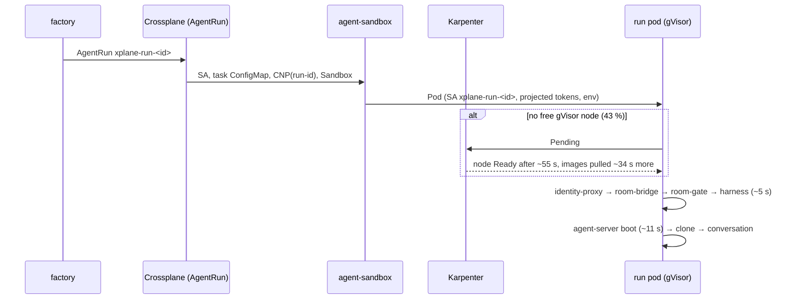
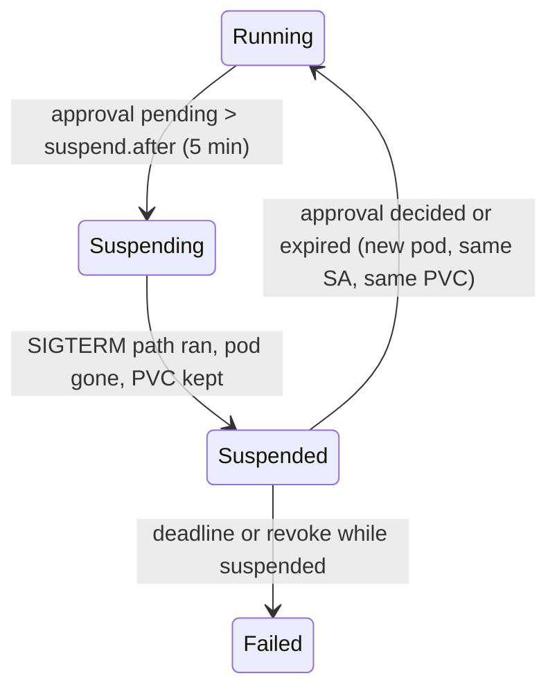

# v2: warm and suspended sandboxes

**Date:** 2026-10-16 · **Status:** draft, owner review pending ·
**Part of:** the v2 roadmap on the
[status page](../../../website/content/docs/platform/ai-platform/status.md#v2-roadmap), row "Warm and
suspended sandboxes"

## Outcome

The gate: *the extensions controller enabled; a `SandboxTemplate` rendering the run pod minus its
per-run parts, claimed without `env` or volume templates; a run waiting on a human suspended
rather than ended, its OpenHands conversation and room bridge restored on resume; a start-time
target and an idle-cost cap set before the pool is turned on.*

Conclusions, from aws-0's last 3 days (42 run pods) and the code as of today:

| # | Finding | Consequence |
|---|---|---|
| 1 | Pod created → Ready is **p50 16 s, p90 154 s, max 198 s**; 18 of 42 pods (43 %) took over 60 s. They are the runs that landed on a **fresh node**: the gVisor NodePool consolidates empty nodes after 5 min | The node is ~90 % of the tail. The pod's own start is ~5 s to the harness container plus **~11 s** for agent-server to boot under gVisor |
| 2 | A run's identity **is its ServiceAccount** `xplane-run-<id>`: octo-sts's `subject_pattern`, the gateway's `ar_agent`, the budget meter. A pod's ServiceAccount and its projected token audiences are fixed at creation | A warm pod can be claimed into a run by labels, but it **cannot receive the run's identity** without a new component that mints the run's tokens at claim time (the *binder*, [§4](#4-binding-a-warm-pod-to-a-run)) |
| 3 | `rooms_approvals_oldest_pending_seconds` peaked at **0** over 7 days: factory runs are unattended, nothing ever waited on a human inside a run | Suspend saves **nothing today**. It pays only once attended rooms are used |
| 4 | The controller image is `v1.0.5`, the chart's git tag `v1.0.6` (#2303 moved one, not both) | The lockstep the HelmRelease comment requires is broken: fixed first |

**Recommended:** ship the cheap half now and build the rest on evidence.

1. **Now — a warm node, not a warm pod.** One low-priority *headroom* pod on the gVisor NodePool,
   running the harness, proxy and bridge images. It keeps one node up with the images pulled; a run
   preempts it. Expected p90 154 s → ~16–20 s, no identity change, same idle cost as a pool of one.
2. **Designed, built when attended rooms wait** (trigger: ≥ 3 approvals a week pending over 5 min):
   suspend a cold run on a PVC, restore its conversation and room lease on resume.
3. **Designed, built only on the owner's go** ([decision 2](#decisions-to-confirm)): the
   `SandboxWarmPool` with the claim-time binder, for the last ~11–15 s.

Measured with `kube_pod_status_ready_time − kube_pod_created` and
`kube_pod_container_state_started{container="harness"}` on namespace `agents`, aws-0, 2026-10-16.
agent-sandbox's own latency histograms have no samples: no claim has ever been made.

## 1. Today's start path



| Segment | Fresh node | Warm node | What removes it |
|---|---|---|---|
| NodeClaim → node Ready | ~55 s (SP1 spike Q1) | 0 | headroom or pool |
| Image pulls | ~34 s | 0 (cached) | headroom (pulls the images) or pool |
| Created → harness started | 129–198 s total | 4–5 s | pool only |
| Harness started → Ready (agent-server) | ~11 s | ~11 s | pool only |
| Clone, conversation start | not measured | not measured | neither (per-run) |

## 2. Options

| Option | Start p90 (expected) | New authority | Idle cost | Verdict |
|---|---|---|---|---|
| **A. Headroom pod** (`PriorityClass` −10, preemptible, images as containers running `sleep`) | ~16–20 s | none | one spot node | **Now** |
| **B. `SandboxWarmPool` + claim-time binder** | ≤ 5 s + clone | binder mints run tokens | one spot node | Owner's go |
| C. Warm pool with the run's SA pre-bound | ≤ 5 s | none | one node *per future run* | Rejected: a warm pod would hold a run identity before claim |
| D. Claim with `env` / `volumeClaimTemplates` | cold | none | — | Rejected: either field forces a cold start (`sandboxclaim_types.go`), the pool is bypassed |
| E. Substrate (memory snapshots) | — | its own | — | The [comparison spike](../../../website/content/docs/platform/ai-platform/agents/alternatives.md#agent-substrate) at the next gcp-0 rebuild, unchanged |

A pool of one and a headroom pod hold the same node. B buys ~11–15 s more per run on runs that
last 10–60 min, against a component that can mint any run's tokens. That trade is the owner's.

## 3. The template: what can and cannot be pre-rendered

One `SandboxTemplate` per **size** (`small` first): roles and data classes differ only in
per-run values, which the binder delivers. The template comes from the same KCL as the run pod
(a new `AgentWarmPool` XR in crossplane-configuration), so the harness digest stays single-sourced.

| Part of today's run pod | In the template? | Instead |
|---|---|---|
| Images (harness, identity-proxy, room-bridge), `runtimeClassName: gvisor`, security contexts, probes, resources for the size, `do-not-disrupt`, tolerations | **Yes** | — |
| Volumes: `proxy-config`, `proxy-tmp`, `workspace`, `home`, `tmp`, `git-cache` (all emptyDir/ConfigMap) | **Yes** | — |
| ServiceAccount `xplane-run-<id>` | **No**: immutable on a pod | Pool SA `agent-warm`: no RBAC, no automount |
| Gateway and octo-sts projected tokens (audiences `agent-router.<role>.<class>`, `octo-sts/<repo>/<role>`) | **No**: SA- and run-bound | Minted by the binder, written to a memory volume only identity-proxy mounts |
| Room token (audience `room-broker`) | **No** | Minted by the binder, written to a volume only room-bridge mounts |
| Label `agents.ogenki.io/run-id` (the CNP's selector), `role`, `task` | **No** | `SandboxClaim.spec.additionalPodMetadata`, propagated to the live pod |
| Env (`RUN_ID`, `ROLE`, `REPOSITORY`, `BRANCH`, `MODEL`, `DATA_CLASS`, `CONVERSATION_ID`, `TRACEPARENT`, `ROOM_ID`, `LLM_BASE_URL`, …) | **No**: the gate forbids claim `env` | `/run/agent/bind/run.json`, written by the binder; agent-run and the bridge read it instead of env |
| `task` ConfigMap (`task.md`, `rules.md`, `run.json`) | **No** | Still rendered; the binder returns its content |
| `activeDeadlineSeconds` | **No** | `SandboxClaim.spec.lifecycle.shutdownTime` = creation + `maxMinutes`; the token TTL is the deadline, as today |
| `room-gate` init container | **No**: it blocks the harness | agent-run waits for the bridge's `/healthz` to report the room held |
| Pod-lost scheduling gate (F12) | **No** | The binder binds one pod uid per run: a replacement pod stays unbound, the run reads lost and the factory resumes it |

## 4. Binding a warm pod to a run

```mermaid
sequenceDiagram
  participant X as Crossplane (AgentRun, launch Warm)
  participant C as claim controller
  participant W as warm pod (pool SA, no run token)
  participant B as run-binder (agent-system)
  X->>X: SA xplane-run-<id>, task ConfigMap, CNP(run-id)
  X->>C: SandboxClaim(warmPoolRef small, additionalPodMetadata run-id, lifecycle.shutdownTime)
  C->>W: adopt; patch labels run-id, role → Cilium selects the run CNP
  loop every 1 s until bound
    W->>B: GET /v1/binding (pool token, audience run-binder)
  end
  B->>B: TokenReview → pod uid; pod label run-id; claim.status.sandbox == pod's Sandbox; uid not yet bound
  B->>B: TokenRequest ×3 for xplane-run-<id> (as today's audiences, TTL to deadline)
  B-->>W: tokens + run.json + task.md + rules.md
  W->>W: binder sidecar writes tokens (identity-proxy, bridge volumes) and run files (harness volume)
  W->>W: agent-run (agent-server already up) clones, starts the conversation
```

- **The claim carries no `env` and no volume templates**, only `warmPoolRef`, `lifecycle` and
  `additionalPodMetadata`. agent-sandbox only propagates labels from its allow-list: the
  `agent-sandbox-config` ConfigMap gains `allowed-label-domains: agents.ogenki.io`.
- **The binder sidecar** (`run-binder-client`, a native sidecar before identity-proxy) is the only
  container that sees both the pool token and the run tokens. It shares the token volume with
  identity-proxy alone and the room-token volume with the bridge alone, so the harness still mounts
  no token (S5).
- **Token reload:** identity-proxy watches its token directory. R2 (no inotify under gVisor) was
  about kubelet's host-side writes; these writes happen inside the sandbox. **Spike W-1** proves
  it before anything else; if it fails, the binder sidecar restarts Envoy once after the write.
- **CNP keyed on run-id:** the run CNP is rendered before the claim, so it selects the pod the
  moment the label lands. A pool CNP (`agents.ogenki.io/pool: small`) allows only DNS for the
  binder and the binder's port; Cilium policies add up, so after the claim the pod gets the run's
  egress plus the binder. agent-run retries its first clone (3 × 2 s) to absorb the identity update.
- **What reads the pod changes:** the composition's pod read and the CNP's `Usage` key on the pod
  name from `SandboxClaim.status.sandbox.name`, not `xplane-run-<id>`.

## 5. Security

| Property | How it holds |
|---|---|
| A warm pod holds no run's identity before claim | It runs as `agent-warm` and holds one token: audience `run-binder`, which grants nothing but `GET /v1/binding` for its own pod, answered 404 until a claim names it |
| A pod receives at most one run, a run at most one pod | The binder records the bound pod uid on the AgentRun (`agents.ogenki.io/bound-pod`) with resourceVersion; a second uid is refused and counted |
| The binder cannot mint arbitrary tokens | A `ValidatingAdmissionPolicy` on `serviceaccounts/token` from the binder's SA: names `^xplane-run-[a-z2-7]{8}$` in `agents`, audiences in today's three families, `expirationSeconds` ≤ 7200 |
| The binder is reachable only from pool pods | Its own default-deny CNP: ingress from `agents.ogenki.io/pool` endpoints on one port; egress to the API server only |
| gVisor | Unchanged: `runtimeClassName` is in the template |
| Default deny until labelled | The pool CNP is the only policy selecting an unclaimed pod |
| Revocation | Unchanged: tokens die at the deadline (octo-sts and the gateway verify offline, so deleting a bound object would not revoke); agent-run still revokes the GitHub token on exit |
| Blast radius of the binder | It holds the power to impersonate any live run. That is new: today only the kubelet mints run tokens. Hence [decision 2](#decisions-to-confirm) |

## 6. Suspend and resume (attended runs)

A run waiting on a human today keeps its pod until the decision or its deadline. Suspend uses the
pinned runtime's `operatingMode: Suspended`: the pod is deleted, **volumes are kept, memory is not**.
Warm-pool pods cannot suspend (a volume template forces a cold start), so **suspendable runs are
cold-launched**: the factory sets `spec.suspendable: true` only on runs in an `attended` room.



| State | Where it lives today | Survives suspend? | Change |
|---|---|---|---|
| OpenHands conversation (`base_state.json`, events) | `/workspace/conversations/<id>` (agent-server's default, cwd `/`) on an emptyDir | Only on a PVC | `workspace` becomes a `volumeClaimTemplates` PVC (gp3 / pd-balanced, the size's `scratch`) when `suspendable` |
| Encrypted conversation secrets | `OH_SECRET_KEY` random per pod | No: agent-server redacts what it cannot decrypt | A per-run key generated once into `/workspace/.oh-key` (0600) |
| Working tree | `/workspace/repo` | With the PVC | Also checkpointed to the branch by the SIGTERM path, as today |
| Conversation id | `CONVERSATION_ID` = the AgentRun's uid | Yes (same XR) | — |
| Room lease, pending approval | The broker | Yes | The broker marks the run's lease `suspended` (no heartbeat expected, the room stays the run's); the resumed bridge reclaims it by run id |
| In-flight tool call, bash sessions, LLM call | Process memory | **No** | Interrupted (`/interrupt`) on SIGTERM; on resume the agent re-issues the call, and the bridge answers it from the decided approval, matched on run, tool and argument digest |
| GitHub token cache, `/tmp`, `/home` | Memory / emptyDir | No | Re-exchanged through octo-sts |

On resume agent-run finds the conversation on disk: it skips the clone and the create, and calls
`POST /api/conversations/<id>/run` with a "resumed after approval" message. **Spike W-2** proves a
pinned agent-server 1.49.6 reloads a persisted conversation after a restart.

**Deadline:** `maxMinutes` counts running time. The composition sets each pod's
`activeDeadlineSeconds` to what remains and the token TTL to the same; suspended time is bounded
by the room's approval TTL (30 min attended), after which the run resumes on the auto-deny.

**Cost saved:** a `small` run holds over 1 vCPU / 2 GiB of requests and its node while it waits.
Suspend frees them for up to 30 min per approval and, for the last run on a node, lets the node
consolidate; the PVC costs ~$0.80 per 10 GiB-month. Zero waits today means zero saved today.

## 7. Changes

| Repo | Change |
|---|---|
| ai-native-ref (the AI paths after the S3 switch; cnref until then, frozen now) | Controller image to `v1.0.6` (lockstep); a `PriorityClass` and the headroom Deployment (step 1); `controller.extensions: true`, `allowed-label-domains`, the binder's CNP, RBAC and `ValidatingAdmissionPolicy`, the `AgentWarmPool` claim at `replicas: 0` (step 3); the run PVC's `StorageClass` (step 3); runbook 01 gains "warm launch" and "suspend" |
| crossplane-configuration | `AgentRun`: `spec.launch: Cold \| Warm` (default `Cold`), `spec.suspendable`; render a `SandboxClaim` instead of a `Sandbox` for `Warm`, a `workspace` PVC for `suspendable`; the annotation `agents.ogenki.io/operating-mode` mapped to `operatingMode`; phase `Suspended` in the XRD; pod and `Usage` keyed on the claimed name. New `AgentWarmPool` XR rendering `SandboxTemplate` + `SandboxWarmPool` + pool SA + pool CNP from the run pod's shared function. Golden tests for each |
| agent-platform | `run-binder` (service and client sidecar image); agent-run reads `/run/agent/bind/run.json` when present, waits for the bridge's room, resumes a persisted conversation, keeps a per-run `OH_SECRET_KEY`; room-bridge reads its config from the bind file; the broker's `suspended` lease and the decided-approval replay; the factory sets `launch`/`suspendable` per run and flips `operating-mode` on the room's `AwaitingHuman` and `approval_decided` |

Flags, all off by default: factory config `sandbox.launch: cold` (`warm` turns the pool on per run,
with cold fallback when the pool is empty) and `sandbox.suspend.enabled: false`
(`suspend.after: 5m`). The pool's `replicas` is the kill switch: `0` empties it, runs fall back cold.

## 8. Observability

| Signal | Source | Use |
|---|---|---|
| Created → Ready, by launch | kube-state (the query above), `agent_sandbox_claim_controller_startup_latency_ms{launch_type}` | The start-time target |
| Pool depth | `agent_sandbox_warmpool_size{sandbox_status}` | Alert: pool empty 10 min while a run is `Pending` |
| Binds | `agent_binder_binds_total{result="bound\|refused_unclaimed\|refused_second_pod\|denied"}` | Alert on any `refused_second_pod` or `denied` |
| Suspensions | `agentrun_status_phase{phase="Suspended"}`, `agent_factory_suspends_total{outcome}` | Resume success rate; time suspended |
| Idle cost | node hours of the gVisor NodePool with no run pod (Karpenter `karpenter_nodes_*` × spot price) | The idle-cost cap |

The run dashboard gains a "start" row (p50/p90 by launch) and a "pool" row.

## 9. Acceptance — live proof on aws-0 (owner go)

| # | Step | Expected |
|---|---|---|
| A1 | Headroom on; 10 factory runs spaced > 5 min apart | p90 created → Ready ≤ the target (decision 1); headroom pod preempted, never a run |
| A2 | Headroom idle for 24 h | node hours ≤ the idle-cost cap |
| W1 | Spike W-1: a token written inside a gVisor pod reloads identity-proxy | a model call succeeds with the new token, no restart |
| W2 | Pool of 1, `launch: warm`; `kubectl auth whoami`-style check of the warm pod's token before claim | subject `agent-warm`; `GET /v1/binding` → 404; the gateway refuses it |
| W3 | A warm run | `launch_type=warm`; claim Ready ≤ 5 s; the gateway logs `ar_agent=…:xplane-run-<id>`; octo-sts exchange succeeds; Hubble shows the run CNP applied |
| W4 | Delete the claimed pod mid-run | replacement pod unbound (`refused_second_pod` = 1); the run reads lost; the factory resumes it |
| W5 | Pool `replicas: 0` | the next run starts cold and succeeds |
| S1 | Spike W-2: restart agent-server 1.49.6 over a persisted conversation | events and state reload |
| S2 | An attended room; an `mcp.write` approval left pending 6 min | AgentRun `Suspended`, pod gone, PVC `Bound`, room lease `suspended` |
| S3 | Approve | new pod, same SA; the conversation continues from its last event (no re-clone); the tool call runs once; the run ends `Succeeded` |
| S4 | Leave an approval to auto-deny (30 min) | resumes, the agent sees the denial, the run ends without the write |

## Results

Step 1 (headroom) went live on aws-0 with ai-native-ref#5, ran on gcp-0 from the 2026-10-17
rebuild, and is [off by default](#headroom-off-by-default-on-for-production) since 2026-10-18. **A1 and A2 were run as a compressed same-day test on 2026-10-17**, not as
the two weeks step 1 names. The owner chose this because a week-long platform costs too much. A1
is complete on its own terms (10 runs, spaced > 5 min). A2 is one measured idle hour,
extrapolated: it shows what a day costs, not that a day passed without incident.

| # | State | Evidence |
|---|---|---|
| A1 | **Pass** (compressed same-day test 2026-10-17) | 10 of 10 runs, all on the warm gVisor node: 11, 11, 12, 11 s on aws-0, then 17, 16, 16, 17, 16, 21 s on gcp-0. **p50 16 s, p90 17 s** against the 30 s target (p90 154 s before headroom). The preemption run is [below](#a1-the-forced-preemption) |
| A2 | **Pass with the headroom off** (the default since 2026-10-18): $0 idle | With it on, the node costs **~$126 a month**, 2.5 × the ≤ $50 cap ([below](#a2-idle-cost)); the cap assumed a 4-vCPU spot node, gcp-0's gVisor pool is `e2-standard-8`. The on-cost and the production options are [documented](#headroom-off-by-default-on-for-production) |
| S2 | **Pass** (gcp-0, 2026-10-18) | `Suspended` under 6 min after the approval opened; pod gone, PVC `Bound`: [runbook 01, Step 8](../../runbooks/agent-factory/01-runtime-sandbox.md#step-8--gcp-0-2026-10-18-ai-native-ref-v0114) |
| S3 | **Pass** (gcp-0, 2026-10-18) | New gVisor pod, same SA and PVC, one conversation; `Succeeded` with exactly one PR: [runbook 01, Step 8](../../runbooks/agent-factory/01-runtime-sandbox.md#step-8--gcp-0-2026-10-18-ai-native-ref-v0114) |
| S4 | Not run | |

Created → Ready is the pod's `Ready` transition minus its `creationTimestamp`: the same quantity as
`kube_pod_status_ready_time − kube_pod_created`, read from the API every 5 s. On gcp-0 each run was a
`solo` task from a `[v2 A1 probe]` docs issue. The probe pull requests were closed unmerged, except
the one the owner merged as runbook 11 step 7. The gcp-0 split: 4–7 s from created to harness
started (images cached), then 10–15 s for agent-server to boot under gVisor. That is the ~11 s that
only the warm pool removes.

### A1: the forced preemption

The factory sizes every run `small` (1 vCPU harness, 1,070m with its sidecars), and `caps.concurrentRuns`
is 4, so its runs alone cannot fill the warm node. Before run 8, a 5,599m `pause` pod at priority 0
(a run's priority) stood in for a `large` run. It left 600m beside the headroom pod (priority −10),
so the run fitted only if the headroom yielded. The filler was deleted after the probe.

| Time (UTC) | Event |
|---|---|
| 21:15:11 | Run pod `xplane-run-xndo3o6k` created |
| 21:15:12 | `agents-headroom` **Preempted** by the run on `…-wrfp`. The replacement headroom pod is Pending (`preemptionPolicy: Never`) |
| 21:15:17 | `TriggeredScaleUp`: `agents-gvisor` 1 → 2 |
| 21:15:28 | Run pod Ready: **17 s**, on the warm node |
| 21:16:21 | Node `…-wc9m` created, `e2-standard-8` spot, in `agents-gvisor` (no NAP fallback) |
| 21:17:22 / 21:18:53 | Headroom scheduled / Ready on `wc9m` (image pulls on a fresh node) |
| 21:20:31 | Filler gone; the autoscaler drains `wc9m`. The headroom is back on `wrfp`, Ready in 4 s |

There was no `FailedScaleUp` and no quota event: `CPUS_ALL_REGIONS` was at 30 of 48 before the
scale-up. The run preempted the headroom, never the reverse. The cost: a warm node is
missing for 3 min 41 s after a preemption, until the headroom is Ready elsewhere.

### A2: idle cost

The idle hour is 19:56–20:56 UTC, 2026-10-17, before the first run. All six nodes were present for
the whole hour (180 of 180 scrapes of `kube_node_info`), and no run pod existed. The prices are the
Cloud Billing Catalog's list prices for europe-west4 on the same day, a month taken as 730 h.

| Nodes, idle hour | Model | Per hour | Per day | Per month |
|---|---|---|---|---|
| `agents-gvisor`: 1 × `e2-standard-8`, holding only the headroom pod, + 50 GB pd-standard | spot | $0.172 | $4.14 | **$125.80** |
| `static`: 3 × `e2-standard-4`, + 3 × 50 GB pd-balanced | spot | $0.277 | $6.64 | $201.90 |
| NAP: 2 × `e2-standard-4`, + 2 × 50 GB pd-standard | on-demand | $0.301 | $7.23 | $219.80 |
| **Cluster nodes, idle** | | **$0.750** | **$18.00** | **$547.50** |

Spot E2 is $0.01378 per vCPU-hour and $0.001846 per GiB-hour. On-demand is $0.02401 and $0.003218.
The GKE management fee ($0.10/h) and the OpenBao and Tailscale VMs outside GKE are left out:
headroom does not change them.

The headroom's own idle cost is the `agents-gvisor` row, ~$126 a month, **2.5 × the cap**. The
owner's call (2026-10-18): [headroom off by default](#headroom-off-by-default-on-for-production).

## Headroom: off by default, on for production {#headroom-off-by-default-on-for-production}

**This demo platform ships the headroom at `replicas: 0`: $0 idle, and the first run on an empty
pool starts cold (~1.5–3.5 min). The headroom is a supported switch: a production platform turns it
on and gets ~16 s starts.** The PriorityClass and the Deployment stay deployed, so the switch is one
value.

```mermaid
sequenceDiagram
  participant H as headroom pod (priority −10)
  participant N as warm agents-gvisor node
  participant R as run pod (priority 0)
  participant A as autoscaler
  H->>N: holds the node, run images pulled
  R->>N: scheduled; preempts the headroom
  N-->>R: Ready in ~16 s (no node boot, no image pull)
  H->>A: replacement headroom Pending
  A->>A: scale agents-gvisor +1
  A-->>H: headroom Running on the new node, warm for the next run
```

**Switch on:** `spec.replicas: 1` in
[`infrastructure/base/karpenter-nodepools-agents/headroom/deployment.yaml`](../../../infrastructure/base/karpenter-nodepools-agents/headroom/deployment.yaml)
(shared by every cluster). `0` turns it back off.

| Production option | Idle cost a month | Start time |
|---|---|---|
| Always on, one `e2-standard-8` spot node | ~$126 | ~16 s, every run |
| Working hours only, scheduled scaling of `replicas` (10 h × 22 days) | ~$38 | ~16 s in hours, cold outside |
| Smaller node, `e2-standard-4` | ~$63 | ~16 s for `small`; a `large` run doesn't fit, so it starts cold |
| Off (this platform's default) | $0 | Cold: the first run ~1.5–3.5 min |

Costs are our europe-west4 spot list prices ([A2](#a2-idle-cost)). Cold times: ~90 s
submission-to-start in the phase-0 spike, 205 s created → Ready for a plain gVisor pod on a freshly
scaled node on 2026-10-17 (vs ~32 s on an up node).

**Recommended for production:** always on, or working hours if nights and weekends are quiet,
with the gVisor node sized for the largest run class.

## Decisions

| # | Decision | Recommended | Rejected, and why |
|---|---|---|---|
| D1 | Unit of the pool | One template per size, `small` first; roles and classes come from the binding | Per role × class: 8 pools to keep warm for one maintainer's traffic |
| D2 | Where per-run data enters a warm pod | A pull by an in-pod sidecar from the binder | Claim `env`/volumes: cold start by definition. A push into the pod: nothing ever dials into a sandbox (C4) |
| D3 | Who mints run tokens | A dedicated `run-binder` in `agent-system`, fenced by a VAP | The room-broker or the factory API: either would add token minting to a component that already faces humans |
| D4 | Suspendable runs | Cold, PVC-backed, only in `attended` rooms | All runs on PVCs: an EBS create and attach on every run for a feature unattended runs never use |
| D5 | Suspend trigger | 5 min of a pending approval | Immediately: most decisions in an attended room take seconds; a suspend-resume costs a cold start |
| D6 | Deadline while suspended | Running time only, bounded by the approval TTL | Wall clock: a human's lunch would end the run |

## Decisions to confirm

Only the owner holds these.

1. **The start-time target and the idle-cost cap** (the gate requires both before the pool turns
   on). *Recommended:* p90 created → Ready **≤ 30 s** with headroom, **≤ 10 s** with the pool;
   idle cost **≤ $50 a month per active cloud** (one 4-vCPU spot node, an estimate to confirm from
   the pricing API). *Decided 2026-10-18:* the measured node is ~$126, so the headroom ships off;
   production turns it on ([options](#headroom-off-by-default-on-for-production)).
2. **Accept a component that can mint any live run's tokens** (the binder, §5), to buy the last
   ~11–15 s. *Recommended:* **not now** — headroom first; revisit when interactive rooms make
   seconds matter or headroom misses the target.
3. **Build suspend before attended rooms are in use?** *Recommended:* **no** — build it when
   ≥ 3 approvals a week stay pending over 5 min (zero in the last 7 days).
4. **The live proof on aws-0** (A1–A2 now; W and S rows when their step is built): owner go per run.

## Implementation order

| Step | What | Repos | Gate |
|---|---|---|---|
| 0 | Controller image `v1.0.6`; extensions on (no claim yet) | ai-native-ref | Rendered bundle diff only; controller healthy |
| 1 | Headroom PriorityClass + Deployment, measured 2 weeks | ai-native-ref | A1, A2 |
| 2 | Spikes W-1 and W-2 (a day, no merge) | agent-platform (harness), a scratch pod on aws-0 | W1, S1 |
| 3 | Suspend: XRD/KCL, broker lease, approval replay, agent-run resume, factory trigger, behind `suspend.enabled` | crossplane-configuration → agent-platform → ai-native-ref | Decision 3; S2–S4 |
| 4 | Warm pool: `AgentWarmPool` XR, `launch: Warm`, run-binder, agent-run/bridge bind files, VAP and CNPs, `replicas: 0` then 1 | agent-platform → crossplane-configuration → ai-native-ref | Decision 2; W2–W5 |
