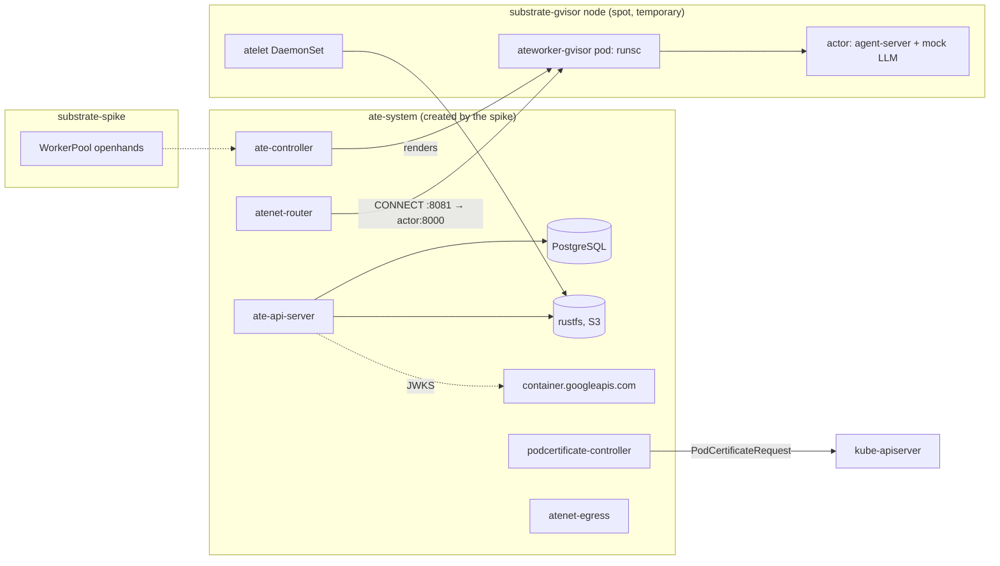

# Substrate spike on gcp-0

**Date:** 2026-10-17 · **Status:** run on gcp-0 2026-10-18, torn down 2026-10-18 ·
**Part of:** the v2 roadmap, row "Substrate spike";
[alternatives § Reconsidering Substrate](../../../website/content/docs/platform/ai-platform/agents/alternatives.md#reconsidering-substrate-not-now-deliberately-open),
[runbook 14 step 10](../../runbooks/agent-factory/14-gcp-0-session.md#10-the-substrate-spike)

## Conclusion

**Pass.** OpenHands agent-server, run as a Substrate actor, suspends, resumes and restores on
another node with its conversation intact, and keeps going: a second message got a reply after the
restore. A golden-snapshot warm start takes **2.9 s** (p50), against **16 s** for the factory's
warm-node path today.

**Recommendation, for the owner to decide: do not adopt now; keep Substrate as a candidate to
revisit.** The start-time and portability gains are real, but every cost in [Verdict](#verdict)
comes first: beta kubelet gates that only new node pools carry, a second control plane with its own
PostgreSQL, one-actor-per-worker sizing, and a v0.5.0 with no published images.

## Results

Time from `kubectl ate resume` to the first `200` from agent-server's `/health` through the atenet
router, unless noted.

| # | What | Result |
|---|---|---|
| M1 | Cold start (no golden snapshot), ×5 | 15.1–15.3 s, p50 15.3 s (`resume` returns at ~15.0–15.2 s) |
| M2 | Warm start from the golden snapshot, ×5 | 2.8–3.5 s, p50 **2.9 s** |
| M3 | Pause | 2.1 s |
| M5 | Resume after pause | 1.2 s, conversation intact (7 events) |
| M4 | Suspend | 8.8 s (a second suspend: 3.3 s) |
| M5 | Resume after suspend | 2.7 s, conversation intact (7 events) |
| M6 | Restore on another node (worker moved from `…-3nn6` to `…-f7vr`) | 53.2 s, conversation intact (7 events) |
| M7 | Agent continues after the restore | **PASS**: the second reply arrived, events 7 → 14 |
| B1 | Baseline: the same image as a plain GKE Sandbox pod, created → Ready, ×5 | 205 s for the first (node scale-up), then 31.8–33.8 s on the up node, image cached |

| Path | Warm start | Cold start | Standing cost |
|---|---|---|---|
| The factory today ([warm-sandboxes design](2026-10-16-v2-warm-sandboxes-design.md)) | run created → Ready p50 16 s, headroom on | ~205 s | an idle placeholder node |
| Substrate, golden snapshot | 2.9 s, ~5× faster | 15.3 s, worker already up | the worker itself: a standing pod (1 CPU / 4Gi request) on a gated node |

### Findings

Each is symptom → cause → fix.

| # | Finding |
|---|---|
| 1 | `postgres-0` Pending → upstream's PVC requests 500Gi, more than gcp-0's regional `SSD_TOTAL_GB` quota (500) → edited to 20Gi in the local checkout ([README](../../../spikes/substrate/README.md#upstream-edit-and-hand-patches)) |
| 2 | Pods stuck in Init / ContainerCreating, "ClusterTrustBundle projection is not supported in static kubelet mode" → GKE enabled the beta APIs in place, but node pools created before keep kubelet templates without the `ClusterTrustBundle` / `PodCertificateRequest` gates (verified: the old templates lack them; the NAP template created 2026-10-18 06:30Z has them), and a same-version node-pool upgrade does **not** regenerate the template → only new node pools work; the spike used a temporary `substrate-gvisor` pool and pinned the control plane to gated pools (`spikes/substrate/patches/pin.yaml`) |
| 3 | `kubectl-ate` "Unauthenticated: invalid bearer token", the server logs nothing → ate-api-server must reach the GKE issuer's public discovery document and JWKS at `container.googleapis.com`, which the spike's default-deny policy blocked → CiliumNetworkPolicy `ate-api-server-egress` |
| 4 | "no worker has room for the actor" → an actor occupies its whole worker (requests are ignored; capacity is the worker's limits, 2500m / 6Gi, against the actor's limit of 2 CPU / 4Gi), and the warm template's golden-snapshot build holds the slot until it finishes → one actor per worker; size worker pools by actor count |
| 5 | Router 503, "connection refused" to `169.254.17.2:80` → the router's HTTP port reaches an actor's port 80 only; other ports need the CONNECT listener (Service port 8081) with the port in the authority → `measure.sh` fixed |
| 6 | `measure.sh`'s node lookup prints `node=?` (it reads the wrong field of `kubectl-ate`'s JSON) → not fixed; the node names above come from the worker records |

### Verdict

What this means for the platform's v2 [warm sandboxes](2026-10-16-v2-warm-sandboxes-design.md):

| Substrate gives | Substrate costs |
|---|---|
| ~3 s warm starts, against 16 s with an idle node | Beta kubelet gates, carried only by node pools created after the APIs were enabled: every agent pool would be recreated |
| Portable suspend and restore across nodes, conversation intact: a spot reclaim or a drain need not lose a run | A second control plane in `ate-system`: PostgreSQL, ate-api-server, ate-controller, the podcertificate controller, router and egress |
| No placeholder node beyond the worker | One actor per worker: a standing worker pod per concurrent run, pools sized by actor count |
| | v0.5.0 maturity: no published images ([#2730](https://github.com/agent-substrate/substrate/issues/2730)), an installer that hardcodes `ate-system`, a 500Gi PostgreSQL default |

The [result table](#question) has a pass lead to designing a Substrate backend behind `AgentRun`.
The recommendation is to hold that design until the costs shrink upstream (published images, the
gates on by default in GKE) or the alternatives page's triggers fire, with 2026-12-15 as the next
look.

## Question

Does upstream Agent Substrate, running OpenHands agent-server as a bring-your-own actor on a gVisor
`WorkerPool`, suspend, resume and **restore on another node** with its conversation intact? What
does it cost in start time compared with today's path, kubernetes-sigs/agent-sandbox with one gVisor
pod per run?

| Result | Next step |
|---|---|
| **Pass**: OpenHands restores on another node and continues its conversation | Design a Substrate backend behind `AgentRun` |
| **Fail**: the restored Python process crashes, or the conversation does not continue | The path stays closed for OpenHands until it is fixed upstream; reconsider on the alternatives page's triggers or on 2026-12-15 |
| **Inconclusive**: blocked before OpenHands ran | Record the blocker; the triggers and the 2026-12-15 date still apply |

## What was installed

Substrate **v0.5.0** (`e8d40c3`, released 2026-10-14). The gVisor sandbox asset comes from the
release's `SandboxConfig` (`gs://gvisor/releases/nightly/2026-10-10`).

| Choice | Why |
|---|---|
| Control plane in `ate-system`, workloads in `substrate-spike` | Upstream names `ate-system` literally (61 manifest and 44 Go references), and the installer refuses any other namespace (`cmd/ate-setup/internal/steps/env.go`). The spike created it and deleted it |
| Snapshots on an in-cluster rustfs, S3 backend | Upstream's kind overlay does this. No GCS bucket and no Workload Identity, so nothing outside the cluster |
| Workers on a temporary `substrate-gvisor` pool (2× `e2-standard-4` spot, gVisor), not `agents-gvisor` | Planned on `agents-gvisor`, the pool the factory runs on, but that pool predates the beta APIs and its kubelet lacks the gates ([finding 2](#findings)). Substrate brings its own `runsc` and runs it inside an unprivileged runc pod with 13 capabilities and AppArmor unconfined, so the worker tolerates `sandbox.gke.io/runtime=gvisor` without using GKE Sandbox's RuntimeClass; nested gVisor cannot checkpoint |
| Images built from the tag with ko, pushed to a private Artifact Registry repo | Upstream publishes none ([#2730](https://github.com/agent-substrate/substrate/issues/2730)). `envoy-dataplane` is a Rust build in Docker, so it ran in a buildx container capped at 3 GiB |
| Installed by the upstream installer, not by kustomize | It generates CA and JWT-signing Secrets at install time, which cannot live in the repository. `spikes/substrate/` holds its settings, our own objects and numbered scripts |
| `ActorTemplate` and actors created with `kubectl ate` | They live in Substrate's PostgreSQL, not etcd; only `WorkerPool` and `SandboxConfig` are CRDs |

### Network

A default-deny `CiliumClusterwideNetworkPolicy` covers `ate-system`,
`podcertificate-controller-system` and `substrate-spike`: traffic among the three, DNS, and egress
to kube-apiserver. Substrate registers no admission webhook, so nothing needs ingress from
kube-apiserver and the GKE konnectivity sibling rule does not apply. atelet alone may also reach
the image registries, the metadata server (GKE's image credential provider) and
`storage.googleapis.com` (the public gVisor asset); ate-api-server alone may reach
`container.googleapis.com` ([finding 3](#findings)). The actor gets **no egress**: its model is a
mock in the same actor, `atenet-egress` has no route out, and Substrate drops actor DNS when no
egress policy is set.

### The actor

| Container | Image | Role |
|---|---|---|
| `agent-server` | `ghcr.io/openhands/agent-server:1.49.6-python`, by digest: the base of the factory's harness image, without its run wrapper | the harness under test, on `:8000` |
| `mock-llm` | the same image, `python -c` with a 25-line OpenAI-compatible server on `localhost:4000` | answers every completion with `PONG`, so the conversation advances with no key and no egress |

The prompt is `"Reply with the word PONG."`. It names no repository, and the actor has no
credentials of any kind.

## Method

Each is timed from the client side (the `kubectl ate` call to the first `200` from agent-server's
`/health` through the atenet router), repeated 5 times where marked ×5.

| # | Measurement | How |
|---|---|---|
| M1 | Cold start | Template with golden snapshots disabled: `create actor` + `resume` → first `/health` 200 |
| M2 | Warm start | Template with golden snapshot: `create actor` (seeded from the golden tag) + `resume` → first 200 |
| M3 | Pause | `kubectl ate pause`: the snapshot stays on the node |
| M4 | Suspend | `kubectl ate suspend`: the snapshot goes to object storage |
| M5 | Resume, same node | after M3 and after M4, `resume` → first 200, worker on the same node |
| M6 | Restore, another node | after M4, flip the `WorkerPool`'s `nodeAffinity` from `In [node 1]` to `NotIn [node 1]`, wait for the worker on node 2, `resume`; the actor's worker is on node 2 |
| M7 | OpenHands continues | before M4: start a conversation, one exchange. After M6: the same conversation id lists the same events, and a second message gets a reply |
| B1 | Baseline | the same agent-server image as a plain pod with GKE Sandbox's `gvisor` RuntimeClass: pod created → Ready. The factory's figures (p50 16 s, p90 154 s) are from the [warm-sandboxes design](2026-10-16-v2-warm-sandboxes-design.md) |

Cordon is not used. `kubectl ate` cannot set an actor's `worker_selector`, so placement moves on the
pool side: the worker pool has 2 nodes, and the affinity flip makes ate-controller roll the only
worker onto the other one.

## Known constraints going in

| Constraint | Source |
|---|---|
| Upstream says GKE 1.36 serves the two beta APIs only if they are enabled at cluster creation. **Not so on `1.36.4-gke.1391002`**: gcp-0, created 18:26 UTC, served both after an in-place update at about 19:40. The kubelets of existing node pools still lack the gates ([finding 2](#findings)) | Substrate [setup-gcp README](https://github.com/agent-substrate/substrate/blob/e8d40c3/tools/setup-gcp/README.md), "Create Cluster"; `kubectl api-resources` on gcp-0 |
| A reclaimed spot VM gives the worker 15 s by default, at most 2 min; an actor not suspended by then is `CRASHED` and loses everything since its last snapshot | [api-guide § Eviction](https://github.com/agent-substrate/substrate/blob/e8d40c3/docs/api-guide.md#eviction) |
| Substrate does not suspend on `SIGTERM`; the harness must call `SuspendActor` itself | same |
| WebSocket upgrades are rejected on actor egress | v0.5.0 release notes, #1634 |
| A gVisor worker supports one `durableDir` volume per actor | [api-guide § ActorTemplate](https://github.com/agent-substrate/substrate/blob/e8d40c3/docs/api-guide.md#2-actortemplate-the-workload-blueprint) |

## Status

| Step | State |
|---|---|
| Gate | **Met** 2026-10-17 about 19:40 UTC: `clustertrustbundles` and `podcertificaterequests`, both `certificates.k8s.io/v1beta1` |
| 1. Images | **Done** 2026-10-17: 16 ko images and `envoy-dataplane`, tag `v0.5.0`, in `europe-west4-docker.pkg.dev/ogenki-435905/substrate-spike` |
| 2. Base | **Applied** 2026-10-17: namespaces, network policy, rustfs with its bucket |
| 3. Install | **Run** by the owner 2026-10-18, with PostgreSQL's PVC edited to 20Gi ([finding 1](#findings)) |
| 4. Post-install | **Run** 2026-10-18, plus the hand-applied `patches/pin.yaml` ([finding 2](#findings)) |
| Measurements | **Run** 2026-10-18: [Results](#results) |
| Teardown | **Done** 2026-10-18 |

## Inventory and cleanup

[`spikes/substrate/OBJECTS.md`](../../../spikes/substrate/OBJECTS.md) lists every object the spike
created, in and outside the cluster, from `inventory.sh` diffs, and the cleanup of each.
