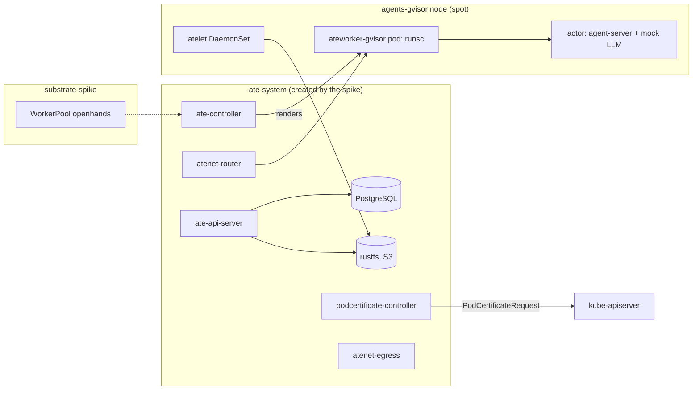

# Substrate spike on gcp-0

**Date:** 2026-10-17 · **Status:** parked at the install, waiting on the owner (see [Status](#status)) ·
**Part of:** the v2 roadmap, row "Substrate spike";
[alternatives § Reconsidering Substrate](../../../website/content/docs/platform/ai-platform/agents/alternatives.md#reconsidering-substrate-not-now-deliberately-open),
[runbook 14 step 10](../../runbooks/agent-factory/14-gcp-0-session.md#10-the-substrate-spike)

## Question

Does upstream Agent Substrate, running OpenHands agent-server as a bring-your-own actor on a gVisor
`WorkerPool`, suspend, resume and **restore on another node** with its conversation intact? What
does it cost in start time compared with today's path, kubernetes-sigs/agent-sandbox with one gVisor
pod per run?

| Result | Next step |
|---|---|
| **Pass**: OpenHands restores on another node and continues its conversation | Design a Substrate backend behind `AgentRun` |
| **Fail**: the restored Python process crashes, or the conversation does not continue | The path stays closed for OpenHands until it is fixed upstream; reconsider on the alternatives page's triggers or on 2026-12-15 |
| **Inconclusive**: blocked before OpenHands ran | Record the blocker; the triggers and the 2026-12-15 date still apply |

## What is installed

Substrate **v0.5.0** (`e8d40c3`, released 2026-10-14). The gVisor sandbox asset comes from the
release's `SandboxConfig` (`gs://gvisor/releases/nightly/2026-10-10`).



| Choice | Why |
|---|---|
| Control plane in `ate-system`, workloads in `substrate-spike` | Upstream names `ate-system` literally (61 manifest and 44 Go references), and the installer refuses any other namespace (`cmd/ate-setup/internal/steps/env.go`). The spike creates it and deletes it |
| Snapshots on an in-cluster rustfs, S3 backend | Upstream's kind overlay does this. No GCS bucket and no Workload Identity, so nothing outside the cluster |
| Workers on `agents-gvisor` (spot, `e2-standard-8`) | The pool the factory runs on. Substrate brings its own `runsc` and runs it inside an unprivileged runc pod with 13 capabilities and AppArmor unconfined, so the worker tolerates `sandbox.gke.io/runtime=gvisor` without using GKE Sandbox's RuntimeClass; nested gVisor cannot checkpoint |
| Images built from the tag with ko, pushed to a private Artifact Registry repo | Upstream publishes none ([#2730](https://github.com/agent-substrate/substrate/issues/2730)). `envoy-dataplane` is a Rust build in Docker, so it runs in a buildx container capped at 3 GiB |
| Installed by the upstream installer, not by kustomize | It generates CA and JWT-signing Secrets at install time, which cannot live in git. `spikes/substrate/` holds its settings, our own objects and numbered scripts |
| `ActorTemplate` and actors created with `kubectl ate` | They live in Substrate's PostgreSQL, not etcd; only `WorkerPool` and `SandboxConfig` are CRDs |

### Network

A default-deny `CiliumClusterwideNetworkPolicy` covers `ate-system`,
`podcertificate-controller-system` and `substrate-spike`: traffic among the three, DNS, and egress
to kube-apiserver. Substrate registers no admission webhook, so nothing needs ingress from
kube-apiserver and the GKE konnectivity sibling rule does not apply. atelet alone may also reach
the image registries, the metadata server (GKE's image credential provider) and
`storage.googleapis.com` (the public gVisor asset). The actor gets **no egress**: its model is a
mock in the same actor, `atenet-egress` has no route out, and Substrate drops actor DNS when no
egress policy is set.

### The actor

| Container | Image | Role |
|---|---|---|
| `agent-server` | `ghcr.io/openhands/agent-server:1.49.6-python`, by digest: the base of the factory's harness image, without its run wrapper | the harness under test, on `:8000` |
| `mock-llm` | the same image, `python -c` with a 25-line OpenAI-compatible server on `localhost:4000` | answers every completion with `PONG`, so the conversation advances with no key and no egress |

The prompt is `"Reply with the word PONG."`. It names no repository, and the actor has no
credentials of any kind.

## Measurements

Each is timed from the client side (the `kubectl ate` call to the first `200` from agent-server's
`/health` through the atenet router), repeated 5 times, median and max reported.

| # | Measurement | How |
|---|---|---|
| M1 | Cold start | Template with golden snapshots disabled: `create actor` + `resume` → first `/health` 200 |
| M2 | Warm start | Template with golden snapshot: `create actor` (seeded from the golden tag) + `resume` → first 200 |
| M3 | Pause | `kubectl ate pause`: the snapshot stays on the node |
| M4 | Suspend | `kubectl ate suspend`: the snapshot goes to object storage |
| M5 | Resume, same node | after M3 and after M4, `resume` → first 200, worker on the same node |
| M6 | Restore, another node | after M4, flip the `WorkerPool`'s `nodeAffinity` from `In [node 1]` to `NotIn [node 1]`, wait for the worker on node 2, `resume`; the actor's worker is on node 2 |
| M7 | OpenHands continues | before M4: start a conversation, one exchange. After M6: the same conversation id lists the same events, and a second message gets a reply |
| B1 | Baseline | the same agent-server image as a plain pod with GKE Sandbox's `gvisor` RuntimeClass on the same pool: pod created → first 200, on a warm node. The cold-node figure (p50 16 s, p90 154 s) is from the [warm-sandboxes design](2026-10-16-v2-warm-sandboxes-design.md) |

Cordon is not used. `kubectl ate` cannot set an actor's `worker_selector`, so placement moves on the
pool side: `agents-gvisor` autoscales to 2 nodes, and the affinity flip makes ate-controller roll
the only worker onto the other one.

## Known constraints going in

| Constraint | Source |
|---|---|
| Upstream says GKE 1.36 serves the two beta APIs only if they are enabled at cluster creation. **Not so on `1.36.4-gke.1391002`**: gcp-0, created 18:26 UTC, served both after an in-place update at about 19:40 | Substrate [setup-gcp README](https://github.com/agent-substrate/substrate/blob/e8d40c3/tools/setup-gcp/README.md), "Create Cluster"; `kubectl api-resources` on gcp-0 |
| A reclaimed spot VM gives the worker 15 s by default, at most 2 min; an actor not suspended by then is `CRASHED` and loses everything since its last snapshot | [api-guide § Eviction](https://github.com/agent-substrate/substrate/blob/e8d40c3/docs/api-guide.md#eviction) |
| Substrate does not suspend on `SIGTERM`; the harness must call `SuspendActor` itself | same |
| WebSocket upgrades are rejected on actor egress | v0.5.0 release notes, #1634 |
| A gVisor worker supports one `durableDir` volume per actor | [api-guide § ActorTemplate](https://github.com/agent-substrate/substrate/blob/e8d40c3/docs/api-guide.md#2-actortemplate-the-workload-blueprint) |

## Status

| Step | State, 2026-10-17 |
|---|---|
| Gate | **Met** at about 19:40 UTC: `clustertrustbundles` and `podcertificaterequests`, both `certificates.k8s.io/v1beta1` |
| 1. Images | **Done**: 16 ko images and `envoy-dataplane`, tag `v0.5.0`, in `europe-west4-docker.pkg.dev/ogenki-435905/substrate-spike` |
| 2. Base | **Applied**: namespaces, network policy, rustfs with its bucket |
| 3. Install | **Refused** by the agent's permission classifier ("Protected-Scope IaC Apply"). The owner decides and runs it |
| 4. Post-install | Not run |
| Measurements | Not run |

### Morning steps for the owner

From this branch, with `SUBSTRATE` a v0.5.0 checkout of agent-substrate/substrate (`ate-setup`
and `kubectl-ate` built into `$SUBSTRATE/bin`) and `KUBECONFIG` on gcp-0:

```bash
cd spikes/substrate
./3-install.sh          # the upstream installer, memory-capped; refuses any cluster but gcp-0
./4-post-install.sh     # patches, WorkerPool, atespace, ActorTemplates
./inventory.sh > after.txt && comm -13 inventory-before.txt after.txt   # into OBJECTS.md, before measuring
```

Then `measure.sh` as in the [README](../../../spikes/substrate/README.md), or hand back to the agent.

## Inventory and cleanup

[`spikes/substrate/OBJECTS.md`](../../../spikes/substrate/OBJECTS.md) lists every object, from
`inventory.sh` diffs. Created so far:

| Where | Objects |
|---|---|
| Artifact Registry | repo `substrate-spike` (europe-west4, ogenki-435905) with the spike's images |
| Cluster-scoped | Namespaces `ate-system`, `substrate-spike`; CiliumClusterwideNetworkPolicy `substrate-spike`; PV `pvc-304aba6d-d14b-42a4-8104-ea8b20a56afd` (via the PVC) |
| `ate-system` | CiliumNetworkPolicy `atelet-egress`; NetworkPolicy `rustfs`; Secret `rustfs-credentials`; PVC `rustfs-data`; Service, Deployment `rustfs`; Job `rustfs-bucket-init` |

Cleanup of what exists today:

```bash
kubectl delete -k spikes/substrate/
gcloud artifacts repositories delete substrate-spike --location=europe-west4 --project=ogenki-435905 --quiet
```

Once steps 3 and 4 have run, their cleanup comes first, in the order `OBJECTS.md` gives.

## Results

*Pending: no measurement has run.*
