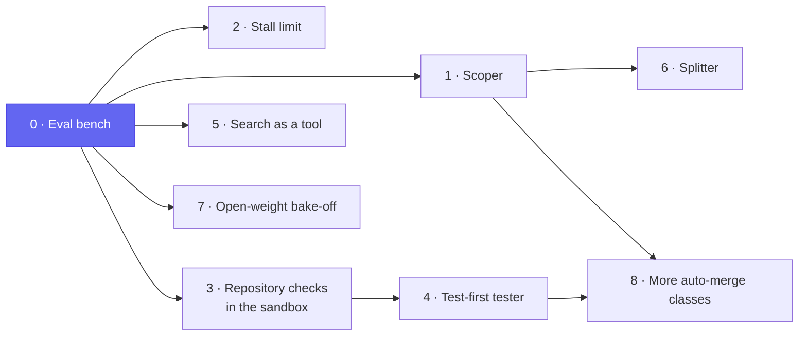
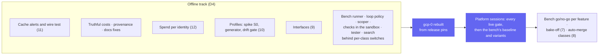

# v3: more accepted pull requests per dollar, on the models we may use

**Date:** 2026-10-19 · **Status:** roadmap approved by the owner 2026-10-19; **amended 2026-10-21** by the
[v3 review](2026-10-21-v3-review.md#5-amendments-proposed): features 2, 4, 5, 7 and 8 revised, 9 to 11
added, the [Later](#later) section now pointing at agent-platform's designs; **amended 2026-10-22**:
feature 12 (spend per identity) added and the work ordered offline first
([D4, D5](#owner-decisions-2026-10-22)). Each feature gets its own design before it is built ·
**Part of:** the roadmap on the
[status page](../../../website/content/docs/platform/ai-platform/status.md#roadmap)

## Outcome

v2.0 made the factory safe to leave running: budgets enforced, low-risk merges without a human, a
revert breaker, two repositories. v3 makes it **land more accepted pull requests per dollar** on the
models it is allowed to use. Public work stays on open-weight models; internal work stays on Claude.

The lever is the **task**, not the model. On the hard-task cohort, GLM-5.3 got 0 of 15 accepted in
our factory and in Claude Code alike, while Claude got 13 of 15
([results](2026-10-12-v2-hard-task-cohort-design.md#results)). Public work may not move to Claude, so
v3 shapes tasks to fit the model, measures every change, and lets the best open model win on our own
issues.

## Owner decisions, 2026-10-19

| # | Decision | Consequence |
|---|---|---|
| D1 | **Outcomes first.** v3 is for a factory that works better, not for adoption | Installing on any Kubernetes moves to a later release ([Later](#later)) |
| D2 | **Public work stays on open weights.** [ADR-0058](../../../website/content/docs/decisions/0058-reviewer-on-another-model.md) holds: no public content to Anthropic | Routing cannot buy capability from a frontier model on public tasks; it picks among open models |
| D3 | **Fit the task to the model** (approach A), over finding a better open model first (B) or bigger self-hosted models (C) | Scoping and splitting come before the model bake-off; the bake-off is a gated step, not the plan |

## Owner decisions, 2026-10-22 {#owner-decisions-2026-10-22}

| # | Decision | Consequence |
|---|---|---|
| D4 | **Offline first.** Everything that can be built and proven without a cluster is, before a platform runs: unit, golden and container suites in CI, rule unit tests, drift gates. The live gates then run together in platform sessions on `gcp-0` | Each feature's gate splits into an offline proof, merged first, and a live proof on a session's checklist. Each feature ships behind a per-class switch, off by default, so one session measures the bench's baseline and its variants. `gcp-0` is rebuilt when the offline track is done, not first ([order](#order-of-work)) |
| D5 | **Spend per identity** becomes feature 12: one dashboard per charged principal, the person or the sponsored service account | Needs truthful costs (dollars, cache reads discounted) and the factory's charge per run, since a label-started run's pod carries `system:factory`, not the person |

## Why these features

### What the numbers say

| Fact | Source |
|---|---|
| Most runs finish in 10–40 steps for under $0.20, with about 95% of input read from cache | [harness tuning, real runs](../../../website/content/docs/platform/ai-platform/agents/harness.md#examples) |
| The expensive runs are vague tasks: one spent its whole $2.55 on 319 `grep` steps and pushed nothing | same |
| The agent mostly cannot run the repository's own checks before pushing: the harness image holds Python, git and `gh`, and a factory run reaches GitHub only. A red CI starts a new run, which reloads the whole context, to fix it | [harness reference](../../../website/content/docs/platform/ai-platform/agents/harness-reference.md#composition) |
| On hard issues the model is the bottleneck: 0/15 for GLM-5.3 in either harness, 13/15 for Claude | [cohort](2026-10-12-v2-hard-task-cohort-design.md#results) |
| At 15 issues, one run each, the standard error is about 13 points: only a gap as large as 13 vs 0 reads | sampling arithmetic |

So the cheap runs have little left to save. The money goes to failed and wandering runs, and no
change can be judged without more runs per issue.

### What the field says (research, 2026-10-19)

| Question | Finding |
|---|---|
| Is the gap ours to fill? | Hosted products made "issue → sandbox → PR" a commodity. No open-source, GitOps-native factory combines hard USD caps per run, a short-lived identity per run, implementer/reviewer roles and risk-tiered auto-merge with a revert breaker ([Copilot](https://docs.github.com/en/copilot/concepts/agents/cloud-agent/risks-and-mitigations), [OpenHands Enterprise](https://docs.openhands.dev/enterprise/k8s-install/installation), [agentgateway budgets](https://agentgateway.dev/docs/standalone/main/llm/cost-controls/budget-limits/)) |
| Where should routing decide? | Per task at the start, or by restarting on another model with a verified handoff ([SWE-Router](https://arxiv.org/html/2607.00053v1)). Never mid-run: a model switch re-bills the cached prefix at the write rate, 12.5–25× that step's input on Claude ([prompt caching](https://platform.claude.com/docs/en/build-with-claude/prompt-caching)). Rule-based complexity scores came out about random ([LiteLLM](https://docs.litellm.ai/docs/proxy/auto_routing_benchmark.md)) and cost 3.2× unrouted ([TwinRouterBench](https://arxiv.org/abs/2605.18859)) |
| Which roles pay? | Roles that add judgement without adding writers: a scoper (69.4% vs 61.2% on underspecified issues, [Ask or Assume](https://arxiv.org/abs/2603.26233)), a fresh-context reviewer ([Cognition 2026](https://cognition.com/blog/multi-agents-working)), a test-first tester ([TDFlow](https://arxiv.org/abs/2510.23761)). Multi-agent setups cost 7–15× the tokens and hurt sequential work ([Google](https://research.google/blog/towards-a-science-of-scaling-agent-systems-when-and-why-agent-systems-work/), [Anthropic](https://www.anthropic.com/engineering/multi-agent-research-system)) |

## The features

| # | Feature | What changes | Gate, on bench numbers |
|---|---|---|---|
| 0 | **Eval bench** | A fixed corpus scored the same way every time: the cohort's 15 hard issues and 15 routine ones from the factory's history, 3 runs each, on pinned releases. Scored on [the metrics below](#how-v3-is-judged). Runs on truthful costs: the price rule discounts cache reads, and daily caps count dollars, not raw tokens | A baseline, with its run-to-run spread measured |
| 1 | **Scoper** | The `investigate` template grows into the first stage of every non-mechanical class: it rewrites the issue into a bounded task (the files or components, acceptance criteria, the check that proves it) or sends it back to its author with the question it could not answer. The check comes from the class's **steering**: a procedural note per class, three modules at most, on how to verify the change here and which paths to leave alone, read from the intake snapshot and itself a gate path. Focused skills lift smaller models ([SkillsBench](https://arxiv.org/abs/2602.12670)); a repository overview does not ([Not in v3](#not-in-v3)). The harness sets no agent context today, so a run sees nothing of the repository: steering alone is the first bench experiment | Fewer runs past the stall limit; acceptance not lower. Steering alone: fewer review rounds per accepted PR, cost per accepted PR not higher |
| 2 | **Stall limit** | In the harness: no commit by step N stops the run and posts what it found | Spend on wandering runs drops; acceptance not lower |
| 3 | **Repository checks in the sandbox** | The sandbox gets the repository's toolchain (the versions in its `mise.toml`, fetched over GitHub-only egress, or an image per repository) and the implementer runs the same entrypoint the CI runs, `task check` or its equivalent, before it pushes. The fast subset only: checks that need CI secrets, a diff against `main` or more than the sandbox's size stay CI-only. A feedback loop, never a gate: the CI stays the only judge | Fewer fix runs started by a red CI, acceptance not lower |
| 4 | **Test-first tester** | Where the change has testable behaviour, the tester runs before the implementer and writes the failing test that becomes its contract | Acceptance rises on routine issues |
| 5 | **Search as a tool** | Inside the implementer, a read-only search subagent with a fresh context returns a short summary, instead of the implementer reading the repository itself | Steps or cost drop at equal acceptance |
| 6 | **Splitter** | A hard issue becomes sub-issues, each with its own verifier and each run through the existing templates on its own branch. The parent closes when its children merge | Some hard-set issues land through their sub-issues |
| 7 | **Open-weight bake-off** | The models Z.ai serves first; another open family only through a second processor the owner approves. The winner per class sets the tier's model; a stalled run may restart on the larger model with a verified handoff. Internal work picks Sonnet or Opus per task and tries Anthropic's advisor tool | One model beats GLM-5.3 on cost per accepted PR |
| 8 | **More auto-merge classes** | Beyond link fixes (lint fixes, dependency bumps with green CI), as declarative risk tiers, each proven by a drill like the link-fix one | Each class holds the breaker's revert budget over its window |

Features 1–3, 5 and 7 can run in parallel once the bench exists. The test-first tester needs the
repository's checks in the sandbox, or nobody can run its test before pushing. The splitter needs the
scoper's bounded-task format; new auto-merge classes need the scoper or the tester to make a change
verifiable.

Features 9 to 11 come from the [v3 review](2026-10-21-v3-review.md#5-amendments-proposed); feature
12 from D5:

| # | Feature | What changes | Gate |
|---|---|---|---|
| 12 | **Spend per identity** | A dashboard per charged principal (`github:<login>` for a person, `system:<name>` for a sponsored principal, with its sponsor): dollars against its daily cap and the fleet's day, tokens by type and the cache-read share, runs, rooms and tasks, pull requests opened, merged and reverted, cost per accepted PR, refusals and revocations, the time runs waited on that person, and a sponsored principal's `max_cost` against its spend. The factory exports spend and runs per charged principal (its `chargedTo`), which the gateway's per-run series cannot give | Offline: the factory's per-principal series sum to the meter's run costs. Live: for a day, each principal's spend on the dashboard matches the meter's ledger |

### Order of work {#order-of-work}

Within the offline track: checks in the sandbox (3) precede the tester (4); the profiles' per-run
model pin (P4) precedes the loop policy's judge, which calls through it; daily caps in dollars precede
the sponsored principals and the Slack intake.

## How v3 is judged

Every feature is a go/no-go on the bench, the way each v2 gate was a go/no-go on live evidence.

| Metric | Definition |
|---|---|
| Acceptance rate | Pull requests the maintainer merges without substantial rework, over issues attempted |
| Cost per accepted PR | All spend on the issue, failed and wandering runs included, over accepted PRs |
| Steps | Median and p90 per run |
| Wandering share | Runs past N steps with no commit |
| CI round-trips | Fix runs started by a red CI, per accepted PR |
| Scoper bounce rate | Issues sent back, and acceptance after the author answers |
| Reviewer yield | Real defects caught per PR, against false alarms, and how many repeat a defect seen on an earlier task |

Each issue runs at least 3 times per variant: rankings can flip between single runs. A change ships
only if it moves acceptance or cost per accepted PR by more than the spread the baseline measured.
Baselines: the current templates on GLM-5.3, and the cohort's Claude arm as the ceiling to compare
internal-class results against.

## Not in v3

| Not built | Why |
|---|---|
| Public work on Claude | D2 |
| A doc-writer agent | Context files do not raise success rates and cost over 20% more, written by developers or by agents alike; their instructions are followed, their overviews are not ([ETH](https://arxiv.org/abs/2602.11988)); agent-written skills come out net negative ([SkillsBench](https://arxiv.org/abs/2602.12670)) |
| Memory across tasks | A 3.7% average gain, only once lessons are abstracted, and it grows with the pool ([memory transfer](https://arxiv.org/abs/2604.14004)): under the bench's spread at 20 tasks a day. A write path from one run into every later run's prompt, across data classes, and runs on the bench stop being independent. Reopens if reviewer yield shows repeat defects, as entries agents propose and humans merge into the class's steering |
| A standalone architect agent | Planning helps as a phase inside the implementer; as a separate agent it hands its decisions over in prose |
| Parallel writers on one branch, swarms | Writes must stay single-threaded ([Cognition 2026](https://cognition.com/blog/multi-agents-working)) |
| Per-step model switching on the agent loop | Breaks the prompt cache that carries 95% of input |
| vLLM Semantic Router on agent traffic | Stays on human chat; a per-request router is the wrong granularity for agents |
| The designed complexity classifier, as designed | Rule-based scores did no better than chance elsewhere; the scoper and the bake-off replace it |

## Later {#later}

**Install on any Kubernetes**, deferred by D1. The research gives its shape, for the release that
takes it up:

- a **core profile**: kind or any cluster, any OIDC provider, a GitHub App and one model key, with a
  nightly kind job that takes a labelled issue to a pull request. cloud-native-ref becomes the
  **reference profile**, the one proven live;
- the factory creating [agent-sandbox](https://github.com/kubernetes-sigs/agent-sandbox) resources
  directly instead of the Crossplane `AgentRun` composition, which also brings warm pools and,
  on its roadmap, suspend;
- optional extensions, isolation through a RuntimeClass rather than a required gVisor pool, bundled
  dependencies labelled proof-of-concept only;
- no dependency on Kubernetes APIs newer than the clusters people run (kagent 1.0's 1.37 floor is the
  warning).

Also later: the warm pool's binder, Substrate as the runtime, the continuation loop, untrusted-input
hardening (an agent that only writes through validated outputs, as GitHub's agentic workflows do).

## Before v3 starts

- **Rebuild `gcp-0` from release pins**, once the offline track is done (D4). It was torn down on
  2026-10-18 after v2.0; the bench runs there. First, three teardown fixes: the load-balancer sweep also after an interactive confirmation,
  external-dns records removed before their addresses are released, and a pinned-tool-version check.
- **Truthful costs.** One price table, every copy generated from it (the metrics price rule first),
  daily caps in dollars, a drift check against public catalogs, the gateway's per-request cost as a
  cross-check, and reconciliation with the provider
  ([pricing research](2026-10-20-model-pricing-research.md#recommendations)).
- **v2 carry-overs.** The per-person caps' shadow record, and the breaker's and the revert's live
  proofs at the next link-fix pull request.

## Open questions

| Question | Owner of the answer |
|---|---|
| Where the bench's pull requests go: the real repositories, or a mirror that keeps them out of history | Owner, at the bench's design |
| The routine half of the corpus: which classes, sampled how | Bench design |
| How the sandbox gets the repository's toolchain: `mise` from the repository's own pins, or an image per repository | Design of feature 3 |
| N, the stall limit's step count | Bench data: the step distribution of accepted runs |
| A second open-weight processor for the bake-off | Owner, only if Z.ai's models are not enough |
