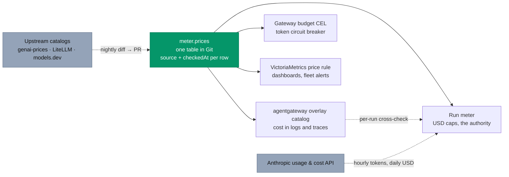

# Model pricing: where prices live, how they stay right, and how spend is enforced

**Date:** 2026-10-20 · **Status:** research, for the owner's decision · **Feeds:** the "truthful costs"
step before v3 on the [status page](../../../website/content/docs/status.md#before-v3)

## Question

agentgateway 1.6 ships a built-in model price catalog; this project keeps its own table,
`meter.prices`. Should we switch to agentgateway's, adopt another upstream catalog, or keep ours? And
how do comparable gateways, observability tools and agent products compute and cap spend?

## Conclusion

**Keep `meter.prices` as the only source of prices, and add what it lacks: drift detection against
upstream catalogs, generated copies everywhere a price is used, an independent cross-check from the
gateway, and reconciliation against the provider's own usage data.** No upstream catalog is a safe
source of truth: they lag a price change by a day to two weeks, follow the provider's page including
its mistakes, and the gateway's own catalog is frozen per release. For six models, detecting drift
matters more than generating the table.

## What we have today

| Piece | Where | State |
|---|---|---|
| `meter.prices` | `tooling/base/agent-factory/helm-values-configmap.yaml` | The source. One row per model a backend pins, read from the providers' pages on 2026-10-16. A pinned model without a row fails gate AG10; an unpriced model falls back to its token cap and fires `AgentModelUnpriced`. Haiku 5.5 sits at its over-100K rate, the safe direction for a cap |
| Gateway budget CEL | `infrastructure/base/agent-gateway/policy-budgets.yaml` | Generated from `meter.prices`; gate AG8 fails on any difference |
| VictoriaMetrics price rule | `infrastructure/base/llm-gateway/vmrule-llm-gateway.yaml` | **Hand-maintained**, list prices with no cache discount, so cost panels and `AnthropicFleetNearCap` overstate spend about 4× |
| agentgateway built-in catalog | in the gateway binary | Unused: budgets charge the meter's prices "not the built-in catalog" (`anthropic.yaml`) |

## What the field does

### Price catalogs

| Catalog | Maintained by, freshness | Models cache, tiers, batch | Z.ai GLM-5.3 |
|---|---|---|---|
| [LiteLLM](https://github.com/BerriAI/litellm/blob/main/model_prices_and_context_window.json) | Team and community PRs, very active; open issues on missing flex/priority/long-context fields ([#46880](https://github.com/BerriAI/litellm/issues/46880)) | 5-minute and 1-hour cache writes, long-context tiers, batch/flex/priority, regional keys | Yes |
| [models.dev](https://github.com/anomalyco/models.dev) | Hourly per-provider sync bot plus PRs; GLM-5.3 arrived 11 days after release ([#5410](https://github.com/anomalyco/models.dev/pull/5410)) | One cache-write rate, context tiers | Yes, though its coding-plan entries are priced 0 |
| [genai-prices](https://github.com/pydantic/genai-prices) (Pydantic) | Importers and a bot, a `prices_checked` date per price, dated historic prices | 1-hour writes, tiers, price variants (batch, service tier) | [Yes](https://github.com/pydantic/genai-prices/blob/main/prices/providers/zai.yml) |
| [Langfuse](https://github.com/langfuse/langfuse/blob/main/worker/src/constants/default-model-prices.json) | A daily automated audit against provider pages opens PRs | 5-minute and 1-hour writes, conditional tiers | No |
| [Portkey](https://github.com/Portkey-AI/models) | PRs; prices in cents per token | Regions, modes, tiers | No (stops at GLM-5.2) |
| agentgateway 1.6 | Built from models.dev at release time, frozen per release; a [daily refresh PR](https://github.com/agentgateway/agentgateway/blob/main/.github/workflows/model-catalog.yml) on `main`. Overlays through `AgentgatewayParameters.modelCatalog` | One cache-write rate in 1.6.0; 1-hour writes and service tiers came after | No: its importer's provider list has [no `zai`](https://github.com/agentgateway/agentgateway/blob/v1.6.0/controller/pkg/cli/catalog/source_modelsdev.go) |
| tokencost, Helicone, OpenLIT | Stale: tokencost's updater has [failed silently for 13 months](https://github.com/AgentOps-AI/tokencost/issues/237) | | |
| Envoy AI Gateway, Kong, Cloudflare | No shared catalog: CEL weights over token counts (Envoy), operator-set costs (Kong), unpublished estimates (Cloudflare) | | |

No provider we use publishes machine-readable prices: Anthropic and Z.ai have HTML pages only. Anthropic's
Models API carries no prices but its `lifecycle` field shows new and retired models.

**A real example of drift.** Anthropic listed Sonnet 5.5 cache reads at $0.20 per million on
[2026-10-03](https://web.archive.org/web/20261003190452/https://platform.claude.com/docs/en/about-claude/pricing)
and $0.10 from 2026-10-07 ([today](https://platform.claude.com/docs/en/about-claude/pricing)). Catch-up:

| Catalog | Updated | Lag |
|---|---|---|
| LiteLLM | 2026-10-07 ([#45113](https://github.com/BerriAI/litellm/pull/45113)) | same day |
| models.dev | 2026-10-07 | same day |
| agentgateway `main` | 2026-10-08, with Haiku 5.5 added | 1 day; **v1.6.0, the release we run, still has $0.20 and no Haiku 5.5** |
| genai-prices | 2026-10-12 | 5 days |
| Langfuse | 2026-10-13 | 6 days |
| Portkey | not yet | 13+ days |

With about 95% of agent input read from cache, a wrong cache-read rate dominates the error: here it
would have doubled every internal Sonnet run's cost.

### Computing and enforcing spend

| Practice | Who | Lesson |
|---|---|---|
| **Unpriced counts as $0** | LiteLLM ([docs](https://docs.litellm.ai/docs/troubleshoot/missing_model.md)), Portkey ([docs](https://portkey.ai/docs/product/ai-gateway/virtual-keys/budget-limits)), agentgateway USD budgets ("does not report an error") | The common failure mode. The Claude apps gateway does the opposite: an unknown model is priced at a punitive default "so an ID the meter can't place is never free" ([docs](https://code.claude.com/docs/en/claude-apps-gateway-spend-limits)) |
| **Charge after the call** | agentgateway, Kong, Cloudflare, Envoy's Agent Router; every agent product lets the turn in progress finish | The call that crosses a budget completes. Industry norm: bound the overshoot rather than cut streams |
| **Reserve before the call** | LiteLLM since v1.84.0: reserve from `max_tokens`, then settle | Bounded overshoot, worth it for shared budgets under concurrency |
| **Cost at ingestion, never recomputed** | Langfuse ([docs](https://langfuse.com/docs/observability/features/token-and-cost-tracking)) | Keep historic cost as recorded; a price change applies forward |
| **Gateway USD in Kubernetes** | agentgateway 1.6: token budgets only in Kubernetes mode; USD budgets are standalone and soft; cost appears in logs, traces and CEL, with no cost metric | The meter has to stay the USD authority: it alone knows which run a call belongs to |
| **Reconciliation** | Anthropic usage report: 1-minute to 1-day buckets by key, model, tier, cache read vs creation; cost report: daily, in cents ([docs](https://platform.claude.com/docs/en/manage-claude/usage-cost-api)). Z.ai: no documented usage API | Providers attribute to a key or workspace, never to a run: per-run attribution stays ours. Their APIs lag minutes to a day, so they audit, never enforce |
| **Agent products** | Copilot credits, Cursor usage pools, Devin ACUs, Claude Code `--max-budget-usd`, Codex credits, Factory multipliers | All price tokens × a per-model rate, cache separately, and hold caps on the server |

## Recommendations

| # | Change | Why |
|---|---|---|
| 1 | **Keep `meter.prices` as the only place a price is edited**, with a `source` URL and `checkedAt` date per row | A vendor catalog is frozen (agentgateway) or lags and copies page mistakes (all of them) |
| 2 | **Generate the VictoriaMetrics price rule from it**, cache rates included | Removes the third, hand-kept, wrong table (the 4× overstatement); extend gate AG8 to it |
| 3 | **Render it into an agentgateway overlay catalog** (`AgentgatewayParameters.modelCatalog`, a ConfigMap), Z.ai rows under our custom provider's name | Per-request cost in access logs and traces, split by token type; `agentgateway_cost_catalog_lookups_total{status!="Exact"}` alerts on anything unpriced. The `custom` provider key is inferred from the source: prove `Exact` lookups at the rebuild |
| 4 | **Cross-check per run**: gateway `llm.cost` from the overlay against the meter, alert above 1% | Two independent computations from one table catch mapping and token-class bugs |
| 5 | **Nightly drift check** against genai-prices, LiteLLM and models.dev, plus Anthropic's Models API for new models; a disagreement opens a pull request | Turns "read on 2026-10-16" into a watched table. A scheduled factory task fits it, like the weekly link check |
| 6 | **Reconcile with Anthropic**: tokens hourly by model and token class, dollars daily, tolerance about 2%. Z.ai by hand monthly | Catches dropped or mis-bucketed tokens and price drift the catalogs miss |
| 7 | **Keep failing closed**: unknown models refused at the gateway, never a default of 0 in the cost expression, punitive pricing in the meter | Already partly true (AG10, `AgentModelUnpriced`, the alias allow-list); make it a rule |
| 8 | **Bound the overshoot**: cap `max_tokens` per call, revoke at the cap minus the largest call | Charging after the call is the norm; a bounded last call is enough. Reservation only if fleet budgets meet real concurrency |

**Fields to add only when used:** 1-hour cache writes (1.6× a 5-minute write; our harness uses the
5-minute default), Opus 5.5 fast mode ($8/$40), US-only inference (1.1×), Haiku 5.5's under-100K rate.
Each would under-count a cap if used without its column.

## Not recommended

| Option | Why not |
|---|---|
| Switch to agentgateway's built-in catalog | No GLM, the bulk of our traffic; v1.6.0 is two prices behind; frozen per release; a USD budget on an unpriced model charges nothing |
| Generate `meter.prices` from an upstream catalog | Imports upstream lag and errors; mapping code for six models; GLM pricing differs across catalogs (models.dev's coding-plan rows are 0) |
| Enforce from provider cost APIs | Daily and minutes late |
| Recompute historic cost in place | Past runs keep the price they were charged |
| Cut streams at the budget | No major gateway does it reliably; bound the last call instead |

## Open questions for the owner

| Question | Default if unanswered |
|---|---|
| Is a scheduled factory task the right owner for the nightly drift check, or a plain CI job? | A plain CI job first; the factory later |
| Reconcile Anthropic automatically (an Admin API key in OpenBao) or by hand? | By hand monthly until internal spend justifies the key |
