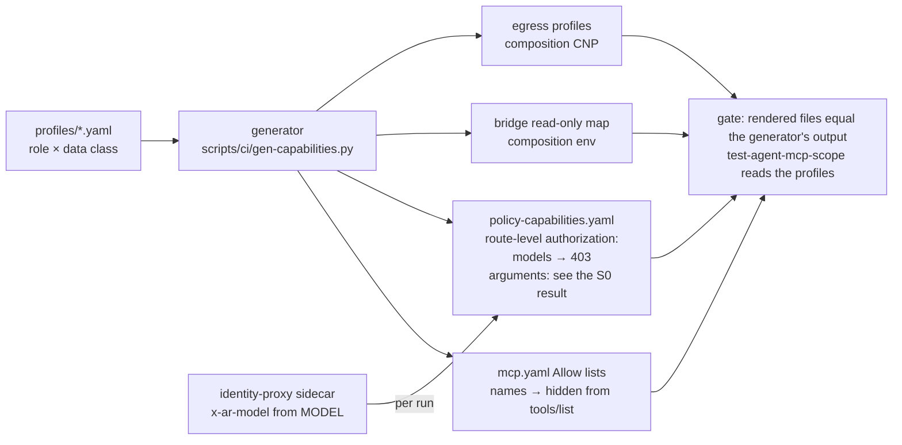

# v3: capability profiles, what a run may call, declared once and enforced at the gateway

**Date:** 2026-10-21 · **Status:** draft; no owner decision pending (O3 and O4 taken 2026-10-21) · **Amended
2026-10-22**: the migration's first step, the profiles and a generator at parity, is built
([plan](../plans/2026-10-22-capability-profiles-p1-plan.md)); P2 and P4 are
built ([plan](../plans/2026-10-22-capability-profiles-p2-p4-plan.md)) · **Part of:** the
[v3 review](2026-10-21-v3-review.md), proposed feature 10 · **Research:**
[§3](2026-10-21-v3-landscape-research.md#3-fine-grained-permissions-for-tools-and-models) ·
**Runtime:** the gateway runtime only; the portable runtime has no gateway to compile to

## Outcome

The tools, their arguments, the models and the hosts a run may reach are declared in one file per
role and data class, compiled into the gateway's policies, the run's network policy and the
bridge's read-only map, and checked for drift in CI. Adding a tool is a line in a profile (and its expected set in `test-agent-mcp-scope`, ruling R6 of the P1 plan), not CEL
by hand; a role cannot call a model its profile does not name, and a run cannot change the model
it was created with.

## What exists

| Dimension | Today | Enforced at |
|---|---|---|
| Tools | `Allow` CEL per listener and role in `infrastructure/base/agent-gateway/mcp.yaml`, names only; denied tools hidden from `tools/list` | the gateway |
| Models | Four aliases per data class; any other name refused 400; **any role may ask for any of the four** | the gateway |
| Arguments | None | — |
| Egress | Per-run default-deny CNP with FQDN profiles | the composition |
| Read-only tools for the approval classifier | `MCP_READ_ONLY_TOOLS`, a list the composition sets | the bridge |
| Approvals | `forge.push`, `forge.pr`, `forge.other`, `mcp.write`, `shell.high` per room profile | the bridge and the room |

## Decisions

| # | Decision | Rejected | Why |
|---|---|---|---|
| P1 | **One profile per role and data class, in Git**, under `infrastructure/base/agent-gateway/profiles/`: `models`, `tools` (per server, with optional argument constraints), `egress`, `readOnly`. A generator renders the `mcpAuthorization` allow lists (for list hiding), a route-level `authorization` policy (for arguments and models), and a ConfigMap `agent-capability-profiles` in `agents` holding each profile's read-only map and requestable egress set, which the AgentRun composition reads at reconcile time (one KCL change, released once through crossplane-configuration and the host's pin). The rendered files are committed and a gate fails on any difference, as AG8 does for the price table | Hand-written CEL; a policy engine (Cerbos, OPA) in the request path; generated KCL committed in crossplane-configuration (every profile change would chain a package release, a host pin and a `HOST_REF` bump) | ToolHive and Cerbos show the dimensions; CEL is enough at four roles and two classes; generated-and-committed keeps the gate paths reviewable and the gateway the only enforcer |
| P2 | **Per-role model allow-lists**: a route-level `authorization` rule `jwt.aud` → `llm.requestModel in [...]`, answering 403. The first profiles list the aliases each role's loop policy names, which today is `agent-default` everywhere; since every alias resolves to the same model today, the lists bind nothing real until roles move to different sizes ([loops L8](2026-10-21-loops-and-teams-design.md#decisions), decision O3, taken). The mechanism ships now so that day needs a profile edit, not a design | Budgets alone (SP4 R10); the factory's tier change in this design | Available in agentgateway 1.6.0; the router's 403 lacks caller attributes in its log until a release carries [#3996](https://github.com/agentgateway/agentgateway/issues/3989) |
| P3 | **Argument constraints** in the same route-level policy on `mcp.tool.arguments`. The first one is `get_kubernetes_resources` never with `kind: Secret`; the first profiles otherwise encode today's access exactly (reviewers read every namespace today, and no per-class namespace list exists), so a namespace scope is a later per-repository choice shown by the mechanism, not imposed here. The reviewer's `room_read` scope ([loops L4](2026-10-21-loops-and-teams-design.md#decisions)) waits for the broker to give the tool a `kinds` argument (its schema is `{sinceSeq, limit}` today), an agent-platform change; until then the rule is name-only | An ExtMCP guardrail service now | `mcp.tool.arguments` is request-time in route-level `authorization` and absent in `mcpAuthorization`; a 403 instead of a hidden tool is not acceptable: the SDK's MCP client does not survive one (see the [S0 result](#gate-the-spike-and-the-live-checks)) |
| P4 | **The identity proxy pins the model per run**: on `/v1` the sidecar sets `x-ar-model` from its `MODEL` environment (Envoy `%ENVIRONMENT(MODEL)%`, overwriting any client value); on a second prefix, `/judge/v1`, from `JUDGE_MODEL`, the loop policy's judge alias ([loops L2](2026-10-21-loops-and-teams-design.md#decisions)); the gateway strips a client-set copy as it strips `x-ar-agent`, then sets the request's `model` from the header. A role's `models` are exactly the aliases its pinned paths can name | The tier in the token audience; trusting the body; one pinned path (it would force the judge onto the run's model) | The sidecar is the trusted path the harness cannot configure, and the token never leaves it: a call from the harness straight to the gateway fails 401. Whichever path the harness uses, it gets one of the two aliases its profile allows. Audiences per tier would multiply past the provider's eight |
| P5 | **Tool annotations drive the bridge's classifier through the profile**: `readOnly` replaces `MCP_READ_ONLY_TOOLS`, seeded from each server's `readOnlyHint` and reviewed by a human; an unlisted tool is a write, as today | Trusting annotations | The MCP spec: "clients MUST consider tool annotations to be untrusted"; ToolHive's annotation overrides are the pattern |
| P6 | **No external policy decision point in v3**; reconsider when a profile outgrows CEL, a third data class appears, or rules become per task | Cerbos or OPA behind `extAuthz` now | One more critical service in the request path; AuthZEN's agent drafts are from June 2026 |
| P7 | **A server-bound token per MCP backend later** (agentgateway `oauthTokenExchange`), replacing the shared `x-room-mcp-key`; needs an STS | Now | agentgateway 1.6 carries it; octo-sts is GitHub-only; no server-side authorization gap today beyond the gateway |
| P8 | **The repository as a dimension later**, carried like P4 in an `x-ar-repo` header, when a repository needs other tools or egress | Now | Two repositories with the same needs |
| P9 | **An approval classifier later**: a second model triaging approval requests in attended rooms, failing closed | Now | Approvals are oversight, not a boundary (rooms design) |

## Compilation



### A profile

```yaml
# infrastructure/base/agent-gateway/profiles/reviewer.internal.yaml
role: reviewer
dataClass: internal
models: [tier-frontier, agent-default]
tools:
  flux-operator-mcp:
    - search_flux_docs
    - get_flux_instance
    - get_kubernetes_api_versions
    - get_kubernetes_metrics
    - {name: get_kubernetes_resources, when: 'mcp.tool.arguments.kind != "Secret"'}
    - get_kubernetes_logs
  mcp-victorialogs:
    - documentation
    - query            # a namespace scope would be `when: 'mcp.tool.arguments.query.contains("kubernetes.pod_namespace:ns")'`
  room-broker:
    - room_read        # scoped to handoff, task_state and review_verdict once the tool takes `kinds` (loops L4)
    - room_post
    - room_progress
    - room_verdict
egress: []            # the profiles a run of this role and class MAY request; internal requests none, as today
readOnly: ["flux-operator-mcp/*", "mcp-victorialogs/*", "room-broker/*"]
```

Argument names follow each server's schema; the builder reads them. A tool listed without `when`
compiles to a name rule only. `egress` is a cap on what a run may request (`roomctl fork --egress`,
`egressProfiles` on the run API), not what every run gets: the per-run profiles, the `github`
default and the bridge's `egress.new` verdict are unchanged. An implementer profile's `models` holds the run's alias and the loop
policy's judge alias, which `agent-run` calls on the run's token through the sidecar's judge path.

### What the generator emits

| Output | From | Enforces |
|---|---|---|
| `mcpAuthorization` expressions, one per role, target and tool name | `tools` names | list hiding, a denied call answers `Unknown tool` |
| Route-level `authorization` `Require` rules per listener: `"<aud>" in jwt.aud && (mcp.tool.name != X \|\| <when>)` and `"<aud>" in jwt.aud && llm.requestModel in <models>` | `tools[].when`, `models` | models: 403 on a model outside the profile. `tools[].when`: superseded by the S0 result (deny at the JSON-RPC level or ExtMCP, not a 403) |
| A `model` transformation reading `x-ar-model` when present | P4 | the run's model on `/v1`, the judge's on `/judge/v1` |
| The `agent-capability-profiles` ConfigMap: per profile, the read-only map and the requestable egress set | `readOnly`, `egress` | the bridge's `mcp.write` class; the run API's and `roomctl fork`'s validation of a requested profile |
| The listener's own `Require` rule (`jwt.sub.startsWith("system:serviceaccount:agents:")`) repeated in every generated route-level policy | — | agentgateway merges policies per field, so a route-level `authorization` replaces the listener's on the routes it targets; a gate asserts the repetition |

## Gate: the spike and the live checks

**S0, first:** a tool call the route-level policy refuses with an HTTP 403 must leave the OpenHands
MCP client connected for the rest of the run. If the client drops the server, P3 moves to ExtMCP
or to a JSON-RPC-level denial before anything else is built.

**S0 result, 2026-10-22:** measured against the harness's pinned OpenHands SDK 1.49.6 (mcp 1.30.0),
with and without the harness's `sitecustomize.py` patches, an HTTP 403 on a `tools/call` POST
disconnects the SDK's MCP client for the rest of the run: the refused call returns an error
observation, and every later call on that server fails with "MCP client not connected ...
Reconnection attempt failed". A JSON-RPC error answered with HTTP 200 leaves it connected. S0 fails
for a route-level 403, so before P3 is built its argument constraints must deny at the JSON-RPC
level (an agentgateway capability to check) or move to ExtMCP, as this paragraph foresaw. The cost is
larger than one tool: the router federates all four targets behind one `/mcp` endpoint per listener,
so a single 403 costs the run every MCP tool, the room-broker's `room_handoff` and `room_verdict`
included. P3's options: (a) a JSON-RPC-level denial in agentgateway (to check), (b) ExtMCP, (c) a
further harness monkey-patch, disfavoured by the prompt-cache design's rejection of "a fifth
monkey-patch". Whichever P3 takes must amend AG6's grammar and the scope suite's regex, which hold
tool names only today. P3's first rule (`kind: Secret`) is already enforced at the server: the
flux-operator-mcp service account cannot read Secrets (the scope suite and runbook 06 Step 5), which
lowers P3's urgency.

**After SDK 1.55 (2026-10-23):** the harness now runs OpenHands SDK 1.56.0, and since 1.55 the SDK's MCP
client no longer disconnects on an HTTP 403: agent-platform's `test_mcp_session.py` pins that a
refused `tools/call` keeps the run's session. The measurement above stays true of 1.49.6; whether P3
uses the 403 is still this design's decision, and the S0 spike should be re-run against 1.56.0 first.

1. A run whose test profile excludes an alias is refused 403 when it names it, and the refusal is
   attributed in the access log (or recorded as the known gap until the gateway release that fixes
   it). Today's profiles allow the same model under every name, so the check runs with a test
   profile on the bench cluster.
2. Superseded by the S0 result (deny at the JSON-RPC level or ExtMCP, not a 403): `get_kubernetes_resources`
   with `kind: Secret` from a reviewer is refused; without the argument it answers.
3. A command in the sandbox posting to the identity proxy's `/v1` with another `model` reaches the
   model the run was created with, and one posting to `/judge/v1` reaches the judge's alias; the
   gateway log names the pinned alias in both cases.
4. `tools/list` per role is unchanged from today, and `test-agent-mcp-scope` passes from the
   profiles.
5. Editing a rendered policy by hand fails the drift gate.

## Not in this design

A policy engine; per-task rules; a repository dimension; token exchange per backend; the approval
classifier; changes to the approval classes or room profiles.

## Left to the builder

The generator's language and tests; whether the route-level policy attaches to each listener's
HTTPRoute or to the Gateway; the exact CEL for list-valued arguments; how the composition passes
`MODEL` and `JUDGE_MODEL` to the sidecar's environment (the claim carries `spec.model` today; the
judge alias is a new claim field the loop policy adds); the migration order (profiles first,
generated files equal to today's hand-written ones, then the new rules, then the composition's
ConfigMap read).

Ruled in P1 ([plan](../plans/2026-10-22-capability-profiles-p1-plan.md#this-plans-rulings)):

- **The generator:** Python, unit-tested by `test-gen-capabilities`. It owns only the
  `matchExpressions` items of `mcp.yaml`'s MCP policies. Roles render in name order, targets in the
  backend's order and tools in the profile's order, which is how the hand-written lists were
  ordered, so the first rendering changed no byte. A comment must sit above `matchExpressions:`,
  never inside the list: the generator refuses a list holding anything it did not render.
- **The drift gate:** the suite `test-agent-capabilities`. The profiles reach the bundle only with
  the ConfigMap, so the suite reads the tree and regenerates the lists, as AG8 regenerates its cost
  string.
- **The fields:** `models` is carried and checked against the backends' aliases until P2 renders it.
  `egress`, `readOnly` and `when` are refused until their steps.

Ruled in P2 and P4 ([plan](../plans/2026-10-22-capability-profiles-p2-p4-plan.md#this-plans-rulings)):

- **The rule reads the model itself.** agentgateway 1.6 has no `llm.requestModel` where a route's
  `authorization` runs (the backend parses the body later): a Require on it refused every call. The
  rule binds `("x-ar-model" in request.headers ? request.headers["x-ar-model"] :
  json(request.body).model)` and requires, for the caller's audience, that it is in the profile's
  `models`: one Require per listener, the roles OR-ed. The backends' `model` transformation makes the
  same choice, header first, and gate AG12 refuses any object that removes the header, since the
  two would then disagree.
- **Authorization adds up in 1.6**: a route's rules join the listener's rather than replacing them.
  The listener's Require is repeated anyway, and gate AG14 asserts it with the rest of the rule.
- **The gateway does not strip `x-ar-model`.** It would strip the proxy's value too; the proxy
  overwrites the harness's, and only the proxy holds a run token.
- **A gzip request with no `x-ar-model` header, served before, is now refused 403**: the rule reads the
  raw body. Accepted: the harness does not compress requests, and the proxy pins the header on every call.
- **A 403 on a model call is acceptable**: it is a single stateless request, which the harness does
  not retry, and it ends the conversation as today's 400 for an unknown name does. The refusal's
  access log names the run's `sub`, so gate item 1's attribution holds in 1.6.0; #3996 concerns the
  model router's own 403.
- **The judge path refuses until the claim names a judge**: the composition sets `JUDGE_MODEL` to
  `spec.loop.judgeModel`, else `none`, which no profile names.
- **P3 and S0:** OpenHands SDK 1.55 fixes the disconnect S0 measured (measured 2026-10-22 against
  1.56.0 by the SDK upgrade plan): a route-level 403 for P3's argument constraints becomes possible
  once the harness ships an SDK at 1.55 or later, which P3 then depends on.
