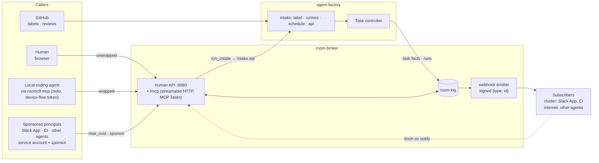

# v3: factory interfaces, how other apps and agents reach the factory

**Date:** 2026-10-21 · **Status:** draft; decisions O1, O2, O7 taken 2026-10-21 (the
[review](2026-10-21-v3-review.md#decisions-for-the-owner)) · **Part of:** the v3 review, proposed
feature 9 · **Research:** [§1](2026-10-21-v3-landscape-research.md#1-how-other-apps-and-agents-interact-with-a-factory) ·
**Runtime:** both; the MCP server and the webhooks read the room log, which exists on either runtime;
the sponsored principals' budgets need the factory and daily caps in dollars

## Outcome

A developer's coding agent, a chat channel, a tracker or another agent can file work for the
factory, follow it, queue a note for its next run and learn when it needs a human, through the
protocols they already speak, while a human stays accountable for every run's spend and nothing a
machine sends becomes an instruction.

## What exists

| Surface | Today |
|---|---|
| Intake | `factory/ready` from a maintainer; `POST /intake/runlore` (bearer, from the `runlore` namespace); cron schedules in the config; `POST /v1/runs` on the factory's `:8082`, which creates a bare `AgentRun` in a room (no `Task`, no triage, no gate, no narration) for a human's OIDC token |
| Observe | The broker's human API behind oauth2-proxy (`summary/v1`, rooms, WebSocket), reached through `rooms.<domain>`; `roomctl` (device-flow login, bearer passthrough); the `factory-handoff` skill, which drafts issues with the developer's `gh` and reads `roomctl status` |
| Agents inside a run | `room_*` MCP tools on the broker's `:8090`, reached through the gateway with an injected key |
| Outbound | Comments on the issue, one verdict comment on the PR, labels, metrics and traces. No events, no webhooks |
| The unit | Every factory task owns one room; human rooms and forks exist without a `Task`. The room log holds the task's facts (`state_changed{kind: task}`), the approvals and every run's events, and `summary/v1` is read from it |

Local-first D2 chose a skill over an MCP server "unless a target agent cannot run a shell". The
condition that decides now is different: other agents, not only the developer's shell, must reach
the factory, and every peer's agent-to-agent path is an MCP server.

## Decisions

| # | Decision | Rejected | Why |
|---|---|---|---|
| F1 | **The room is the unit.** The MCP server, the webhooks and the state vocabulary act on rooms; a room's summary carries the task's facts when a `Task` owns it | A `Task`-centred API | Human rooms and forks have no `Task`; approvals live in the room, not in the factory's outbox; `summary/v1` already unifies both |
| F2 | **An MCP server on the room broker**, streamable HTTP at `rooms.<domain>/mcp`, behind the same oauth2-proxy bearer passthrough `roomctl` uses; **`roomctl mcp`** is the stdio client that holds the device-flow token and refreshes it, so a local agent configures one command and no token is pasted. A remote MCP client with its own OAuth flow (the MCP authorization spec: protected-resource metadata, a ZITADEL client per MCP client) is later, since the ZITADEL clients are the host's (HOST-CONTRACT H5) | A new listener and port; a separate binary; the skill alone; the authorization spec first | GitHub, Devin and Notion expose session tools over MCP; every local agent speaks it; the broker already holds human auth, the summary and an MCP implementation; the token path reuses `roomctl`'s. Supersedes D2 of the [local-first design](2026-10-08-agent-factory-local-first-ux-design.md) |
| F3 | **The tools mirror `roomctl`'s standing** (ADR-0049): `rooms_list`, `room_summary`, `room_tail`, `room_queue`, `room_fork`, `issue_draft`; filing is a **client-side** tool of `roomctl mcp` using the developer's `gh`, so the human stays the issue's author. **No tool labels, approves, steers or stops** | Server-side filing with the factory App's key; an `approve` or `start` tool | A client an agent can drive never decides for a human; starting work stays the maintainer's label (local-first D1); a bot-authored issue would break `--mine` and need `issues: write` on every repository |
| F4 | **Machine callers start work only as sponsored principals**, through a new intake kind `api` that creates a `Task` (triage, gate and narration apply), never through `/v1/runs`: a ZITADEL service account bound to a maintainer `sponsor` (who must be in the repository's `maintainers`), a daily USD budget per principal, a mandatory `max_cost` per request capped by the class's `taskUSD`, both identities on the `Task` and in the room. In v3, after daily caps enforce in dollars ([#155](https://github.com/Smana/agent-platform/issues/155)) | Agents starting work with the developer's own token; machine callers refused for ever; bare runs | Devin's `create_as_user_id` under an elevated permission, Cursor's two run-as modes and Managed Agents' `max_list_cost`: the sponsor pays attention, the ceiling bounds the automation. **Decision O1: in v3** |
| F5 | **Long calls use MCP Tasks**: `run_create` and `room_tail` declare `execution.taskSupport: optional`; `tasks/get` polls; `input_required` maps to `waiting_for_human` | Blocking calls; a bespoke job id | The spec's shape, and "receivers MUST bind tasks to the authorization context" |
| F6 | **Outbound events are signed webhooks with id-only payloads, emitted by the broker from the room log and declared in the broker's config per repository.** Each subscriber names its `network`: `cluster` (a Service name, egress generated as `toEndpoints`) or `internet` (a public address, egress generated as `toFQDNs`; a private or cluster address is refused at config load) | Emitting from the factory's outbox; subscriptions registered through an API; payloads carrying room text; a message bus | The log is the source of truth and holds approvals the factory never sees; Managed Agents' design: `{type, id}`, fetch on notify, `webhook-id`, `-timestamp`, `-signature`, at most three retries, no ordering, auto-disabled after three failures. Declared in Git because subscribers are few, the config is a gate path and the broker's default-deny CNP must learn each one. **Decision O7: config.** If subscribers multiply, an API that lets a sponsored principal subscribe only to hosts already declared here |
| F7 | **One state vocabulary** for `summary/v1`, MCP and webhooks: the room's `phase` and the task's `phase` and `reason` as today, plus a coarse `state` ∈ `queued, running, waiting_for_human, done, failed, stopped` ([table](#the-coarse-state)) | Three vocabularies | It maps one to one onto A2A's task states and GitHub's `waiting_for_user`; a later A2A card is a mapping |
| F8 | **Text is unwrapped only from the web UI.** Everything entering through the MCP server or `roomctl` is machine-sent: wrapped and labelled as Claude's routine-fire payload is, since a local agent can drive either. The human who holds the token stays the prompter for four-eyes. The issue snapshot stays the only task text; class, tier and auto-merge are never caller-controlled; hidden characters are stripped at intake | Wrapping by principal (a coding agent on the human's token would pass unwrapped) | Trail of Bits on Copilot issue injection; gh-aw's sanitisation; GitHub's hidden-character filter; ADR-0049's reasoning |
| F9 | **Slack intake in v3**, as a sponsored principal (F4) and a webhook subscriber (F6). The Slack App runs in the cluster; `@factory` in a thread drafts an issue through `issue_draft`; a ✅ from a Slack user linked to a maintainer's ZITADEL identity files it and calls `run_create` with that maintainer as `sponsor` and `on_behalf_of`; the thread follows the room through F6 events. **Approvals and steering stay in the web UI** (ADR-0049): a question from the run is linked in the thread, never answered there | Later; a bot with its own identity and approval surface; a ✅ from any channel member | A team's chat is where the question is asked, and Devin, Codex and Claude Code all take Slack mentions; F4's sponsor and ceiling bound the bot as they bound any machine; local-first D6's finding (GitHub's notifications are enough) held for one developer. **Decision O2: full intake in v3** |
| F10 | **A2A and tracker delegates later**; F7 keeps the mapping ready | Now | Among our consumers only Atlassian's Rovo speaks A2A; we have no Linear or Jira |

## Architecture



## The tools

| Tool | Standing | Input | Output |
|---|---|---|---|
| `rooms_list` | watcher | `repo?`, `mine?`, `needsMe?` (as `roomctl rooms`) | rooms with `state`, `phase`, `reason`, `url` |
| `room_summary` | watcher | `room` | `summary/v1` |
| `room_tail` | watcher | `room`, `cursor?`, `kinds?` | events after the cursor, the new cursor; a long tail runs as an MCP Task |
| `room_queue` | collaborator | `room`, `text` | the queued message id; the text is wrapped (F8) |
| `room_fork` | owner of the fork | `room`, `at`, `role`, `egress?`, `note?` | the new room |
| `issue_draft` | any human | `repo`, `title`, `body` | the draft in the skill's shape, validated server-side; `issue_file` is `roomctl mcp`'s own tool and runs the developer's `gh` after an explicit confirmation step, never labels |
| `run_create` (F4) | sponsored principal | `repo`, `text`, `dataClass`, `max_cost`, `on_behalf_of?` | the room, as an MCP Task; refused without `max_cost`, above the principal's daily budget or above the class's `taskUSD` |

Every string an agent wrote (notes, verdicts, drafts) comes back under `untrusted: true`, as the
summary does today. The agents' own `room_*` tools on `:8090` are unchanged and distinct.

### The coarse state

| `state` | Task phases | Rooms without a task | A2A |
|---|---|---|---|
| `queued` | `Received`, `Triaged`, `Queued` | `Open` | `SUBMITTED` |
| `running` | `Implementing`, `Reviewing`, `AwaitingCI`, `AutoMerging`, `Verifying` | `Active`, `Idle` with a next run | `WORKING` |
| `waiting_for_human` | `AwaitingHuman`, `Escalated` (a `/factory retry` is a human's) | `AwaitingHuman` | `INPUT_REQUIRED` |
| `done` | `Done`, `NoOp` | `Closed` after a verdict or a hand-off | `COMPLETED` |
| `failed` | `Rejected`, `Reverted` | — | `REJECTED`, `FAILED` |
| `stopped` | `Stopped`, `Closed` | `Closed` by its owner | `CANCELED` |

## Events

| Event | When | Payload |
|---|---|---|
| `room.task_received`, `room.task_triaged` | the factory's facts land in the log | `{type, room, repo}` |
| `room.run_started`, `room.run_ended` | each run | `{type, room, run}` |
| `room.waiting_for_human` | an approval requested, `AwaitingHuman`, `Escalated` | `{type, room, reason}` |
| `room.pr_opened`, `room.verdict_posted`, `room.merged`, `room.reverted` | the gate's facts | `{type, room, pr}` |
| `room.budget_reached` | a `budget-*` end | `{type, room, limit}` |
| `room.ended` | a final state | `{type, room, state}` |

```yaml
# the broker's config, a gate path
webhooks:
  - name: slack-app
    network: cluster
    url: http://slack-app.tooling.svc.cluster.local:8080/events       # egress: a generated toEndpoints rule
    events: [room.waiting_for_human, room.pr_opened, room.ended]
    secretRef: {name: webhook-slack-app, key: signing-key}             # HMAC-SHA256 over timestamp + body
    repositories: [Smana/ai-native-ref]
  - name: ci-mirror
    network: internet
    url: https://hooks.example.io/factory                              # egress: a generated toFQDNs rule; private addresses refused
    events: [room.ended]
    secretRef: {name: webhook-ci-mirror, key: signing-key}
```

A subscriber verifies the signature, rejects a timestamp older than five minutes, deduplicates on
`webhook-id`, and fetches the room through the MCP server or the human API. Three failed deliveries
disable the subscription and raise `RoomWebhookDisabled`. A generator renders the broker's egress
rules from this list, and a gate fails when they differ, as the capability profiles' gate does.

## Identity and budgets

| Caller | Token | Pays | Recorded |
|---|---|---|---|
| A human, or an agent in their session | The human's OIDC access token (device flow, as `roomctl login`) | The human's daily cap (shadow today) | `requestedBy: human:<sub>` |
| A sponsored principal | A ZITADEL service account's token with a `sponsor` claim naming a maintainer; a third branch of the factory's intake authentication | The principal's daily USD budget, and `max_cost` per request | `source.kind: api`, `requestedBy: system:<name>`, `sponsor: human:<sub>` |
| A Slack user | The Slack App's service-account token (a sponsored principal); the ✅ user must be linked to a maintainer's ZITADEL identity, or the request is refused | The App's daily USD budget, and the maintainer's `max_cost` | `source.kind: api`, `requestedBy: system:slack-app`, `sponsor: human:<sub>`, `onBehalfOf: human:<sub>` |
| GitHub | The label, as today | The factory's daily budget | `source.requestedBy` |

The run token the gateway verifies is still minted by the factory for the run; a caller's token
never reaches a sandbox or a model.

## Gate: the live proof

1. A Claude Code session with `roomctl mcp` configured lists rooms, reads a summary, queues a note
   (wrapped in the next brief) and drafts an issue; the draft is filed by the client tool only after
   the confirmation step, under the developer's GitHub identity, and carries no label.
2. A webhook replayed with an old timestamp, a wrong signature or a forged `webhook-id` is rejected;
   an `internet` subscriber whose address is private is refused at config load; a `cluster`
   subscriber not in the generated egress fails the gate.
3. A sponsored principal's `run_create` without `max_cost` is refused; with it, a `Task` with
   `source.kind: api` records both identities and ends at `max_cost`.
4. A drafted issue carrying hidden characters and an instruction-shaped line arrives stripped and
   wrapped, and the run treats it as data.
5. A ✅ in a Slack thread from a user linked to no maintainer is refused; from a linked one, a
   `Task` with `source.kind: api` names the App and the maintainer, and the thread receives the
   room's state changes.

## Not in this design

Approvals or steering from MCP or Slack; subscriptions registered through an API; an event bus;
A2A; a remote MCP client with its own OAuth flow (F2, later); replacing `roomctl`, which gains the
`mcp` subcommand and nothing it did not have.

## Left to the builder

Whether `room_tail` streams or pages; the signing key's rotation; the `sponsor` claim's shape in
ZITADEL; the wrapping format of machine-sent text; how `roomctl mcp` refreshes the token across a
long session; whether the skill becomes a thin client of the server or stays shell-first; how a
Slack user is linked to a ZITADEL identity (a Slack identity provider in ZITADEL, or a maintained
map); whether the App answers a mention or a slash command.

Settled in agent-platform's part 2 plan (`docs/superpowers/plans/2026-10-23-factory-interfaces-part2-plan.md`):

- The sponsor claim's shape: no ZITADEL claim; the sponsor is declared in the factory's config, per principal (R1, O-A).
- How a sponsored token is identified: by its client, as `roomctl`'s is, the client id read at each use from a file the host's sync writes (R2).
- How a Slack user is linked: a map in the factory's config, Slack id to maintainer login (R9).
- How a webhook is signed: Standard Webhooks headers, one signature per key (R15).
- The signing key's rotation: one or two base64 keys per file; add the new one, roll, remove the old one (R16).
- Mention or slash command: a mention, never a slash command (R22).
