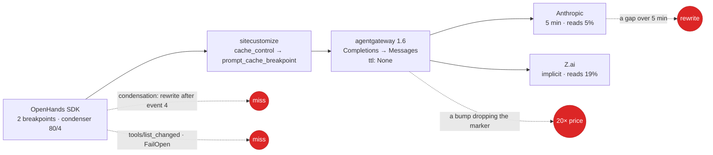

# v3: the prompt cache, protected first and tuned second

**Date:** 2026-10-21 · **Status:** draft; decisions O5, O6 taken 2026-10-21 (the
[review](2026-10-21-v3-review.md#decisions-for-the-owner)) · **Amended 2026-10-22**: C1 and C2 built offline ([plan](../plans/2026-10-22-cache-protection-plan.md)); gate 1's drill moves to the loop-policy composition release · **Part of:** the v3 review, proposed
feature 11; its first two decisions belong to the "before v3" step · **Research:**
[§4](2026-10-21-v3-landscape-research.md#4-prompt-and-kv-caching) · **Runtime:** the gateway
runtime: the markers cross it and the alert reads its series; only the harness's per-step log line
works on the portable runtime too

## Outcome

The cache-read share of every run is measured, alerted on and tested at each pin bump, so the 75%
saving it carries cannot vanish silently. Then the levers the field confirms are pulled in order:
the TTL for attended runs, the condenser, a frozen request shape.

## What exists

| Fact | Value |
|---|---|
| Cache-read share | 95.1% of agent input on GLM-5.3 (automatic, writes unbilled); 85% on Opus 5.5 through the harness shim |
| The marker's path | The SDK marks the static system block and the last message; `sitecustomize.py` rewrites `cache_control` to `prompt_cache_breakpoint`, the one field agentgateway 1.6 converts; the gateway writes `cache_control` with **`ttl: None`** |
| The condenser | 80 events, keep the first 4: a rewrite of everything after event 4 about every 40 events, plus an uncached summary call |
| Tools | Fixed per role, but an MCP `tools/list_changed` can change the list mid-run, and a federated target that fails is dropped from the list (`failureMode: FailOpen`) |
| Reasoning | Opus 5.5's prior thinking is not replayed (the SDK stores `thinking_blocks`, the conversion needs `reasoning_signature`) |
| Signals | `gen_ai_client_token_usage_sum{gen_ai_token_type="cached_input"}` per run, with no step number; the gateway's access log carries cached tokens per request and the run dashboard shows that line; the harness prints "prompt cache NOT applied" only when the SDK loses the method it patches; no share panel, no alert |

## Decisions

| # | Decision | Rejected | Why |
|---|---|---|---|
| C1 | **Measure and alert, on two sources.** The alert reads the gateway's series, which have a run but no step: `AgentCacheReadShareLow` when an internal run's share over 15 minutes is under 60% with at least 200k input tokens in the window (one condensation fits inside it), and `AgentCacheReadZero` when an internal run has read nothing after its first 100k input tokens, which catches a dropped marker within two scrapes. The per-step view, with misses classified expected (the first step, a condensation, a resume) or unexpected, comes from the harness's step log, which gains the SDK's `cache_read_tokens` and `cache_write_tokens` per response and a line per condensation, read in VictoriaLogs for the run dashboard and the bench; `AgentCacheMarkerMissing` stays on the harness's "NOT applied" line and covers only the SDK-shape failure | Dashboards alone; a per-step PromQL rule (the series has no step) | The costliest failure is silent: before the shim, 15 Opus calls read "500,930 input tokens, 0 cached" ([#132](https://github.com/Smana/agent-platform/pull/132)); a gateway or SDK bump can bring it back |
| C2 | **Two wire tests, one per repository.** agent-platform's test from #132 keeps asserting `prompt_cache_breakpoint` on the body leaving the harness. This repository gains a suite that runs the **pinned agentgateway image** against a fake Anthropic upstream, as `test-agent-traces-filter` runs the collector, and asserts `cache_control` on the system block and the last tool result in the Messages body the gateway emits, and the `ttl` once C3 lands; it runs at every `infrastructure/base/agentgateway` pin bump | Discovering it live; the harness test alone, which never runs the gateway | The regression the field warns about most |
| C3 | **Reach the 1-hour TTL for attended runs.** The gateway forces `ttl: None`; the path is an upstream change carrying `prompt_cache_breakpoint.ttl` (OpenAI defines the field with `30m` and `12h`; Anthropic needs `1h`) or native Messages from the harness for internal runs (passthrough preserving the TTL is UNVERIFIED). Until then internal runs stay at 5 minutes and a suspended run accepts one rewrite at resume. Policy once available: `1h` on both breakpoints for suspendable runs, `5m` for unattended ones; a 1-hour entry must precede 5-minute ones | Always 1 hour; never | The arithmetic ([research §4.6](2026-10-21-v3-landscape-research.md#46-cost-arithmetic)): 1 hour costs an extra 3× the final context and saves 5× the context at each 5–60 minute gap; attended runs have such gaps (approvals, the suspend trigger after 5 idle minutes), unattended ones rarely. **Decision O5: the upstream change; 5 minutes meanwhile** |
| C4 | **Make condensation rarer and expected.** Raise `max_size` and `keep_first` within the validator's bound for Anthropic runs (a 1M window); tag the condensation step an expected miss; evaluate server-side compaction (`compact-2026-01-12`) with the system breakpoint kept, once the beta header is proven to cross the gateway | The SDK's defaults | The single largest remaining cache event; server-side compaction "doesn't count as an edit". **Decision O6: tune now, evaluate compaction once the Messages path exists** |
| C5 | **Freeze the request shape for a run**: model and effort fixed per run (exists); no timestamps in the prompt (the SDK's dynamic block is unmarked and reused on resume); deterministic JSON; the tool list pinned at the first step, **at the SDK bump** (R12): ignoring `tools/list_changed` is SDK-internal and the federation's `FailOpen` drop is gateway behaviour, so until then a tools-level miss is classified from the logs, not prevented | A fifth monkey-patch in `sitecustomize.py`, the upgrade hazard this design exists to contain | A tool change invalidates tools, system and messages; a flapping target would cost a full rewrite per flap |
| C6 | **Reasoning replay stays off in v3**, measured: output tokens per step on internal runs are recorded; revisit with server-side compaction | Replaying through the native path now | Replay with client-side condensation hits preserved thinking's history check (a 400 on accounts created after 2026-08-31); Anthropic measures +4.6% to +67.1% output tokens without replay, so the bench should see the cost |
| C7 | **Z.ai**: keep the body byte-stable and record `cached_tokens` per step; the TTL is undocumented and the bench learns it | — | Nothing else is tunable |
| C8 | **Haiku needs no override on internal runs**: `agent_run.py` already forces `supports_prompt_cache` for every `internal` run, which bypasses the SDK's pattern list that lacks `claude-haiku-5-5` ([#5702](https://github.com/OpenHands/software-agent-sdk/issues/5702)); only an Anthropic model on a non-internal class would need one, and none exists | — | Recorded so nobody adds the override twice |
| C9 | **Serving side, when vLLM runs**: automatic prefix caching is on; add CPU offload and the Inference Extension's prefix scorer from two replicas; graph `vllm:prefix_cache_hits / _queries`; **no semantic cache** on agent or tool traffic | A semantic cache | It replays stale tool calls, and vendors now say so |
| C10 | **One Anthropic key and workspace per route**; write-affinity before any load balancing if a second key appears | — | Caches are per workspace |

## Where the cache lives, and where it breaks

## Signals

| Signal | Source | Rule |
|---|---|---|
| `agent_run:cache_read_share` | `cached_input / input` from `gen_ai_client_token_usage_sum` by `ar_agent` | recorded per run; a new share panel on the `agent-gateway` dashboard |
| `AgentCacheReadShareLow` | internal runs under 60% over 15 min with ≥ 200k input tokens in the window | pages like a budget alert; one condensation does not trip it |
| `AgentCacheReadZero` | an internal run with no cache reads after its first 100k input tokens | the dropped-marker case, within two scrapes |
| Per-step share and expected misses | the harness's step log: cache tokens per response, a line per condensation and resume | the run dashboard and the bench, in LogsQL; not an alert |
| `AgentCacheMarkerMissing` | the harness log line | fires at run start; the SDK-shape failure only |
| `ephemeral_1h_input_tokens` | the gateway's usage fields, once C3 lands | proves the TTL reached the provider |
| Output tokens per step, internal | the same series, `output` | C6's measurement |

## Gate

1. Offline, in `task check`: `test-agent-cache-alerts` shows `AgentCacheReadZero` firing within two
   scrapes of a run's first 100k input tokens with no reads and `AgentCacheReadShareLow` at 50% on
   600k input but not on 90k; `test-agent-gateway-cache-wire` shows the pinned gateway's series and
   marker. Live, later: a run started with the `agents.ogenki.io/cache-drill` annotation (a harness
   switch that skips the marker rewrite, mapped by the composition) fires `AgentCacheReadZero`
   within two scrapes; the annotation rides the loop-policy release of the `AgentRun` composition.
   `AgentCacheMarkerMissing` matches the substring both of the harness's messages carry
   (`prompt cache NOT applied`); no agent-platform test asserts that message yet, unlike the
   harness's three other patches, which is a follow-up there.
2. The gateway wire test runs here in CI and fails on an agentgateway pin that drops the marker; the
   harness test runs in agent-platform.
3. The bench reports the cache-read share per class and model, and the share of expected against
   unexpected misses.
4. With C4, internal runs' prompt cost per step over the run's life drops, acceptance unchanged.
5. With C3, a run suspended for 20 minutes resumes with reads, not a rewrite.

## Not in this design

Model switching inside a run; pre-warming (rejected by the API with thinking on, which Opus 5.5
always has); a semantic cache; Anthropic context editing (`clear_tool_uses` invalidates the
prefix); any change to Z.ai's path beyond measurement.

## Left to the builder

The recording rule's exact label set and the thresholds' first tuning on real runs; the step log's
field names; the fake upstream and fixtures of the gateway wire test; the condenser values and the
validator's bound; the upstream change's shape (O5); the serving-side flags when `llm-platform`
runs again.
