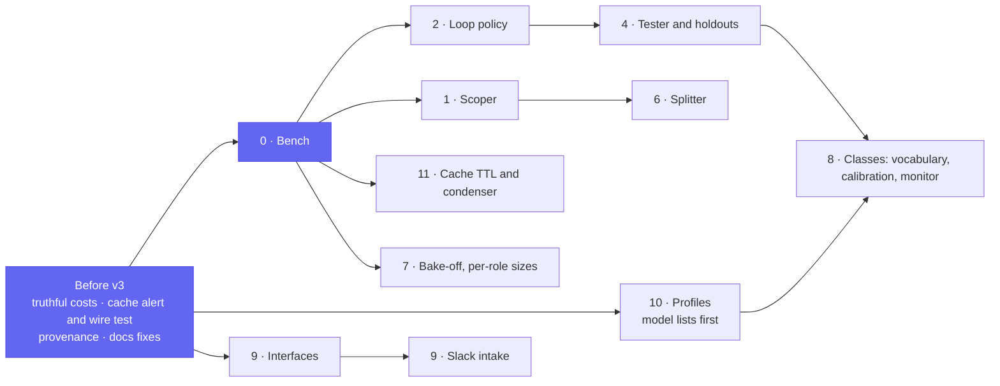

# v3 review: where the factory stands, what the field does, and the amendments proposed

**Date:** 2026-10-21 · **Status:** reviewed; the owner's decisions taken 2026-10-21 ([below](#decisions-for-the-owner)) ·
**Amends:** the [v3 roadmap](2026-10-19-v3-roadmap-design.md) and the roadmap on the
[status page](../../../website/content/docs/platform/ai-platform/status.md#roadmap) ·
**Research:** [the field at 2026-10-21](2026-10-21-v3-landscape-research.md)

## Conclusion

The v3 roadmap's thesis holds: the money goes to failed and wandering runs, and the lever is the
task. The field confirms its shape (one writer, a fresh-context judge, a scoper) and adds four
things it does not have yet, each with evidence:

1. **A loop policy per class**, not only a stall limit: an independent completion judge after each
   implementer run, continuation in the same conversation (the cache survives), commit-counting
   stalls, a reviewer that never reads the implementer's transcript, and verdicts that carry
   executable evidence ([loops and teams](2026-10-21-loops-and-teams-design.md)).
2. **Capability profiles** declared once per role and data class and compiled into the gateway's
   policies: per-role model lists, argument-scoped tools and a per-run model pin close the gap that
   any role may call any of its class's four models. agentgateway 1.6.0 already evaluates the CEL
   this needs ([capability profiles](2026-10-21-capability-profiles-design.md)).
3. **Prompt caching protected before it is tuned**: the 75% saving rests on a marker the harness
   rewrites and the gateway converts; nothing alerts when it drops. The 1-hour TTL is unreachable
   through the current gateway path, and the condenser is the largest cache event in a run
   ([prompt cache](2026-10-21-prompt-cache-design.md)).
4. **Surfaces for other agents and apps**: an MCP server with MCP Tasks, signed id-only webhooks,
   a shared task-state vocabulary, and sponsored machine principals with a cost ceiling, which is how
   every peer keeps a human accountable ([factory interfaces](2026-10-21-factory-interfaces-design.md)).

Two findings outside the roadmap's scope need the owner's attention: **the two repositories'
roadmaps diverge** on install-anywhere ([§3](#3-the-two-repositories-roadmaps-diverge)), and the
merge gate is where the field moved fastest (risk calibration on revert and incident rates,
path-scoped reviewer approvals, a declared gate vocabulary, post-merge monitoring), which sharpens
roadmap feature 8 ([§5](#5-amendments-proposed)).

## 1. Where v3 stands

| Fact | Evidence |
|---|---|
| v2.0.1 shipped 2026-10-18; `gcp-0` torn down; the v3 roadmap approved 2026-10-19 with nine bench-gated features | [status page](../../../website/content/docs/platform/ai-platform/status.md), [roadmap](2026-10-19-v3-roadmap-design.md) |
| `task check` on `main` at `893e961`: the host's six gates pass (155 overlays rendered, 100 PromQL expressions parse), the cross-object gates and VMRules pass, 20 of 22 suites pass; the two failures are this machine's (`test-agent-traces-filter`: Colima does not share `/var/folders`; `test-gcp-0-checks`: no `timeout` binary); `links`, `docs` and `sources` pass by hand | run of 2026-10-21 |
| Open issues: ai-native-ref [#75](https://github.com/Smana/ai-native-ref/issues/75) (price rule without cache discount), [#76](https://github.com/Smana/ai-native-ref/issues/76) (Semantic Router fails closed), [#30](https://github.com/Smana/ai-native-ref/issues/30); agent-platform [#155](https://github.com/Smana/agent-platform/issues/155) (daily budgets in raw tokens), [#156](https://github.com/Smana/agent-platform/issues/156) (a deadline narrated as `PodFailed`), [#147](https://github.com/Smana/agent-platform/issues/147) | `gh issue list` 2026-10-21 |
| Pins: agent-platform v0.15.6 (`main` carries one unreleased feature, [#160](https://github.com/Smana/agent-platform/pull/160)); OpenHands SDK 1.49.6 against 1.56.0 upstream; agentgateway 1.6.0, the latest; agent-sandbox 1.0.6 against 1.0.7 | `tooling/base/agent-factory/helm-values-configmap.yaml`, `infrastructure/base/agent-sandbox/helmrelease.yaml`, [research §5.3](2026-10-21-v3-landscape-research.md#53-runtime-changes-since-2026-10-04) |

## 2. Issues found

| # | Finding | Evidence | Weight | Proposed fix |
|---|---|---|---|---|
| R1 | Any role may call any of its data class's four model aliases; only the USD cap would bound a `light` run that asks for `tier-frontier`. Latent today, since every alias resolves to the same model; real the day roles move to different sizes (O3) | "A run can still ask for any of the four names in its class (SP4 R10)" on the [routing page](../../../website/content/docs/platform/ai-platform/routing.md#agent-routing); `infrastructure/base/agent-gateway/llm.yaml` | medium | profiles P2 (per-role lists) and P4 (per-run pin) |
| R2 | The reviewer may read the implementer's transcript (`room_read` is in its allow-list), against the field's finding that review works best with no shared context | `infrastructure/base/agent-gateway/mcp.yaml`; [research §2.1](2026-10-21-v3-landscape-research.md#21-patterns) | medium, quality | loops L4 with profiles P3 |
| R3 | The 1-hour cache TTL is unreachable: agentgateway 1.6 converts the harness's marker with `ttl: None`; a suspended attended run resumes with a cold cache | `messages.rs` at v1.6.0; [#3167](https://github.com/agentgateway/agentgateway/issues/3167) open, [#3265](https://github.com/agentgateway/agentgateway/pull/3265) closed unmerged 2026-10-21 | medium, cost | cache C3 |
| R4 | Nothing alerts on the cache-read share; a dropped marker would re-price every internal run about 20× and only a harness log line would say so. Before the shim, 15 Opus calls read "500,930 input tokens, 0 cached" | agent-platform [#132](https://github.com/Smana/agent-platform/pull/132); `sitecustomize.py` logs "prompt cache NOT applied" | **high**, cost | cache C1 and C2, before v3 |
| R5 | The condenser (80 events, keep 4) is the biggest cache event of a run: a rewrite of everything after event 4 about every 40 events, plus an uncached summary call, on the run's budget | SDK v1.49.5 condenser; [research §4.2](2026-10-21-v3-landscape-research.md#42-what-our-harness-path-sends) | medium, cost | cache C4 |
| R6 | Opus 5.5's prior reasoning is not replayed through the Chat Completions path (the SDK stores `thinking_blocks`, the gateway needs `reasoning_signature`), which Anthropic measures at +4.6% to +67.1% output tokens; and whether `reasoning_effort: high` reaches Anthropic as `output_config.effort` is unverified, while Opus 5.5 defaults to `medium` | `messages.rs` at v1.6.0; Anthropic's thinking and preserved-thinking pages | medium, quality and cost | verify on the bench's first internal runs; cache C6 |
| R7 | Known cost gaps: daily budgets in raw tokens, two price tables, the dashboard's price rule without cache discount | [#155](https://github.com/Smana/agent-platform/issues/155), [#75](https://github.com/Smana/ai-native-ref/issues/75), [pricing research](2026-10-20-model-pricing-research.md) | known | the "truthful costs" step before v3 |
| R8 | Dead triage config: `triage.classifierURL` names a service that never existed and the roadmap replaced the classifier; `defaults.template` and `defaults.tier` are read by nothing | `tooling/base/agent-factory/helm-values-configmap.yaml` lines 151–155 | low | drop with the scoper's design |
| R9 | Docs drift: the user guide and the factory page still call the gate "shadow" and the factory "v1, pilot"; the agents overview keeps "one repository at first"; the README's comparison row "hard spend caps per run and fleet: hosted *No*" overclaims (Managed Agents `budget.max_list_cost`, Devin `max_acu_limit`, gh-aw `max-daily-ai-credits`) | `website/content/docs/platform/ai-platform/agents/{user-guide,factory,_index}.md`, `README.md`; [research §1](2026-10-21-v3-landscape-research.md#1-how-other-apps-and-agents-interact-with-a-factory) | low | a docs pull request |
| R10 | No run provenance on the `Task`: neither the harness digest, the composition revision nor the factory version is recorded, while the bench runs "on pinned releases" | the `Task` CRD's status fields; gap 3 of the [2026-10-01 research](2026-10-01-agent-ecosystem-recheck-research.md) | medium, bench | the bench design records them per run |
| R11 | The two repositories' roadmaps diverge on install-anywhere | [§3](#3-the-two-repositories-roadmaps-diverge) | medium, coordination | decision O4 |
| R12 | The harness pins SDK 1.49.6; 1.55.0 (2026-10-15) replaced regex shell policies with AST analysis while the bridge keeps a 1,200-line shell classifier of its own, and 1.56.0 (2026-10-19) added child conversations, the mechanism feature 5 needs | [SDK releases](https://github.com/OpenHands/software-agent-sdk/releases) | low | plan the bump with features 2 and 5 |
| R13 | agent-sandbox 1.0.6 pinned; 1.0.7 adds bearer auth on `sandboxd` and warm pools that hold scheduling-gated members | [releases](https://github.com/kubernetes-sigs/agent-sandbox/releases) | low | Renovate |
| R14 | A reviewer verdict is required to arm an auto-merge, which is right as a block signal: review agents measure at or under 52% precision across products. The verdict carries no evidence today | gate reason `no_approving_verdict`; [research §2.3](2026-10-21-v3-landscape-research.md#23-verification-evidence) | info | loops L5 |

## 3. The two repositories' roadmaps diverge

On 2026-10-18 the owner approved three "adoption" designs in agent-platform: a landing page and
live demo (shipped, [#150](https://github.com/Smana/agent-platform/pull/150)), a **portable run
runtime** (a native `agents.ogenki.io` `AgentRun` CRD and a `run-controller` that renders the pod,
its ServiceAccount, ConfigMaps and default-deny CNP directly; the model key and a PAT inside the
sandbox; no gateway, no octo-sts, no meter; shipped on `main` as
[#160](https://github.com/Smana/agent-platform/pull/160), unreleased), and **install anywhere** (an
umbrella chart, a kind quickstart under ten minutes, a local human mode and TokenReview run issuer
for the broker). On 2026-10-19 the v3 roadmap here deferred install-anywhere to "Later" (D1) and
sketched a different shape: agent-sandbox resources created directly, any OIDC provider, the host
as a reference profile.

Neither is wrong: agent-platform is the product, this repository its reference deployment. But
every v3 feature now has to say which runtime it needs. The features that live in the harness
(stall limit, judge, continuation, checks in the sandbox) and in the factory (scoper, splitter,
classes) work on both; the ones that live at the gateway (capability profiles, budgets, model
pins, caching markers) exist only here, and the quickstart's own table says so ("your API key is
in the sandbox. No budget or meter"). The owner decided (O4) that v3 targets the gateway runtime,
that the roadmap's "Later" section points at the two agent-platform designs instead of describing
a third shape, and that each design below names its runtime.

## 4. What the field says

The [research](2026-10-21-v3-landscape-research.md) has the sources. In one table:

| Question | Finding | Consequence here |
|---|---|---|
| Teams | One writer and a fresh-context judge is the mainstream shape; agent teams cost about 7× and lose on sequential work; swarms and auto-generated scaffolds trail a single agent | Keep sequential roles; add the judge, not teammates |
| Loops | Goal loops with a *separate, cheap* evaluator are first-class features (Claude Code and Codex `/goal`); every mature loop adds an iteration cap, an independent completion judge and a stall rule | Loop policy, [design](2026-10-21-loops-and-teams-design.md) |
| Testers and reviewers | An execution-grounded tester is the strongest single stage (+14 points) **only** when test quality is gated: bad tests lower resolve. Review agents miss about 28% of known bugs and no product exceeds 52% precision; small open judges flip with answer position | Fail-closed test gating; verdicts with evidence; abstain to a human |
| Scoping | +8 points on underspecified issues, "closing the gap" with fully specified ones; agents ask in 1.4% of turns | The roadmap's scoper is its best-evidenced feature |
| Interfaces | MCP servers that start sessions, MCP Tasks, signed id-only webhooks, human-bound identity to start work, a caller-set cost ceiling | [Interfaces design](2026-10-21-factory-interfaces-design.md) |
| Permissions | Route-level CEL on model and arguments exists in our gateway version; the MCP spec made audience validation mandatory; only ToolHive reads annotations in policy | [Profiles design](2026-10-21-capability-profiles-design.md) |
| Caching | The marker is the first-order lever, the condenser the biggest event, the 1-hour TTL blocked by the gateway, semantic caching wrong for tool traffic | [Cache design](2026-10-21-prompt-cache-design.md) |
| Merge gate | RADAR lands 331K+ diffs with risk scores calibrated on revert (a third) and incident (a fiftieth) rates; GitHub lets a bot's path-scoped approval count toward required reviews; gh-aw ships a declared gate vocabulary; Cursor attaches a post-merge monitor per PR | Feature 8 gains a calibration rule, a vocabulary, monitoring and an oracle-backed next lane |
| Models | SWE-bench Verified is saturated; Terminal-Bench 2.1 and SWE-bench Pro separate models; cost per test over pass rate is the metric | The bake-off's shortlist of six and its metric |

## 5. Amendments proposed

| Roadmap item | Change | Gate | Where |
|---|---|---|---|
| 0 · Eval bench | Record per run: harness digest, composition revision, factory version, served model (R10). Add metrics: cache-read share per step, cost per **merged** PR, the judge's false-"met" rate, reviewer precision. The bake-off metric is cost per resolved issue, on Terminal-Bench-shaped and our own tasks | a baseline with its spread | the bench design, next |
| 1 · Scoper | Its output is a bounded task, a plan, explicit assumptions and the acceptance checks the judge reads; re-injected each round | unchanged | the scoper design, next |
| 2 · Stall limit | Becomes the **loop policy**: a commit-counting stall, a completion judge, bounded continuations in the same conversation | wandering share down, cost per accepted PR not up | [loops](2026-10-21-loops-and-teams-design.md) |
| 4 · Test-first tester | Agent-written tests gated fail-closed (fail on base, pass on head); holdout checks the implementer cannot read for every `live` class | acceptance up on routine issues | [loops L7](2026-10-21-loops-and-teams-design.md#decisions) |
| 5 · Search as a tool | An OpenHands child conversation on the run's own token with a hard budget; the bridge mirrors it | steps down at equal acceptance | [loops L10](2026-10-21-loops-and-teams-design.md#decisions) |
| 7 · Open-weight bake-off | The shortlist of six; **per-role** model sizes within a data class (judgment roles on the strong alias), never per step; best-of-3 inside the bench only | one model beats GLM-5.3 on cost per accepted PR | [loops L8](2026-10-21-loops-and-teams-design.md#decisions), decision O3 |
| 8 · More auto-merge classes | A declared gate vocabulary (gh-aw's names); class thresholds calibrated on revert and follow-up-fix rates, widened only on evidence (RADAR); a post-merge monitor per PR feeding the breaker; the next lane an **oracle-backed** class (a detector re-run) | each class holds the breaker's budget | a merge-gate design, next; decision O8 |
| **9 · Factory interfaces** (new) | An MCP server with MCP Tasks mirroring `roomctl`'s standing; sponsored machine principals that start work under a maintainer's name with a cost ceiling (O1); Slack intake as such a principal (O2); signed id-only webhooks declared in config (O7); a shared task-state vocabulary | live proofs | [interfaces](2026-10-21-factory-interfaces-design.md) |
| **10 · Capability profiles** (new) | Profiles per role and data class compiled into gateway CEL, the CNP and the bridge's read-only map; per-role model lists; argument scopes; a per-run model pin | live checks, a drift gate | [profiles](2026-10-21-capability-profiles-design.md) |
| **11 · Prompt cache** (new) | Instrument, alert and wire-test now; then the TTL path, the condenser, a frozen request shape | an alert drill; the bench's cache share | [cache](2026-10-21-prompt-cache-design.md), decisions O5, O6 |
| Before v3 | Add the cache alert and wire test (R4), the provenance fields (R10), the docs fixes (R8, R9); daily caps in dollars ([#155](https://github.com/Smana/agent-platform/issues/155)) now precede the sponsored principals (O1) | — | — |
| Later | Install anywhere points at agent-platform's [portable run runtime](https://github.com/Smana/agent-platform/blob/main/docs/superpowers/specs/2026-10-18-portable-run-runtime-design.md) and [install anywhere](https://github.com/Smana/agent-platform/blob/main/docs/superpowers/specs/2026-10-18-install-anywhere-design.md) designs; A2A; an API to register webhook subscribers; an external PDP; per-backend token exchange | — | — |

### Order of work

Profiles and interfaces need no bench and can start now; the sponsored principals and the Slack
intake wait for daily caps in dollars. The cache alert is a day's work and protects the largest
saving the platform has.

## Decisions for the owner

| # | Question | Decision, 2026-10-21 |
|---|---|---|
| O1 | May a machine caller start factory work through the MCP server? (a) v3 exposes read, draft, queue and fork only, `roomctl`'s standing; (b) also `run_create` for **sponsored** service principals with a mandatory `max_cost` | **(b), in v3.** Daily caps in dollars ([#155](https://github.com/Smana/agent-platform/issues/155)) move into v3's critical path ahead of it |
| O2 | Chat intake (Slack) in v3, or later? | **Full intake in v3**, as a sponsored principal (O1) and a webhook subscriber. Approvals stay in the web UI: ADR-0049 keeps approve and steer off every client, and this decision does not reopen it |
| O3 | Per-role model **sizes** within a data class: revise ADR-0058 from "the reviewer keeps the implementer's model" to "the same provider per data class, the size per role" (scoper and reviewer on the strong alias), bench-gated? Data class rule D2 is untouched | **Yes, bench-gated**; ADR-0058 is revised |
| O4 | v3 targets the gateway runtime; the roadmap's Later section points at agent-platform's 3a and 3b designs; each design names its runtime | **Yes** |
| O5 | The path to a 1-hour cache TTL: an upstream agentgateway change carrying `prompt_cache_breakpoint.ttl`, or native Messages from the harness for internal runs, or stay at 5 minutes | **The upstream change**, with the wire test; 5 minutes meanwhile |
| O6 | Condensation on Anthropic: tune the client condenser now and evaluate server-side compaction, or switch at once | **Tune now, evaluate compaction** once the Messages path exists |
| O7 | Webhook subscriptions declared in the factory config (a gate path), or registered through an API | **Config.** If subscribers multiply, an API that lets a sponsored principal subscribe only to hosts already declared there |
| O8 | The next auto-merge lane: an oracle-backed autofix class (a scanner's alert → a fix → the scanner re-run) or dependency bumps as the roadmap says | **The oracle-backed class first**; dependency bumps after, patch versions only |

Calls made in the designs without asking, to check while reading: the split into four designs; the
MCP server served by the room broker; the profile file format and location; the loop defaults
(stall at 80 steps, 2 continuations, `tier-light` as the judge); the alert thresholds (60% over
15 minutes); the webhook event names; Terminal-Bench 2.1 and SWE-bench Pro as the bake-off's
external yardsticks.

## Next

The status page's roadmap carries the decisions; the 2026-10-19 roadmap design is amended by this
review. Next: the bench design (the first build); the ADR-0058 revision (O3); the docs pull request
for R8 and R9; the agentgateway upstream issue for the TTL (O5); the SDK bump plan (R12); whether
approvals may be answered from Slack, an ADR-0049 question the Slack intake (O2) does not reopen.
