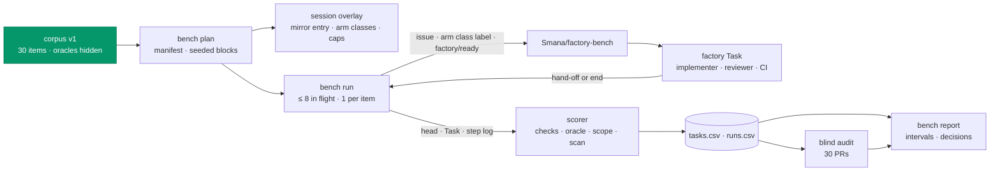

# v3 feature 0: the eval bench, a fixed corpus scored the same way every time

**Date:** 2026-10-22 · **Status:** draft; owner decisions OB1–OB4 open, each with a recommended
default ([below](#owner-decisions)) · **Part of:** the [v3 roadmap](2026-10-19-v3-roadmap-design.md#the-features),
feature 0, as amended by the [v3 review](2026-10-21-v3-review.md#5-amendments-proposed) (R10 and the
added metrics) and by D4 (offline first, per-class switches) · **Research:** the
[hard-task cohort](2026-10-12-v2-hard-task-cohort-design.md#results) and its
[sheet](2026-10-12-v2-hard-task-cohort-results.csv) · **Runtime:** the gateway runtime: costs come
from the factory's meter on [truthful costs](2026-10-22-truthful-costs-design.md), runs start
through the factory's label intake

## Outcome

One command runs 30 frozen issues, 3 times each, through the factory once per arm: the baseline
with every v3 switch off, and each variant with one switch on. Every attempt is scored by the same
hidden checks, and the session ends in a report that says, per feature, whether it moved acceptance
or cost per accepted pull request by more than the bench can resolve. Nothing the bench does lands
in the history of the repositories the factory serves.

## What exists

Read against agent-platform `main` at `d40876a` and cloud-native-ref's GitHub history.

| Piece | Today |
|---|---|
| The cohort | 15 hard issues × 3 arms, one run each, 2026-10-14 to 10-15. Arm A was started by labels (`factory/ready` and `class:<class>`) from the maintainer; each PR got one of four verdicts by hand (`merged-as-is`, `merged-after-edits`, `rejected-fixable`, `rejected-wrong`; accepted = the first two), delegated to the operating agent from issue 5. `scripts/ops/github/cohort-row.py` appended one row per task-arm from `gh`, the `Task` and VictoriaMetrics; `cohort-results.py` summed them; both have suites (`test-cohort-row`, `test-cohort-results`) |
| Cohort results | A (factory, GLM-5.3) 0/15, $9.00, stopped by its token budget; B (Claude) 13/15, $1.22 per accepted; C (GLM-5.3 in Claude Code) 0/15, $25.65, $1.71 per issue. Reference fixes: B's 13 merged PRs; #2319 and #2321 are still open |
| Factory history | 41 PRs by the agents' App on cloud-native-ref, 2026-09-27 to 10-18, 2 on ai-native-ref. Without the cohort's, the probes (v2 A1 start-time probes, a live-gate probe) and the link-rot drills: about 24 doc corrections, one tests item (#2415), one scripts item (#2340) |
| Starting work | The label intake creates a `Task` per labelled issue: snapshot of title and body, refused if edited after the label (`internal/factory/intake/issues.go:279`), and **one moving task per issue** (`task_active`, `:307`). `POST /v1/runs` creates a bare `AgentRun` with no `Task`, triage, reviewer or gate |
| Base of a run | Every implementer run branches from `main` (`internal/factory/reconciler/implement.go:134`); the harness clones the whole repository, every branch included (`images/agent-harness/agent_run.py:582`) |
| Class | Triage takes the class from a maintainer's `class:<name>` label naming a class of that repository (`internal/factory/triage/classify.go:121`); `triage.controlPercent: 10` sends a task to the frontier tier and the `trio` template whatever its class |
| Per-task record | `Task.status`: `runs[]` (role, trigger, reason, verdict, `headSHA`, `costMicroUSD`, `chargedTo`, start and end), `reviewRounds`, `fixRuns`, `usage.costMicroUSD`, `configHash`, `pullRequest` |
| Steps | The harness logs `agent-run step N:` per step; VictoriaLogs counts distinct step numbers per run (the fleet dashboard's query), since a resumed attempt re-logs earlier ones |
| Caps (values) | `activeTasks: 3`, `concurrentRuns: 4`, `tasksPerDay: 20`, `awaitingHumanWIP: 5`; standard tier `runUSD 2.55`, `taskUSD 5.10`, `runMinutes 45`; daily caps in dollars after truthful costs PR 3 (`factoryDailyUSD: 42.50`) |
| Repositories | At most 8 per factory; each must name the factory in `.github/agent-factory.yaml`. The gateway's `sts` listener holds 8 audiences, four per repository, and is full with two (`infrastructure/base/agent-gateway/policies-identity.yaml`); the composition reaches it on a fixed port |
| Provenance | None on the `Task` (review R10); a run-provenance design is drafted in parallel |

## Owner decisions {#owner-decisions}

### OB1: where the bench's pull requests go

| | **A. The real repositories** | **B. A mirror (recommended)** |
|---|---|---|
| Where issues and PRs land | cloud-native-ref: up to 90 issues and 90 PRs per arm, about 360 of each per session | `Smana/factory-bench`, a public repository holding the frozen base |
| A fixed corpus | **Not possible as the factory stands.** The hard items' fixes are on `main`, and every run branches from `main` (implement.go:134). Replaying needs a factory change (a base per task, and PRs against it) | Yes: the mirror's `main` is the corpus base, and nothing merges into it |
| A merged bench PR | Moves the base for every later run, and ships a duplicate of real work | Impossible: no class live or shadow, no merger App installed |
| Onboarding | None | The second-repository steps without policy-bot or the merger (rulesets, the factory's and agents' Apps, labels, fence, trust policies), the base commit, CI workflows copied from the source, and four `sts` audiences (OB2) |
| CI | The real queue and minutes, shared with real work | The source's workflows as of the base, minus jobs that need secrets; free on a public repository |
| Leaks to the agent | The fix is on the default branch | The fix is in the source repository's public PRs: caught by the contamination scan ([B12](#decisions)) |

**Recommended: B.** A cannot hold a corpus fixed without a factory change, and a session would
file hundreds of issues and PRs into a repository people read. B's costs are one-time.

### OB2: `sts` capacity for the mirror

**Recommended: the session overlay swaps ai-native-ref's four audiences, and its repository entry,
for the mirror's**, and the revert restores them. No factory work runs on ai-native-ref while the
bench does. The alternative, a second `sts` listener, needs a composition change (the port is fixed)
and a crossplane-configuration release; it waits for a third repository that stays.

### OB3: the session's budget and shape

**Recommended: $600 of model spend for the baseline plus three variants, 8 attempts in flight.**
Expected spend is about $360 ([cost](#the-cost-of-one-session)); the runner stops starting attempts at
the budget. The Z.ai wallet is topped up by the same amount before the session.

### OB4: who grades the audit sample

**Recommended: the maintainer**, 30 PRs per session, about two hours. The alternative is the
operating agent under the owner's delegation, as the cohort did from issue 5; on Claude it reads
public-class content, the owner's call under D2. The report records the grader either way.

## Decisions

| # | Decision | Rejected | Why |
|---|---|---|---|
| B1 | **Corpus v1: 30 items from cloud-native-ref.** The cohort's 15 hard issues, frozen as the cohort froze them, and 15 routine items. Data class `public` throughout, so every run is on GLM-5.3 | New issues each session; SWE-bench or Terminal-Bench alone; ai-native-ref's two routine items | A corpus that changes cannot carry a baseline; the factory's own issues are the work being judged; one source repository needs one mirror |
| B2 | **The routine half by stratum: docs 8, tests 3, scripts 3, dashboards 1.** Docs counts every doc-only correction, whatever its label said (`review`, `docs`, `docs-links`). Each stratum draws from the factory's history first, then from the maintainer's own merged PRs over the same window that changed at most 50 lines for one concern. Within a stratum, candidates are ordered by `sha256("bench-v1/" + repo#issue)` and taken in order while they pass B3's validity rule; rejects are recorded with their reason. Excluded: probes, drills, scheduled link-rot tasks (their oracle is the internet on the day), the cohort's issues | Proportional sampling of the history; hand-picking | The history holds about 24 doc corrections, one tests item and one scripts item: proportional sampling gives about 14 one-line doc edits, a ceiling no feature moves. A seeded order makes the draw reproducible and its rejects auditable |
| B3 | **One base, frozen.** The mirror's `main` is one root commit: cloud-native-ref at `fc0bbb8` (`main` just before #2352, the first cohort merge), plus one seed per routine item fixed before it (its reference fix reverse-applied), plus the mirror's own `.github/` files. No history, so nothing can be mined from it. An item is valid when its reverse patch applies, its oracle fails at the base and passes at base + reference fix, and the oracle checks only what a factory run may write (the composition forbids `.github/workflows/`, so #2279's oracle checks its script, not its CI wiring). #2319 and #2321, which nothing closed, get a reference the corpus builder writes. A version never changes: a new item makes v2, and v1 and v2 numbers are never compared | A base per item; the source's history kept | The factory branches every task from `main`; a history would show each seed's reverse. Fail-to-pass is SWE-bench's validity rule |
| B4 | **The corpus lives in ai-native-ref, never in the mirror**: `scripts/ops/bench/corpus/v1/` holds `corpus.yaml` (source, base, tree hash, strata, order, rejects) and per item `issue.md`, `item.yaml`, `reference.patch` and `oracle/` | Oracles in the mirror; a private repository | An oracle in the mirror is a test the agent reads. A private repository adds a credential for little: the scan covers a run that looks elsewhere |
| B5 | **The runner is a resumable CLI**, `scripts/ops/bench/bench.py`, run by the operator during a platform session over the tailnet, as the cohort tooling was. Its state is GitHub, the cluster and the session's append-only CSVs: each tick plans, starts what is due, collects what ended; `--watch` repeats | An in-cluster controller or CronJob; a GitHub Actions workflow | A workload needs RBAC, a CNP, credentials and a release for a few sessions a year. Actions jobs stop at 6 hours and have no tailnet |
| B6 | **Attempts start by label, as cohort arm A did**: the runner files the item's `issue.md` in the mirror, then adds `class:<class>--<arm>`, then `factory/ready`, with the maintainer's token. One issue per attempt (item × arm × replicate) | `POST /v1/runs`; F4's `run_create` | One moving task per issue, and the snapshot is taken at the label. A bare run has no triage, reviewer, gate or cost per task. `run_create` waits for sponsored principals; it can replace the label later |
| B7 | **An arm is a class suffix (D4).** The overlay declares `<class>--<arm>` beside each plain class in the mirror's entry, and turns each arm's switches on for its classes only. The baseline uses the plain classes, every switch off. **Every v3 feature keys its switch by class name**; a switch that cannot be set per class cannot be benched | A variant label the factory maps to switches; one arm per session | A label is how the factory already takes a class, and the class is where D4 puts the switch. A label-to-switch map is a factory change and a new way to change behaviour. Arms on different days measure the provider's drift too |
| B8 | **The session overlay**, rendered by the runner from the session's manifest and committed for the session, reverted after: the mirror's entry (OB2), every bench class neither `live` nor `shadow`, `triage.controlPercent: 0`, caps raised (`activeTasks: 8`, `concurrentRuns: 10`, `tasksPerDay: 400`, `awaitingHumanWIP: 12`), `budgets.factoryDailyUSD` at the session budget and gateway bucket B2 raised to AG8's floor | Running inside the production caps | The control group would switch tier and template under an arm, as the cohort found; at 20 tasks a day one arm takes five days |
| B9 | **The schedule is blocked and balanced.** Each block holds every (arm, item) once, in an order shuffled by the session's seed; block r is replicate r. At most 8 attempts in flight and **at most one per item**. A session stopped early still compares the arms on whole blocks | All replicates of an arm in a row | Provider drift spreads over the arms. One attempt per item keeps a run from seeing a sibling's branch in its clone |
| B10 | **An attempt ends** at the `Task`'s hand-off to the maintainer (`AwaitingHuman` with a PR), `Escalated`, `NoOp`, `Rejected` or `Stopped`, or at the runner's 3-hour stop (`factory/stop`). The runner records the head, closes the PR and the issue, and deletes the branch; the PR's ref keeps the commit. An attempt is **invalid**, and re-run once at the end of its block, only for: provenance unlike the manifest, the provider wallet empty (error 1113), the kill switch, a run lost that the factory could not resume. Every other end counts | Re-running failures | The cohort's rule: the arm ends where it ends. Infrastructure is not the variant |
| B11 | **The verdict is automated.** *Accepted* when all five hold: a PR reached the hand-off; the mirror's required checks are green on its head; the item's oracle passes at the head; the diff stays in the item's allowed paths and under its size bound; the contamination scan is clean. *Resolved* when the oracle passes, whatever else. "A maintainer merge without substantial rework" is these five; the audit (B13) measures how far that holds | The maintainer grading every PR; a model grader; CI alone | About 300 PRs a session. Small open judges flip with position, and a Claude grader would read public-class content (D2). Green CI says nothing about the issue |
| B12 | **The contamination scan** reads each run's step log and flags: a read of the source repository's PRs, commits or compares; a git command naming a branch other than the run's own and `main`; a `gh` read of an issue or PR other than the attempt's own; a read of the corpus path. A flagged attempt is not accepted and goes to the audit | Blocking egress per repository | The run's egress is github.com, and a CNP cannot tell repositories apart |
| B13 | **A blind audit per session**: 30 PRs, 15 the oracle accepted and 15 it rejected with a PR, drawn across the arms, exported as diff and issue text with the arm hidden, graded on the cohort's four verdicts (OB4). Below 90% agreement, every attempt of a disputed item is graded by hand before any decision | No audit; auditing every PR | The oracle stands in for the maintainer only as far as it agrees with one |
| B14 | **The statistic: a paired, item-level bootstrap.** Per arm and item, the mean of its 3 attempts; per variant and item, the difference with the baseline; the 95% interval of the mean difference over 10,000 resamples of items, seeded by the session. **The spread** is the interval's half-width. A feature ships when its primary metric's interval lies entirely on the good side ("moves by more than the spread") and no guardrail's lies entirely on the bad side. Primary and guardrails are written in the manifest before the first run | The range of 3 replicate passes; a t-test; a two-level bootstrap | Three values make no interval. Rates near 0 and 1 are not normal. Resampling runs inside items as well counts their noise twice ([arithmetic](#the-arithmetic)) |
| B15 | **Provenance per run**: the run-provenance design's four fields (harness digest, composition revision, factory version, served model), the `Task`'s `configHash` and the arm. The manifest pins the expected values; a run that differs is invalid (B10) | Trusting the pins | The roadmap's "pinned releases" is checked, not assumed |
| B16 | **N, the stall limit, from the baseline**: per class, 1.25 × the largest steps-to-first-commit among the baseline's accepted implementer runs, rounded up to 10, at least 40. A class with no accepted run keeps the loop policy's default 80 | One N for every class | The rule must not end a run the baseline accepted; classes differ (the loop policy already gives dashboards 120) |
| B17 | **The report is a Markdown page with its CSVs**, in `docs/superpowers/bench/<session>/`, merged by PR and linked from the status page and from each feature's design with its go/no-go | A dashboard | A session is a few days a quarter; the decision needs a reviewed record, as the cohort's sheet was |

## A session



## The corpus

### An item

```yaml
# scripts/ops/bench/corpus/v1/items/hard-tests-2316/item.yaml
id: hard-tests-2316
half: hard                   # hard | routine
class: tests                 # docs | tests | scripts | dashboards
source: {issue: Smana/cloud-native-ref#2316, reference: Smana/cloud-native-ref#2364}
seed: none                   # none | reverse: the reference fix reverse-applied into the base
allowedPaths: [scripts/ci/tests/]
maxChangedLines: 300         # the size bound; the builder sets it from the reference
oracle: {run: oracle/run.sh, timeout: 600}
```

`issue.md` is the frozen title and body. The builder rewrites every cross-reference to plain text:
no source issue or PR number, no link to the source repository, nothing that names the cohort.

### The oracles

| Class | Oracle |
|---|---|
| scripts | Fail-to-pass tests written from the reference fix, with the cloud CLIs stubbed as the cohort's acceptance criteria required |
| tests | The PR's suite runs in `scripts/ci/tests/run.sh`, passes at the head, and kills at least 80% of the frozen mutants of the script under test that the reference suite kills |
| dashboards | The JSON is a valid dashboard; every panel's query parses and names only metrics in the item's frozen `metrics.txt`; the panels the issue's criteria list exist |
| docs | The target text matches the item's accepted forms; nothing else in the file changes |

The oracle runs in a pinned image against a checkout of the head, never inside the mirror. A file a
feature reads from the repository, such as a class's steering, joins the base as one overlay commit
identical for every arm; the switch decides whether it is read, and the report names the commit.

## The runner

```yaml
# docs/superpowers/bench/<session>/manifest.yaml, committed before the first attempt
session: 2026-11-03
corpus: {version: v1, baseTree: <tree sha>}
mirror: Smana/factory-bench
pins: {factory: <tag@digest>, harness: <digest>, composition: <revision>, hostRef: <sha>}
budgetUSD: 600
inFlight: 8
replicates: 3
seed: 1103
arms:
  - {name: base}
  - name: loop
    switches: {loops: {stallSteps: 80, continuations: 2, judge: tier-light}}
    primary: {metric: wandering_share, direction: down}
    guardrails: [acceptance, cost_per_accepted]
```

| Command | Does |
|---|---|
| `bench plan` | Validates the manifest, renders the overlay fragment and the seeded blocks |
| `bench run [--watch]` | One tick: refuses to start if the live pins differ from the manifest or if spend so far plus the `taskUSD` of every attempt in flight would pass the budget; starts what is due; collects what ended; closes it |
| `bench score` | Scores recorded attempts; re-runnable offline from the recordings |
| `bench audit export \| import` | The blind sample out, the grades in, the agreement computed |
| `bench report` | `report.md` from the manifest and the CSVs |

Recordings (Task JSON, step logs, check runs, diff stats) go into one archive per session, attached
to a release of the mirror; the CSVs and the report go to Git.

## Scoring

### The metrics

| Metric | On the bench | Source |
|---|---|---|
| Acceptance rate | Accepted attempts over attempts; pass@3 per item beside it (loops L11) | the scorer |
| Cost per accepted PR | All spend of the arm, failed and wandering attempts included, over accepted attempts. **Cost per merged PR** is the same number here: accepted is the bench's merge | `Task.status.usage.costMicroUSD` (the meter; cache reads at their rate) |
| Cost per resolved issue | All spend over resolved attempts: the bake-off's metric on our own tasks | the same |
| Steps | Median and p90 per run, by role | VictoriaLogs, distinct step numbers per run |
| Wandering share | Implementer runs past N steps with no commit | the step log: the first `git commit` or `git push` step |
| CI round-trips | Fix runs over accepted attempts | `Task.status.fixRuns` |
| Scoper bounce rate | Attempts sent back to the author, over attempts; a bounce is not accepted. Acceptance after the author answers is measured in production: a frozen corpus has no author | the `Task`'s end reason |
| Reviewer precision and yield | A `changes` verdict on a head whose oracle fails is a real defect, on a head whose oracle passes a false alarm; an `approve` on a failing head is a miss | `runs[].verdict` and `runs[].headSHA`, the oracle at that head |
| Judge false-"met" rate | Attempts not accepted whose last implementer run the judge called `met`, over the judge's `met` | the loop policy's verdict in the room log |
| Cache-read share | Per run from the gateway's series over its window (`increase_pure`); per step from the harness's step log once the cache design's C1 fields ship | VictoriaMetrics, VictoriaLogs |
| Label to hand-off | Minutes | GitHub events, `Task` phases |

Reported for the whole corpus and per half. The internal ceiling is the cohort's arm B as recorded
(13 of 15, $1.22 per accepted), never re-run: public content does not go to Anthropic (D2).

### The arithmetic {#the-arithmetic}

A simulation of 200 sessions, 2026-10-22, with the baseline guessed from the cohort and the
history: 13 hard items at p = 0, 2 at 0.3 (A's two correct PRs); routine items 10 at 0.9, 3 at 0.6,
2 at 0.3.

| Reading | Value |
|---|---|
| Spread, paired item-level bootstrap | ±7 to 8 acceptance points over 30 items |
| The same, resampling runs inside items too | ±10 points: run noise counted twice |
| No true change, interval excluding 0 | 4 of 200 sessions (2%) |
| True change +5, +6.7, +8.3 points | seen in 24%, 49%, 66% of sessions |
| Range of the 3 replicate passes, no change | median 6.7 points, p90 13.3 |

So the bench resolves about 8 points of overall acceptance, 15 inside one half. The cohort's 15
issues at one run each carried a standard error of about 13 points. Whether a smaller effect is
real, the bench cannot say, and the report says so.

## The report

`docs/superpowers/bench/<session>/` holds `manifest.yaml`, `tasks.csv` (one row per attempt),
`runs.csv` (one row per `AgentRun`, with its provenance) and `report.md`:

1. The session: corpus, base, pins, arms and their switches, the pre-registered rules.
2. Per arm and half: every metric above, with its interval.
3. Per variant: the paired differences against the baseline, and the decision per rule:
   **go** (the primary's interval on the good side, no guardrail's on the bad side), **no-go**
   (the primary's or a guardrail's interval on the bad side) or **inconclusive** (otherwise).
4. The audit: agreement, and each disagreement.
5. Invalid attempts and their re-runs; contaminated attempts.
6. N per class (B16), from the baseline.
7. Spend: per arm, per half, against the budget.

## The cost of one session

The baseline and three variants, 360 attempts, 8 in flight. A hard attempt runs to the standard
tier's 45-minute deadline; a routine one takes about 35 minutes with its review and CI.

| Part | Per arm | Session |
|---|---|---|
| Hard half, 45 attempts | ≈ $77 at arm C's $1.71 per hard issue; at most $230 at `taskUSD` $5.10 | ≈ $308 |
| Routine half, 45 attempts | ≈ $14 at about $0.30 per pair task | ≈ $54 |
| **Model spend** | ≈ $90 | **≈ $360**, stopped at the $600 budget (OB3) |
| gcp-0, about 30 hours | — | ≈ $40: $0.75 an hour idle (measured), $0.34 for two busy gVisor spot nodes, $0.10 GKE fee |
| Mirror CI | — | $0 on a public repository |
| **Total** | | **≈ $400 expected, at most about $640** |

A pilot before the first block (two items, every arm, one attempt) adds about $8.

## Pull requests, in order

| # | Repository | Content | Offline proof | Depends on |
|---|---|---|---|---|
| 1 | ai-native-ref | `scripts/ops/bench/`: the corpus schema and validator, the scorer (verdicts, scope, the scan, the oracle runner), the statistics, the report; suites `test-bench-*` on fixtures, the cohort's recorded PRs among them | 1–5 | nothing |
| 2 | ai-native-ref | Corpus v1: 30 items, oracles, reference patches, the sample's order and rejects; the mirror tree builder; a suite proving every item fail-to-pass | 6, 7 | 1 |
| 3 | ai-native-ref | The live driver (plan, run, collect, close, resume) against a fake GitHub and a fake cluster; the overlay renderer | 8, 9 | 1 |
| 4 | the owner, `Smana/factory-bench` | The repository, its rulesets, the two Apps, labels, the base commit from PR 2's builder, the fence, trust policies, CI | live 1 | 2; OB1 |

Before the session: truthful costs PR 3 pinned (dollar caps, the meter's USD), the run-provenance
fields released, and each benched feature's per-class switch merged off.

## Gate

The baseline, with its spread measured: the roadmap's gate for feature 0.

**Offline proofs** (D4)

1. The verdict rules, table-driven: each verdict from a synthetic `Task`, check runs, oracle exit,
   diff stats and step log; a path outside the item's and a diff over its bound each refuse
   acceptance.
2. The scan flags a `gh pr diff` of another PR, a fetch of another `agent/` branch, a read of the
   source repository's pulls or commits and a read of the corpus path; the attempt's own issue, PR
   and branch pass.
3. The cohort replay: each hard item's oracle fails at the base and passes on B's head for the 13
   B landed; A's #2371 and #2376 pass; B's three `merged-after-edits` heads pass the oracle and
   fail only the shellcheck the maintainer's edits fixed.
4. The statistics on synthetic arms: the null excludes 0 in at most 5% of 1,000 sessions, a known
   effect is found, a seed gives the same interval twice, and a resample with no accepted attempt
   gives no cost per accepted, not an error.
5. The report renders a fixture session to its golden file.
6. Every item of corpus v1 is valid (B3), names nothing of its source (B1), and the builder's tree
   hash equals `corpus.yaml`'s.
7. The strata hold their quotas, and re-drawing with the seed gives the same items and rejects.
8. The driver, against fakes: the blocks are balanced; never two attempts of one item in flight; a
   runner killed mid-tick and restarted files no issue twice and loses no attempt; the budget
   refuses an attempt that could pass it; an invalid attempt is re-run once.
9. The overlay parses under the pinned factory release's `config.Parse` with the arm classes, AG8
   passes with the raised daily cap and B2, and the `sts` listener still holds 8 audiences.
10. `task check` is green.

**Live proofs** (the first gcp-0 bench session)

1. The pilot fills every column of both CSVs for every arm; the source repositories gain no
   issue, PR, branch or label during the session.
2. For three ended attempts, `usage.costMicroUSD` equals the sum of the runs' `costMicroUSD`, and
   the gateway's series read with `increase_pure` agree within 1%.
3. Every run's provenance matches the manifest, or the run is invalid and re-run.
4. The baseline's 90 attempts are scored; its spread and N per class are in the report.
5. The audit agrees at 90% or more.
6. After the session: the overlay reverted, every mirror PR and issue closed, the report merged.

## Not in this design

Terminal-Bench 2.1 and SWE-bench Pro runs, the bake-off's external yardsticks (its design; the
item format above is the same three parts: an instruction, an environment at a commit, tests). An
internal-class corpus. Acceptance after a scoper's question is answered. Counting reviewer
findings that repeat an earlier task's. A second `sts` listener, unless OB2 chooses it. A bench
dashboard. A refresh cadence for the corpus: v2 is a decision of its own.

## Left to the builder

The item ids and size bounds; the oracle image and its tools; the mutants per tests item; the
step-log patterns for commits and the scan; the CSV columns beyond the metrics; the archive format;
how the corpus suite gets cloud-native-ref at `fc0bbb8` in CI; which source workflows the mirror
keeps and its required checks; the trust policies' text; the runner's 3-hour stop if the pilot
shows hard attempts need more; whether the cohort scripts' helpers move into `bench.py` or are
imported.
