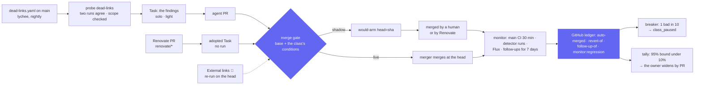

# v3: more auto-merge classes, the merge gate's vocabulary, monitor and calibration

**Date:** 2026-10-22 · **Status:** approved by the owner 2026-10-22 with every recommended default; M1–M6 decided as recommended · **Part of:** the
[v3 roadmap](2026-10-19-v3-roadmap-design.md), feature 8, as amended by the
[v3 review](2026-10-21-v3-review.md#5-amendments-proposed) and its decision O8 ("the oracle-backed
class first; dependency bumps after, patch versions only") · **Research:**
[§5.1](2026-10-21-v3-landscape-research.md#51-practitioners-and-research) (RADAR, Xia and Miller,
Abenhaim), [§5.2](2026-10-21-v3-landscape-research.md#52-products-september-to-october-2026)
(GitHub, gh-aw, Cursor) · **Amends:** loop policy [L7](2026-10-21-loops-and-teams-design.md#decisions)
(where `holdoutChecks` lives, and what covers `docs-links` today) · **Runtime:** both; the gate, the
classes and the monitor live in the factory, and the Flux signal reads the cluster the factory runs in

## Outcome

Every class that merges without a human declares its gate in one vocabulary of named,
machine-checkable conditions, on top of a base no class can remove. Two new classes follow O8's
order: `dead-links`, whose task is a detector's finding and whose proof is the detector re-run on
the head, then `deps-patch`, Renovate's patch bumps merged by the factory instead of by Renovate.
Every merge of a class is watched after it lands; reverts, follow-up fixes and monitor regressions
feed the breaker, which demotes at once, and a calibration rule that widens a class only on
evidence, by the owner's pull request.

Read against agent-platform `origin/main` at `d40876a`, cited `AP/<path>:<line>`; the host is
cloud-native-ref `origin/main`, cited `cnref/<path>`.

## What exists

| Piece | Where | Today |
|---|---|---|
| The rule | `AP/internal/factory/reconciler/arm.go:73-161` (`DecideArm`) | One fixed sequence of rows, each failing to a human with its reason. Class-specific code: `if class == "docs-links" \|\| class == "revert"` applies `LinksOnly` (R52, `arm.go:279-310`) |
| Classes | `AP/internal/factory/config/config.go:302-305`; the factory config in `tooling/base/agent-factory/helm-values-configmap.yaml` | `Class{Live, Shadow}` only. Host: `docs-links` and `revert` live at 1 merge a day; ai-native-ref: both shadow; `docs`, `tests`, `dashboards`, `scripts` label-only |
| After the merge | `AP/.../merge.go:587-608` (`verifying`) | main's `verifyChecks` on the merge commit for `verifyFor` (30 min); red opens the revert |
| Revert | `merge.go:622-707` | A merger-authored revert PR labelled `factory/revert-of:#<n>`, merged green at its head (#158) |
| Breaker | `merge.go:709-749`, `ledger.go:21-80` | Per class, the newest `window` (10) merges, demoted at `maxReverts` (1). GitHub labels are the ledger (v2 D1), so a rebuild keeps a demotion |
| Daily cap | `merge.go:751-778` | `autoMergesPerDay` per repository, every class together |
| A probe | `AP/internal/factory/intake/schedule.go:169-212` | `renovate-red`: Renovate PRs red over 24 h become an agent PR "with the bump and the fix", class `review` |
| Shadow tally | `AP/scripts/shadow-merge-tally.sh` | Counts shadow decisions merged unchanged at their `head=` (v2 D3) |
| Policy | `cnref/.policy.yml` ([ADR-0045](../../../website/content/docs/decisions/0045-merge-policy-gate.md)); this repository's [`.policy.yml`](../../../.policy.yml) | Host: `low-risk: docs-links` and `low-risk: factory revert` rules (docs paths, < 21 lines, no file added or deleted, CI green); a `renovate` rule that approves every Renovate PR, informative because Renovate bypasses the rulesets. Here: no low-risk rule |
| Renovate | `cnref/.github/renovate.json`; `cnref/scripts/ops/github/agent-merge*-ruleset.sh` | Native auto-merge of patch **and** minor since 2026-09-12, `minimumReleaseAge: 1 day`, a never-automerge list (agent MCP servers, the factory, OpenBao, ZITADEL, agent-sandbox, Gateway API, Grafana plugins, action digests). Renovate is on the bypass list of `agent-merge` and `agent-merge-gate`. ai-native-ref has no Renovate |
| Holdouts | [loops L7](2026-10-21-loops-and-teams-design.md#decisions) | Named, not built. L7 counts "Check the documentation links 🔗" as `docs-links`' holdout, but that job resolves relative links only (`validate-links.sh` skips absolute URLs by design): nothing fetches the external target a `docs-links` PR writes |
| Detectors in CI | `cnref/.github/workflows/ci.yaml`, `build-container-images.yml` | TruffleHog (verified only, required); Trivy filesystem scan and Checkov (non-failing, SARIF to code scanning); ShellCheck and the relative link check (required); Trivy on images at build, on push only. No external link check |
| Sandbox egress | [harness reference](../../../website/content/docs/platform/ai-platform/agents/harness-reference.md) | `github.com` and its API, codeload and content hosts, plus each profile's package registries. An implementer can check a `github.com` link and no other |
| Metrics | the factory | `agent_factory_merge_decisions_total{class,verdict,reason}`, `agent_factory_pr_outcomes_total{class,outcome}` (`auto_merged`, `human_merged`, `reverted`, `closed`); an alert on `reverted` |

## Measured, 2026-10-22

| Fact | Number | How |
|---|---|---|
| Host merges since 2026-08-18 | 651, with 5 revert PRs: 3 deliberate drills (#2424, #2425, #2521), so 2 genuine (#1766, #1982): **0.3%** | `gh pr list --state merged` |
| Renovate merges on the host, same period | 205: 111 minor, 75 patch, 7 digest, 6 major, 6 other; 104 merged by Renovate's auto-merge, 101 by the owner | each PR's own "Update" column |
| Patch bumps outside the gate paths | 62, about 6.5 a week | the same, against the host's gate list |
| Known Renovate breakages on `main` | 3, **all minor**: #1959 (fixed by #1980), #1981 (reverted by #1982), #2095 (OpenBao 2.7.0, auto-merged; the next deploy failed). None among the 75 patches | `renovate.json`'s own notes, the revert search |
| Host code-scanning alerts open | 1,881: 1,783 in category `trivy-agent-harness` (an image now built in agent-platform, last scanned 2026-10-07), 67 in three tool images, 31 Checkov (OpenTofu and YAML secret rules), **0** from the Trivy scan of the tree. ai-native-ref: no analysis | `gh api code-scanning/alerts` |
| Link rot in `docs-links`' scope | 91 external Markdown targets, 1 answering 404 | [runbook 12](../../runbooks/agent-factory/12-live-auto-merge-drill.md#2026-10-18-morning-gcp-0), 2026-10-18 |

At one or two merges a day, no class can show a bad-outcome rate near the human baseline (0.3%)
within a year: 0 failures in 1,000 merges is needed to bound it under 0.3%. The calibration below
bounds a class against the breaker's own budget, 10%, and the breaker stays the safety.

## Decisions

| # | Decision | Rejected | Why |
|---|---|---|---|
| MC1 | **A declared gate vocabulary.** `DecideArm` becomes a fixed base, which no class can remove, plus conditions a class names in its config, each a predicate with its own refusal reason ([vocabulary](#the-vocabulary)). gh-aw's names where it has one, spelled in the factory's camelCase keys. An unknown name fails the strict decoder | Per-class branches in Go, as `arm.go` has today; a CEL expression per class; the whole gate in policy-bot | gh-aw ships this shape (`allowed-files`, `max-patch-files`, `protected-files`, `staged`) ([research §5.2](2026-10-21-v3-landscape-research.md#52-products-september-to-october-2026)). A reason per condition keeps every refusal explainable on the dashboard. An expression language in a gate path is a program. policy-bot cannot read the room's head report, a verdict or an oracle |
| MC2 | **policy-bot stays the independent second check** (ADR-0045). Each live class has its own rule in the repository's `.policy.yml`, and a parity suite here fails when a class's `allowedFiles`, `protectedFiles`, `modifyOnly` or `maxModifiedLines` differ from its rule | Generating `.policy.yml` from the factory config | The policy lives in each repository, is read from `main` and is a human-owned gate path. Two evaluators of one fence, with drift caught in CI, is the profiles' pattern ([P1](2026-10-21-capability-profiles-design.md#decisions)) |
| MC3 | **Path-scoped authority is already ours**: the class's `allowedFiles`, repeated in its policy rule, and the merger App as the only merge actor (R16) | GitHub's bot approval counted toward required reviews | The research's GitHub finding ([§5.2](2026-10-21-v3-landscape-research.md#52-products-september-to-october-2026)) is a path scope on a bot's authority. These repositories gate on policy-bot's status, not on a count of approvals, and Copilot is not our reviewer (D2) |
| MC4 | **The first oracle-backed class is `dead-links`**, with lychee as the detector (M1) | Trivy on images, Trivy on the tree, Checkov, TruffleHog, CodeQL ([below](#which-detector-first)) | The only detector here whose findings arrive on `main` from outside, with a fix whose shape is already proven live (R52). Code scanning has no usable intake today. The new part under test is the oracle machinery, not a new diff shape |
| MC5 | **A finding is permanent; a proof is strict.** A finding is a 404, a 410 or a name that does not resolve, reported by two consecutive scheduled runs on `main`. 403, 429, 5xx and timeouts are never findings. On the pull request, every target it changed must answer 2xx after redirects, or the holdout check fails | One run; counting rate limits and bot walls | A flaky oracle is no oracle. Fail closed both ways: fix only what is surely broken, merge only what surely works. Abenhaim's "two consecutive" passes, as a detection rule |
| MC6 | **The findings are the task, and the only change allowed.** The probe renders the task from the findings; the gate refuses a target changed outside them (`oracle_unrequested`). `dead-links` runs `solo` on `light`, with no reviewer: the oracle is its verifier | `pair`, as `docs-links` runs | The reviewer cannot fetch the targets either (GitHub-only egress) and adds a run per PR. A finding is the bounded task the scoper would write and its re-run the check the tester would: neither lane waits for features 1 or 4 |
| MC7 | **A monitor per merge** watches main's CI (as today), the detector's next runs and Flux on the factory's cluster, then records `healthy`, `regression` or `inconclusive` ([monitor](#the-post-merge-monitor)). It never reverts on its own: main red within `verifyFor` still opens the revert (§6.4), nothing else does | Monitor-driven reverts | Cursor's monitor reports and "never merges or rolls back itself". A cluster-wide reading can blame the wrong merge; the breaker demotes on a regression anyway, so the next PR waits for a human |
| MC8 | **Follow-up fixes count against the breaker** (M5): `breaker.maxFollowUps` beside `maxReverts`, both 1 in 10 | Reverts only | Agentic PRs need more corrective maintenance, and a fix-forward is invisible to a revert count ([Xia and Miller](2026-10-21-v3-landscape-research.md#51-practitioners-and-research)) |
| MC9 | **Demote automatically, widen only on evidence, by the owner.** The breaker demotes at its first bad outcome. A class widens one step only when the 95% upper bound of its bad-outcome rate is below its budget ([calibration](#calibration)); the widening is a config pull request the owner merges, citing the tally | Automatic widening; a time window; the v2 bar of 20 for widening | RADAR: start conservative, widen while revert and incident rates hold. 0 bad in 20 still allows 13.9%; the bar for a wider class must be stated as a bound, and a config change to a gate path is a human's |
| MC10 | **Dependency bumps are Renovate's PRs, adopted by the gate.** The factory authors no bump: an adopt poller turns an eligible open Renovate PR into a Task with no run, decided and merged like any class. `renovate-red` (an agent's fix of a red bump) stays `review` | Factory-authored bumps; Renovate's native auto-merge as the lane | Renovate already finds every version; an agent adds cost and risk to a deterministic job, and its sandbox cannot reach most registries. Renovate merging by its bypass has no breaker, no monitor and no daily cap |
| MC11 | **`semver-patch` is computed from the diff**, not from Renovate's label. Release age is Renovate's own `minimumReleaseAge`, raised from 1 to 3 days for the lane's patches at the live switch, and read at the gate from its `renovate/stability-days` status. The never-automerge list is protected, and a parity suite reads it from the host's `renovate.json` | Trusting Renovate's labels or title | A label is a claim; the diff is the change. All three known breakages were minors: the predicate is the line O8 drew |
| MC12 | **`deps-patch` shadow observes Renovate's own merges.** Renovate keeps auto-merging while the class is in shadow; the factory records its decision with `head=` and monitors the merge | Shadow that takes patches away from Renovate | Calibration data at no human cost, about 6.5 eligible merges a week (M3) |
| MC13 | **Every outcome lives on GitHub** (v2 D1 extended): `factory/follow-up-of:#<n>`, `factory/monitor:regression`, a monitor comment `event=monitor-<n> verdict=<v>`. The tally extends `shadow-merge-tally.sh` | A metric or a ConfigMap | A rebuild must keep a demotion and the calibration record, as it keeps the revert ledger today |
| MC14 | **Off by default** (D4). The release ships the vocabulary at parity; the classes are declared with no switch and no intake, and a session's first commit sets `shadow: true` | Shadow from the first deploy | One session measures each class's baseline; `dead-links` in shadow starts paid runs |

### Which detector first

| Detector | Findings on `main` today | Re-run on the head | Fix | Verdict |
|---|---|---|---|---|
| **lychee, external Markdown targets** | About 1 a week (1 of 91 on 2026-10-18), arriving from outside | A pull-request job fetches every changed target | A retarget: R52's `LinksOnly`, proven live on 2026-10-18 | **First** |
| Trivy, image scan | 67 live alerts in three tool images, behind 1,783 stale ones | None: `check-container-images.yml` builds without scanning | A base image or package bump, mostly OpenBao (never auto-merged) and npm transitive dependencies | After the host prunes the stale category and scans on pull requests; it converges with `deps-patch` |
| Trivy, filesystem scan of the tree | 0 | Yes | A version bump | No intake |
| Checkov | 31, on OpenTofu and YAML secret rules | Yes | IAM, KMS and S3 changes applied outside CI and Flux | No: nothing watches the effect |
| TruffleHog | None: a required check | Yes | Rotation, not a diff (R42 escalates) | No |
| CodeQL | Not enabled; the languages here are YAML, HCL, shell and Python under `scripts/ci/`, a gate path | — | — | No |

`docs-links` keeps its rules. Its weekly prose schedule asks the implementer to find broken links
it cannot fetch outside `github.com`; M4 retires that schedule once `dead-links` is in shadow.

## The vocabulary

**Base, every class.** A class cannot declare these away; they are today's rows, kept with their
reasons.

| Condition | gh-aw | Predicate | Refusal |
|---|---|---|---|
| `requiredChecks` (repository) | built-in status checks | every required check `SUCCESS` on the head | `ci_red`, `ci_cancelled`, `ci_pending` |
| `leakScanCheck` (repository) | threat detection, failing closed | TruffleHog's check not `FAILURE` | `secret_scan_red` (escalates) |
| fence | — | `.github/agent-factory.yaml` names this factory | `not_owned` |
| policy | built-in review decision | `policy-bot: main` `SUCCESS`, posted by `policyBotLogin`; `ERROR` is a gate path | `policy_absent`, `gate_path`, `policy_pending` |
| no maintainer approval | — | no maintainer's `APPROVED` review: a human's success means a human merges | `maintainer_approved` |
| breaker | — | the class is not demoted ([calibration](#calibration)) | `class_paused` |
| caps | `max` | today's merges below `autoMergesPerDay` and below the class's `maxPerDay` | `auto_merge_cap` |
| head pin | — | the merge carries `expectedHeadOid` = the decided head | `head_moved`, `not_mergeable` |
| `shadow` | `staged` | decide everything, record `would-arm head=<sha>`, never merge | `shadow_would_arm` |

**Author, one of two.**

| Condition | Predicate | Refusal |
|---|---|---|
| `author: agents` (default) | the agents App authored it; the room reported this head; the verifiers approved this head (L5's evidence once it exists); the `Agent-Run` trailer names one of the task's runs; every push is the agents App's | `not_agent_authored`, `head_unreported`, `no_approving_verdict`, `verdict_stale`, `foreign_trailer`, `human_commit_in_pr` |
| `author: {adopt: [logins], branches: [regex]}` (gh-aw `allowed-branches`) | the PR's author is one of `logins`, every commit is that login's, the head branch matches. No room, run or verdict | `not_adopted_author`, `branch_not_allowed` |

**Class-declared.**

| Condition | gh-aw | Predicate | Refusal |
|---|---|---|---|
| `allowedFiles` | `allowed-files` | every changed path matches one regex | `file_not_allowed` |
| `protectedFiles` | `protected-files: request-review` | no changed path matches one; the repository's gate list is protected in every class through the policy | `file_protected` |
| `modifyOnly` | — | no file added or deleted (policy-bot's `file_not_added`, `file_not_deleted`) | `file_added_or_deleted` |
| `maxPatchFiles` | `max-patch-files` | changed files ≤ n | `patch_too_large` |
| `maxModifiedLines` | `max-patch-size` counts KB; policy-bot counts lines | additions + deletions ≤ n | `patch_too_large` |
| `diffShape` | — | `links-only`: R52's `LinksOnly`. `semver-patch`: every changed line differs from its base only in version tokens, and each moves within one major.minor to a higher patch, no pre-release; a digest may change only beside its tag on the same line | `class_mismatch` |
| `holdoutChecks` | — | each named check is `SUCCESS` on the head and was posted by GitHub Actions; its workflow is a gate path (L7) | `holdout_red`; pending waits |
| `oracle` | — | the head no longer holds any of the task's findings, and changes no target outside them | `oracle_finding_open`, `oracle_unrequested` |
| `releaseAgeCheck` | — | the named Renovate status (`renovate/stability-days`) `SUCCESS` on the head: the age is the one `renovate.json` sets | pending waits |
| `maxPerDay` | `max` | merges of this class today below n | `auto_merge_cap` |

`docs-links` and `revert` keep their behaviour: in the first pull request their conditions become
built-in defaults (`author: agents`, `diffShape: links-only`), at parity with today's decisions.
L7's `classes.<class>.holdoutChecks` keeps its key, flat in the class with the other conditions.
gh-aw refuses merges to the default branch; here the merger App merging to `main` is the point, so
the `agent-merge` ruleset keeps every other actor off it.

### The classes, in the factory config

```yaml
repositories:
  - name: Smana/cloud-native-ref
    classes:
      docs-links: {live: true}            # unchanged; conditions built in (PR 1)
      revert: {live: true}
      dead-links:                         # declared off (MC14); a session sets shadow: true
        allowedFiles: ['^(docs|website/content)/.+\.md$']
        protectedFiles: ['^docs/(superpowers|specs)/', '^website/content/docs/decisions/']
        modifyOnly: true
        maxModifiedLines: 20
        diffShape: links-only
        holdoutChecks: ["External links 🔗"]
        oracle: {probe: dead-links, workflow: dead-links.yaml, maxFindings: 10}
        maxPerDay: 1
        monitor: {oracleRuns: 2, followUpWindow: 168h}
      deps-patch:                         # declared off; shadow observes Renovate (MC12)
        author: {adopt: ["renovate[bot]"], branches: ['^renovate/']}
        diffShape: semver-patch
        protectedFiles: ['^opentofu/', '^security/base/zitadel/', '^flux/sources/gitrepo-(agent-sandbox|gateway-api)\.yaml$',
                         '^observability/base/victoria-metrics-k8s-stack/vm-common-helm-values-configmap\.yaml$']
        maxPatchFiles: 3
        maxModifiedLines: 10
        releaseAgeCheck: renovate/stability-days
        maxPerDay: 2
        monitor: {flux: {source: flux-system/flux-system, within: 1h}, followUpWindow: 168h}
    merge:
      autoMergesPerDay: 1                 # the ceiling over every class; raised as classes go live
      breaker: {window: 10, maxReverts: 1, maxFollowUps: 1}
```

The protected files above are the never-automerge entries outside the gate list today; the parity
suite derives the list from `renovate.json`, so this one is illustrative.

## How a class merges



## `dead-links`, the oracle-backed class

| Part | Choice |
|---|---|
| Detector | `.github/workflows/dead-links.yaml` in each repository, a gate path: lychee, its action pinned by commit SHA, `schedule` nightly and `workflow_dispatch`. Code blocks are skipped (lychee's default) |
| Artifact | `findings.json`: `[{file, line, url, status, archive?}]`. `archive` is the Wayback Machine's closest snapshot (`archive.org/wayback/available`) when one exists: the sandbox cannot look it up |
| Pull-request job | "External links 🔗": fetches every external target the PR added or changed, 3 retries, 20 s timeout; any non-2xx fails. Not a required check: it is the class's holdout, and a docs PR from a human should not wait on someone else's site |
| Probe | A schedule entry `{probe: dead-links}`, next to `renovate-red`. It reads the newest two completed runs of the workflow on `main` (a schedule, or a dispatch by a maintainer) through the merger App, which holds `actions: write` since runbook 12: no new permission. It keeps a finding only when both runs report it, its file is allowed and not protected, and its URL is a link target at that file on `main` (`linksOf`). At most `maxFindings`; nothing while a PR from the schedule is open (L9) |
| Task | Rendered from a fixed template: each finding's file, URL and archive snapshot, and the rule "change only these targets, to the same host or the snapshot given". No text from the artifact but validated paths and URLs. The findings are stored on the Task for the gate |
| Oracle at the gate | Fails on base by construction (two runs on `main` reported it). Passes on head when the holdout is green, no finding's URL remains at its file, and no other target moved |
| Repositories | Shadow on both; live on the host first. ai-native-ref's `.policy.yml` gains its rule only when its own 20 shadow decisions exist (v2 D9) |

Widths, narrowest first. Each step is a config pull request under the [calibration](#calibration)
rule.

| Width | Adds |
|---|---|
| w0 | External targets in `docs/` and `website/content/` Markdown, `docs-links`' exclusions, same host or `web.archive.org`, ≤ 10 findings, ≤ 20 lines, 1 a day |
| w1 | Relative targets and anchors, with `validate-links.sh` as a second holdout |
| w2 | 3 a day; ai-native-ref live |

## The post-merge monitor

| Signal | Classes | Window | `healthy` | `regression` | `inconclusive` |
|---|---|---|---|---|---|
| main's `verifyChecks` on the merge commit | every class (exists) | `verifyFor`, 30 min | green | red: the revert PR opens (exists) | — |
| The detector's scheduled runs on `main` | `oracle` classes | the next `oracleRuns` (2) | no target the PR wrote is a finding | one is | a run missing or failed |
| Flux on the factory's cluster | classes with `monitor.flux` | from the source's artifact holding the merge commit, for `within` (1 h) | every Kustomization and HelmRelease Ready before the merge is Ready after it | one turns not Ready, or a HelmRelease upgrade fails | the source never reaches the commit: suspended, or another cluster's component |
| Follow-up fixes | every class | `followUpWindow`, 168 h | none | — | — |

**A follow-up fix** of merge *m* is a later merged PR in the same repository, within
`followUpWindow`, that is not *m*'s revert (counted already) nor the same adopted lane's next merge
(Renovate's next bump of a line is the lane working), and that either changes a line *m*
introduced (GraphQL blame at the later PR's base names *m*'s merge commit) or carries
`factory/follow-up-of:#<m>` from a maintainer. The factory writes that label when it detects one.

The monitor's verdict is the worst signal. It is posted on the PR as `event=monitor-<n>
verdict=<v>`; a regression also takes the label `factory/monitor:regression`, narrates on the
control issue, counts in `agent_factory_monitor_verdicts_total{class,verdict}` and fires
`AgentFactoryMergeRegression`. A follow-up adds `outcome="follow_up"` to
`agent_factory_pr_outcomes_total`. The monitor reads Flux through a read-only ClusterRole (get,
list, watch on Kustomizations, HelmReleases and GitRepositories), off in the chart unless
`monitor.flux` is set. ai-native-ref's changes reach a cluster only through a host pin bump, so its
Flux signal is `inconclusive` by design.

## Calibration

A merge of a class is **bad** if it was reverted, has a follow-up fix or a monitor regression. It is
**mature** once `followUpWindow` has passed.

| Step | Rule | Who |
|---|---|---|
| Demote | In the class's newest `window` merges (auto and human, as today), reverts ≥ `maxReverts` or follow-ups and regressions ≥ `maxFollowUps`: `class_paused`. Clean merges push it out of the window, as today | The factory, at once |
| Shadow → live, at w0 | ≥ 20 shadow decisions merged unchanged at their `head=` (v2 D3), 0 bad among them once mature, a passed drill | The owner merges the switch |
| Widen one step | Over the mature merges since the commit that set the current width, `inconclusive` ones left out: the one-sided 95% upper bound (Clopper-Pearson) of the bad rate is below the class budget, `maxReverts / window` = 10%. That is 0 bad in ≥ 29 merges, 1 in ≥ 46, 2 in ≥ 61 | The tally prints the bound; the owner merges the widening PR, which cites it |
| Narrow | A breaker trip within the first `window` merges after a widening | The owner reverts the widening |

`AP/scripts/shadow-merge-tally.sh` gains `--outcomes`: per class and width, merges, bad outcomes by
kind, maturity, and the bound. It reads only GitHub, so it gives the same answer after a rebuild.
At about one finding a week, `dead-links` needs about five months for its 20 shadow decisions, the
pace the owner accepted for `docs-links`; `deps-patch` needs about three weeks.

## `deps-patch`, the second lane

| Part | Choice |
|---|---|
| Source | Renovate on the host. ai-native-ref has no Renovate, and its pins sit on gate paths (`flux/`, `infrastructure/base/agent-*`, `tooling/base/agent-factory/`): no lane there |
| Intake | An adopt poller lists open Renovate PRs on `renovate/*` for classes in shadow or live. A PR whose diff passes `semver-patch` becomes a Task with no runs (template `none`), class `deps-patch`, phase `AwaitingCI`. Anything else is left to Renovate, as today |
| Shadow | Renovate keeps its native auto-merge. The factory posts `would-arm head=<sha>`; a Renovate merge at that head counts as merged unchanged; the monitor runs on it. A merge that lands before the factory decided is not counted |
| Live | The host's `renovate.json` turns `automerge` off for patch updates outside the protected files, and the merger merges at the head. Minor updates are M2's |
| Policy | The host's `renovate` rule gains the gate list (`no_changed_files`): a Renovate PR on a gate path then gets `error`, read `gate_path`. Renovate's own path is unchanged (it bypasses `agent-merge-gate`). A `low-risk: deps-patch` rule holds the lane's fence for live |
| Red PR | `renovate-red`, unchanged: an agent PR in class `review` |
| Revert | The merger's revert of a `deps-patch` merge merges unattended only once the host's `low-risk: factory revert` rule carries the lane's files; before that, a maintainer merges it |
| w0 | Patch updates outside the gate list and the never-automerge files, ≤ 3 files, ≤ 10 lines, released 3 days ago at least (1 day in shadow, Renovate's setting today), 2 a day. Later widths: more a day, and `mise.toml`'s CI tools. Never minor by widening: that is M2 |

## Pull requests, in order

| # | Repository | Content | Offline proof | Depends on |
|---|---|---|---|---|
| 1 | agent-platform | The vocabulary at parity: `DecideArm` composed from named conditions; `docs-links` and `revert` as built-in defaults; the class keys decoded strictly, absent meaning today | Offline 1–3 | — |
| 2 | agent-platform | Outcomes: follow-up detection and its label, `maxFollowUps`, the monitor (oracle runs, Flux), the read-only ClusterRole in the chart, metrics; `shadow-merge-tally.sh --outcomes` | Offline 4–7 | 1 |
| 3 | agent-platform | `dead-links`: the probe, the task template, the `oracle` condition; a release | Offline 8–9 | 1, 2 |
| 4 | cloud-native-ref | `dead-links.yaml` (lychee, schedule and "External links 🔗"); the `renovate` rule with the gate list; `low-risk: dead-links` lands with the live switch | Offline 10 | — |
| 5 | ai-native-ref | Pin release 3; `dead-links` declared off on both repositories; the Flux RBAC value; `AgentFactoryMergeRegression` and its rule test; the parity suite; runbook 15, the `dead-links` drill | Offline 11–13 | 3, 4 |
| 6 | agent-platform | Adopted PRs, `semver-patch`, `releaseAgeCheck`; a release | Offline 14–15 | 1, 2 |
| 7 | ai-native-ref | Pin release 6; `deps-patch` declared off on the host; the parity suite reads `renovate.json`; runbook 16, the `deps-patch` drill | Offline 11, 16 | 6 |
| 8 | cloud-native-ref | At the live switch only: in `renovate.json`, patch `automerge: false` and `minimumReleaseAge: 3 days` in the lane's files; `low-risk: deps-patch`; the revert rule's files | `renovate-config-validator`; `check-policy-gate-coverage.sh` | the shadow evidence |

crossplane-configuration: no change. Nothing reaches the harness.

## Gate

Per D4, each pull request merges on its offline proof; the live proofs run in the gcp-0 sessions,
in O8's order.

**Offline proofs**

1. Every existing `arm_test.go` and `merge_test.go` case passes unchanged after PR 1.
2. A table test: each condition, failed alone, yields exactly its reason; the base holds for a class
   that declares nothing.
3. The decoder refuses an unknown condition, and an `oracle` without `holdoutChecks`: the head
   would go unproven.
4. Follow-ups on a fake forge: an overlapping later PR is labelled; a later PR elsewhere is not;
   Renovate's next bump of the same line is not; a maintainer's label counts.
5. The breaker demotes on one follow-up or regression in 10, and still demotes after every Task is
   deleted (the labels), v2 G1's shape.
6. The Flux monitor on a fake client: a HelmRelease turning not Ready is `regression`; a suspended
   source is `inconclusive`; all Ready is `healthy`.
7. The tally's bound on fixtures: 0 in 28 fails, 0 in 29 passes at 10%; immature and inconclusive
   merges are left out.
8. The probe on fixture artifacts: a finding in one run only, a protected file, a URL not at its
   file on `main`, a fenced link and an artifact from a pull-request run are each dropped; the task
   text matches its golden.
9. The `oracle` condition on fixtures: a finding left, a target moved outside the findings, a red or
   missing holdout, each with its reason.
10. The host's workflow: actionlint; the findings script on a fixture tree emits the expected JSON;
    `check-policy-gate-coverage.sh` passes with the new rule.
11. The parity suite: each class's path and size conditions equal its policy rule; a deliberate
    mismatch fails it.
12. `task check` on the composite, with both classes declared off.
13. promtool: `AgentFactoryMergeRegression` fires on one `regression` verdict.
14. `semver-patch` replays the host's 205 Renovate merges since 2026-08-18: it refuses every one
    Renovate's table calls minor, major or digest, and accepts the patch ones within the lane's
    limits.
15. An adopted PR: a second committer, a branch outside `renovate/*` or a pending
    `renovate/stability-days` refuses or waits.
16. The parity suite fails when a never-automerge rule of `renovate.json` names a file outside the
    gate list and `deps-patch`'s `protectedFiles`.

**Live proofs**

| # | Session | Expected |
|---|---|---|
| L1 | `dead-links: {shadow: true}` on both repositories | A detector finding becomes a task and a PR, `would-arm head=<sha>`; the tally counts it once a human merges at that head |
| L2 | `dead-links` drill, owner's go (runbook 15) | A planted dead link on the host: two detector runs, the task, the merger's merge at the head, the monitor `healthy` after two runs, then `factory/revert`: the revert merged, `class_paused` on the next decision |
| L3 | `deps-patch: {shadow: true}` on the host | Each eligible Renovate PR gets `would-arm head=`; each Renovate merge gets a monitor verdict from Flux on gcp-0 |
| L4 | `deps-patch` drill, after its 20 shadow decisions, owner's go (runbook 16) | One patch PR merged by the merger at its head, the monitor `healthy`, `factory/revert` reverts it and demotes the class |
| L5 | After L2 or L4 | Every Task deleted, the factory restarted: the class still reads `class_paused` |

## Decisions for the owner

| # | Question | Recommended default |
|---|---|---|
| M1 | The first oracle-backed detector: (a) lychee on external links, `dead-links`; (b) Trivy on images, once the host prunes 1,783 stale alerts and scans on pull requests | **(a)**. (b) is the next oracle lane; its fixes are version bumps, so it follows `deps-patch` |
| M2 | When `deps-patch` goes live, Renovate's minor bumps (12 a week, the three known breakages): (a) keep native auto-merge; (b) send them to human review; (c) a `deps-minor` class later | **(a), with a `deps-minor` class in shadow beside `deps-patch`**: it observes Renovate's minors at no cost (no run, no merge; a `semver-minor` shape in PR 6), so (b) or (c) is decided on their monitor verdicts and follow-ups, not on three anecdotes |
| M3 | Start `deps-patch`'s shadow at the gcp-0 rebuild, ahead of `dead-links`' live drill: O8 orders the go-live, not the observation | **Yes.** It costs no human time and needs weeks of merges |
| M4 | Retire the prose `link-rot` schedule once `dead-links` is in shadow; `docs-links` stays for maintainer-labelled issues | **Yes.** The sandbox cannot fetch what the schedule asks it to check |
| M5 | Follow-up fixes demote a class like reverts (`maxFollowUps: 1` in 10) | **Yes.** The alternative counts them in calibration only |
| M6 | The class budget for widening: 10% (the breaker's 1 in 10) or 5% (0 bad in 59) | **10%.** At a merge or two a day, 5% doubles the wait for each step |

Each live drill also needs the owner's go, as runbook 12 did.

## Not in this design

| Not built | Why |
|---|---|
| Minor, major and digest bumps as a lane | O8; M2 |
| Factory-authored bumps beyond `renovate-red` | MC10 |
| A lint-fix class | No lint detector reports anything on `main`: pre-commit and ShellCheck are required checks |
| Classes on Checkov, TruffleHog or CodeQL findings | [Which detector first](#which-detector-first) |
| gh-aw's `required-labels` and `required-title-prefix` | No class needs them: membership comes from triage, the probe or adoption |
| A merge queue | The breaker and the head pin bound one merge at a time; the host's post-merge CI catches a broken `main` |
| Automatic widening, or reverts driven by the monitor | MC9, MC7 |
| A `deps-patch` lane on ai-native-ref | No Renovate; its pins sit on gate paths |

## Left to the builder

lychee's flags and its action's SHA; the `findings.json` schema's exact fields; how the merger
client reads an artifact and a check run's app; the Task fields for findings and adoption, and the
`none` template's name; the blame calls' cost and their cache; the Flux source's name per
repository; the dashboard panels for the new reasons and verdicts; whether the monitor comment and
the `would-arm` comment share one marker format.
