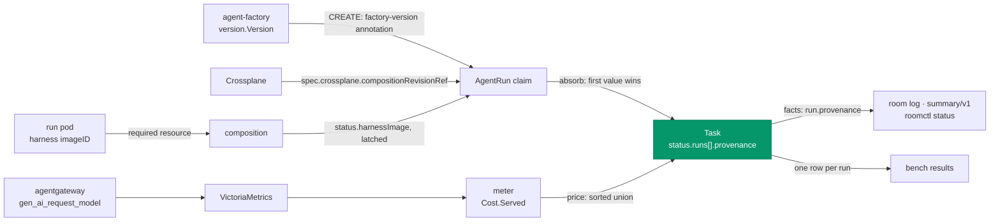

# Before v3: run provenance, what every run ran on

**Date:** 2026-10-22 · **Status:** approved by the owner 2026-10-22 with every recommended default; OP1 (always on, exempt from the per-class switch), OP2 (no Manual composition policy) and OP3 (rides v0.16.0 only if merged when it is cut) decided as recommended · **Part of:** the [v3 review](2026-10-21-v3-review.md), finding R10
and the "Before v3" row of its amendments; the eval bench (roadmap feature 0) reads it ·
**Research:** gap 3 of the [2026-10-01 ecosystem recheck](2026-10-01-agent-ecosystem-recheck-research.md) ·
**Runtime:** the gateway runtime (O4): the served model comes from the gateway's meter; the portable
runtime's native `AgentRun` (agent-platform #160) has neither composition nor meter, and is not covered ·
**Plan:** agent-platform `docs/superpowers/plans/2026-10-22-run-provenance-plan.md`

**Shipped:** agent-platform v0.17.1, pinned here (R10 done). Live proofs 1 to 3 wait for the next `gcp-0` session.

## Outcome

Every factory run records four facts on its `Task`: the factory build that created it, the
`AgentRun` CompositionRevision it was bound to, the harness image digest its pod ran, and the models
that served it. The room shows them for the current run. The bench attributes a run to a release
only when all four are set and match the pins the bench declares, so "the bench runs on pinned
releases" is checked per run, not asserted.

## What exists

| Fact | Knowable today at | Recorded per run |
|---|---|---|
| Factory version | `version.Version`, stamped by `-ldflags` at build: the release tag, `vX.Y.Z-prN.<sha8>` for a PR image (agent-platform `ci.yaml:80`), `dev` locally | No. Only `agent_factory_build_info{version}`, for the process |
| Composition revision | The claim's `spec.crossplane.compositionRevisionRef.name`. Crossplane 2.4 sets it at creation whatever the update policy, and moves it to each new revision under the default `Automatic` policy | No; the factory never reads it |
| Harness image | The composition's pin, `ghcr.io/smana/agent-harness:v0.15.2@sha256:c49c…` (crossplane-configuration `apis/agentrun/kcl/main.k:38`, while the factory runs v0.15.6). The pod's `containerStatuses[name=harness].imageID`. The composition already reads the run's pod as a required resource, for the harness's exit code (`_harnessEnd`, `_requiredPods`) | No |
| Served model | `gen_ai_request_model`, the alias-resolved model (measured 2026-10-22). The meter's query groups by it (`tooling/base/agent-factory/helm-values-configmap.yaml:192`) and `meter.Usage.Models` splits each run's tokens by it (agent-platform `vm.go:113`) | Priced, then dropped |
| The record | `Task.status.runs[]`: id, role, trigger, tokens, `costMicroUSD`, `chargedTo`, … (`task_types.go:308`) | — |
| The room | `state_changed{kind: task}`: `run{id, role, trigger, startedAt}` (`envelope/payloads.go:128`), folded into `summary/v1` | — |

## Decisions

| # | Decision | Rejected | Why |
|---|---|---|---|
| P1 | **One struct per run record:** `status.runs[].provenance{factoryVersion, compositionRevision, harnessImage, servedModels[]}`. Each field fills once as it becomes known; `servedModels` only grows, sorted, and stops at 8 (a ninth model is not recorded). Empty means unknown, never a guess | Task-level fields; the claim's status alone | A task's runs can straddle a release (retries, resumes, review rounds), and the bench's unit is a run. The Task is the audit record that outlives its claims |
| P2 | **Factory version: a CREATE-only claim annotation.** `runs.Build` writes `agents.ogenki.io/factory-version: <version.Version>` on every claim; `Annotate` refuses the key; the record reads it back | The reconciler stamping its own version when it records the run | R48: a replay by a newer factory finds the claim and must record the build that created it. The run API's claims carry it too. The patch limit is untouched: the admission policy restricts updates, not creation |
| P3 | **Composition revision: read, not written.** The factory reads `spec.crossplane.compositionRevisionRef.name` from the claim; the first value it sees stays | A version constant in the KCL source; resolving the package version from the CompositionRevision | Crossplane already writes it. A constant is one more pin to bump by hand. The lookup needs cluster-scoped RBAC the factory does not have |
| P4 | **Harness image: what ran, from the pod.** The composition projects the `harness` container's `imageID` into the claim's `status.harnessImage`, only when it reads `<repository>@sha256:<64 hex>`, and keeps the first value. The factory reads it | The factory reading pods; the composition stamping its own pin; the harness reporting itself | Pod RBAC for the factory, and a race with the pod's deletion. The pin is what was asked, which the revision (P3) already implies. An image cannot contain its own digest. The composition is status's one writer (C3) and reads the pod already |
| P5 | **Served models: the meter's reading.** `meter.Cost` gains `Served`, the models with tokens in the run's typed reading; the reconciler adds them to the record where it takes the cost (`price`) | The claim's `spec.model`; the provider's `model` field in the harness | The claim holds an alias. `gen_ai_request_model` is what the gateway resolved, and what prices the run |
| P6 | **Write-once is enforced in Go** by the reconciler, the record's one writer: `cmp.Or` per field, a sorted union for the models | CEL transition rules on the CRD | Measured: the API server refuses `oldSelf` under `status.runs`, an atomic list: "oldSelf cannot be used on the uncorrelatable portion of the schema". Tokens' never-down rule is Go already |
| P7 | **The room shows the current run's.** The task facts' `run` gains `provenance`, copied from the record; `summary/v1` and `roomctl status` pass it through. The room log, backed up, keeps it after the cluster is gone | Task status only; a new event type | Tasks die with `gcp-0`. The facts are re-posted as fields fill, one event per fact as it lands, and no phase waits on facts (agent-platform `reconciler.go:217`) |
| P8 | **The bench's attribution rule.** A run counts in a bench cell when its four facts are set, `factoryVersion` is a tag (not `dev`), its harness digest, factory version and served models equal the cell's declared pins, and every run of the cell shares one composition revision. Any other run is listed with the reason, never averaged in | Trusting the session's notes | R10's point: the bench claims pinned releases, and this makes each run prove it |

## Where the facts flow

## Interfaces

| Interface | Shape | Writer | When |
|---|---|---|---|
| Claim annotation | `agents.ogenki.io/factory-version: v0.16.0` | the factory | CREATE only |
| Claim status | `status.harnessImage: ghcr.io/smana/agent-harness@sha256:<64 hex>`, `maxLength: 320` in the XRD | the composition | the first reconcile that reads the harness's `imageID`; latched |
| Task record | `status.runs[].provenance`: `factoryVersion` (≤ 64), `compositionRevision` (≤ 253), `harnessImage` (≤ 320), `servedModels` (≤ 8 items of ≤ 64) | the reconciler | each observe (`absorb`) and each cost hand-off (`price`) |
| Room facts | `run.provenance{factoryVersion?, compositionRevision?, harnessImage?, servedModels?}`, absent while all are empty | the factory | with the task facts, whenever the record changes |
| Bench row | `factory_version`, `composition_revision`, `harness_image`, `served_models` (`;`-joined) | the bench's row script | per run, from the Task |

The broker decodes task facts strictly. Measured on today's broker: facts carrying `run.provenance`
answer 400 `bad_message`. The broker learns the field in the same release; a factory ahead of its
broker retries its facts until the broker rolls.

## Pull requests, in order

| # | Repository | Content | Offline proof | Depends on |
|---|---|---|---|---|
| 1 | crossplane-configuration | `status.harnessImage` in the XRD; `_harnessImage` and its status line in `main.k`; three KCL tests; `task generate`; then a release | 1, 2 | Nothing |
| 2 | agent-platform | The CRD field, the annotation, the claim reads, `stamp`, `Cost.Served`, the facts field, docs; then a release | 3–7 | Nothing; rebased after #155 (the meter) |
| 3 | cloud-native-ref | Pin PR 1's release: the three `Configuration` packages and the App Wizard's clone tag | the host's CI | PR 1 released |
| 4 | ai-native-ref | Pin PR 2's release (factory and broker in one commit); `HOST_REF` past PR 3; R10 marked done on the status page | `task check` | PRs 2, 3 |

## Gate

The owner's offline-first rule (D4): each pull request merges on its offline proof; the live proofs
join the next gcp-0 session's checklist.

**Offline proofs**

1. KCL (crossplane-configuration): the harness container's `imageID` reaches `status.harnessImage`,
   not a sidecar's; the first value survives a resumed pod on another image and a pod that is gone;
   no pod, a tag-only `imageID` and an empty one project nothing. 108 of 108 tests pass on the
   prototype, and dropping the latch fails one.
2. `task check` in crossplane-configuration: generate-sync and the XRD schema pass. The render
   equivalence needs Docker and runs in CI; no golden changes, since no example renders a pod.
3. `runs`: every claim carries `factory-version`; `Annotate` refuses it; a read returns the three
   claim facts.
4. The reconciler: a record takes each fact as it appears and never changes it, even when the claim
   is re-bound to a newer revision and a resumed pod runs another image; served models gather
   sorted; the facts carry the current run's. Writing over a filled field fails the test.
5. The meter: `Cost.Served` is the models with tokens in a typed reading, and nothing for an untyped
   one.
6. envtest (kube-apiserver 1.36.2): a status write keeps all four through the real API server, and a
   ninth served model is refused.
7. The broker accepts facts with `run.provenance`, and `summary/v1` returns them. agent-platform's
   `task check` passes in CI.

**Live proofs** (gcp-0)

1. A factory task's first run has all four facts. `factoryVersion` is the deployed tag;
   `compositionRevision` names a CompositionRevision of `xagentruns.cloud.ogenki.io`; `servedModels`
   equals the `gen_ai_request_model` values of that run's token series.
2. `harnessImage`'s digest equals the composition's pinned digest. Unproven offline: whether
   containerd reports the multi-arch index digest the composition pins or the platform manifest's.
   If the latter, the bench compares against the pin's per-platform digest.
3. `roomctl status <room> --json` shows `.status.run.provenance` for the current run.

## Owner decisions

| # | Question | Recommended default |
|---|---|---|
| OP1 | D4 ships each feature behind a per-class switch, off by default. Is provenance exempt? | **Exempt: always on.** It records and changes no run; the bench's baseline needs it from its first run |
| OP2 | Should the factory create claims with `compositionUpdatePolicy: Manual`, so a run keeps the revision it was created on? | **No.** The record keeps the first revision; a bench session upgrades nothing mid-session; composition fixes keep reaching live runs |
| OP3 | Does PR 2 ride the release that carries #155 (v0.16.0, which truthful costs PR 3 pins)? | **Yes if both are merged when it is cut; never hold that release for it.** Otherwise the next patch release, and PR 4 pins it |

## Not in this design

The bench itself: its corpus, cells, row script and results file (the bench design, next; it reads
the fields above). A record for API runs beyond their claim: they have no `Task`. The portable
runtime. The instruction commit, which the research's gap 3 also names: the harness's prompt and the
platform rules ship in the harness image and the composition, which P2–P4 cover, and a repository's
own files are the run's base, which its branch and pull request record. Mapping a CompositionRevision
to the crossplane-configuration tag: the bench session records its pins once per session. Runs
created before PR 2: their fields stay empty.

## Left to the builder

The Go names beyond those in the Interfaces table; the KCL lambda's name and the exact `imageID`
pattern; the tests' names; the docs' wording in `docs/factory.md`, `docs/event-envelope.md` and the
status page.
