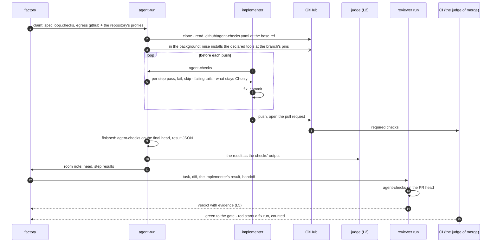

# v3: repository checks in the sandbox, the CI's fast subset before every push

**Date:** 2026-10-22 · **Status:** approved by the owner 2026-10-22 with every recommended default; Q1–Q4 decided as recommended · **Part of:** the [v3 roadmap](2026-10-19-v3-roadmap-design.md#the-features),
feature 3. It answers the roadmap's open question on the toolchain, gives the
[loop policy](2026-10-21-loops-and-teams-design.md#decisions)'s judge (L2) and verdict evidence (L5)
the checks' output they wait for, and is what the test-first tester (feature 4) builds on · **Research:**
[measured 2026-10-22](#measured-2026-10-22) · **Runtime:** both. `agent-checks` lives in the harness
image; this design wires the gateway runtime's composition, and the portable runtime's `AgentRun`
takes the same field and the same `github` profile fix

## Outcome

A public implementer runs its repository's fast checks in its own sandbox before it pushes, with the
tools its repository pins, and fixes what fails in the same conversation. The harness runs the same
checks on the final head and hands the result to the judge and the reviewer as evidence. The CI stays
the only judge of a merge: nothing in the sandbox blocks a push or arms a gate. Off by default, per
repository and class.

## What exists

| Piece | Today |
|---|---|
| Harness image | `agent-harness:v0.15.2`, 1,305 MB compressed: Python, git, `gh`, jq, curl, Node, and a docker CLI with no daemon. No mise, no repository tool ([harness reference](../../../website/content/docs/platform/ai-platform/agents/tune/harness-reference.md#composition)) |
| Sandbox | gVisor, `size: small` always: 1→2 CPU, 2→4 GiB, `/workspace` 10 Gi, `HOME` and `/tmp` 2 Gi each. No Docker daemon |
| Egress | The `github` profile: `github.com`, `api.github.com`, `codeload.github.com`, `objects.githubusercontent.com`, `raw.githubusercontent.com`. Requestable: `pypi`, `npm`, `golang`, `crates`. None for `internal` |
| Rules | `rules.md` from the composition: one branch, one PR, no `.github/workflows/`. Nothing about checks |
| Milestones | The harness notes "ran the checks." when the agent runs `task check*`, `pytest`, `go test` or `npm test` |
| Fix runs | A red required check enqueues a fix run, "Read the failing jobs with `gh pr checks`", up to `merge.fixRuns` (2 on cloud-native-ref, 1 on ai-native-ref), then the task escalates `ci_red`. Counted in the Task's `status.fixRuns` |
| ai-native-ref's CI | `validate` runs `task check`: host-profile, validate, gates, vmrules, test, links, docs, sources. `lint` runs pre-commit and TruffleHog. `prerelease` signs an artifact |
| cloud-native-ref's CI | Eight required checks ([factory config](../../../tooling/base/agent-factory/helm-values-configmap.yaml)). Its `task check` covers the overlay and the `ci:*` gates, not shellcheck, pre-commit or the security scans |

## Measured, 2026-10-22 {#measured-2026-10-22}

| What | Result | How |
|---|---|---|
| Where a GitHub release download lands | `github.com/<owner>/<repo>/releases/download/…` answers 302 to `release-assets.githubusercontent.com`, which the `github` profile lacks. A mise fetch of any GitHub-released tool, and `gh release download`, fail in a sandbox today | `curl -sI` on task's v3.54.0 asset |
| Hosts outside GitHub | Go: `dl.google.com` (go.dev/dl redirects there). Helm: `get.helm.sh` (its GitHub releases carry signatures only). Node: `nodejs.org` | `curl -sIL` |
| The fast subset's tools, downloaded | ai-native-ref 223 MB: promtool 106.5 (it ships inside the prometheus archive), Go 67.3, hugo-extended 20.9, task 15.8, pre-commit 7.3, kustomize 4.8. cloud-native-ref 137 MB: promtool, task, pre-commit, kustomize, shellcheck 2.4. mise itself 54.7 | `Content-Length` of each pinned asset |
| Installed | ai-native-ref's set about 690 MB: Go 283, the prometheus archive 252, hugo 60, task 51 | `du` over mise's installs |
| ai-native-ref's checks, step by step, warm caches, a desktop | host-profile 5 s, vmrules < 1 s, test 10 s (28 pass, 2 skip: Docker), links, sources and docs (hugo, 54 pages) about 1 s each, pre-commit 7 s. validate 153 s, gates 6 s. **The fast subset is about 24 s of 183** | each `task <step>` timed in a fresh worktree |
| The terminal tool, SDK 1.49.6 | A command with no new output for 30 s pauses and asks the agent whether to go on; a `timeout` argument raises the limit | `openhands/tools/terminal/constants.py` |
| The fence file | `fence.Parse` accepts exactly `factory: <name>`; anything else reads as **not owned** | agent-platform `internal/factory/fence/fence.go` |
| Red CI on agent pull requests | 43 agent heads with check runs (41 cloud-native-ref pull requests, 2 ai-native-ref): **none red** | `gh api` over every commit of every `ogenki-agents[bot]` pull request |
| The cohort's Claude arm, told to run `task check` before pushing | 4 of its 13 PRs took commits after opening, and "three of B's PRs needed a small shellcheck fix before merging": a check the host's `task check` does not run | [cohort results](2026-10-12-v2-hard-task-cohort-design.md#results) |

Two consequences. "GitHub-only egress" fails as written: the release host is missing, Go comes from
Google, Hugo modules from the Go proxy, pre-commit hooks from PyPI. And on routine work there is
little to save: no agent head went red. The signal is on hard tasks, and in what the judge, the
reviewer and the tester do with the evidence.

## Decisions

| # | Decision | Rejected | Why |
|---|---|---|---|
| RC1 | **mise from the repository's own pins** ([Q1](#owner-decisions)). The harness image carries mise, checksum-pinned as `gh` is, and no repository tool. On first use, `agent-checks` installs only the tools the declaration lists, at the versions of the branch's `mise.toml`, into `/workspace/.toolchain` (outside the clone, on the PVC when the run is suspendable). The harness starts the install in the background right after the clone, so it runs while the model reads the issue | An image per repository; one image with every repository's tools; a pull-through cache in the cluster | The branch's pins are the CI's pins (`jdx/mise-action` reads the same file), a Renovate bump included. An image per repository lags them until it is rebuilt and released through the composition ([Q1](#owner-decisions)). A cache is infrastructure to run before the fetch time is known |
| RC2 | **The repository declares its fast subset in `.github/agent-checks.yaml`**, read from the base ref at the clone, never from the branch: the tools to install, ordered steps (`name`, `run`, the `ci` check it mirrors, an optional `timeoutMinutes` and `stopOnFailure`), the whole budget, the paths that define the checks (`definedBy`), and the CI's remainder (`ciOnly`, each with why) | A `task check:fast` convention alone; a `checks:` key in `.github/agent-factory.yaml`; the branch's copy | `.github/` is a gate path in every agent rule of both repositories, so a change needs a human. Per-step results are what L5 cites, and `ci` lets the bench compare each step with its CI check. The host's `taskfile.yaml` is not a gate path. The fence parser is strict: a `checks:` key would make every pinned factory read the repository as not owned and stop acting on it |
| RC3 | **The fast subset, by rule:** a step runs in the sandbox only if it needs no CI secret or workflow identity, no diff against the base, no Docker, fits `small` within the budget, and reaches only the run's egress. Everything else is a `ciOnly` entry. A suite in each repository fails when a job of a `pull_request` workflow is neither a step's `ci` nor a `ciOnly` entry | `task check` whole; the render with a baked chart cache | The roadmap's rule, with gVisor's and egress's limits made explicit. The render needs about 20 chart hosts beyond any profile. The coverage suite keeps the declaration a mirror of the CI, which the host's hand-kept `task check` failed to be (shellcheck) |
| RC4 | **The agent runs `agent-checks` through its terminal.** The harness appends one rule when the switch is on: "Before every push, run `agent-checks` and fix what it reports. It runs the CI's fast subset; the CI stays the judge. If a failure is not your change's, say so in the pull request." The command prints a line at least every 20 s, then a summary of at most 8,000 characters: one line per step (`pass`, `fail`, `skip`, `timeout`), the last 60 lines of each failed step, the CI-only remainder, the full log's path. `--step <name>` runs one step. Exit 0 when nothing failed, 1 otherwise, 2 when the repository declares nothing | A blocking `pre-push` hook; a custom SDK tool; an MCP tool | A blocking hook is a gate in the sandbox, adds minutes to every push, and stalls a run on a check its environment cannot pass. The terminal already carries a command; the 20 s line stays under its 30 s pause. An MCP tool rides the gateway path, where a 403 costs the run every tool ([S0](2026-10-21-capability-profiles-design.md#gate-the-spike-and-the-live-checks)) |
| RC5 | **Steps run with the agent's own environment**, in `/workspace/repo`: never `agent-run`'s, so no model key and no token path; `CI` unset; the toolchain first on `PATH`. Each step runs in its own process group, killed at its timeout | Running the checks from `agent-run`'s environment | They run code from the agent's branch. In the agent's environment they reach nothing the agent cannot already reach. `CI=true` turns the cache wire test's missing-Docker skip into a failure |
| RC6 | **The final head's result is the evidence.** When the conversation ends `finished`, `agent-run` runs `agent-checks` on the head, unless the last result is for that head on a clean tree. It writes `/workspace/.agent-checks/<sha>.json` (head, base, the declaration's blob, the tools and versions, each step's result and seconds, `ciOnly`, and `definitionTouched`: the `definedBy` paths the branch changed), posts a fixed-text room note (head, counts, the failed steps' names), and emits a span. The judge (L2) reads the summary as "the checks' output"; a result with `definitionTouched` reads as unverified. The reviewer's brief carries the note; the reviewer runs `agent-checks` on the PR head itself and cites that result (L5) | A continuation on a red result, from this feature alone; failing tails on the pull request | Continuing is the judge's, counted by L2's `continuations`. Before the judge ships, a red final result is recorded and the CI decides. Step names come from the base ref's declaration, so the note carries no text the agent wrote; tails stay in the sandbox and the judge's prompt (C7: a public task's room text stays in the room). The reviewer's own run needs no trust in the implementer's sandbox |
| RC7 | **The platform names the egress, never the repository.** The claim of a check-enabled run requests `github` plus the repository's `checks.egress` from the factory config, capped by the role's capability profile `egress` once P1's step lands. The `github` profile gains `release-assets.githubusercontent.com`; `golang` gains `dl.google.com` ([Q2](#owner-decisions)). ai-native-ref requests `[golang, pypi]`, cloud-native-ref `[pypi]` | Hosts named in the repository's file; a new `toolchain` profile; GitHub-only | The repository file is a gate path, but a served repository should not widen its runs' egress. `release-assets` is GitHub's own release host. Go's archive is served only by Google |
| RC8 | **The switch is per repository and class, off by default:** `repositories[].classes.<class>.checks: true`. The factory then writes `spec.loop.checks: true` and the egress on the class's public implementer and reviewer claims; an internal run of the class runs without checks. `spec.loop` is the loop policy's claim object: whichever feature lands first creates it, so one crossplane-configuration release can carry both. The composition sets `AGENT_CHECKS=1`; without it the harness behaves as today | A global switch; a switch in the image | D4: one session measures the baseline and the variant. Internal runs have no egress to fetch a tool |
| RC9 | **Bounds:** the install 5 min, after which a step whose tool is missing fails with that reason; the whole declaration at most 15 min (default 8); a step its own `timeoutMinutes`, else the rest of the budget. The final run is skipped, and recorded `skipped: deadline`, when the pod has less than the budget plus 2 min left. `size` stays `small` | A `size` per repository | A step that needs more is CI-only by RC3. The light tier's 20-minute run cannot spend half of itself on checks |

## The loop



## The declaration

ai-native-ref's, as it would be committed:

```yaml
# .github/agent-checks.yaml: what an agent runs before it pushes, the CI's fast subset.
# A gate path. The harness reads it from the base branch, never from the agent's branch.
version: 1
timeoutMinutes: 8
tools: [task, promtool, kustomize, hugo-extended, go, pre-commit]   # keys of mise.toml
definedBy: [taskfile.yaml, scripts/ci/, .pre-commit-config.yaml, mise.toml, HOST_REF]
steps:
  - {name: composite, run: task host-profile, ci: validate, stopOnFailure: true, timeoutMinutes: 3}
  - {name: vmrules, run: task vmrules, ci: validate}
  - {name: suites, run: task test, ci: validate}
  - {name: links, run: task links, ci: validate}
  - {name: site, run: task docs, ci: validate}
  - {name: sources, run: task sources, ci: validate}
  - {name: pre-commit, run: pre-commit run --all-files --show-diff-on-failure, ci: lint}
ciOnly:
  - {check: validate, part: "task validate, task gates", why: "renders every HelmRelease: about 20 chart hosts beyond the egress"}
  - {check: validate, part: "the two Docker suites", why: "no Docker daemon under gVisor"}
  - {check: lint, part: TruffleHog, why: "an Action over the pushed range"}
  - {check: prerelease, part: all, why: "signs and pushes with the workflow's identity"}
```

| Field | Meaning | Bounds |
|---|---|---|
| `tools` | mise.toml keys installed before the first step; the versions come from the branch's `mise.toml` | keys the file pins; a missing one makes the steps that need it fail with the reason |
| `steps[].run` | a `bash -c` line in `/workspace/repo` | — |
| `steps[].ci` | the CI job or required check the step mirrors | a job of a `pull_request` workflow |
| `stopOnFailure` | later steps read `skip` when this one fails | — |
| `timeoutMinutes` | the whole run; per step, that step | ≤ 15 in all |
| `definedBy` | paths whose change makes a result `definitionTouched` | prefixes |
| `ciOnly` | the CI's remainder, printed after every summary so a green result is never read as the CI's | every job neither mirrored nor listed fails the coverage suite |

## What stays CI-only

**ai-native-ref** (required: `validate`, `lint`)

| CI job | In the sandbox | CI-only | Why |
|---|---|---|---|
| `validate` | host-profile, vmrules, test, links, docs, sources | validate (render, flux schema, polaris), gates | the render's chart hosts; gates read its bundle |
| `validate` | 28 of the 30 suites | the two Docker suites | they exit 77 without a daemon. The image's docker CLI makes `command -v docker` pass, so a Docker suite must test the daemon, as these two do |
| `lint` | pre-commit | TruffleHog | an Action over the pushed range |
| `prerelease` | — | all | signing and `packages: write` |

**cloud-native-ref** (eight required checks)

| Required check | In the sandbox | CI-only |
|---|---|---|
| Pre-commit checks 🛃 | every hook but the terraform ones (`SKIP=terraform_fmt,terraform_validate,terraform_tflint`) | the terraform hooks and the OpenBao module test: provider and plugin downloads |
| Kubernetes validation ☸ | the overlay from git ([Q3](#owner-decisions)), `ci:test`, `ci:policy-gates`, `ci:workflow-secrets`, `ci:idp-topology`, `ci:openbao-policies`, `ci:vmrules` | `ci:validate`, the render |
| Check the shell scripts 💻 | `ci:shellcheck`, once shellcheck is pinned in `mise.toml` and the job calls the task | — |
| Check the documentation links 🔗 | `ci:links`, `ci:doc-claims`, `ci:doc-paths` | — |
| Security scanning 🔒 | — | Trivy's database, Checkov, TruffleHog's verification |
| Rendered manifest diff 📝 | — | a diff against `main` |
| Vector (vlsingle), Vector (vlcluster) | — | Docker |

The host's gates read the AI paths, which only `ai-overlay.sh` lays, from a signed artifact on
`ghcr.io` verified with cosign: neither host is in a profile. `--from-git` lays the same paths from the
pin's tag, cloned from GitHub, and refuses to run when `CI=true`.

## Timeouts and cost

| Item | Per check-enabled run | Source |
|---|---|---|
| Download | ai-native-ref 223 MB, cloud-native-ref 137 MB, once per run (a resumed suspendable run keeps them) | measured |
| Disk | about 0.75 GB under `/workspace/.toolchain`, of 10 Gi | measured |
| Wall time | the install overlaps the first model steps (about 11 s each on GLM-5.3 at `high`); the checks took 24 s on a desktop and are measured under gVisor by offline proof 4 | measured; [harness reference](../../../website/content/docs/platform/ai-platform/agents/tune/harness-reference.md#harness) |
| Tokens | at most about 2,000 per invocation: $0.003 fresh on GLM-5.3, then $0.0005 per later step from cache | the summary's cap; `meter.prices` |
| What it saves | a fix run: a new run that reloads the context, queued behind CI | `fixCI` in the factory |

## The switch, in the factory config

```yaml
repositories:
  - name: Smana/ai-native-ref
    checks: {egress: [golang, pypi]}   # what a check-enabled run requests beyond github
    classes:
      docs: {checks: true}             # absent or false: today's run
```

The factory's config decoder refuses unknown keys, so these keys follow the release that reads them.
`checks.egress` is validated against the profile enum, at most four. The first bench variant turns on
every class but `docs-links` and `revert` in both repositories.

## Owner decisions {#owner-decisions}

| # | Question | Options | Recommended default |
|---|---|---|---|
| Q1 | How the sandbox gets the toolchain (the roadmap's open question) | **(a)** mise from the branch's `mise.toml`, installed lazily, prefetched (RC1). **(b)** An image per repository: 137–223 MB more per image, no fetch; each pin bump is an image build, a crossplane-configuration release, a host pin and a `HOST_REF` bump before a run sees it, and until then the sandbox and the CI run different versions | **(a).** Reopen with (b)'s layer as a warm cache under (a) if the install's p90 exceeds 2 minutes on the bench |
| Q2 | The egress RC1 needs | **(a)** `release-assets.githubusercontent.com` into `github`, `dl.google.com` into `golang`. **(b)** (a)'s first host only, and ai-native-ref's site step moves to `ciOnly` | **(a).** The first host is GitHub's release host and fixes `gh release download` for every run; the second is Go's own archive, beside the Go proxy `golang` already reaches. Without the site step, a broken relref surfaces only in the CI |
| Q3 | The host's overlay in the sandbox | **(a)** `ai-overlay.sh --from-git`: the pin's tag from GitHub, unverified, refused under `CI=true`. **(b)** No overlay: the host's subset shrinks to shellcheck and pre-commit | **(a).** The sandbox is a feedback loop; the CI keeps verifying the signed artifact |
| Q4 | The gate | **(a)** The roadmap's: fewer fix runs started by a red CI, acceptance not lower. **(b)** Acceptance not lower, cost per accepted PR not higher, and the sandbox agreeing with the CI on at least 90% of final heads, each disagreement explained; CI round-trips reported | **(b).** No agent head went red in 43, so (a) can only move on the hard half. The feature pays through the judge's and the reviewer's evidence and the tester (feature 4) |

## Pull requests, in order

| # | Repository | Content | Offline proof | Depends on |
|---|---|---|---|---|
| 1 | cloud-native-ref | `.github/agent-checks.yaml`; `ai-overlay.sh --from-git`; shellcheck pinned in `mise.toml`, `task ci:shellcheck`, the CI job calling it; the coverage suite | 1, 2 | nothing |
| 2 | ai-native-ref | `.github/agent-checks.yaml`; the coverage suite | 1 | nothing |
| 3 | agent-platform | The harness: mise, `agent-checks`, the prefetch, the rule, the `checks` milestone for `agent-checks`, the final run, the room note, the spans. The run-controller's default profiles (the two hosts) and the portable `AgentRun`'s `loop.checks` | 3–5 | nothing |
| 4 | agent-platform | The factory: `checks.egress`, `classes.<class>.checks`, the claim's `spec.loop.checks` and egress, the reviewer's brief. Then a release carrying PRs 3 and 4 | 7 | nothing |
| 5 | crossplane-configuration | XRD `spec.loop.checks` (refused on `internal`, immutable) to `AGENT_CHECKS`; the two profile hosts; the harness digest of that release. Then a release | 6 | PRs 3 and 4 released |
| 6 | cloud-native-ref | Pin PR 5's release | the host's CI | PR 5 |
| 7 | ai-native-ref | `HOST_REF`; pin the agent-platform release; the config keys, every class off; `harness-reference.md` (egress, the harness's `agent-checks`) and the status page | `task check`; the pins suite | PRs 4 and 6 |

## Gate

Each pull request merges on its offline proof (D4). The live proofs run in one gcp-0 session after
PR 7.

**Offline proofs**

1. Each repository's coverage suite: removing a step without listing it in `ciOnly`, or a new
   `pull_request` job, fails it.
2. `ai-overlay.sh --from-git` lays the same file list as the verified artifact for the pinned tag, and
   exits non-zero under `CI=true`.
3. `agent-checks` unit tests: the declaration comes from the base ref (a branch edit changes
   nothing); a step past its timeout is killed and reads `timeout`; `stopOnFailure`; the summary's
   cap; a line every 20 s; a step's environment holds no `CI`, no model key, no token path;
   `definitionTouched` lists the changed `definedBy` paths; the exit codes.
4. A container suite in agent-platform's CI runs the harness image under runsc, behind a proxy that
   allows exactly the claim's hosts, on both repositories' `main`: every tool installs, every step
   ends `pass` or `skip`, a refused host fails the suite with its name. It records the install's and
   each step's seconds, and how many GitHub API calls mise made.
5. The final run: a fake conversation ending `finished` makes `agent-run` run the checks on the head,
   write the JSON and post the note's fixed text; with the deadline near it records `skipped:
   deadline`; without `AGENT_CHECKS` nothing changes.
6. Composition goldens: `spec.loop.checks` sets `AGENT_CHECKS=1`; the CNP's FQDN and DNS rules hold
   the two new hosts; an internal claim with `checks` is refused.
7. The factory: the keys parse; a switched-on class's public implementer and reviewer claims carry
   `spec.loop.checks` and the repository's egress; other claims are byte-identical to today's.

**Live proofs** (gcp-0)

1. A check-enabled run on each repository installs its tools through the CNP with no dropped flow
   to a declared host, and its result on `main` matches offline proof 4's.
2. A drill task on each repository asks for a small change, a defect left in its first commit (a
   shellcheck warning on the host, a broken relref on ai-native-ref), then `agent-checks` before the
   push: the sandbox reports the defect, the first pushed head is green, `status.fixRuns` stays 0.
3. The bench, per [Q4](#owner-decisions), with the switch off and on:

| Metric | Definition | Source |
|---|---|---|
| CI round-trips | `status.fixRuns` summed over an issue's tasks, per accepted PR | the Task |
| Agreement | on each final head, for each CI check a step names: the steps' result against the check's conclusion. A miss: green here, red there; a false alarm: the reverse | the result JSON and the head's check runs |
| Check time | seconds in the install and in `agent-checks`, and their share of the run | the spans |
| Acceptance, cost per accepted PR | the roadmap's | the bench |

## Not in this design

Docker or the render in the sandbox; a tool or chart cache in the cluster; checks on internal runs,
on API runs (`task agent:run`) and on forked rooms; a blocking pre-push hook; the tester's
single-test entry point (feature 4); the judge's prompt and the `evidence` field's shape (the loop
policy's); larger sandboxes.

## Left to the builder

The JSON's exact fields; how `agent-checks` puts the toolchain on `PATH` (`mise exec` or `mise env`);
whether a committed `mise.lock` removes mise's GitHub API calls, and, if offline proof 4 counts any,
passing the run's GitHub token to the install alone, never to a step; whether the image needs
`rsync` (both overlays call it); the room note's wording, outside the milestone notes' cap of 8; the
coverage suites' names; the host's `ci:shellcheck` command, which must keep the job's `-type l`.
