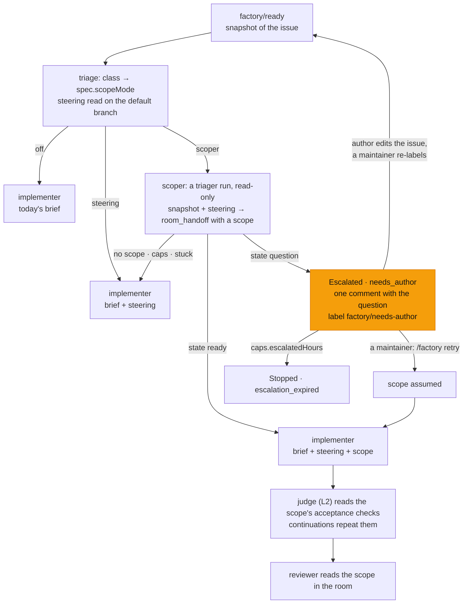

# v3 feature 1: the scoper and per-class steering, a bounded task or one question before any code

**Date:** 2026-10-22 · **Status:** approved by the owner 2026-10-22 with every recommended default; SO1–SO4 (SO4, the bench's answer keys, is moot while the bench is deferred) decided as recommended · **Part of:** the [v3 roadmap](2026-10-19-v3-roadmap-design.md#the-features),
feature 1, as amended by the [review](2026-10-21-v3-review.md#5-amendments-proposed) ("a bounded task, a
plan, explicit assumptions and the acceptance checks the judge reads; re-injected each round") ·
**Research:** [§2.1](2026-10-21-v3-landscape-research.md#21-patterns) (Ask or Assume, SWE-chat,
Plan-to-Action) and the roadmap's [field table](2026-10-19-v3-roadmap-design.md#what-the-field-says-research-2026-10-19)
(SkillsBench) · **Runtime:** both; it lives in the factory and the broker, and adds nothing at the
gateway: the scoper runs as the `triager` role every layer already knows

## Outcome

Before an implementer writes code on a non-mechanical class, a read-only run turns the issue into a
**bounded task**: what to change and where, a plan, the assumptions it made, and the checks that prove
it. Every later run and the loop policy's judge work from it. When the issue leaves a question that no
reasonable default answers, the run asks the issue's author that one question instead, and the task
waits. A short **steering note** per class, written by the repository's maintainers, tells each run how
a change of that class is verified here and which paths to leave alone. Both are off by default and
switched per class (D4), so one bench session measures the baseline, steering alone, then the scoper.

## What exists

| Piece | Today | Where (agent-platform unless named) |
|---|---|---|
| `investigate` template | `[triager]`, chosen only for RunLore findings (`triage.Matrix`, source `runlore`). One read-only run confirms an alert and proposes a public issue text through `room_handoff`; the task ends `proposal_ready` or `no_action`, and a human publishes (R38) | `internal/factory/triage/classify.go`, `reconciler/implement.go` |
| The `triager` role, end to end | The XRD's role enum; the composition's read-only rules ("Your repository access is read-only… call room_handoff with the role, a summary and the commit you worked on"); octo-sts `agent-triager.sts.yaml` in both repositories (contents, issues, pull requests, checks, actions: read); gateway audiences `agent-router.triager.{public,internal}`; both profiles list `room_read`, `room_post`, `room_progress`, `room_handoff` | crossplane-configuration `apis/agentrun/`, each repository's `.github/chainguard/`, this repository's `infrastructure/base/agent-gateway/` |
| Classes | `docs-links` and `revert` (mechanical, required by the validator), `docs`, `tests`, `dashboards`, `scripts`; `review` is the implicit class of every unlabelled issue and cannot be declared | `tooling/base/agent-factory/helm-values-configmap.yaml` |
| The task text | The issue's title and body as labelled (R5 refuses an edit after the label), sanitised, at most 14 KiB (`caps.maxTextBytes`), posted once as the room's first `task_state`. Comments are never task text (interfaces F8) | `intake/issues.go`, `reconciler/text.go` |
| Briefs | `FirstBrief`: a preamble and the fenced snapshot. `ReviseBrief`, at most 13 KiB: a preamble, the room log's brief, the queued messages. Reviewers get no task text and read the room. `task.text` is capped at 16 KiB by the XRD | `reconciler/text.go`, `reconciler/team.go` |
| Agent context | None: the harness sends the brief as the first user message and the composition's rules as the system suffix; no AGENTS.md, no skills | `images/agent-harness/agent_run.py`, `build_request` |
| Asking | No path. An implementer that cannot tell what is wanted guesses or wanders: one spent its whole $2.55 on 319 `grep` steps and pushed nothing | [harness page](../../../website/content/docs/operate/tune-a-run.md#examples) |
| Waiting on a person | `Escalated`, non-terminal: a maintainer's `/factory retry` re-queues it; a new `factory/ready` supersedes it with a fresh snapshot (R4); it stops after `caps.escalatedHours` (168 h). `AwaitingHuman` needs a pull request | `reconciler/watch.go`, `intake/issues.go` |
| Agent text on an issue | Only `RoundsExhausted`: a public task's verdict summary, sanitised and quoted as an inert code block (ruling TE); an internal task's stays in the room (C7). Every other narration is the factory's own words | `narrate/narrate.go` |
| Acceptance | The `factory-handoff` issue template's `## Acceptance check` section; the judge reads it until the scoper exists ([loops L2](2026-10-21-loops-and-teams-design.md#decisions)) | `internal/roomctl/skill/factory-handoff/references/issue-template.md` |

## Decisions

| # | Decision | Rejected | Why |
|---|---|---|---|
| SC1 | **The scoper is a `triager` run with a scoping brief.** The `investigate` template keeps its R38 path; for a scoped task the factory starts a triager run before the template's first role, and its handoff feeds the implementer instead of ending the task. The loop policy's per-role alias key for it is `roles.<dataClass>.triager` ([L8](2026-10-21-loops-and-teams-design.md#decisions) names it `scoper`; read `triager`) | A new `scoper` role | The triager is read-only at every layer already. A new role is an XRD enum and a composition release, two gateway audiences, two profiles, two MCP allow lists, the Task CRD's enums, and a trust policy in every target repository's `.github/chainguard/`, for a run that differs only by its brief |
| SC2 | **One switch per class: `loops.<class>.scope` ∈ `off`, `steering`, `scoper`; `off` by default.** `loops.default` covers `review` and every class without a row. Triage records the mode on `spec.scopeMode`, so a config change never moves a task already triaged. `investigate` tasks are never scoped | A per-repository switch under `repositories[].classes` (`review` cannot be declared there); scoped templates (`scoped-pair`) | D4: off by default, flipped per class for the bench. The loop policy already keys its per-class policy by class with a `default` row; if the scoper is built first, its pull request introduces `loops` with this key alone |
| SC3 | **The steering note lives in the repository it describes**: `.github/agent-factory/steering/<class>.md` (`review.md` included), read on the default branch at triage through the factory App, as the ownership fence file is. The Task keeps it in `spec.steering` (path, git blob sha, text); the factory posts it once in the room after the snapshot | The factory config (a Flux release per edit, knowledge kept apart from the code it describes); `.agents/skills/` (agent tools discover skills there by convention: an agent context added later would load every class's note into every run); `AGENTS.md` (an overview for every task, which [ETH](https://arxiv.org/abs/2602.11988) found raises cost, not success); the run's own checkout (the agent can edit it) | "Read from the intake snapshot and itself a gate path": `.github/` is a gate path in both repositories' `.policy.yml`, so no agent pull request can change a note; read once at triage, every run of a task sees the same bytes, and the bench pins a variant by blob sha |
| SC4 | **Format: Markdown, at most 2 KiB, at most three `##` modules, `## Verify` required.** `## Verify` names the checks that prove a change of this class here, each with the CI check that runs it (the judge reads CI output until roadmap feature 3); `## Leave alone` lists paths not to touch; a third module is free. Written by maintainers only. An absent note means no steering; an invalid one is not used, is counted and logged, and the task proceeds. Each repository's CI validates its notes | Free-form length; agent-written notes; failing the task on a bad note | SkillsBench: two or three focused modules lift smaller models, comprehensive documentation does not, and agent-written skills come out net negative. Steering is advice, so a broken note must not stop work; CI keeps a broken one from merging |
| SC5 | **Steering reaches runs through the factory's brief, not the harness.** Implementer briefs carry it, fenced as trusted (`.github/` on the default branch); the scoper's brief carries it; the reviewer reads it in the brief [L4](2026-10-21-loops-and-teams-design.md#decisions) builds, and not before | The harness's agent context (skills); the composition's rules, which form the system suffix | The harness sets no agent context; both alternatives need a new XRD field and a crossplane-configuration release, host pin and `HOST_REF` bump. The brief is the first user message: inside the cached prefix, fixed for the conversation, and among the events the condenser keeps ([prompt cache C4, C5](2026-10-21-prompt-cache-design.md#decisions)) |
| SC6 | **The scope is a structured `scope` object on `room_handoff`** ([schema](#the-scope)), accepted from the triager role only and validated by the broker: a wrong shape is an argument error the model fixes within its run. At most 4 KiB as canonical JSON, stored on the handoff event (`HandoffPayload.Scope`, additive). The handoff names `toRole: implementer` and the commit the scoper read | The scope as JSON or YAML inside `summary` (nothing validates it until the run is over); a new `room_scope` tool (a new name in two profiles, and the composition's "call room_handoff" rule contradicting the brief) | `room_verdict`'s precedent: the broker owns the schema. The triager's rules already end on `room_handoff`, so nothing outside agent-platform changes |
| SC7 | **Ask or assume.** The scoper asks only when the answer changes what gets built and no reasonable default exists; every other gap becomes an assumption. It always writes the whole bounded task; with a question, its first assumption is the one a maintainer may proceed on. One question, never a list | Asking whenever unsure; a question without a scope | [Ask or Assume](https://arxiv.org/abs/2603.26233): 61.2% → 69.4% on underspecified issues, "closing the gap" with fully specified ones. Agents in the wild ask in 1.4% of turns ([SWE-chat](https://arxiv.org/html/2604.20779v1)), so asking must be an explicit step, and a bounce costs a person a round-trip |
| SC8 | **A bounce is `Escalated`, reason `needs_author`.** The factory comments once on the issue, mentioning its author and the maintainers; for a public task the question and the first assumption are quoted as an inert code block (ruling TE), for an internal one they stay in the room behind a link (C7). It adds the label `factory/needs-author`, an output it never reads, removed when the task leaves `Escalated`. The room summary lists an `answer` need for the issue's author. Three exits, all built today: **(a)** the author edits the issue's title or body to answer and a maintainer re-applies `factory/ready`: R4 supersedes the waiting task and a new generation starts with a fresh snapshot and a fresh scoper; **(b)** a maintainer comments `/factory retry`: the task proceeds on the stated assumptions (scope state `assumed`), with no second scoper run; **(c)** nothing for `caps.escalatedHours`: `Stopped`, `escalation_expired`. A task without an issue (a schedule) never bounces: its question becomes an assumption | A new phase `AwaitingAuthor` (a CRD enum, the summary's and F7's vocabularies, narration, for what `Escalated` already does); ending the task `Closed` (no way to proceed on the assumptions); reading the author's reply comment ([SO1](#owner-decisions)) | `Escalated` is the platform's wait for a person, with its retry, supersede and expiry already proven. F7 maps it to `waiting_for_human`, which is A2A's `INPUT_REQUIRED`. The rooms are tailnet-only, so a public issue's author can only read the question on the issue |
| SC9 | **The scope is re-injected into every round.** Every implementer brief carries it after the steering note: the first, revisions, CI fixes, retries and resumes. The judge reads it from the room, never from a brief: the task's scope is the last handoff carrying one. Each continuation the judge sends ([L2](2026-10-21-loops-and-teams-design.md#decisions)) repeats the acceptance checks with its reason. The reviewer reads it among the room's handoffs, which L4's argument scope keeps. Where the scope and the snapshot disagree, the snapshot wins and the implementer says so in its handoff | The scope in the first brief only | Plan-to-Action: "a subpar plan hurts performance even more than no plan at all", and periodic plan reminders reduce violations. The snapshot is what a maintainer labelled; the scope is an agent's reading of it |
| SC10 | **The scoper's run is cheap and its model strong.** Caps: the `light` tier's run caps (USD, tokens, minutes), whatever the task's tier ([SO2](#owner-decisions)); its spend counts toward the task's caps. Model: `roles.<dataClass>.triager` once L8 exists (the strong alias, decision O3, bench-gated), the task's tier model until then (every tier asks `agent-default` today). The loop policy's commit-counting stall (L3) does not apply to a run that never commits; its caps bound it | The task tier's caps | A scoping run reads and writes no code; the light caps bound a wandering scoper at $0.51, a fifth of the run that wandered. Judgment roles on the strong alias, per O3 |
| SC11 | **A scoper that leaves no scope fails open** ([SO3](#owner-decisions)): no handoff, a handoff without a scope, or a run that ends on its caps, stuck or in error starts the implementer unscoped (steering still applies), and the outcome is counted. A run lost to its infrastructure resumes as any run does; a run stopped by hand (`revoked`) escalates as today | Escalating every scoper failure to a maintainer | The scoper improves work that runs today; its own failure must not create human work. The bench reads the failure rate |
| SC12 | **The bench reads Task records.** `spec.scopeMode`; `status.scope: {state, seq}` with state ∈ `ready`, `question`, `assumed`, `missing`, `failed`, kept when the task later stops; `spec.steering`'s blob sha. Generations of one issue are paired by the `agents.ogenki.io/issue` label and creation order. Three counters feed dashboards: scoper outcomes, steering reads (`used`, `absent`, `invalid`) and bounce exits (`relabel`, `retry`, `expired`), by repository and class | New labels on the existing PR-outcome series; a lineage field | The records are exact and already the bench's source (R10's provenance); a superseded task's reason becomes `superseded`, so the bounce must live in `status.scope` |

## The flow



## The scope

The `scope` property of `room_handoff`, listed to the triager role only:

| Field | Type and bounds | Meaning |
|---|---|---|
| `state` | `ready` or `question` | Whether the implementer can start |
| `task` | string, 1–1000 | The bounded task in the scoper's words: the change, why, and that nothing else changes |
| `touches` | 1–10 strings, each ≤ 200 | The files, globs or components the change touches |
| `leave` | 0–10 strings, each ≤ 200 | Paths not to touch: the steering's and the issue's |
| `plan` | 1–7 strings, each ≤ 300 | Ordered steps |
| `assumptions` | 0–5 strings, each ≤ 300 | Every gap filled by a default. With `question`, at least one, and the first is what `/factory retry` proceeds on |
| `acceptance` | 1–5 objects `{check ≤ 300, proves ≤ 200}` | A command (the steering's `## Verify` first) or an observation, and what it proves. The judge's checklist |
| `question` | string, ≤ 500 | Required and non-empty exactly when `state` is `question`: one question, answerable in a sentence |

The whole object is at most 4096 bytes as canonical JSON. The splitter (roadmap feature 6) emits one
such object per sub-issue.

```json
{
  "state": "ready",
  "task": "Fix the user guide's link to the removed runbook 07 so it points at runbook 08, and change nothing else.",
  "touches": ["website/content/docs/platform/ai-platform/agents/use/user-guide.md"],
  "leave": ["docs/superpowers/", "website/content/docs/decisions/"],
  "plan": ["Find the link to runbook 07 in the user guide.", "Point it at runbook 08's page with relref."],
  "assumptions": ["Runbook 08 replaces 07: its front matter says so."],
  "acceptance": [
    {"check": "task docs (CI: validate)", "proves": "the site builds and every relref resolves"},
    {"check": "the diff touches the user guide only", "proves": "nothing else changed"}
  ]
}
```

## Steering

`.github/agent-factory/steering/docs.md` in this repository could read:

```markdown
# Steering: docs

## Verify
- `task links` (CI: validate): every relative Markdown link resolves.
- `task docs` (CI: validate): the site builds; every repository path it names exists.

## Leave alone
- `docs/superpowers/`: dated designs and plans; edit only the one the issue names.
- `website/content/docs/decisions/`: an ADR is superseded by a new one, never edited.

## Write
- English, short declarative sentences, tables over prose; a host page by absolute URL.
```

The validator, the same in the factory and in this repository's suite: UTF-8, at most 2048 bytes, an
optional `# ` title, at most three `## ` headings, one of them `## Verify` with at least one item.

## Briefs per mode

| Brief | `off` | `steering` | `scoper` |
|---|---|---|---|
| Scoper (a triager run) | — | — | preamble · steering · snapshot · how to scope, ask or assume, and hand off |
| First implementer | preamble · snapshot (today) | preamble · steering · snapshot | preamble · steering · scope · snapshot |
| Revision, CI fix, retry, resume (≤ 13 KiB) | today | steering before the room log | steering and scope before the room log |
| Judge's continuation (L2) | the issue's acceptance section | the same | the scope's acceptance checks |
| Reviewer | the room | the room; steering once L4 writes its brief | the room (the scope is a handoff); steering and scope once L4 writes its brief |

The steering note and the scope are never clipped. The snapshot is inlined whole when the brief stays
within 16 KiB, else replaced by the instruction to read it with `room_read`, `sinceSeq` 0, as a
revision brief already does. In a revision brief the room log and the queued messages take what is
left of 13 KiB, as today: a clipped message names its seq and stays readable whole. The scope is an
agent's text drawn from an untrusted issue: it is sanitised as `cleanLog` sanitises a handoff and
fenced under the same notice as the snapshot. The steering note is fenced as trusted.

## The bounce, on the issue

> Agent factory task `k3q7x2ma` needs an answer from @author before it writes any code. The scoper's
> question, and the assumption it would make otherwise:
>
> ```text
> Which dashboard should the panel move to: agent-run or agent-factory?
> Assumption: agent-run, where the per-run cost panels are.
> ```
>
> **To answer**, edit this issue's title or body: the factory reads the issue as it was labelled,
> never its comments. Then a maintainer re-applies `factory/ready`. **To proceed on the assumption**, a
> maintainer comments `/factory retry`. Without either, the task stops in 7 days.

## The switch, in the factory config

```yaml
loops:
  default:    {scope: off}       # review and every class without a row
  docs-links: {scope: off}       # mechanical
  docs:       {scope: off}       # a bench session sets steering, then scoper
```

The loop policy's keys (`stallSteps`, `continuations`, `judge`, …) join the same rows. The config
validator refuses a mode outside the three and a class that is neither `default`, `review` nor
declared by some repository.

## Where each piece runs

| Piece | Repository | Reaches runs through |
|---|---|---|
| Switch, steering read, `spec.scopeMode`, `spec.steering`, `status.scope`, briefs, the scoper's run and end, `needs_author` narration, label and summary need, counters | agent-platform, the factory | a release, pinned here |
| `scope` on `room_handoff` | agent-platform, the broker and the envelope | the same release |
| The judge reading the scope; continuations repeating its checks | agent-platform, the harness | the loop policy's pull requests |
| Steering notes | each target repository's `.github/agent-factory/steering/` | its default branch, read at triage |
| `loops.<class>.scope`; the notes' suite | ai-native-ref | Flux; CI |
| Nothing | crossplane-configuration, the gateway and its profiles, the harness image | — |

## Owner decisions {#owner-decisions}

| # | Question | Options | Recommended default |
|---|---|---|---|
| SO1 | How an author's answer reaches the next task | (a) an edit of the issue's title or body, then a maintainer's re-label; (b) also fold the author's comments posted after the bounce into the next snapshot | **(a).** The snapshot rule (R5, F8) stays whole, and the issue itself becomes the clearer spec for humans too. (b) changes what the content hash covers and lets a thread steer a task |
| SO2 | The scoper run's caps | (a) the `light` tier's run caps; (b) the task tier's | **(a)**, read again on the bench: an internal scoper on Opus may hit $0.51, which the counter shows as `failed` |
| SO3 | A scoper that leaves no scope | (a) fail open: the implementer starts unscoped; (b) escalate to a maintainer | **(a)**: the scoper never makes a task worse than today's |
| SO4 | Who answers a bounce on the bench | (a) an answer key per corpus issue, written by the owner before the session and applied by the bench driver as an edit and a re-label, recorded; (b) the owner, live | **(a)**, decided with the bench's design: reproducible, and "acceptance after the author answers" then compares the same answers across variants |

Calls made without asking, to check while reading: the `triager` wire role (SC1), the notes' path
(SC3), the 2 KiB and 4 KiB bounds (SC4, SC6), the label's name (SC8), the switch inside `loops` (SC2).

## Gate

D4: each pull request merges on its offline proof; the live proofs run in one gcp-0 session, then the
bench.

**Offline proofs**

1. Config: `loops.<class>.scope` parses, defaults to `off`, refuses a fourth value and an unknown class.
2. Steering read, on a fake forge: a valid note lands on `spec.steering` with its blob sha and is posted
   once in the room after the snapshot; an absent note gives none; a note of 2049 bytes, four modules or
   no `## Verify` is not used and counted `invalid`; a read error retries.
3. Broker: `room_handoff` with a valid `scope` from a triager is stored. A scope from an implementer,
   one of 4097 bytes, `question` without a question and `ready` with one are each an argument error.
   `scope` is listed to the triager only.
4. State machine, on fakes: mode `scoper` starts a triager run first, at the light caps; `ready` starts
   the implementer with the scope; `question` gives `Escalated`, `needs_author`, one comment (quoted for
   public, a link for internal), the label and the summary need; `/factory retry` starts the implementer
   on `assumed` with no second scoper run and removes the label; a re-label after an edit supersedes it
   and the new generation scopes again; a schedule's question becomes `assumed`; no scope, the caps or a
   stuck run start the implementer unscoped; `revoked` escalates; an infrastructure loss resumes.
   R38's tests pass unchanged.
5. Briefs, golden: each brief in the table above per mode; with a 14 KiB snapshot, a 2 KiB note and a
   4 KiB scope the first brief stays within 16 KiB through the snapshot pointer and a revision within
   13 KiB; a scope imitating the fence or carrying the nonce is defused.
6. Counters: one outcome per scoper run, one steering read per triaged task in a mode other than `off`,
   one exit per bounce.
7. This repository: `test-agent-steering` validates its notes; the values parse under the pinned
   release's `config.Parse`; the pins suite passes.

**Live proofs** (gcp-0)

1. The first public triager run: a corpus issue under `scoper` gets a scope in its room, and the
   implementer's brief and the room show the same scope.
2. An issue with its acceptance section removed bounces with one comment and the label; after an edit
   and a re-label a new task scopes `ready`; on another, `/factory retry` proceeds on the assumption.
3. Under `steering`, the implementer's brief carries the note at the blob sha on `spec.steering`.

**Bench** (roadmap [row 1](2026-10-19-v3-roadmap-design.md#the-features) and
[metrics](2026-10-19-v3-roadmap-design.md#how-v3-is-judged)): variants `off`, `steering`, `scoper` per
class, three runs per issue.

| Metric | Variant against `off` | Expected |
|---|---|---|
| Review rounds per accepted PR | `steering` | down |
| Cost per accepted PR, scoper runs included | both | not up |
| Runs past the stall limit (wandering share) | `scoper` | down |
| Acceptance | both | not down |
| Scoper bounce rate: bounced over scoped tasks, per class | `scoper` | measured; the owner marks each question needed or not |
| Acceptance after the author answers, against the same issues under `off` | `scoper` | measured |
| Scoper failures (`missing`, `failed`) and its share of a task's cost | `scoper` | measured |

## Pull requests, in order

| # | Repository | Content | Offline proof | Depends on |
|---|---|---|---|---|
| 1 | ai-native-ref | Steering notes for its classes (`review`, `docs`, `tests`, `dashboards`, `scripts`), written by the owner; the suite `test-agent-steering` | 7 (suite) | nothing: a note is inert until a factory reads it |
| 2 | cloud-native-ref | Its notes for the bench corpus's classes, human-authored (`.github/` is a gate path there too) | the host's CI | nothing |
| 3 | agent-platform | Steering: the switch accepting `off` and `steering`, the read at triage, `spec.scopeMode`, `spec.steering`, the room post, implementer briefs, the steering counter | 1, 2, 5, 6 | nothing |
| 4 | agent-platform | The scoper: `scope` on `room_handoff`, the scoper brief and run, `status.scope`, `needs_author` (narration, label, summary need), retry as `assumed`, the scope in every brief, the other counters, `scoper` accepted; the `factory-handoff` skill learns the bounce | 3, 4, 5, 6 | 3 |
| 5 | ai-native-ref | Pin the release carrying 3 and 4; `loops.default.scope: off`; the user guide (the bounce and how to answer), the harness reference (what a brief holds), the factory page; the loops design's `scoper` key read as `triager` | 7 | 3 and 4 released |

Steering alone (3) is the first bench experiment, so 3 may ship in a release of its own.

## Not in this design

The judge and the continuations themselves (the loop policy builds them; this design gives them the
scope). The splitter (feature 6), which reuses the scope's schema per sub-issue. Memory across tasks: a
new generation's scoper does not read the previous scope or question, and runs stay independent on the
bench. Agent-written steering and a repository overview ([Not in v3](2026-10-19-v3-roadmap-design.md#not-in-v3));
if reviewer yield shows repeat defects, lessons arrive as entries agents propose and humans merge into a
class's note. A per-repository mode. More than one question per bounce. Answers from Slack: the
interfaces design links a run's question in the thread and never takes an answer there
([F9](2026-10-21-factory-interfaces-design.md#decisions)). A `Scoping` phase: the scoper's run is
`Implementing`, as the investigate run is.

## Left to the builder

The scoper brief's wording and its few-shot examples of asking against assuming; how the broker lists
`scope` to the triager only; the Go names, the counters' names and the summary need's text; the brief's
layout within the table above; how the factory and the judge pick the scope handoff (the last handoff
carrying a scope since the scoper run's `startSeq`); that a scoper's handoff, whose commit is the base
it read, never counts as a reported head (R02); the comment's exact text; this repository's suite's
name.
