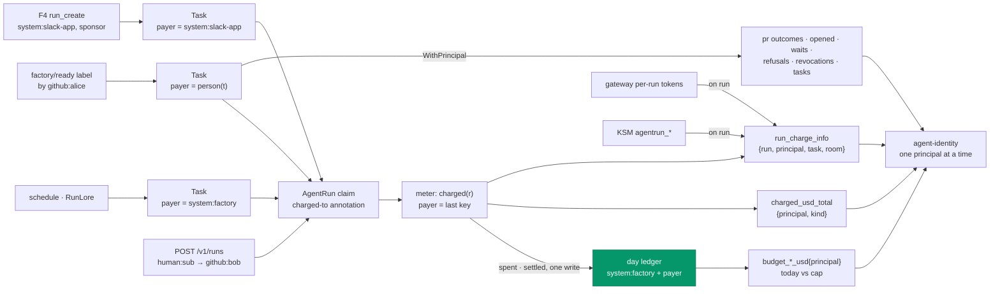

# v3 feature 12: spend per identity, one page per charged principal

**Date:** 2026-10-22 · **Status:** approved by the owner 2026-10-22 with every recommended default; OD-A to OD-C decided as recommended · **Part of:** the [v3 roadmap](2026-10-19-v3-roadmap-design.md#owner-decisions-2026-10-22),
feature 12 (D5) · **Research:** none new; it builds on [truthful costs](2026-10-22-truthful-costs-design.md#decisions)
(TC6 to TC8), [per-person caps](2026-10-16-v2-per-person-caps-design.md#decisions) (D1, D2),
[factory interfaces](2026-10-21-factory-interfaces-design.md#identity-and-budgets) (F4) ·
**Runtime:** the gateway runtime: the meter prices the gateway's per-run series, and the token
panels read them

Read against agent-platform `feat/daily-caps-usd` at `1b2c530` (truthful costs PR 2, not merged),
cited as `AP/<path>:<line>`.

## Outcome

A maintainer opens one page per charged principal (`github:<login>` for a person, `system:<name>`
for a sponsored principal, `system:factory` for work no person caused) and sees what the platform
spent on the work that principal caused: dollars against its day and the fleet's, tokens by type
and the cache-read share, its runs, rooms and tasks, the pull requests they produced, cost per
accepted pull request, refusals and revocations, and how long its tasks waited for a human. The
page attributes cost. It does not score a person.

## What exists

| Piece | Where | Names the payer? |
|---|---|---|
| The charge per run | `charged(r)` (`AP/internal/factory/meter/meter.go:816`): `[system:factory, r.ChargedTo]`, else `[r.Principal]`. `ChargedTo` is the claim annotation `agents.ogenki.io/charged-to` (`AP/internal/factory/runs/runs.go:55`), set when `perPerson.enabled` (on here) from `Task.Payer()`: the retrier, else the `github:` labeller (`AP/api/factory/v1alpha1/person.go:13`). An API run of a linked human: the person's `github:<login>` (`AP/internal/factory/api/server.go:546`) | Yes, as ledger keys |
| A task's run records | `status.runs[].chargedTo` and `costMicroUSD` (`AP/api/factory/v1alpha1/task_types.go:333-342`) | Per run, not a series |
| The day ledger | `agent-factory-ledger-usd-<day>`: `spent` per key, `settled.<runId>` (TC6). The `system:factory` key counts every run charged to the fleet | Yes, one UTC day |
| Day gauges | `agent_factory_budget_{cap,remaining,spent}_usd{principal}` (TC8; truthful costs PR 2, its plan's Task 5): set by the leader after a settled tick; yesterday's keys read 0 at a day's first tick | Yes, one day |
| Run cost | `agent_factory_run_cost_usd{tier}`, `agent_factory_model_cost_usd_total{model}`, `agent_factory_run_spend_usd{run, model}` (`AP/internal/factory/fmetrics/fmetrics.go:228-251`, `:439-463`) | No |
| Pull requests | `agent_factory_pr_outcomes_total{class, outcome, repository}` (`:341`); `agent_factory_time_to_pr_seconds{source, tier, template, repository}` | No |
| Revocations | `agent_factory_run_revocations_total{reason, limit}` (`:397`, `:410`); the shadow `{reason="budget-principal-shadow", principal}` names the key over (`:404`) | The shadow only |
| Refusals | `agent_factory_admission_refusals_total{repository, reason}` (`:327`) | No |
| Tasks | `agent_factory_tasks{phase, source, predicted_class, tier, repository}`, `agent_factory_task_phase_seconds{task, phase}` (`:266-313`) | No |
| Per-run series | KSM's `agentrun_*{run_id}`, whose `principal` is the claim's `spec.principal`; the gateway's `gen_ai_client_token_usage_sum{ar_agent="…xplane-run-<id>", gen_ai_token_type}` | The pod's principal: `system:factory` for every task run |
| Dashboards | `agent-fleet`, `agent-run`, `agent-factory`, `agent-gateway` in the folder `agents`, on VictoriaMetrics and VictoriaLogs | `agent-factory`'s budget panel, one bar per ledger key |
| A runs listing | None: the factory serves `POST /v1/runs` only (`AP/internal/factory/api/server.go:161`), and Grafana has no JSON datasource | — |

The gap: the ledger charges each run to the person who caused it, but outside one day's gauge no
series names that person. A label-started run carries `system:factory` on every per-run series (D5).

## Decisions

| # | Decision | Rejected | Why |
|---|---|---|---|
| SI1 | **One payer per run.** `payer(r)` is `r.ChargedTo`, else `r.Principal`: the last key of `charged(r)`. A task's payer is `person(t)` (`AP/internal/factory/reconciler/implement.go:169`), else `system:factory`: the `chargedTo` its next run gets. Every series below is keyed by it. Schedules and RunLore pay as `system:factory`, so their `requestedBy` (`system:scheduler`, `system:runlore`) never becomes a key | The pod's principal; the issue author; `onBehalfOf`; the sponsor | The owner's choice. It is what the ledger charges, and one key per run makes the series a partition: they sum to the meter's charges |
| SI2 | **Dollars from a counter**, `agent_factory_charged_usd_total{principal, kind}`, `kind` ∈ `task` (a run of a `Task`), `room` (a run started through `POST /v1/runs`). The meter adds each run's charge under its payer when the write that settles it succeeds, or when `resolve` finds a write in doubt landed (`AP/internal/factory/meter/meter.go:415`). Today's figure against the cap reads TC8's gauges | The `spent` gauges alone; `agent_factory_model_cost_usd_total` by principal; the gateway charge rule joined by principal | The gauges hold one UTC day, and the fleet key counts every run. The model counter adds a priced run's cost at its end, never a reference-rate charge. The charge rule applies today's prices to the whole window. The counter is the ledger's charges, so any range sums |
| SI3 | **A run's payer as a series**, `agent_factory_run_charge_info{run, principal, task, room}` = 1, `room` per [OD-C](#owner-decisions), set by the leader for each run not terminal, or finished less than `endSettle` ago (`AP/internal/factory/meter/meter.go:205`), like `agent_factory_run_spend_usd`. It joins the gateway's per-run tokens (tokens by type, cache share), KSM's `agentrun_*` (the runs table), and counts runs, rooms and tasks | Typed token counters in the meter; a `charged_to` label on KSM's `agentrun_info`; a runs JSON endpoint | Tokens have no settled watermark: after a failover a meter counter double-counts or drops a live run's tokens. The join keeps the gateway's counting, as every token panel does. KSM is the host's (a host PR first), and it drops an Info whose path is missing. A JSON endpoint needs authentication and a Grafana plugin neither side has |
| SI4 | **The payer on existing series**, bound through the context as the repository is (`fmetrics.WithPrincipal`, as `WithRepository`, `AP/internal/factory/fmetrics/fmetrics.go:146`): `principal` on `agent_factory_pr_outcomes_total`, `agent_factory_admission_refusals_total`, `agent_factory_tasks`, and on every revocation the factory or the meter records. Two new counters: `agent_factory_prs_opened_total{principal, repository}` where `TimeToPR` records, and `agent_factory_human_wait_seconds_total{principal, phase}` | `principal` on `agent_factory_time_to_pr_seconds`; `opened` as a fifth outcome | A histogram multiplies its buckets by every principal. The outcomes' sum counts pull requests that ended; an `opened` value would break it |
| SI5 | **Bounded labels.** `principal` takes the shape of a ledger key (`system:<name>`, `github:<login>`, `human:<sub>`), else `other`. Its values are the people who may start runs and the sponsored principals in the config. Of the new labels, `run`, `task` and `room` appear only on the per-live-run series. The shadow keeps its `principal`, the key over | A cap on distinct principals per process | The shadow counter already carries the same values under the same bound (`AP/internal/factory/fmetrics/fmetrics.go:401-403`). See [the series](#the-series) for the counts |
| SI6 | **One dashboard, `agent-identity`**, "Spend per identity", in the folder `agents`, VictoriaMetrics only, UTC. A `principal` variable from `label_values(agent_factory_charged_usd_total, principal)`, single value, no All. Linked from `agent-fleet` and from each bar of `agent-factory`'s budget panel | A row per principal on `agent-fleet`; VictoriaLogs panels | One principal at a time is what the owner asked for, and it ranks nobody. Every figure has a metric; the logs add nothing the page needs |
| SI7 | **Cost attribution, not a score** ([framing](#framing-cost-attribution-not-a-score)): the page shows what was spent on work the principal caused and how that work ended. No per-person activity, text, steps, response times or interventions | A productivity view | An agent wrote the code. The outcomes are the factory's yield on the work sent, not the sender's performance. Activity data per person is surveillance the cost question does not need |
| SI8 | **Waits are the payer's tasks waiting for a human**: `agent_factory_human_wait_seconds_total{principal, phase}` adds `now − status.phaseSince` when a task leaves `AwaitingHuman` or `Escalated` (`AP/internal/factory/reconciler/reconciler.go:333`), recorded after the status write as task metrics are. Waiting now: `agent_factory_tasks{principal, phase}` | The approver's response time; approval waits in human rooms ([OD-B](#owner-decisions)) | A waiting task holds one of `awaitingHumanWIP`'s five slots: a cost to the fleet. Timing whoever answers is a score |
| SI9 | **Sponsored principals through F4.** F4 makes `Payer` return the sponsored principal, so its runs carry `chargedTo: system:<name>`. F4's pull requests record two series this page reads: `agent_factory_principal_sponsor_info{principal, sponsor}` from its config, the sponsor as a ledger key (D1), and `agent_factory_max_cost_usd_total{principal}`, each ceiling added when a request is admitted. Tasks stopped at their ceiling are the payer's revocations with `limit="task-usd"` | Registering them here before F4 records them | F4 owns the config, the admission and `max_cost`. The page's panel reads No data until then |
| SI10 | **Accepted means merged and not reverted**: `auto_merged` plus `human_merged`, minus `reverted`, in the range. Cost per accepted PR is the payer's `kind="task"` spend over that count, and No data when it is 0 | Per-task attribution | An approximation of the bench's acceptance, which also judges rework. Over a 30-day range the window's edges matter little; the bench keeps the exact per-task figure |
| SI11 | **`increase_pure` on every per-principal counter and per-run series.** A principal's series is born at its first event, inside the range, and VictoriaMetrics' `increase()` drops a large first value | `increase()` | Measured 2026-10-22; the per-run Cost panel reads it so (truthful costs, live proof 1). The suites substitute `increase` for promtool on series that start at 0, as `test-agent-cost-rules` does |

## One key per run



With per-person caps on, as here, every run is charged to the fleet and to its payer, so the
payers' charges sum to the fleet's day. A non-human caller of `/v1/runs` would be charged to its own
key alone; none exists, and F4 sends machine callers through a `Task`.

## Interfaces

### The series

| Series | Type | Labels | Recorded | Count |
|---|---|---|---|---|
| `agent_factory_charged_usd_total` | counter, new | `principal`, `kind` | the meter, per settled charge (SI2) | principals × 2 |
| `agent_factory_run_charge_info` | gauge, new | `run`, `principal`, `task` (absent for a room run), `room` | the meter, per tick, leader only (SI3) | the live runs, plus those ended within `endSettle` |
| `agent_factory_prs_opened_total` | counter, new | `principal`, `repository` | where `TimeToPR` records | principals × repositories |
| `agent_factory_human_wait_seconds_total` | counter, new | `principal`, `phase` | a task leaving `AwaitingHuman` or `Escalated` (SI8) | principals × 2 |
| `agent_factory_pr_outcomes_total` | counter, `principal` added | `class`, `outcome`, `repository`, `principal` | unchanged sites | × principals, sparse |
| `agent_factory_run_revocations_total` | counter, `principal` added to `RunRevoked` and `Revoked` | `reason`, `limit`, `principal` | unchanged sites; the run's payer | × principals, sparse |
| `agent_factory_admission_refusals_total` | counter, `principal` added | `repository`, `reason`, `principal` | the API (the requester) and the intake (the labeller) | × principals, sparse |
| `agent_factory_tasks` | gauge, `principal` added | … , `principal` | the scrape-time collector | at most one per task |
| `agent_factory_principal_sponsor_info`, `agent_factory_max_cost_usd_total` | F4's (SI9) | `principal`, `sponsor`; `principal` | F4 | the sponsored principals |

Existing readers keep working: the alerts and panels on these series sum over the new label
(`AgentFactoryAutoMergeReverted`'s `sum(increase(...{outcome="reverted"}[15m]))`,
`AgentPersonCapShadowRefusal`'s `sum by (principal)`, the factory page's
`sum by (phase) (agent_factory_tasks)`).

### The dashboard

`$principal` is the variable; it has no braces, so Flux's substitution leaves it alone.

| Row | Panel | Reads |
|---|---|---|
| — | What this page is | A text panel: the [framing](#framing-cost-attribution-not-a-score) in two sentences |
| Spend | Today, against its day | `max(agent_factory_budget_spent_usd{principal="$principal"})` over `max(agent_factory_budget_cap_usd{…})`: the ledger key's day. For `system:factory` that key is the fleet |
| Spend | The fleet's day | The same for `system:factory`, and this principal's share of it |
| Spend | Spend in the range, by kind | `sum by (kind) (increase_pure(agent_factory_charged_usd_total{principal="$principal"}[$__range]))` |
| Spend | Spend per day | The counter's daily increase, by `kind` |
| Tokens | Tokens by type · cache-read share | The gateway's per-run series joined on the charge info ([below](#tokens-by-type)); share = `cached_input` / `input` |
| Work | Runs · rooms · tasks | `count` of distinct `run`, `room`, `task` in `max_over_time(agent_factory_run_charge_info{principal="$principal"}[$__range])` |
| Work | Runs | A table: the charge info joined on `run_id` to `agentrun_info`, `agentrun_status_phase`, `agentrun_pull_request_info`, `agentrun_started_timestamp_seconds`, and `sum by (run) (max_over_time(agent_factory_run_spend_usd[$__range]))` for priced runs; each `run_id` opens its `agent-run` page |
| Outcomes | Pull requests opened · merged · reverted | `agent_factory_prs_opened_total`, `agent_factory_pr_outcomes_total` by `outcome` |
| Outcomes | Cost per accepted PR | [Below](#cost-per-accepted-pr) (SI10) |
| Limits | Refusals | `agent_factory_admission_refusals_total` by `reason`, and the shadow refusals naming this key |
| Limits | Revocations | `agent_factory_run_revocations_total{reason!="budget-principal-shadow"}` by `reason`, `limit` |
| Waits | Waiting for a human now · time waited | `sum(agent_factory_tasks{principal="$principal", phase=~"AwaitingHuman\|Escalated"})`; `increase_pure` of the wait counter |
| Sponsored | Sponsor · ceilings against spend · stopped at the ceiling | F4's two series, the `kind="task"` spend, revocations with `limit="task-usd"`; No data until F4 |

#### Tokens by type

```promql
sum by (gen_ai_token_type) (
  label_replace(
    sum by (ar_agent, gen_ai_token_type) (
      increase_pure(gen_ai_client_token_usage_sum{ar_agent=~"system:serviceaccount:agents:xplane-run-.*",
        gen_ai_token_type=~"input|output|cached_input|cache_creation_input"}[$__range])),
    "run", "$1", "ar_agent", "system:serviceaccount:agents:xplane-run-(.*)")
  * on (run) group_left ()
  max by (run) (max_over_time(agent_factory_run_charge_info{principal="$principal"}[$__range]))
)
```

`input` counts the cache reads and writes ([truthful costs](2026-10-22-truthful-costs-design.md#the-counting-the-formula-rests-on)),
so the share is `cached_input / input`, as the gateway dashboard's prompt-cache panel computes it.

#### Cost per accepted PR

```promql
sum(increase_pure(agent_factory_charged_usd_total{principal="$principal", kind="task"}[$__range]))
/
((sum(increase_pure(agent_factory_pr_outcomes_total{principal="$principal", outcome=~"auto_merged|human_merged"}[$__range]))
  - (sum(increase_pure(agent_factory_pr_outcomes_total{principal="$principal", outcome="reverted"}[$__range])) or vector(0))) > 0)
```

### Framing: cost attribution, not a score

| Rule | How |
|---|---|
| Say what it is | The title is "Spend per identity". The text panel and the dashboard's description: what the platform spent on work this principal caused, against the caps the owner set; outcomes are the factory's yield on that work |
| One principal at a time | No All value; no panel groups, sorts or ranks by `principal` (`by (principal)`, `topk`, `bottomk`, `sort`). The suite fails on any |
| Only cost and its causes | Never prompts, task or issue text, steps, wandering, time-of-day activity, interventions per person, or the time anyone took to answer. A run's text stays on its own `agent-run` page, as today |
| Waits belong to the work | A wait counts for the task's payer, not for whoever had to act (SI8) |
| Ledger keys only | `github:<login>` and `system:<name>`, the keys the ledger and the shadow counter already hold. `human:<sub>` appears only for an API caller with no GitHub link |
| Same audience as the data | The folder `agents`, as every agent dashboard ([OD-A](#owner-decisions)) |

## Gate

The owner's offline-first rule (D4): each pull request merges on its offline proof; the live proofs
run in a gcp-0 session after the pin.

**Offline proofs**

1. Partition (agent-platform, the meter): runs paid by `github:alice` (labelled task), by
   `system:factory` (schedule and RunLore tasks), by `github:bob` (an API run of a linked human) and
   by `human:<sub>` (an unlinked one), priced and unpriced, ticked through a day. The counter's sum
   over principals equals the sum over runs of `settled.<runId>`, which equals each run's total as
   the meter counts it (its priced cost, or its tokens × 1.7). Each priced task run's
   `costMicroUSD` lands under its record's `chargedTo`.
2. Ledger match: per person key, the counter's increase over the day equals the day's `spent`; the
   counter summed over every payer equals `spent[system:factory]`.
3. The same equalities through a leader change (two meters' counters together), a write in doubt
   that landed (counted once, by `resolve`), a failed write (nothing counted), a run across
   midnight (each day its share), and the switch day's ended run (R10: nothing charged, nothing
   counted).
4. The charge info: present for a live run and for `endSettle` after its end, then absent; never
   for an ended run a new leader first sees after that window; a principal of another shape reads
   `other`.
5. The labels: outcomes, openings, waits, refusals, revocations and tasks carry the payer the
   context binds; a wait equals the time from `phaseSince` to leaving the phase; the shadow keeps
   its key; `docs/operations.md` lists every series and label. `task check` is green.
6. The dashboard (ai-native-ref): uid `agent-identity` in folder `agents`; the variable single,
   without All; the text panel; no grouping, sorting or ranking by `principal`; `increase_pure` on
   every per-principal counter and the gateway's per-run series; VictoriaMetrics only.
7. promtool on the panels' queries over synthetic series: two payers' spends sum to the fleet's; a
   run of alice reading 1050 input with 900 cached gives alice 0.857 and bob nothing; three runs in
   two rooms of one task read 3 runs, 2 rooms, 1 task; $3 of task spend with 2 merged and 1
   reverted reads $3.00 per accepted PR, and with 0 accepted, nothing.
8. `validate-links`, the doc-path check and `task check` pass.

**Live proofs** (gcp-0)

1. For one UTC day with a labelled task, a schedule task and an API run: per person key, the page's
   spend for that day matches `spent` in `agent-factory-ledger-usd-<day>`, within the charges of one
   scrape interval (a leader that exits loses those from its counter, not from the ledger);
   `agent_factory_budget_spent_usd{principal}` before midnight equals `spent` ÷ 1e6; the payers'
   spends sum to `spent[system:factory]`.
2. A labelled run's tokens on the page equal its `agent-run` page's; its cache share equals the
   gateway dashboard's.
3. The runs table lists exactly the runs whose task records name the owner in `chargedTo` that day,
   and the API run; each opens its run page.
4. A task held in `AwaitingHuman` shows as waiting, and adds its minutes to the time waited once it
   leaves.
5. With the leader deleted mid-day, proof 1 still holds within its tolerance.

## Pull requests, in order

| # | Repository | Content | Offline proof | Depends on |
|---|---|---|---|---|
| 1 | agent-platform | `payer`, the counter, the charge info, `WithPrincipal` and the labels of SI4, the two new counters, `docs/operations.md`; then a release | 1-5 | Truthful costs PR 2 merged. If PR 1 merges before that PR's release (v0.16.0) is cut, it rides it |
| 2 | ai-native-ref | `grafana-dashboard-agent-identity.yaml`, the links from `agent-fleet` and `agent-factory`, the dashboard and promtool suites, `observability.md`, the status row's link here | 6-8 | Nothing: until 3, the panels read No data |
| 3 | ai-native-ref | Pin PR 1's release; folded into truthful costs PR 3 when PR 1 rides v0.16.0 | the pins suite | PR 1 released |

F4's pull requests record its two series (SI9).

## Owner decisions {#owner-decisions}

| # | Question | Recommended default | Alternative |
|---|---|---|---|
| OD-A | Who may open a person's page? | **The folder `agents`**, every Grafana Viewer, as O10 set for every agent dashboard: the series are queryable in Explore by the same audience, so a narrower folder alone protects nothing | A folder for maintainers only, accepting that Explore still shows the series |
| OD-B | Do approval waits in human rooms count as waits? | **No, the factory's task waits only (SI8).** The factory never sees approvals | A broker counter by the room owner's identity link: a broker change, and the owner's response time comes close to a score |
| OD-C | May the charge info carry `room`? agent-platform's AGENTS.md says "`room` only on the per-Active-room gauge" | **Yes, on per-live-run series.** The series exists per run anyway, so `room` adds no series; PR 1 amends the sentence | Rooms shown as room runs (`kind="room"`), not distinct rooms |

## Not in this design

Enforcing per-person caps (a later decision on the shadow record). Alerts per principal: the shadow
alert exists. `onBehalfOf` as a dimension; interventions per person; the approver's response time.
Approval waits in human rooms (OD-B). Spend by model per principal; the per-task cost table, which is
the bench's. Reconciling a principal's spend with the provider's bill. Backfill: the series start at
PR 1's release, and earlier days live only in the ledger, for 35 days.

## Left to the builder

The Go names (`payer`, `WithPrincipal`, the meter's callback for the counter and the charge info, as
`OnSpend` hands `RunSpend` the per-run spend); how the meter remembers a run's payer for a charge
`resolve` finds landed; the principal shape's regular expression; the panels' layout and the runs
table's joins; the "Spend per day" step; the suites' names and fixtures.
