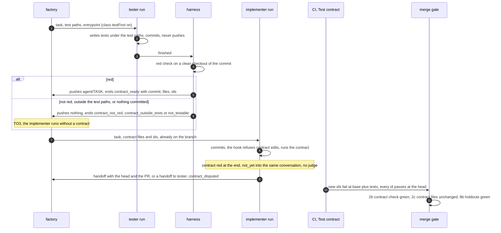

# v3: the test-first tester, a failing test as the implementer's contract, and holdout checks

**Date:** 2026-10-22 · **Status:** draft; owner decisions [TO1–TO5](#owner-decisions) open, each
with a recommended default · **Part of:** the [v3 roadmap](2026-10-19-v3-roadmap-design.md#the-features),
feature 4, as the [v3 review](2026-10-21-v3-review.md#5-amendments-proposed) amended it; the
holdouts are [loops L7](2026-10-21-loops-and-teams-design.md#decisions) · **Research:**
[§2.1](2026-10-21-v3-landscape-research.md#21-patterns),
[§2.3](2026-10-21-v3-landscape-research.md#23-verification-evidence),
[§5.1](2026-10-21-v3-landscape-research.md#51-practitioners-and-research) · **Depends on:**
feature 3, repository checks in the sandbox, designed in parallel ([what the tester needs from
it](#what-the-tester-needs-from-feature-3)) · **Runtime:** both; the tester lives in the harness
and the factory, the contract check in each repository's CI, the holdout rows in the factory's gate

## Outcome

Where a class's switch is on and the task has testable behaviour, a tester run writes the failing
tests first. The harness proves they fail on the base before it pushes them. The implementer then
works against them and may not change them. CI proves on the pull request that every test it adds
fails on the base and passes on the head, and the merge gate hands to a human any head where the
tester's files changed. Separately, every class that merges alone names holdout checks the pull
request cannot change, and the gate reads them before it arms. The contract is visible to the
implementer, so it never counts as a holdout.

## What exists

| Piece | Today | Where |
|---|---|---|
| The `tester` role | A **verifier**: runs after the implementer from `agent/<task>` with the pull request as its task, ends with `room_verdict` approve or changes. Its GitHub token is read-only (`contents: read`) | agent-platform `internal/factory/reconciler/team.go`; `.github/chainguard/agent-tester.sts.yaml` in each repository; the composition's `_rulesFor` (crossplane-configuration) |
| `trio` | `[implementer, tester, reviewer]`, picked for any class but `docs-links` at `frontier`. The classifier does not exist, so triage falls back to `standard` and `trio` runs on the `controlPercent` share, 10% | `tooling/base/agent-factory/helm-values-configmap.yaml` |
| Role sequence | One branch, sequential runs; config refuses a template without an implementer ("only an implementer writes", R38). A verifier's approve counts for the head it was given; a moved head restarts the verifier chain | `team.go`, `internal/factory/config/config.go` |
| Implementer start | Clones the base and resumes `agent/<task>` when an earlier run pushed it (R7); only the implementer's harness pushes (a checkpoint) | `images/agent-harness/agent_run.py` |
| Merge gate | Twelve rows ([factory docs](https://github.com/Smana/agent-platform/blob/main/docs/factory.md#the-merge-gate)). Row 2: required checks, red starts a fix run (`merge.fixRuns`), then `ci_red`. Row 6: `no_approving_verdict` (only when the template has a reviewer), `head_unreported`, `verdict_stale` (reviewer and tester approvals). Row 8: links only, for `docs-links` and `revert` | `internal/factory/reconciler/arm.go` |
| Classes | Per repository, `{live, shadow}` only. `docs-links` and `revert` live in cloud-native-ref, shadow here; `docs`, `tests`, `dashboards`, `scripts` label only; `review` implicit | `config.go` `Class`; the factory config |
| Oracles | `docs-links` and `revert` have the link check among the required checks. No other class has one | the factory config |
| Tests in the sandbox | None: the harness image holds Python, git and `gh`, not the repository's toolchain | [roadmap](2026-10-19-v3-roadmap-design.md#what-the-numbers-say) |

## What the field says

| Finding | Source | Consequence here |
|---|---|---|
| An execution-grounded tester: 42% against 28% without it on SWE-bench Lite; retries saturate after about two | AgentForge, [§2.1](2026-10-21-v3-landscape-research.md#21-patterns) | A tester stage; one continuation |
| Test quality decides the sign: a weak test agent lowered resolve by 3.9 points; visible tests can be gamed | ExecCritic, [§2.3](2026-10-21-v3-landscape-research.md#23-verification-evidence) | The contract is gated fail-closed, and never a holdout |
| Given correct tests, TDFlow resolves 88.8% of SWE-bench Lite and 94.3% of Verified; "the primary obstacle" is writing valid reproduction tests | [TDFlow](https://arxiv.org/abs/2510.23761) | Prove the test before the implementer is paid to pass it |
| TDD instructions without targeted test context raised regressions from 6.08% to 9.94% | TDAD, [§2.3](2026-10-21-v3-landscape-research.md#23-verification-evidence) | The tester may decline; the bench watches CI round-trips |
| Holdout scenarios kept outside the codebase; done when they "pass (and stay passing)" | StrongDM, [§5.1](2026-10-21-v3-landscape-research.md#51-practitioners-and-research) | Holdouts the pull request cannot change; `verifyChecks` keeps them passing on `main` |

## Decisions

| # | Decision | Rejected | Why |
|---|---|---|---|
| TF1 | **The tester runs first, per class, behind a switch.** `repositories[].classes.<class>.testFirst`, default `false`. On, every task of the class starts with a tester run on `agent/<task>`, then the template's roles. Off, the sequence is today's. The tester run is a writer: the task is `Implementing` while it runs. It takes the task tier's caps, counts on the task cap, and calls `roles.<dataClass>.tester` ([loops L8](2026-10-21-loops-and-teams-design.md#decisions)) | A new template; a test phase inside the implementer; test-first for every class | D4: one session measures baseline and variant on the same issues. A phase inside the implementer shares the author's context, and the point is a test written before and apart from the code. Templates are a CRD enum |
| TF2 | **`tester` becomes the test writer; the verifier tester retires** (TO1). A template listing `tester` warns for one release, then is refused; `trio` becomes `[implementer, reviewer]`. `room_verdict` drops the tester; verdicts are the reviewer's alone | Two modes of one role | One role has one octo-sts audience (`octo-sts/<repo>/tester`): two modes need a claim field and a second trust policy per repository. The verifier cannot run the checks today, and after feature 3 the reviewer runs them ([L5](2026-10-21-loops-and-teams-design.md#decisions)). It runs on 10% of tasks, and no bench baseline exists yet |
| TF3 | **Testable behaviour, three filters in order.** The class switch (static, TO4). The scoper's bounded task, once it exists: a check that is not a test skips the tester without a run. The tester itself: a run that commits nothing ends `not_testable`, its reason in the room | A classifier; path heuristics; a test forced for every task | Changed paths are unknown before the change. ExecCritic and TDAD: a bad or forced test costs more than none |
| TF4 | **The contract** is the tester's commit: the test files it adds or changes, all under the repository's test paths, and the test ids in them. The factory records `status.contract: {runId, commit, files, ids}` from the harness's end note, which the broker stamps with the tester run. The implementer's harness reads the files from the commit's trailers, written by the tester's harness: no claim field | A manifest file in the tree; test ids handed to CI | A manifest would merge into `main` with every task. Nothing trusted carries data from the factory into a pull request's workflow; TF7 needs none |
| TF5 | **Red before push, by the harness, not the model.** The tester commits and never pushes. When its conversation ends `finished`, `agent-run` checks the commit on a clean checkout ([the contract check](#the-contract-check)). Red: the harness pushes it to `agent/<task>` and ends `contract_ready`. Otherwise it sends the result into the same conversation once, then ends `contract_not_red` or `contract_outside_tests` and pushes nothing. A branch that moved without `contract_ready` escalates `contract_invalid` | The model's own claim; the red check in CI only | Deterministic evidence. A vacuous test found in CI is found after the implementer's whole run. Nothing pushed keeps the branch clean, so the task can go on without a contract (TO3) |
| TF6 | **The implementer is held to the contract.** It resumes the branch holding the contract commit; its brief names the files and ids. It may not change those files; it may add tests elsewhere, held to TF7 as well. A harness pre-commit hook refuses a commit touching a contract file (a courtesy: `--no-verify` bypasses it). At the run's end a red contract in the sandbox sends `not_yet` with the failing ids into the same conversation without asking the judge, within `continuations`. The gate enforces (TF8). Every implementer run of the task is held: revisions, CI fixes, a maintainer's Request changes. An implementer that finds the contract wrong hands off to `tester` with why, and the task escalates `contract_disputed` | The implementer edits the tests; a dispute round between the two runs | ExecCritic: visible tests get gamed. Byte identity is language-agnostic and checkable from the forge. A dispute round is two writers arguing on one branch: count disputes first |
| TF7 | **CI judges: "Test contract 🧪"**, a job in its own workflow in each repository that switches a class on (a gate path), running agent-platform's action pinned by commit. On every pull request from `agentsLogin` it runs the changed test files at the overlay (the base plus those files) and at the head ([rules](#the-contract-check)). The factory requires it green on a task with a contract (`merge.contractCheck`); on any other it only reports, which gives the bench the baseline's vacuous-test rate | The factory running tests; the sandbox's result as the gate | CI stays the only judge; feature 3's sandbox is a feedback loop. One script serves the harness and CI, so they agree. Its own workflow keeps a report-only red out of `ci.yaml`'s conclusion, which policy-bot reads |
| TF8 | **Two gate rows for a contract**, after row 2. 2b: `merge.contractCheck` counts as a required check: red starts a fix run with its output (the contract is visible by design), pending waits. 2c: each contract file at the head equals the contract commit's, or `contract_modified`, to a human | A fix run that restores the files | The implementer changed them because it could not pass them: a restore loops to `ci_red`. Both rows run for every class, before the class rows, so a maintainer reviewing a label-only class is told too |
| TF9 | **Holdouts: one declared oracle at least per live class**, `repositories[].classes.<class>.holdoutChecks`. Each is a check whose definition the pull request cannot change: the workflow and every file it runs are gate paths, or outside the paths the class's policy-bot rule admits. Two kinds. An **invariant** holdout checks the class's property itself (the link check, a scanner re-run): reading it teaches only the task, so it may be readable and may be a required check. A **scenario** holdout checks behaviour case by case and must also be unreadable: it lives in a private repository the run's token and anonymous egress cannot read, posts a commit status from a named App, and is never a required check, so its output never reaches a fix run | The contract as a holdout; `loops.<class>.holdout: true` | The contract is visible. A boolean names no oracle, and check names differ per repository. StrongDM's holdout scenarios; ExecCritic |
| TF10 | **The gate reads holdouts after the class rows** (row 8b, live and shadow classes): each green on the head. Pending waits (`holdout_pending`); red goes to a human (`holdout_red`), never to a fix run; absent once the required checks are green, or posted by another creator, goes to a human (`holdout_absent`). A required check that is also a holdout keeps row 2's fix run, which only an invariant may be. **No switch:** holdouts protect merges, not bench numbers. A live class without one loads with a warning and `agent_factory_class_without_holdout{class}` for one release, then is refused (TO5) | A switch, off by default | D4's switches exist to measure variants; a holdout is a safety floor |
| TF11 | **Scenario holdouts are specified, not built, in v3.** `docs-links` and `revert` have invariants; the next lane is a scanner re-run ([O8](2026-10-21-v3-review.md#decisions-for-the-owner)), an invariant too. The first class that would merge alone on behaviour builds its scenario suite first | A suite now | No v3 class needs one |

## The flow



### The contract check

One script in agent-platform, `test-contract`, carried by the harness image and wrapped in a
composite action that each repository's workflow pins by commit.

| | Red check, tester run (TF5) | "Test contract 🧪", every agent pull request (TF7) |
|---|---|---|
| Runs | in the sandbox, on a clean checkout of the tester's commit | in CI, on the pull request's head |
| Reads the entrypoint, the test paths and the runner's files from | the base | the base |
| Test files | those the tester's commit changes | those the pull request changes |
| Green when | every changed path is a test path; the runner ran; at the overlay at least one id fails and no new id passes | the runner ran both times; no new id passes at the overlay; every id passes at the head, a skip being no pass; at least one id fails at the overlay and passes at the head; no runner file changed. No changed test file: green, reporting none |
| Evidence | the end note in the room: commit, files, each id's result | the check run's summary: each id's two results |
| Decides | whether the contract is pushed | the gate's row 2b, on a task with a contract |

*Overlay*: the base's tree with the changed test files at their new content. *New id*: an id the
head or the tester's commit reports and the base does not. A changed existing id that fails at the
overlay counts as fail-to-pass (a changed expectation); one that passes is neutral. *Ran*: the
entrypoint's report exists and says tests ran; an infrastructure failure is never red. Reading the
declaration from the base, as policy-bot reads `.policy.yml` from `main`, stops a pull request from
editing the runner to pass. A `tests`-class pull request adds tests of behaviour that already holds,
which pass at the overlay: the job reports it red, and nothing requires it there (TO4).

### What the tester needs from feature 3

| Need | Why |
|---|---|
| The toolchain in the tester's sandbox, not only the implementer's | The red check runs there |
| An entrypoint that takes a selection of test files | The red check and the job run the changed tests only |
| Per-test results with stable ids, such as JUnit XML; a suite with no finer report is one id, its file | Fail-to-pass is per id |
| An exit status or report field that tells "tests failed" from "could not run" | An infrastructure failure must never count as red |
| The repository's test paths and the runner's own files, declared with the entrypoint, in a gate path | What the tester may write, what the contract is, what the job overlays and refuses to see changed |
| The same entrypoint in CI | The sandbox and CI agree |

### Holdouts in this deployment

| Repository | Class | State | Holdout | Why the pull request cannot change it |
|---|---|---|---|---|
| cloud-native-ref | `docs-links`, `revert` | live | "Check the documentation links 🔗" | The job is in `.github/workflows/ci.yaml`, a gate path. The script it runs, `scripts/ci/validate-links.sh`, is not a gate path on the host, but policy-bot's rules for both classes admit only Markdown under `docs/` and `website/content/` |
| ai-native-ref | `docs-links`, `revert` | shadow | `validate` (`task check`, the link check included) | `.github/`, `scripts/ci/` and `taskfile.yaml` are gate paths here |

L7 gave "`.github/` is a gate path" as the reason a CI workflow qualifies. That is incomplete: a
workflow runs files outside `.github/`. The rule is TF9's, and a human checks it when naming a
holdout, since the factory config is itself a gate path. The factory checks what it can see: the
name, the state and the creator.

## The config

```yaml
repositories:
  - name: Smana/cloud-native-ref
    classes:
      docs-links: {live: true, holdoutChecks: ["Check the documentation links 🔗"]}
      revert:     {live: true, holdoutChecks: ["Check the documentation links 🔗"]}
      scripts:    {testFirst: false}   # TO4: the bench's variant turns it on
      review:     {testFirst: false}   # declared for its switch only, never live or shadow
      docs: {}
      tests: {}
      dashboards: {}
    merge:
      contractCheck: "Test contract 🧪"  # required on a task with a contract (TF8)
  - name: Smana/ai-native-ref
    classes:
      docs-links: {shadow: true, holdoutChecks: [validate]}
      revert:     {shadow: true, holdoutChecks: [validate]}   # no testFirst here (TO4), so no contractCheck
templates:
  trio: {roles: [implementer, reviewer], maxReviewRounds: 2}  # TF2
```

`review` stays implicit: declared, it takes `testFirst` only. A scenario holdout is written
`{status: <context>, creator: <App login>}`. `testFirst: true` needs `merge.contractCheck`.

### How a tester run ends, and what the task does

| End | Room | Task | On the issue |
|---|---|---|---|
| `contract_ready` | the end note: commit, files, ids | `status.contract`; the implementer next | the fixed narration: a contract of N tests |
| `not_testable` | the tester's reason | the implementer, without a contract (TO3) | the category only (C7) |
| `contract_not_red`, `contract_outside_tests` | the check's result as a note | the same | the same |
| a pushed branch without `contract_ready` | — | `Escalated`, `contract_invalid` | the same |

The implementer's own end adds `contract_disputed` (Escalated). The gate adds `contract_modified`,
`holdout_red`, `holdout_absent` (AwaitingHuman) and `holdout_pending` (AwaitingCI).

## Owner decisions

| # | Question | Recommended default |
|---|---|---|
| TO1 | Retire the verifier tester and give the `tester` role to the test writer, `trio` becoming `[implementer, reviewer]`? Or keep both modes, with a claim field and a second trust policy per repository | **Retire** (TF2) |
| TO2 | The tester's token gains `contents: write` in each repository's trust policy, a gate path and so a human pull request per repository, and the harness pushes only after the red check? Or the tester stays read-only and its commit travels through the room as a patch the implementer's harness applies: no trust-policy change, but a broker message kind for patches, a size limit, and a contract commit made by the implementer's pod | **Write, pushed by the harness** |
| TO3 | A tester run that ends without a contract: the implementer runs without one, as today, or the task escalates | **Run without a contract**, counted on the bench |
| TO4 | Which classes may switch on: `scripts` and `review` in cloud-native-ref. Not `docs-links`, `revert` or `docs` (no behaviour), not `tests` (coverage of behaviour that holds passes on the base by definition), `dashboards` once a dashboard has a runnable test. None in ai-native-ref while its tests live under the gate path `scripts/ci/`: a contract there makes the pull request a `gate_path` hand-off | **As listed** |
| TO5 | A live class without a holdout: warned for one release, then refused, or refused at once | **Warn for one release**: agent-platform is a product, and other deployments need the window |

## Gate: what the bench must show

The roadmap's gate: acceptance rises on routine issues. The bench design must hold at least 8
routine issues in cloud-native-ref's eligible classes, marked testable by a human before any run, or
the effect cannot be read at three runs each.

| Metric | Expected | Reading |
|---|---|---|
| Acceptance on the testable routine issues, `testFirst` on against off | up by more than the baseline's spread | the gate |
| Acceptance on the other routine issues | not down | declines and degraded contracts cost nothing |
| Cost per accepted PR | reported | whether one more run per task pays for itself |
| CI round-trips per accepted PR | not up | TDAD's regression risk |
| Contract ends: ready, `not_testable`, `contract_not_red`, `contract_outside_tests`, `contract_disputed`, `contract_modified` | counted | test quality, and how often the implementer reaches for the tests |
| Contracts kept: accepted PRs whose contract files the maintainer merged unchanged | reported | whether the tests are worth keeping |
| Vacuous-test rate of implementer-written tests, from the report-only job | measured in the baseline | the size of what TF7 gates |
| The hard set | measured, not gated | TDFlow: writing the test is the hard part there |

A second variant runs the tester on the strong alias (L8): writing the test is the step TDFlow
found hardest.

**Offline proofs** (D4: each pull request merges on these)

1. `test-contract` on two fixture repositories, one pytest, one of shell suites: a new test failing
   at the overlay and passing at the head is green; one passing at the overlay is red; a skip at the
   head is red; a runner that could not run is red and never green; a changed expectation counts as
   fail-to-pass; no changed test is green; a changed runner file is red; a head that edits the
   declaration is judged by the base's.
2. Harness container suite, against a fake gateway and a local bare remote: a red commit under the
   test paths is pushed with its trailers and ends `contract_ready`; a commit outside them ends
   `contract_outside_tests` and nothing is pushed; a vacuous test gets one continuation, then
   `contract_not_red`, nothing pushed; no commit ends `not_testable`.
3. The implementer's harness: the hook refuses a commit touching a contract file; a red contract at
   the end sends `not_yet` without a judge call.
4. The factory: `testFirst` off leaves every existing test passing and the role sequence unchanged;
   on, the tester runs first; each end above leads where the table says; a template listing `tester`
   warns; rows 2b, 2c and 8b decide as TF8 and TF10 say, shadow classes included; a live class with
   no holdout warns and sets the metric.
5. Composition goldens: the tester's rules say it writes under the test paths, commits, never
   pushes and gives no verdict; the implementer's are unchanged.
6. ai-native-ref `task check`: the config parses under the release's `config.Parse`, the tester's
   capability profile has no `room_verdict` and passes the drift gate, the gate-path suite passes.

**Live proofs** (a gcp-0 session)

1. A seeded `scripts` issue in cloud-native-ref with `testFirst` on: the tester's commit is pushed
   only after it is red; "Test contract 🧪" lists the tester's ids as fail-to-pass; `status.contract`
   names the pushed commit.
2. A seeded issue telling the implementer to loosen the test: the hook refuses; with
   `--no-verify`, the gate hands off `contract_modified`.
3. A shadow-class drill whose holdout is renamed: `holdout_absent`. `docs-links`' shadow tally is
   unchanged with its holdout named.
4. The bench: the baseline and the `testFirst` variant on the testable routine issues, three runs each.

## Pull requests, in order

| # | Repository | Content | Proof | Depends on |
|---|---|---|---|---|
| 1 | agent-platform | `test-contract`, its composite action, the fixtures | offline 1 | feature 3's declaration format |
| 2 | agent-platform | The harness: the tester's commit-only mode, red check, validated push and trailers, its ends; the implementer's hook and contract-red continuation; `room_verdict` without the tester | offline 2, 3 | 1; feature 3's toolchain in the sandbox |
| 3 | agent-platform | The factory: `testFirst`, `holdoutChecks`, `merge.contractCheck`, the sequence, `status.contract`, rows 2b, 2c, 8b, the reasons and narration, the template and live-class warnings, the tester out of the verifier sets; a release | offline 4 | 2 |
| 4 | crossplane-configuration | The tester's platform rules; a release | offline 5 | none: it may go first |
| 5 | cloud-native-ref (host) | The "Test contract 🧪" workflow; the tester's trust policy with `contents: write`; the test paths in feature 3's declaration; the composition pin. Gate paths: human-authored | the host's CI | 1, 4, TO2 |
| 6 | ai-native-ref | Pin the release; the config above, every switch off; the tester's profile; `HOST_REF`; the harness and factory pages, the status page. No workflow or trust-policy change here while TO4 enables no class | offline 6 | 3, 5 |

## What this changes in other designs

| Design | Change |
|---|---|
| [Loops](2026-10-21-loops-and-teams-design.md) | L7's holdouts are TF9–TF11; the sketch's `loops.<class>.holdout` is dropped. L2: on a task with a contract, the acceptance checks include its ids, and a red contract answers `not_yet` before the judge is asked. L5: the reviewer cites the contract check |
| [Capability profiles](2026-10-21-capability-profiles-design.md) | The tester's profiles drop `room_verdict` |
| The [roadmap](2026-10-19-v3-roadmap-design.md#the-features) | Row 4 stands; it still waits for feature 3 |

## Not in this design

The scenario suites themselves (TF11); mutation testing for the `tests` class; a dispute round
between the implementer and the tester; test ids immutable per case rather than per file; best-of-N
tests; the tester as a gate on the hard set; auto-merge for a tested class (feature 8).

## Left to the builder

The script's language and its runner adapters (pytest, shell suites, promtool rule tests); how the
base's ids are collected (a collect-only pass or a run); the trailer names; where the hook is
installed; the forge read of files at two commits for row 2c; how long an absent holdout waits;
the narration's wording; the check run's summary layout; the order between the harness release and
feature 3's.
