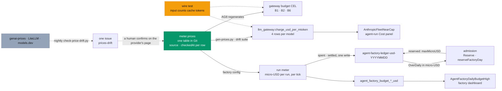

# Before v3: truthful costs, one price table and daily caps in dollars

**Date:** 2026-10-22 · **Status:** approved design 2026-10-22; TC1–TC10 record the owner's
decisions, and the details they left open are ruled where they appear, each with its reason ·
**Built offline, all four PRs merged** (ai-native-ref #99, agent-platform #168 in v0.16.0, ai-native-ref #105 and #98; [plan](../plans/2026-10-22-truthful-costs-rule-plan.md)); the live proofs wait for a `gcp-0` session ·
**Part of:** the [v3 roadmap](2026-10-19-v3-roadmap-design.md#before-v3-starts), "Before v3 starts",
truthful costs; this is its first part, B-2 holds the rest ([Not in this design](#not-in-this-design)) ·
**Research:** [model pricing](2026-10-20-model-pricing-research.md#recommendations), recommendations 1,
2 and 5 · **Runtime:** the gateway runtime: the charge rule reads the gateways' token series and the
ledger is the factory's; the drift check is CI only

## Outcome

Every dollar figure the platform shows or enforces comes from `meter.prices`, cache rates included:
the cost panels and fleet alerts, the gateway budgets, and the factory's daily caps, which count
dollars instead of raw tokens. A nightly check tells a human when a public catalog disagrees with the
table.

## What exists

| Piece | Where | Today |
|---|---|---|
| `meter.prices` | `tooling/base/agent-factory/helm-values-configmap.yaml`, `config.meter.prices` | The source: six rows, `input`, `cacheRead`, `cacheWrite` (Anthropic), `output`, read 2026-10-16. Gate AG10 fails a pinned model without its row |
| Gateway budget CEL | `infrastructure/base/agent-gateway/policy-budgets.yaml` | Generated from `meter.prices`; AG8 regenerates it and fails on any difference. Assumes `llm.inputTokens` includes cache tokens |
| Price rule | `infrastructure/base/llm-gateway/vmrule-llm-gateway.yaml`, group `llm-gateway-prices` | Hand-kept `llm_gateway:price_usd_per_mtoken`: input and output list prices, no cache rows, Haiku at 0.10/0.50 against the meter's 0.50/2.50, retired `glm-5.2` rows. Cost read through it is about 4× too high ([#75](https://github.com/Smana/ai-native-ref/issues/75)) |
| Its readers | `AnthropicFleetNearCap` (`observability/base/agent-platform/vmrule.yaml`), the `agent-run` dashboard's Cost panel, `website/content/docs/platform/ai-platform/routing.md` | No cloud-native-ref file reads the series |
| Run meter | agent-platform `internal/factory/meter/meter.go` | Prices each run in micro-USD (`cost`, lines 141-152). The USD total is in memory only (lines 286-289): a failover after a counter reset forgets it |
| Daily caps | `budgets.factoryDaily` 25M, `humanDaily` 5M, `perPerson.dailyTokens` (default `humanDaily`) | Raw tokens: a cache read counts as a full token. `enforcePrincipal: false` until they count priced units ([agent-platform#155](https://github.com/Smana/agent-platform/issues/155)) |
| Ledger | `agent-factory-ledger-<YYYYMMDD>`, `internal/factory/api/server.go` lines 115-134 | `spent`: principal → tokens. `reserved.<runId>`: `{principal, person?, room?, maxTokens}`. resourceVersion transactions, 5 attempts, kept 35 days |
| Admission | `api.Reserve` (server.go:607), `reserveFactoryDay` (reconciler/implement.go:148), `OverDaily` (server.go:711) | A task run reserves `RunTokens`; an API run its `MaxTokens` |
| Gauges | `agent_factory_budget_remaining_tokens`, `agent_factory_budget_cap_tokens` (fmetrics.go:175, 178) | Set only for principals in today's `spent`, after a successful ledger write. Read by `AgentFactoryDailyBudgetHigh` and the `agent-factory` dashboard's budget panel |
| Gateway buckets | `infrastructure/base/agent-gateway/ratelimit.yaml` | B1 5M per run, B2 41M for the fleet ($69.70: the fleet's day plus four frontier runs), B6 10M for Anthropic; enforced since [#65](https://github.com/Smana/ai-native-ref/pull/65) |
| Drift detection | — | None |

## The counting the formula rests on

Every gateway this platform runs counts cache tokens inside `input`:

| Gateway, path | A reply of 100 fresh, 900 read, 50 written is counted | Evidence |
|---|---|---|
| agentgateway 1.6, Chat Completions → Messages, streamed and not | `input` 1050, `cached_input` 900, `cache_creation_input` 50 | Measured 2026-10-22. The cache-protection wire test asserts the non-streamed case |
| Z.ai, OpenAI shape | `prompt_tokens` include `cached_tokens` | The OpenAI usage shape |
| Envoy agent router (`llm-gateway`) | `cached_input` a subset of `input` | `FrontierSpendGuardTripped`'s comment in `vmrule-llm-gateway.yaml` |

`gen_ai_request_model` carries the alias-resolved model (measured), so rows are keyed by the served
model, as `meter.prices` is. The meter's comment at meter.go:87-91 says a streamed call leaves cache
tokens out of `input`; the measurement contradicts it. Pricing is unaffected: the meter's
`inputExcludesCache` test prices either shape.

**What breaks if a gateway stops counting cache inside `input`.** The same Opus reply would read
`input` 100, and the join below would give 100 × 4.00 − 900 × 3.80 + 50 × 1.00 + 10 × 20.00 = −2770
per million: a negative cost. `AnthropicFleetNearCap` would never fire and the Cost panel would go
negative. The gateway budget CEL makes the same assumption. The meter stays right: it prices such an
input as fresh and counts the run in `agent_factory_meter_input_excludes_cache_runs_total`. TC4 is
how the change is caught.

## Decisions

| # | Decision | Rejected | Why |
|---|---|---|---|
| TC1 | **One price table.** `meter.prices` stays the only place a price is edited. agent-platform's `config.Price` (config.go:356-362) gains optional `source` (an https URL) and `checkedAt` (a `YYYY-MM-DD` date): validated when present, ignored by the meter. Rows gain them in PR 3, once a release that decodes them is pinned: the factory's decoder refuses unknown keys (`DisallowUnknownFields`, config.go:576) | agentgateway's built-in catalog; `meter.prices` generated from an upstream catalog | Catalogs lag a price change by a day to two weeks and copy the providers' mistakes; agentgateway's is frozen per release and has no GLM ([research](2026-10-20-model-pricing-research.md#not-recommended)) |
| TC2 | **The rule is a charge, not a price.** `llm_gateway:charge_usd_per_mtoken{gen_ai_request_model, gen_ai_token_type}` is what one counted token of that type adds to the cost: `input` → input; `output` → output; `cached_input` → cacheRead − input; `cache_creation_input` → cacheWrite − input, which is 0 without a cacheWrite. The cost is one join ([below](#the-charge-series)) | True list prices, with the cache subtraction in each consumer | Cache tokens are counted inside `input`, so a list-price join charges a cache read twice. Subtracting it in each query is label surgery in every consumer |
| TC3 | **The rule is generated and drift-gated.** `scripts/ci/gen-prices.py` checks by default and writes with `--write`. It renders the `llm-gateway-prices` group of `vmrule-llm-gateway.yaml` from `meter.prices`: four rows per model, zeros included, so no token type of a priced model drops out of the join. A suite fails when the committed group differs from the rendering. `llm_gateway:price_usd_per_mtoken` and the `glm-5.2` rows go in the same PR as their readers move | The hand-kept rows (#75); a new gate id in `assert-agent-gateway.py` | AG8's pattern, which regenerates the budget CEL from the same table. A suite, not a gate id, for P1's reason (its ruling R5): the capability profiles are not in the bundle, and the property is the committed file's bytes. `glm-5.2` retired 2026-09-27 and every reader looks back 24 hours at most |
| TC4 | **The formula's precondition is tested.** The cache-protection wire test (`scripts/ci/tests/test-agent-gateway-cache-wire.sh`, [#95](https://github.com/Smana/ai-native-ref/pull/95), [cache design C2](2026-10-21-prompt-cache-design.md#decisions)) runs the pinned agentgateway against a fake Anthropic and asserts `input` = 1050 and reads = 900 per reply. PR 1 adds a streamed reply to it. Live, a new alert `AgentMeterInputExcludesCache` reads the meter's existing counter | Trusting the 2026-10-22 measurement | The wire test runs at every agentgateway pin bump. Only the live counter sees a provider change, such as Z.ai's `prompt_tokens` dropping its cached tokens. The streamed case is the one the meter's comment gets wrong |
| TC5 | **Daily caps in native USD.** `budgets.factoryDailyUSD: 42.50`, `budgets.humanDailyUSD: 8.50`, `budgets.perPerson.dailyUSD` (default `humanDailyUSD`): today's 25M and 5M at the reference $1.70 per M, now counted truly. The token keys are accepted for one release, ignored with a warning, then removed. AG8's fleet floor reads `factoryDailyUSD`; B2 stays $69.70, at it (the fleet day plus four frontier runs: $42.50 + 4 × $6.80) | Priced reference tokens (USD ÷ $1.70 per M) | The owner's choice. USD is already the unit of the run and task caps (OD-6); reference tokens are only the rate limiter's integer |
| TC6 | **A USD ledger with a settled watermark.** A new ConfigMap per UTC day, `agent-factory-ledger-usd-<YYYYMMDD>`. `settled.<runId>` holds the micro-USD charged for that run that day, written in the same transaction as `spent` | Converting the token ledger in place; the USD watermark in memory, as today; a new run annotation | One unit per day. A failover must neither lose nor re-charge a run's spend, and the factory's patch limit admits no new annotation |
| TC7 | **Settlement and admission in micro-USD.** Each tick charges each run's priced increase, minus what is settled, to `charged(r)`: `[system:factory, ChargedTo]` or `[r.Principal]` (meter.go:677). An unpriced or untyped run is charged at the reference rate (`RefUSDPerMToken` 1.70, config.go:39), never $0. Admission decides `OverDaily(usedMicroUSD, maxMicroUSD, limit)`. `waiting_daily_budget`, `budget-person`, `waiting_meter_blind` and the shadow when not enforcing are unchanged | Unpriced as $0 | Counting an unknown model as free is the common failure (LiteLLM, Portkey, agentgateway's USD budgets); a punitive default never makes it free |
| TC8 | **USD gauges only.** `agent_factory_budget_cap_usd{principal}`, `agent_factory_budget_remaining_usd{principal}`, and a new `agent_factory_budget_spent_usd{principal}`, today's spend unclamped. The `_tokens` gauges are removed. `AgentFactoryDailyBudgetHigh` and the dashboard's budget panel move to them | Both units side by side | One unit per day; an unclamped spend shows by how much a day was overrun, and a per-principal spend view reads it |
| TC9 | **The switch day starts at $0.** The new ledger holds nothing from before the switch: a one-day under-count, bounded by B2. Nothing deletes ended claims, the meter lists them all and the gateway keeps exporting their counters, so without a rule the switch tick would charge every listed ended run its whole cost again (an over-count). A run first seen ended, already carrying its usage annotation and with nothing settled, is taken as settled at its current measure and charged nothing (agent-platform PR 2, R10 with R11); the under-count is then the spend of the runs still in flight at the switch. agent-platform#155 closes. `enforcePrincipal` stays `false`: enforcing per-person caps is a later decision on their shadow record | Seeding the new ledger from the day's token spend at $1.70 per M | Seeding would carry the over-count the switch removes. B2 is enforced and priced from the same table |
| TC10 | **A nightly drift check opens one issue, not a pull request.** A scheduled GitHub Actions workflow runs `scripts/ci/check-price-drift.py` against genai-prices, LiteLLM and models.dev. On a mismatch or a missing row it opens or updates one issue labelled `prices-drift` | A pull request with the catalog's value (research recommendation 5); a scheduled factory task | Catalogs copy the providers' page mistakes: a human confirms against the provider's page. A plain CI job first, the research's default |

## Where prices flow



## Interfaces

### The charge series

Cost in USD over a window, here 24 hours; each consumer adds its own selector:

```promql
sum(
  sum by (gen_ai_request_model, gen_ai_token_type) (
    increase(gen_ai_client_token_usage_sum{gen_ai_token_type=~"input|output|cached_input|cache_creation_input"}[24h])
  )
  * on (gen_ai_request_model, gen_ai_token_type) group_left() llm_gateway:charge_usd_per_mtoken
) / 1e6
```

The selector names the four types exactly: `reasoning` is a subset of `output`. Today's table renders:

| Model | `input` | `output` | `cached_input` | `cache_creation_input` |
|---|---|---|---|---|
| glm-5.3 | 1.40 | 4.40 | −1.14 | 0 |
| glm-5.3-flashx | 0.37 | 1.25 | −0.295 | 0 |
| glm-5.3-flash | 0.15 | 0.50 | −0.12 | 0 |
| claude-opus-5-5 | 4.00 | 20.00 | −3.80 | 1.00 |
| claude-sonnet-5-5 | 2.00 | 10.00 | −1.90 | 0.50 |
| claude-haiku-5-5 | 0.50 | 2.50 | −0.45 | 0.125 |

The measured Opus reply with 10 output tokens costs 1050 × 4.00 − 900 × 3.80 + 50 × 1.00 + 10 × 20.00
= 1030 per million, $0.00103: the same as 100 × 4.00 + 900 × 0.20 + 50 × 5.00 + 10 × 20.00. Today's
rule charges it 4400, 4.3× more.

### The ledger

| Key | Value | Unit | Written by |
|---|---|---|---|
| Name | `agent-factory-ledger-usd-<YYYYMMDD>`, in the factory's namespace, one per UTC day, kept 35 days | — | the first writer of the day |
| `spent` | JSON map, principal → integer | micro-USD | the meter |
| `reserved.<runId>` | JSON `{principal, person?, room?, maxMicroUSD}` | micro-USD | admission; dropped when the run ends (agent-platform#55), its spend stays |
| `settled.<runId>` | integer | micro-USD charged to that run that UTC day | the meter, in the same write as `spent` |

For each key, `spent` equals the sum of `settled` over the runs charged to it. A meter that first sees
a run (a new run, or a new leader) reads its `settled` from every retained ledger and starts the
run's USD total at the larger of that sum and its priced counters, as it starts tokens at the usage
annotation today (meter.go:327-329). Each tick charges the run's total minus everything settled for
it so far.

| Run | Reserves |
|---|---|
| Task run | `Spec.Budget.RunMicroUSD` (task_types.go:120-127); `RunTokens` at the reference rate when that is 0 (a tier capped in tokens) |
| API run (`RunRequest`) | `MaxTokens` at the reference rate (1.7 micro-USD per token); F4 sends machine callers through a `Task`, never `/v1/runs`, so a bare API run keeps it ([factory interfaces](2026-10-21-factory-interfaces-design.md#decisions)) |

### Config, metrics and alerts

| Config key | Value here | Release default | Replaces |
|---|---|---|---|
| `budgets.factoryDailyUSD` | 42.50 | 42.50 | `factoryDaily` (25 000 000) |
| `budgets.humanDailyUSD` | 8.50 | 8.50 | `humanDaily` (5 000 000) |
| `budgets.perPerson.dailyUSD` | omitted | `humanDailyUSD` | `perPerson.dailyTokens` |

Each must be positive. The release carrying #155 accepts the three token keys, ignores them and logs a
warning naming each; the next release removes them, and the strict decoder then refuses them.

| Reader | Today | After | PR |
|---|---|---|---|
| `AnthropicFleetNearCap` | `input\|output` × the price, > 13.6 | the four types × the charge, > 13.6 | 1 |
| `agent-run` Cost panel | the same | the same | 1 |
| `AgentMeterInputExcludesCache` (new, `vmrule-agent-factory.yaml`) | — | `sum by (model) (clamp_min(X - (X offset 1h or X * 0), 0)) > 0`, X being `agent_factory_meter_input_excludes_cache_runs_total` (promtool's `increase()` reads a counter born at 1 as 0) | 1 |
| `AgentFactoryDailyBudgetHigh` | `1 − remaining_tokens / cap_tokens > 0.8` | `agent_factory_budget_spent_usd / agent_factory_budget_cap_usd > 0.8` | 3 |
| `agent-factory` dashboard, budget panel | `remaining_tokens / cap_tokens` | `remaining_usd / cap_usd` | 3 |
| `AgentPersonCapShadowRefusal` description | names `agent-factory-ledger-<YYYYMMDD>` | names the USD ledger | 3 |

At the first tick of a UTC day the meter records yesterday's principals at 0 spent: a gauge moves only
when recorded, and the 80% alert would otherwise outlive midnight.

### The drift check

| Part | Choice |
|---|---|
| Workflow | `.github/workflows/price-drift.yaml`: nightly `schedule` and `workflow_dispatch`; `contents: read`, `issues: write` |
| Sources | genai-prices' published price data, LiteLLM's `model_prices_and_context_window.json`, models.dev's `api.json` |
| Compared | Every `meter.prices` row's `input`, `cacheRead`, `cacheWrite` and `output`, equal when they round to the same 4 decimals in USD per M. Our absent `cacheWrite` matches a catalog's absent or 0 |
| Mapping | In the script: each row's key in each catalog. A row that differs on purpose names what it matches (Haiku 5.5: the over-100K rate) or an accepted deviation with its reason. models.dev's GLM coding-plan entries are priced 0, so the mapping names the pay-as-you-go ones |
| Finding | A field that differs; a row a catalog lacks; a row the mapping lacks |
| Outcome | One open issue labelled `prices-drift`: created, or its body replaced with the night's findings (row, field, ours, theirs, catalog, the row's `source`). The first clean run closes it. A catalog that cannot be fetched or parsed fails the run, which notifies, and leaves the issue alone |
| Network | Only the workflow's fetches and its `gh` calls. The comparison and the issue action (open, update, close, nothing) are in the script and tested on fixtures |

## Pull requests, in order

| # | Repository | Content | Offline proof | Depends on |
|---|---|---|---|---|
| 1 | ai-native-ref | `gen-prices.py`, the generated group, the drift suite, the consumers above, `AgentMeterInputExcludesCache`, a streamed reply in the wire test, `routing.md`'s cost section | Offline 1-5 | No other B pull request; #95 merged, whose wire test it extends |
| 2 | agent-platform | The USD ledger, settlement and admission, the config keys and their deprecation, `Price.source` and `checkedAt`, the three gauges, the corrected comment at meter.go:87-91; then a release | Offline 6-10 | Nothing |
| 3 | ai-native-ref | Pin that release (chart and image by digest); the USD config keys; `source` and `checkedAt` on every row; AG8's fleet floor from `factoryDailyUSD`, and a token key fails AG8; the factory alerts and dashboard on the USD gauges; the comments in `ratelimit.yaml` and on `enforcePrincipal`; runbook 04, `routing.md`'s budget layers (B1, B2 and B6 are enforced, not shadow), `harness-reference.md` | Offline 11-13 | PR 2 released |
| 4 | ai-native-ref | `check-price-drift.py`, its mapping and fixtures, the workflow | Offline 14 | Nothing |

## Gate

The owner's offline-first rule (D4): each pull request merges on its offline proof; the live proofs
run together in one gcp-0 session after PR 3.

**Offline proofs**

1. `gen-prices.py` reports the committed group is the rendering. A hand edit to a row, or a row added
   to `meter.prices` without `--write`, fails the drift suite with the diff.
2. The generator's unit tests: four rows per model at the values above, 0 for Z.ai's writes, no
   `glm-5.2`, no `llm_gateway:price_usd_per_mtoken`.
3. promtool on synthetic series: the measured reply costs $0.00103 through the join; a cache-heavy
   Opus day of $5 real spend, $20 at list prices, does not fire `AnthropicFleetNearCap`, and $14 does;
   one increment of the meter's counter fires `AgentMeterInputExcludesCache`.
4. The wire test passes on the pinned agentgateway with the streamed reply added.
5. `validate-vmrules`, the alert-annotation suite and the doc-path check pass: `task check` is green.
6. agent-platform, the ledger: its name, `spent` in micro-USD, `reserved.<runId>` with `maxMicroUSD`,
   `settled.<runId>`; the pruner deletes both ledger prefixes after 35 days.
7. Settlement: a tick charges the priced increase to both keys and `settled` in one write; a second
   meter taking over mid-run, with or without a counter reset, charges neither twice nor less; a run
   across midnight charges its second day only that day's increase; an unpriced or untyped run is
   charged 1.7 micro-USD per token.
8. Admission: `OverDaily` in micro-USD at both call sites; the reservations in the table above; the
   waiting states and the shadow pass their existing tests in the new unit.
9. Config: the USD keys parse, default and validate; each token key is accepted, ignored and named in
   a warning; `source` and `checkedAt` parse and validate, and the meter ignores them.
10. Metrics: the three USD gauges and no `_tokens` gauge; yesterday's principals read 0 at a day's
    first tick.
11. AG8: the fleet floor from `factoryDailyUSD` is B2's 41M; a raised `factoryDailyUSD` without B2
    fails; a token key fails. AG10 passes with `source` and `checkedAt` on every row.
12. The pins suite passes on the release's digests, and the values parse under the release's
    `config.Parse`.
13. promtool: `AgentFactoryDailyBudgetHigh` fires at 80% of the USD cap.
14. The drift script's tests, on trimmed fixtures of the three catalogs: they agree; Sonnet 5.5's cache
    read at $0.20 (the provider's page on 2026-10-03) is one finding; a row a catalog lacks; Haiku's
    tier; Z.ai's absent `cacheWrite`; the issue action for each case, the same findings twice giving
    the same body.

**Live proofs** (gcp-0; the drift check needs no cluster)

1. `llm_gateway:charge_usd_per_mtoken` holds 24 series. A finished internal run's Cost panel is within
   1% of the cost the meter reported for it. Read it with `increase_pure`, as the panel does: VictoriaMetrics'
   `increase()` skips a large first value, which a run's new series always have. The meter's
   `agent_factory_model_cost_usd_total` is the exact reference.
2. With only factory runs in the window, `AnthropicFleetNearCap`'s expression without its threshold is
   within 1% of the increase of the meter's `agent_factory_model_cost_usd_total` for the Claude models
   over the same 24 hours. The alert's `increase()` form may read a few percent low on short runs (see 1).
3. The factory starts on the USD keys with no deprecation warning. Today's
   `agent-factory-ledger-usd-<YYYYMMDD>` holds `spent`, `reserved` and `settled` in micro-USD, and per
   key `spent` equals the sum of its runs' `settled`.
4. Deleting the meter's leader mid-run leaves the run's `settled` equal to the cost the meter reports
   at its end.
5. A drill lowering `factoryDailyUSD` to $0.01, with `enforcePrincipal: true` (ruled in PR 3, below),
   makes the next task wait `waiting_daily_budget` and fires `AgentFactoryDailyBudgetHigh`;
   `agent_factory_budget_spent_usd{principal="system:factory"}` equals `spent` ÷ 1e6. The values are
   put back.
6. The first two scheduled drift runs leave at most one `prices-drift` issue, and the owner confirms
   each finding against the provider's page.

## Open item for the release step

agent-platform `main` is v0.15.6 plus the unreleased portable run runtime
([#160](https://github.com/Smana/agent-platform/pull/160), adoption 3a); install anywhere
([#165](https://github.com/Smana/agent-platform/pull/165)) is a draft. The release that carries #155
carries #160 too. Before that release, check what #160 changes for this deployment's factory chart
(values keys, CRDs, RBAC, a new controller), and whether PR 3 needs more than the pin and the keys. If
#165 merges first, the same check applies to it.

## Not in this design

B-2: the agentgateway overlay catalog and the per-run cross-check against the meter (research
recommendations 3 and 4), and reconciliation with Anthropic's usage API, by hand monthly
(recommendation 6). Recommendations 7 and 8. Anthropic's Models API as a source of new models.
Enforcing per-person caps. F4's `max_cost`. The raw-token alerts (`AgentRunTokenSpendHigh`,
`AgentFleetTokenSpendHigh`, `FrontierSpendGuardTripped`) and the sizes of B1, B2 and B6, unchanged.
Price columns not used yet: 1-hour cache writes, fast mode, US-only inference, Haiku's under-100K rate.
Historic cost: the PromQL cost applies today's charge to the whole window; the ledger keeps what was
charged.

## Left to the builder

Whether the generator splices the group's rules into the file or renders the whole group (capability
profiles P1 splices), and how it prints numbers without float noise; the suites' names; the Go names
and the warning's wording; the catalogs' exact URLs and field names, and the fixtures; the cron
minute and the issue body's layout; whether the values-parse check of offline proof 12 becomes a suite.

Ruled in PR 4 ([plan](../plans/2026-10-22-price-drift-check-plan.md#this-plans-rulings)):

- **The catalogs:** genai-prices' live feed is `prices/new_data/v2/data.json`. Its `prices/data.json`
  is a v1 snapshot, frozen since 2026-07-25, that lists no 5.5 model and no `zai` provider.
- **The mapping:** four tables in `scripts/ci/check-price-drift.py`. `MAPPING` holds each row's key
  in each catalog. `ABSENT` holds the rows a catalog lacks (LiteLLM has no `zai/glm-5.3-flashx`).
  `TIERS` holds the tier a row is priced at (Haiku 5.5's over-100K rate). `ACCEPTED` holds accepted
  deviations (none yet).
- **The issue:** its body depends only on the findings, so a night with the same findings leaves the
  issue alone. A catalog that lists none of the rows fails the run, as one that cannot be parsed does.
- **The cron:** 04:17 UTC.

Ruled in PR 1 ([plan](../plans/2026-10-22-truthful-costs-rule-plan.md#this-plans-rulings)):

- **The generator** renders the whole `llm-gateway-prices` group and splices it in place: the comment
  above it and the other group stay hand-written. Charges are exact decimals with at least two places
  (`-1.14`, `0.125`, `0.00`), and the written file must parse back to the rendering.
- **The suites:** `test-gen-prices`, the generator's unit tests (offline proof 2); `test-agent-prices`,
  the drift check (offline proof 1); `test-agent-cost-rules`, promtool on the readers (offline proof 3).
- **`AgentMeterInputExcludesCache`** compares the counter with an hour ago, absence read as 0, as the
  `agent_router:budget_*` rules do. The counter is born at its first increment, which promtool's
  `increase()` reads as 0, so the `increase(X[1h])` form the table first held could not be proven to fire.

Ruled in PR 3 ([plan](../plans/2026-10-22-truthful-costs-adopt-plan.md#this-plans-rulings)):

- **The pin:** the whole release, as every agent-platform pin moves: the factory's chart and image,
  the room-broker's image, its `crd-rooms.yaml` asset and its schema ref. The values move to the
  USD keys in the same commit: v0.15.6's strict decoder refuses `factoryDailyUSD`.
- **The rows:** `source` is the provider's page the table's comment names, and `checkedAt` the day
  the row was read (2026-10-16), quoted, on the same single line as the row (the flow mapping), not a second one: that keeps test-gen-prices' row anchors.
- **The gates:** AG8 also fails values without a positive `factoryDailyUSD`. AG10 requires `source`
  and `checkedAt` on every row, in the release's format. Offline proof 12's parse is a one-off step
  of the plan, not a suite: it needs Go and the release's source.
- **The alert's suite:** `test-agent-factory-budget-alerts`, its own, so PR 3 does not wait on
  PR 1's `test-agent-cost-rules`.
- **Live proof 5:** the drill also sets `enforcePrincipal: true`. While it is `false` the fleet's
  day is shadow too, and the task would run. It edits the values in place under a suspended
  Kustomization ([runbook 04, Part F](../../runbooks/agent-factory/04-gateway-secrets-budgets.md#part-f--daily-caps-in-dollars-the-switch-day)),
  as Part D's refusal drill does, instead of a commit.
