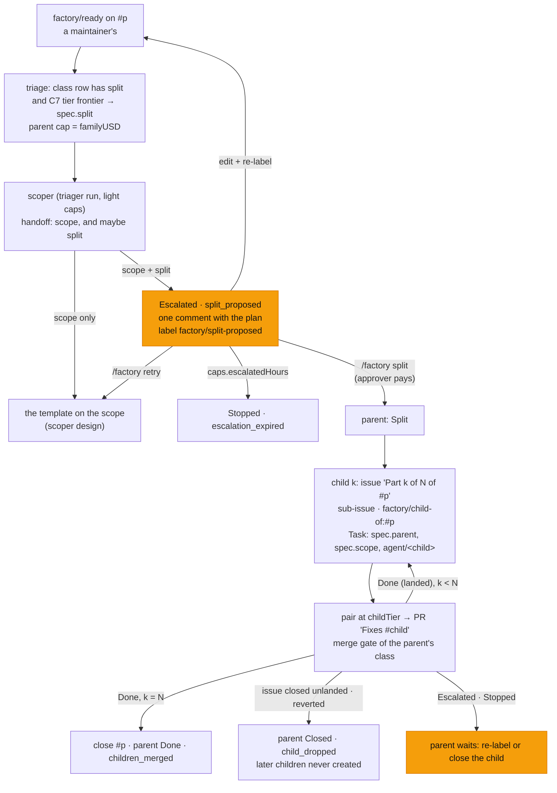

# v3 feature 6: the splitter, a hard issue landed as approved sub-issues, one at a time

**Date:** 2026-10-23 · **Status:** proposed; SP1–SP6 open, each with a recommended default ·
**Part of:** the [v3 roadmap](2026-10-19-v3-roadmap-design.md#the-features), feature 6 ("A hard issue
becomes sub-issues, each with its own verifier and each run through the existing templates on its own
branch. The parent closes when its children merge"; it "needs the scoper's bounded-task format") ·
**Builds on:** the [scoper](2026-10-22-scoper-design.md) (SC1–SC12, [the scope](2026-10-22-scoper-design.md#the-scope)),
the [merge gate classes](2026-10-22-merge-gate-classes-design.md) (MC1, MC13), [spend per
identity](2026-10-22-spend-per-identity-design.md) · **Runtime:** both; it lives in the factory and the
broker, and adds nothing at the gateway: the splitter is the scoper's run with one more answer

## Outcome

On a class that switches it on, the scoper of a hard task may answer with a **split**: two to four
bounded tasks, each in the scoper's own scope shape, plus the whole task as one scope. The factory
proposes the split on the parent issue and waits. A maintainer approves it with `/factory split`, or
runs the task whole with `/factory retry`. Once a split is approved, the factory opens the first
**child**, a sub-issue of the parent with a task of its own on its own branch. That child goes through
the class's usual template and merge gate. The next child starts only when the previous one has merged,
and the parent issue closes when the last one merges. All of it is spent from the parent's cap and
charged to the approver. The split is off by default and switched per class (D4).

Read against agent-platform `origin/main` at `0fcd458` (scoper PR 1, #185), cited `AP/<path>:<line>`.
The scoper's PR 2 (`scope` on `room_handoff`, the scoper run, `status.scope`, the bounce) is being
built: what this design takes from it is cited from its [plan](https://github.com/Smana/agent-platform/blob/main/docs/superpowers/plans/2026-10-22-scoper-plan.md)
(rulings S10, S13–S15).

## What exists

| Piece | Today | Where |
|---|---|---|
| Who starts a task | Only a maintainer's `factory/ready`, re-checked against GitHub write access (v2 D5); the labeller becomes `requestedBy`. While any task of the issue is still open, a new label is refused (`task_active`, R4). An escalated task is superseded instead | `AP/internal/factory/intake/issues.go:264-273`, `:298-309`, `:320-327` |
| Who pays | `Task.Payer()`: the maintainer whose `/factory retry` sent the task back, else the labeller. Each run records `chargedTo` | `AP/api/factory/v1alpha1/person.go:13`, `task_types.go:405` |
| "Hard" | C7's tier. `frontier` picks `trio` (implementer, tester, reviewer). `status.classification.tier` keeps C7's own verdict even when the control group forces frontier | `AP/internal/factory/triage/classify.go:23-36`, `:98-103` |
| Tiers on the host | light $0.51/$1.02, standard $2.55/$5.10, frontier $6.80/$13.60 (run/task USD). `caps: {activeTasks: 3, tasksPerDay: 20}` | [`helm-values-configmap.yaml`](../../../tooling/base/agent-factory/helm-values-configmap.yaml) |
| The factory opening issues | `CreateIssue` with `issues:write`, already in the factory App's scope. RunLore opens one per finding, labelled `factory/proposed`, after creating the Task and before patching `spec.issue` | `AP/internal/factory/forge/github.go:293-303`, `intake/runlore.go:251` |
| Closing issues, sub-issues | No `CloseIssue`, no sub-issue call. A PR closes its own issue: the brief asks for "Fixes #n" | `AP/internal/factory/reconciler/text.go:78` |
| A maintainer's command | `command()`: the newest unedited comment by a maintainer with write access, posted since the phase began, whose line is exactly the verb. `/factory retry` is the only verb today | `AP/internal/factory/reconciler/watch.go:259-299` |
| Branches | Every run of a task writes `agent/<taskId>` from `main` (C3) | `AP/internal/factory/reconciler/implement.go:135` |
| The scoper | `loops.<class>.scope`: `off` or `steering` (`scoper` refused until PR 2). Rows are whole. Triage records `spec.scopeMode` and `spec.steering`. PR 2 adds `envelope.Scope`, which is listed to the triager only (`RoleSchemas`, S10), `status.scope {state, seq}`, and the `needs_author` bounce | `AP/internal/factory/config/config.go:1116-1179`, `task_types.go:95` |
| Room payloads | At most 64 KiB per event; `HandoffPayload` is `{fromRole, toRole, summary, commit, branch}` | `AP/internal/envelope/envelope.go:17`, `payloads.go:105` |
| Phases | 17 values in the CRD enum. An escalated task waits for a person until `caps.escalatedHours` | `AP/api/factory/v1alpha1/task_types.go:198` |
| The gate | It reads the task's `predictedClass`. A class that is neither `live` nor `shadow` goes to a human. The breaker counts per class | `AP/internal/factory/reconciler/arm.go:96-121`, `merge.go:726-762` |
| Stops | `factory/stop` on an issue or PR stops the tasks whose `spec.issue` or PR is that number | `AP/internal/factory/intake/issues.go:423-476` |

## Decisions

| # | Decision | Rejected | Why |
|---|---|---|---|
| SL1 | **The splitter is the scoper's run with a second answer.** On a task where a split is offered (SL3), the scoper's brief allows it to hand off `split` beside `scope`. No new role, run or template | A separate splitter run before or after the scoper | The scoper already reads the issue and the steering note at the light caps (SC10). Splitting is a judgement on the same reading, and a second run would read everything again |
| SL2 | **`split` reuses the scope shape.** `room_handoff` gains `split: {why, children}`, listed to the triager only. `children` holds 2 to `maxChildren` (≤ 5) objects, each exactly the scope of SC6 with `state: ready`. A split handoff also carries `scope`, the whole task, `ready` ([shape](#the-split)) | A child format of its own; a split without the whole | The roadmap: "the splitter needs the scoper's bounded-task format". With the whole task present, `/factory retry` runs the task unsplit with no second scoper run (SC7: "it always writes the whole bounded task") |
| SL3 | **The switch: `loops.<class>.split: {maxChildren}`, off when absent.** It requires `scope: scoper` on the same row. It is refused on `docs-links`, `revert` and oracle classes. Triage records `spec.split` only when the class's row sets it **and** C7's own tier is `frontier` ([SP1](#owner-decisions)) | A fourth `scope` mode; offering a split on every task | D4: off by default, per class. The roadmap aims the splitter at hard issues. C7's own verdict ignores the control group, so OD-14 stays clean. Recording at triage means a config change never moves a task already triaged (SC2) |
| SL4 | **No child exists before a maintainer's `/factory split`.** A split handoff puts the parent in `Escalated`, reason `split_proposed`. The factory comments once on the parent with the plan (public: each child's task quoted as an inert code block, ruling TE; internal: a room link, C7) and labels it `factory/split-proposed`. **Exits:** **(a)** `/factory split`: the split is approved and the approver is recorded; **(b)** `/factory retry`: the task runs whole on its `scope`; **(c)** the author edits the issue and a maintainer re-labels it: R4 supersedes the parent, and a fresh scoper may split again; **(d)** `caps.escalatedHours` passes: `Stopped`, `escalation_expired` | Creating sub-issues at once, labelled for approval; auto-approval | An untrusted issue must never make the factory open issues or start runs without a person's say. `command()` already gives the maintainer-plus-write check, the no-edit rule and dedup by comment id. `Escalated` is the platform's wait for a person, as for the bounce (SC8) |
| SL5 | **A child is a Task with a given scope.** Its `spec.parent` holds `{task, issue, index, of}`. Its `spec.scope` is its child scope, frozen. Its `spec.text` is the parent's snapshot: what a maintainer labelled, with the same `contentSHA256`. It inherits the parent's `predictedClass`, `steering`, `scopeMode` and `dataClass`. It never runs a scoper (S13 reads "due while `status.scope` and `spec.scope` are unset") and never splits | The child issue's body as the child's snapshot; a child scoper | SC9: the snapshot wins over an agent's reading, so it must stay the labelled text. The scope tells the run which part is its own. Depth 1 is enforced by the field itself |
| SL6 | **A child's class is its parent's.** It merges only if that class does. The gate is unchanged | Letting the splitter name a child's class | A class is a maintainer's intent, never an agent's (§2, T3: `predictClass` trusts only maintainer-applied labels). A `review` child always waits for a human (`arm.go:98`) |
| SL7 | **One child at a time, in order** ([SP2](#owner-decisions)). The factory creates child *k* + 1 only after child *k* is **landed**, meaning its newest task is `Done` (merged). Each child is created when its turn comes: the factory opens its issue, then its Task | Every child at once, ordered by a dependency graph | Siblings on one tree conflict. A failed first child stops the spending on the others. One PR at a time stays under `awaitingHumanWIP`. Teams lose on sequential work ([roadmap](2026-10-19-v3-roadmap-design.md#what-the-field-says-research-2026-10-19)) |
| SL8 | **A child issue is the factory's own text.** Title: `Part k of N of #p`. Body: public, the child's scope quoted as an inert code block plus a link to the parent; internal, a room link only. Labels: `factory/child-of:#p` (the ledger, v2 D1, as MC13's `follow-up-of`) and the parent's `class:` label. A GitHub sub-issue link (`POST …/issues/{p}/sub_issues`, the child's numeric id) is added for people to read, and a failure to add it is logged and never blocks. Creating the issue is idempotent through a body marker `split=<parentTask>/<k>`, as `PostOnce`'s marker is | Agent-written titles; the sub-issues API as the record | Titles cannot hold an inert block. The sub-issue link needs the issue id, which the forge does not return today, so it is a convenience and the labels are what survives a rebuild |
| SL9 | **Each child brings its own verifier.** Its template is `Matrix(parentClass, childTier)`. A child runs at `split.childTier`, `standard` by default ([SP5](#owner-decisions)), so it gets `pair`: an implementer, then a reviewer. The judge reads the child's `acceptance` from `spec.scope` (SC9's re-injection, from the spec instead of a handoff) | C7 per child; the parent's frontier tier | D3: the split exists to fit the work to the model. Each part is a standard task, and its acceptance checks are the judge's checklist |
| SL10 | **The parent's cap is the family's cap.** When a split is offered, triage sets the parent's `taskMicroUSD` to `split.familyUSD` (default $20.40, four standard tasks). A child is created with `taskMicroUSD = min(childTier.taskUSD, family left)`. Family left is the parent's cap minus the spend of the parent and every earlier child. It is read once, when the child is created, which is race-free because children run one at a time. If what is left cannot hold one run (`runFits`), the parent goes `Escalated`, `budget-family` ([SP3](#owner-decisions)) | A cap per child only; live accounting across tasks | A split must not make an issue cost more than the owner allowed for it whole. Cost per accepted PR counts every run on the issue |
| SL11 | **The approver pays.** Every child's `requestedBy` is `github:<approver>`, so `Payer()` and `chargedTo` name them (D2, as for `/factory retry`). Their day is checked at approval, as intake checks a labeller's (`personSpent`, D4) | The parent's labeller | The person whose command causes the spend pays for it (spend per identity SI1) |
| SL12 | **The parent waits in a new phase, `Split`.** It is neither active nor terminal, so children hold the `activeTasks` slots and the parent holds none. It ends **`Done`, `children_merged`**: once every child has landed, the factory closes the parent issue (a new `CloseIssue`, `issues:write` held) with one comment listing the children's PRs. It ends **`Closed`, `child_dropped`**: when a child's issue closes with no landed task, or its merge is reverted before the parent closes; the parent issue stays open with a comment, and the remaining children are never created. A child that escalates or stops leaves its issue open, and the parent waits for it. A maintainer re-labels the child issue (intake honours `factory/child-of` only when the factory App applied it) or closes it. A revert after the parent has closed only comments on the parent | Holding the parent in `Escalated` (wrong expiry and retry meaning); ending the parent `Done` at approval and letting the last child close it (a terminal task written again) | No existing phase means "waiting on its own children". R4 then refuses a second `factory/ready` on the parent while a family is open, so a parent cannot fan out twice. F7 maps `Split` to `running` |
| SL13 | **A stop on the parent stops the family.** `factory/stop` on the parent annotates the parent and every open child, matched by `spec.parent.issue`. The kill switch already covers children, which are ordinary tasks | Stopping the parent alone | A maintainer who stops the work means all of it |
| SL14 | **Records and counters.** On the parent, `status.split: {state, seq, approvedBy, children[{index, issue, task, outcome}]}`, with `state` ∈ `proposed`, `approved`, `declined`, `superseded`, `expired`, `ignored`. On every child Task, the label `agents.ogenki.io/parent=<parentTask>`, so a family's cost is a selector sum. Counters: `agent_factory_splits_total{repository,class,outcome}` and `agent_factory_split_children_total{repository,class,outcome}` with `landed`, `dropped`, `reverted`. Provenance stays per run (R10) | A lineage store | Task records are already the bench's source (SC12). A split handed off on a task where none was offered is ignored, the task runs on its `scope`, and the case is counted `ignored` |

## The flow



## The split

The `split` property of `room_handoff`, listed to the triager only (S10's `RoleSchemas`), validated by
the broker:

| Field | Type and bounds | Meaning |
|---|---|---|
| `why` | string, 1–500 | Why the task does not fit one run: the parts and what separates them |
| `children` | 2–5 scopes ([SC6 shape](2026-10-22-scoper-design.md#the-scope)), each `state: ready`, no `question` | In order: child *k* + 1 is written assuming child *k* has merged |

Each child is at most 4096 bytes as canonical JSON, like any scope, and the whole `split` at most
21 KiB, under the 64 KiB event cap. A `split` without a `scope`, or a `scope` in state `question`, is an
argument error the model fixes within its run. A question always bounces as SC8 says, never beside a
split. The factory refuses a handoff with more children than the task's `spec.split.maxChildren`: it
ignores the split and counts `ignored`.

## The Task, the claims and the config

| Change | Where | Shape |
|---|---|---|
| `spec.split` | parent, set at triage | `{maxChildren 2–5, familyMicroUSD, childTier}`; nil: no split offered |
| `spec.parent` | child | `{task (C2 id), issue ≥ 1, index 1–5, of 2–5}`; immutable (CEL) |
| `spec.scope` | child | the scope's fields, the CRD mirroring `envelope.Scope` with the same bounds |
| `status.split` | parent | SL14; `children` at most 5 |
| Phase `Split` | enum | non-terminal, non-active; reasons `children_merged`, `child_dropped`, `budget-family` |
| Label `agents.ogenki.io/parent` | child Task | the parent's name, for the family's selector |
| GitHub labels | issues | `factory/split-proposed` (an output, removed when the parent leaves `Escalated`), `factory/child-of:#p` |
| Forge | factory App | `CloseIssue`; `AddSubIssue(parent, childID)`; `CreateIssue` returns the id too |
| Claims (AgentRun) | — | **unchanged**: a child's run is an implementer's or a reviewer's on `agent/<childTask>`, principal `system:factory`, `chargedTo` the approver |
| Config | `loops.<class>.split` | below; the validator refuses `split` without `scope: scoper`, on `docs-links`, `revert` or an oracle class, `maxChildren` outside 2–5, and a `familyUSD` below `childTier.taskUSD` |

```yaml
loops:
  default: {scope: off}
  scripts:                      # a live session's first commit; absent everywhere until then
    scope: scoper
    split: {maxChildren: 4, familyUSD: 20.40, childTier: standard}
```

The scoper's brief, when `spec.split` is set, adds: "If the task holds two to N changes that can
each be verified and merged alone, in order, hand off `split` with each change as a scope, and the
whole task as `scope`. Otherwise do not split."

## Safety: what an untrusted issue cannot do

| Threat | Bound |
|---|---|
| Fan out issues | No issue before a maintainer's `/factory split` (SL4). Then at most `maxChildren` ≤ 5 issues, opened one at a time, and none after a failure (SL7, SL12). Titles and bodies are the factory's own text, with agent text inert (SL8) |
| Fan out spend | A family's runs stay within one cap, `familyUSD` (SL10). Children count against `tasksPerDay` and `activeTasks` and pass through the day reservation per run, which is unchanged. One child runs at a time (SL7) |
| Recursion | A child carries `spec.scope` and never runs a scoper (SL5): depth 1 |
| Fan out twice | R4 refuses a re-label while the parent is `Split` or `Escalated` without a supersede |
| Choose its own merge path | A child keeps the parent's class (SL6). Gate paths and steering notes stay refused (`gate_path`, `steering_path`) |
| Forge a child | Intake honours `factory/child-of:#p` only when the factory App applied it, by label event actor (SL12) |
| Outlive a stop | `factory/stop` on the parent stops every open child (SL13); the kill switch pauses intake and runs |

## Where each piece runs

| Piece | Repository | Reaches runs through |
|---|---|---|
| `split` on `room_handoff`, its validation | agent-platform, the envelope and the broker | a release, pinned here |
| `spec.split`, the proposal and its exits, `Split`, children, family cap, closing, stop cascade, counters; the scoper brief's split clause; the `factory-handoff` skill learns `/factory split` | agent-platform, the factory | the same release |
| `loops.<class>.split`; the user guide, the factory page, runbook 17 (the live proof) | ai-native-ref | Flux |
| Nothing | crossplane-configuration, the gateway and its profiles, the harness image, cloud-native-ref | — |

## Owner decisions {#owner-decisions}

| # | Question | Options | Recommended default |
|---|---|---|---|
| SP1 | Which tasks may be split | (a) C7's own tier `frontier` in a class with `split`; (b) every task of such a class | **(a).** The roadmap names hard issues, and a split on a routine issue spends a person's approval for nothing |
| SP2 | Children's order | (a) one at a time, in order; (b) in parallel, behind a dependency graph | **(a).** No conflicts, and spending stops at the first failure. (b) after the live proof, if waits dominate |
| SP3 | The family's cap | (a) `familyUSD`, $20.40 (four standard tasks, 1.5× a frontier task); (b) the frontier task's own $13.60 | **(a).** (b) holds only two standard children whole, so a three-part split would end on `budget-family` |
| SP4 | Approval | (a) a maintainer's `/factory split` before any child exists; (b) the split runs unless a maintainer objects within a delay | **(a).** No untrusted text opens issues or starts runs on its own |
| SP5 | A child's tier | (a) `split.childTier`, `standard`; (b) C7 on each child's scope; (c) the parent's `frontier` | **(a).** It is deterministic and costs no classifier call. (c) gives four children frontier run caps and holds two of them at most |
| SP6 | A revert of a child after the parent closed | (a) a comment on the parent; (b) reopen the parent | **(a).** The breaker already counts the revert in the class. Whether the issue is solved is a person's call |

Calls made without asking, to check while reading: the verb `/factory split`, the label names
(SL4, SL8), the phase name `Split` (SL12), the 5-child ceiling and the 21 KiB bound (SL2), the
children's titles (SL8).

## Gate

D4: each pull request merges on its offline proof. The live proofs run in one gcp-0 session after the
scoper's live proofs.

**Offline proofs**

1. Config: `split` parses, is absent by default, and refuses `split` without `scope: scoper`, on
   `docs-links`, `revert` or an oracle class, `maxChildren: 6`, and `familyUSD` below the child tier's
   task cap.
2. Broker: a triager's `room_handoff` with `scope` and a valid two-child `split` is stored. Each of the
   following is an argument error with nothing stored: a split without `scope`, one child, six children,
   a child in state `question`, a child of 4097 bytes, and a split from an implementer. `split` is
   listed to the triager only.
3. Triage, on fakes: `spec.split` and the family cap are set only for a `frontier` C7 verdict in a
   class with `split`. They are unset for a control-forced frontier task and for any other row.
4. State machine, on a fake forge: a split handoff gives `Escalated`, `split_proposed`, one comment
   (quoted for public, a link for internal) and the label. `/factory split` from a maintainer with
   write access gives `Split`, `approvedBy`, and child 1 only: its issue with the title, the marker and
   both labels, its sub-issue link, and its Task with `spec.parent`, `spec.scope`, the parent's text,
   class and steering, `requestedBy` the approver, and template `pair`. A non-maintainer's command is
   ignored. `/factory retry` runs the implementer on the whole scope. Re-labelling after an edit
   supersedes. A replay after a lost write after `CreateIssue` adopts the issue by its marker and opens
   none.
5. Children: child 1 `Done` creates child 2 with `min(5.10, left)`. The last `Done` closes the parent
   issue and ends the parent `Done`, `children_merged`. Each of the following ends the parent `Closed`,
   `child_dropped`, and creates no further child: a child issue closed with no landed task, a child
   `Reverted`. An escalated child keeps the parent waiting. A family whose budget left is below one
   run's cap ends `Escalated`, `budget-family`. A failure to add the sub-issue link blocks nothing.
6. Stops and intake: `factory/stop` on the parent annotates the parent and the running child. A
   `factory/ready` on the parent while it is `Split` is refused `task_active`. On a child issue,
   `factory/child-of` added by a user is ignored, and the same label added by the factory App links the
   new generation to its parent.
7. Briefs, golden: a child's first brief carries the steering note, its scope and the parent's
   snapshot, with the line "part k of N of #p". With a 14 KiB snapshot the brief stays within 15 KiB
   through the snapshot pointer (S8). The judge's continuation repeats the child's acceptance checks.
8. Counters and records: one `splits_total` outcome per split handoff, one `split_children_total`
   outcome per child, and the family's selector sums to the parent's `familyUSD` ledger.
9. This repository: the values parse under the pinned release's `config.Parse` with no `split` row;
   `task check` on the composite.

**Live proofs** (gcp-0)

1. Two issues of the hard-task cohort, filed again as new issues, under `scripts: {scope: scoper,
   split: …}`: at least one is proposed as a split. After `/factory split` its children land one by one
   as sub-issues, each through `pair` and a human merge, and the parent issue closes on the last merge.
   This is the roadmap's gate: "some hard-set issues land through their sub-issues".
2. On another proposal, `/factory retry` runs the task whole, and no child issue exists.
3. `factory/stop` on a `Split` parent stops its running child within 60 s.
4. Every child's runs are charged to the approver on the spend-per-identity dashboard, and the family's
   spend stays within `familyUSD`.

## Pull requests, in order

| # | Repository | Content | Offline proof | Depends on |
|---|---|---|---|---|
| 1 | agent-platform | `split` on `room_handoff`: envelope type and validation, the triager-only schema | 2 | scoper PR 2 (`envelope.Scope`, `RoleSchemas`) |
| 2 | agent-platform | The factory: `loops.<class>.split`; `spec.split`, `spec.parent`, `spec.scope`, `status.split`, phase `Split` (CRD); the scoper brief's clause; the proposal, `/factory split`, the exits; children, family cap, `CloseIssue`, sub-issue link, stop cascade, intake's `child-of`; counters; the `factory-handoff` skill; a release | 1, 3–8 | 1, scoper PR 2 |
| 3 | ai-native-ref | Pin the release; no `split` row; the user guide (approving a split, what a child is), the factory page, runbook 17 | 9 | 2 released |

The session's first commit adds the `split` row to one class, and its last commit removes it.

## Not in this design

Children in parallel and dependencies between them (SP2). Children of children. A child of another
class than its parent. Splitting a task already running, or splitting after an implementer fails:
that would be a new generation's scoper, after an edit and a re-label. Splits across repositories: the
fence holds one factory per repository, and children open on the parent's repository only. Reading the
answers in the parent's comments (SO1 holds). The bench's split variant, which waits for the bench
(D6).

## Left to the builder

The split clause's wording and its examples of splitting against not splitting; the comment's exact
text; the Go names and the counters' names; how the forge returns an issue's id; the CEL rules that
keep `spec.parent` and `spec.scope` immutable; how the parent observes its children (a watch on the
`agents.ogenki.io/parent` label, or its own requeue); the order of the status writes around
`CreateIssue`, as long as a replay opens no second issue.
