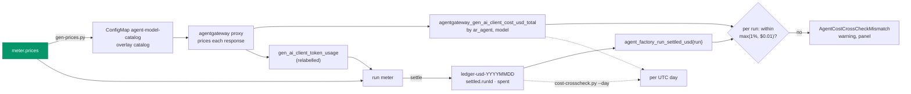

# Before v3: truthful costs B-2, the gateway's per-request cost as a cross-check

**Date:** 2026-10-27 · **Status:** approved 2026-10-27; the owner's answers to Q1–Q3 are
[recorded below](#owner-decisions-2026-10-27) · **Part of:** the [v3 roadmap](2026-10-19-v3-roadmap-design.md#before-v3-starts), truthful
costs; the B-2 half the [first part](2026-10-22-truthful-costs-design.md#not-in-this-design) left
out, research recommendations 3 and 4 only · **Research:**
[model pricing](2026-10-20-model-pricing-research.md#recommendations) · **Runtime:** the gateway
runtime prices each request; the factory's ledger is compared with it in VictoriaMetrics

Read against agent-platform `origin/main` at `481d11a` (`AP/`), agentgateway `v1.6.0` (`AGW/`),
this repository at `1699daf`.

## Outcome

Two independent computations of the same spend, from the same price table, are compared per run.
The gateway prices every response itself; the factory's ledger records what it charged. A run
whose two numbers differ by more than 1% raises a warning, and a panel shows both. Nothing is
enforced: the meter stays the USD authority (research, "Gateway USD in Kubernetes").

## What exists

| Piece | Where | Today |
|---|---|---|
| Gateway cost counter | `AGW/crates/agentgateway/src/telemetry/metrics.rs:431-436`, incremented at `log.rs:972-982` | **Exists at v1.6.0**: `gen_ai_client_cost`, unit `usd`, a counter of `llm.cost` total per response, exported as `agentgateway_gen_ai_client_cost_usd_total` ([gap matrix](2026-10-01-agentgateway-gap-matrix-research.md)). Labels `GenAILabels`: request and response model, provider, route and the custom `ar_agent` (`policy-frontend.yaml` adds `jwt.sub`). No token type. Nothing when the lookup is not `Exact` |
| Lookup counter | `metrics.rs:162-166, 491-495` | `agentgateway_cost_catalog_lookups_total{status, ar_agent, gen_ai_request_model, …}`: `Exact`, `Missing`, `Unpriced`, `NoCatalog` |
| Its catalog | `AgentgatewayParameters.spec.modelCatalog.sources[].configMap` (`AGW/controller/api/v1alpha1/agentgateway/agentgateway_parameters_types.go:213-233`) | **Not set** in `infrastructure/base/agent-gateway/parameters.yaml`: the built-in v1.6.0 catalog prices today, with no GLM, Sonnet 5.5's cache read at the stale $0.20 and no Haiku 5.5. The counter is wrong or absent for every model we run |
| Scrape | `infrastructure/base/agent-gateway/vmpodscrape.yaml` | Keeps the cost and lookup series under their `agentgateway_` names (only the token and duration families are renamed) |
| Z.ai backends | `infrastructure/base/agent-gateway/llm.yaml:40, 77` | `custom` provider, no `providerOverride`: catalog key `custom` (`agentgateway_backend_types.go:329-331`) |
| Ledger | `agent-factory-ledger-usd-<YYYYMMDD>` | `spent` per principal, `settled.<runId>` per run per day, micro-USD (TC6) |
| Ledger as metrics | `AP/internal/factory/fmetrics/fmetrics.go` | `agent_factory_budget_spent_usd{principal}`: the spent column as written. `agent_factory_charged_usd_total{principal,kind}`: added when a settle write succeeds, so a late-landing write (#166) is missing from it. `agent_factory_run_spend_usd{run,model}`: the meter's in-memory total, dropped 2 min after the run (`endSettle`, `meter.go:221`). **No per-run series reads the ledger** |
| Known ledger errors | [AP#166](https://github.com/Smana/agent-platform/issues/166), [AP#167](https://github.com/Smana/agent-platform/issues/167), open | #166: a settle write answered 504 that commits later is charged twice (over-count of one tick, window of milliseconds). #167: a lifted run's late spend is lost when a failover precedes its next write (under-count of a run's last reading; only runs first seen ended with nothing settled) |

## What it checks, and what it cannot

Both sides read tokens the gateway counted, so this does **not** check the provider's counts; that is
recommendation 6, reconciliation with Anthropic. It checks everything between the response and the
ledger: the price arithmetic (Rust catalog with its cache convention against the meter's `cost()`),
the token-type relabel the meter depends on (`input_cache_read` → `cached_input`; the gateway prices
before it), the meter's typed query, settlement, failover, midnight, and the ledger writes.

## Decisions

| # | Decision | Rejected | Why |
|---|---|---|---|
| XC1 | **The gateway's number is its own cost counter**, priced by an overlay catalog generated from `meter.prices` | The TC2 charge join (tokens × `llm_gateway:charge_usd_per_mtoken`); the built-in catalog | The join reads the same relabelled series and the same query shape as the meter: a relabel or token-type bug moves both sides. The built-in catalog is wrong for every model we run (above). The table stays the only place a price is edited (TC1) |
| XC2 | **`gen-prices.py` renders the overlay** as ConfigMap `agent-model-catalog` (`catalog.json`, `agent-gateway` namespace): Anthropic rows under `anthropic`, GLM rows under `zai` (both Z.ai backends set `providerOverride: zai`, Q3), `input`/`output`/`cacheRead`/`cacheWrite`, absent `cacheWrite` absent. The drift suite covers it | A hand-kept catalog; GLM under the inferred `custom` key | TC3's pattern: one generator, one suite. `zai` is agentgateway's own provider name, maintained upstream, where `custom` is a catch-all (Q3). The override renames `gen_ai_provider_name` on every Z.ai series: PR 1 moves every rule, panel and test that reads `custom` |
| XC3 | **Grain: per run, alerted; per UTC day, by script and panel.** Per run: the gateway's `increase_pure` over the run's life by `ar_agent` against the ledger's `settled` sum for that run. Per day: the gateway's increase over the UTC day (`@` the day's end) against the sum of that day's `spent` column | Per request (the ledger has no request); per day alerted | A run is the unit the meter charges and the ledger keys. A rule cannot express "since UTC midnight"; the script can, with `@` |
| XC4 | **Agreement: `abs(ledger − gateway) ≤ max(1% × gateway, $0.01)`** per run, `max(1%, $0.10)` per day | 0 tolerance; 2% | 1% is recommendation 4. The floor absorbs micro-USD rounding per tick and the last reading of a short run. Scrape loss of a dying proxy pod hits both sides alike: the meter reads the same pods |
| XC5 | **The ledger side is a new gauge read from the ledger**, `agent_factory_run_settled_usd{run}`: the sum of the run's `settled` entries, taken from the object each settle write returned and from `learn`'s read, never from the meter's account. Kept 1 h after the run ends | `agent_factory_run_spend_usd` (memory); `agent_factory_charged_usd_total` (success-only) | Either would hide #166: the meter's memory and the success counter hold one charge where the ledger holds two. 1 h outlives the alert's `for` |
| XC6 | **A mismatch warns, nothing more.** `AgentCostCrossCheckMismatch` (warning, `for: 15m`) on runs whose gateway cost has not moved for 10 min; `AgentGatewayCostUnpriced` when a run's request is looked up other than `Exact`. Panels on the `agent-run` (per run) and `agent-factory` (24 h) dashboards. A runbook names #166, #167 and the overlay as the first suspects | Revoking a run; gating admission | Charging after the call is the norm and the meter is the authority; a disagreement needs a human to say which side is wrong |
| XC7 | **Scope: runs whose every token series is on agentgateway** (`namespace="agent-gateway"`). A run with an Envoy series is left out and counted in a panel | Comparing them anyway | Envoy's router exports no per-request cost: such a run would always mismatch |
| XC8 | **#166 is fixed in PR 2; #167 stays open.** #166's double charge is already reproduced offline (`TestReviewParked1LateCommit`), so its fix is proven the same way; the cross-check then watches for anything else. #167 cannot occur on a rebuilt cluster | Waiting for the alert to show #166 (the draft's order) | Q2: the double charge can be simulated offline, so evidence does not need to wait for a live 504 |

## #166 and #167: fix first?

No. Neither makes the cross-check noisy: each fires only on its own rare condition, and when it fires
the alert is right, the ledger really is off. #166 needs a 504 that commits within milliseconds of
the next tick's read; its issue defers it on rarity, and the cross-check is the measurement that
claim lacks. #167 needs a run first seen ended with nothing settled, then a failover before its next
write: on a cluster rebuilt from scratch no such run exists, and pruned days are 35 days old.
**Superseded by Q2 (2026-10-27):** #166 is fixed in PR 2, red first on its late-commit test, and
the gauge test shows 1× after the fix (2× before). #167 is fixed when a lifted run is seen at all.

## Where the numbers flow

## Interfaces

| Thing | Shape |
|---|---|
| `agent-model-catalog` | `{"providers": {"anthropic": {"models": {"claude-opus-5-5": {"rates": {"input": "4.00", "output": "20.00", "cacheRead": "0.20", "cacheWrite": "5.00"}}}}, "zai": {"models": {"glm-5.3": {"rates": {…}}}}}}`; strings, USD per M, exactly the table's values |
| `parameters.yaml` | `spec.modelCatalog.sources: [{configMap: {name: agent-model-catalog}}]`; same namespace as the Gateway |
| Access log | `policy-frontend.yaml` `accessLog.attributes.add: {name: cost, expression: flatten(llm.cost)}`, to trace a mismatch to a request |
| `agent_cost:gateway_run_usd` | `sum by (run) (label_replace(increase_pure(agentgateway_gen_ai_client_cost_usd_total{ar_agent=~"system:serviceaccount:agents:xplane-run-.+"}[6h]), "run", …, "ar_agent", ".*xplane-run-(.+)"))`; 6 h outlasts the longest run cap. The capture group needs postBuild escaping (vmpodscrape's note) |
| `agent_factory_run_settled_usd{run}` | gauge, USD, the run's ledger total (XC5); `run` a C2 id |
| Alert | `abs(settled − gateway) > clamp_min(0.01 × gateway, 0.01)`, `and on(run) changes(gateway[10m]) == 0`, `unless on(run)` an Envoy series; also `gateway unless on(run) settled` once the run has ended (spend the ledger never saw) |
| `scripts/ops/cost-crosscheck.py --day YYYYMMDD` | Reads the day's ledger via `kubectl` and VM's query API; prints per principal and total, ledger, gateway, diff; exit 1 outside XC4. Its comparison is a function tested on fixtures |

## Pull requests, in order

| # | Repository | Content | Proof | Depends on |
|---|---|---|---|---|
| 1 | ai-native-ref | `gen-prices.py` renders `agent-model-catalog`; the drift suite covers it; `parameters.yaml` references it; the access-log `cost`; the wire test asserts the gateway's cost; `cost-crosscheck.py` and its fixtures | Offline 1-4 | Nothing |
| 2 | agent-platform | `agent_factory_run_settled_usd{run}` from the ledger (XC5); #166's fix (XC8); then a release | Offline 5-6 | Nothing |
| 3 | ai-native-ref | Pin that release; the `agent-cost-crosscheck` VMRule group (record, two alerts); both panels; a runbook section with the suspects | Offline 7-8 | PR 2 released |
| — | gcp-0 | One live session, after PR 3 (D4) | Live 1-4 | PR 3, the rebuild |

## Gate

**Offline proofs**

1. The drift suite fails a hand edit to `catalog.json` or a `meter.prices` row added without `--write`;
   the generator's tests: six rows, GLM under `zai`, no `cacheWrite` for GLM.
2. The cache wire test, on the pinned agentgateway against its fake Anthropic, reads
   `agentgateway_gen_ai_client_cost_usd_total` = 0.00103 for the measured reply (1050 in, 900 read,
   50 written, 10 out on Opus), streamed and not, and `cost_catalog_lookups_total{status="Exact"}`.
   A fake Z.ai reply through a backend with `providerOverride: zai` reads `Exact` too: the override key is proven offline. PR 1 first checks that agentgateway v1.6.0 accepts `zai` as a `providerOverride` and looks the catalog up under it; if it does not, the rows stay under `custom` and the PR says why.
3. `cost-crosscheck.py`'s tests: agreement, a 2% gap, the $0.10 floor, a principal on one side only.
4. `task check` is green.
5. agent-platform: the gauge equals the sum of the run's `settled` entries across days; a failover
   keeps it; `TestReviewParked1LateCommit`'s sequence leaves it at 2.80 (the ledger), not 1.40.
6. It leaves 1 h after the run ends; only C2 run ids are exported.
7. promtool, the fake gateway as synthetic series: an agreeing run is silent; 1.5% off fires after
   15 m; a $0.005 gap on a $0.20 run is silent; a run still spending is silent; an Envoy run is
   silent; gateway cost with no ledger series fires; a `Missing` lookup fires `AgentGatewayCostUnpriced`.
8. The pins suite and the alert-annotation suite pass.

**Live proofs** (gcp-0, one session)

1. `cost_catalog_lookups_total` shows only `Exact` for the six models after a run on each backend.
2. A finished internal and a public run: gateway and `agent_factory_run_settled_usd` within XC4;
   no alert.
3. `cost-crosscheck.py --day` on the session's day is within XC4.
4. The drill: in `agent-model-catalog`, Opus `output` doubled in place under a suspended
   Kustomization (runbook 04, Part F's method); the next Opus run fires
   `AgentCostCrossCheckMismatch` within 30 min; the row is put back.

## Owner decisions 2026-10-27

Q1: the warning route, no page. Q2: the double charge is simulated offline by its late-commit
test, so #166 is fixed in PR 2. Q3: `providerOverride: zai`, agentgateway's maintained provider
name, over the catch-all `custom`.

Q3 verified in PR 1 against agentgateway `v1.6.0` (2026-10-27): `AgentgatewayBackend` `spec.ai.provider.custom.providerOverride`
is accepted (`CustomProviderSettings`, `agentgateway_backend_types.go:329-331`, "Provider identity used for
cost-catalog lookup and telemetry"); `AIProvider::provider()` returns it (`llm/mod.rs`, `AIProvider::Custom`), the
request's provider is that value, and `ModelCatalog::project` resolves `(provider, model)` with it
(`llm/catalog/mod.rs:152-170`). The built-in catalog has no `zai` provider, so the overlay's rows are the only ones. The wire
test reads `Exact` and the expected cost for a Z.ai reply under `gen_ai_system="zai"`.

## The questions as asked

| # | Question | Default if unanswered |
|---|---|---|
| Q1 | Where the alert goes: the factory's warning route, or panel only until a month shows it quiet? | Warning route, no page |
| Q2 | Bundle #166's fix (its candidate fix is written) into PR 2 instead of waiting for the alert to show it? | Wait: evidence first (XC8) |
| Q3 | GLM rows under the inferred `custom` key, or `providerOverride: zai` on both Z.ai backends? | `custom`: no label changes; offline proof 2 shows `Exact` |

## Not in this design

Reconciliation with Anthropic's usage and cost API and Z.ai by hand (recommendation 6): the only
check of the provider's own counts. A daily alert (the script and panel cover the day). Enforcement
from the gateway's cost, and agentgateway's USD budgets. Envoy's router. Recommendations 7 and 8.
Price tiers and columns the table lacks. Historic cost. The fixes to #166 and #167.

## Left to the builder

The gauge's Go names and how it is fed from `settle` and `learn`; the record's window if a cap
outgrows 6 h; the panels' layout; the runbook's number; whether the fake Z.ai reply extends the
cache wire test or gets its own; the exact series name, confirmed on the wire test's scrape.
