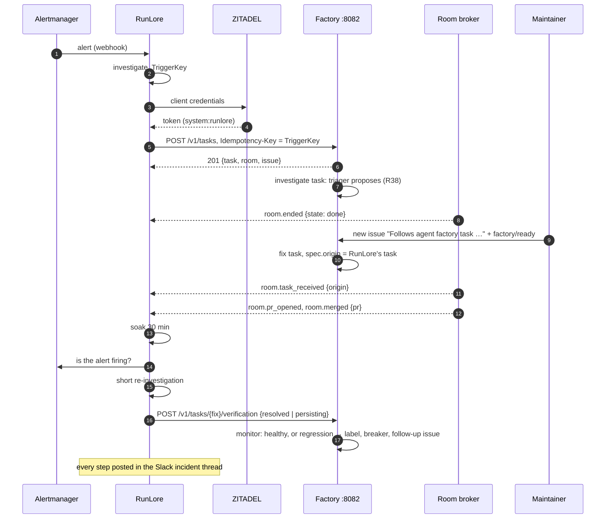

# v3 feature 14: agent-to-agent work with RunLore

**Date:** 2026-10-27 · **Status:** design approved by the owner 2026-10-27 ("yes, go with your
recommendation"); RA9 and RA10 were settled while writing this spec, on a fact the approval did not
have ([below](#what-the-approval-did-not-have)), and await the owner's confirmation · **Part of:** the
[v3 roadmap](2026-10-19-v3-roadmap-design.md#the-features), as feature 14 by owner decision
[D8](2026-10-19-v3-roadmap-design.md#owner-decisions-2026-10-27). It extends feature 9's
[factory interfaces](2026-10-21-factory-interfaces-design.md) and the post-merge monitor of
[more auto-merge classes](2026-10-22-merge-gate-classes-design.md)

Read against RunLore `origin/main` at `f340b4e1` (`RL/`), agent-platform `origin/main` at `2c4bae7`
(`AP/`), cloud-native-ref `origin/main` at `b85b28eb` (`CNR/`), this repository at `05ee385`.

## Outcome

RunLore and the factory work as two agents on one incident, through the factory's standard
interfaces. RunLore detects an incident and hands it to the factory as an ordinary client. It
follows the work through signed webhooks and posts each step in its Slack incident thread. Once the
fix is merged, it checks whether the incident is gone and tells the factory. A fix that did not hold
counts against its class like any other regression. Two stages, in order (D8): **B**, RunLore as a
standard client; then **A**, RunLore verifies the fix.

## What exists

| Piece | Today | Where |
|---|---|---|
| RunLore → factory | One way. The generic templated notifier POSTs each finding with a static bearer to `…/intake/runlore` on `:8080`, reads only the status, and never learns the task, room, PR or merge | `RL/internal/notify/templated/templated.go:43-49, 104-119`; template in `observability/base/runlore-factory/helm-values-configmap.yaml:22-30` |
| `/intake/runlore` | Gates: verdict `action_required` or `action_suggested` at confidence ≥ 0.75, 5 tasks a day. Dedup key `runlore:<alert>:<resource_ref>` while a task is open, a new generation after. An `internal` Task (`requestedBy: system:runlore`, `trust: untrusted`), then a public issue labelled `factory/proposed` naming the alert, resource and room, never the finding | `AP/internal/factory/intake/runlore.go:159-262`, `AP/internal/factory/taskid/taskid.go:45`; config `tooling/base/agent-factory/helm-values-configmap.yaml:258-263` |
| The `investigate` template | `{roles: [triager]}`: the triager confirms the finding read-only and proposes a public issue text. The task ends `Done`. A maintainer opens a new issue with the text they approve and labels it `factory/ready` (R38); that new task writes the fix | `AP/internal/factory/triage/classify.go:27-28`, `AP/internal/factory/reconciler/text.go:178`, `AP/internal/factory/narrate/narrate.go:312-318` |
| Sponsored principals (feature 9) | ZITADEL machine users in `api.sponsored` {`name`, `clientIDFile`, `sponsor`, `repositories`, `dailyUSD`, `maxCostUSD`, `maxOpenTasks`, `onBehalfOf`}. `POST /v1/tasks` on `:8082` with `Idempotency-Key`, `maxCostUSD` mandatory, `dataClass: public` only, charged to `system:<name>`. The name `runlore` is reserved | `AP/docs/factory.md` "Sponsored principals", `AP/docs/api.md` "POST /v1/tasks" |
| Webhooks (feature 9) | The broker's `webhooks` subscribers: Standard Webhooks, HMAC-SHA256, id-only payloads (`room.pr_opened {pr}`, `room.merged {pr}`, `room.ended {state}`, `room.waiting_for_human {reason}`, …), filtered by event and repository, never by principal | `AP/docs/api.md` "Webhooks", `AP/docs/operations.md` "Webhooks"; egress from `scripts/ci/gen-webhook-egress.py` |
| Post-merge monitor | Per class that declares `monitor`: main's CI, the detector (an oracle workflow's `findings.json`), Flux, follow-ups. Verdict `healthy`, `regression` or `inconclusive`; `factory/monitor:regression`; the breaker pauses the class (`class_paused`) on reverts, and with `maxFollowUps` set on regressions and follow-ups. No signal comes from an agent | `AP/internal/factory/reconciler/monitor.go:266-325`, `AP/docs/factory.md` "The post-merge monitor" |
| RunLore | `TriggerKey = curator.IncidentKey(alertname, workload, cluster)` on every alert; its ledger is `outcome.Ledger`; a Slack thread per incident. No factory client, no "investigate X" API, no inbound webhook from the factory. It queries VictoriaMetrics, not Alertmanager. GLM-5.2 on Z.ai with its own key | `RL/internal/curator/fingerprint.go:96`, `RL/internal/source/alertmanager/alertmanager.go:137`, `RL/internal/metrics/prometheus/prometheus.go:123` |
| Network | The factory's CNP admits RunLore on `:8080`. RunLore's `extraEgress` opens only `observability` on 8428/9428 and Hubble Relay: **no rule to `agent-system`**, so the notifier may be dropped today. Its ingress admits only `observability` | `tooling/base/agent-factory/network-policy.yaml:32-37`; `observability/base/runlore/helmrelease.yaml:335-368` |

### What the approval did not have

RunLore's own task never opens a pull request. It runs the `investigate` template, a lone triager
that proposes and never writes (R38), and ends `Done`. The fix is a **second task**, started by a
maintainer's new issue. So `room.pr_opened` and `room.merged` never fire for RunLore's room: the
loop needs a link from the fix's task back to RunLore's. RA9 and RA10 add it; R38 is unchanged.

## Decisions

| # | Decision | Rejected | Why |
|---|---|---|---|
| RA1 | **Two stages, B then A** (D8). B makes RunLore a standard client and retires `/intake/runlore`; A adds the verdict | A first; both at once | A needs B's task, room and merge events. B alone is useful: the incident thread shows the work |
| RA2 | **RunLore is an internal principal**: a ZITADEL machine identity in a new `api.internalPrincipals` list, allowed `dataClass: internal`. Sponsored principals stay public-only | Letting a sponsored principal ask for `internal` (loosening feature 9's rule) | The owner's choice. A sponsored principal is any machine a maintainer vouches for, and its text can be anything; internal data is a property of one known caller, declared beside it. One explicit list is easier to audit than a flag on every sponsored entry |
| RA3 | **It keeps a sponsor (Smana), `maxCostUSD`, `dailyUSD`, and today's gates in the factory**: `minConfidence: 0.75`, `dailyTasks: 5` | Moving the gates into RunLore | The factory is the boundary that holds the caps today; a client-side gate is a promise |
| RA4 | **Its tasks take the `investigate` template**, forced by the principal, never by the body | A class or template in the request | R38 holds: internal alert text reaches a public implementer only through a maintainer |
| RA5 | **`Idempotency-Key` is the incident's `TriggerKey`.** For an internal principal the factory keeps today's dedup: a duplicate while a task of that key is open, a new generation once it ended | `api:<name>:<key>` forever (feature 9's rule) | The same incident firing again next week is new work, as it is today |
| RA6 | **The public issue is today's stub**, from `incident` identifiers transposed to the label charset; `title` is refused | The sponsored path's titled issue | The finding is internal (R33): the issue names the alert, resource and room, never the text |
| RA7 | **RunLore follows its tasks through the broker's webhooks**, as a `cluster` subscriber of the repository, and drops rooms its ledger does not know | A filter by principal in the broker; polling `/mcp` | Webhooks exist, are signed and id-only; a principal filter is a broker change for one caller |
| RA8 | **`/intake/runlore` is retired** once stage 1's live proofs pass | Keeping both paths | Two intakes for one caller are two sets of gates to keep in step |
| RA9 | **The fix's task records its origin.** The proposal comment asks the maintainer to keep a `Follows agent factory task <name>.` line in the new issue. A `factory/ready` issue whose line names an `investigate` task of the same repository that made a proposal gets `spec.origin: <name>`; any other line is ignored | Dropping R38 for RunLore; RunLore matching PRs by text | Keeps R38. The line is public and spoofable, but only a maintainer's label starts the task, and a wrong origin only makes RunLore check an unrelated merge |
| RA10 | **`room.task_received` gains `origin`**, the origin task's room, an id like the others | A new event type | RunLore learns the fix's room from the event it already receives, then follows it like its own |
| RA11 | **The verdict is a new monitor signal, `verification`**, declared per class: `resolved` is healthy, `persisting` a regression, no verdict within `within` is `inconclusive` | A RunLore-only label; a revert on `persisting` | It feeds the existing breaker, labels and narration. The monitor never reverts; a revert stays main-red's |
| RA12 | **On `persisting`, the factory opens a follow-up**: a public stub issue labelled `factory/proposed`, naming the merged PR, the alert and the origin room, never the evidence | A new `investigate` task at once | No spend the incident's owner did not decide; RunLore's own next detection of the key starts the next generation |
| RA13 | **The evidence stays internal**: stored on the origin room, which is `internal`. The PR comment carries the verdict, the alert name and the room link | Evidence in the PR comment | The fix's room and PR are public |
| RA14 | **The soak is RunLore's** (default 30 min), persisted in its ledger, run by the leader | A factory-side timer calling RunLore | RunLore has no inbound API to call, and the soak is its judgement of its own alert |

## Interfaces

**`api.internalPrincipals`** (factory config), a list. Each entry:

| Key | Holds |
|---|---|
| `name` | A DNS label; the principal is `system:<name>`. May be `runlore` (reserved for sponsored only); unique across `api.sponsored` and `api.systemPrincipals` values |
| `clientIDFile` | The ZITADEL machine client's id, read at each use; never a sponsored entry's, the web UI's or `roomctl`'s |
| `sponsor`, `repositories`, `dailyUSD`, `maxCostUSD`, `maxOpenTasks` | As `api.sponsored` |
| `minConfidence` | (0, 1]: below it the request is answered `202 {accepted: false, reason: below_threshold}` and creates nothing |
| `dailyTasks` | Tasks created per UTC day; past it `429 principal_daily_tasks` |
| `verification` | `true` admits the verification endpoint for this principal; default `false` |

Ours: `{name: runlore, sponsor: Smana, repositories: [Smana/cloud-native-ref], dailyUSD: 10, maxCostUSD: 2, maxOpenTasks: 3, minConfidence: 0.75, dailyTasks: 5, verification: true}`; the dollar values are the builder's to confirm against today's investigate costs.

**`POST /v1/tasks`**, from an internal principal: the sponsored body, with `dataClass: internal` only,
`title` and `onBehalfOf` refused (`title_not_allowed`, `on_behalf_of_not_allowed`), and a required
`incident: {alert, resource, severity, cluster, verdict, confidence}`. `Idempotency-Key` is the
`TriggerKey` (its SHA-256 hex past 255 bytes). `201 {task, room, issue}`; `200 {task, room, issue,
duplicate: true}` while a task of the key is open; `202` below threshold; `429 principal_daily_tasks`;
the sponsored errors otherwise.

**`POST /v1/tasks/{task}/verification`**, on `:8082`, internal principals with `verification: true`.

| | |
|---|---|
| Body | `{verdict: "resolved" \| "persisting", alert: {name, firingAtMerge: bool, firingNow: bool}, checkedAt: RFC 3339, evidence: text}`; evidence at most 16 KiB, redacted, stored on the origin room; at most 32 KiB; unknown fields refused |
| Own tasks only | `{task}` is `Merged` and its `spec.origin` names a task whose `requestedBy` is the caller |
| `201` | `{task, verdict, recordedAt}`; written to `status.monitor.verification` |
| `200` | The same verdict again: `{…, duplicate: true}` |
| `400` | `bad_json`, `bad_verdict`, `bad_evidence` |
| `401`, `403` | `unauthenticated`; `not_permitted`, `verification_not_allowed`, `not_own_task` |
| `404` | `no_such_task` |
| `409` | `not_merged`, `verdict_already_recorded` (a different verdict), `window_closed` (past the class's `within`) |
| `503` | `tasks_unavailable` |

**The monitor signal**, `classes.<class>.monitor.verification: {within: 2h}`:

| Signal | Reads | Regression | Healthy |
|---|---|---|---|
| Verification | `status.monitor.verification` of a merge whose task has an origin from an internal principal | `persisting` | `resolved`. None within `within` of the merge: `inconclusive`. A task with no such origin has no signal |

`agent_factory_monitor_verifications_total{class,verdict}` counts each verdict once.

**RunLore** gains `factory: {url, tokenURL, clientIDFile, clientSecretFile, audience, maxCostUSD,
webhook: {listen, secretFile}, soak: 30m}` and `alertmanager: {url}`. Its ledger records per
`TriggerKey`: task, room, issue, fix room, PR, the outcomes and the verdict.

## The closed loop

## Pull requests, in order

| # | Repository | Content | Proof | Depends on |
|---|---|---|---|---|
| 1 | agent-platform | `api.internalPrincipals`; `POST /v1/tasks` for them (RA3–RA6); `spec.origin` (RA9) and the proposal text; `origin` on `room.task_received` (RA10); a release | Offline 1, 3 | nothing |
| 2 | RunLore | The factory client: token, `POST /v1/tasks`, ledger fields; the webhook receiver (verify, ±5 min, dedup on `webhook-id`, persisted); the Slack thread posts; the templated notifier stays until PR 7 | Offline 1, 2 | nothing |
| 3 | cloud-native-ref | **After live 1 shows the drop**: RunLore egress to `agent-system` factory `:8082` and `observability` Alertmanager `:9093`; RunLore ingress from the room broker on its webhook port | the host's CI | live 1 |
| 4 | ai-native-ref | Pin both releases; the `runlore` internal principal and its ZITADEL client; the broker's `runlore` subscriber and its generated egress; the factory CNP admits RunLore on `:8082`; RunLore's `factory` values | `task check` | 1, 2, 3 |
| — | gcp-0 | Stage 1 live session | Live 1-3 | 4 |
| 5 | agent-platform | The verification endpoint; the `verification` signal; the follow-up issue (RA12); a release | Offline 4, 5 | 1 |
| 6 | RunLore | Soak, Alertmanager check, re-investigation, verdict post | Offline 6 | 2 |
| 7 | ai-native-ref | Pin both; `verification: true`; a class for the seeded fix (e.g. `alert-rules`) with `monitor.verification` and `maxFollowUps: 1`; retire `/intake/runlore` (its config, ExternalSecret, CNP rule, notifier template) | `task check` | 5, 6, stage 1 live |
| 8 | agent-platform | Remove `/intake/runlore` and `runlore.*` config | Offline | 7 |
| — | gcp-0 | Stage 2 live session | Live 4-5 | 7 |

## Gate

**Offline proofs**

1. RunLore's client against a fake factory: token refresh, `201`, `200 duplicate`, `202`, `429`, a
   `503` retried with the same key; the ledger holds task, room, issue.
2. RunLore's receiver: a good signature passes; a wrong key, a body changed by one byte, a timestamp
   6 min old or ahead, and a replayed `webhook-id` are refused or dropped; a room it does not know
   is acknowledged and ignored; `origin` adopts the fix's room.
3. The factory: an internal principal gets `internal` and `investigate`; a sponsored one asking
   `internal` is still `400 bad_data_class`; `title` refused; the gates at 0.74 and the sixth task;
   a new generation after `Done`; `origin` set only from an `investigate` task with a proposal.
4. The verification endpoint's authz: own fix task `201`; another principal's, a task with no
   origin, a sponsored caller, `verification: false`, a task not merged, a second different
   verdict, past `within`: each its code.
5. The monitor's decision tables: `resolved` with every other signal healthy is `healthy`;
   `persisting` is `regression` posted at once, `factory/monitor:regression`, the follow-up issue
   with no evidence, and with `maxFollowUps: 1` the class `class_paused`; no verdict by `within` is
   `inconclusive`; a merge with no origin has no verification signal.
6. RunLore's soak survives a leader change; Alertmanager unreachable posts nothing.
7. `task check` is green.

**Live proofs** (gcp-0)

1. Before PR 3: from a RunLore pod, a request to the factory is dropped (Hubble names the policy).
   After it: answered.
2. A seeded incident (a deliberately broken alerting rule) goes RunLore → `POST /v1/tasks` → task,
   room and stub issue; a replay is a duplicate; each webhook lands in the Slack thread.
3. `/intake/runlore` is no longer called (its counter flat for the session).
4. The same incident, end to end: proposal, the maintainer's issue with its `Follows` line, the fix
   merged, the soak, verdict `resolved`, the monitor `healthy`.
5. A second seeded case whose fix does not hold: verdict `persisting`, the PR labelled, the
   follow-up issue, the class `class_paused`.

## Not in this design

An A2A agent card or an "investigate X" API on RunLore. RunLore's model behind agentgateway (SP4,
planned separately). Other internal principals. A revert on `persisting`. Verifying fixes RunLore
did not originate. A principal filter on webhook subscribers. Charging the fix task to RunLore: it
is the labelling maintainer's, as any label-started task.

## Owner decisions

D8, 2026-10-27: feature 14, stages B then A, RunLore as an internal principal over loosening the
sponsored rule (RA2), the rest as recommended. To confirm: RA9 (the `Follows` line) and RA10
(`origin` on `room.task_received`), settled while writing this spec.

## Left to the builder

The Go names; the dollar values in our entry; the webhook port and path on RunLore; whether the
Alertmanager check matches the workload labels or only `alertname` and `cluster`; the class name for
the seeded fix; the re-investigation's step and cost bound.
