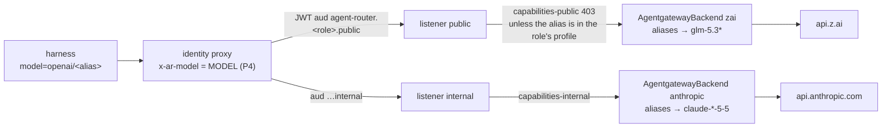

# v3 feature 15: Moonshot and Mistral as selectable providers, public data only

**Date:** 2026-10-28 · **Status:** draft for the owner; decisions taken by the owner on 2026-10-28
are [D9](2026-10-19-v3-roadmap-design.md#owner-decisions-2026-10-28) · **Part of:** the
[v3 roadmap](2026-10-19-v3-roadmap-design.md), feature 15 · **Plan:**
[2026-10-28-moonshot-mistral-providers-plan.md](../plans/2026-10-28-moonshot-mistral-providers-plan.md)

This design was checked against this repository at `6cc5f7d`, agent-platform `origin/main` at
`7ee45a1`, crossplane-configuration `origin/main`, and agentgateway `v1.6.0` as `parameters.yaml`
pins it. Provider facts were read on 2026-10-28; anything marked **unverified** comes from a
third-party page and must be confirmed before its row is merged ([plan](../plans/2026-10-28-moonshot-mistral-providers-plan.md), Task 0).

## Outcome

A public class can run a role on Moonshot's Kimi or on Mistral by setting one config value, with no
change to any default. The gateway routes the run to the provider its pinned alias names. The meter
prices the run at that provider's list price, cache reads included. No internal call can reach
either provider.

Owner decisions, 2026-10-28 (D9):

- **Selectable providers.** The gateway gets the routes, the prices and one alias per tier. A
  class or role picks an alias by config. Every default stays `agent-default`, which is GLM-5.3 on
  `public` and Claude Opus 5.5 on `internal`.
- **Public data only.** Both are new processors, so they serve public repositories and public tasks
  only, until the owner approves them for internal data.

D9 is the approval that feature 7's text asked for ("another open family only through a second
processor the owner approves"). It approves the processors, not the bake-off: the bake-off stays in
Later with the bench (D6).

## How providers work today



| Piece | Where | What it does |
|---|---|---|
| Aliases | `infrastructure/base/agent-gateway/llm.yaml`, `anthropic.yaml` | Four names, `agent-default` and `tier-{light,standard,frontier}`. Each backend maps them to its own models. A `model` transformation takes `x-ar-model`, or else the body's model, and nulls any other name, which 1.6 answers 400 |
| Data class | The listener (`public` / `internal`) and gate AG5 | Z.ai is reachable from `public` only and Anthropic from `internal` only (ADR-0054). A run's data class picks its listener through its token's audience |
| Per-role allow-list (P2) | `profiles/<role>.<class>.yaml` → `gen-capabilities.py` → `policy-capabilities.yaml` | `jwt.aud` → the allowed aliases, answering 403 |
| Per-run pin (P4) | `infrastructure/base/agent-runtime/identity-proxy-configmap.yaml` | The sidecar sets `x-ar-model` from `MODEL` on `/v1` and from `JUDGE_MODEL` on `/judge/v1`, and overwrites any value the client set. Proven live: the drill D judge reached `glm-5.3-flash` through it |
| Where the factory picks an alias | agent-platform `internal/factory/config/config.go` | `tiers.<t>.model`, `templates.<t>.reviewerModel` and `loops.<class>.judge`. All three are checked against `models()`, the four names. The Task and AgentRun CRDs and the AgentRun XRD (crossplane-configuration `apis/agentrun/definition.yaml`) enumerate the same four names |
| Prices | `meter.prices` in `tooling/base/agent-factory/helm-values-configmap.yaml` | The one price table. `gen-prices.py` renders the VictoriaMetrics price rule and `agent-model-catalog`, keyed by the provider (`PROVIDERS` maps name prefixes to providers). The B1, B2 and B6 cost strings in `policy-budgets.yaml` are regenerated by AG8, and `check-price-drift.py` compares each row with three public catalogs nightly |
| Meter | `meter.query` groups by `gen_ai_request_model` | Each run is priced by the model the alias resolved to. A model with no row is never free: the run falls back to its token caps, and `AgentModelUnpriced` fires (AG10) |
| Keys | OpenBao mount `agents`, read by SecretStore `agents-secrets` | `agents/zai` and `agents/anthropic`, field `api_key`, seeded by the owner (runbook 14 §5). The host policy `agents-secrets.hcl` already allows `agents/data/*` |
| Egress | `infrastructure/base/agent-gateway/network-policy.yaml` | `toFQDNs` `api.z.ai`, `api.anthropic.com` (and `github.com`) from the data plane only. Run pods reach the gateway, never a provider |

## Design

### F1. One backend per provider, routed by the pinned alias

There are two new `AgentgatewayBackend`s in `agent-system`. Each uses the custom provider and Chat
Completions only, as Z.ai's backend does (1.6 keeps `openai` for the OpenAI API):

| Backend | Host and path | `providerOverride` | Key Secret |
|---|---|---|---|
| `moonshot` | `api.moonshot.ai`, `/v1/chat/completions` | `moonshot` | `agents-moonshot-api-key` |
| `mistral` | `api.mistral.ai`, `/v1/chat/completions` | `mistral` | `agents-mistral-api-key` |

Routing. The `public` listener's HTTPRoute `agentgateway-models` gains two rules on the
`PathPrefix /v1` match, each with a header match `x-ar-model` `Exact` for each of its aliases. The
existing `openai` rule keeps everything else. Gateway API ranks a rule with header matches above one
without them on the same path, so the existing rule needs no change.

- **Body only.** A call that names a provider alias in its body only (no pin) still reaches Z.ai. There,
  the `model` transformation nulls the name and the call is refused 400. It never reaches a model.
- **Messages.** `/anthropic` (Messages) is not routed to either backend. A Messages call that names a
  provider alias meets Z.ai's transformation the same way. The harness speaks Chat Completions.
- **The judge.** `/judge/v1` reaches the gateway as `/v1` with the judge's alias in `x-ar-model`, so
  a class can put its judge on `mistral-light` too.

Why a header match and not one backend with every model. agentgateway 1.6 maps a name to one
provider per backend (AG12), and it has no body-based route match. The pin is already the trusted
path (P4).

### F2. Aliases per tier

Each alias names its provider and its tier, and serves that tier only:

| Alias | Model (pinned, dated id) | Tier it serves | Weights | Context |
|---|---|---|---|---|
| `kimi-frontier` | `kimi-k3.1-pro` | frontier | Due 2026-11-04, license not yet announced (**unverified**; see Q1) | 1M |
| `mistral-standard` | `mistral-medium-2604` (Mistral Medium 3.5; id **unverified**) | standard | Open, Modified MIT (Mistral's model card) | 256K |
| `mistral-light` | `mistral-small-2603` (Mistral Small 4; id **unverified**) | light | Open, Apache 2.0 (Mistral's models overview) | not verified |

Why one tier per alias. The run caps stay the tier's, and AG8's per-replica local limit (40M
raw tokens an hour) must stay above a run's cap spent entirely on cache reads. With a run's cap
`runUSD` and the alias's cache-read rate `cacheRead`, the check is `runUSD / cacheRead` million
tokens, which must stay at or under 40M:

| Alias | Tier cap | Cache read | Tokens at the cap | Under 40M? |
|---|---|---|---|---|
| `kimi-frontier` | $6.80 | $0.20 | 34.0M | Yes |
| `mistral-standard` | $2.55 | $0.15 | 17.0M | Yes |
| `mistral-light` | $0.51 | $0.015 | 34.0M | Yes |

`mistral-standard` on frontier would be 45.3M, and `mistral-light` on standard would be 170M:
either would let the local limit refuse a run before the meter does. A provider alias on another
tier is therefore refused at config load, rather than fixed by raising the limit.

**Left out, and why:**

- **The Kimi K2 series.** Closed to new users from 2026-10-31 and retired by the end of December
  2026 (Moonshot's pricing page).
- **Codestral and Mistral Large 4.** Closed weights: Codestral is "Premier", and Large 4's weights are
  reported as unpublished (**unverified**). D2 keeps public work on open weights.
- **Devstral 2 (`devstral-2512`).** Retired 2026-07-31. Mistral names Medium 3.5 as its successor.
- **Mistral Large 3.** Superseded, and its current price is contested.
- **A light or standard Kimi alias.** The K3 series has no smaller model.

### F3. A class picks an alias per role and tier

agent-platform adds one key to a `loops` row, and it applies to **public tasks only**:

```yaml
loops:
  docs: {scope: scoper, …, models: {implementer: {standard: mistral-standard, frontier: kimi-frontier}}}
```

- **Mapping.** `models.<role>.<tier>` is the alias that role runs on for a public task of that tier.
  A role or tier without an entry keeps today's model: the tier's `model`, or `reviewerModel` for
  the reviewer.
- **Internal tasks.** An internal task of the class ignores the key and keeps its tier's model. The
  run's provenance records which source chose the model.
- **Config validation.** Loading refuses a key it cannot honour: an alias outside the provider
  aliases, a tier other than the alias's own, a role outside the four, or a model with no
  `meter.prices` row behind it.
- **The judge.** `loops.<class>.judge` may also name `mistral-light`: it is already an alias field.
- **This is L8's per-class override, cut to what D9 needs.** It is keyed by role and tier rather
  than by role alone, and it leaves the top-level `roles.<dataClass>.<role>` out. It needs no bench:
  every class row is off by default (D4), and switching a row on for a live proof is the owner's call.

### F4. The data-class gate, public only, held three times

1. **The gateway.** Only the `public` listener routes to `moonshot` and `mistral`. AG5's
   `PROVIDER_LISTENERS` gains `Moonshot: {public}` and `Mistral: {public}`, so a route from
   `internal` fails the bundle.
2. **The profiles.** Only the `*.public.yaml` profiles may list a provider alias.
   `gen-capabilities.py` refuses one in an internal profile. AG14 checks that every internal
   alternative lists only names the internal backend serves.
3. **The factory.** It applies `models` to public tasks only (F3). An internal run that named a
   provider alias anyway would be refused 403 by `capabilities-internal`, and the alias is not on
   the `anthropic` backend.

Each public profile, for the implementer, reviewer, tester and triager, lists the three aliases.
P2 still binds the role, and adding them changes no default.

### F5. Prices in the catalog

Three rows in `meter.prices`, in USD per million tokens. Each row names its source and `checkedAt`
(TC1). Everything else is generated from them:

| Row | input | cacheRead | cacheWrite | output | Source, status |
|---|---|---|---|---|---|
| `kimi-k3.1-pro` | 2.00 | 0.20 | (input, see Q3) | 10.00 | Third-party pages citing the 2026-10-23 launch. Moonshot's own pricing table did not render: **unverified** |
| `mistral-medium-2604` | 1.50 | 0.15 | (none) | 7.50 | Input and output from Mistral's model card. Cached input is 10% of input per Mistral's prompt-caching page |
| `mistral-small-2603` | 0.15 | 0.015 | (none) | 0.60 | Aggregators: **unverified**. 10% cache rule as above |

For comparison, the current public rows are GLM-5.3 (1.40 / 0.26 / 4.40), FlashX (0.37 / 0.075 /
1.25) and Flash (0.15 / 0.03 / 0.50). Medium 3.5 costs about four times FlashX's input and six
times its output. That is why these aliases are opt-in and never a default.

**Generators.**

- `gen-prices.py` `PROVIDERS` gains `("kimi-", "moonshot")` and `("mistral-", "mistral")`. The
  catalog's provider keys must equal the backends' `providerOverride`, or the cross-check's lookup
  is `Missing`.
- `check-price-drift.py` `MAPPING` gains each row's keys in genai-prices, LiteLLM and models.dev,
  with `ABSENT` entries where a catalog does not list one yet.

**Cache semantics.**

- **Mistral.** It reports cached prompt tokens at `usage.prompt_tokens_details.cached_tokens`,
  inside `prompt_tokens`, and bills writes as input. That is the shape agentgateway already counts
  for Z.ai.
- **Moonshot.** It caches automatically (5-minute TTL by default, in blocks). On the K3 series it
  bills cache writes separately by TTL. Where the usage object reports cached tokens is
  **unverified**: third-party sources name both a top-level `usage.cached_tokens` and
  `prompt_tokens_details.cached_tokens`.
- **If Moonshot's cache field is the top-level one,** agentgateway counts no cache reads, and a
  run is overcounted about tenfold on its cached input. That would stop runs early, the safe
  direction, but it would make the alias useless. Task 0's probe settles it before anything is
  built (Q3).

### F6. Secrets, owner-seeded

There are two ExternalSecrets in `agent-system`, on SecretStore `agents-secrets`, shaped like
`agents-zai-api-key`. The agents get their **own** keys, never a platform key, so the spend splits
by key and a revocation breaks nothing else:

```bash
bao kv put -mount=agents moonshot api_key=-   # platform.moonshot.ai (now platform.kimi.ai), an agents-only key
bao kv put -mount=agents mistral  api_key=-   # console.mistral.ai, an agents-only workspace key
```

- **Host policy.** No host change is needed: `agents-secrets.hcl` already reads `agents/data/*`.
- **An unseeded key.** The ExternalSecret stays not-Ready, and the `agent-gateway` Flux
  Kustomization does not wait on it (its health check is the Gateway only). Only calls that name
  that provider's aliases fail, with a 5xx or the provider's 401, and no class names them by
  default.
- **Provider-side cap.** The owner also sets a monthly spend cap on each provider console. It is a
  backstop beside B1 and B2: B6, the per-provider fleet bucket, stays Anthropic-only (YAGNI).

### F7. Egress

`network-policy.yaml`'s provider `toFQDNs` gains `api.moonshot.ai` and `api.mistral.ai`, on port
443, from the data plane only. The run CNP is unchanged, because runs reach the gateway and never a
provider.

### F8. Metering

The meter needs no code change. It already groups by `gen_ai_request_model`, and a new row prices
it. What does change:

- **Cost strings.** AG8's regenerated cost strings in `policy-budgets.yaml` gain the three rows.
- **AG10.** It fails a pinned model without its row.
- **Cost cross-check.** The gateway's per-request cost, from the `agent-model-catalog` overlay,
  checks the meter within 1%. Its lookup counter must read `Exact` under `moonshot` and `mistral`.
- **Harness cost estimate.** The harness's own `LLM_*_USD_PER_MTOK` defaults to GLM's, and it is
  only the SDK's local estimate. The meter is the authority, so the harness's value stays as it is.

### F9. Failure modes

| Failure | Behaviour | Mitigation |
|---|---|---|
| Provider 429 (rate limit) | It passes through. The harness treats every 429 as terminal (`num_retries=0`, because a budget 429 must not be retried), so the run ends. That is the same as Z.ai today | The owner picks a paid usage tier on each console. There is no failover to another provider: a conversation never changes model (the prompt cache, and "Not in v3") |
| Provider 5xx, reset, timeout | agent-server's own transient-error retry (agent-platform #99) and the single hard-timeout retry apply as for Z.ai | None needed |
| Unseeded or revoked key | The provider answers 401, or the backend has no Secret. The run fails at its first call | The class switch stays off until the key is seeded |
| A body names a provider alias with no pin | Z.ai's transformation nulls the name → 400 | It fails closed by design (F1) |
| **Kimi: fixed sampling.** K3.1 Pro fixes `temperature=1.0` and `top_p=0.95` and says to omit them | A request that sends other values may be refused (**unverified** whether it errors or ignores them) | The `moonshot` backend's transformations null `temperature` and `top_p`. The wire test asserts the upstream body |
| **Kimi: thinking is always on, and the full assistant message must be returned.** Moonshot says to send back "the complete assistant message … unchanged" in tool-call turns | If litellm or the SDK drops `reasoning_content` on replay, multi-turn tool calls may be refused 400 or degrade (**unverified**) | Live smoke, step 1 of the live proof: three tool-call turns through the gateway. If it fails, a harness change in agent-platform keeps `reasoning_content` (feature work, a second PR) |
| **Kimi: `reasoning_effort`.** It takes `low`, `high` or `max` (default `max`). The harness sends `high`, and `low` for the judge | Compatible | None needed |
| **Mistral: strict request schema.** It is historically 422 on unknown fields; whether it accepts `reasoning_effort` (sent in `extra_body`) is **unverified** | Every call refused 422 | The probe checks it. If it is refused, the `mistral` backend's transformations null `reasoning_effort` |
| **Mistral: tool-call ids.** Mistral requires 9-character alphanumeric ids | Ids Mistral generated replay fine. An id the SDK synthesises (a condenser summary, an injected tool result) would be refused | Live smoke with a condensation forced by a low threshold. If it fails, it is an agent-platform harness fix |
| **Mistral: message order** (a `user` turn straight after a `tool` turn was refused in older releases; **unverified** today) | 400 on the second turn of a continuation | The live smoke covers a judge continuation (`not_yet`) |
| Moonshot cache field not counted | A tenfold overcount stops runs early | Task 0 probe, before the build (F5) |
| Moonshot cache writes billed but not reported | The meter undercounts writes | The probe reads the usage object. Provider-side reconciliation (truthful costs, recommendation 6) is the backstop |

### F10. Proofs

**Offline** (D4: merged first, no key, no cluster):

1. **Gates.** AG5, AG10, AG12 and AG14 are extended (per-backend alias sets; public-only providers;
   internal alternatives use internal names only). Each gets a failing fixture in
   `test-assert-agent-gateway.py`.
2. **Generators.** `gen-prices.py`, `gen-capabilities.py` and `check-price-drift.py` goldens include
   the new rows, and an internal profile naming `kimi-frontier` is refused.
3. **Wire test.** It runs on the pinned agentgateway image with fake Moonshot and Mistral upstreams:
   - `x-ar-model: kimi-frontier` reaches the Moonshot fake with `model: kimi-k3.1-pro`, and no
     `temperature` or `top_p`;
   - `mistral-light` and `mistral-standard` reach the Mistral fake;
   - an unpinned body `kimi-frontier` is answered 400 and reaches no upstream;
   - each reply's `prompt_tokens_details.cached_tokens` shows up as `cached_input` in the token
     series, and the cost counter's lookup is `Exact`.
4. **agent-platform config tests.** A `models` row is applied to a public task and ignored on an
   internal one. An alias on another tier, an unknown alias and an unpriced model are each refused.
   The CRD enums accept the three names.
5. **crossplane-configuration KCL test.** The XRD's `model` and `judgeModel` enums accept them.

**Live** (one gcp-0 session, on a public task in a public repository):

1. **Smoke.** Through the gateway, with a run's token: three tool-call turns on each alias, and on
   Mistral a forced condensation and a judge continuation.
2. **One run per provider.** One `kimi-frontier` frontier run and one `mistral-standard` standard
   run on a real public issue, each switched on by a class row for that session and removed after.
   Cost per run is read from the meter and matches the gateway's cost counter within 1%. The
   cache-read share is above zero on both.
3. **Refusals.** A call on an internal run's token naming `kimi-frontier` is refused 403, and the
   access log shows that the request reached neither provider.

Acceptance numbers are recorded, not gated: the bake-off is still Later (D6).

## Not in scope

| Not here | Why |
|---|---|
| Changing any default (`agent-default`, any tier's `model`) | D9: selectable only |
| Internal data on either provider | D9: public only until the owner approves the processors for internal data |
| The open-weight bake-off (feature 7) | D6: it needs the bench, which stays Later |
| Failover between providers within a run | A conversation never changes model (the prompt cache) |
| Messages (`/anthropic`) on the new backends | The harness speaks Chat Completions, and coding clients outside the factory are not routed here |
| A per-provider fleet bucket like B6 | Provider-side console caps and B1/B2 suffice for opt-in public runs |
| Cache alerts for the new providers | The agent-cache alerts are Anthropic-only by design (C2). Add them if a class adopts an alias for good |
| Human chat (`llm-gateway`, Envoy AI Gateway, vLLM Semantic Router) | Agent traffic only |
| GLM-5.3 served by Mistral as a second GLM processor | Listed on Mistral's models overview (**unverified**). That would be a failover topic, not this feature |

## Open questions for the owner

| # | Question | Default if unanswered |
|---|---|---|
| Q1 | `kimi-k3.1-pro`'s weights are promised for 2026-11-04 and their license is unannounced. Is D2 met by published weights under the Kimi license family? If not, should the alias pin `kimi-k3` (open, Kimi K3 License, reported at $3.00 / $0.30 / $15.00) instead? | The route and the price ship, but no class row names `kimi-frontier`, and its live run waits, until the weights and their license are published |
| Q2 | Your accounts: is a Moonshot account opened before 2026-10-31 needed for anything (K2 access)? Which usage tier on each console? | No K2. A paid tier on each, with a console spend cap of $20 a month |
| Q3 | The Task 0 probe needs the two keys and about $0.02 of calls, before the build. Will you seed `agents/moonshot` and `agents/mistral` now, or at the gcp-0 session? | Now, from your shell. The probe runs with `curl` from your machine, never in the cluster |
| Q4 | Where Moonshot data is processed (its platform's region and retention terms). Public data only, so this is not blocking, but it is recorded for the later internal approval | Recorded as an open item in D9 |
