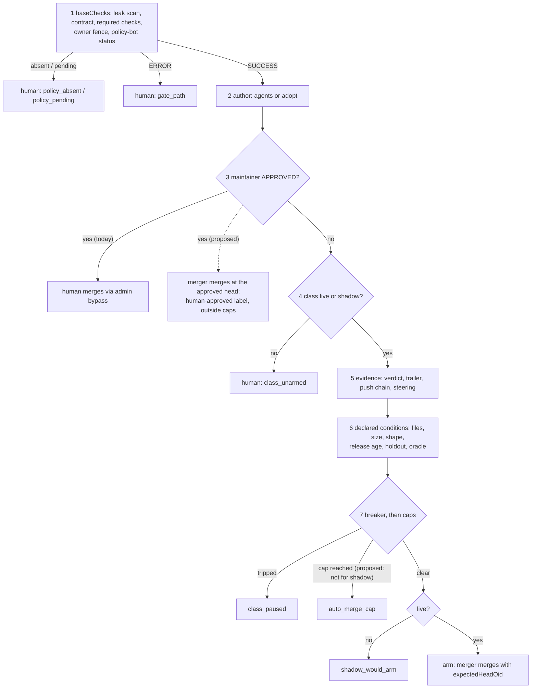

# Auto-merge criteria and merge gates: a study for the Agent Factory

**Date:** 2026-10-29 · **Status:** research; its recommendations are decided in the [human path design](2026-10-29-merge-gate-human-path-design.md) and planned there · **Part of:** the [v3 roadmap](2026-10-19-v3-roadmap-design.md), feature 8, after the [merge gate classes design](2026-10-22-merge-gate-classes-design.md) · **Thesis:** cheapen the human click before widening auto-merge · **Method:** six research notes (the factory's current state, platform-native merging, merge bots and policy engines, dependency bots, agent-authored PR policies, merge-gate design practice), synthesised on 2026-10-29

> **Source key.** External claims cite a URL inline. Local claims cite a file: **ANR** = ai-native-ref at `origin/main` 5230bb4; **CNR** = cloud-native-ref at `origin/main` 0078ba4a; **AP** = agent-platform (Maku, the controller) at tag `v0.30.4`, whose gate files are byte-identical at v0.31.0. Short names: *helm-values* = ANR `tooling/base/agent-factory/helm-values-configmap.yaml`; *design* = ANR `docs/superpowers/specs/2026-10-22-merge-gate-classes-design.md`; *runbook NN* = ANR `docs/runbooks/agent-factory/NN-*.md`; *follow-ups plan* = AP `docs/superpowers/plans/2026-10-23-merge-gate-followups-plan.md`. **session ledger** = the owner's local notes under `~/.cache/v3/`, in no repository; **[S]** = secondary or search-snippet source; **[V]** = vendor-reported number. Paragraphs are labelled **Evidence** (what a source says or measured), **Inference** (my reading) and **Recommendation** (what to do). Numbers marked *computed* are mine.

The Agent Factory's gate already covers more of the merge-criteria space than any merge bot, policy engine or platform feature surveyed: policy-bot's path and size fence, a declared diff-shape vocabulary, holdout and oracle checks, a merger pinned to the decided head, a revert on red `main`, daily caps, and a breaker fed by a GitHub-label ledger that survives rebuilds. No open-source merge bot read reverts a merged PR at all. What the gate lacks is throughput on two paths. The human path costs two actions per agent PR outside a live class: an approval to turn policy-bot green, then an admin-bypass merge that the owner's own Claude Code agent is refused. The evidence path is throttled three ways. A deliberate drill revert paused `docs-links` until ten newer class merges arrive. Daily caps apply to shadow decisions. And the live-switch bar of 20 clean shadow decisions only bounds the bad rate under 13.9%, which sits above the 10% class budget. The dominant pattern in bors, Tide, Zuul and Gerrit is "a human approves, a bot merges". The strongest adopter evidence also points to a faster human decision rather than more autonomy: Ona cut lead time 74% with a bot approving and a human still merging, and dotnet/runtime takes about two days to merge agent PRs because review capacity is the constraint. **Verdict on the owner's challenge:** widening auto-merge is not the most important work right now, and asking for autonomy beyond link fixes before each class has about 29 clean shadow decisions is asking too much. Three things are the right size for the next gcp-0 session: making one human approval enough to merge, making evidence accrue without loss, and proving the live paths that are already built.

| Question | Short answer |
|---|---|
| How do other solutions manage auto-merge? | Three families. **Policy evaluators** post one status: policy-bot, Mergify merge protections, Gerrit submit requirements. **Actors** merge once the platform says mergeable: Bulldozer, Kodiak, Renovate, GitHub auto-merge. **Queues** build and test the merge result: bors, Tide, Zuul, GitHub merge queue, GitLab trains, Mergify, Aviator, Trunk. Every agent product defaults to a human merge, and GitHub hard-blocks its cloud agent from approving or merging |
| What are the common criteria? | CI green on the head SHA, review state, author identity, path and size scope, an explicit opt-in audience, branch freshness, and for dependencies the update type plus release age. Time windows, kill switches and diff-content predicates are rarer |
| How are criteria tuned and extended? | A closed vocabulary read from the target branch, plus one universal extension point: a status from your own service, pinned to its App identity. Only Mergify and Gerrit have expression languages, and no merge tool read uses CEL or Rego. Dry-run exists as Gatekeeper `dryrun`, GitHub's "Evaluate" mode (Enterprise only), Gerrit's expression-check endpoint and policy-bot's simulate API |
| What are the best practices? | Keep branch protection under the bot. Pin the status source. Invalidate approvals on push and pin the head SHA. Require tests that actually exercise the change. Bound retries at 1-3. Revert first. Cool dependency updates down for 3-7 days. Measure the gate as a pair: share of changes gated against share of incidents caught |
| Applied to the factory | The gate already does all of the above except four things: a one-flip kill switch, a freshness bound, a per-predicate decision record, and measurement of the human path. The real defects are the breaker's recovery, the interaction between caps and shadow decisions, and the two-step human path |
| Important? Too much? | Wider autonomy: not now, and too much. One-click human merge, plus a breaker and shadow pipeline that keep their evidence: yes, and small |

## 1. Executive summary: the bottleneck is the human path, not the gate's reach

**Evidence (local).** One merger merge exists: cloud-native-ref #2520 on 2026-10-18. The revert of that drill, #2521, was merged by the owner because native auto-merge stalled, and the fix for it (Maku #158) is proven offline only (runbook 12:321-322, 369-374). `dead-links`, `deps-patch` and `deps-minor` have been in shadow since 2026-10-27, and no tally result is recorded yet. At its observed pace `dead-links` needs about five months for 20 shadow decisions and `deps-patch` about three weeks (design:255-256). All of the friction of 2026-10-28/29 landed in classes with no live switch: ANR #223 and #226, and cloud-native-ref #2652 and #2670. Every such PR needs two human steps: `policy_pending` → approve → `maintainer_approved` → an admin-bypass merge, because the `agent-merge` ruleset refuses plain merges (AP `arm.go:117-121`; ADR-0043:129-133). The Claude Code permission classifier refused the agent's `--admin` merges, so the owner had to do them himself (the session ledger (`~/.cache/v3/v3-program.md:297,307`)). Separately, `caps.awaitingHumanWIP: 5` stalled new work behind parked drill PRs (AP `implement.go:47-59`; the session ledger (`~/.cache/v3/v3-program.md:115`)).

**Evidence (external).** The best-measured adopter result keeps the human merge click. At Ona, a bot approves low-risk PRs and "a person always clicks the merge button". Median time to first approval fell from 2h49m to 3.8 min and median lead time from 4.1 h to 1.1 h. This is a before/after comparison, not a controlled one ([Ona](https://ona.com/stories/auto-approving-low-risk-prs)). At dotnet/runtime the median time to merge an agent PR is about 2 days, and the team names review as the constraint ([.NET Blog](https://devblogs.microsoft.com/dotnet/ten-months-with-cca-in-dotnet-runtime/)). No source states a PR volume above which auto-merge pays for itself.

**Inference.** At ≤1 auto-merge a day, the payoff of a wider gate is bounded by the supply of class PRs, and that supply is a few per week. The cost of the current human path, by contrast, is paid on every agent PR. The defects that slow evidence (section 5) also matter more than any new criterion, because the evidence clock is the only path to more autonomy and a single session cannot shorten it (the session ledger (`~/.cache/v3/v3-live-backlog.md:42`)).

**Recommendation.** In this order: make a maintainer approval at the decided head arm the merger ("approve-to-merge"); stop drills and caps from consuming shadow evidence; measure the human path; and spend the next gcp-0 session proving what is built (S0, L1, L3, L5/G1, M1, M2, #182, #158) rather than adding classes.

## 2. The gate today already covers the field's criterion families; four gaps remain

The table maps the criteria families found across all tools onto the gate. "Ahead" means the factory does something no surveyed GitHub bot does.

| Family | What the field uses | Agent Factory today | Gap |
|---|---|---|---|
| CI state | Required checks pinned by `integration_id` ([GitHub rules](https://github.com/github/docs/blob/main/content/repositories/configuring-branches-and-merges-in-your-repository/managing-rulesets/available-rules-for-rulesets.md)); Mergify `check-success/-pending/-stale` ([Mergify](https://docs.mergify.com/configuration/conditions/)); Tide optional and required-if-present contexts ([Tide](https://docs.prow.k8s.io/docs/components/core/tide/config/)) | `requiredChecks` via `CIState` gives `ci_red`, `ci_cancelled`, or wait on `ci_pending`; `checkReruns 1`, `fixRuns 2`, `awaitingCIFor 24h`; TruffleHog yields `secret_scan_red`; `holdoutChecks` (AP `arm.go:181-226`; helm-values:114-146) | None of substance |
| Review state | Approval count, last-push approval, code owners ([GitHub rules](https://github.com/github/docs/blob/main/content/repositories/configuring-branches-and-merges-in-your-repository/managing-rulesets/available-rules-for-rulesets.md)); bors `r+`, Tide `lgtm`+`approved`, Zuul Workflow +1 as the trigger for the bot to merge | policy-bot `requires {count 1, users [Smana]}`, `invalidate_on_push`; any maintainer `APPROVED` hands off as `maintainer_approved` → **a human merges**; agent reviewer `approve` required on the exact head (AP `arm.go:117-121,228-257`) | **Real**: an approval never causes the merge |
| Authorship and trust | `has_author_in` with `app[bot]`, `only_has_contributors_in` ([policy-bot](https://github.com/palantir/policy-bot/blob/develop/README.md)); Copilot's single `copilot/` branch | `agentsLogin` or adopt `{logins, branches}`; no forks; `Agent-Run` trailer matched to task runs; push-chain record; branch `^agent/[a-z2-7]{8}$`; `agent-branches` ruleset | None |
| Diff content and scope | policy-bot `only_changed_files`, `modified_lines`, `file_added/deleted`; Gerrit `withDiffContaining` ([Gerrit](https://gerrit-review.googlesource.com/Documentation/config-submit-requirements.html)) | `allowedFiles`, `protectedFiles`, `modifyOnly`, `maxPatchFiles`, `maxModifiedLines`, `diffShape` (`links-only`, `semver-patch`, `semver-minor`), `steering_path`; re-decided on GitHub's own file list (AP `gate.go:30-42`; `merge.go:129-146`) | None. **Ahead**: diff shape is a content predicate no GitHub bot has |
| Labels and commands | Label triggers in Kodiak, Bulldozer and Aviator ([Kodiak](https://kodiakhq.com/docs/config-reference)); bors and Tide commands | Labels never count as trust; a class label only sets the prediction; `factory/revert` is honoured only from a maintainer with write rights | None (deliberate) |
| Time | Mergify `schedule` (pending outside the window) ([freeze](https://docs.mergify.com/merge-protections/freeze/)); Renovate `minimumReleaseAge`; bors `treeclosed` | Per-UTC-day `autoMergesPerDay` and `maxPerDay`; `releaseAgeCheck` | Small: **caps also bind shadow decisions** |
| Branch freshness | GitHub strict mode; Tide retests on the latest base; Chromium reuses a green tryjob for ≤24 h or ~800 commits ([Chromium CQ](https://chromium.googlesource.com/chromium/src/+/main/docs/infra/cq.md)) | Host `strict: false`; base read at the merge base; `expectedHeadOid`; 30-min watch on `main` after merge | Small: no bound on the age of a green check |
| Repository kill switch | Tide `blocker_label` issue; bors `treeclosed`; Kodiak `merge.do_not_merge`; "operations staff should be able to trip or reset breakers" ([Fowler](https://martinfowler.com/bliki/CircuitBreaker.html)) | Breaker trips automatically to `class_paused`; anything else is a config PR (`live: false` or `autoMergesPerDay: 0`) rolled out by Flux | Small: no one-flip human freeze or reset |
| External signals | policy-bot `has_status`; Mergify `@app/check`; GitLab external status checks ([GitLab](https://docs.gitlab.com/user/project/merge_requests/status_checks/)); Aviator final gates ([Aviator](https://docs.aviator.co/mergequeue/concepts/final-gates)) | `policy-bot: main` pinned by `integration_id` and by login; holdout checks; `oracle` probe; monitor (Flux, RunLore) | None. **Ahead** |
| Blast radius over time | None of the tools read caps merges per day | Per-repo and per-class daily caps | **Ahead** |
| Post-merge feedback | No merge bot reverts; Google TAP and Mozilla autoland do | Revert on red `main` within 30 min; maintainer label within 168 h; breaker over the newest 10 merges; monitor verdicts | **Ahead**. The recovery path is the defect (section 5) |
| Decision record | Mergify shows a per-condition summary; Tide's status lists what is missing; Conftest `--trace` ([Conftest](https://github.com/open-policy-agent/conftest/blob/master/docs/debug.md)) | First failing reason plus narration; `would-arm head=` marker; counter labelled by class, verdict and reason | Small: only the first failing row is kept |
| Human-path measurement | Ona: time to first approval; Assembled: first-review wait ([Assembled](https://www.assembled.com/blog/code-review-bottlenecks-how-we-hill-climbed-our-way-to-higher-pr-throughput)) | `human_wait_seconds_total{phase,principal}` only; four separate waiting mechanisms with no single queue (backlog O16) | **Real** |

The diagram shows `DecideArm` as coded (AP `arm.go:100-158`), with the two proposed changes dashed or annotated.

**Inference.** Two structural facts explain most of the friction. First, the policy rows precede the class rows, so an agent PR that matches no `low-risk:*` rule reads `policy_pending` whatever its class, and `class_unarmed` is reached only when policy-bot's success came from a low-risk rule (AP `arm.go:214-225`; `narrate.go:282-284`); the only exit for such a PR is row 3, and row 3 hands off to a human merge. Second, the breaker counts any revert in the window, deliberate drills included.

Flake handling already matches bounded-retry practice. Google reports a flagged flaky test as failed only after 3 failures in a row ([Google Testing Blog](https://testing.googleblog.com/2016/05/flaky-tests-at-google-and-how-we.html)), Trunk keeps retries at 1-3 ([Trunk](https://docs.trunk.io/merge-queue/optimizations/anti-flake-protection)), and the factory uses `checkReruns: 1`. Google's flake prevalence is reported two ways that should not be mixed: 1.5% of runs and 16% of tests in 2016, against a flaky rate that "hovers around 0.15%" with no stated unit in [SWE at Google ch.11](https://abseil.io/resources/swe-book/html/ch11.html).

Small documentation drift was noted while reading: Maku's `docs/factory.md:7-8` says the host runs `docs-links` in shadow while the deployed config has it live; the text of `AgentFactoryAutoMergeReverted` describes a pause "until the factory config changes" although the breaker is an outcome window; and the design and the follow-ups plan disagree on when ANR's `low-risk: dead-links` rule lands.

## 3. Every tool family reduces to predicates, a pinned status and a merging actor

| Family | Tools | How auto-merge is decided | What it contributes to the factory |
|---|---|---|---|
| Platform-native | GitHub rulesets, auto-merge and merge queue; GitLab auto-merge, merge trains and approval policies; Gitea and Forgejo | Merge when every required check and review passes. GitHub has **no rule keyed on author type, labels, diff size or time** ([OpenAPI rule list](https://github.com/github/rest-api-description/blob/main/descriptions/api.github.com/api.github.com.json)). GitLab adds merge-after windows, title regex, external status checks and service-account bypass ([GitLab auto-merge](https://docs.gitlab.com/user/project/merge_requests/auto_merge/)) | Head pin (`sha` / `expectedHeadOid`); app-pinned required status; the merge queue requires an org-owned repo ([gating](https://github.com/github/docs/blob/main/data/reusables/gated-features/merge-queue.md)) |
| Policy evaluators | policy-bot, Mergify merge protections, Gerrit submit requirements | A rule splits applicability (`if` / `applicableIf`) from satisfaction (`requires` / `submittableIf`) and reports one status ([Gerrit](https://gerrit-review.googlesource.com/Documentation/config-submit-requirements.html)) | Already in the gate. Gerrit's `OVERRIDDEN` status is the audit-trail idea |
| Actors | Bulldozer, Kodiak, Renovate, GitHub auto-merge, the Nixpkgs merge bot | Merge as soon as GitHub says mergeable; the audience is chosen by label, author or update type | "Enable branch protection or Bulldozer may merge everything immediately" ([Bulldozer](https://github.com/palantir/bulldozer/blob/develop/README.md)); native auto-merge "often gets stuck", so watch it ([Nixpkgs merge.ts](https://github.com/NixOS/nixpkgs/blob/master/ci/github-script/merge.ts)) |
| Queues | bors, Tide, Zuul; Mergify, Aviator, Trunk and Graphite queues; GitHub merge queue; GitLab trains | A **human approval** admits the PR; the queue tests the merge result, then a bot merges it | bors `r+` stays "tentative until PR CI succeeds" ([bors help](https://bors-prod.rust-lang.net/help)); Tide merges PRs that carry `lgtm`+`approved` ([Tide](https://docs.prow.k8s.io/docs/components/core/tide/config/)); Zuul submits after Workflow +1 and its own Verified ([OpenDev pipelines](https://opendev.org/openstack/project-config/raw/branch/master/zuul.d/pipelines.yaml)) |
| Dependency bots | Renovate, Dependabot, Scala Steward | A static rule match on update type, dependency type, package, current version and age; the platform's required checks are the safety net | Cooldown; exclusion of 0.x versions; a bot's own check must not count as evidence (`internalChecksAsSuccess: false`, [Renovate](https://docs.renovatebot.com/configuration-options/#internalchecksassuccess)) |
| Agent products | Copilot cloud agent, Codex, Devin, Cursor, Jules, Claude Code, Kiro | The agent opens a PR and a human merges. GitHub's agent "cannot approve or merge a pull request" ([GitHub](https://docs.github.com/en/copilot/concepts/agents/coding-agent/risks-and-mitigations)). Path-scoped Copilot approvals that count toward required approvals have been GA since 2026-10-28 ([changelog](https://github.blog/changelog/2026-10-28-copilot-code-review-merge-with-confidence-with-max-and-approvals/)) | Separate identities for author, approver and merger. The factory already has this |
| Large organisations | Google TAP and LSC, Meta DRS, Uber SubmitQueue, Chromium CQ, LLVM, Mozilla | A fast presubmit admits the change; a queue protects mainline; rollback comes first after merge; ML risk scores modulate scrutiny | Google's global approver auto-approves tool-generated shards by pattern, and "flaky tests are ignored for automated submission" ([SWE at Google ch.22](https://abseil.io/resources/swe-book/html/ch22.html)): the class model at scale |

**Evidence.** The documentation's common denominator for safe auto-merge has four parts: tests exist and are required, the bot is a thin actor on top of branch protection, the audience is explicit, and the status source is pinned. Renovate puts it as "enable automerge for any dependency update where you would select 'merge' anyway" ([Renovate](https://docs.renovatebot.com/key-concepts/automerge/)).

Machine authorship is not inherently safe. In Google's continuous-testing data, one release tool made 42 commits, 39 of which caused breakages ([Memon et al.](https://huang.isis.vanderbilt.edu/cs8395-f23/paper/google-testing-icse-seip-17.pdf)).

Risk models modulate scrutiny rather than approve. Gating the riskiest 10% of Meta's diffs captures 27.9% of SEVs with the production logistic regression and 42.3% with the best risk-aligned LLM ([Abreu et al.](https://arxiv.org/abs/2410.06351)).

For Dependabot, the two official auto-merge recipes conflict. GitHub's docs run on `pull_request` with explicit write `permissions:` ([GitHub](https://docs.github.com/en/code-security/dependabot/working-with-dependabot/automating-dependabot-with-github-actions)). The `fetch-metadata` README says Dependabot `pull_request` runs are read-only and uses `pull_request_target` instead ([README](https://github.com/dependabot/fetch-metadata)). The conflict is unresolved, and irrelevant to the factory: it adopts Renovate PRs and runs no Dependabot workflow.

**Inference.** The factory combines a policy evaluator (policy-bot) with an actor (the merger) that adds class logic, which is the composition Bulldozer's README recommends. The only family it does not use is the queue. The queue is also where the field's "human approves, bot merges" pattern lives. That pattern is independent of queueing and can be borrowed alone (section 7, rank 1).

## 4. Custom criteria everywhere are a closed vocabulary plus a pinned check

| Mechanism | Precedent (evidence) | Factory today | Gap |
|---|---|---|---|
| Expression language | Mergify's attribute/operator DSL ([Mergify](https://docs.mergify.com/configuration/conditions/)); Gerrit's change-query expressions for applicable, submittable and override. No merge tool read offers user-defined functions, CEL or Rego | A declared vocabulary; MC1 rejected CEL per class and per-class Go branches (design:60-77) | None. MC1 matches the field |
| External-check extension | policy-bot `has_status` with an expected source ([policy-bot](https://github.com/palantir/policy-bot/blob/develop/README.md)); Mergify `@app/check`; Zuul `user[bot]:status:value`; GitLab external status checks report per HEAD (409 on a stale SHA) | `holdoutChecks`, `oracle`, `releaseAgeCheck`; policy-bot status pinned by `integration_id` and `merge.policyBotLogin` | Whether holdout checks are source-pinned is an open question (section 10) |
| Shadow / dry-run | Gatekeeper `enforcementAction: dryrun` ([Gatekeeper](https://github.com/open-policy-agent/gatekeeper/blob/master/website/docs/violations.md)); GitHub ruleset "Evaluate" (Enterprise) ([GitHub](https://github.com/github/docs/blob/main/data/reusables/repositories/rulesets-about-enforcement-statuses.md)); Gerrit's `check.submit_requirement` endpoint; Mergify's config editor; policy-bot `api/simulate` | `shadow: true` decides like live, records `would-arm head=<sha>`, and is tallied by `shadow-merge-tally.sh` (AP `classes.go:12-14`; `narrate.go:557-580`) | Only arming decisions are recorded; caps pre-empt shadow; no counterfactual replay |
| Policy tests | `opa test --coverage`; `conftest verify` ([OPA](https://github.com/open-policy-agent/opa/blob/main/docs/docs/policy-testing.md)); policy-bot `validate` checks regex only | A parity suite compares fence keys with the `low-risk:*` rules; `check-policy-gate-coverage.sh` | No behavioural test of `.policy.yml`; simulate replay fills it |
| Explainable verdict | Mergify per-condition summary; Tide's status names what is missing; Meta chose logistic regression so it could "simply explain the resulting risk" ([Mockus et al.](https://mockus.us/papers/UnfreezeMeta.pdf)) | Reason vocabulary, narration, would-arm comment | Only the first failing row is kept |
| Gate measured as a pair | Meta: share of diffs gated against share of SEVs captured; Assembled warns of "policy too loose" and "policy too strict" | The tally counts would-arm decisions merged unchanged; dashboard SC-11 shows reverts against a 5% threshold | No count of "refused but merged unchanged" (the strictness side) |

**Evidence.** Shadow modes elsewhere record every would-be outcome, not only the passes. Gatekeeper surfaces all would-be violations in the constraint status. Mergify's config editor evaluates conditions against existing PRs without acting.

Two adopter rules bear directly on agent gates. Ona treats "a model swap" as a policy change requiring executive sign-off, and "engineers cannot self-classify a change as low-risk" ([Ona](https://ona.com/stories/auto-approving-low-risk-prs)). Assembled found that "people shape PRs to fit the policy" and that its first policy was too conservative ([Assembled](https://www.assembled.com/blog/code-review-bottlenecks-how-we-hill-climbed-our-way-to-higher-pr-throughput)).

**Inference.** The factory's tuning surface already matches the field: closed config keys, strict decoding, and new criteria arriving as pinned checks. Its blind spots are evaluative, not expressive. A shadow decision that fails a row records only that first reason, so the owner cannot ask "what if `maxModifiedLines` were 40?" against real history. Nothing counts PRs the gate refused that a human then merged unchanged, so the gate's strictness is invisible. And the reviewer's model is not part of the decision record: the F15 drills swapped reviewer models (Kimi, Mistral), so a model swap could loosen a live class silently.

The factory's splitter is a legitimate tool, but Assembled's warning applies to it: agents splitting work to fit under `maxModifiedLines` is exactly the policy-shaping effect.

**Recommendation.** Persist the full row vector per decision and let the tally replay candidate thresholds (rank 4). Record the reviewer model in the would-arm marker and treat a change of model for a live class as a config change (rank 6). Use policy-bot's simulate API to replay recent PRs as the behavioural test of `.policy.yml`.

## 5. The breaker trips rarely on noise but recovers far too slowly

**Evidence (local).** Promotion stays manual. A class goes live after ≥20 shadow decisions merged unchanged at their `head=`, 0 bad among them once mature, and a passed drill. Widening needs a one-sided 95% Clopper-Pearson upper bound under the 10% class budget: 0 bad in ≥29 merges, 1 in ≥46, 2 in ≥61 (design:249-254). Demotion is automatic over the newest 10 merges of the class, auto and human: one revert, or one follow-up or regression, sets `class_paused`, for shadow classes too (AP `merge.go:864-916`; helm-values:146). Clean merges push old ones out of the window. The host's human merges have a genuine revert rate of 0.3% (2 of 651), and "0 failures in 1,000 merges" would be needed to bound a class under that rate (design:47-58).

**What n clean decisions certify** (*computed*; Wilson from [Evan Miller](https://www.evanmiller.org/how-not-to-sort-by-average-rating.html)'s method; rule of three from [Wikipedia](https://en.wikipedia.org/wiki/Rule_of_three_(statistics))):

| Clean decisions, 0 bad | One-sided 95% CP upper bound on bad rate | Rule of three, 3/n | Wilson 95% lower bound on success |
|---|---|---|---|
| 10 | 25.9% | 30% | 72.2% |
| **20 (live switch)** | **13.9%** | 15% | 83.9% |
| **29 (first widening)** | **9.8%** | 10.3% | 88.6% at n=30 |
| 50 | 5.8% | 6% | 92.9% |
| 100 | 3.0% | 3% | 96.3% |
| 1,000 | 0.30% | 0.3% | n/a |

**What the breaker does with a given true bad rate** (*computed*; p combines reverts, follow-ups and regressions):

| True bad rate p | Where p comes from | P(trip within a 10-merge window) | P(at least one bad in 100 merges) |
|---|---|---|---|
| 0.3% | Host human merges, 2 of 651 (design:49) | 3.0% | 26% |
| 0.8% | dotnet non-agent PRs, 33 of 4,251 ([.NET](https://devblogs.microsoft.com/dotnet/ten-months-with-cca-in-dotnet-runtime/)); Assembled "steady at 0.8%" | 7.7% | 55% |
| 5% | Dashboard SC-11 red threshold | 40% | 99.4% |
| 10% | Class budget | 65% | ~100% |

**Evidence (external).** Published base rates sit well below the class budget. Across six OSS projects, 1-5% of commits are reverted, after a median of 1-35 days ([Shimagaki et al.](https://rebels.cs.uwaterloo.ca/confpaper/2016/10/04/why-are-commits-being-reverted.html)). dotnet/runtime saw 0.6% for agent PRs against 0.8% for others, "not statistically meaningful". The source's 87.1% human success figure does not reconcile with the counts relayed for it, so cite it with care. Greptile reported revert rates across about 1M PRs a month: Codex about 1 per thousand PRs, Devin 3.5, humans about 2.5 ([talk transcript](https://agents.conffab.com/worlds-fair/live/day-1-keynotes/sessions/1782846300.md), anecdotal).

The precedents for asymmetric trust all shrink fast and recover deliberately. **Zuul's window** starts at 20, adds one per merge and halves per failure ([Zuul](https://zuul-ci.org/docs/zuul/latest/gating.html)). **Circuit breakers** add a half-open probe state, operator trip and reset, and the rule that "not all errors should trip the circuit" ([Fowler](https://martinfowler.com/bliki/CircuitBreaker.html)); resilience4j defaults to a 100-call minimum before it evaluates a rate and 10 probe calls when half-open ([resilience4j](https://github.com/resilience4j/resilience4j/blob/master/resilience4j-circuitbreaker/src/main/java/io/github/resilience4j/circuitbreaker/CircuitBreakerConfig.java)). **Argo Rollouts** pairs `consecutiveSuccessLimit` with `failureLimit` and returns Inconclusive when neither is met ([Argo](https://github.com/argoproj/argo-rollouts/blob/master/docs/features/analysis.md)). **Google's error-budget policy** freezes changes when the budget is spent but lists causes that do not count against it, such as external outages and out-of-scope load tests ([SRE Workbook](https://sre.google/workbook/error-budget-policy/)).

No published rationale exists for "promote after N successes" in merge gates. Any N is a design choice.

**Inference.** The arithmetic reframes the "one revert demotes" worry. **The window-10 breaker discriminates well**: it trips about 3% of the time per window for a class at the human baseline and 65% for a class at budget. The worry that a single revert is noise applies only over a class's lifetime, where a class of human-level quality has a 26-55% chance of at least one trip per 100 merges, and that is acceptable only if a trip is cheap to recover from. **It is not.** A paused class needs 10 newer class merges, and while paused those can only be human merges of class PRs; at `dead-links`' pace of about one finding a week, that is roughly ten weeks. `docs-links` on the host has shown no merge since the drill revert of 2026-10-18, so it very likely still reads `class_paused` (runbook 12:87-91; not verified against GitHub). **Drills count as failures**, so L2 as written would pause `dead-links`' shadow clock the same way. Finally, **safety lives in the breaker and the cap, not in the promotion bar**: with ≤1 merge a day and a trip on the first bad outcome, the expected loss per trip is about one bad merge plus its revert. The bar of 20 (bound 13.9%) does not meet the class's own 10% budget; it only decides how often the owner pays that one-merge loss.

A single 10% budget treats a broken link fix and a broken HelmRelease alike. A tighter `deps-patch` budget, for example 5%, would need 59 clean decisions (*computed*), roughly tripling its evidence time.

**Recommendation.** Fix the breaker's inputs and recovery before touching its thresholds. A maintainer-only `factory/drill` label should exclude a revert from the window, and a tripped class should re-close after K human-merged shadow decisions at their would-arm head (half-open) rather than after 10 newer merges. Either align the live switch to 29 decisions, or record explicitly that w0 accepts a 13.9% bound because the breaker bounds the loss. Keep Clopper-Pearson: Wilson adds nothing at these sample sizes.

## 6. Post-merge nets: revert-first is the norm, and the factory already has it

| Net | Precedent (evidence) | Factory today | Recommendation |
|---|---|---|---|
| Revert on red mainline | Google TAP auto-rolls back "when it has high confidence that they are the culprit" ([SWE at Google ch.23](https://abseil.io/resources/swe-book/html/ch23.html)); LLVM "revert to green", with a two-hour no-discussion window ([LLVM](https://llvm.org/docs/DeveloperPolicy.html)); Mozilla autoland backed out 9.3% of pushes in June 2017 ([Mozilla](https://blog.mozilla.org/tomcat/2017/07/03/sheriff-statistics-for-june-2017/)); Chromium reserves `No-Try` for reverts | `revert(main_red)` within `verifyFor` (30 min); maintainer `factory/revert` within 168 h; merger-authored revert PR; `revert` class live; the unattended revert merge (#158) is proven offline only (AP `merge.go:743-862`) | Prove #158 live. Add the `deps-patch` revert lane (PR K) |
| Behavioural regression | Kayenta classifies a canary as success, marginal (a human path) or failure ([Kayenta](https://cloud.google.com/blog/products/gcp/introducing-kayenta-an-open-automated-canary-analysis-tool-from-google-and-netflix)); Flagger rolls back after `threshold` failed checks ([Flagger](https://github.com/fluxcd/flagger/blob/main/docs/gitbook/usage/deployment-strategies.md)) | Monitor reads oracle runs, Flux Ready within 1 h, RunLore verification and follow-ups; the worst signal wins; `inconclusive` never counts as healthy; it never reverts (MC7) and feeds the breaker | Keep MC7 for now. Revisit for `deps-patch` only, when one merge is the sole candidate culprit |
| Freshness | Chromium reuses a green tryjob for ≤24 h or while the branch has moved fewer than ~800 commits | `strict: false`; head pin; 30-min watch on `main` | Refuse to arm when the green head check is >24 h old (low priority) |
| Dependency cooldown | Dependabot defaults to 3 days since 2026-07-14 ([changelog](https://github.blog/changelog/2026-07-14-dependabot-version-updates-introduce-default-package-cooldown/)); Renovate best-practices use 3 days and recommend 14 for automerge ([Renovate](https://docs.renovatebot.com/upgrade-best-practices/)); Renovate's own org uses 7 days ([default.json](https://github.com/renovatebot/.github/blob/main/default.json)); 64.3% of adopters chose 7 days ([Tanaka et al.](https://arxiv.org/abs/2609.16605)) | Renovate `minimumReleaseAge: 1 day` today; PR K raises the lane to 3 days; `releaseAgeCheck` reads `renovate/stability-days` | 3 days sits at the knee; 7 days is the common automerge choice. Verify registry timestamps first |
| Freeze when the budget burns | SRE error-budget policy halts everything but P0 and security work; Meta's gating levels vary by period ([Abreu](https://arxiv.org/abs/2410.06351)) | Per-class breaker only | One-flip freeze label (rank 7) |
| Revert latency tail | Reverted commits persist a median of 1-35 days before revert | `revertWindow` and `followUpWindow` 168 h | Keep. Widen only the tally's `--window` for calibration |

**Evidence.** Yossarian's ten supply-chain attacks had windows of opportunity of 7/10 under 3 days, 8/10 under 7 days and 9/10 under 14 days (counted from the [table](https://blog.yossarian.net/2025/11/21/We-should-all-be-using-dependency-cooldowns)). Datadog found that a 12-hour cooldown would have blocked the axios and s1ngularity spreads, and calls one week "the commonly recommended guidance" ([Datadog](https://securitylabs.datadoghq.com/articles/dependency-cooldowns)). These sources are practitioner-compiled, and there is no peer-reviewed measurement.

Renovate's cooldown has a registry gap: it needs a release timestamp from the registry. Docker Hub provides one; ghcr.io, quay.io and other Docker registries do not. Since Renovate 42, a missing timestamp means "not yet old enough" (`timestamp-required`); `timestamp-optional` opts out ([Renovate](https://docs.renovatebot.com/key-concepts/minimum-release-age/)). Cilium sets `timestamp-optional` for Docker for exactly this reason ([Cilium](https://github.com/cilium/cilium/blob/main/.github/renovate.json5)).

Renovate also warns that SemVer allows breaking changes in any 0.x release, and its stable non-major preset excludes `!/^0/` ([Renovate](https://docs.renovatebot.com/key-concepts/automerge/)).

CI is a weak oracle for dependency bumps. Tests catch 47% of injected faults in direct dependencies and 35% in transitive ones ([Hejderup and Gousios](https://arxiv.org/abs/2109.11921)). 26% of Dependabot PRs run at least one check that contributes nothing to the score ([Rombaut et al.](https://arxiv.org/abs/2403.09012)).

**Inference.** For Flux-deployed YAML, presubmit CI validates manifests, not runtime behaviour. The Flux monitor is the real test of `deps-patch`, which makes revert speed and the breaker more important than any presubmit criterion. Two dependency facts follow. On **registry timestamps**, Flux-deployed images and charts often come from ghcr.io or quay.io: under `timestamp-required` those bumps would read `release_age_pending` indefinitely, and under `timestamp-optional` they would skip the cooldown, so either way the `deps-patch` evidence is distorted, which proof N3 must reveal. On **the host's own record**, 75 Renovate patch merges produced 0 breakages (design:47-58), which bounds the patch population's bad rate under 3.9% (*computed*): a useful prior that a historical backtest of the `deps-patch` fence can attach to the class (rank 4).

## 7. What to borrow, ranked, and what to leave alone

| Rank | Borrow | Precedent (evidence) | Change to the gate | Cost | When |
|---|---|---|---|---|---|
| 1 | **Approve-to-merge**: a maintainer `APPROVED` at the decided head arms the merger | bors `r+` is tentative until CI passes; Tide merges on `lgtm`+`approved`; Zuul submits after Workflow +1; Google Cloud's "Conditional LGTM" approves contingent on tests ([Google Cloud](https://cloud.google.com/transform/when-ai-writes-the-code-who-reviews-it-cto-google-cloud)) | Row 3 arms instead of handing off. A distinct ledger label means not counted in caps, never auto-reverted, and counted by the breaker as a human merge. Add re-entry on a maintainer approval at an unchanged head (refused today, AP `merge.go:254-320`). `expectedHeadOid` = the approved head | S | Build offline; prove as N6 |
| 2 | **Drills do not trip the breaker; half-open recovery** | Fowler: "not all errors should trip the circuit", and operators trip and reset breakers; resilience4j half-open probes; SRE budget exclusions | A maintainer-only `factory/drill` label excludes a revert from the window. After a trip, K human-merged shadow decisions at their would-arm head re-close the class | S-M | Before L2 |
| 3 | **Shadow decisions ignore caps** | Gatekeeper `dryrun` records every would-be violation | Compute the shadow verdict before caps; record `capped` in the marker | XS | Before the session |
| 4 | **Full predicate record, replay and backtest** | Mergify's config editor; Gerrit's check endpoint; Meta's gated-share against SEV-capture pair | Persist each row's value per decision; the tally replays candidate thresholds and counts "refused but merged unchanged"; an offline backtest of `deps-patch` over historical Renovate patch PRs | M | Design now, build after |
| 5 | **Measure the human path** | Ona: time to first approval fell from 2h49m to 3.8 min; Assembled: first-review wait rose from 3.5 h to 16 h+; Microsoft Nudge cut overdue-PR resolution time 60% in a randomised trial ([S](https://arxiv.org/abs/2011.12468)) | Add `reason` and `class` labels to the wait metric; time to merge by hand-off reason; one queue panel | S | Before the session (N4) |
| 6 | **The reviewer model is part of the policy** | Ona: "a model swap counts as a policy change" | Record the model in the would-arm marker; tally per model | XS | Before the session |
| 7 | **One-flip freeze** | Tide `blocker_label`, bors `treeclosed`, Mergify freeze, Kodiak `do_not_merge` | A maintainer label on the control issue pauses every class (reason `frozen`), with no rollout | S | Optional |
| 8 | **Cooldown 3 → 7 days for the live deps lane; 0.x check; timestamp check** | Renovate org (7 days); Tanaka et al.; Yossarian; Renovate `!/^0/` | Config in PR K; check `semverdiff` | XS | PR K |
| 9 | **Freshness bound** | Chromium: 24 h | Refuse to arm when the green head check is >24 h old | XS | Later |
| 10 | **Auto-revert a single-culprit Flux regression** (`deps-patch` only) | Google TAP; Mozilla autoland; Flagger | Revisit MC7 for this one case | M | After L4 |

**Inference on rank 1.** Approve-to-merge gives the merger no new authority. A stolen merger key can already merge any PR with green checks and `policy-bot: main` success (runbook 09:13), and for a non-low-risk PR that success already requires the maintainer's approval. The change removes three costs at once: the second human action, the admin bypass (which skips every ruleset), and the classifier conflict, since no agent runs `--admin`.

The human stays the trust anchor, as Ona insists, because the approval is bound to one head by `invalidate_on_push` and `expectedHeadOid`.

| Do not borrow | Why not (evidence) |
|---|---|
| Merge queue, speculative batching, optimistic merging, rollups | The GitHub merge queue needs an org-owned public repo or a GHEC private one. The docs source and the changelog also disagree on which plans get the ruleset form. Trunk advises against optimistic merging above about 5% flake ([Trunk](https://docs.trunk.io/merge-queue/optimizations/optimistic-merging)). The factory merges ≤2 a day |
| Zuul-style adaptive cap | The window governs concurrency of speculative testing. At ≤1 decision a day a growing cap never binds |
| ML or LLM risk score as an approver | Gating the top 10% of diffs catches 27.9-42.3% of SEVs at Meta. A logistic regression on added lines alone beats deep models ([Zeng et al.](https://conf.researchr.org/details/issta-2021/issta-2021-technical-papers/33/Deep-Just-in-Time-Defect-Prediction-How-Far-Are-We-)). The factory has 2 genuine reverts to learn from |
| CEL, Rego or a Mergify-like DSL | MC1 already rejected them. No merge tool offers user-defined functions; a pinned check is the field's extension point |
| Bot approvals counted toward reviews (Copilot approvals, Actions approvals) | MC3 rejected this. Whether an App's approval counts is undocumented, and community answers conflict ([discussion 181487](https://github.com/orgs/community/discussions/181487)) |
| Labels as trust (Kodiak `auto_approve_labels`, Bulldozer triggers) | Already rejected; more actors can write labels than can author the policy |
| Merge Confidence or the compatibility score | Merge Confidence's algorithm is private, it covers 7 datasources, and machine use is paid ([Renovate](https://docs.renovatebot.com/merge-confidence/)). Only 3.4% of PRs carry a compatibility score ([He et al.](https://arxiv.org/abs/2206.07230)). Neither applies to Flux YAML |
| Weekday or time-of-day risk gating | In Eclipse, Friday's fix-inducing rate was 12.2% against an 11.4% average ([Sliwerski et al.](https://thomas-zimmermann.com/publications/files/sliwerski-wsr-2005.pdf)); day-of-week effects are "small" and project-specific ([Eyolfson et al.](https://www.cs.purdue.edu/homes/lintan/publications/commitTime-msr11.pdf)). Only Meta's staffing argument stands |
| Automatic widening | MC9; no published rationale for promote-after-N |
| Native auto-merge, or Renovate `platformAutomerge` as the lane | Native auto-merge never fires under the `update` rule (wiki); MC10 rejected it |
| Moving the merger to `merge-async` now | `merge-async` has been GA since 2026-10-01 and is recommended over REST sync ([changelog](https://github.blog/changelog/2026-10-01-github-async-merge-api-generally-available/)). The merger uses GraphQL `mergePullRequest` with `expectedHeadOid`, which works for a bypass actor. Settle the question in a sandbox first |

## 8. The owner's challenge: important, but not in the way asked

**The case that wider auto-merge is not important now.** The fastest published gains come from a faster human decision. Ona's bot-approves, human-merges model raised the share of PRs approved within 10 minutes from 13% to 73% ([Ona](https://ona.com/stories/auto-approving-low-risk-prs)). Assembled's first-review wait rose from 3.5 h to over 16 h as agent volume grew, and its observation that "speeding up one stage of a pipeline tends to move the constraint to the next stage" applies directly ([Assembled](https://www.assembled.com/blog/code-review-bottlenecks-how-we-hill-climbed-our-way-to-higher-pr-throughput)). dotnet/runtime runs every agent PR on an explicit maintainer request and still merges in a median of about 2 days, with reviewers leaving 16.5 comments on merged agent PRs against 12.4 on human PRs ([.NET Blog](https://devblogs.microsoft.com/dotnet/ten-months-with-cca-in-dotnet-runtime/)).

None of the PRs that hurt on 2026-10-28/29 is a candidate under any evidence-based policy. #2670 changed 8 files and +815 lines across a script, a dashboard and docs. #2652 was a tester drill. #223 and #226 were reviewer-model drills. Only #226 (+5 lines, one runbook) is small, and docs prose is judgement work: in dotnet/runtime, docs PRs succeeded 68.1% of the time against 84.7% for cleanup. A class gate would not have saved one of those clicks. Approve-to-merge would have saved one per PR.

**The case that it is important.** The human gate on agent PRs is thin in the wild. **77.51%** of merged agentic PRs are merged by the user who submitted them, against 57.63% of human PRs ([Yoshioka et al.](https://arxiv.org/html/2601.18749v1)); about 79% of sampled merged agent PRs show no feedback loop ([Peralta et al., S](https://www.alphaxiv.org/abs/2605.22534.md)); Claude Code users accept 93% of permission prompts ([Anthropic](https://www.anthropic.com/engineering/claude-code-auto-mode)); and agent PRs revert no more often than human ones (0.6% against 0.8% in dotnet/runtime).

Locally, a single human bottleneck stalls the factory itself: review-WIP back-pressure blocks new tasks. Feature 8's live proof is part of the product's claim ("built, shadow; full-day proof deferred", the session ledger (`~/.cache/v3/status-report-2026-10-29-final.md:13`)).

**Verdict.** The owner is asking for the right outcome, a more autonomous factory, through the wrong lever. Within one session, wider auto-merge cannot be earned: the evidence clocks (about 3 weeks for `deps-patch`, about 5 months for `dead-links`) dominate, and a drill would currently stop one of them. "Improve auto-merge" is too much if it means new classes, automatic widening, or `deps-patch` live before roughly 29 clean decisions. It is not too much if it means that one human approval suffices to merge, that drills and caps stop consuming evidence, and that the session measures the human path and proves the paths already built.

That work is a few S/XS changes plus a measurement-heavy session. It yields more autonomy per owner-minute than any new class could this quarter.

## 9. Live-test plan for the next gcp-0 session

The session comes up on Maku v0.31.0 with the `maku.ogenki.io` CRD group. Two prerequisites: owner action B1 (merger installation grants `issues: write` on both repos and `actions: read` on ANR, follow-ups plan:95-98), and, for L2 only, a host `low-risk: dead-links` rule. Proofs N6-N8 run only if their change was built and proven offline first.

| ID | Proof | Status | Pass criterion | Order and notes |
|---|---|---|---|---|
| S0 | Readiness | Not recorded | The factory can `list` HelmReleases but not `create` them; the monitor reads no Task; `monitor_verdicts_total` is exported; the merger mints with `issues: write` | First; blocks everything |
| L5 / G1 | Rebuild survival; breaker survives a restart | G1 "Not run" | At boot, host `docs-links` reads `class_paused` from the #2521 ledger labels with no Task present. After deleting every Task and restarting, it still does | Second. Uses the existing pause, so no new drill is needed |
| L3 | `deps-patch` and `deps-minor` shadow | One adoption recorded (cnref #2570) | Every eligible Renovate PR gets an adopted Task and `would-arm head=<sha>`; ineligible ones (`mise.toml`, a gate path, a digest) get none; Renovate's merge gets `factory/merged:deps-patch` and a Flux reading within 2 h; the tally counts it | Passive, from boot |
| L1 | `dead-links` shadow on both repos | Not recorded | Finding → task → PR → `would-arm`. After a human merge at that head: `factory/merged:dead-links`, then `monitor.oracle: healthy` after two detector runs. Fails closed if a verdict posts before the follow-up window ends | Passive |
| #182 | `awaitingCIFor` expiry | Open | A task whose required check never reports hands off as `ci_wait_expired`, naming the missing check | Early |
| M1 | Regression path | Not recorded | A scratch merge gives `monitor.main: regression`, the label, a control-issue narration and a firing `AgentFactoryMergeRegression`; the next decision is `class_paused`; nothing is reverted | On ANR `docs-links` only, never on `dead-links` or `deps-patch` |
| M2 | Follow-up detection | Not recorded | `factory/follow-up-of:#<n>`, `outcome="follow_up"`, class paused | Same class as M1 |
| N1 | Policy replay | New | policy-bot simulate on ANR #226, #223 and cnref #2652, #2670 gives every `low-risk:*` rule's state and the predicate that skipped it | Early; settles the #226 question |
| N3 | Release-age reality | New | Every L3 PR records its `releaseAgeCheck` outcome and its registry; no PR stays pending beyond `minimumReleaseAge` + 24 h, or the session produces a list of registries without timestamps | Passive |
| N4 | Human-path baseline | New | For every hand-off: reason, hand-off time, merge time. Median per reason reported at teardown | Whole session |
| N5 | Follow-up precision | New | Each `follow_up` outcome (from M2 and natural ones) is labelled real or unrelated by the owner; the count is reported | Whole session |
| N6 | Approve-to-merge | New, if built | Approving a `policy_pending` agent PR makes the merger merge it at the approved head within one reconcile; the label is the human-approved one; the repo cap count is unchanged; a push after the approval yields `head_moved` and no merge | Mid-session |
| N7 | Shadow ignores caps | New, if built | A shadow decision on a capped day still posts `would-arm` with `capped=true` | Passive |
| N8 | Freeze label | New, if built | The label on the control issue makes every class's next decision `frozen`; removing it restores normal decisions | Short |
| L2 + #158 | `dead-links` live drill and unattended revert merge | Open; #158 proven offline | Planted link → two detector runs → task → merger merge at the head → monitor `healthy` → `factory/revert` → **the merger merges its own revert unattended** → `class_paused` | **Last.** Run only after rank 2 (drill exclusion) is deployed. Otherwise `dead-links`' shadow clock stops for 10 class merges, about 10 weeks |
| L4 | `deps-patch` drill | Blocked | Needs ≥20 shadow decisions and PR K | Not this session (clock-bound) |

## 10. Open questions to settle in a sandbox or a code read

| Question | Why it matters | How to settle |
|---|---|---|
| Does a GitHub App's approving review count toward `required_approving_review_count`? | Matters only if the gate ever leans on native required reviews or bot approvals. The docs are silent and community answers conflict | Sandbox org repo: a ruleset requiring 1 approval; the App posts an `APPROVE` review; read `mergeStateStatus` |
| Does policy-bot count an App's review toward `requires.count` when the rule uses `permissions` rather than `users`? | An App approval must never satisfy the maintainer rule; the README does not say | Sandbox `.policy.yml` plus the simulate API |
| Under the `agent-merge` `update` rule, does `merge-async` from the merger need `bypass_rules: true`, and does `sha` pin the head like `expectedHeadOid`? | `merge-async` is GitHub's recommended merge path | Sandbox with both rulesets: call it with and without `bypass_rules`, and push between request and execution |
| Why did ANR #226 read `policy_pending` when its diff fits ANR's `low-risk: dead-links` fence? | A fence that silently skips sends every docs PR down the two-step path | N1. Also check whether `has_workflow_result` sits in `if` (skip, so `error` when every rule skips) or in `requires.conditions` (pending) |
| Can policy-bot simulate an already-merged PR? | N1 depends on it | Try it on one merged PR; fall back to re-opening an identical PR on `agent/<8>` |
| Does an `auto_merge_cap` on a shadow class post a would-arm marker? | Evidence loss | Code read of AP `arm.go:148-157` and `merge.go:220-229` |
| Does `semverdiff` refuse 0.x patch bumps? | SemVer allows breaking changes in any 0.x release | Code read plus a unit test |
| Which Renovate version and registries does the host use, and what is `minimumReleaseAgeBehaviour`? | `timestamp-required` parks bumps from ghcr.io and quay.io; `timestamp-optional` skips the cooldown | Host Renovate run log; N3 |
| Are holdout checks source-pinned like `policy-bot: main`? | An unpinned check can be satisfied by any writer of statuses. The agents' tokens lack `statuses: write` (inference from the trust policies) | Code read of `CIState` |
| Are `agent-merge-gate` and `agent-merge` applied on ANR, and was B1 granted after 2026-10-27? | The merger's authority on ANR is unverified locally | `gh api repos/Smana/ai-native-ref/rulesets`; the installation's permissions |
| Is follow-up detection (blame overlap within 168 h) precise on busy docs paths? | False follow-ups trip the breaker exactly as reverts do | N5, plus an offline replay over the last 100 host docs merges |

## Conclusion

The gate is not under-specified. It is over-paused and under-measured. Its criteria vocabulary already exceeds what any surveyed GitHub tool offers, and its post-merge net matches Google and Mozilla practice rather than the merge bots'. The highest-yield change is a re-routing, not a new criterion: let a human approval drive the merger, which is what bors, Tide and Zuul have done for a decade. The statistics also shift the design focus. The window-10 breaker is a sound detector; its recovery path and its blindness to drills are what turn one deliberate revert into months of lost evidence. And because the breaker and cap bound the loss to about one bad merge per trip, the promotion bar is a frequency knob, not a safety boundary.

That reframes the next gcp-0 session as a measurement session: how long each hand-off actually costs, whether release-age checks pass on the host's registries, whether follow-up detection is precise, and whether the paths built since 2026-10-18 hold live. Those answers, not a wider gate, are what the next design needs.

Do that before asking the factory to decide more on its own.

## Sources

**Platform-native.** GitHub available rules: https://github.com/github/docs/blob/main/content/repositories/configuring-branches-and-merges-in-your-repository/managing-rulesets/available-rules-for-rulesets.md · ruleset enforcement statuses: https://github.com/github/docs/blob/main/data/reusables/repositories/rulesets-about-enforcement-statuses.md · REST OpenAPI: https://github.com/github/rest-api-description/blob/main/descriptions/api.github.com/api.github.com.json · async merge GA: https://github.blog/changelog/2026-10-01-github-async-merge-api-generally-available/ · merge queue gating: https://github.com/github/docs/blob/main/data/reusables/gated-features/merge-queue.md · Copilot risks: https://docs.github.com/en/copilot/concepts/agents/coding-agent/risks-and-mitigations · Copilot approvals GA: https://github.blog/changelog/2026-10-28-copilot-code-review-merge-with-confidence-with-max-and-approvals/ · App approvals discussion: https://github.com/orgs/community/discussions/181487 · Nixpkgs merge bot: https://github.com/NixOS/nixpkgs/blob/master/ci/github-script/merge.ts · GitLab auto-merge: https://docs.gitlab.com/user/project/merge_requests/auto_merge/ · GitLab external status checks: https://docs.gitlab.com/user/project/merge_requests/status_checks/

**Merge bots and policy engines.** policy-bot: https://github.com/palantir/policy-bot/blob/develop/README.md · Bulldozer: https://github.com/palantir/bulldozer/blob/develop/README.md · Kodiak: https://kodiakhq.com/docs/config-reference · Mergify conditions: https://docs.mergify.com/configuration/conditions/ · Mergify freeze: https://docs.mergify.com/merge-protections/freeze/ · bors help: https://bors-prod.rust-lang.net/help · Tide config: https://docs.prow.k8s.io/docs/components/core/tide/config/ · Zuul gating: https://zuul-ci.org/docs/zuul/latest/gating.html · OpenDev pipelines: https://opendev.org/openstack/project-config/raw/branch/master/zuul.d/pipelines.yaml · Gerrit submit requirements: https://gerrit-review.googlesource.com/Documentation/config-submit-requirements.html · Aviator final gates: https://docs.aviator.co/mergequeue/concepts/final-gates · Trunk optimistic merging: https://docs.trunk.io/merge-queue/optimizations/optimistic-merging · Trunk anti-flake: https://docs.trunk.io/merge-queue/optimizations/anti-flake-protection · Chromium CQ: https://chromium.googlesource.com/chromium/src/+/main/docs/infra/cq.md

**Dependency bots.** Renovate automerge: https://docs.renovatebot.com/key-concepts/automerge/ · minimum release age: https://docs.renovatebot.com/key-concepts/minimum-release-age/ · upgrade best practices: https://docs.renovatebot.com/upgrade-best-practices/ · internalChecksAsSuccess: https://docs.renovatebot.com/configuration-options/#internalchecksassuccess · Merge Confidence: https://docs.renovatebot.com/merge-confidence/ · Renovate org preset: https://github.com/renovatebot/.github/blob/main/default.json · Cilium: https://github.com/cilium/cilium/blob/main/.github/renovate.json5 · Dependabot automation: https://docs.github.com/en/code-security/dependabot/working-with-dependabot/automating-dependabot-with-github-actions · fetch-metadata: https://github.com/dependabot/fetch-metadata · Dependabot cooldown default: https://github.blog/changelog/2026-07-14-dependabot-version-updates-introduce-default-package-cooldown/ · Yossarian: https://blog.yossarian.net/2025/11/21/We-should-all-be-using-dependency-cooldowns · Datadog: https://securitylabs.datadoghq.com/articles/dependency-cooldowns · Tanaka et al.: https://arxiv.org/abs/2609.16605 · He et al.: https://arxiv.org/abs/2206.07230 · Rombaut et al.: https://arxiv.org/abs/2403.09012 · Hejderup and Gousios: https://arxiv.org/abs/2109.11921

**Agent PRs and adopters.** Ona: https://ona.com/stories/auto-approving-low-risk-prs · Assembled: https://www.assembled.com/blog/code-review-bottlenecks-how-we-hill-climbed-our-way-to-higher-pr-throughput · dotnet/runtime: https://devblogs.microsoft.com/dotnet/ten-months-with-cca-in-dotnet-runtime/ · Yoshioka et al.: https://arxiv.org/html/2601.18749v1 · Peralta et al. [S]: https://www.alphaxiv.org/abs/2605.22534.md · Greptile talk: https://agents.conffab.com/worlds-fair/live/day-1-keynotes/sessions/1782846300.md · Anthropic auto mode: https://www.anthropic.com/engineering/claude-code-auto-mode · Google Cloud "Conditional LGTM": https://cloud.google.com/transform/when-ai-writes-the-code-who-reviews-it-cto-google-cloud · Microsoft Nudge [S]: https://arxiv.org/abs/2011.12468

**Gate design and statistics.** SWE at Google ch.11: https://abseil.io/resources/swe-book/html/ch11.html · ch.22: https://abseil.io/resources/swe-book/html/ch22.html · ch.23: https://abseil.io/resources/swe-book/html/ch23.html · Google flaky tests: https://testing.googleblog.com/2016/05/flaky-tests-at-google-and-how-we.html · Memon et al.: https://huang.isis.vanderbilt.edu/cs8395-f23/paper/google-testing-icse-seip-17.pdf · Meta DRS: https://arxiv.org/abs/2410.06351 · Meta un-freeze: https://mockus.us/papers/UnfreezeMeta.pdf · Zeng et al.: https://conf.researchr.org/details/issta-2021/issta-2021-technical-papers/33/Deep-Just-in-Time-Defect-Prediction-How-Far-Are-We- · Sliwerski et al.: https://thomas-zimmermann.com/publications/files/sliwerski-wsr-2005.pdf · Eyolfson et al.: https://www.cs.purdue.edu/homes/lintan/publications/commitTime-msr11.pdf · Shimagaki et al.: https://rebels.cs.uwaterloo.ca/confpaper/2016/10/04/why-are-commits-being-reverted.html · LLVM policy: https://llvm.org/docs/DeveloperPolicy.html · Mozilla June 2017: https://blog.mozilla.org/tomcat/2017/07/03/sheriff-statistics-for-june-2017/ · Kayenta: https://cloud.google.com/blog/products/gcp/introducing-kayenta-an-open-automated-canary-analysis-tool-from-google-and-netflix · Flagger: https://github.com/fluxcd/flagger/blob/main/docs/gitbook/usage/deployment-strategies.md · Argo Rollouts analysis: https://github.com/argoproj/argo-rollouts/blob/master/docs/features/analysis.md · SRE error-budget policy: https://sre.google/workbook/error-budget-policy/ · Fowler circuit breaker: https://martinfowler.com/bliki/CircuitBreaker.html · resilience4j: https://github.com/resilience4j/resilience4j/blob/master/resilience4j-circuitbreaker/src/main/java/io/github/resilience4j/circuitbreaker/CircuitBreakerConfig.java · Wilson bound: https://www.evanmiller.org/how-not-to-sort-by-average-rating.html · Rule of three: https://en.wikipedia.org/wiki/Rule_of_three_(statistics) · OPA testing: https://github.com/open-policy-agent/opa/blob/main/docs/docs/policy-testing.md · Conftest debug: https://github.com/open-policy-agent/conftest/blob/master/docs/debug.md · Gatekeeper violations: https://github.com/open-policy-agent/gatekeeper/blob/master/website/docs/violations.md
