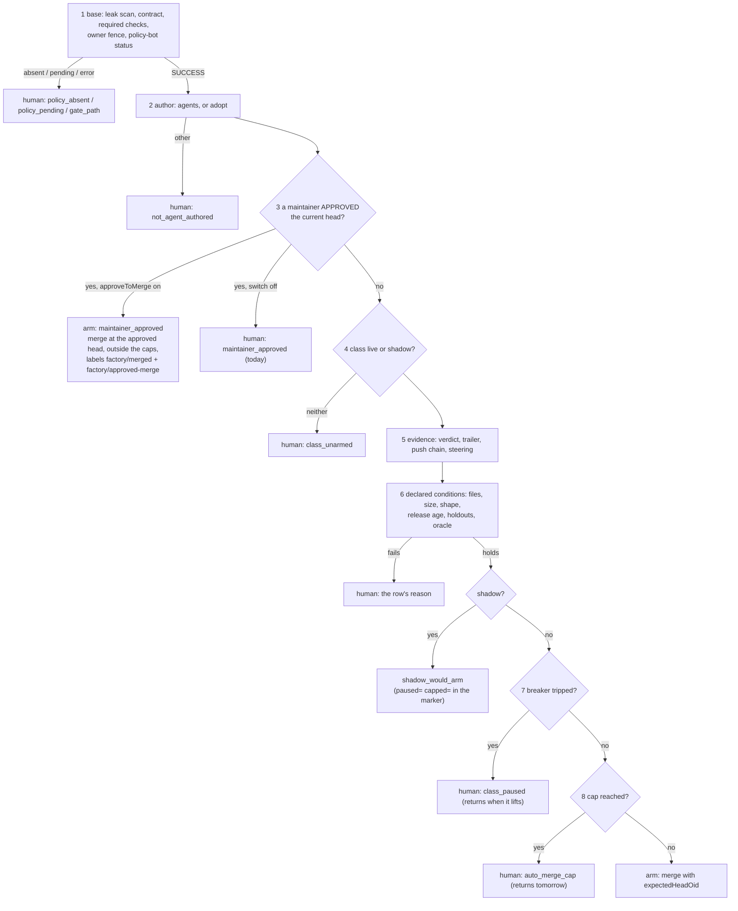

# Merge gate: the human path, the breaker's evidence and the decision record

**Date:** 2026-10-29 · **Status:** proposed with every default as recommended; the owner reviews it in this pull request · **Part of:** the [v3 roadmap](2026-10-19-v3-roadmap-design.md), feature 8, after the [merge gate classes design](2026-10-22-merge-gate-classes-design.md) (MC1–MC14) and agent-platform's merge gate follow-ups plan (R27–R50) · **Research:** the [auto-merge criteria study](2026-10-29-automerge-criteria-research.md), whose ranked borrows 1–8 this design decides · **Amends:** runbook 12's drill (a label before the revert); the live-switch bar of 20 is kept and its bound recorded; MC7 (the monitor never reverts) is kept · **Runtime:** Maku (the gate, the breaker, the ledger, the metrics), this repository (config, dashboards, alerts, runbooks), cloud-native-ref (the fence file for aws-0; PR K)

Read against agent-platform tag `v0.31.0` (the gate files are byte-identical at `v0.30.4`), cited
`AP/<path>` with the function's name; this repository at `origin/main` b8f76ec; cloud-native-ref at
`origin/main` 0078ba4a, cited `cnref/<path>`.

## Outcome

One maintainer approval merges an agent pull request: the merger merges the approved head, so no
admin bypass and no second click. Drills and daily caps stop consuming the shadow evidence, and a
paused class recovers on clean merges instead of waiting months. Every decision leaves a record the
tally can replay, and the time each hand-off costs a human is measured. The next live session, on
aws-0, measures the human path and proves the paths built since 2026-10-18 before any class widens.

The study's verdict stands: wider auto-merge is not what slows the factory, the human path is.
Nothing here adds a class or widens one.

## What exists

| Piece | Where | Today |
|---|---|---|
| The rule | `AP/internal/factory/reconciler/arm.go` `DecideArm`, `baseChecks` | Base rows (secret scan, required checks, contract, fence, `policy-bot: main`), then the author row, then **any maintainer `APPROVED` review hands off `maintainer_approved`: a human merges**, then the class rows, the breaker (`class_paused`), the caps (`auto_merge_cap`), shadow or arm |
| The human merge | cnref `.github/rulesets/agent-merge.json`, `scripts/ops/github/agent-merge-ruleset.sh`; [ADR-0043](../../../website/content/docs/decisions/0043-octo-sts-for-agent-github-tokens.md) | The `update` rule covers `main`; humans with write, Renovate and the merger App are bypass actors. Every human merge is an explicit bypass ("bypass rules" or `gh pr merge --admin`), which the Claude Code permission classifier refuses to the owner's agent sessions (ANR #223, #226; cnref #2652, #2670 on 2026-10-28/29) |
| Returns to the gate | `merge.go` `reenter`, `engagedSince` | An agent task returns only from `policy_pending`, `policy_absent`, `head_unreported`, `ci_cancelled`, on the same head, at most `maxGateReentries` (3) times, and never once a maintainer reviewed or commented since the hand-off: **an approval blocks the return it should trigger** |
| The breaker | `merge.go` `paused`, `Demoted`; `ledger.go` `githubLedger` | The newest `breaker.window` (10) merges of a class, auto and human; 1 revert, or 1 follow-up or regression, pauses the class, shadow included. Reverts are read as `factory/revert-of:#<n>` labels, so a **deliberate drill revert counts**. A pause lifts only when 10 newer class merges push the bad one out |
| The caps | `arm.go` (`auto_merge_cap`), `merge.go` `armedTodayOf` | `autoMergesPerDay` per repository and `maxPerDay` per class, on the UTC day, counted from the merger's merges. **A shadow decision meets the caps too** (`auto_merge_cap` instead of `shadow_would_arm`) |
| The record | `AP/internal/factory/narrate/narrate.go` `WouldArm`, `WaitingForHuman`; `fmetrics.go` | A `would-arm-<n> head=<sha>` marker, a hand-off comment naming the first failing row, `merge_decisions_total{class,verdict,reason}` (no repository), `human_wait_seconds_total{phase,principal}` (no reason, no class) |
| The tally | `AP/scripts/shadow-merge-tally.sh` | Counts would-arm decisions merged unchanged at their head, and the outcomes of a class's merges against a 10% budget (Clopper-Pearson) |
| Classes live | `tooling/base/agent-factory/helm-values-configmap.yaml` | Host: `docs-links` and `revert` live at 1 merge a day; `dead-links`, `deps-patch`, `deps-minor` shadow. Here: `dead-links` shadow, `docs-links` and `revert` shadow. One merger merge ever: cnref #2520 (2026-10-18), reverted by drill #2521 |
| aws-0 | `clusters/aws-0-agent-platform/tooling-policy-bot.yaml`, `security-merge-gate-secrets.yaml` | Both children exist and point at base with `eks-aws-0-vars`; cnref's `opentofu/aws/openbao/management/mounts.tf` has the `merge-gate` mount. The fence files of both repositories name `gcp-0` |

## The numbers that drive the design

From the [study](2026-10-29-automerge-criteria-research.md#5-the-breaker-trips-rarely-on-noise-but-recovers-far-too-slowly) (computed; bad = reverted, follow-up or regression):

| Fact | Value | Consequence |
|---|---|---|
| Host human merges reverted | 0.3% (2 of 651) | The window-10 breaker trips on noise about 3% of the time per window at that rate, 65% for a class at the 10% budget: a good detector |
| Recovery after a trip | 10 newer class merges | About 10 weeks at `dead-links`' pace; `docs-links` on the host very likely still reads `class_paused` since the drill of 2026-10-18 |
| 20 clean decisions (the live switch) | bad rate under 13.9% (95%) | Above the 10% budget; 29 would meet it. The breaker and the cap bound the loss to about one bad merge per trip, so the bar sets how often that loss is paid, not how large it is |
| Agent PRs merged by their own submitter in the wild | 77.5% | The human gate is thin; one approval that merges is honest about what it is |
| Fastest published gain | Ona: approval wait from 2 h 49 min to 3.8 min, a human still clicks merge | The cheap click, not the wider gate, is where the time goes |

## Decisions

| # | Decision | Rejected | Why |
|---|---|---|---|
| AM1 | **Approve-to-merge.** With `merge.approveToMerge: true`, a maintainer's `APPROVED` review of the current head arms the merger: it merges that head, outside the caps, recorded as a human merge. Agents author mode only; adopted classes (Renovate) keep today's path | GitHub auto-merge enabled by the merger; counting an App's review as a required approval; a `factory/merge` label | bors `r+`, Tide `lgtm`+`approved` and Zuul `Workflow +1` are the field's pattern; the merger gains no authority, since policy-bot's success for such a PR already requires the maintainer's review; native auto-merge never fires under the `update` rule; labels never count as trust (MC3) |
| AM2 | **An approval returns a task to the gate.** From any hand-off a human's judgement covers, on the hand-off head, once per review, uncounted against `maxGateReentries` | Widening `engagedSince`; re-deciding on every reconcile | The approval is the engagement `engagedSince` guards against; a human act is not a flap |
| AM3 | **The hand-off says the one action**: "approve this pull request". The bypass instructions stay only for the hand-offs a human must fix by hand | Keeping `MergeHow` everywhere | Backlog O16: a waiting room must say the one action |
| AM4 | **Shadow decisions ignore the pause and the caps.** A shadow class records `shadow_would_arm` whatever the breaker and the day's count say; the marker says `paused=` and `capped=` | Keeping `class_paused` and `auto_merge_cap` for shadow classes | A shadow decision arms nothing, so a blocker that only decides whether to arm has nothing to block; today it erases evidence (Gatekeeper `dryrun` records every would-be outcome) |
| AM5 | **A capped or paused agent task returns** when the UTC day turns or the pause lifts, on the same head, counted against `maxGateReentries` | Leaving it with a human, as today | Adopted tasks already return from both; an agent task capped at 23:50 UTC should not wait on a human |
| AM6 | **Drills never trip the breaker.** A maintainer's `factory/drill` label on the pull request being reverted marks the revert a drill: the merger copies it to the revert PR, the ledger does not count that revert, the tally lists it apart | A `--drill` flag on the tally only; a time window after a rebuild | Fowler: "not all errors should trip the circuit"; the SRE error-budget policy excludes planned events. Runbook 12's drill G1 and L2 need it before they run again |
| AM7 | **Half-open recovery.** `breaker.recoverAfter: 3`: a tripped class resumes once its 3 newest merges are all newer than the newest bad one, clean and mature (older than the class's `followUpWindow`, or `revertWindow` without a monitor) | Shortening the window; a time-based reset; recovery by the owner's config PR only | Circuit breakers recover through a bounded probe, Zuul's window "shrinks rapidly, recovers slowly", Argo pairs `failureLimit` with `consecutiveSuccessLimit`. Three mature clean merges is the smallest probe that is not one merge |
| AM8 | **The decision record.** Every non-wait decision carries its row vector (files, lines, shape, holdouts, oracle, release age, evidence, pause, cap, reviewer model) in the hand-off or would-arm comment's marker and in a log line; the tally replays thresholds and counts decisions refused by a class row that a human merged unchanged | A database; Task status only (lost on a rebuild) | The PR thread survives rebuilds, as the ledger does (v2 D1); Mergify's editor and Gerrit's check endpoint show the replay is the tuning tool |
| AM9 | **Measure the human path.** `human_wait_seconds_total` gains `reason` and `class`; a histogram of hand-off to merge by reason and how; a `class_paused` gauge with a 7-day alert; `merge_decisions_total` gains `repository` | A single "time to merge" number | Ona and Assembled measure the wait per stage; a class paused for weeks was invisible |
| AM10 | **The reviewer model is part of the policy.** The record names it; a change of a live class's reviewer model is reviewed like a class switch | Pinning the model in the class config | Ona treats a model swap as a policy change; F15's drills swapped reviewers mid-stream |
| AM11 | **The live switch stays at 20 decisions**, and its 13.9% bound is recorded next to the budget | Raising it to 29 | The breaker and the cap bound the loss per trip to about one merge; 29 adds a third to `deps-patch`'s clock for a bound that still leaves the breaker as the safety. Widening steps keep 29 / 46 / 61 (MC13) |
| AM12 | **The session runs on aws-0.** The fence files of both repositories flip to `factory: aws-0` in two human-authored gate-path PRs before it; the manifests already have parity | Running policy-bot on gcp-0 for an aws-0 factory | A factory acts only where the fence names it (v2 D7); policy-bot is a per-cluster deployment with the App's webhook pointed at one hook |

## The gate after this design



Rows 1, 2, 5 and 6 are unchanged. Row 3 changes its verdict. Rows 7 and 8 move after the shadow
split, which is AM4, and gain returns, which is AM5.

## Approve-to-merge (AM1–AM3, AM5)

**Who and what counts.** A review counts when its author is in the repository's `maintainers`
(bot logins are refused there already), its state is `APPROVED`, and it is of the pull request's
current head: `forge.Review` gains `Commit` (GraphQL `commit { oid }`), and `Commit == PR.HeadSHA`.
GitHub keeps an old approval `APPROVED` after a push unless a ruleset dismisses it, so the head
check is the gate's own; policy-bot's `invalidate_on_push` is the second one, and its `SUCCESS`
is already row 1. The newest review of each maintainer is the one that counts: a maintainer whose
newest review is `CHANGES_REQUESTED` vetoes (`changes_requested`, as adopted classes have it). A
review list GitHub truncated is a veto (`ReviewsTruncated`), as adopted classes have it. An
approval of another head is `approval_stale`, to a human; a push after the approval re-opens
policy-bot's gate anyway, so in practice the task reads `policy_pending` until the maintainer
approves again.

**The switch.** `merge.approveToMerge` (bool, default false) per repository. Off, row 3 behaves as
today (`maintainer_approved`, a human merges). Both repositories turn it on in the adopt PR, so the
session proves it; the switch is also the rollback.

**The verdict and the merge.** Row 3 returns `arm` with reason `maintainer_approved` and
`Matched: "review"`. AwaitingCI merges exactly as a class merge does (`Merge(nodeID, head)` with
`expectedHeadOid`: a head that moved is refused, 409, and decided again; a merge GitHub refuses as
it stands, 405, hands off `not_mergeable`). The differences, all recorded on the Task's
`status.pullRequest`:

| | Class merge (today) | Approved merge |
|---|---|---|
| `mergedHow` (new) | `class` | `approved`, with `approvedBy: <login>` |
| `armedAt` | set: counts against the caps | not set: outside `autoMergesPerDay` and `maxPerDay` |
| `autoMerged` | true | false |
| Labels | `factory/auto-merged:<class>` (+ `factory/merged:<class>` by the monitor) | `factory/merged:<class>` and `factory/approved-merge`, written by the merger at the merge |
| Outcome | `pr_outcomes_total{outcome="auto_merged"}` | `outcome="approved_merged"` |
| After the merge | `Verifying`: main's CI for `verifyFor`, `main_red` opens the revert | `Done` / `merged`: no `Verifying`, no automatic revert; the monitor watches it like any merge of a monitored class (MC7) |
| `factory/revert` by a maintainer within `revertWindow` | the merger opens the revert | the same: `revertable` accepts `mergedHow: approved` |
| The breaker | an auto merge in the window | a human merge in the window; its revert, follow-up or regression counts as any merge's does |

The merger's authority does not grow. A stolen merger key can already merge any pull request whose
required checks and `policy-bot: main` are green (runbook 09); for a pull request outside every
low-risk rule, that success requires the maintainer's review. GitHub re-checks `policy-bot: main`
at merge time, since the merger is no bypass actor of `agent-merge-gate`: an approval dismissed
between the decision and the merge is a 405, to a human.

**Returns (AM2, AM5).** In `reenter`, for an agent task in `AwaitingHuman`: a counting approval of
the hand-off head (`status.pullRequest.headSHA`), newer than the hand-off and not yet in
`status.handled`, returns the task to the gate as `reentered_approved`, uncounted against
`maxGateReentries` and marked handled, from any reason but these, which a human fixes by hand:
`not_agent_authored`, `gate_path`, `contract_modified`, `not_owned`, `steering_path`,
`foreign_trailer`, `not_mergeable`, `changes_requested`. `engagedSince` keeps guarding the
transient returns and does not see the approval. `auto_merge_cap` returns on the next UTC day and
`class_paused` once `paused` reads false, both on the same head and counted, as adopted tasks
already do.

**Narration (AM3).** With the switch on, `WaitingForHuman` on an agent task ends with "To merge:
approve this pull request (a GitHub review by a maintainer). The merger merges the approved head
within a minute, or says why not." The bypass text (`summary.MergeHow`) stays for the eight
reasons above and for every adopted task. `Armed` gains the approved variant: "merged at the head
`@login` approved". The room card and `maku status` read the same reason table.

**What it saves.** One action instead of two on every agent pull request outside a live class,
no admin bypass, and so no classifier conflict: no agent runs `--admin`. Review WIP
(`caps.awaitingHumanWIP`) drains at the speed of approvals.

## The breaker (AM4, AM6, AM7)

**Order.** `DecideArm` decides the class rows first, then splits: a shadow class returns
`shadow_would_arm` at once; a live class meets the breaker, then the caps. The would-arm marker
gains `paused=<bool> capped=<bool>` so the tally can show what a live class would have met.

**Drills (AM6).** `factory/drill` is a maintainer-only label on the pull request a maintainer is
about to revert, verified as `factory/revert` is (the label event's actor is a maintainer;
`intake/issues.go` `Generation`). When the revert opens, the merger copies `factory/drill` to the
revert PR and sets `status.pullRequest.drill: true`. The ledger lists a merge as reverted only by
a `factory/revert-of:#<n>` pull request without `factory/drill` (`forge.LabelledPull` gains
`Labels`); the Task side reads `drill`. The tally's `--outcomes` prints `drill=<n>` apart from
`bad`. A `main_red` revert is never a drill. Retroactively, the owner labels cnref #2521
`factory/drill` before the session: the next ledger read no longer counts #2520 as reverted, and
`docs-links` resumes without a code change to the ledger's history.

**Recovery (AM7).** `breaker.recoverAfter` (int, default 0 = today's rule). `Demoted` keeps its
verdict over the newest `window` merges; when `recoverAfter > 0` and the verdict is demoted, the
class resumes if the `recoverAfter` newest merges are all newer than the newest bad merge, carry
no revert, follow-up or regression, and are mature: merged more than the class's
`monitor.followUpWindow` ago, or `merge.revertWindow` for a class without a monitor. Immature
merges do not count either way; a new bad merge re-trips at once. Recommended: `recoverAfter: 3`
on both repositories. With `window: 10, maxReverts: 1, maxFollowUps: 1, recoverAfter: 3`, a class
trips on the first bad outcome and resumes after three clean mature merges, about a week after the
third lands.

Why not drop the window to 3 instead: the window is the detector and 10 is the right memory for a
class merging once a day; recovery is a separate question, as every circuit breaker treats it.

## The decision record and the human path (AM8–AM10)

**The record (AM8).** Every non-wait `DecideArm` result produces one vector, logged at `info` and
appended to the marker of the comment the decision already posts (the hand-off or the would-arm):

```
<!-- agent-factory scope=task event=would-arm-3 head=<sha> decision=shadow:shadow_would_arm files=2/3 lines=12/20 shape=ok holdout=ok oracle=ok age=n/a evidence=ok paused=false capped=false reviewer=glm-5.3 -->
```

`files` and `lines` are GitHub's counts against the class's caps; `shape`, `holdout`, `oracle`,
`age` and `evidence` are `ok`, `n/a` or the row's reason; `reviewer` is the reviewer run's
`provenance.servedModels` joined with `+`, or `none` for a solo class. The tally reads it:
`--replay lines=40` recounts the recorded decisions under another cap, and `--strictness` counts
the decisions refused by a class row (`files`, `lines`, `shape`, `holdout`, `oracle`, `age`) whose
pull request a human then merged at that head: the gate's "too strict" side, which nothing
measures today. An offline backtest of the `deps-patch` fence over the host's 75 historical
Renovate patch merges uses the same script against their diffs.

**The metrics (AM9).**

| Series | Change |
|---|---|
| `agent_factory_merge_decisions_total{class,verdict,reason}` | gains `repository` |
| `agent_factory_human_wait_seconds_total{phase,principal}` | gains `reason` (the hand-off reason) and `class` |
| `agent_factory_handoff_to_merge_seconds{class,reason,how}` | new histogram, buckets 5 m, 15 m, 1 h, 4 h, 1 d, 3 d, 7 d: from the first `AwaitingHuman` entry to `mergedAt`; `how` is `approved` or `human` |
| `agent_factory_class_paused{repository,class}` | new gauge, 1 while `paused` reads true, refreshed at each decision and by the monitor's poll |
| `agent_factory_pr_outcomes_total` | gains the outcome `approved_merged`; the dashboards' `auto_merged\|human_merged` expressions include it |

Dashboard `agent-factory`: a "Human path" row (median hand-off to merge by reason, tasks waiting
by reason, classes paused). Alert `AgentFactoryClassPausedLong`: a class paused for more than 7
days, `warning`, with a promtool test. No alert on approvals or decisions.

**The model (AM10).** The record names the reviewer model; `shadow-merge-tally.sh` prints its
counts per model. A change of `reviewerModel`, of a tier's model or of `loops.<class>.models` for a
live class is a config PR reviewed as a class switch is: the tally's evidence is attributable to
the model that produced it, and a swap starts a new count for that model.

## Configuration, labels and status fields

| Key or name | Where | Meaning |
|---|---|---|
| `merge.approveToMerge: true` | per repository, helm values | AM1; default false |
| `merge.breaker.recoverAfter: 3` | per repository | AM7; default 0 |
| `factory/drill` | label, maintainer-only, on the pull request to revert | AM6 |
| `factory/approved-merge` | label, the merger's, on an approved merge | AM1; beside `factory/merged:<class>` |
| `status.pullRequest.mergedHow`, `approvedBy`, `drill` | Task CRD | AM1, AM6 |
| `reentered_approved`, `approval_stale`, `approved_merged`, `merged` with `mergedHow: approved` | reasons and outcomes | AM1, AM2 |

The strict decoder refuses the two keys on a Maku older than the release that carries them, so the
pin and the config move in one commit (as every adopt plan has it).

## Testing

| Layer | What proves it |
|---|---|
| `arm_test.go` | Row 3 with the switch on and off; approval by a non-maintainer, of another head, with a newer `CHANGES_REQUESTED`, with truncated reviews; a shadow class with a tripped breaker and a reached cap still reads `shadow_would_arm` |
| `merge_test.go`, envtest | An approved merge: no `armedAt`, both labels, `approved_merged`, `Done`, no `Verifying`; `factory/revert` on it opens the revert; `reenter` on an approval from each returning reason and none of the eight refused ones; dedup by review id; `auto_merge_cap` returns on the next UTC day; `class_paused` returns when `paused` flips |
| `ledger_test.go` | A revert PR with `factory/drill` is not a revert; `Demoted` with `recoverAfter` on every edge (bad newest, three clean immature, three clean mature, a new bad after recovery) |
| `narrate_test.go`, `fmetrics_test.go` | The one-action text per reason; the new labels and series, the marker vector's format |
| `scripts/shadow-merge-tally.sh` | Fixture tests for `drill=`, `--replay`, `--strictness`, per-model counts |
| This repository | The helm values render with the new keys; the parity suite unchanged (no fence changes); promtool on `AgentFactoryClassPausedLong`; the dashboards' JSON lint; the link and doc-path checks on the runbook and the docs |
| Live | The session plan's proofs N6–N8 and the re-ordered L and M proofs |

## Rollout and pull requests, in order

| # | Repository | Content | Depends on |
|---|---|---|---|
| 1 | agent-platform | Approve-to-merge: `forge.Review.Commit`, row 3, `mergedHow`, labels, outcome, returns, narration (AM1–AM3, AM5) | — |
| 2 | agent-platform | The breaker: shadow before the blockers, `factory/drill`, `recoverAfter`, the gauge (AM4, AM6, AM7, part of AM9) | 1 (shared status fields) |
| 3 | agent-platform | The record and the human path: the marker vector, the log line, the metrics' labels and histogram, the tally's `--replay`, `--strictness` and per-model counts (AM8–AM10); the release | 2 |
| 4 | ai-native-ref | The pin (the release of 3), `approveToMerge` and `recoverAfter` on both repositories, the dashboards and the alert, runbook 12's drill label step, the docs, this repository's fence to `aws-0` (AM12) | 3 |
| 5 | cloud-native-ref | The fence to `aws-0`, held to the session's eve (AM12) | the owner's go |
| PR K | cloud-native-ref | Unchanged in scope; carries AM11's note and the study's three dependency findings (7-day cooldown, the 0.x exclusion, `minimumReleaseAgeBehaviour` per registry) when it is unheld | 20 shadow decisions, L3 |

The three Maku pull requests are planned in
[the Maku plan](../plans/2026-10-29-merge-gate-human-path-maku-plan.md), 4 and 5 in
[the adopt plan](../plans/2026-10-29-merge-gate-human-path-adopt-plan.md), and the session in
[the aws-0 session plan](../plans/2026-10-29-aws-0-merge-gate-session-plan.md).

## The live proofs

The session plan orders them: readiness, the breaker's survival on the existing pause and its
lift by the drill label, the shadow classes, the human-path baseline, the policy replay of #226,
the release-age reading against the host's registries, the three new proofs (approve-to-merge,
shadow under a cap, the paused gauge), and last the `dead-links` drill with the unattended revert
merge. L4 (`deps-patch` live) stays clock-bound.

## Not in this design

- A freshness bound on a green check (study rank 9): low yield at one merge a day.
- A one-flip freeze label (rank 7): `factory/stop` on the control issue already stops every task; a
  merge-only freeze waits for a need.
- Automatic reverts on a monitor regression (rank 10, MC7): revisit for `deps-patch` after L4.
- Approve-to-merge for adopted classes: Renovate's own merge and R48 (the `renovate` rule's
  maintainer requirement) are PR K's.
- Any new class, any widening, `merge-async`, merge queues, risk scores, CEL or Rego, bot
  approvals counted as reviews: rejected in the study's section 7.

## Open questions, settled in a sandbox or a code read before PR 1 merges

| Question | How |
|---|---|
| Does GitHub's GraphQL `commit { oid }` on a review report the head the review was submitted on, after a force-push? | A sandbox PR: approve, force-push, read the review's commit |
| Under the `agent-merge` `update` rule, does the merger's `mergePullRequest` with `expectedHeadOid` behave the same when a maintainer's approval, not a low-risk rule, produced policy-bot's success? | The N6 proof; nothing in the ruleset reads the rule's name |
| Why did ANR #226 read `policy_pending` when its diff fits this repository's `low-risk: dead-links` fence? | policy-bot's simulate API on #226 (proof N1); check whether `has_workflow_result` sits in `if` (a skip, so `error` when every rule skips) or in `requires.conditions` |
| Does `semverdiff` refuse 0.x patch bumps? | A code read and a unit test; carried into PR K |
| Are holdout checks pinned to a source App as `policy-bot: main` is? | A code read of `CIState`; the agents' tokens lack `statuses: write`, so the exposure is a writer of statuses on the repository |
| Were the rulesets applied on this repository, and was the merger's `issues: write` (B1) granted after 2026-10-27? | `gh api repos/Smana/ai-native-ref/rulesets`; the installation's permissions; both in the session's readiness |
