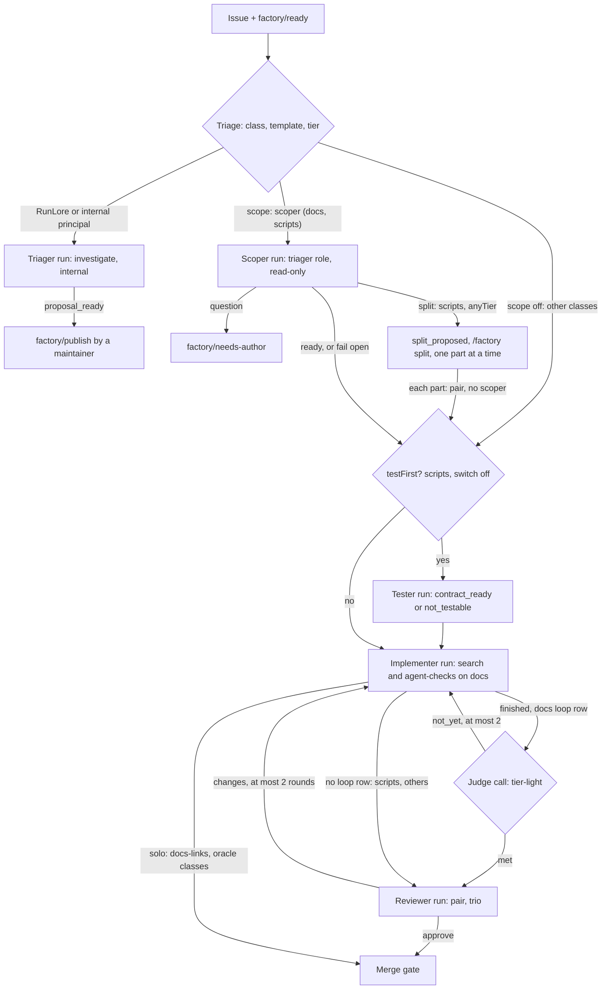

# The harness roles: a study of the factory's roles, the field, OpenHands and the owner's own agent setups

**Date:** 2026-10-30 · **Status:** research; its recommendations are decided in the [harness roles design](2026-10-30-harness-roles-design.md) and planned there · **Part of:** the [v3 roadmap](2026-10-19-v3-roadmap-design.md), features 1, 2, 4, 5, 6 and 13, after the [loops and teams design](2026-10-21-loops-and-teams-design.md) and the [test-first tester design](2026-10-22-test-first-tester-design.md) · **Thesis:** keep the roles, enforce their endings · **Method:** six research notes (the factory's roles today, the owner's OpenCode and Claude Code setups, OpenHands, role-decomposition evidence, harness practices and configs, the v3 motion review), synthesised on 2026-10-30

> **Source key.** External claims cite a URL inline. **[V]** = a vendor's claim about its own product; **[S]** = a secondary or search-summary source. Local claims cite a file: **AP** = agent-platform (Maku, the controller) `origin/main` a48efbec, with `rec/` = `internal/factory/reconciler/`, `h/` = `images/maku-harness/`; **ANR** = ai-native-ref `origin/main` b8f76ec, with `cfg` = `tooling/base/agent-factory/helm-values-configmap.yaml`, `rb/` = `docs/runbooks/agent-factory/`, `site/` = `website/content/docs/platform/ai-platform/`; **XPC** = crossplane-configuration `apis/agentrun/kcl/main.k`; **V3** = the v3 session's own records in the owner's local session ledger (`~/.cache/v3/`, in no repository); **OCS** = the owner's local `opencode-setup` repository; **clip** = `origin/feat/motion-agent-factory-v3` at 347fe27. Paragraphs are labelled **Evidence**, **Inference** and **Recommendation**. "Agent Factory" is the product; "Maku" is its controller component.

The Agent Factory's role set already has the shape every surveyed product converged on: a read-only scoper that may ask one question, one writer, a fresh-context reviewer, read-only search, an independent test artifact and a deterministic-first judge. No role should be added and none merged, including the proposed tester-and-judge merge. The v3 drills show the roles failing at their edges rather than in their judgement. Five budget-runs and two deadline ends stand against two false `met` verdicts, one over-eager tester and one inferred acceptance check. The judgement failures were closed by deterministic guards (Maku #224, #254, #263); the termination failures are still handled by prompt advice (the scoper's 25-call rule) or by time boxes (#275). Two roles lag the field. The reviewer has no factory-written brief at all (its task text is "Work on <PR URL>."), no evidence field, and the implementer's model. The judge runs only on `docs`, so split parts and test-first tasks on `scripts` get none. Every role runs one model family, and no metric attributes cost to a role, so nothing yet measures what any role is worth. Before aws-0, six small changes are worth making: label cost by role, add a judge row to `scripts`, enforce the scoper's exploration cap in the harness, give the reviewer a brief, stop spending continuations on checks the implementer cannot act on, and accept an inline `Acceptance:` paragraph. A docs-truth pass should go with them, covering three high-severity errors in the v3 clip and one claim of unbuilt behaviour. Locally, a factory-like team can be built from documented OpenCode and Claude Code primitives for the read-only roles and the judge. Neither tool reproduces the factory's token-level enforcement, and OpenCode has no per-run budget.

| Question | Short answer |
|---|---|
| How are the roles configured today? | Four AgentRun roles: implementer, reviewer, tester, triager. The scoper and splitter are triager modes; the judge and search are calls inside the implementer. Every tier names `agent-default` (glm-5.3 on public, claude-opus-5-5 on internal), and no classifier is deployed, so every task is `standard` except a 10% `frontier` control group. Only `docs` has a loop row (scoper, judge, stall 60, search). `scripts` has the scoper and splitter. The tester is a session switch, off |
| What does the field do per role? | Same shape everywhere. Published numbers exist almost only for reviewers [V]. The strongest independent evidence: independent tests work as patch filters, clarification should be gated on detected ambiguity, graders should be deterministic first, and LLM judges prefer their own output. Against: parallel writers and role-play teams |
| Local setups versus the factory roles? | Implementer and reviewer have strong local counterparts. Scoper, tester, judge, splitter and triager have none. The local `search-agent` does web and memory research, not repo search. A local team is feasible as configuration, but enforcement drops from tokens and gateway profiles to tool-call permissions and hooks |
| What should change before aws-0? | Six small changes plus one docs bundle (section 7). Everything else waits for aws-0 measurements |
| What must be fixed in the clip? | Three high findings from the review: the gate drawn as the merger, one pipeline for every class, and "Every switch off by default". A fourth high finding: the reviewer's "evidence, or abstain" is not built. Then six medium labelling fixes and the publishing defects (section 6) |

## 1. Executive summary: right roles, weak endings, one model family, no per-role numbers

| Role | Verdict | One line |
|---|---|---|
| Scoper | **Change** | Keep the role and its output shape. Enforce the 25-call exploration rule in the harness instead of the prompt, and accept an inline `Acceptance:` paragraph |
| Splitter | **Keep** | Leave it as the scoper's second answer. Prove `/factory split` → part 1 → part 2 live before touching it |
| Implementer | **Keep** (change around it) | One writer is the settled pattern. Fix what surrounds it: unactionable continuations, the ANR `task check` trap, condensation unknowns |
| Reviewer | **Change** | The least-built role. It needs a factory-written brief, then the L5 evidence field. Run the F15 second-family arm in the session |
| Tester | **Keep** | Its pre-patch contract, verified from GitHub, is the field's best-evidenced tester form. Prove the holds (T2, T3); do not change it |
| Completion judge | **Keep, extend** | Keep the guards and the model. Add a judge row to `scripts` so parts and test-first tasks get a judge |
| Tester + judge merge | **Do not merge** | They already form one acceptance sequence (contract hold, then check guards, then the LLM verdict). Merging the roles would cost the tester its independence |
| Triager | **Keep** | `no_proposal` came from the daily cap, not the prompt. The triager does a different job from the field's "triage into the scoper" advice |
| Search | **Keep, hold** | `docs` only. Run the paired SQ5a gate before widening the tool or forcing its use |

**Cross-cutting finding 1: the roles fail at their ends, not in their judgement.** Recorded v3 failures, by kind:

- Budget: the scoper three times (drill C; S4 at 1.23M tokens; 6ysg5vvt at ~1.55M tokens after 72 calls) and the implementer twice (z4aj4zkj at 8.3M tokens; Mistral vjmsp6ku at 4.80M tokens on a 5-line change).
- Deadline: two runs (#205 after its handoff; E3 #193).
- Judgement: two false `met` verdicts (E #146, E2 #169), one grep test written as a contract (T2), one inferred acceptance check (B).

V3 `v3-program.md:73-354` records all of these. The v2 hard-issue cohort ended 11 of 15 runs `budget-run` with none accepted (ANR spec `2026-10-12-v2-hard-task-cohort-design.md:192-210`). The judgement failures were fixed with deterministic guards. The end conditions are still prompt advice or wall-clock boxes. The field says outright that rules a model keeps missing belong in the harness: "If you keep adding emphasis to a CLAUDE.md line and Claude still misses it, that's a sign the line belongs in a hook" [V] ([Claude Code best practices](https://code.claude.com/docs/en/best-practices)).

**Cross-cutting finding 2: one model family in every role.** Tiers change caps, not models (ANR `cfg:278-283`). The reviewer runs the implementer's `agent-default`, and the judge runs `glm-5.3-flash`, the same family. The only family switch, the F15 `models` row, is off (#218). LLMs prefer their own text: self-recognition correlates linearly with self-preference ([Panickssery et al.](https://arxiv.org/abs/2404.13076)), and the effect is linked to familiarity, or low perplexity ([Wataoka et al.](https://arxiv.org/abs/2410.21819)). Cognition runs mixed Claude and GPT pairs in production [V] ([Cognition, 2026-04-22](https://cognition.com/blog/multi-agents-working)). The caveat: the best-supported independence is of context, not of family ([Claude Code best practices](https://code.claude.com/docs/en/best-practices)), and one informal write-up found no meaningful home-company bias [S] ([tianpan.co](https://tianpan.co/blog/2026-05-25-the-judge-that-agreed-with-itself-across-a-and-b)). Family diversity is therefore a hypothesis to test, not a fix to ship.

**Cross-cutting finding 3: no role has a measured value.** `maku_factory_run_cost_usd` is labelled by tier only (AP `docs/operations.md:239`). No false-`met` rate exists. The search on/off gate SQ5a has not run. The reviewer has no evidence field. The bench is parked: a session costs about $400 against a $600 budget (ANR `site/status.md:165`). Two "Proven live" badges overstate their evidence: search rests on one drill with three calls, and the tester's contract holds have no reading at all (ANR `rb/21-test-first-tester.md:39-69`). The field reports cost next to accuracy: the OpenHands Index scores ability, cost and run time per model [V] ([OpenHands Index](https://openhands.dev/blog/introducing-the-openhands-index)). Anthropic recommends starting with 20 to 50 tasks drawn from real failures and tracking pass@k and pass^k ([Anthropic, 2026-01-09](https://www.anthropic.com/engineering/demystifying-evals-for-ai-agents)).

## 2. The roles today: a gap map against the field

The flow below follows note 01 and the shipped config. Diamonds are decisions or calls; boxes are runs or states. A part re-enters as its own `scripts` task; that it meets the tester gate is inferred from the tester's trigger, "every public task of a `testFirst` class" (AP `rec/tester.go:23-35`).



| Role | Runs today | Model and caps | Ends on | Field's best-supported practice | Gap |
|---|---|---|---|---|---|
| Scoper | `docs`, `scripts` | `agent-default` at light caps ($0.51, 300k, 20 min); task tier when a split is offered | `room_handoff`, a cap, or fail open | Short, checkable definition of done; ask only when ambiguity is detected; bounded exploration | 25-call rule is prompt-only; light cap still binds `docs`; inline `Acceptance:` bounced |
| Splitter | `scripts` (`anyTier`) | the scoper's | a maintainer's `/factory split` | File-disjoint, independently verifiable units; single-threaded writes | Accepted path never run live; parts get no judge |
| Tester | cloud-native-ref `scripts`, switch off | task's model and caps | `contract_ready`, `not_testable`, `contract_not_red`, `contract_outside_tests` | Independent reproduction test before the patch; never edit tests | Holds (T2) and holdouts (T3) unproven; never co-occurs with a judge |
| Implementer | always | `agent-default`, standard $2.55 / 1.5M / 45 min | `finished`, `stuck`, caps, stall, judge | A pass/fail check it can run; one writer; lint-on-edit; small units | Continuations on checks it cannot act on; budget burn on long runs |
| Judge | `docs` only | `tier-light`: glm-5.3-flash public, claude-haiku-5-5 internal | `met`, `not_yet` (≤2 continuations, 15-min box), `impossible` | Deterministic graders first; LLM for the rest with a way out; per-issue feedback; different family | Absent on `scripts`; same family; no false-`met` rate |
| Reviewer | `pair`, `trio` | `agent-default`; frontier USD cap ($6.80) on ~90% of tasks | `room_verdict` approve or changes, ≤2 rounds | Fresh context; diff plus spec; correctness only; silence allowed; evidence cited; different family | No brief; no evidence field; reads the implementer's handoff summary; same model |
| Triager | `investigate` (RunLore link off) | claude-opus-5-5, internal | `proposal_ready` or `no_action` | Readiness and dedupe pre-filter | `persisting` verdict path unproven |
| Search | `docs` only | run's model at effort `low`; 40 iterations, 300k tokens, 300 s, 6 calls | one answer of at most 8,000 characters | Read-only, small model, summarized, effort knob; a hook if mandatory | One drill; SQ5a not run; tool use is at the model's discretion |

## 3. Role by role

### 3.1 Scoper: the right output, a prompt-only end

**Today.** The scoper is a read-only `triager` run with a scoping brief (AP `rec/text.go:197-230`). It hands off `scope {state, task, touches 1-10, leave, plan 1-7, assumptions 0-5, acceptance 1-5, question}` (AP `envelope/scope.go:26-96`) and reaches GitHub read-only. It has no search tool, no loop policy and no stall rule.

A factory guard rewrites a `ready` scope into the question "which command or observation proves it is done?" when the issue has no `## Acceptance` heading. The model's own `ready` "is not trusted for it" (AP `rec/scoper.go:83-142`). Missing scopes, caps and errors fail open: the implementer then runs unscoped.

The drills:

| Drill | Result |
|---|---|
| A | Pass |
| B | The scoper inferred its own acceptance check; fixed by #222 |
| C | Budget-run while reading the tree |
| B2 | Pass |
| H4 | Bounced: an inline `Acceptance:` paragraph was not recognised |
| S4 | Budget-run at 1.23M tokens |
| #2648 | `needs_author`, correctly: the work already existed at HEAD |
| ziawgisq | Split described in the room but left out of the handoff; fixed by #277 |
| 6ysg5vvt | No handoff after 72 calls; fixed by #278: the 25-call rule, and the task's tier once a split is offered |
| #2672 | Three-part split proposed in 8 minutes |

Sources for the drills: V3 `v3-program.md:73-353`.

**Evidence.** The field rewards detection-gated asking. Models "struggle to distinguish between well-specified and underspecified instructions", and interaction recovers up to 74% ([Ambig-SWE](https://arxiv.org/abs/2502.13069)). Decoupling underspecification detection from execution reached 69.40% on underspecified SWE-bench Verified ([Ask or Assume](https://arxiv.org/abs/2603.26233)). About 10% of SWE-bench Lite lacks the information needed to solve it ([Agentless](https://arxiv.org/html/2407.01489v2)).

A planner earns its keep when the writer under-scopes. Anthropic kept its planner for that reason, at $0.46 of a $124.70 run [V] ([Anthropic, 2026-03-24](https://www.anthropic.com/engineering/harness-design-long-running-apps)). Long spec stages backfire on small work: Kiro produced "a total of 16 acceptance criteria" for a small bug, and agents ignored spec notes ([Böckeler](https://www.martinfowler.com/articles/exploring-gen-ai/sdd-3-tools.html)). Short, well-scoped issues merge more often (AUC 72%) ([Sayagh](https://arxiv.org/abs/2512.21426)).

On effort, "agents struggle to judge appropriate effort", so Anthropic hard-coded 3 to 10 tool calls for simple fact-finding [V] ([Anthropic, 2025-06-13](https://www.anthropic.com/engineering/multi-agent-research-system)). The tools enforce the end themselves:

- OpenCode `steps`: "On the final step, OpenCode removes tools and asks the model to summarize" [V] ([OpenCode agents.mdx](https://github.com/anomalyco/opencode/blob/v2.1.2/services/www/src/docs/content/agents.mdx)).
- Claude Code `maxTurns` returns a partial, resumable result [V] ([sub-agents](https://code.claude.com/docs/en/sub-agents)).
- OpenHands nudges once, then halts as STUCK ([stuck detector](https://docs.openhands.dev/sdk/guides/agent-stuck-detector)).

**Inference.** The scoper's output already is the field's best form: short, checkable, one gated question. The acceptance rewrite is the "detection decoupled from execution" that Ask-or-Assume measures, done by a regex rather than a model. The weak part is the end condition. Three of the ten recorded scoper drills ended on budget, and #278 raised the cap only for split-offered scopers. A `docs` scoper still runs at $0.51 under prompt advice. When it over-reads, it fails open, and the judge then reads the whole issue text, because no acceptance heading reaches the brief (AP `h/loop_policy.py:72-75`).

**Recommendation.**

- **Count the scoper's tool calls in the harness (S).** At 25, post one nudge: "hand off what you have". At a hard limit, about 40, strip tools and ask only for `room_handoff` (OpenCode's final-step pattern). With no handoff, fail open as today and count the outcome as `budget`.
- **Accept a single-line `Acceptance:` paragraph (XS)** in both readers (`scoper.go:110`, `loop_policy.acceptance`). Keep bouncing issues that have none.
- **Do not give the scoper the search tool yet.** Six full searches can exhaust a light run cap (SQ3), and search's value is unmeasured.
- **Do not change "exactly one question".** No source tests the number, and Ask-or-Assume favours sparse asking.

### 3.2 Splitter: the conservative form the field supports, still unproven past the proposal

**Today.** The splitter is the scoper's second answer, offered on `scripts` with `anyTier`. It returns 2 to 5 `ready` children beside the whole-task scope, and the task escalates `split_proposed`. A maintainer's `/factory split` opens part 1, then part k+1 only once part k is `Done`. Parts run `pair` at `standard`, never run a scoper, and share a family cap of $20.40 (AP `docs/factory.md:1261-1303`; ANR `cfg:333`).

The drills:

| Drill | Result |
|---|---|
| S1 | One unit, correctly not split |
| S3 | Not split |
| S4 | Budget-run |
| #2672 | Three file-disjoint parts proposed (script, dashboard, docs); left `proposed` at teardown |

No source records an accepted split, a part opening, a family cap hit or a `child_dropped` (V3 `status-report-2026-10-29-final.md:34`).

**Evidence.** Success decays roughly exponentially with task length ([Ord](https://arxiv.org/abs/2505.05115); [METR](https://metr.org/blog/2025-03-19-measuring-ai-ability-to-complete-long-tasks/)), so smaller verifiable units help. Multi-agent results range from +80.8% on decomposable work to −70.0% on sequential planning ([arXiv 2512.08296](https://arxiv.org/abs/2512.08296)). Unmerged agent PRs are larger, touch more files and fail CI more often ([Ehsani et al.](https://arxiv.org/abs/2601.15195)). The working pattern keeps "writes single-threaded" [V] ([Cognition, 2026-04-22](https://cognition.com/blog/multi-agents-working)). Claude Code warns that "two teammates editing the same file leads to overwrites" [V] ([agent teams](https://code.claude.com/docs/en/agent-teams)). Anthropic dropped sprint decomposition for Opus 4.6 but kept its planner [V] ([Anthropic, 2026-03-24](https://www.anthropic.com/engineering/harness-design-long-running-apps)).

**Inference.** The factory's splitter is the form this evidence supports. Each part must pass its acceptance checks alone, parts run in order, a human approves, and writes stay single-threaded. S1 and #2672 came from the same prompt, so splitting is the model's call on separability, which is the right place for that decision. Two weaknesses remain:

- Parts on `scripts` run with no judge. AP `docs/factory.md:1283-1285` says a part's brief "puts the part's checks first, so the completion judge reads the part's", which does not hold without a loop row.
- Nothing verifies that part k+1 starts from part k's merge, beyond the brief's instruction.

**Recommendation.** No change beyond the `scripts` judge row (3.5). Prove the accepted path on aws-0. After aws-0, compare each part's scope `touches` with its diff before tuning anything, and re-test whether to split at all at each model generation.

### 3.3 Implementer: one writer is right; its continuations and budget are not

**Today.** The implementer is the only writer: an OpenHands agent-server driven by `agent-run`, with the platform rules from XPC `main.k:296-312`. It runs the default OpenHands tools, plus the platform MCP and `search` on `docs`.

A run ends on any of these:

- `finished`, `error` or `stuck` (OpenHands' own detector);
- `max_iterations 500`;
- the USD cap;
- `runMinutes`;
- 10 minutes without room activity;
- on `docs`, the stall rule (no commit by step 60) and the judge (AP `h/agent_run.py:42-43, 358, 1492-1494`).

The `agent-checks` rule before each push is prompt text (AP `h/agent_run.py:720-722`). The drills:

| Drill | Result |
|---|---|
| A | Two LLM timeouts killed runs; a timed-out call is now retried once (#224) |
| F2 | Checks proven: one push, `fixRuns` 0 |
| H3 | Stalled building the site without egress |
| #205 | Ran about 40 minutes and 2.2M tokens after its handoff, ending on the 45-minute deadline |
| z4aj4zkj | 8.3M tokens, budget-run |
| vjmsp6ku (Mistral) | 4.80M tokens ($2.5572) on a correct 5-line change |

**The notes disagree on #205.** The morning status report says the implementer "kept validating after its handoff", with 83 terminal calls and four helm-install attempts (V3 `status-report-2026-10-29-morning.md:22`). The harness README and the session log say continuation 1 of 2 was bounded only by the wall clock: "36 minutes retrying a CI log the sandbox could not reach", which the 15-minute box fixed (#275) (AP `h/README.md:50-52`; V3 `v3-program.md:320`).

Note 01 reads both as the same run and the second as the later, code-backed diagnosis. Note 04 treats "the implementer stops at hand-off" as an existing factory practice. Note 01 finds no stop-at-handoff behaviour in code. The code wins.

**Evidence.**

- **One writer** is the settled pattern ([Cognition, 2025-06-12](https://cognition.com/blog/dont-build-multi-agents)).
- **Interface design moved results more than role splits did** ([SWE-agent](https://arxiv.org/html/2405.15793)), with GPT-4 Turbo on SWE-bench Lite:

  | SWE-agent ablation | Result |
  |---|---|
  | Edit command | 18.0 with linting, 15.0 without |
  | Search | 18.0 summarised, 12.0 iterative, 15.7 with no search tool |
  | Failed edits | 51.7% of trajectories had one; success odds fell from 90.5% to 57.2% after the first |
  | Median cost | $1.21 over 12 steps for successful runs; $2.52 over 21 for failures |

- **Architect/editor splits** helped 2024 models: o1-preview rose from 79.7% to 85.0% ([Aider](https://aider.chat/2024/09/26/architect.html)). On the 2025-11 leaderboard, o3 (high) with a gpt-4.1 editor scored 78.2% at $17.55 against o3 solo at 81.3% at $21.23 ([Aider leaderboards](https://aider.chat/docs/leaderboards/)). A search summary gives o3 solo at 76.9% and $13.75 [S]. The sources disagree, so the only safe reading is "cost saving, not a quality gain".
- **Implementer-written tests:** changing how many tests the agent writes "do[es] not significantly change final outcomes" ([Chen et al.](https://arxiv.org/abs/2602.07900)).
- **Failures belong in context in compact form** [V] ([Manus](https://manus.im/blog/Context-Engineering-for-AI-Agents-Lessons-from-Building-Manus)).
- **Mid-task additions hurt:** Devin "performs worse when you keep telling it more after it starts" [V] ([Cognition, 2025-11-14](https://cognition.com/blog/devin-annual-performance-review-2025)).

**Inference.** The role shape is right; the waste is in the loop around it. #224 accepted the cost of an "extra continuation on unrelated red CI". The pending-check guard sends the implementer a `not_yet` after the judge's 5-minute wait, even though the implementer cannot act on a check that is still pending. In #205 it also could not reach the failing log. That made the continuation unactionable by construction, and the 15-minute box only caps its cost at 2 × 15 minutes.

The four helm installs in the ANR run plausibly come from ANR `AGENTS.md` ("`task check` is the evidence") meeting a sandbox toolchain without helm (ANR `.github/agent-checks.yaml:5`). No source states that cause; it is an inference.

**Recommendation.**

- **Triage `not_yet` before spending a continuation (S).** If the only problem is a pending check, re-poll within the box without sending a message. If a check failed, have the harness fetch the failing check's log tail with its own `gh` and quote it, fenced, into the continuation, so the model never retries a log it cannot reach.
- **Add an ANR steering note (XS):** in the sandbox, `agent-checks` is the evidence and `task check` runs in CI.
- **Log the handoff time and every judge round in the final read,** so aws-0 can settle the conflict above. Build stop-at-handoff only if the logs show work between handoff and `finished`.
- **Do not adopt an architect/editor split, and do not mandate implementer-written tests.**

### 3.4 Reviewer: the role with the most field evidence and the least factory build

**Today.** The reviewer's run task is the PR URL (AP `rec/team.go:54-58`), and the composition writes "Work on <url>." (XPC `main.k:576`). It gets no factory-written brief. Its rules are:

- read-only;
- record a `room_verdict`;
- on check classes, "run `agent-checks` on the pull request's head and cite its first line as your evidence" (AP `h/agent_run.py:723-724`).

`room_read` returns messages and handoffs, so the reviewer reads the implementer's handoff summary but not its transcript (AP `mcp/tools.go:243`).

The verdict is `approve` or `changes`, with a summary and the commit. `changes` triggers a revision, up to 2 rounds. A missing verdict fails closed. The gate needs an approving verdict (`no_approving_verdict`).

The reviewer runs on `agent-default`, which is the implementer's model (glm-5.3 on public). In code only its USD cap changes, via the other tier's label. The loops-design decisions L4 (argument-scoped `room_read`), L5 (`evidence` field, `abstain`) and L6 (deferred PR comment) are not built (AP `mcp/tools.go:204-206`). v3 reviewer evidence is one F15 Kimi run: $0.0896, with an 82% cache-read share (V3 `v3-program.md:352`).

**Evidence.** The fresh-context reviewer is the best-supported split:

- **Independence:** `/code-review` "reviews the diff in a fresh subagent that never saw your conversation. It isn't swayed by the reasoning that produced the code" [V]. A reviewer "asked to find problems will always find *something*", so the prompt should say: report "only the gaps that affect correctness. Skip style" [V] ([Claude Code best practices](https://code.claude.com/docs/en/best-practices)).
- **Review rules from the trusted branch:** "`REVIEW.md` from the base or default branch and never from the pull request's own changes" [V] ([Claude Code Code Review](https://code.claude.com/docs/en/code-review)).
- **Copilot** is actionable in 71% of reviews and "says nothing at all" in 29%. Agentic context gathering added +8.1% positive feedback; a stronger model added +6% at +16% latency [V] ([GitHub blog](https://github.blog/ai-and-ml/github-copilot/60-million-copilot-code-reviews-and-counting/)).
- **Anthropic's Code Review** raised the share of PRs with substantive comments from 16% to 54%, with under 1% of findings marked incorrect, at $15-25 and about 20 minutes per review [V] ([Anthropic](https://claude.com/blog/code-review)).
- **Cognition:** reviewer and coder work best when they "do not share any context beforehand" [V] ([Cognition, 2026-04-22](https://cognition.com/blog/multi-agents-working)).
- **Narrative anchoring:** PR metadata refined to frame a change as safe beat Claude Code and CodeRabbit review pipelines in 32 of 33 CVE cases ([Mitropoulos et al.](https://arxiv.org/abs/2603.18740)).
- **Explanation-heavy prompts** raise misjudgment ([Jin and Chen](https://arxiv.org/abs/2603.00539)).
- **In the wild,** only 0.9% to 19.2% of valid AI review comments led to code changes, against 60% for human comments [S] ([arXiv 2508.18771](https://arxiv.org/pdf/2508.18771)).
- **Skepticism can be tuned:** making a standalone evaluator skeptical is "far more tractable" than making a generator critical of its own work [V] ([Anthropic, 2026-03-24](https://www.anthropic.com/engineering/harness-design-long-running-apps)).

**Inference.** On every lever the field uses, the factory reviewer is at the default:

- no rubric;
- no "silence allowed" instruction;
- no spec handed to it as such (it must find the scope in the room);
- the implementer's narrative readable in the room;
- the implementer's model.

Its quality rests on the model and on the checks rule. Abstention costs little in human clicks. The merge-gate report (2026-10-29, §1) found that every agent PR outside `docs-links` and `revert` already goes to a human approval and an admin-bypass merge, and `docs-links` runs `solo` with no reviewer. An `abstain` that the gate reads as `no_approving_verdict` therefore lands where those PRs already go.

**Recommendation.**

- **Write a reviewer brief in the factory (S),** mirroring the implementer's: the scope's acceptance checks first, the fenced issue snapshot, the PR URL. Rules: review the diff against the acceptance checks, report only gaps that affect correctness, skip style, approve when there are none, and cite the command and output relied on (`agent-checks`' first line or the head's check run). Do not quote the implementer's handoff in the brief.
- **Defer L4 (M):** a `kinds` argument on `room_read` that excludes implementer messages. Run it after aws-0.
- **Build L5 (M)** before publishing the clip if the clip keeps "evidence, or abstain"; otherwise after aws-0.
- **Run F15 as a session arm (config only):** `loops.<class>.models.reviewer.frontier: kimi-frontier` on public classes, recording the model per verdict as the merge-gate report's rank 6 proposes ("the reviewer model is part of the policy").
- **Do not add parallel reviewer lenses** at the factory's volumes.

### 3.5 Tester and judge: keep two roles, one acceptance sequence

**Tester today.** The tester runs before the implementer on public tasks of a `testFirst` class. Its brief says to write tests that "fail on the current code and pass once the task is done", never to change the code under test, and that a documentation-only change is not testable (AP `rec/text.go:253-262`).

The model never pushes: its push URL is disabled. The harness squashes the commits, proves the tests red on the base, and pushes one signed commit. The factory adopts the contract only after verifying it from GitHub (AP `docs/factory.md:148-169`). The implementer gets a pre-commit hook, a red `test-contract hold` that becomes `not_yet` before the judge, and gate rows 2b and 2c.

Live readings:

| Drill | Result |
|---|---|
| T1 | Contract written, `Test contract` check passed, merged |
| T2 | A grep test written on prose; fixed by `not_testable` handling in #263 |
| #2650 | `not_testable`, correctly |

The holds (pre-commit refusal, `contract_disputed`, `contract_modified`, a rebased head) and the holdouts have no reading (ANR `rb/README.md:381-382`). The status page nonetheless lists "the implementer works to it and cannot change it" as proven live (ANR `site/status.md:110`). The switch is off, and turning it on also needs `checks: true` on the class (ANR `cfg:48`).

**Judge today.** The judge is one stateless call to `/judge/v1` when the conversation finishes. It reads the acceptance section, the head's check runs (after waiting up to 5 minutes), the diff (16 KiB cap) and up to 20 named paths. It answers `met`, `not_yet` or `impossible` with evidence ids (AP `h/loop_policy.py:55-143`). Its guards are already shipped:

- a failing or pending check, or an unpushed head, is never `met`;
- a missing required path is never `met`; an unmakeable one becomes `impossible`;
- invalid verdicts are discarded;
- continuations are boxed at 15 minutes.

The judge runs only where a loop row exists, today `docs`.

**Evidence for merging them** (note 04's proposal):

- Deterministic graders should come first ([Anthropic, 2026-01-09](https://www.anthropic.com/engineering/demystifying-evals-for-ai-agents)).
- A hybrid verifier reached 51% against about 42-43% for either execution-based or execution-free verification alone [S] ([R2E-Gym](https://arxiv.org/pdf/2504.07164)).
- Generated reproduction tests lifted Agentless from 27.00% to 32.00% ([Agentless](https://arxiv.org/html/2407.01489v2)) and "doubl[ed] the precision of SWE-Agent" ([SWT-Bench](https://arxiv.org/abs/2406.12952)).
- An evaluator "still added value on tasks at the edge of the model's solo capability, but was unnecessary overhead for tasks within it" [V] ([Anthropic, 2026-03-24](https://www.anthropic.com/engineering/harness-design-long-running-apps)).

**Evidence against a literal merge:**

- **Independence.** SWT-Bench and Agentless gain from tests authored independently of the patch. A judge that chose or wrote tests after seeing the diff would lose that independence.
- **Opposite trust models.** The tester writes, and the harness and GitHub verify its contract. The judge is a tool-less call. Merging them would either give a stateless call write power or give a model-run judge tools and their cost.
- **Oracles leak.** About 7.8% of "correct" patches fail the developer tests, and 29.6% of plausible patches behave differently from ground truth [S] ([Wang, Pradel, Liu](https://arxiv.org/html/2503.15223v2)). Tests alone are not the whole verdict.

**Inference.** The factory already has the field's "one acceptance gate", as a sequence rather than as a role:

1. A red contract becomes `not_yet` before any judge.
2. The check and path guards run.
3. The LLM verdict comes last.

In today's config the tester (`scripts`, off) and the judge (`docs`) never run on the same task, so a merge would change nothing operationally. The real gap is coverage. Claude Code's `/goal` uses the same three verdicts with "a small fast model" that "does not call tools" [V] ([Claude Code goal](https://code.claude.com/docs/en/goal)), which suggests the judge's design is not idiosyncratic. The judge offers no "unknown" exit, as Anthropic advises ("give the LLM a way out"); an unsure judge spends a continuation instead.

**Recommendation.**

- **Do not merge the roles.**
- **Add `judge: tier-light` to the `scripts` loop row (XS).** That also switches on the default stall rule (80 steps) and two continuations (AP `config.go:1688-1720`), so parts and test-first tasks get a judge.
- **Keep `continuations: 2`.** OpenHands caps refinement at 3 [V].
- **Ship the `not_yet` triage from 3.3.**
- **After aws-0,** name the judge's `not_yet` reasons from a fixed rubric list to get per-failure-mode counts (incomplete implementation, failing check, missing path, scope creep, skipped tests: a subset of the OpenHands critic's 24 rubrics, see 4), and test an `unknown` verdict.
- **Tester:** no code change. Prove T2 and T3, and fix the status page until then.

### 3.6 Triager: a different job from the field's triage, and not the cause of `no_proposal`

**Today.** The triager is the only run in the `investigate` template: read-only, forced internal, on claude-opus-5-5. It confirms or refutes a RunLore finding. If a change is needed, it hands off a public issue draft (title `<area>: <what is wrong>`, three fixed sections, no cluster detail); otherwise it ends `no_action`. A maintainer publishes the draft with `factory/publish` (AP `rec/text.go:180-190`; AP `docs/factory.md:655-671`).

Stage 2 ran end to end twice: #2631 → #2638 merged (RunLore missed the human merge, fixed by #267), then p3fxdxuu with verdict `resolved`. RunLore's own verify investigation hit its 6-step maximum with confidence 0 (V3 `v3-program.md:237-327`).

**The notes disagree on `no_proposal`.** The first reading was that the RunLore triager run 2d5ch27g "made no proposal" (V3 `v3-program.md:300`; `status-report-2026-10-29-morning.md:12, 26`). The later root cause: the task was refused by the global `tasksPerDay 20` cap at 22:58:45Z, the stub still said "investigates", and publish then said `no_proposal`. Maku #276 now answers `429 daily_task_cap` at intake (V3 `v3-program.md:305-306, 320`). The later reading is backed by a cap count and a code fix, so the triager's prompt was never shown defective.

**Evidence.** The field's "triage" is a readiness and dedupe pre-filter. The most common reasons fix PRs stay unmerged are failing tests and "prior resolution of the same issues by other PRs" ([Alam et al.](https://arxiv.org/abs/2602.00164)); duplicates and unwanted features recur ([Ehsani et al.](https://arxiv.org/abs/2601.15195)). No source measures incident-to-PR agents. Zero-shot LLM issue labelling is inconsistent across datasets [S] ([Colavito et al.](https://conf.researchr.org/details/esem-2025/esem-2025-journal-first-track/2/Benchmarking-large-language-models-for-automated-labeling-The-case-of-issue-report-c)).

**Inference.** Note 04's "merge the triager into the scoper at low volume" addresses issue readiness, and the factory's scoper already does that: the acceptance bounce, and #2648's "already done at HEAD" `needs_author`. The factory's triager investigates a monitoring finding with internal cluster tools: different input, data class, model and token. The two cannot share a run.

**Recommendation.** No change. Prove the `persisting` path. Count `needs_author` outcomes caused by already-done work: the field's top unmerged reason is a duplicate.

### 3.7 Search: used once, valued never

**Today.** Search is a read-only child conversation on the run's own model at effort `low`. It has `grep`, `glob`, `read_file` and `list_directory`, and is bounded at 40 iterations, 300k tokens, 300 s, 6 calls a run and 8,000 characters back (AP `h/site/agent_search.py:38-81`). It was ignored in four drills (H1, H2, H4, H5) until #261 moved the rule into the brief's first lines and added a one-time nudge. Drill #205 then made three calls, one of them after the handoff (V3 `v3-program.md:302`). The "Proven live" badge rests on that one run, and SQ5a has not run (ANR `rb/README.md:326-331`).

**Evidence.**

- Windsurf and Devin trajectories spent ">60% of their first turn just retrieving context" [V] ([Cognition SWE-grep](https://cognition.com/blog/swe-grep)).
- Summarised search beat iterative search, and iterative search did worse than none ([SWE-agent](https://arxiv.org/html/2405.15793)).
- "A fresh subagent first has to gather context your conversation already had, so it can end up *slower*" [V] ([Claude Code best practices](https://code.claude.com/docs/en/best-practices)).
- Whether an offered tool gets used is at the model's discretion in every vendor's docs. A mandatory step belongs in a `PreToolUse` hook that denies with a reason [V] ([Claude Code hooks](https://code.claude.com/docs/en/hooks)).
- No study explains why models skip offered tools (note 05).

**Inference.** The calls cannot be attributed to any one of the three #261 changes, and a greppable repository may simply not need search. Forcing search before its value is known risks the "slower than inline" cost the vendor itself warns about.

**Recommendation.** Hold. Run SQ5a with paired drills, and record the ledger's `budget` and `error` share plus the child's token share. Reword the badge to "used live in one drill; value unmeasured". Only if SQ5a pays, consider a `tier-light` search model, as the field's small-model searchers suggest, and then other classes.

## 4. OpenHands: what transfers and what does not

OpenHands argues for one generalist agent. Neubig names three costs of multi-agent setups: structure mismatch, lossy summaries and maintenance. He also names the exception: multi-agent is right where an agent has privileged information or agents act for different people ([Neubig](https://www.openhands.dev/blog/dont-sleep-on-single-agent-systems)). The factory's roles are that exception. They hold different tokens and different capability profiles; the triager has internal cluster read and the implementer has write. The roles are trust boundaries, not prompt personas, so the single-agent argument does not apply.

OpenHands' own gains came from models and tools, not roles. V0 and V1 scored 68.0% each on Sonnet 4; Sonnet 4.5 gained +8.2 from extended-thinking support; errors fell 61% [V] ([SDK paper](https://arxiv.org/html/2511.03690v2)).

| Mechanism | What OpenHands does (numbers) | Caveats | Factory today | Transfer |
|---|---|---|---|---|
| Stop hooks | A `Stop` hook can deny finishing; the SDK repo runs pre-commit, targeted pytest and GitHub CI so the agent cannot finish red ([Hooks](https://docs.openhands.dev/openhands/usage/customization/hooks); [repo customization](https://docs.openhands.dev/openhands/usage/customization/repository)) | No effect sizes | The judge's check guards and the red contract act at `finished`; `agent-checks` before a push is prompt text | Largely present. Run `agent-checks` in the harness at `finished` only if aws-0 shows red fast checks at push |
| Rubric critic with thresholds | 4B critic over 24 rubrics: Best@8 73.8% against Random@8 57.9% on a 148-instance mixed-outcome subset; early stop at τ=0.5 after 1.35 attempts (+17.7 over random); CLI refinement when the overall score is below 60% or any single issue is above 75%, at most 3 rounds [V] ([paper](https://arxiv.org/html/2603.03800); [CLI critic](https://docs.openhands.dev/openhands/usage/cli/critic)) | Gain measured on a selected subset; benchmark-trained critics score AUC 0.45-0.48 on production outcomes; a success-only critic lost 8.1 points on Opus 4.5 trajectories; needs production traces; "highly experimental" | One LLM verdict with a free-text reason; 2 continuations | The rubric vocabulary for `not_yet` reasons, and the cap of at most 3. Not the learned critic, not best-of-N |
| Path-triggered skills | A `paths:` glob injects guidance once, when the agent first touches a matching file; it beats keyword triggers ([Skills](https://docs.openhands.dev/overview/skills)) | No ablation; context files gave "no measurable gain" at +20% cost [S] ([Gloaguen et al.](https://arxiv.org/pdf/2602.11988)) | One steering note per class | Later, for paths that caused drills (site build, `.github/`), if class notes grow |
| Content-based stuck detection | Five patterns over the last 20 events (≥4 identical action-observation pairs, ≥3 identical action-errors, ≥3 monologue turns, ≥6 ping-pong cycles, repeated context-window errors); one nudge on an error streak, then STUCK ([guide](https://docs.openhands.dev/sdk/guides/agent-stuck-detector); [source](https://github.com/OpenHands/software-agent-sdk/blob/main/openhands-sdk/openhands/sdk/conversation/stuck_detector.py)) | Hard-coded thresholds halted a legitimate polling task ([#762](https://github.com/OpenHands/software-agent-sdk/issues/762)); no FP/FN data | Already active: the harness is agent-server and ends on `stuck`; the stall rule adds a progress check, for the implementer only | The nudge-then-stop shape for the scoper (3.1). Its 72 reads of different files would not match these patterns |
| Resumable sub-agent tasks | `task(prompt, subagent_type, resume?)`, persisted and resumable by `task_id` ([Task Tool Set](https://docs.openhands.dev/sdk/guides/task-tool-set)) | "Designed for sequential blocking tasks" | Judge continuations resume the same conversation, cache intact; revisions start fresh runs; lost sandboxes resume from a checkpoint | Not now. Resuming across review rounds needs conversation state persisted across pods. Revisit with per-role cost data |
| Deterministic risk analyzer | Pattern, PolicyRail and Ensemble analyzers beside a self-labelled LLM risk; `ConfirmRisky(HIGH)` by default; "the model can be manipulated" ([Security](https://docs.openhands.dev/sdk/guides/security)) | LLM analysis "subject to adversarial prompts" | Boundaries at the octo-sts token, egress, gateway profile and platform-rule layers | Nothing: the factory's boundary sits below the agent and is stronger |
| Cost next to accuracy | The Index scores ability, cost and run time; QA runs in three tiers: mocked-LLM per commit, $0.5-3 LLM smoke runs, $100-1000 benchmarks [V] ([Index](https://openhands.dev/blog/introducing-the-openhands-index); [SDK paper](https://arxiv.org/html/2511.03690v2)) | Vendor-run | Cost by run and tier; bench parked | Yes: a role label on cost, and cost per accepted PR per arm in SQ5a |
| Condenser | Summarises the middle of the log, keeps the head; 54% against 53% at up to 2x lower per-turn cost on an unstated subset [V] ([blog](https://openhands.dev/blog/openhands-context-condensensation-for-more-efficient-ai-agents)) | Top remaining V1 production error was a condensation bug; summarising misses the KV cache ([#1496](https://github.com/OpenHands/software-agent-sdk/issues/1496)). **Defaults conflict:** class default `max_size` 240 / `keep_first` 2, `default_condenser()` 80/4, docs 120/4, an earlier summary 60 ([source](https://github.com/OpenHands/software-agent-sdk/blob/main/openhands-sdk/openhands/sdk/context/condenser/llm_summarizing_condenser.py); [docs](https://docs.openhands.dev/sdk/arch/condenser)) | Unknown whether `agent-run` condenses; the scoper's brief says "the whole conversation is re-sent each turn" | Read the value from the pinned SDK version, not the docs. Open question 1 |

**Inference.** Of the seven mechanisms reviewed, two are already present (stop-style gates, stuck detection) and one is weaker than what the factory has (the risk analyzer). Resumable tasks are premature. The two that transfer now are cheap: a rubric vocabulary for the judge's feedback, and cost reported next to accuracy.

## 5. The owner's OpenCode and Claude Code setups

### 5.1 Inconsistencies worth fixing, ranked

| Rank | Finding | Evidence | Fix | Size |
|---|---|---|---|---|
| 1 | The `factory` MCP server exists only in the generated `opencode.json`, so the next `setup-opencode.sh` run drops it. It also runs `roomctl mcp` v0.23.2, the pre-v0.30.0 name, while ANR ships Maku v0.30.4 | `~/.config/opencode/opencode.json` L31-38; OCS `bin/setup-opencode.sh:241-245`; skill pins `roomctl-version: v0.23.2` | Install `maku`; register it through `maku setup opencode` or the OCS profile | XS |
| 2 | No permission rule covers `factory_*` tools, which include `issue_file` (files a GitHub issue) | `opencode.json` L41-147 | Allow the read tools, `ask` on `factory_issue_file`, per agent | XS |
| 3 | Claude Code safety is loose: 53 allows, no deny rules (stale `asdf` entries, `Bash(curl:*)`, `sudo pacman`); cloud-native-ref allows `rm`, `aws`, `aws ec2 delete-volume`, `sudo chmod`; `autoMode.environment` describes only `runlore`; no `hard_deny`. Deny rules "hold in every mode" [V] ([permission modes](https://code.claude.com/docs/en/permission-modes)) | `~/.claude/settings.local.json` L2-60; cnref `.claude/settings.local.json` | `permissions.deny` for destructive commands; `hard_deny`; rewrite the environment for the current repos | S |
| 4 | `main`, `fast` and `controller` have no `edit` rule, so they inherit the global `edit * ask`: implementers may prompt on every edit, and the controller is not hard-blocked (unverified at runtime) | OCS `config/agents/main.md`; `opencode.json` L43-46 | Explicit `edit` rules; add `steps` | XS |
| 5 | The fix loop allows 3 rounds; the loaded Superpowers 6.4.2 SDD allows 5 (rounds 1-3 resume, rounds 4-5 a fresh, stronger implementer) | OCS `controller.md:167-168` against SDD `SKILL.md:372-386` | Align with SDD, or document the override | XS |
| 6 | The OpenCode reviewers are stale copies: AppRole where cnref now uses the per-cluster JWT mount, a wrong `validate-manifests.sh` path, "IAM (AWS EKS)" wording | OCS `security-reviewer.md:57`, `kubernetes-reviewer.md:69` against cnref `.claude/agents/` | Load cnref's maintained versions. aws-0 makes EKS wording relevant again, so take the maintained text rather than editing by hand | S |
| 7 | The global OpenCode `AGENTS.md` (329 lines) embeds Claude-only content (`TaskStop`, `mcp__tolaria__*`, an `@` import) and contradictory memory instructions, breaking its own "<150 lines" rule | `~/.config/opencode/AGENTS.md` L25-297 | Stop assembling the Claude-only parts | S |
| 8 | The controller allows two background implementers; SDD says "Never dispatch multiple implementation subagents in parallel" | OCS `controller.md:175-196`; SDD L282 | Keep only for disjoint file sets, stated per batch, or drop | XS |
| 9 | `fast` contradicts itself ("any number of files" against "1-3 line answers"), and the README says DeepSeek `low` "reasons as much as `high`" | OCS `controller.md:154`, `fast.md:62-69`, README L361 | Fold `fast` into `main` | XS |
| 10 | Superpowers skew: 6.4.2 in OpenCode, 6.3.0 in Claude Code, 6.1.1 in four cnref worktrees | `installed_plugins.json` | Pin one version | XS |
| 11 | cnref's "use `EnterWorktree`, never `git worktree add`" is unworkable in OpenCode | cnref `docs/superpowers/AGENTS.md:49-53` | "`EnterWorktree` where it exists, else `git worktree add` from `origin/main`" | XS |
| 12 | The wiki page `opencode-experimental-client` still says Claude Code is primary and relies on a `CLAUDE.md` fallback | wiki note; 328 OpenCode sessions | Supersede the page | XS |

Lower-ranked items: the SDD-to-`general` mapping while `general` is disabled, the model-lock plugin hiding an SDD instruction, rules duplicated across layers, the inert `work-writer` row, `main`'s self-description, and the Claude Code harness's attribution reminder, which contradicts the owner's "never co-author" rule; factory-spawned Claude Code agents would meet the same conflict.

**The notes conflict on OpenCode's docs.**

- **Keys.** Note 05 read opencode.ai docs: `permission` (singular), `bash`, `task`, `doom_loop`, `subagent_depth`, and a `CLAUDE.md` fallback. Note 02 read the V2 doc tree (v2.1.2) and the owner's files: `permissions` as an ordered list of `{action, resource, effect}`, actions `shell`, `edit`, `subagent`, and "V2 does not use `CLAUDE.md` as a fallback". The installed runtime is v2.0.22 and the owner's tested files use the V2 form, so the sketch below uses V2 keys.
- **`instructions`.** v2.0.24 docs: "accepts this field but does not load its entries", which matches the owner's 2026-10-03 audit. The v2.0.32 and v2.1.2 docs say it loads after `AGENTS.md`. Treat it as not loaded until tested after an upgrade.

### 5.2 Local agents mapped to factory roles

| Factory role | OpenCode | Claude Code | Coverage |
|---|---|---|---|
| Implementer | `main`, `builder` (Kimi k3.1-pro, red/green then commit), `fast`, `build` | SDD implementer prompt in `general-purpose` teammates (`taskN-*`, `impl-partN`) | Strong; "runs the checks before pushing" is a repo rule, not an agent rule |
| Reviewer | `advisor` (GLM, read-only), `architect`, the two domain reviewers (0 and 2 sessions) | SDD reviewer prompts, `code-review`, cnref `.claude/agents` | Strong; OpenCode adds a second model family by design |
| Search | `search-agent` (web, vault, Context7); built-in `explore` disabled | cnref `spec-research` (forked Explore) | Partial: a different job from the factory's in-run repo search |
| Scoper, splitter, tester, judge, triager | none; nearest: `brainstorming`, `writing-plans`, `test-driven-development`, `verification-before-completion`, the `factory-handoff` issue draft | same skills | Missing as agents |

### 5.3 A factory-like local team: feasible for five roles, with weaker enforcement

**Inference.** A local team should reuse what exists (`builder` and `main` as the writer, `advisor` as the reviewer, `controller` as the dispatcher) and add at most three agents: a scoper, a judge and a repo-search agent. A tester agent adds little while Superpowers' TDD skill and the repo rules ("TDD. The failing test first") already drive red/green. The table uses only documented primitives.

| Role | OpenCode V2 (keys as in the owner's files) | Claude Code | Enforced or prompt-only |
|---|---|---|---|
| Scoper | `config/agents/scoper.md`: `mode: subagent`; `permissions` denying `edit *` and `subagent *`, allowing one scope directory, the `advisor` read-only `shell` allow-list; `steps: 25` (documented in v2.1.2, unverified on 2.0.22); model in `opencode.json` `agents.scoper.model`; command `/scope` with `agent: scoper`, `subagent: true` | `.claude/agents/scoper.md`: `tools: Read, Grep, Glob`, `model: opus`, `maxTurns: 25`, `permissionMode: plan` | Read-only enforced; output shape and "one question" prompt-only |
| Tester | `edit *` deny, then allow test globs (the `architect` pattern); `shell` allows only the test runner | `tools` plus a frontmatter `hooks` `PreToolUse` that exits 2 on writes outside test paths | Red-on-base and "the implementer cannot change it" need a plugin (`ctx.tool.hook("execute.before")`, as `read-before-edit.js`) or a hook |
| Judge | Every action denied; a different family from the writer (for example glm-5.3-flash judging DeepSeek or Kimi); returns `met`/`not_yet`/`impossible` JSON; the controller resumes the implementer by `sessionID` on `not_yet`, at most 2 times | `/goal "<acceptance> or stop after 20 turns"` (small fast model, three verdicts, no tools) plus a `Stop` hook running the deterministic check (exit 2 sends Claude back; capped at 8 consecutive blocks, `CLAUDE_CODE_STOP_HOOK_BLOCK_CAP`) [V] ([goal](https://code.claude.com/docs/en/goal); [best practices](https://code.claude.com/docs/en/best-practices)) | The deterministic part is enforced; the LLM verdict is advisory |
| Reviewer | `advisor` unchanged, plus "correctness only, skip style, silence allowed" | cnref reviewers; `code-review` | Fresh context by construction |
| Search | Re-enable `explore` with a small model and a `steps` cap | `.claude/agents/Explore.md` with `model: haiku` [V] ([sub-agents](https://code.claude.com/docs/en/sub-agents)) | In OpenCode, callable only from the controller (default depth one) |
| Splitter | `writing-plans` plus the controller | `/batch` (5-30 units, one worktree and PR each) [V] | — |

```yaml
# OCS config/agents/scoper.md — the owner's V2 permission syntax (architect.md, search-agent.md)
---
description: Read-only scoper. Turns a task into a bounded scope (files, plan of at most 7 steps, 1-5 acceptance checks) or returns exactly one question. Dispatched by the controller before any implementer.
mode: subagent
steps: 25
permissions:
  - {action: "edit", resource: "*", effect: "deny"}
  - {action: "edit", resource: "**/docs/superpowers/scopes/**", effect: "allow"}
  - {action: "subagent", resource: "*", effect: "deny"}
  - {action: "webfetch", resource: "*", effect: "deny"}
  - {action: "shell", resource: "git log*", effect: "allow"}
  - {action: "shell", resource: "rg *", effect: "allow"}
  - {action: "shell", resource: "*>*", effect: "ask"}
---
```

```jsonc
// ~/.claude/settings.json (or a project's) — the deterministic half of a local acceptance gate
{ "hooks": { "Stop": [ { "hooks": [ { "type": "command", "command": "task check 1>&2 || exit 2" } ] } ] } }
```

| Do not attempt | Why |
|---|---|
| Per-run USD or token budgets in OpenCode | None documented, only `steps`. Claude Code's `--max-budget-usd` exists only in `-p` mode, is a client-side estimate, and "spend can pass the cap" [V] ([CLI](https://code.claude.com/docs/en/cli-reference)) |
| Parallel writers on shared files | "Two teammates editing the same file leads to overwrites" [V] ([agent teams](https://code.claude.com/docs/en/agent-teams)); the controller's two parallel implementers already contradict SDD |
| A standing team for routine work | Teams use "significantly more tokens" (about 7x in plan mode) [V] ([costs](https://code.claude.com/docs/en/costs)); multi-agent research used about 15x chat tokens [V] ([Anthropic](https://www.anthropic.com/engineering/multi-agent-research-system)); Anthropic's full planner, generator and evaluator harness cost $200 against $9 solo [V] ([Anthropic](https://www.anthropic.com/engineering/harness-design-long-running-apps)) |
| Search inside the implementer (OpenCode) | Default subagent depth is one; the `subagent_depth` knob appears only in the legacy doc tree |
| Expecting factory-grade enforcement | Rules match tool calls, not intent: a `Read` deny does not stop a script that opens the file [V] ([best practices](https://code.claude.com/docs/en/best-practices)); there is no per-teammate permission mode at spawn |
| A local triager | RunLore is a separate product; `factory-handoff` already drafts issues |

## 6. The v3 motion clip: four high findings, then labels

**Evidence.** Note 06 reviewed the branch read-only. Every visual remark is computed from coordinates and must be verified with stills.

The storyboard read for this report shows a fourth high finding that note 06 marked as correct: the judge-beat caption "A reviewer that never saw the transcript needs **evidence**" and the pill "evidence, or abstain" (clip `agent-factory-v3.storyboard.ts`). Note 06 matched these against the loops spec (L31). Note 01 shows that design is not built: `room_verdict` carries only `verdict`, `summary` and `commit`, and no `abstain` exists in non-test code (AP `mcp/tools.go:204-206`).

Note 06 also left open whether the PR exists while the reviewer runs. Note 01 settles it: the reviewer's task is the PR URL (AP `rec/team.go:54-58`), so the PR comes first.

| # | Sev | Finding | Fix |
|---|---|---|---|
| F1 | H | The only arrow into GitHub starts at the gate ("PR · merge"); `eReview` ("reviews · merges") is created but never drawn. In fact the implementer opens the PR before the reviewer runs | PR edge from the implementer ("branch · PR"); gate → GitHub "merge · low-risk classes only"; draw `eReview` |
| F2 | H | One pipeline for every task. The only unattended lane, `docs-links`, is `solo` with no scoper, judge or reviewer | A short path, or a legend line |
| F3 | H | "Every switch off by default." The `docs` and `scripts` rows are on in the source | "Each stage is a per-class switch. Only link fixes and reverts merge without a human." |
| F16 | H | "needs **evidence**" and "evidence, or abstain" claim L5, which is not built | Build L5 before publishing, or "…cites the checks' output" and drop "abstain" |
| F4 | M | Tester absent, though it sits between two drawn stages | A switch-gated pill: "failing test first · the contract" |
| F5 | M | No stage says which class runs it | Class pills or a legend: `docs` / `scripts` / `docs-links` |
| F6 | M | Split edge "one at a time" | "next part after the merge"; a longer stagger |
| F7 | M | Search drawn outside the implementer | "in-process · read-only", or draw it inside the box |
| F8 | M | Judge drawn as a run | `dashed: true`, or "a call, not a run" |
| F9 | M | "stop", "impossible" and "abstain" tags have no arrows | One dashed "escalates to a maintainer" edge |
| F10 | M | The question flies scoper → maintainer while the task node stays lit | Dim the task node; show `factory/needs-author` |
| F11-F15 | L | "step 80" (the docs row is 60); "one lane at a time"; no post-merge monitor; "one writer" against the docs' tester wording; "judgement roles" is not a docs term | "step N"; "low-risk classes only · holdout checks"; optional pills |
| V1-V7 | M/L | The maintainer sub (405.6 px in 380 px) and the scoper sub (421 px) overflow their nodes; three pills cover arrowheads; captions 3-4 may wrap to three lines | Shorter subs or `subSize` ≤ 22; move the pills; captions ≤ 80 characters |
| T | L | Outro caption at 15.8 characters per second for 4.3 s (v1: 10.7-11.5); frame 0 is an empty grid | Lengthen the cue; take the poster from about 26 s |
| R | M | README says 1080×1350 and scales to 720x900, which stretches a 1080×1280 clip; poster at 0.00 s; stale `theme.ts` comment; POST.md v1-only; not embedded anywhere; `task check` does not cover `motion/` | `scale=720:-2`; a late poster; a generalised shortcode with alt text and reduced motion; `npm run build` plus stills as the evidence |
| C | L | `Beat` imported from the v1 storyboard; dead strings (`title`, `labels.edges.scope`); hard-coded canvas numbers | Shared `Beat` module; delete the dead strings |

**Recommendation for aws-0 (brief).**

| # | Suggestion | Why |
|---|---|---|
| S1 | Map each beat to runbook layers 1-6 in storyboard comments and a README table | The session proves layers in order |
| S2 | Use the real strings: `factory/needs-author`, `factory/split-proposed`, `judge_impossible`, `stalled`, `not_met`, `contract_ready`, `not_testable`, `would-arm` | Labels-only edits |
| S3 | State tags on the Pill: cyan "live", amber "shadow" or "switch" | Amber already means planned work |
| S4 | A per-class legend mirroring the `loops` rows | Lets the operator check the clip against the config |
| S5 | Keep it cloud-agnostic (it says "Kubernetes" and "gVisor sandbox") | Valid on aws-0 as-is |
| S6 | Fix publishing (R row) | Today the clip would render stretched with an empty poster |
| S7 | A short beat on the shadow gate | The part the session leaves least proven |
| S8 | `npm run build` output and stills in the PR | Rebase first |

## 7. What to change before aws-0, and what not to

Each change must be proven offline first (the standing rule), then read once live.

| Rank | Change | Role | Size | Evidence | Offline proof |
|---|---|---|---|---|---|
| 1 | Add a `role` label to `maku_factory_run_cost_usd` and a per-role rollup panel | all | XS | No role rollup exists (AP `docs/operations.md:239`); the Index reports cost next to accuracy | Metric label unit test |
| 2 | `loops.scripts` gains `judge: tier-light` (switches on stall 80 and 2 continuations) | judge | XS (config) | Parts and test-first tasks run unjudged (AP `config.go:1688-1704`); the docs claim otherwise | Config validation; harness test on a scripts fixture |
| 3 | Scoper exploration cap in the harness: nudge at 25 calls, strip tools and request the handoff at the limit, count `budget` | scoper | S | Three scoper budget-runs; OpenCode `steps`, Claude Code `maxTurns`, OpenHands nudge-then-stop | Harness test with a scripted model |
| 4 | Factory-written reviewer brief: acceptance first, snapshot, correctness-only rubric, silence allowed, evidence cited, no implementer handoff quoted | reviewer | S | Task text is "Work on <url>."; Claude Code, Copilot and Cognition practice; the framing attack | Brief golden test |
| 5 | Triage `not_yet` before a continuation: pending-only re-polls; a failing check is quoted from a log the harness fetched itself | judge / implementer | S | #205: 36 minutes on an unreachable CI log; #224's accepted cost; Manus on compact errors | `loop_policy` unit tests |
| 6 | Accept an inline `Acceptance:` paragraph in both readers | scoper / judge | XS | H4 #170 bounce | Regex tests |
| 7 | ANR steering note: `agent-checks` is the sandbox's evidence | implementer | XS | #205's four helm installs (inferred cause) | — |
| 8 | Docs-truth bundle (detail below) | docs | XS | Note 01 §14; note 06 | `task check`, `npm run build` |
| Optional | L5: `room_verdict.evidence`; an approve with none becomes `abstain`, spends no round, and reaches the gate as `no_approving_verdict` | reviewer | M | "Ask for evidence: the command it ran and its output" [V] ([best practices](https://code.claude.com/docs/en/best-practices)) | Broker and gate tests |
| Switches (no code) | F15 `kimi-frontier` reviewer arm on public classes; `testFirst` plus `checks: true` on cnref `scripts` for the T-drills; search off/on pairs for SQ5a | reviewer, tester, search | — | Section 3 | — |

The docs-truth bundle (rank 8):

- status page: tester holds "proven live" → not yet read; search "Proven live" → "used live once";
- harness-reference: the stale v0.15.2 pin, "a timeout is not retried", and "tester read-only";
- the three-way conflict on reviewer caps;
- `factory.md`'s claim that a part's judge reads the part's checks;
- clip findings F1-F3 and F16.

| Do not change | Why |
|---|---|
| Merging the tester and the judge | Already one acceptance sequence; the tester's pre-patch independence is the evidence-backed part (SWT-Bench, Agentless) |
| Adding roles (architect, doc-writer, parallel writers, reviewer lenses) | No evidence of gain; −70% on sequential work ([arXiv 2512.08296](https://arxiv.org/abs/2512.08296)); Cognition and Cursor retreated to single-threaded or hierarchical writes |
| Widening or forcing search | One drill; SQ5a not run; tool use is at the model's discretion |
| A learned critic or best-of-N | No production trace corpus; benchmark-trained critics score below random on production outcomes; caps forbid N rollouts |
| More judge regexes before aws-0 | Four fixes in two days, each from a single drill; let the guards meet new phrasings live first |
| An architect/editor split | The current leaderboard shows a cost saving, not a quality gain |
| The one-question rule; splitter limits (`maxChildren: 4`, sequential parts) | No evidence against them; both match the field |
| `testFirst` on by default; continuations above 2 | Unproven holds; OpenHands caps at 3 |
| Folding the triager into the scoper | Different input, data class, model and token |
| Resuming the implementer across review rounds | Needs conversation state persisted across pods; measure cost per round first |

## 8. Proofs the aws-0 session should run, per role

| # | Role and layer | Proof | Pass criterion |
|---|---|---|---|
| P1 | Scoper, layer 1 | Drill A (vague), B (no Acceptance), an inline `Acceptance:` issue, a whole-tree `docs` issue | A → `ready`; B → `needs_author`; inline → `ready` (if rank 6 is built); `maku_factory_scoper_runs_total{class="docs",outcome="budget"}` = 0 across the session; no scoper over its call limit |
| P2 | Judge and loop, layer 2 | Drills D, E, E2/E3 phrasings, a pending-check case | D `met` with evidence; a failing check never `met`; a missing path → `not_yet`; unmakeable → `impossible`; each continuation ≤ 15 min; a pending-only `not_yet` spends no continuation (if rank 5 is built) |
| P3 | Judge on a `scripts` part | One part of P6's family | An `agent-run judge 1:` line on the part's run that reads the part's acceptance; `maku_factory_loop_runs_total{class="scripts"}` ≥ 1; no `met` with a red check |
| P4 | Implementer checks, layer 3 | F2-type seeded failure on both repos | Fixed before the first push; one push; `fixRuns` 0; no `helm` install in the ANR run's step log |
| P5 | Search, layer 4 (SQ5a) | Paired `docs` drills, same text and model, search off then on | Report acceptance and cost per accepted PR per arm; on-arm runs make ≥ 1 call; `budget` + `error` < 25% of calls. Pass: acceptance on ≥ off and cost per accepted PR on ≤ off. Small N is directional only |
| P6 | Splitter, layer 5 | A three-area `scripts` issue → proposal → `/factory split` | Part 1 issue "Part 1 of N of #p" with `factory/child-of:#p`, `pair` at `standard`, no scoper; part 2 opens only after part 1 is `Done`; parent `Done children_merged`; family spend ≤ $20.40 and recorded; each part's diff stays within its `touches` |
| P7 | Tester, layer 6 (T1-T3) | Testable, holds and holdout drills on cnref `scripts` with the switch on | T1 `contract_ready` with `Test contract` passing; a staged contract file is refused by pre-commit; a handoff to `tester` → `Escalated contract_disputed`; an edited contract file → `contract_modified` at the gate; a rebase keeps the contract; a README task → `not_testable` with no grep test |
| P8 | Reviewer | Every review run; the F15 arm | On `docs`, 100% of summaries cite `agent-checks`' first line; with rank 4, each summary names at least one acceptance check; with L5, an evidence-less approve → `abstain`, no round spent, `no_approving_verdict`; Kimi verdicts carry `servedModels [k3.1-pro]`; agreement with the owner's merge decision is counted per arm |
| P9 | Triager | RunLore stage 2, live 5 | A `persisting` verdict recorded; an intake past the cap → `429 daily_task_cap`; one real proposal published |
| P10 | Cross-role | Teardown read | Per-role cost and duration from the `role` label; the false-`met` count (judge `met`, maintainer rejected); the time from handoff to `finished` for every implementer run |

## 9. Open questions and source conflicts

| # | Question | Why it matters | How to settle |
|---|---|---|---|
| 1 | Does `agent-run`'s implementer use the SDK's default condenser, and at which `max_size`? | 8.3M- and 4.8M-token runs; OpenHands' defaults drifted | Code read at the pinned SDK version |
| 2 | What is the `docs` scoper's outcome distribution after #278? | The light cap is unchanged | P1 |
| 3 | Did the reviewer ever run `agent-checks`, and what did it cite? | The only evidence rule it has | Room logs; P8 |
| 4 | Is the "CI log the sandbox could not reach" an egress gap or a token scope? | Decides rank 5's design | Inference only so far; a code and egress-profile read |
| 5 | How many steps does a `scripts` run take before its first commit (p90)? | A stall of 80 might cut legitimate runs | Session data; P3 |
| 6 | Does a tester run for split parts of a `testFirst` class? | The trigger reads "every public task" | Code read of `rec/tester.go` |
| 7 | Does `steps` work in OpenCode 2.0.22 frontmatter, and is there a V2 depth knob? | The local sketch depends on it | `opencode debug config` |
| 8 | Is the reviewer's verdict "advice only" (roles.md) or a gate input (`no_approving_verdict`)? | The docs pair disagree | Docs fix |
| 9 | What will aws-0 prove that gcp-0 did not? | The status page still names a gcp-0 bootstrap | The owner's session plan |

| Conflict | Side A | Side B | Reading |
|---|---|---|---|
| `no_proposal` | The triager made no proposal (V3 `v3-program.md:300`) | Refused at the daily cap → #276 (`:305-306, 320`) | B: later and code-backed |
| #205's post-handoff burn | "Kept validating after its handoff" (status report) | Continuation 1 of 2 bounded only by the wall clock → #275 | B for the cause; A's pattern not excluded → log it (rank 5, P10) |
| Stop at handoff | Note 04: an existing factory practice | Note 01: absent in code | Note 01 |
| Condenser defaults | Class default 240 / 2 | `default_condenser()` 80/4; docs 120/4; a summary 60 | Read the pinned version |
| Aider o3 | Leaderboard: solo 81.3% / $21.23; pair 78.2% / $17.55 | Solo 76.9% / $13.75 [S] | Leaderboard primary; the comparison is unsettled |
| OpenCode `instructions` | v2.0.24 docs and the owner's audit: not loaded | v2.0.32 and v2.1.2 docs: loads after `AGENTS.md` | Not loaded on 2.0.22 until tested |
| OpenCode keys and `CLAUDE.md` fallback | Note 05 (opencode.ai): `permission`, `bash`, `task`, fallback present | Note 02 (V2 tree, the owner's files): `permissions`, `shell`, `subagent`, no fallback | V2 for the owner's runtime |
| Reviewer caps | factory.md: "takes that tier's caps" | harness-reference: keeps the implementer's `maxTokens` | Code: the USD cap follows the tier label; tokens and minutes follow the implementer |
| Clip "evidence, or abstain" | Note 06: matches the loops spec | Note 01: not built | Code |
| Reviewer before or after the PR | roles.md mermaid: reviewer → PR | Loops spec and code: the reviewer's task is the PR URL | Code |
| Does the tester write? | harness-reference: read-only | Trust policy `contents: write`; roles.md "implementer and tester write" | The model never pushes; the harness does |

## Conclusion

The v3 session moved the factory's failure surface. Whether a role's model judges correctly is now largely bounded by deterministic guards under every verdict. What remains open is whether a role stops, and on what evidence. That points the next work at the harness (end conditions, actionable continuations) and at the reviewer's inputs, not at new roles. The roles also differ from OpenHands' single generalist for a reason the single-agent argument itself concedes: they are trust boundaries enforced below the model. The local setups can borrow the shape but not that enforcement.

None of the eight roles has a cost or value number yet: no per-role spend, no false-`met` rate, no search A/B, no reviewer precision. aws-0 should therefore be designed as the first per-role measurement session, with paired arms (search off/on, a second-family reviewer) and per-role cost read at teardown. Another round of single-drill PASS badges would not answer the question.

## Sources

**Local (read through the notes):** AP `internal/factory/reconciler/{scoper,split,implement,team,tester,text}.go`, `internal/factory/config/config.go`, `internal/envelope/{scope,split}.go`, `internal/mcp/tools.go`, `images/maku-harness/{agent_run.py,loop_policy.py,README.md,site/agent_search.py}`, `docs/{factory,operations}.md`; ANR `tooling/base/agent-factory/helm-values-configmap.yaml`, `website/content/docs/platform/ai-platform/{status,routing,agents/*}.md`, `docs/runbooks/agent-factory/{README,17-splitter,21-test-first-tester}.md`, `docs/superpowers/specs/2026-10-{12,21,22,23}-*.md`, `.github/agent-checks.yaml`; XPC `apis/agentrun/kcl/main.k`; V3 `v3-program.md`, `v3-live-backlog.md`, `status-report-2026-10-29-{morning,final}.md`; OCS `config/agents/*.md`, `bin/*.sh`, README; `~/.claude/settings*.json`; the clip branch `motion/ai-platform/src/scenes/agent-factory-v3*.ts`; the merge-gate report `~/.cache/v3/research/reports/Factory automerge and merge gates.md`.

**Products and vendor docs [V]:**
[Claude Code best practices](https://code.claude.com/docs/en/best-practices) · [sub-agents](https://code.claude.com/docs/en/sub-agents) · [agent teams](https://code.claude.com/docs/en/agent-teams) · [Code Review](https://code.claude.com/docs/en/code-review) · [hooks](https://code.claude.com/docs/en/hooks) · [goal](https://code.claude.com/docs/en/goal) · [costs](https://code.claude.com/docs/en/costs) · [permission modes](https://code.claude.com/docs/en/permission-modes) · [CLI reference](https://code.claude.com/docs/en/cli-reference) · [Anthropic Code Review blog](https://claude.com/blog/code-review) · [Anthropic, harness design for long-running apps](https://www.anthropic.com/engineering/harness-design-long-running-apps) · [Anthropic, effective harnesses](https://www.anthropic.com/engineering/effective-harnesses-for-long-running-agents) · [Anthropic, multi-agent research system](https://www.anthropic.com/engineering/multi-agent-research-system) · [Anthropic, demystifying evals](https://www.anthropic.com/engineering/demystifying-evals-for-ai-agents) · [Cognition, multi-agents working](https://cognition.com/blog/multi-agents-working) · [Cognition, don't build multi-agents](https://cognition.com/blog/dont-build-multi-agents) · [Cognition, SWE-grep](https://cognition.com/blog/swe-grep) · [Cognition, Devin annual review](https://cognition.com/blog/devin-annual-performance-review-2025) · [GitHub, 60M Copilot code reviews](https://github.blog/ai-and-ml/github-copilot/60-million-copilot-code-reviews-and-counting/) · [Manus, context engineering](https://manus.im/blog/Context-Engineering-for-AI-Agents-Lessons-from-Building-Manus) · [Aider architect/editor](https://aider.chat/2024/09/26/architect.html) · [Aider leaderboards](https://aider.chat/docs/leaderboards/) · [OpenCode agents.mdx v2.1.2](https://github.com/anomalyco/opencode/blob/v2.1.2/services/www/src/docs/content/agents.mdx)

**OpenHands [V]:**
[Neubig, single-agent systems](https://www.openhands.dev/blog/dont-sleep-on-single-agent-systems) · [SDK paper v2](https://arxiv.org/html/2511.03690v2) · [critic paper](https://arxiv.org/html/2603.03800) · [CLI critic](https://docs.openhands.dev/openhands/usage/cli/critic) · [Hooks](https://docs.openhands.dev/openhands/usage/customization/hooks) · [Repository customization](https://docs.openhands.dev/openhands/usage/customization/repository) · [Skills](https://docs.openhands.dev/overview/skills) · [Stuck detector](https://docs.openhands.dev/sdk/guides/agent-stuck-detector) · [stuck_detector.py](https://github.com/OpenHands/software-agent-sdk/blob/main/openhands-sdk/openhands/sdk/conversation/stuck_detector.py) · [issue #762](https://github.com/OpenHands/software-agent-sdk/issues/762) · [Task Tool Set](https://docs.openhands.dev/sdk/guides/task-tool-set) · [Security](https://docs.openhands.dev/sdk/guides/security) · [OpenHands Index](https://openhands.dev/blog/introducing-the-openhands-index) · [Condenser blog](https://openhands.dev/blog/openhands-context-condensensation-for-more-efficient-ai-agents) · [condenser source](https://github.com/OpenHands/software-agent-sdk/blob/main/openhands-sdk/openhands/sdk/context/condenser/llm_summarizing_condenser.py) · [condenser docs](https://docs.openhands.dev/sdk/arch/condenser) · [issue #1496](https://github.com/OpenHands/software-agent-sdk/issues/1496)

**Research:**
[Ambig-SWE, arXiv 2502.13069](https://arxiv.org/abs/2502.13069) · [Ask or Assume, arXiv 2603.26233](https://arxiv.org/abs/2603.26233) · [Agentless, arXiv 2407.01489](https://arxiv.org/html/2407.01489v2) · [Böckeler, SDD tools](https://www.martinfowler.com/articles/exploring-gen-ai/sdd-3-tools.html) · [Sayagh, arXiv 2512.21426](https://arxiv.org/abs/2512.21426) · [Ord, arXiv 2505.05115](https://arxiv.org/abs/2505.05115) · [METR](https://metr.org/blog/2025-03-19-measuring-ai-ability-to-complete-long-tasks/) · [Multi-agent scaling, arXiv 2512.08296](https://arxiv.org/abs/2512.08296) · [Ehsani et al., arXiv 2601.15195](https://arxiv.org/abs/2601.15195) · [Alam et al., arXiv 2602.00164](https://arxiv.org/abs/2602.00164) · [SWE-agent, arXiv 2405.15793](https://arxiv.org/html/2405.15793) · [Chen et al., arXiv 2602.07900](https://arxiv.org/abs/2602.07900) · [SWT-Bench, arXiv 2406.12952](https://arxiv.org/abs/2406.12952) · [Mitropoulos et al., arXiv 2603.18740](https://arxiv.org/abs/2603.18740) · [Jin and Chen, arXiv 2603.00539](https://arxiv.org/abs/2603.00539) · [Panickssery et al., arXiv 2404.13076](https://arxiv.org/abs/2404.13076) · [Wataoka et al., arXiv 2410.21819](https://arxiv.org/abs/2410.21819)

**Secondary [S]:**
[arXiv 2508.18771 (review-comment acceptance)](https://arxiv.org/pdf/2508.18771) · [R2E-Gym, arXiv 2504.07164](https://arxiv.org/pdf/2504.07164) · [Wang, Pradel, Liu, arXiv 2503.15223](https://arxiv.org/html/2503.15223v2) · [Gloaguen et al., arXiv 2602.11988](https://arxiv.org/pdf/2602.11988) · [Colavito et al., ESEM 2025](https://conf.researchr.org/details/esem-2025/esem-2025-journal-first-track/2/Benchmarking-large-language-models-for-automated-labeling-The-case-of-issue-report-c) · [tianpan.co, judge bias](https://tianpan.co/blog/2026-05-25-the-judge-that-agreed-with-itself-across-a-and-b)
