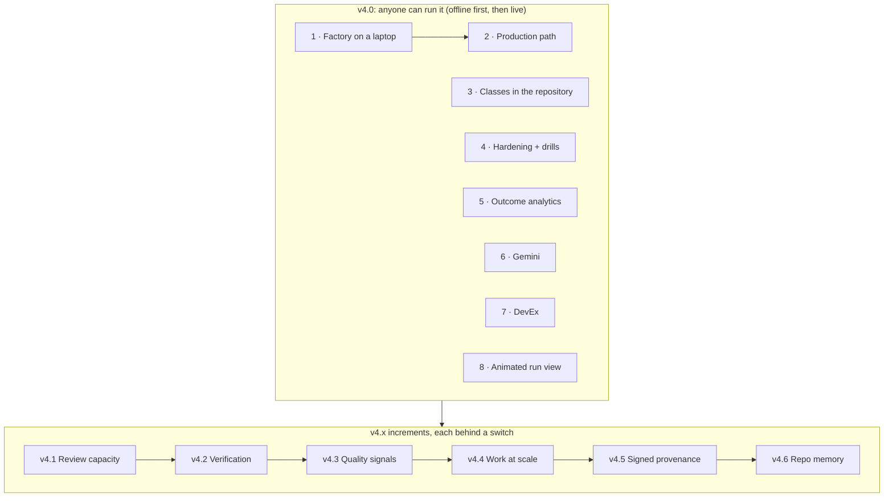

# v4: anyone can run it

**Date:** 2026-10-31 · **Status:** roadmap approved by the owner 2026-10-31 (decisions
[V1 to V6](#owner-decisions-2026-10-31)). Each sub-project gets its own design before it is built ·
**Follows:** the [v3 roadmap](2026-10-19-v3-roadmap-design.md), released as v3.0.0 on 2026-10-31 ·
**Candidates:** issue [#280](https://github.com/Smana/ai-native-ref/issues/280) and the
[v4 landscape research](2026-10-31-v4-landscape-research.md)

## Outcome

v3 made the factory land more accepted pull requests per dollar, on the reference host. v4 makes it
**run for anyone, outside the reference host**:

1. **On a laptop:** a platform engineer runs the whole factory loop on kind in about 30 minutes,
   from the docs alone. The loop is: label an issue, watch the room, get a reviewed pull request,
   see the merge gate decide.
2. **In production:** a platform team installs it on its own cluster and plugs in its own identity
   provider, secrets store, GitOps tool and gateway.

Today neither holds:
- Maku's [kind quickstart](https://github.com/Smana/maku/blob/main/docs/quickstart.md) runs one
  attended run in a room. It has no factory loop, gateway, budgets or short-lived credentials.
- The full platform needs cloud-native-ref's [host contract](../../../HOST-CONTRACT.md).
- v3 deferred "install on any Kubernetes" ([Later](2026-10-19-v3-roadmap-design.md#later)). v4 takes
  it up with the shape v3 sketched: a core profile any cluster can run, with cloud-native-ref as the
  reference profile, the one proven live.

The other capabilities the owner selected follow as v4.x increments, each behind its own switch.

## Owner decisions, 2026-10-31 {#owner-decisions-2026-10-31}

| # | Decision |
|---|---|
| V1 | **v4's outcome is "anyone can run it"**, chosen over "less human time per merge", "from one issue to fleets" and "trust you can prove". It decides priority when items compete |
| V2 | **Both stages, in order.** First the laptop: the full loop on kind in about 30 minutes. Then the production path: an adopter's own cluster, with bring-your-own identity provider, secrets, GitOps and gateway |
| V3 | **v4.0 is a core, the rest v4.x increments.** v4.0 holds the reach items plus what an outside adopter needs on day one: classes declared in their repositories, untrusted-input hardening (their issues come from strangers) and outcome analytics (to see value). Every other pick ships as an increment, each behind its own switch, in dependency order |
| V4 | **The selection.** From #280: customizable merge classes, the animated run view, Gemini, the Kubernetes-from-scratch setup, developer experience. From the research: the items in [the increments](#increments). Not selected: [below](#not-in-v4) |
| V5 | **Repository memory reopens, as reviewed code.** v3 kept memory out and named its reopening: "entries agents propose and humans merge". v4.6 builds exactly that, after the repeat-defect signal of v4.3 exists |
| V6 | **Approving from Slack is in.** v3 kept approval in the rooms web UI ([status](../../../website/content/docs/status.md#later)). #280 item 5, which the owner wrote and selected, reverses it. The DevEx design sets its limits |

## Why these features

**What the field says** ([research](2026-10-31-v4-landscape-research.md)):

| Question | Finding |
|---|---|
| Is self-hosting still a differentiator? | It is narrowing. Cursor, Claude, Amp, Devin (Outposts) and Factory now run on customer machines. What is still ours: class-based autonomous merging with shadow mode, caps and a regression breaker; a test-first tester; model routing by data class at a gateway; an open-source GitOps control plane. Adoption needs these to be reachable outside the reference host |
| Where is the bottleneck for adopters? | Review and verification, not code generation. Agent PRs wait 17.6 h for a first review against 3.4 h, and merge 32.7% of the time against 84.4% (LinearB 2026, 8.1M PRs). Spotify: "PR review is" the bottleneck. These drive v4.1 and v4.2 |
| What do adopters build first? | Sandboxed per-run environments, verification before review, triggers from where work starts, fleet migrations, governed tool access (Spotify, Stripe, Ramp, Uber, Monzo, 2025–2026) |
| What do competitors ship that we lack? | Scheduled and event-triggered tasks (7 products), per-repo environment snapshots, multi-repo tasks, memory (6 products; GitHub reports 90% vs 83% merge rate with Copilot Memory), PR continuation including merge conflicts |
| Where is security heading? | Adaptive injection attacks beat 12 published defences more than 90% of the time ("The Attacker Moves Second", Nov 2025). OWASP's GenAI red-teaming manual (2026-10-20) and the CISA/Five Eyes guidance (2026-05-01) call for regular assessment. gh-aw's safe outputs, threat detection and author-trust filtering are the reference |

## v4.0: the core {#core}

| # | Sub-project | Outcome | Built on | Design lives in |
|---|---|---|---|---|
| 1 | **The factory on a laptop** | The kind quickstart grows from one attended run to the full loop. A sample repository, a GitHub App (or PAT) setup helper, the factory and reviewer on one model key, and the merge gate in shadow by default. A nightly kind job proves it end to end | Maku quickstart and portable runtime (Maku designs 3a/3b) | Maku |
| 2 | **The production path** (#280 item 4) | The host contract split into *required* and *bring-your-own* pieces, each with a reference implementation and a stated seam: identity provider via OIDC, secrets, GitOps, gateway. One proven install on a cluster that is not cloud-native-ref, with a smoke test | [`HOST-CONTRACT.md`](../../../HOST-CONTRACT.md), v3's [install sketch](2026-10-19-v3-roadmap-design.md#later) | ai-native-ref, with Maku |
| 3 | **Merge classes declared in the repository** (#280 item 1) | A class is declared once, in the adopter's repository, against a schema. Maku's gate and the policy-bot rule are generated from it. Presets. Promotion from shadow by replay. The platform sets the ceiling a repository may relax | [merge gate classes](2026-10-22-merge-gate-classes-design.md), the [human path](2026-10-29-merge-gate-human-path-design.md) | Maku |
| 4 | **Untrusted-input hardening** | The agent writes only through validated outputs. Input is filtered by author trust, outputs pass a threat check before they apply, and protected files (CI config, `AGENTS.md`, manifests) stay out of reach. **Injection red-team drills** against every role prove it, run like the merge-gate drills | gh-aw's safe outputs as the reference | Maku |
| 5 | **Outcome analytics** | Merge rate, revert rate, time to merge, rework and cost per merged PR, by class, model, role and repository, on a dashboard and in a weekly report | v3's outcome metrics and spend per identity | Maku, dashboards here |
| 6 | **Gemini** (#280 item 3) | Gemini as a selectable provider, public data only. Added the way Kimi and Mistral were: a gateway backend, a capability profile, a cost check, `loops.<class>.models` | [providers design](2026-10-28-moonshot-mistral-providers-design.md) | ai-native-ref |
| 7 | **Developer experience** (#280 item 5) | Fewer steps from "hand this off" to a running task (CLI, MCP, `factory-handoff` skill). Slack: richer thread status, and the hand-off's one action as a button ([V6](#owner-decisions-2026-10-31)) | [factory from your agent](2026-10-25-factory-from-your-agent-design.md), Slack intake | Maku |
| 8 | **The animated run view** (#280 item 2) | A run's page builds its diagram as each role starts, and replays when finished. It includes a **run timeline** (every tool call, check, decision and cost, from the room log) and a **diff between two runs** of the same task | the room log | Maku |

## v4.x: the increments {#increments}

| Release | Theme | Items | Needs first |
|---|---|---|---|
| v4.1 | Review capacity | A **review inbox and routing**: one queue of agent PRs waiting on a human, across repositories, ranked by risk, class and age, routed to owners, stale ones closed. A **plan approval gate** per class: the scoper's plan waits for a maintainer's ✅ before any code | — |
| v4.2 | Verification | **Pre-PR verification on real services**: ephemeral services, scoped test credentials, a preview, and screenshots for UI changes, before the PR opens. The **PR continuation loop**: the factory drives its own PR to the merge (CI, review comments, rebases, merge conflicts) | — |
| v4.3 | Quality signals | **Judge and reviewer calibration**: false-`met` and false-`approve` rates against recorded outcomes. **Reviewer severity and resolution**: severity tiers, the share of findings fixed, and rules that are rarely acted on muted | 5 |
| v4.4 | Work at scale | **Event triggers and schedules**: main's CI red, security alerts, cron. **Multi-repo tasks**: one task, linked PRs merged in order. **Fleet campaigns**: one change across N repositories, with a progress view | 3; 4, because events carry strangers' text |
| v4.5 | Provable trust | **Signed provenance of agent changes**: an attestation per commit naming its run, model, prompt hash, policy and checks | v3's [run provenance](2026-10-22-run-provenance-design.md) |
| v4.6 | Repository memory as reviewed code | Agents propose what they learned as small PRs to `AGENTS.md` or skills files, reviewed like code. No hidden state ([V5](#owner-decisions-2026-10-31)) | 4 (the write path), v4.3 (the repeat-defect signal) |

## Order of work {#order-of-work}

- **Within v4.0:**
  - 1 comes before 2: the laptop loop is the core profile that the production path extends.
  - 3, 4 and 5 run beside 1, because the laptop loop shows all three.
  - 6, 7 and 8 are independent of each other.
- **Across releases:** the arrows give the default order. A release may move earlier only when what it needs has shipped (the table's last column).
- **As in v3:** offline proofs first, then live sessions in batches, then a go/no-go per item on live evidence.

## How v4 is judged

| Item | Go when |
|---|---|
| v4.0 laptop (1) | A nightly kind job takes a labelled issue to a reviewed PR and a gate decision. A fresh agent with no context, given only the quickstart page, reaches the same end. The quickstart takes 30 minutes or less on the reference laptop |
| v4.0 production (2) | One install on a cluster that is not cloud-native-ref passes the smoke test from the docs alone. Each bring-your-own seam is named, with what is lost when it is not filled |
| Every other item | Its own design's go/no-go, on offline proofs and then live evidence |

The outcome metrics of v3 ([How v3 is judged](2026-10-19-v3-roadmap-design.md#how-v3-is-judged))
stay. v4.0's analytics (5) report them.

## Not in v4 {#not-in-v4}

**Considered in the research and not selected (2026-10-31):**
- audit export and compliance evidence;
- pre-call budget reservation;
- SLO-driven auto-revert;
- best-of-N attempts;
- playbooks;
- repository-declared environments;
- multi-team tenancy;
- a release-gating regression eval;
- a rule for new dependencies and sources;
- an egress denial view;
- Jira and Linear intake;
- the warm pool.

**Still out, for v3's reasons** ([Not in v3](2026-10-19-v3-roadmap-design.md#not-in-v3)):
- public work on Claude;
- a doc-writer agent;
- a standalone architect agent;
- parallel writers on one branch;
- per-step model switching.

## Maintenance the research found

These are not features. Each one is a small change of its own:

| Finding | Action |
|---|---|
| The [alternatives page](../../../website/content/docs/how-it-works/alternatives.md) is stale on Substrate (per-agent JWT closed 2026-10-22; v1.0.0-rc.1 adds micro-VMs, moves to DCO), kagent (v1.0.0-rc1: owned-resource RBAC) and ax (a Claude Code example; #376 and #363 still open) | Re-check and update the rows |
| agent-sandbox is pinned at v1.0.5; v1.0.9 is current, and v1.0.7 adds warm members behind Kueue gates | Bump, with its release notes read |
| SWE-bench Verified is retired (OpenAI, 2026-02-23) | The [eval bench design](2026-10-22-eval-bench-design.md) names SWE-bench Pro, SWE-rebench or Terminal-Bench 2.0 as its public anchor |
| Daytona went private (June 2026); Google's Jules closes on 2026-12-31 | Remove them where the docs cite them as options |

## Open questions

These are for the sub-project designs, not this roadmap:

1. **The laptop gate (1):** does it need policy-bot, or does a built-in check stand in until the production path?
2. **Laptop credentials (1):** a GitHub App setup helper, or a fine-grained PAT, as the quickstart uses today?
3. **The production proof (2):** which cluster? A managed cluster from another cloud (AKS), or a generic one (k3s or kubeadm)?
4. **Environments (v4.2):** does pre-PR verification on real services need the repository-declared environments that were not selected? Decided in v4.2's design.
5. **Slack approval (7):** which approvals may happen from Slack, bound to which commit, and with what audit, so it keeps approve-to-merge's binding to the reviewed head?
